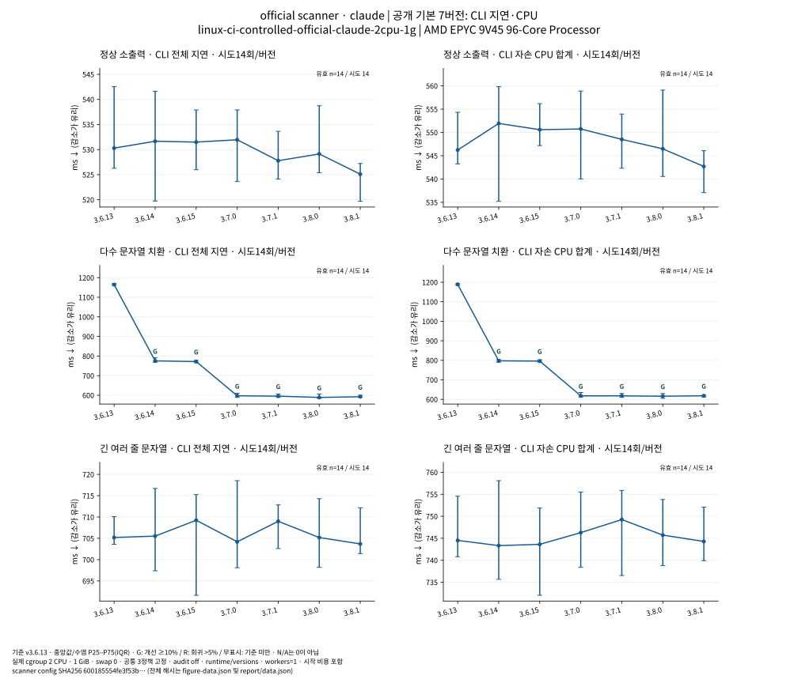
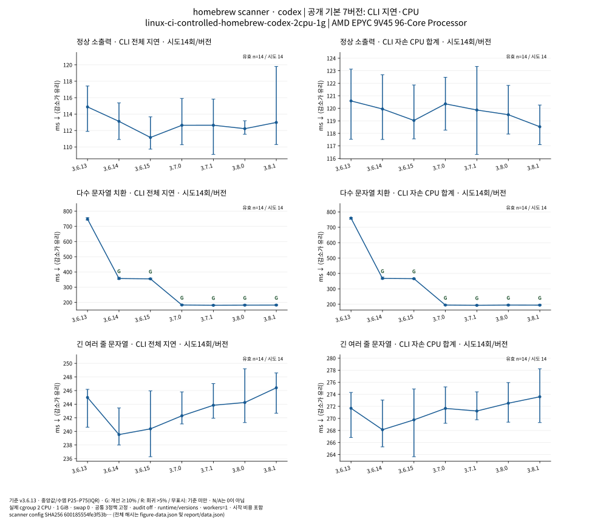
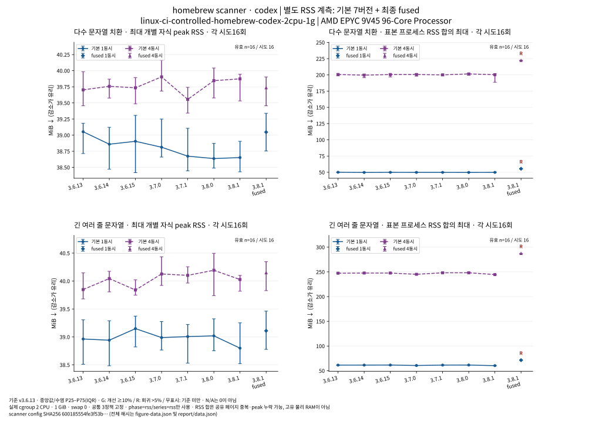
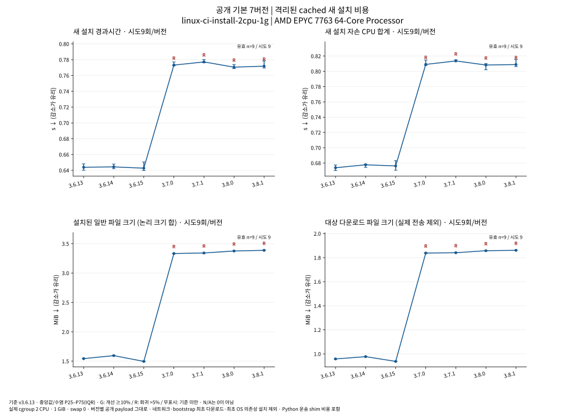

# Agent Guard 공개 버전 실측 비교

[독립형 HTML](report.ko.html) · [모든 집계 CSV](aggregates.csv) · [원시 JSON](data.json) · [재현 도구](generate.py)

## ① 한눈에 보는 결론

- 다수 문자열 치환의 기본 경로 누적 변화(4,100개 문자열 중 100개 치환, 구성별 n=14): official·claude: 지연 -49.14%, CPU -48.05%; homebrew·codex: 지연 -75.54%, CPU -74.33%. 환경별 결과이며 서로 평균 내지 않았다. [원시 근거](../analysis/runtime.json)
- Homebrew·Codex의 같은 입력에서 fused를 켜면 기본 경로보다 지연 -15.31%, CPU -13.68%다. 이 조건의 정상 소출력·긴 문자열은 기본 경로에서 10% 개선 기준에 못 미쳤다. [원시 근거](../analysis/runtime.json)
- 메모리 교환관계: 같은 비교군의 별도 4동시 RSS 계측에서 다수 문자열의 표본 RSS 합 최대 중앙값은 200.29→222.27 MiB(+10.98%, 각 n=16)였다. 공유 페이지가 중복될 수 있어 고유 물리 메모리 사용량과 구분한다. [원시 근거](../analysis/runtime.json)
- 설치 비용은 증가했다. 공개 archive는 +94.25%, payload 파일 합은 +119.43%다. 별도 2 CPU·1 GiB 설치군의 네트워크 제외 새 설치 시간은 +19.87%, CPU는 +20.04%(각 n=9)다. 네트워크 포함 경로와 기존 Homebrew 사용자의 비용은 별도 환경에서 직접 측정했다. [원시 근거](../analysis/installation.json)
- 선택한 32개 CLI 사례×두 host에서 v3.8.1은 각 scanner·설정군 64/64를 통과했다. 이 CI 사례에서는 메시지 본문 오탐 감소와 env/set 탐지 누락 수정을 확인했다. 별도 로컬 4 CPU·16 GiB·jq1.6 보조 검사 42건에서는 printenv 인자의 과도한 마스킹 감소를 확인했다. 이미 마스킹된 토큰의 오탐은 v3.8.1에도 남았고, 새 lifecycle event·macOS·ARM·실제 host 앱 전체 동작은 미검증이다. [원시 근거](../correctness/ci-findings.ko.md) · [로컬 jq1.6 보조 근거](../correctness/local-summary.json)

### 조건별 실측 숫자

- official scanner·claude·audit off의 정상 소출력: 기본 경로 지연 544.44→544.61 ms(+0.03%), CPU 562.49→564.35 ms(+0.33%). v3.8.1에서 fused를 추가하면 지연 522.34 ms(동일 버전 기본 대비 -4.09%, 최초 대비 직접 -4.06%), CPU 541.92 ms(기본 대비 -3.97%). 각 arm n=14; IQR과 모든 표본은 조건별 표에 있다. [원시 근거](../analysis/runtime.json)
- official scanner·claude·audit off의 다수 문자열(4,100개 leaf 중 100개 치환): 기본 경로 지연 1202.61→611.71 ms(-49.14%), CPU 1230.65→639.36 ms(-48.05%). v3.8.1에서 fused를 추가하면 지연 585.87 ms(동일 버전 기본 대비 -4.22%, 최초 대비 직접 -51.28%), CPU 606.65 ms(기본 대비 -5.12%). 각 arm n=14; IQR과 모든 표본은 조건별 표에 있다. [원시 근거](../analysis/runtime.json)
- official scanner·claude·audit off의 긴 여러 줄 문자열(약 260 KB): 기본 경로 지연 685.15→687.90 ms(+0.40%), CPU 724.36→728.42 ms(+0.56%). v3.8.1에서 fused를 추가하면 지연 676.63 ms(동일 버전 기본 대비 -1.64%, 최초 대비 직접 -1.24%), CPU 716.64 ms(기본 대비 -1.62%). 각 arm n=14; IQR과 모든 표본은 조건별 표에 있다. [원시 근거](../analysis/runtime.json)
- homebrew scanner·codex·audit off의 정상 소출력: 기본 경로 지연 112.19→110.99 ms(-1.07%), CPU 118.24→118.43 ms(+0.16%). v3.8.1에서 fused를 추가하면 지연 97.23 ms(동일 버전 기본 대비 -12.40%, 최초 대비 직접 -13.34%), CPU 104.40 ms(기본 대비 -11.85%). 각 arm n=14; IQR과 모든 표본은 조건별 표에 있다. [원시 근거](../analysis/runtime.json)
- homebrew scanner·codex·audit off의 다수 문자열(4,100개 leaf 중 100개 치환): 기본 경로 지연 753.23→184.25 ms(-75.54%), CPU 762.38→195.70 ms(-74.33%). v3.8.1에서 fused를 추가하면 지연 156.04 ms(동일 버전 기본 대비 -15.31%, 최초 대비 직접 -79.28%), CPU 168.92 ms(기본 대비 -13.68%). 각 arm n=14; IQR과 모든 표본은 조건별 표에 있다. [원시 근거](../analysis/runtime.json)
- homebrew scanner·codex·audit off의 긴 여러 줄 문자열(약 260 KB): 기본 경로 지연 240.23→243.54 ms(+1.38%), CPU 267.70→271.36 ms(+1.36%). v3.8.1에서 fused를 추가하면 지연 228.61 ms(동일 버전 기본 대비 -6.13%, 최초 대비 직접 -4.84%), CPU 255.92 ms(기본 대비 -5.69%). 각 arm n=14; IQR과 모든 표본은 조건별 표에 있다. [원시 근거](../analysis/runtime.json)
- 별도 RSS 계측의 official·claude·긴 여러 줄·4동시: v3.8.1 기본→fused의 표본 RSS 합 최대 중앙값 341.26→384.47 MiB(+12.66%, 각 n=16). 고유 물리 메모리가 아니며, 이 계측의 지연·CPU는 본 성능표에 넣지 않았다. [원시 근거](../analysis/runtime.json)
- 별도 RSS 계측의 homebrew·codex·긴 여러 줄·4동시: v3.8.1 기본→fused의 표본 RSS 합 최대 중앙값 244.57→287.26 MiB(+17.46%, 각 n=16). 고유 물리 메모리가 아니며, 이 계측의 지연·CPU는 본 성능표에 넣지 않았다. [원시 근거](../analysis/runtime.json)
- 소스 Git 플러그인의 homebrew·codex·다수 문자열: 기본 shell/jq 경로만으로도 775.69→369.67 ms(-52.34%)였다. 별도 공개 native를 지정한 fused는 154.72 ms지만 추가 독립 설치가 필요한 별도 구성이다. 각 arm n=14. 독립 배포본 기본 결과와 합치지 않는다. [원시 근거](../analysis/runtime.json)
- 배포 archive는 1,004,568→1,951,346 B(+94.25%), 순수 payload 파일 합은 1,618,542→3,551,636 B(+119.43%). 기본 Rust helper가 포함되는 v3.7 이후 설치 증가를 런타임 속도 이득과 분리한다. [원시 근거](../evidence/releases/release-summary.json)
- 주 제한 환경, 다운로드 제외·Python 운송 shim 포함 신규 설치: 지연 0.643892→0.771857 s(+19.87%), CPU 0.673845→0.808911 s(+20.04%), 각 n=9. 초기 bootstrap 스크립트 다운로드와 OS 의존성 최초 설치는 제외한다. 환경이나 운송 방식이 다른 두 결과를 합산하지 않는다. [원시 근거](../analysis/installation.json)
- 실제 4 CPU·16 GiB 보조 환경의 네트워크 포함 신규 설치: 지연 1.208892→1.600462 s(+32.39%), CPU 0.905034→1.113484 s(+23.03%), 각 n=9. 초기 bootstrap 스크립트 다운로드와 OS 의존성 최초 설치는 제외한다. 환경이나 운송 방식이 다른 두 결과를 합산하지 않는다. [원시 근거](../analysis/installation.json)
- 기존 Homebrew 사용자·로컬 Debian13 실제4CPU/16GiB·cached package-only 신규 설치: 7.33408→7.36799 s(+0.46%), CPU 8.13813→8.62528 s(+5.99%), 각 n=9. CPU는 >5% 회귀로 표시하지만 산포와 미검증 원인을 함께 본다. 최초 Brew/의존성/네트워크 비용은 이 값에 포함되지 않는다. [원시 근거](../analysis/installation.json)
- 정확도는 32개 고정 CLI 사례×두 host에서 각 scanner·설정 cohort별 v3.6.13 52/64, v3.6.14 52/64, v3.6.15~v3.8.0 54/64, v3.8.1 64/64가 기대값과 일치했다. 메시지 본문 오탐과 env/set 치환 탐지 누락이 v3.8.1에서 해소된 사례다. 이는 선택한 합성 사례의 검사 통과 수이며 실사용 오탐률이 아니다. [원시 근거](../correctness/ci-summary.json)
- 완전히 마스킹된 토큰을 사용자 프롬프트에 넣었을 때의 오탐은 일곱 공개 버전 모두 남아 있었다. 부분 마스킹 뒤 실제 형태가 남은 양성 대조군은 차단했다. 최신 main의 후속 #416 수정은 이 비교에 섞지 않았다. [원시 근거](../correctness/local-summary.json)

“기본 경로”는 공개 배포본의 redactor·pipeline 선택 기본값입니다. scanner·설정·audit·release check 등은 비교를 위해 통제하며, 모든 자연 기본 설정을 그대로 실행했다는 뜻이 아닙니다. 지연은 hook callback CLI 시작을 포함하고 Claude/Codex 호스트 앱 자체의 지연은 아닙니다.

### 사용 권고

- 입력이 여러 문자열 leaf에 걸친 다수 치환이라면 기본 경로의 직접 비교를 먼저 확인한다. 정상 소출력·긴 문자열·제어 문자·unknown tool·실패 복귀의 변화는 별도 행으로 판단한다. 모든 입력의 개선율을 평균 내어 하나의 전체 성과로 제시하지 않는다. [기본/직접 비교](../analysis/runtime.json)
- v3.7 이상 독립 배포본과 Homebrew package에는 공개 Rust helper가 기본 포함되고 사용자 컴파일러가 필요하지 않다. 소스만 있는 Git 플러그인은 기본 shell/jq를 계속 쓴다. Git 플러그인에 같은 공개 helper를 추가하려면 별도 독립 설치 전체 비용과 명시 설정을 고려한다. [설치·배포 경로](../installation/summary.json)
- fused는 v3.8.0/1에서만 별도로 검증했다. AGENT_GUARD_EXPERIMENTAL_OUTPUT_PIPELINE=fused와 검증한 공개 core의 절대 경로 AGENT_GUARD_EXPERIMENTAL_OUTPUT_PREPARE_BIN을 함께 지정한다. 소스 플러그인에는 동일 파일의 AGENT_GUARD_RUST_CORE_BIN도 지정한다. 입력별 추가 속도와 표본 RSS 합 증가를 함께 보고 선택한다. [활성화·공개 파일 해시](../evidence/releases/paths-and-changes.json)
- 공통 기준 정책은 실험 재현용이다. 실사용에서는 새 배송 정책의 보안·오탐 수정과 사용자 지정 정책을 함께 검토한다. 공개 native 단일 파일을 수동 설치하고 명시 경로로 설정하는 선택지도 있지만, 그 최소 설치 경로의 시간·CPU는 측정하지 않았다. 소스 플러그인에 추가하는 비용은 여기서 직접 검증한 전체 독립 설치와 구분한다. [공개 native 자산](../evidence/releases/manifest.json)
- 업데이트 전 정책은 AGENT_GUARD_GITLEAKS_CONFIG로 지정한 외부 파일에 유지한다. 기존 rc 내용과 외부 정책은 보존됐지만 배포 payload/config/gitleaks.toml 직접 수정은 새 공개 기본 정책으로 덮어써졌다. [설정 보존 원시 대조](../installation/config-preservation.json)

지연·CPU·메모리는 감소가 유리하고 처리량은 증가가 유리합니다. 변화율은 `(현재 / 비교 기준 − 1) × 100`이며, 개선 ≥10%와 회귀 >5%를 미리 고정한 기준으로 표시합니다. 산포는 P25–P75(IQR), n은 유효 표본 수입니다. 실패·작업량 불일치 표본은 원시 자료에 보존하고 같은 작업 성능 집계에서 제외합니다. 검증 표본 9개 또는 같은 round 유효쌍 9쌍 미만이면 중앙값·IQR·n만 유지하고 변화율·개선/회귀 판정은 N/A입니다. optional 버전간 직전 비교는 동일 VM의 별도 버전 블록 중앙값 비율이며 버전간 교대 재확인이 아닙니다.

## ② 버전별 변화

| 공개 버전 | 관련 변경 |
|---|---|
| v3.6.13 | 최초 기준. 셸 최적화·Rust 전환 이전의 공개 기본 셸/jq 경로. 관련 변경의 존재는 확인했다. 아래 시점별 수치와의 인과 기여분을 독립적으로 분해했다는 뜻은 아니다. |
| v3.6.14 | 중복 jq·문자열 분할·watchdog 프로세스 정리. jq 1.6 정상 문자열 과잉 마스킹 수정, 단일 문자열 스크립트 경로 오탐 감소. 선택형 Rust 소스 추가, 공개 native 바이너리는 없음. 관련 변경의 존재는 확인했다. 아래 시점별 수치와의 인과 기여분을 독립적으로 분해했다는 뜻은 아니다. |
| v3.6.15 | 정확한 snapshotToken/snapshot_token 키와 d<n>: 값의 조합에만 면제하여 문서 draft token 과잉 마스킹 수정. 기본 실행은 셸. 관련 변경의 존재는 확인했다. 아래 시점별 수치와의 인과 기여분을 독립적으로 분해했다는 뜻은 아니다. |
| v3.7.0 | 공개 tar·Homebrew에 네 플랫폼 Rust literal 치환기를 기본 제공. 탐지·정책·PII·어댑터는 셸 유지. exec printenv 입력 끝 NUL 오인에 따른 과잉 마스킹 수정, 업데이트 트랜잭션·복구 보강. 관련 변경의 존재는 확인했다. 아래 시점별 수치와의 인과 기여분을 독립적으로 분해했다는 뜻은 아니다. |
| v3.7.1 | 깊은 JSON 직렬화 손상 시 보존된 원본에서 구조 복구, scanner 준비 실패 원인 코드. 별도 scanner 최적화 실험은 기본 릴리스에 채택되지 않음. 관련 변경의 존재는 확인했다. 아래 시점별 수치와의 인과 기여분을 독립적으로 분해했다는 뜻은 아니다. |
| v3.8.0 | 기본 문자열 framing의 연속 구간 처리, 절대 실행 경로 해석의 자식 프로세스 감소, 숫자 fallback 비용 감소, 종료 scanner readiness 경합 수정. 선택형 fused 출력 통합과 prepare-v1 추가. 관련 변경의 존재는 확인했다. 아래 시점별 수치와의 인과 기여분을 독립적으로 분해했다는 뜻은 아니다. |
| v3.8.1 | 메시지 본문의 secret-like 오탐을 줄이고 set·$(env) 환경 출력 탐지 구멍 수정(#405). 이 설명은 소스 변경 사실이며 실제 이득/회귀의 크기는 새 실측으로만 판단. 관련 변경의 존재는 확인했다. 아래 시점별 수치와의 인과 기여분을 독립적으로 분해했다는 뜻은 아니다. |

변경 설명만으로 성능 인과관계가 입증되지는 않습니다. 원인 분리 계측이 없는 설명은 추정입니다.

## ③ 최초 버전 대비 누적 변화

기준은 각 동일 조건의 v3.6.13 실측 중앙값입니다. 직전 비교는 직전 공개 버전의 같은 조건에만 연결합니다. 중간 버전이 N/A이면 건너뛰어 개선율을 계산하지 않습니다. A(기본↔기본), B(v3.8.1 기본↔fused), C(v3.6.13 기본↔v3.8.1 fused)는 분리합니다. v3.6.13↔v3.8.1 직접 교대 실험은 `series=direct`로 유지합니다.

## ④ 표와 그래프

그래프는 [HTML](report.ko.html)에서 동일 조건을 선택해 볼 수 있습니다. 표의 모든 값과 변화율은 [집계 CSV](aggregates.csv)에 있습니다. 전체 CLI 표본의 지연·CPU와 별도의 RSS 표본 실험은 합치지 않습니다.

### 대표 정적 그림









### 동봉 그림 전체

- [official·claude — 기본 7버전 CLI 지연·CPU](figures/official-claude-latency-cpu.svg)
- [official·claude — 단일·4동시 처리량](figures/official-claude-throughput.svg)
- [official·claude — 최대 개별 자식 RSS·표본 RSS 합](figures/official-claude-memory.svg)
- [official·codex — 기본 7버전 CLI 지연·CPU](figures/official-codex-latency-cpu.svg)
- [official·codex — 단일·4동시 처리량](figures/official-codex-throughput.svg)
- [official·codex — 최대 개별 자식 RSS·표본 RSS 합](figures/official-codex-memory.svg)
- [homebrew·claude — 기본 7버전 CLI 지연·CPU](figures/homebrew-claude-latency-cpu.svg)
- [homebrew·claude — 단일·4동시 처리량](figures/homebrew-claude-throughput.svg)
- [homebrew·claude — 최대 개별 자식 RSS·표본 RSS 합](figures/homebrew-claude-memory.svg)
- [homebrew·codex — 기본 7버전 CLI 지연·CPU](figures/homebrew-codex-latency-cpu.svg)
- [homebrew·codex — 단일·4동시 처리량](figures/homebrew-codex-throughput.svg)
- [homebrew·codex — 최대 개별 자식 RSS·표본 RSS 합](figures/homebrew-codex-memory.svg)
- [제한 환경의 cached 신규 설치 비용 — 네트워크 제외](figures/installation-ci-cached-fresh.svg)

### phase=rss / series=rss / environment=linux-ci-controlled-homebrew-claude-2cpu-1g / distribution=standalone / scanner=homebrew / host=claude / audit=off / case=long-multiline / variant=default / workers=1 / 지표=최대 개별 자식 RSS

**최대 개별 자식 RSS (KiB; 감소가 유리)**

| 버전 | 중앙값 | P25–P75 | n | 직전 공개 버전 대비 | v3.6.13 대비 | 같은 버전 기본 대비(fused) | v3.6.13 기본 대비(C) | 누적 판정(A·C) |
|---|---:|---:|---:|---:|---:|---:|---:|---|
| v3.6.13 | 40,030.000 | 39,782.000–40,124.000 | 16 | N/A | +0.00% | N/A | N/A | 기준 미만 |
| v3.6.14 | 39,800.000 | 39,475.000–40,069.000 | 16 | -0.57% | -0.57% | N/A | N/A | 기준 미만 |
| v3.6.15 | 39,980.000 | 39,433.000–40,205.000 | 16 | +0.45% | -0.12% | N/A | N/A | 기준 미만 |
| v3.7.0 | 39,752.000 | 39,519.000–40,057.000 | 16 | -0.57% | -0.69% | N/A | N/A | 기준 미만 |
| v3.7.1 | 39,672.000 | 39,410.000–40,200.000 | 16 | -0.20% | -0.89% | N/A | N/A | 기준 미만 |
| v3.8.0 | 40,080.000 | 39,604.000–40,526.000 | 16 | +1.03% | +0.12% | N/A | N/A | 기준 미만 |
| v3.8.1 | 39,824.000 | 39,601.000–40,230.000 | 16 | -0.64% | -0.51% | N/A | N/A | 기준 미만 |

### phase=rss / series=rss / environment=linux-ci-controlled-homebrew-claude-2cpu-1g / distribution=standalone / scanner=homebrew / host=claude / audit=off / case=long-multiline / variant=default / workers=1 / 지표=표본 프로세스 RSS 합의 최대

**표본 프로세스 RSS 합의 최대 (KiB; 감소가 유리)**

| 버전 | 중앙값 | P25–P75 | n | 직전 공개 버전 대비 | v3.6.13 대비 | 같은 버전 기본 대비(fused) | v3.6.13 기본 대비(C) | 누적 판정(A·C) |
|---|---:|---:|---:|---:|---:|---:|---:|---|
| v3.6.13 | 62,956.000 | 62,743.000–63,183.000 | 16 | N/A | +0.00% | N/A | N/A | 기준 미만 |
| v3.6.14 | 62,762.000 | 62,403.000–62,978.000 | 16 | -0.31% | -0.31% | N/A | N/A | 기준 미만 |
| v3.6.15 | 62,942.000 | 62,538.000–63,287.000 | 16 | +0.29% | -0.02% | N/A | N/A | 기준 미만 |
| v3.7.0 | 61,950.000 | 61,820.000–62,328.000 | 16 | -1.58% | -1.60% | N/A | N/A | 기준 미만 |
| v3.7.1 | 62,672.000 | 62,464.000–63,169.000 | 16 | +1.17% | -0.45% | N/A | N/A | 기준 미만 |
| v3.8.0 | 63,248.000 | 62,888.000–63,591.000 | 16 | +0.92% | +0.46% | N/A | N/A | 기준 미만 |
| v3.8.1 | 62,056.000 | 61,742.000–62,250.000 | 16 | -1.88% | -1.43% | N/A | N/A | 기준 미만 |

### phase=rss / series=rss / environment=linux-ci-controlled-homebrew-claude-2cpu-1g / distribution=standalone / scanner=homebrew / host=claude / audit=off / case=long-multiline / variant=default / workers=4 / 지표=최대 개별 자식 RSS

**최대 개별 자식 RSS (KiB; 감소가 유리)**

| 버전 | 중앙값 | P25–P75 | n | 직전 공개 버전 대비 | v3.6.13 대비 | 같은 버전 기본 대비(fused) | v3.6.13 기본 대비(C) | 누적 판정(A·C) |
|---|---:|---:|---:|---:|---:|---:|---:|---|
| v3.6.13 | 41,036.000 | 40,925.000–41,224.000 | 16 | N/A | +0.00% | N/A | N/A | 기준 미만 |
| v3.6.14 | 40,958.000 | 40,823.000–41,083.000 | 16 | -0.19% | -0.19% | N/A | N/A | 기준 미만 |
| v3.6.15 | 40,958.000 | 40,728.000–41,105.000 | 16 | +0.00% | -0.19% | N/A | N/A | 기준 미만 |
| v3.7.0 | 40,966.000 | 40,924.000–41,071.000 | 16 | +0.02% | -0.17% | N/A | N/A | 기준 미만 |
| v3.7.1 | 40,844.000 | 40,644.000–41,103.000 | 16 | -0.30% | -0.47% | N/A | N/A | 기준 미만 |
| v3.8.0 | 40,996.000 | 40,611.000–41,185.000 | 16 | +0.37% | -0.10% | N/A | N/A | 기준 미만 |
| v3.8.1 | 41,024.000 | 40,810.000–41,241.000 | 16 | +0.07% | -0.03% | N/A | N/A | 기준 미만 |

### phase=rss / series=rss / environment=linux-ci-controlled-homebrew-claude-2cpu-1g / distribution=standalone / scanner=homebrew / host=claude / audit=off / case=long-multiline / variant=default / workers=4 / 지표=표본 프로세스 RSS 합의 최대

**표본 프로세스 RSS 합의 최대 (KiB; 감소가 유리)**

| 버전 | 중앙값 | P25–P75 | n | 직전 공개 버전 대비 | v3.6.13 대비 | 같은 버전 기본 대비(fused) | v3.6.13 기본 대비(C) | 누적 판정(A·C) |
|---|---:|---:|---:|---:|---:|---:|---:|---|
| v3.6.13 | 253,848.000 | 253,379.000–254,363.000 | 16 | N/A | +0.00% | N/A | N/A | 기준 미만 |
| v3.6.14 | 253,762.000 | 253,386.000–254,151.000 | 16 | -0.03% | -0.03% | N/A | N/A | 기준 미만 |
| v3.6.15 | 254,124.000 | 253,581.000–254,409.000 | 16 | +0.14% | +0.11% | N/A | N/A | 기준 미만 |
| v3.7.0 | 250,806.000 | 250,063.000–250,997.000 | 16 | -1.31% | -1.20% | N/A | N/A | 기준 미만 |
| v3.7.1 | 253,696.000 | 253,157.000–254,484.000 | 16 | +1.15% | -0.06% | N/A | N/A | 기준 미만 |
| v3.8.0 | 254,844.000 | 254,231.000–255,148.000 | 16 | +0.45% | +0.39% | N/A | N/A | 기준 미만 |
| v3.8.1 | 250,848.000 | 250,199.000–251,256.000 | 16 | -1.57% | -1.18% | N/A | N/A | 기준 미만 |

### phase=rss / series=rss / environment=linux-ci-controlled-homebrew-claude-2cpu-1g / distribution=standalone / scanner=homebrew / host=claude / audit=off / case=long-multiline / variant=fused / workers=1 / 지표=최대 개별 자식 RSS

**최대 개별 자식 RSS (KiB; 감소가 유리)**

| 버전 | 중앙값 | P25–P75 | n | 직전 공개 버전 대비 | v3.6.13 대비 | 같은 버전 기본 대비(fused) | v3.6.13 기본 대비(C) | 누적 판정(A·C) |
|---|---:|---:|---:|---:|---:|---:|---:|---|
| v3.6.13 | N/A | N/A | N/A | N/A | N/A | N/A | N/A | 이 공개 버전은 선택형 출력 통합(fused)을 지원하지 않습니다. 공개 지원은 v3.8.0부터입니다. |
| v3.6.14 | N/A | N/A | N/A | N/A | N/A | N/A | N/A | 이 공개 버전은 선택형 출력 통합(fused)을 지원하지 않습니다. 공개 지원은 v3.8.0부터입니다. |
| v3.6.15 | N/A | N/A | N/A | N/A | N/A | N/A | N/A | 이 공개 버전은 선택형 출력 통합(fused)을 지원하지 않습니다. 공개 지원은 v3.8.0부터입니다. |
| v3.7.0 | N/A | N/A | N/A | N/A | N/A | N/A | N/A | 이 공개 버전은 선택형 출력 통합(fused)을 지원하지 않습니다. 공개 지원은 v3.8.0부터입니다. |
| v3.7.1 | N/A | N/A | N/A | N/A | N/A | N/A | N/A | 이 공개 버전은 선택형 출력 통합(fused)을 지원하지 않습니다. 공개 지원은 v3.8.0부터입니다. |
| v3.8.0 | N/A | N/A | N/A | N/A | N/A | N/A | N/A | 4동시 처리량·별도 RSS의 fused는 v3.8.1만 측정했습니다. v3.8.0 기능 지원을 해당 항목의 실측으로 대신하지 않습니다. |
| v3.8.1 | 39,934.000 | 39,559.000–40,197.000 | 16 | N/A | N/A | +0.28% | -0.24% | 기준 미만 |

### phase=rss / series=rss / environment=linux-ci-controlled-homebrew-claude-2cpu-1g / distribution=standalone / scanner=homebrew / host=claude / audit=off / case=long-multiline / variant=fused / workers=1 / 지표=표본 프로세스 RSS 합의 최대

**표본 프로세스 RSS 합의 최대 (KiB; 감소가 유리)**

| 버전 | 중앙값 | P25–P75 | n | 직전 공개 버전 대비 | v3.6.13 대비 | 같은 버전 기본 대비(fused) | v3.6.13 기본 대비(C) | 누적 판정(A·C) |
|---|---:|---:|---:|---:|---:|---:|---:|---|
| v3.6.13 | N/A | N/A | N/A | N/A | N/A | N/A | N/A | 이 공개 버전은 선택형 출력 통합(fused)을 지원하지 않습니다. 공개 지원은 v3.8.0부터입니다. |
| v3.6.14 | N/A | N/A | N/A | N/A | N/A | N/A | N/A | 이 공개 버전은 선택형 출력 통합(fused)을 지원하지 않습니다. 공개 지원은 v3.8.0부터입니다. |
| v3.6.15 | N/A | N/A | N/A | N/A | N/A | N/A | N/A | 이 공개 버전은 선택형 출력 통합(fused)을 지원하지 않습니다. 공개 지원은 v3.8.0부터입니다. |
| v3.7.0 | N/A | N/A | N/A | N/A | N/A | N/A | N/A | 이 공개 버전은 선택형 출력 통합(fused)을 지원하지 않습니다. 공개 지원은 v3.8.0부터입니다. |
| v3.7.1 | N/A | N/A | N/A | N/A | N/A | N/A | N/A | 이 공개 버전은 선택형 출력 통합(fused)을 지원하지 않습니다. 공개 지원은 v3.8.0부터입니다. |
| v3.8.0 | N/A | N/A | N/A | N/A | N/A | N/A | N/A | 4동시 처리량·별도 RSS의 fused는 v3.8.1만 측정했습니다. v3.8.0 기능 지원을 해당 항목의 실측으로 대신하지 않습니다. |
| v3.8.1 | 73,054.000 | 72,745.000–73,362.000 | 16 | N/A | N/A | +17.72% | +16.04% | 회귀 >5% |

### phase=rss / series=rss / environment=linux-ci-controlled-homebrew-claude-2cpu-1g / distribution=standalone / scanner=homebrew / host=claude / audit=off / case=long-multiline / variant=fused / workers=4 / 지표=최대 개별 자식 RSS

**최대 개별 자식 RSS (KiB; 감소가 유리)**

| 버전 | 중앙값 | P25–P75 | n | 직전 공개 버전 대비 | v3.6.13 대비 | 같은 버전 기본 대비(fused) | v3.6.13 기본 대비(C) | 누적 판정(A·C) |
|---|---:|---:|---:|---:|---:|---:|---:|---|
| v3.6.13 | N/A | N/A | N/A | N/A | N/A | N/A | N/A | 이 공개 버전은 선택형 출력 통합(fused)을 지원하지 않습니다. 공개 지원은 v3.8.0부터입니다. |
| v3.6.14 | N/A | N/A | N/A | N/A | N/A | N/A | N/A | 이 공개 버전은 선택형 출력 통합(fused)을 지원하지 않습니다. 공개 지원은 v3.8.0부터입니다. |
| v3.6.15 | N/A | N/A | N/A | N/A | N/A | N/A | N/A | 이 공개 버전은 선택형 출력 통합(fused)을 지원하지 않습니다. 공개 지원은 v3.8.0부터입니다. |
| v3.7.0 | N/A | N/A | N/A | N/A | N/A | N/A | N/A | 이 공개 버전은 선택형 출력 통합(fused)을 지원하지 않습니다. 공개 지원은 v3.8.0부터입니다. |
| v3.7.1 | N/A | N/A | N/A | N/A | N/A | N/A | N/A | 이 공개 버전은 선택형 출력 통합(fused)을 지원하지 않습니다. 공개 지원은 v3.8.0부터입니다. |
| v3.8.0 | N/A | N/A | N/A | N/A | N/A | N/A | N/A | 4동시 처리량·별도 RSS의 fused는 v3.8.1만 측정했습니다. v3.8.0 기능 지원을 해당 항목의 실측으로 대신하지 않습니다. |
| v3.8.1 | 41,092.000 | 40,908.000–41,366.000 | 16 | N/A | N/A | +0.17% | +0.14% | 기준 미만 |

### phase=rss / series=rss / environment=linux-ci-controlled-homebrew-claude-2cpu-1g / distribution=standalone / scanner=homebrew / host=claude / audit=off / case=long-multiline / variant=fused / workers=4 / 지표=표본 프로세스 RSS 합의 최대

**표본 프로세스 RSS 합의 최대 (KiB; 감소가 유리)**

| 버전 | 중앙값 | P25–P75 | n | 직전 공개 버전 대비 | v3.6.13 대비 | 같은 버전 기본 대비(fused) | v3.6.13 기본 대비(C) | 누적 판정(A·C) |
|---|---:|---:|---:|---:|---:|---:|---:|---|
| v3.6.13 | N/A | N/A | N/A | N/A | N/A | N/A | N/A | 이 공개 버전은 선택형 출력 통합(fused)을 지원하지 않습니다. 공개 지원은 v3.8.0부터입니다. |
| v3.6.14 | N/A | N/A | N/A | N/A | N/A | N/A | N/A | 이 공개 버전은 선택형 출력 통합(fused)을 지원하지 않습니다. 공개 지원은 v3.8.0부터입니다. |
| v3.6.15 | N/A | N/A | N/A | N/A | N/A | N/A | N/A | 이 공개 버전은 선택형 출력 통합(fused)을 지원하지 않습니다. 공개 지원은 v3.8.0부터입니다. |
| v3.7.0 | N/A | N/A | N/A | N/A | N/A | N/A | N/A | 이 공개 버전은 선택형 출력 통합(fused)을 지원하지 않습니다. 공개 지원은 v3.8.0부터입니다. |
| v3.7.1 | N/A | N/A | N/A | N/A | N/A | N/A | N/A | 이 공개 버전은 선택형 출력 통합(fused)을 지원하지 않습니다. 공개 지원은 v3.8.0부터입니다. |
| v3.8.0 | N/A | N/A | N/A | N/A | N/A | N/A | N/A | 4동시 처리량·별도 RSS의 fused는 v3.8.1만 측정했습니다. v3.8.0 기능 지원을 해당 항목의 실측으로 대신하지 않습니다. |
| v3.8.1 | 294,080.000 | 293,543.000–294,755.000 | 16 | N/A | N/A | +17.23% | +15.85% | 회귀 >5% |

### phase=rss / series=rss / environment=linux-ci-controlled-homebrew-claude-2cpu-1g / distribution=standalone / scanner=homebrew / host=claude / audit=off / case=many-replacement-leaves / variant=default / workers=1 / 지표=최대 개별 자식 RSS

**최대 개별 자식 RSS (KiB; 감소가 유리)**

| 버전 | 중앙값 | P25–P75 | n | 직전 공개 버전 대비 | v3.6.13 대비 | 같은 버전 기본 대비(fused) | v3.6.13 기본 대비(C) | 누적 판정(A·C) |
|---|---:|---:|---:|---:|---:|---:|---:|---|
| v3.6.13 | 39,846.000 | 39,648.000–40,130.000 | 16 | N/A | +0.00% | N/A | N/A | 기준 미만 |
| v3.6.14 | 39,870.000 | 39,557.000–40,073.000 | 16 | +0.06% | +0.06% | N/A | N/A | 기준 미만 |
| v3.6.15 | 39,838.000 | 39,612.000–40,096.000 | 16 | -0.08% | -0.02% | N/A | N/A | 기준 미만 |
| v3.7.0 | 39,778.000 | 39,599.000–40,058.000 | 16 | -0.15% | -0.17% | N/A | N/A | 기준 미만 |
| v3.7.1 | 39,570.000 | 39,416.000–40,015.000 | 16 | -0.52% | -0.69% | N/A | N/A | 기준 미만 |
| v3.8.0 | 39,604.000 | 39,316.000–39,960.000 | 16 | +0.09% | -0.61% | N/A | N/A | 기준 미만 |
| v3.8.1 | 39,720.000 | 39,497.000–40,052.000 | 16 | +0.29% | -0.32% | N/A | N/A | 기준 미만 |

### phase=rss / series=rss / environment=linux-ci-controlled-homebrew-claude-2cpu-1g / distribution=standalone / scanner=homebrew / host=claude / audit=off / case=many-replacement-leaves / variant=default / workers=1 / 지표=표본 프로세스 RSS 합의 최대

**표본 프로세스 RSS 합의 최대 (KiB; 감소가 유리)**

| 버전 | 중앙값 | P25–P75 | n | 직전 공개 버전 대비 | v3.6.13 대비 | 같은 버전 기본 대비(fused) | v3.6.13 기본 대비(C) | 누적 판정(A·C) |
|---|---:|---:|---:|---:|---:|---:|---:|---|
| v3.6.13 | 51,084.000 | 50,751.000–51,470.000 | 16 | N/A | +0.00% | N/A | N/A | 기준 미만 |
| v3.6.14 | 51,110.000 | 50,922.000–51,450.000 | 16 | +0.05% | +0.05% | N/A | N/A | 기준 미만 |
| v3.6.15 | 51,110.000 | 50,932.000–51,441.000 | 16 | +0.00% | +0.05% | N/A | N/A | 기준 미만 |
| v3.7.0 | 51,104.000 | 50,935.000–51,293.000 | 16 | -0.01% | +0.04% | N/A | N/A | 기준 미만 |
| v3.7.1 | 51,118.000 | 50,783.000–51,513.000 | 16 | +0.03% | +0.07% | N/A | N/A | 기준 미만 |
| v3.8.0 | 51,194.000 | 50,786.000–51,348.000 | 16 | +0.15% | +0.22% | N/A | N/A | 기준 미만 |
| v3.8.1 | 51,150.000 | 50,876.000–51,436.000 | 16 | -0.09% | +0.13% | N/A | N/A | 기준 미만 |

### phase=rss / series=rss / environment=linux-ci-controlled-homebrew-claude-2cpu-1g / distribution=standalone / scanner=homebrew / host=claude / audit=off / case=many-replacement-leaves / variant=default / workers=4 / 지표=최대 개별 자식 RSS

**최대 개별 자식 RSS (KiB; 감소가 유리)**

| 버전 | 중앙값 | P25–P75 | n | 직전 공개 버전 대비 | v3.6.13 대비 | 같은 버전 기본 대비(fused) | v3.6.13 기본 대비(C) | 누적 판정(A·C) |
|---|---:|---:|---:|---:|---:|---:|---:|---|
| v3.6.13 | 40,592.000 | 40,412.000–40,912.000 | 16 | N/A | +0.00% | N/A | N/A | 기준 미만 |
| v3.6.14 | 40,570.000 | 40,471.000–40,895.000 | 16 | -0.05% | -0.05% | N/A | N/A | 기준 미만 |
| v3.6.15 | 40,584.000 | 40,446.000–41,017.000 | 16 | +0.03% | -0.02% | N/A | N/A | 기준 미만 |
| v3.7.0 | 40,806.000 | 40,475.000–41,002.000 | 16 | +0.55% | +0.53% | N/A | N/A | 기준 미만 |
| v3.7.1 | 40,644.000 | 40,499.000–40,856.000 | 16 | -0.40% | +0.13% | N/A | N/A | 기준 미만 |
| v3.8.0 | 40,580.000 | 40,379.000–40,847.000 | 16 | -0.16% | -0.03% | N/A | N/A | 기준 미만 |
| v3.8.1 | 40,438.000 | 40,366.000–40,621.000 | 16 | -0.35% | -0.38% | N/A | N/A | 기준 미만 |

### phase=rss / series=rss / environment=linux-ci-controlled-homebrew-claude-2cpu-1g / distribution=standalone / scanner=homebrew / host=claude / audit=off / case=many-replacement-leaves / variant=default / workers=4 / 지표=표본 프로세스 RSS 합의 최대

**표본 프로세스 RSS 합의 최대 (KiB; 감소가 유리)**

| 버전 | 중앙값 | P25–P75 | n | 직전 공개 버전 대비 | v3.6.13 대비 | 같은 버전 기본 대비(fused) | v3.6.13 기본 대비(C) | 누적 판정(A·C) |
|---|---:|---:|---:|---:|---:|---:|---:|---|
| v3.6.13 | 205,576.000 | 204,948.000–206,350.000 | 16 | N/A | +0.00% | N/A | N/A | 기준 미만 |
| v3.6.14 | 205,664.000 | 205,273.000–206,374.000 | 16 | +0.04% | +0.04% | N/A | N/A | 기준 미만 |
| v3.6.15 | 205,988.000 | 205,136.000–206,676.000 | 16 | +0.16% | +0.20% | N/A | N/A | 기준 미만 |
| v3.7.0 | 206,192.000 | 205,773.000–206,538.000 | 16 | +0.10% | +0.30% | N/A | N/A | 기준 미만 |
| v3.7.1 | 205,780.000 | 204,992.000–206,685.000 | 16 | -0.20% | +0.10% | N/A | N/A | 기준 미만 |
| v3.8.0 | 205,616.000 | 205,027.000–206,529.000 | 16 | -0.08% | +0.02% | N/A | N/A | 기준 미만 |
| v3.8.1 | 206,014.000 | 204,975.000–206,805.000 | 16 | +0.19% | +0.21% | N/A | N/A | 기준 미만 |

### phase=rss / series=rss / environment=linux-ci-controlled-homebrew-claude-2cpu-1g / distribution=standalone / scanner=homebrew / host=claude / audit=off / case=many-replacement-leaves / variant=fused / workers=1 / 지표=최대 개별 자식 RSS

**최대 개별 자식 RSS (KiB; 감소가 유리)**

| 버전 | 중앙값 | P25–P75 | n | 직전 공개 버전 대비 | v3.6.13 대비 | 같은 버전 기본 대비(fused) | v3.6.13 기본 대비(C) | 누적 판정(A·C) |
|---|---:|---:|---:|---:|---:|---:|---:|---|
| v3.6.13 | N/A | N/A | N/A | N/A | N/A | N/A | N/A | 이 공개 버전은 선택형 출력 통합(fused)을 지원하지 않습니다. 공개 지원은 v3.8.0부터입니다. |
| v3.6.14 | N/A | N/A | N/A | N/A | N/A | N/A | N/A | 이 공개 버전은 선택형 출력 통합(fused)을 지원하지 않습니다. 공개 지원은 v3.8.0부터입니다. |
| v3.6.15 | N/A | N/A | N/A | N/A | N/A | N/A | N/A | 이 공개 버전은 선택형 출력 통합(fused)을 지원하지 않습니다. 공개 지원은 v3.8.0부터입니다. |
| v3.7.0 | N/A | N/A | N/A | N/A | N/A | N/A | N/A | 이 공개 버전은 선택형 출력 통합(fused)을 지원하지 않습니다. 공개 지원은 v3.8.0부터입니다. |
| v3.7.1 | N/A | N/A | N/A | N/A | N/A | N/A | N/A | 이 공개 버전은 선택형 출력 통합(fused)을 지원하지 않습니다. 공개 지원은 v3.8.0부터입니다. |
| v3.8.0 | N/A | N/A | N/A | N/A | N/A | N/A | N/A | 4동시 처리량·별도 RSS의 fused는 v3.8.1만 측정했습니다. v3.8.0 기능 지원을 해당 항목의 실측으로 대신하지 않습니다. |
| v3.8.1 | 39,666.000 | 39,428.000–40,119.000 | 16 | N/A | N/A | -0.14% | -0.45% | 기준 미만 |

### phase=rss / series=rss / environment=linux-ci-controlled-homebrew-claude-2cpu-1g / distribution=standalone / scanner=homebrew / host=claude / audit=off / case=many-replacement-leaves / variant=fused / workers=1 / 지표=표본 프로세스 RSS 합의 최대

**표본 프로세스 RSS 합의 최대 (KiB; 감소가 유리)**

| 버전 | 중앙값 | P25–P75 | n | 직전 공개 버전 대비 | v3.6.13 대비 | 같은 버전 기본 대비(fused) | v3.6.13 기본 대비(C) | 누적 판정(A·C) |
|---|---:|---:|---:|---:|---:|---:|---:|---|
| v3.6.13 | N/A | N/A | N/A | N/A | N/A | N/A | N/A | 이 공개 버전은 선택형 출력 통합(fused)을 지원하지 않습니다. 공개 지원은 v3.8.0부터입니다. |
| v3.6.14 | N/A | N/A | N/A | N/A | N/A | N/A | N/A | 이 공개 버전은 선택형 출력 통합(fused)을 지원하지 않습니다. 공개 지원은 v3.8.0부터입니다. |
| v3.6.15 | N/A | N/A | N/A | N/A | N/A | N/A | N/A | 이 공개 버전은 선택형 출력 통합(fused)을 지원하지 않습니다. 공개 지원은 v3.8.0부터입니다. |
| v3.7.0 | N/A | N/A | N/A | N/A | N/A | N/A | N/A | 이 공개 버전은 선택형 출력 통합(fused)을 지원하지 않습니다. 공개 지원은 v3.8.0부터입니다. |
| v3.7.1 | N/A | N/A | N/A | N/A | N/A | N/A | N/A | 이 공개 버전은 선택형 출력 통합(fused)을 지원하지 않습니다. 공개 지원은 v3.8.0부터입니다. |
| v3.8.0 | N/A | N/A | N/A | N/A | N/A | N/A | N/A | 4동시 처리량·별도 RSS의 fused는 v3.8.1만 측정했습니다. v3.8.0 기능 지원을 해당 항목의 실측으로 대신하지 않습니다. |
| v3.8.1 | 56,682.000 | 56,191.000–57,095.000 | 16 | N/A | N/A | +10.82% | +10.96% | 회귀 >5% |

### phase=rss / series=rss / environment=linux-ci-controlled-homebrew-claude-2cpu-1g / distribution=standalone / scanner=homebrew / host=claude / audit=off / case=many-replacement-leaves / variant=fused / workers=4 / 지표=최대 개별 자식 RSS

**최대 개별 자식 RSS (KiB; 감소가 유리)**

| 버전 | 중앙값 | P25–P75 | n | 직전 공개 버전 대비 | v3.6.13 대비 | 같은 버전 기본 대비(fused) | v3.6.13 기본 대비(C) | 누적 판정(A·C) |
|---|---:|---:|---:|---:|---:|---:|---:|---|
| v3.6.13 | N/A | N/A | N/A | N/A | N/A | N/A | N/A | 이 공개 버전은 선택형 출력 통합(fused)을 지원하지 않습니다. 공개 지원은 v3.8.0부터입니다. |
| v3.6.14 | N/A | N/A | N/A | N/A | N/A | N/A | N/A | 이 공개 버전은 선택형 출력 통합(fused)을 지원하지 않습니다. 공개 지원은 v3.8.0부터입니다. |
| v3.6.15 | N/A | N/A | N/A | N/A | N/A | N/A | N/A | 이 공개 버전은 선택형 출력 통합(fused)을 지원하지 않습니다. 공개 지원은 v3.8.0부터입니다. |
| v3.7.0 | N/A | N/A | N/A | N/A | N/A | N/A | N/A | 이 공개 버전은 선택형 출력 통합(fused)을 지원하지 않습니다. 공개 지원은 v3.8.0부터입니다. |
| v3.7.1 | N/A | N/A | N/A | N/A | N/A | N/A | N/A | 이 공개 버전은 선택형 출력 통합(fused)을 지원하지 않습니다. 공개 지원은 v3.8.0부터입니다. |
| v3.8.0 | N/A | N/A | N/A | N/A | N/A | N/A | N/A | 4동시 처리량·별도 RSS의 fused는 v3.8.1만 측정했습니다. v3.8.0 기능 지원을 해당 항목의 실측으로 대신하지 않습니다. |
| v3.8.1 | 40,558.000 | 40,377.000–40,868.000 | 16 | N/A | N/A | +0.30% | -0.08% | 기준 미만 |

### phase=rss / series=rss / environment=linux-ci-controlled-homebrew-claude-2cpu-1g / distribution=standalone / scanner=homebrew / host=claude / audit=off / case=many-replacement-leaves / variant=fused / workers=4 / 지표=표본 프로세스 RSS 합의 최대

**표본 프로세스 RSS 합의 최대 (KiB; 감소가 유리)**

| 버전 | 중앙값 | P25–P75 | n | 직전 공개 버전 대비 | v3.6.13 대비 | 같은 버전 기본 대비(fused) | v3.6.13 기본 대비(C) | 누적 판정(A·C) |
|---|---:|---:|---:|---:|---:|---:|---:|---|
| v3.6.13 | N/A | N/A | N/A | N/A | N/A | N/A | N/A | 이 공개 버전은 선택형 출력 통합(fused)을 지원하지 않습니다. 공개 지원은 v3.8.0부터입니다. |
| v3.6.14 | N/A | N/A | N/A | N/A | N/A | N/A | N/A | 이 공개 버전은 선택형 출력 통합(fused)을 지원하지 않습니다. 공개 지원은 v3.8.0부터입니다. |
| v3.6.15 | N/A | N/A | N/A | N/A | N/A | N/A | N/A | 이 공개 버전은 선택형 출력 통합(fused)을 지원하지 않습니다. 공개 지원은 v3.8.0부터입니다. |
| v3.7.0 | N/A | N/A | N/A | N/A | N/A | N/A | N/A | 이 공개 버전은 선택형 출력 통합(fused)을 지원하지 않습니다. 공개 지원은 v3.8.0부터입니다. |
| v3.7.1 | N/A | N/A | N/A | N/A | N/A | N/A | N/A | 이 공개 버전은 선택형 출력 통합(fused)을 지원하지 않습니다. 공개 지원은 v3.8.0부터입니다. |
| v3.8.0 | N/A | N/A | N/A | N/A | N/A | N/A | N/A | 4동시 처리량·별도 RSS의 fused는 v3.8.1만 측정했습니다. v3.8.0 기능 지원을 해당 항목의 실측으로 대신하지 않습니다. |
| v3.8.1 | 228,354.000 | 227,723.000–228,894.000 | 16 | N/A | N/A | +10.84% | +11.08% | 회귀 >5% |

### phase=rss / series=rss / environment=linux-ci-controlled-homebrew-codex-2cpu-1g / distribution=standalone / scanner=homebrew / host=codex / audit=off / case=long-multiline / variant=default / workers=1 / 지표=최대 개별 자식 RSS

**최대 개별 자식 RSS (KiB; 감소가 유리)**

| 버전 | 중앙값 | P25–P75 | n | 직전 공개 버전 대비 | v3.6.13 대비 | 같은 버전 기본 대비(fused) | v3.6.13 기본 대비(C) | 누적 판정(A·C) |
|---|---:|---:|---:|---:|---:|---:|---:|---|
| v3.6.13 | 39,898.000 | 39,434.000–40,249.000 | 16 | N/A | +0.00% | N/A | N/A | 기준 미만 |
| v3.6.14 | 39,876.000 | 39,408.000–40,233.000 | 16 | -0.06% | -0.06% | N/A | N/A | 기준 미만 |
| v3.6.15 | 40,088.000 | 39,753.000–40,318.000 | 16 | +0.53% | +0.48% | N/A | N/A | 기준 미만 |
| v3.7.0 | 39,924.000 | 39,697.000–40,218.000 | 16 | -0.41% | +0.07% | N/A | N/A | 기준 미만 |
| v3.7.1 | 39,942.000 | 39,455.000–40,164.000 | 16 | +0.05% | +0.11% | N/A | N/A | 기준 미만 |
| v3.8.0 | 39,956.000 | 39,683.000–40,268.000 | 16 | +0.04% | +0.15% | N/A | N/A | 기준 미만 |
| v3.8.1 | 39,730.000 | 39,447.000–40,194.000 | 16 | -0.57% | -0.42% | N/A | N/A | 기준 미만 |

### phase=rss / series=rss / environment=linux-ci-controlled-homebrew-codex-2cpu-1g / distribution=standalone / scanner=homebrew / host=codex / audit=off / case=long-multiline / variant=default / workers=1 / 지표=표본 프로세스 RSS 합의 최대

**표본 프로세스 RSS 합의 최대 (KiB; 감소가 유리)**

| 버전 | 중앙값 | P25–P75 | n | 직전 공개 버전 대비 | v3.6.13 대비 | 같은 버전 기본 대비(fused) | v3.6.13 기본 대비(C) | 누적 판정(A·C) |
|---|---:|---:|---:|---:|---:|---:|---:|---|
| v3.6.13 | 62,852.000 | 62,192.000–63,196.000 | 16 | N/A | +0.00% | N/A | N/A | 기준 미만 |
| v3.6.14 | 62,872.000 | 62,549.000–63,145.000 | 16 | +0.03% | +0.03% | N/A | N/A | 기준 미만 |
| v3.6.15 | 63,010.000 | 62,627.000–63,355.000 | 16 | +0.22% | +0.25% | N/A | N/A | 기준 미만 |
| v3.7.0 | 62,084.000 | 61,675.000–62,344.000 | 16 | -1.47% | -1.22% | N/A | N/A | 기준 미만 |
| v3.7.1 | 62,906.000 | 62,694.000–63,206.000 | 16 | +1.32% | +0.09% | N/A | N/A | 기준 미만 |
| v3.8.0 | 63,020.000 | 62,849.000–63,289.000 | 16 | +0.18% | +0.27% | N/A | N/A | 기준 미만 |
| v3.8.1 | 61,770.000 | 61,563.000–62,308.000 | 16 | -1.98% | -1.72% | N/A | N/A | 기준 미만 |

### phase=rss / series=rss / environment=linux-ci-controlled-homebrew-codex-2cpu-1g / distribution=standalone / scanner=homebrew / host=codex / audit=off / case=long-multiline / variant=default / workers=4 / 지표=최대 개별 자식 RSS

**최대 개별 자식 RSS (KiB; 감소가 유리)**

| 버전 | 중앙값 | P25–P75 | n | 직전 공개 버전 대비 | v3.6.13 대비 | 같은 버전 기본 대비(fused) | v3.6.13 기본 대비(C) | 누적 판정(A·C) |
|---|---:|---:|---:|---:|---:|---:|---:|---|
| v3.6.13 | 40,804.000 | 40,633.000–41,110.000 | 16 | N/A | +0.00% | N/A | N/A | 기준 미만 |
| v3.6.14 | 41,006.000 | 40,762.000–41,138.000 | 16 | +0.50% | +0.50% | N/A | N/A | 기준 미만 |
| v3.6.15 | 40,796.000 | 40,702.000–40,984.000 | 16 | -0.51% | -0.02% | N/A | N/A | 기준 미만 |
| v3.7.0 | 41,090.000 | 40,879.000–41,405.000 | 16 | +0.72% | +0.70% | N/A | N/A | 기준 미만 |
| v3.7.1 | 41,064.000 | 40,924.000–41,222.000 | 16 | -0.06% | +0.64% | N/A | N/A | 기준 미만 |
| v3.8.0 | 41,158.000 | 40,693.000–41,468.000 | 16 | +0.23% | +0.87% | N/A | N/A | 기준 미만 |
| v3.8.1 | 40,988.000 | 40,774.000–41,063.000 | 16 | -0.41% | +0.45% | N/A | N/A | 기준 미만 |

### phase=rss / series=rss / environment=linux-ci-controlled-homebrew-codex-2cpu-1g / distribution=standalone / scanner=homebrew / host=codex / audit=off / case=long-multiline / variant=default / workers=4 / 지표=표본 프로세스 RSS 합의 최대

**표본 프로세스 RSS 합의 최대 (KiB; 감소가 유리)**

| 버전 | 중앙값 | P25–P75 | n | 직전 공개 버전 대비 | v3.6.13 대비 | 같은 버전 기본 대비(fused) | v3.6.13 기본 대비(C) | 누적 판정(A·C) |
|---|---:|---:|---:|---:|---:|---:|---:|---|
| v3.6.13 | 253,282.000 | 252,903.000–254,263.000 | 16 | N/A | +0.00% | N/A | N/A | 기준 미만 |
| v3.6.14 | 253,624.000 | 253,271.000–254,047.000 | 16 | +0.14% | +0.14% | N/A | N/A | 기준 미만 |
| v3.6.15 | 253,592.000 | 252,828.000–254,169.000 | 16 | -0.01% | +0.12% | N/A | N/A | 기준 미만 |
| v3.7.0 | 251,010.000 | 250,885.000–251,884.000 | 16 | -1.02% | -0.90% | N/A | N/A | 기준 미만 |
| v3.7.1 | 254,140.000 | 253,696.000–254,790.000 | 16 | +1.25% | +0.34% | N/A | N/A | 기준 미만 |
| v3.8.0 | 254,180.000 | 253,783.000–255,372.000 | 16 | +0.02% | +0.35% | N/A | N/A | 기준 미만 |
| v3.8.1 | 250,440.000 | 249,938.000–250,580.000 | 16 | -1.47% | -1.12% | N/A | N/A | 기준 미만 |

### phase=rss / series=rss / environment=linux-ci-controlled-homebrew-codex-2cpu-1g / distribution=standalone / scanner=homebrew / host=codex / audit=off / case=long-multiline / variant=fused / workers=1 / 지표=최대 개별 자식 RSS

**최대 개별 자식 RSS (KiB; 감소가 유리)**

| 버전 | 중앙값 | P25–P75 | n | 직전 공개 버전 대비 | v3.6.13 대비 | 같은 버전 기본 대비(fused) | v3.6.13 기본 대비(C) | 누적 판정(A·C) |
|---|---:|---:|---:|---:|---:|---:|---:|---|
| v3.6.13 | N/A | N/A | N/A | N/A | N/A | N/A | N/A | 이 공개 버전은 선택형 출력 통합(fused)을 지원하지 않습니다. 공개 지원은 v3.8.0부터입니다. |
| v3.6.14 | N/A | N/A | N/A | N/A | N/A | N/A | N/A | 이 공개 버전은 선택형 출력 통합(fused)을 지원하지 않습니다. 공개 지원은 v3.8.0부터입니다. |
| v3.6.15 | N/A | N/A | N/A | N/A | N/A | N/A | N/A | 이 공개 버전은 선택형 출력 통합(fused)을 지원하지 않습니다. 공개 지원은 v3.8.0부터입니다. |
| v3.7.0 | N/A | N/A | N/A | N/A | N/A | N/A | N/A | 이 공개 버전은 선택형 출력 통합(fused)을 지원하지 않습니다. 공개 지원은 v3.8.0부터입니다. |
| v3.7.1 | N/A | N/A | N/A | N/A | N/A | N/A | N/A | 이 공개 버전은 선택형 출력 통합(fused)을 지원하지 않습니다. 공개 지원은 v3.8.0부터입니다. |
| v3.8.0 | N/A | N/A | N/A | N/A | N/A | N/A | N/A | 4동시 처리량·별도 RSS의 fused는 v3.8.1만 측정했습니다. v3.8.0 기능 지원을 해당 항목의 실측으로 대신하지 않습니다. |
| v3.8.1 | 40,048.000 | 39,708.000–40,409.000 | 16 | N/A | N/A | +0.80% | +0.38% | 기준 미만 |

### phase=rss / series=rss / environment=linux-ci-controlled-homebrew-codex-2cpu-1g / distribution=standalone / scanner=homebrew / host=codex / audit=off / case=long-multiline / variant=fused / workers=1 / 지표=표본 프로세스 RSS 합의 최대

**표본 프로세스 RSS 합의 최대 (KiB; 감소가 유리)**

| 버전 | 중앙값 | P25–P75 | n | 직전 공개 버전 대비 | v3.6.13 대비 | 같은 버전 기본 대비(fused) | v3.6.13 기본 대비(C) | 누적 판정(A·C) |
|---|---:|---:|---:|---:|---:|---:|---:|---|
| v3.6.13 | N/A | N/A | N/A | N/A | N/A | N/A | N/A | 이 공개 버전은 선택형 출력 통합(fused)을 지원하지 않습니다. 공개 지원은 v3.8.0부터입니다. |
| v3.6.14 | N/A | N/A | N/A | N/A | N/A | N/A | N/A | 이 공개 버전은 선택형 출력 통합(fused)을 지원하지 않습니다. 공개 지원은 v3.8.0부터입니다. |
| v3.6.15 | N/A | N/A | N/A | N/A | N/A | N/A | N/A | 이 공개 버전은 선택형 출력 통합(fused)을 지원하지 않습니다. 공개 지원은 v3.8.0부터입니다. |
| v3.7.0 | N/A | N/A | N/A | N/A | N/A | N/A | N/A | 이 공개 버전은 선택형 출력 통합(fused)을 지원하지 않습니다. 공개 지원은 v3.8.0부터입니다. |
| v3.7.1 | N/A | N/A | N/A | N/A | N/A | N/A | N/A | 이 공개 버전은 선택형 출력 통합(fused)을 지원하지 않습니다. 공개 지원은 v3.8.0부터입니다. |
| v3.8.0 | N/A | N/A | N/A | N/A | N/A | N/A | N/A | 4동시 처리량·별도 RSS의 fused는 v3.8.1만 측정했습니다. v3.8.0 기능 지원을 해당 항목의 실측으로 대신하지 않습니다. |
| v3.8.1 | 73,128.000 | 72,825.000–73,471.000 | 16 | N/A | N/A | +18.39% | +16.35% | 회귀 >5% |

### phase=rss / series=rss / environment=linux-ci-controlled-homebrew-codex-2cpu-1g / distribution=standalone / scanner=homebrew / host=codex / audit=off / case=long-multiline / variant=fused / workers=4 / 지표=최대 개별 자식 RSS

**최대 개별 자식 RSS (KiB; 감소가 유리)**

| 버전 | 중앙값 | P25–P75 | n | 직전 공개 버전 대비 | v3.6.13 대비 | 같은 버전 기본 대비(fused) | v3.6.13 기본 대비(C) | 누적 판정(A·C) |
|---|---:|---:|---:|---:|---:|---:|---:|---|
| v3.6.13 | N/A | N/A | N/A | N/A | N/A | N/A | N/A | 이 공개 버전은 선택형 출력 통합(fused)을 지원하지 않습니다. 공개 지원은 v3.8.0부터입니다. |
| v3.6.14 | N/A | N/A | N/A | N/A | N/A | N/A | N/A | 이 공개 버전은 선택형 출력 통합(fused)을 지원하지 않습니다. 공개 지원은 v3.8.0부터입니다. |
| v3.6.15 | N/A | N/A | N/A | N/A | N/A | N/A | N/A | 이 공개 버전은 선택형 출력 통합(fused)을 지원하지 않습니다. 공개 지원은 v3.8.0부터입니다. |
| v3.7.0 | N/A | N/A | N/A | N/A | N/A | N/A | N/A | 이 공개 버전은 선택형 출력 통합(fused)을 지원하지 않습니다. 공개 지원은 v3.8.0부터입니다. |
| v3.7.1 | N/A | N/A | N/A | N/A | N/A | N/A | N/A | 이 공개 버전은 선택형 출력 통합(fused)을 지원하지 않습니다. 공개 지원은 v3.8.0부터입니다. |
| v3.8.0 | N/A | N/A | N/A | N/A | N/A | N/A | N/A | 4동시 처리량·별도 RSS의 fused는 v3.8.1만 측정했습니다. v3.8.0 기능 지원을 해당 항목의 실측으로 대신하지 않습니다. |
| v3.8.1 | 41,112.000 | 40,784.000–41,315.000 | 16 | N/A | N/A | +0.30% | +0.75% | 기준 미만 |

### phase=rss / series=rss / environment=linux-ci-controlled-homebrew-codex-2cpu-1g / distribution=standalone / scanner=homebrew / host=codex / audit=off / case=long-multiline / variant=fused / workers=4 / 지표=표본 프로세스 RSS 합의 최대

**표본 프로세스 RSS 합의 최대 (KiB; 감소가 유리)**

| 버전 | 중앙값 | P25–P75 | n | 직전 공개 버전 대비 | v3.6.13 대비 | 같은 버전 기본 대비(fused) | v3.6.13 기본 대비(C) | 누적 판정(A·C) |
|---|---:|---:|---:|---:|---:|---:|---:|---|
| v3.6.13 | N/A | N/A | N/A | N/A | N/A | N/A | N/A | 이 공개 버전은 선택형 출력 통합(fused)을 지원하지 않습니다. 공개 지원은 v3.8.0부터입니다. |
| v3.6.14 | N/A | N/A | N/A | N/A | N/A | N/A | N/A | 이 공개 버전은 선택형 출력 통합(fused)을 지원하지 않습니다. 공개 지원은 v3.8.0부터입니다. |
| v3.6.15 | N/A | N/A | N/A | N/A | N/A | N/A | N/A | 이 공개 버전은 선택형 출력 통합(fused)을 지원하지 않습니다. 공개 지원은 v3.8.0부터입니다. |
| v3.7.0 | N/A | N/A | N/A | N/A | N/A | N/A | N/A | 이 공개 버전은 선택형 출력 통합(fused)을 지원하지 않습니다. 공개 지원은 v3.8.0부터입니다. |
| v3.7.1 | N/A | N/A | N/A | N/A | N/A | N/A | N/A | 이 공개 버전은 선택형 출력 통합(fused)을 지원하지 않습니다. 공개 지원은 v3.8.0부터입니다. |
| v3.8.0 | N/A | N/A | N/A | N/A | N/A | N/A | N/A | 4동시 처리량·별도 RSS의 fused는 v3.8.1만 측정했습니다. v3.8.0 기능 지원을 해당 항목의 실측으로 대신하지 않습니다. |
| v3.8.1 | 294,156.000 | 293,635.000–294,459.000 | 16 | N/A | N/A | +17.46% | +16.14% | 회귀 >5% |

### phase=rss / series=rss / environment=linux-ci-controlled-homebrew-codex-2cpu-1g / distribution=standalone / scanner=homebrew / host=codex / audit=off / case=many-replacement-leaves / variant=default / workers=1 / 지표=최대 개별 자식 RSS

**최대 개별 자식 RSS (KiB; 감소가 유리)**

| 버전 | 중앙값 | P25–P75 | n | 직전 공개 버전 대비 | v3.6.13 대비 | 같은 버전 기본 대비(fused) | v3.6.13 기본 대비(C) | 누적 판정(A·C) |
|---|---:|---:|---:|---:|---:|---:|---:|---|
| v3.6.13 | 39,990.000 | 39,644.000–40,125.000 | 16 | N/A | +0.00% | N/A | N/A | 기준 미만 |
| v3.6.14 | 39,792.000 | 39,395.000–40,061.000 | 16 | -0.50% | -0.50% | N/A | N/A | 기준 미만 |
| v3.6.15 | 39,838.000 | 39,341.000–40,250.000 | 16 | +0.12% | -0.38% | N/A | N/A | 기준 미만 |
| v3.7.0 | 39,744.000 | 39,588.000–40,192.000 | 16 | -0.24% | -0.62% | N/A | N/A | 기준 미만 |
| v3.7.1 | 39,602.000 | 39,368.000–40,045.000 | 16 | -0.36% | -0.97% | N/A | N/A | 기준 미만 |
| v3.8.0 | 39,564.000 | 39,412.000–39,805.000 | 16 | -0.10% | -1.07% | N/A | N/A | 기준 미만 |
| v3.8.1 | 39,580.000 | 39,354.000–39,839.000 | 16 | +0.04% | -1.03% | N/A | N/A | 기준 미만 |

### phase=rss / series=rss / environment=linux-ci-controlled-homebrew-codex-2cpu-1g / distribution=standalone / scanner=homebrew / host=codex / audit=off / case=many-replacement-leaves / variant=default / workers=1 / 지표=표본 프로세스 RSS 합의 최대

**표본 프로세스 RSS 합의 최대 (KiB; 감소가 유리)**

| 버전 | 중앙값 | P25–P75 | n | 직전 공개 버전 대비 | v3.6.13 대비 | 같은 버전 기본 대비(fused) | v3.6.13 기본 대비(C) | 누적 판정(A·C) |
|---|---:|---:|---:|---:|---:|---:|---:|---|
| v3.6.13 | 51,224.000 | 50,854.000–51,470.000 | 16 | N/A | +0.00% | N/A | N/A | 기준 미만 |
| v3.6.14 | 50,922.000 | 50,729.000–51,395.000 | 16 | -0.59% | -0.59% | N/A | N/A | 기준 미만 |
| v3.6.15 | 51,106.000 | 50,766.000–51,491.000 | 16 | +0.36% | -0.23% | N/A | N/A | 기준 미만 |
| v3.7.0 | 51,030.000 | 50,910.000–51,628.000 | 16 | -0.15% | -0.38% | N/A | N/A | 기준 미만 |
| v3.7.1 | 51,030.000 | 50,692.000–51,424.000 | 16 | +0.00% | -0.38% | N/A | N/A | 기준 미만 |
| v3.8.0 | 50,962.000 | 50,700.000–51,321.000 | 16 | -0.13% | -0.51% | N/A | N/A | 기준 미만 |
| v3.8.1 | 51,054.000 | 50,759.000–51,454.000 | 16 | +0.18% | -0.33% | N/A | N/A | 기준 미만 |

### phase=rss / series=rss / environment=linux-ci-controlled-homebrew-codex-2cpu-1g / distribution=standalone / scanner=homebrew / host=codex / audit=off / case=many-replacement-leaves / variant=default / workers=4 / 지표=최대 개별 자식 RSS

**최대 개별 자식 RSS (KiB; 감소가 유리)**

| 버전 | 중앙값 | P25–P75 | n | 직전 공개 버전 대비 | v3.6.13 대비 | 같은 버전 기본 대비(fused) | v3.6.13 기본 대비(C) | 누적 판정(A·C) |
|---|---:|---:|---:|---:|---:|---:|---:|---|
| v3.6.13 | 40,656.000 | 40,403.000–40,945.000 | 16 | N/A | +0.00% | N/A | N/A | 기준 미만 |
| v3.6.14 | 40,712.000 | 40,525.000–40,826.000 | 16 | +0.14% | +0.14% | N/A | N/A | 기준 미만 |
| v3.6.15 | 40,688.000 | 40,434.000–40,851.000 | 16 | -0.06% | +0.08% | N/A | N/A | 기준 미만 |
| v3.7.0 | 40,862.000 | 40,637.000–41,127.000 | 16 | +0.43% | +0.51% | N/A | N/A | 기준 미만 |
| v3.7.1 | 40,504.000 | 40,286.000–40,696.000 | 16 | -0.88% | -0.37% | N/A | N/A | 기준 미만 |
| v3.8.0 | 40,802.000 | 40,527.000–41,003.000 | 16 | +0.74% | +0.36% | N/A | N/A | 기준 미만 |
| v3.8.1 | 40,830.000 | 40,480.000–40,904.000 | 16 | +0.07% | +0.43% | N/A | N/A | 기준 미만 |

### phase=rss / series=rss / environment=linux-ci-controlled-homebrew-codex-2cpu-1g / distribution=standalone / scanner=homebrew / host=codex / audit=off / case=many-replacement-leaves / variant=default / workers=4 / 지표=표본 프로세스 RSS 합의 최대

**표본 프로세스 RSS 합의 최대 (KiB; 감소가 유리)**

| 버전 | 중앙값 | P25–P75 | n | 직전 공개 버전 대비 | v3.6.13 대비 | 같은 버전 기본 대비(fused) | v3.6.13 기본 대비(C) | 누적 판정(A·C) |
|---|---:|---:|---:|---:|---:|---:|---:|---|
| v3.6.13 | 205,392.000 | 203,392.000–206,512.000 | 16 | N/A | +0.00% | N/A | N/A | 기준 미만 |
| v3.6.14 | 204,444.000 | 200,478.000–205,866.000 | 16 | -0.46% | -0.46% | N/A | N/A | 기준 미만 |
| v3.6.15 | 205,342.000 | 201,584.000–206,097.000 | 16 | +0.44% | -0.02% | N/A | N/A | 기준 미만 |
| v3.7.0 | 205,380.000 | 202,760.000–206,721.000 | 16 | +0.02% | -0.01% | N/A | N/A | 기준 미만 |
| v3.7.1 | 204,820.000 | 203,680.000–205,821.000 | 16 | -0.27% | -0.28% | N/A | N/A | 기준 미만 |
| v3.8.0 | 206,306.000 | 204,226.000–206,858.000 | 16 | +0.73% | +0.45% | N/A | N/A | 기준 미만 |
| v3.8.1 | 205,092.000 | 193,199.000–206,610.000 | 16 | -0.59% | -0.15% | N/A | N/A | 기준 미만 |

### phase=rss / series=rss / environment=linux-ci-controlled-homebrew-codex-2cpu-1g / distribution=standalone / scanner=homebrew / host=codex / audit=off / case=many-replacement-leaves / variant=fused / workers=1 / 지표=최대 개별 자식 RSS

**최대 개별 자식 RSS (KiB; 감소가 유리)**

| 버전 | 중앙값 | P25–P75 | n | 직전 공개 버전 대비 | v3.6.13 대비 | 같은 버전 기본 대비(fused) | v3.6.13 기본 대비(C) | 누적 판정(A·C) |
|---|---:|---:|---:|---:|---:|---:|---:|---|
| v3.6.13 | N/A | N/A | N/A | N/A | N/A | N/A | N/A | 이 공개 버전은 선택형 출력 통합(fused)을 지원하지 않습니다. 공개 지원은 v3.8.0부터입니다. |
| v3.6.14 | N/A | N/A | N/A | N/A | N/A | N/A | N/A | 이 공개 버전은 선택형 출력 통합(fused)을 지원하지 않습니다. 공개 지원은 v3.8.0부터입니다. |
| v3.6.15 | N/A | N/A | N/A | N/A | N/A | N/A | N/A | 이 공개 버전은 선택형 출력 통합(fused)을 지원하지 않습니다. 공개 지원은 v3.8.0부터입니다. |
| v3.7.0 | N/A | N/A | N/A | N/A | N/A | N/A | N/A | 이 공개 버전은 선택형 출력 통합(fused)을 지원하지 않습니다. 공개 지원은 v3.8.0부터입니다. |
| v3.7.1 | N/A | N/A | N/A | N/A | N/A | N/A | N/A | 이 공개 버전은 선택형 출력 통합(fused)을 지원하지 않습니다. 공개 지원은 v3.8.0부터입니다. |
| v3.8.0 | N/A | N/A | N/A | N/A | N/A | N/A | N/A | 4동시 처리량·별도 RSS의 fused는 v3.8.1만 측정했습니다. v3.8.0 기능 지원을 해당 항목의 실측으로 대신하지 않습니다. |
| v3.8.1 | 39,984.000 | 39,684.000–40,284.000 | 16 | N/A | N/A | +1.02% | -0.02% | 기준 미만 |

### phase=rss / series=rss / environment=linux-ci-controlled-homebrew-codex-2cpu-1g / distribution=standalone / scanner=homebrew / host=codex / audit=off / case=many-replacement-leaves / variant=fused / workers=1 / 지표=표본 프로세스 RSS 합의 최대

**표본 프로세스 RSS 합의 최대 (KiB; 감소가 유리)**

| 버전 | 중앙값 | P25–P75 | n | 직전 공개 버전 대비 | v3.6.13 대비 | 같은 버전 기본 대비(fused) | v3.6.13 기본 대비(C) | 누적 판정(A·C) |
|---|---:|---:|---:|---:|---:|---:|---:|---|
| v3.6.13 | N/A | N/A | N/A | N/A | N/A | N/A | N/A | 이 공개 버전은 선택형 출력 통합(fused)을 지원하지 않습니다. 공개 지원은 v3.8.0부터입니다. |
| v3.6.14 | N/A | N/A | N/A | N/A | N/A | N/A | N/A | 이 공개 버전은 선택형 출력 통합(fused)을 지원하지 않습니다. 공개 지원은 v3.8.0부터입니다. |
| v3.6.15 | N/A | N/A | N/A | N/A | N/A | N/A | N/A | 이 공개 버전은 선택형 출력 통합(fused)을 지원하지 않습니다. 공개 지원은 v3.8.0부터입니다. |
| v3.7.0 | N/A | N/A | N/A | N/A | N/A | N/A | N/A | 이 공개 버전은 선택형 출력 통합(fused)을 지원하지 않습니다. 공개 지원은 v3.8.0부터입니다. |
| v3.7.1 | N/A | N/A | N/A | N/A | N/A | N/A | N/A | 이 공개 버전은 선택형 출력 통합(fused)을 지원하지 않습니다. 공개 지원은 v3.8.0부터입니다. |
| v3.8.0 | N/A | N/A | N/A | N/A | N/A | N/A | N/A | 4동시 처리량·별도 RSS의 fused는 v3.8.1만 측정했습니다. v3.8.0 기능 지원을 해당 항목의 실측으로 대신하지 않습니다. |
| v3.8.1 | 56,770.000 | 56,477.000–57,223.000 | 16 | N/A | N/A | +11.20% | +10.83% | 회귀 >5% |

### phase=rss / series=rss / environment=linux-ci-controlled-homebrew-codex-2cpu-1g / distribution=standalone / scanner=homebrew / host=codex / audit=off / case=many-replacement-leaves / variant=fused / workers=4 / 지표=최대 개별 자식 RSS

**최대 개별 자식 RSS (KiB; 감소가 유리)**

| 버전 | 중앙값 | P25–P75 | n | 직전 공개 버전 대비 | v3.6.13 대비 | 같은 버전 기본 대비(fused) | v3.6.13 기본 대비(C) | 누적 판정(A·C) |
|---|---:|---:|---:|---:|---:|---:|---:|---|
| v3.6.13 | N/A | N/A | N/A | N/A | N/A | N/A | N/A | 이 공개 버전은 선택형 출력 통합(fused)을 지원하지 않습니다. 공개 지원은 v3.8.0부터입니다. |
| v3.6.14 | N/A | N/A | N/A | N/A | N/A | N/A | N/A | 이 공개 버전은 선택형 출력 통합(fused)을 지원하지 않습니다. 공개 지원은 v3.8.0부터입니다. |
| v3.6.15 | N/A | N/A | N/A | N/A | N/A | N/A | N/A | 이 공개 버전은 선택형 출력 통합(fused)을 지원하지 않습니다. 공개 지원은 v3.8.0부터입니다. |
| v3.7.0 | N/A | N/A | N/A | N/A | N/A | N/A | N/A | 이 공개 버전은 선택형 출력 통합(fused)을 지원하지 않습니다. 공개 지원은 v3.8.0부터입니다. |
| v3.7.1 | N/A | N/A | N/A | N/A | N/A | N/A | N/A | 이 공개 버전은 선택형 출력 통합(fused)을 지원하지 않습니다. 공개 지원은 v3.8.0부터입니다. |
| v3.8.0 | N/A | N/A | N/A | N/A | N/A | N/A | N/A | 4동시 처리량·별도 RSS의 fused는 v3.8.1만 측정했습니다. v3.8.0 기능 지원을 해당 항목의 실측으로 대신하지 않습니다. |
| v3.8.1 | 40,688.000 | 40,403.000–40,861.000 | 16 | N/A | N/A | -0.35% | +0.08% | 기준 미만 |

### phase=rss / series=rss / environment=linux-ci-controlled-homebrew-codex-2cpu-1g / distribution=standalone / scanner=homebrew / host=codex / audit=off / case=many-replacement-leaves / variant=fused / workers=4 / 지표=표본 프로세스 RSS 합의 최대

**표본 프로세스 RSS 합의 최대 (KiB; 감소가 유리)**

| 버전 | 중앙값 | P25–P75 | n | 직전 공개 버전 대비 | v3.6.13 대비 | 같은 버전 기본 대비(fused) | v3.6.13 기본 대비(C) | 누적 판정(A·C) |
|---|---:|---:|---:|---:|---:|---:|---:|---|
| v3.6.13 | N/A | N/A | N/A | N/A | N/A | N/A | N/A | 이 공개 버전은 선택형 출력 통합(fused)을 지원하지 않습니다. 공개 지원은 v3.8.0부터입니다. |
| v3.6.14 | N/A | N/A | N/A | N/A | N/A | N/A | N/A | 이 공개 버전은 선택형 출력 통합(fused)을 지원하지 않습니다. 공개 지원은 v3.8.0부터입니다. |
| v3.6.15 | N/A | N/A | N/A | N/A | N/A | N/A | N/A | 이 공개 버전은 선택형 출력 통합(fused)을 지원하지 않습니다. 공개 지원은 v3.8.0부터입니다. |
| v3.7.0 | N/A | N/A | N/A | N/A | N/A | N/A | N/A | 이 공개 버전은 선택형 출력 통합(fused)을 지원하지 않습니다. 공개 지원은 v3.8.0부터입니다. |
| v3.7.1 | N/A | N/A | N/A | N/A | N/A | N/A | N/A | 이 공개 버전은 선택형 출력 통합(fused)을 지원하지 않습니다. 공개 지원은 v3.8.0부터입니다. |
| v3.8.0 | N/A | N/A | N/A | N/A | N/A | N/A | N/A | 4동시 처리량·별도 RSS의 fused는 v3.8.1만 측정했습니다. v3.8.0 기능 지원을 해당 항목의 실측으로 대신하지 않습니다. |
| v3.8.1 | 227,604.000 | 227,112.000–227,987.000 | 16 | N/A | N/A | +10.98% | +10.81% | 회귀 >5% |

### phase=rss / series=rss / environment=linux-ci-controlled-official-claude-2cpu-1g / distribution=standalone / scanner=official / host=claude / audit=off / case=long-multiline / variant=default / workers=1 / 지표=최대 개별 자식 RSS

**최대 개별 자식 RSS (KiB; 감소가 유리)**

| 버전 | 중앙값 | P25–P75 | n | 직전 공개 버전 대비 | v3.6.13 대비 | 같은 버전 기본 대비(fused) | v3.6.13 기본 대비(C) | 누적 판정(A·C) |
|---|---:|---:|---:|---:|---:|---:|---:|---|
| v3.6.13 | 65,590.000 | 65,272.000–66,263.000 | 16 | N/A | +0.00% | N/A | N/A | 기준 미만 |
| v3.6.14 | 64,730.000 | 63,879.000–65,834.000 | 16 | -1.31% | -1.31% | N/A | N/A | 기준 미만 |
| v3.6.15 | 65,178.000 | 64,090.000–65,678.000 | 16 | +0.69% | -0.63% | N/A | N/A | 기준 미만 |
| v3.7.0 | 65,404.000 | 64,375.000–66,167.000 | 16 | +0.35% | -0.28% | N/A | N/A | 기준 미만 |
| v3.7.1 | 65,528.000 | 65,280.000–66,229.000 | 16 | +0.19% | -0.09% | N/A | N/A | 기준 미만 |
| v3.8.0 | 65,408.000 | 65,080.000–66,005.000 | 16 | -0.18% | -0.28% | N/A | N/A | 기준 미만 |
| v3.8.1 | 65,558.000 | 64,152.000–66,189.000 | 16 | +0.23% | -0.05% | N/A | N/A | 기준 미만 |

### phase=rss / series=rss / environment=linux-ci-controlled-official-claude-2cpu-1g / distribution=standalone / scanner=official / host=claude / audit=off / case=long-multiline / variant=default / workers=1 / 지표=표본 프로세스 RSS 합의 최대

**표본 프로세스 RSS 합의 최대 (KiB; 감소가 유리)**

| 버전 | 중앙값 | P25–P75 | n | 직전 공개 버전 대비 | v3.6.13 대비 | 같은 버전 기본 대비(fused) | v3.6.13 기본 대비(C) | 누적 판정(A·C) |
|---|---:|---:|---:|---:|---:|---:|---:|---|
| v3.6.13 | 88,776.000 | 88,078.000–89,191.000 | 16 | N/A | +0.00% | N/A | N/A | 기준 미만 |
| v3.6.14 | 87,776.000 | 86,828.000–88,881.000 | 16 | -1.13% | -1.13% | N/A | N/A | 기준 미만 |
| v3.6.15 | 88,144.000 | 87,018.000–88,679.000 | 16 | +0.42% | -0.71% | N/A | N/A | 기준 미만 |
| v3.7.0 | 87,458.000 | 86,483.000–88,046.000 | 16 | -0.78% | -1.48% | N/A | N/A | 기준 미만 |
| v3.7.1 | 88,420.000 | 88,013.000–89,067.000 | 16 | +1.10% | -0.40% | N/A | N/A | 기준 미만 |
| v3.8.0 | 88,564.000 | 88,122.000–89,062.000 | 16 | +0.16% | -0.24% | N/A | N/A | 기준 미만 |
| v3.8.1 | 87,666.000 | 86,232.000–88,099.000 | 16 | -1.01% | -1.25% | N/A | N/A | 기준 미만 |

### phase=rss / series=rss / environment=linux-ci-controlled-official-claude-2cpu-1g / distribution=standalone / scanner=official / host=claude / audit=off / case=long-multiline / variant=default / workers=4 / 지표=최대 개별 자식 RSS

**최대 개별 자식 RSS (KiB; 감소가 유리)**

| 버전 | 중앙값 | P25–P75 | n | 직전 공개 버전 대비 | v3.6.13 대비 | 같은 버전 기본 대비(fused) | v3.6.13 기본 대비(C) | 누적 판정(A·C) |
|---|---:|---:|---:|---:|---:|---:|---:|---|
| v3.6.13 | 67,474.000 | 66,644.000–67,794.000 | 16 | N/A | +0.00% | N/A | N/A | 기준 미만 |
| v3.6.14 | 67,090.000 | 66,450.000–67,745.000 | 16 | -0.57% | -0.57% | N/A | N/A | 기준 미만 |
| v3.6.15 | 66,992.000 | 66,661.000–67,672.000 | 16 | -0.15% | -0.71% | N/A | N/A | 기준 미만 |
| v3.7.0 | 67,280.000 | 66,700.000–67,578.000 | 16 | +0.43% | -0.29% | N/A | N/A | 기준 미만 |
| v3.7.1 | 66,870.000 | 66,430.000–67,339.000 | 16 | -0.61% | -0.90% | N/A | N/A | 기준 미만 |
| v3.8.0 | 66,920.000 | 66,586.000–67,502.000 | 16 | +0.07% | -0.82% | N/A | N/A | 기준 미만 |
| v3.8.1 | 67,478.000 | 66,781.000–67,646.000 | 16 | +0.83% | +0.01% | N/A | N/A | 기준 미만 |

### phase=rss / series=rss / environment=linux-ci-controlled-official-claude-2cpu-1g / distribution=standalone / scanner=official / host=claude / audit=off / case=long-multiline / variant=default / workers=4 / 지표=표본 프로세스 RSS 합의 최대

**표본 프로세스 RSS 합의 최대 (KiB; 감소가 유리)**

| 버전 | 중앙값 | P25–P75 | n | 직전 공개 버전 대비 | v3.6.13 대비 | 같은 버전 기본 대비(fused) | v3.6.13 기본 대비(C) | 누적 판정(A·C) |
|---|---:|---:|---:|---:|---:|---:|---:|---|
| v3.6.13 | 351,904.000 | 349,600.000–355,245.000 | 16 | N/A | +0.00% | N/A | N/A | 기준 미만 |
| v3.6.14 | 351,896.000 | 351,125.000–354,118.000 | 16 | -0.00% | -0.00% | N/A | N/A | 기준 미만 |
| v3.6.15 | 351,154.000 | 349,400.000–352,663.000 | 16 | -0.21% | -0.21% | N/A | N/A | 기준 미만 |
| v3.7.0 | 349,634.000 | 347,758.000–351,504.000 | 16 | -0.43% | -0.65% | N/A | N/A | 기준 미만 |
| v3.7.1 | 352,632.000 | 351,429.000–354,574.000 | 16 | +0.86% | +0.21% | N/A | N/A | 기준 미만 |
| v3.8.0 | 353,250.000 | 351,895.000–354,535.000 | 16 | +0.18% | +0.38% | N/A | N/A | 기준 미만 |
| v3.8.1 | 349,452.000 | 346,893.000–352,138.000 | 16 | -1.08% | -0.70% | N/A | N/A | 기준 미만 |

### phase=rss / series=rss / environment=linux-ci-controlled-official-claude-2cpu-1g / distribution=standalone / scanner=official / host=claude / audit=off / case=long-multiline / variant=fused / workers=1 / 지표=최대 개별 자식 RSS

**최대 개별 자식 RSS (KiB; 감소가 유리)**

| 버전 | 중앙값 | P25–P75 | n | 직전 공개 버전 대비 | v3.6.13 대비 | 같은 버전 기본 대비(fused) | v3.6.13 기본 대비(C) | 누적 판정(A·C) |
|---|---:|---:|---:|---:|---:|---:|---:|---|
| v3.6.13 | N/A | N/A | N/A | N/A | N/A | N/A | N/A | 이 공개 버전은 선택형 출력 통합(fused)을 지원하지 않습니다. 공개 지원은 v3.8.0부터입니다. |
| v3.6.14 | N/A | N/A | N/A | N/A | N/A | N/A | N/A | 이 공개 버전은 선택형 출력 통합(fused)을 지원하지 않습니다. 공개 지원은 v3.8.0부터입니다. |
| v3.6.15 | N/A | N/A | N/A | N/A | N/A | N/A | N/A | 이 공개 버전은 선택형 출력 통합(fused)을 지원하지 않습니다. 공개 지원은 v3.8.0부터입니다. |
| v3.7.0 | N/A | N/A | N/A | N/A | N/A | N/A | N/A | 이 공개 버전은 선택형 출력 통합(fused)을 지원하지 않습니다. 공개 지원은 v3.8.0부터입니다. |
| v3.7.1 | N/A | N/A | N/A | N/A | N/A | N/A | N/A | 이 공개 버전은 선택형 출력 통합(fused)을 지원하지 않습니다. 공개 지원은 v3.8.0부터입니다. |
| v3.8.0 | N/A | N/A | N/A | N/A | N/A | N/A | N/A | 4동시 처리량·별도 RSS의 fused는 v3.8.1만 측정했습니다. v3.8.0 기능 지원을 해당 항목의 실측으로 대신하지 않습니다. |
| v3.8.1 | 65,304.000 | 64,008.000–65,962.000 | 16 | N/A | N/A | -0.39% | -0.44% | 기준 미만 |

### phase=rss / series=rss / environment=linux-ci-controlled-official-claude-2cpu-1g / distribution=standalone / scanner=official / host=claude / audit=off / case=long-multiline / variant=fused / workers=1 / 지표=표본 프로세스 RSS 합의 최대

**표본 프로세스 RSS 합의 최대 (KiB; 감소가 유리)**

| 버전 | 중앙값 | P25–P75 | n | 직전 공개 버전 대비 | v3.6.13 대비 | 같은 버전 기본 대비(fused) | v3.6.13 기본 대비(C) | 누적 판정(A·C) |
|---|---:|---:|---:|---:|---:|---:|---:|---|
| v3.6.13 | N/A | N/A | N/A | N/A | N/A | N/A | N/A | 이 공개 버전은 선택형 출력 통합(fused)을 지원하지 않습니다. 공개 지원은 v3.8.0부터입니다. |
| v3.6.14 | N/A | N/A | N/A | N/A | N/A | N/A | N/A | 이 공개 버전은 선택형 출력 통합(fused)을 지원하지 않습니다. 공개 지원은 v3.8.0부터입니다. |
| v3.6.15 | N/A | N/A | N/A | N/A | N/A | N/A | N/A | 이 공개 버전은 선택형 출력 통합(fused)을 지원하지 않습니다. 공개 지원은 v3.8.0부터입니다. |
| v3.7.0 | N/A | N/A | N/A | N/A | N/A | N/A | N/A | 이 공개 버전은 선택형 출력 통합(fused)을 지원하지 않습니다. 공개 지원은 v3.8.0부터입니다. |
| v3.7.1 | N/A | N/A | N/A | N/A | N/A | N/A | N/A | 이 공개 버전은 선택형 출력 통합(fused)을 지원하지 않습니다. 공개 지원은 v3.8.0부터입니다. |
| v3.8.0 | N/A | N/A | N/A | N/A | N/A | N/A | N/A | 4동시 처리량·별도 RSS의 fused는 v3.8.1만 측정했습니다. v3.8.0 기능 지원을 해당 항목의 실측으로 대신하지 않습니다. |
| v3.8.1 | 98,144.000 | 96,845.000–99,116.000 | 16 | N/A | N/A | +11.95% | +10.55% | 회귀 >5% |

### phase=rss / series=rss / environment=linux-ci-controlled-official-claude-2cpu-1g / distribution=standalone / scanner=official / host=claude / audit=off / case=long-multiline / variant=fused / workers=4 / 지표=최대 개별 자식 RSS

**최대 개별 자식 RSS (KiB; 감소가 유리)**

| 버전 | 중앙값 | P25–P75 | n | 직전 공개 버전 대비 | v3.6.13 대비 | 같은 버전 기본 대비(fused) | v3.6.13 기본 대비(C) | 누적 판정(A·C) |
|---|---:|---:|---:|---:|---:|---:|---:|---|
| v3.6.13 | N/A | N/A | N/A | N/A | N/A | N/A | N/A | 이 공개 버전은 선택형 출력 통합(fused)을 지원하지 않습니다. 공개 지원은 v3.8.0부터입니다. |
| v3.6.14 | N/A | N/A | N/A | N/A | N/A | N/A | N/A | 이 공개 버전은 선택형 출력 통합(fused)을 지원하지 않습니다. 공개 지원은 v3.8.0부터입니다. |
| v3.6.15 | N/A | N/A | N/A | N/A | N/A | N/A | N/A | 이 공개 버전은 선택형 출력 통합(fused)을 지원하지 않습니다. 공개 지원은 v3.8.0부터입니다. |
| v3.7.0 | N/A | N/A | N/A | N/A | N/A | N/A | N/A | 이 공개 버전은 선택형 출력 통합(fused)을 지원하지 않습니다. 공개 지원은 v3.8.0부터입니다. |
| v3.7.1 | N/A | N/A | N/A | N/A | N/A | N/A | N/A | 이 공개 버전은 선택형 출력 통합(fused)을 지원하지 않습니다. 공개 지원은 v3.8.0부터입니다. |
| v3.8.0 | N/A | N/A | N/A | N/A | N/A | N/A | N/A | 4동시 처리량·별도 RSS의 fused는 v3.8.1만 측정했습니다. v3.8.0 기능 지원을 해당 항목의 실측으로 대신하지 않습니다. |
| v3.8.1 | 67,702.000 | 66,911.000–68,027.000 | 16 | N/A | N/A | +0.33% | +0.34% | 기준 미만 |

### phase=rss / series=rss / environment=linux-ci-controlled-official-claude-2cpu-1g / distribution=standalone / scanner=official / host=claude / audit=off / case=long-multiline / variant=fused / workers=4 / 지표=표본 프로세스 RSS 합의 최대

**표본 프로세스 RSS 합의 최대 (KiB; 감소가 유리)**

| 버전 | 중앙값 | P25–P75 | n | 직전 공개 버전 대비 | v3.6.13 대비 | 같은 버전 기본 대비(fused) | v3.6.13 기본 대비(C) | 누적 판정(A·C) |
|---|---:|---:|---:|---:|---:|---:|---:|---|
| v3.6.13 | N/A | N/A | N/A | N/A | N/A | N/A | N/A | 이 공개 버전은 선택형 출력 통합(fused)을 지원하지 않습니다. 공개 지원은 v3.8.0부터입니다. |
| v3.6.14 | N/A | N/A | N/A | N/A | N/A | N/A | N/A | 이 공개 버전은 선택형 출력 통합(fused)을 지원하지 않습니다. 공개 지원은 v3.8.0부터입니다. |
| v3.6.15 | N/A | N/A | N/A | N/A | N/A | N/A | N/A | 이 공개 버전은 선택형 출력 통합(fused)을 지원하지 않습니다. 공개 지원은 v3.8.0부터입니다. |
| v3.7.0 | N/A | N/A | N/A | N/A | N/A | N/A | N/A | 이 공개 버전은 선택형 출력 통합(fused)을 지원하지 않습니다. 공개 지원은 v3.8.0부터입니다. |
| v3.7.1 | N/A | N/A | N/A | N/A | N/A | N/A | N/A | 이 공개 버전은 선택형 출력 통합(fused)을 지원하지 않습니다. 공개 지원은 v3.8.0부터입니다. |
| v3.8.0 | N/A | N/A | N/A | N/A | N/A | N/A | N/A | 4동시 처리량·별도 RSS의 fused는 v3.8.1만 측정했습니다. v3.8.0 기능 지원을 해당 항목의 실측으로 대신하지 않습니다. |
| v3.8.1 | 393,698.000 | 391,684.000–395,679.000 | 16 | N/A | N/A | +12.66% | +11.88% | 회귀 >5% |

### phase=rss / series=rss / environment=linux-ci-controlled-official-claude-2cpu-1g / distribution=standalone / scanner=official / host=claude / audit=off / case=many-replacement-leaves / variant=default / workers=1 / 지표=최대 개별 자식 RSS

**최대 개별 자식 RSS (KiB; 감소가 유리)**

| 버전 | 중앙값 | P25–P75 | n | 직전 공개 버전 대비 | v3.6.13 대비 | 같은 버전 기본 대비(fused) | v3.6.13 기본 대비(C) | 누적 판정(A·C) |
|---|---:|---:|---:|---:|---:|---:|---:|---|
| v3.6.13 | 65,402.000 | 64,625.000–65,680.000 | 16 | N/A | +0.00% | N/A | N/A | 기준 미만 |
| v3.6.14 | 65,364.000 | 64,574.000–65,924.000 | 16 | -0.06% | -0.06% | N/A | N/A | 기준 미만 |
| v3.6.15 | 65,270.000 | 65,127.000–65,735.000 | 16 | -0.14% | -0.20% | N/A | N/A | 기준 미만 |
| v3.7.0 | 65,300.000 | 63,783.000–65,952.000 | 16 | +0.05% | -0.16% | N/A | N/A | 기준 미만 |
| v3.7.1 | 65,718.000 | 65,383.000–66,381.000 | 16 | +0.64% | +0.48% | N/A | N/A | 기준 미만 |
| v3.8.0 | 65,498.000 | 65,368.000–66,072.000 | 16 | -0.33% | +0.15% | N/A | N/A | 기준 미만 |
| v3.8.1 | 65,304.000 | 62,826.000–65,589.000 | 16 | -0.30% | -0.15% | N/A | N/A | 기준 미만 |

### phase=rss / series=rss / environment=linux-ci-controlled-official-claude-2cpu-1g / distribution=standalone / scanner=official / host=claude / audit=off / case=many-replacement-leaves / variant=default / workers=1 / 지표=표본 프로세스 RSS 합의 최대

**표본 프로세스 RSS 합의 최대 (KiB; 감소가 유리)**

| 버전 | 중앙값 | P25–P75 | n | 직전 공개 버전 대비 | v3.6.13 대비 | 같은 버전 기본 대비(fused) | v3.6.13 기본 대비(C) | 누적 판정(A·C) |
|---|---:|---:|---:|---:|---:|---:|---:|---|
| v3.6.13 | 76,054.000 | 73,948.000–76,827.000 | 16 | N/A | +0.00% | N/A | N/A | 기준 미만 |
| v3.6.14 | 76,394.000 | 74,927.000–76,813.000 | 16 | +0.45% | +0.45% | N/A | N/A | 기준 미만 |
| v3.6.15 | 75,698.000 | 74,381.000–76,456.000 | 16 | -0.91% | -0.47% | N/A | N/A | 기준 미만 |
| v3.7.0 | 75,502.000 | 74,141.000–76,547.000 | 16 | -0.26% | -0.73% | N/A | N/A | 기준 미만 |
| v3.7.1 | 75,246.000 | 73,985.000–76,981.000 | 16 | -0.34% | -1.06% | N/A | N/A | 기준 미만 |
| v3.8.0 | 76,554.000 | 74,336.000–77,166.000 | 16 | +1.74% | +0.66% | N/A | N/A | 기준 미만 |
| v3.8.1 | 76,638.000 | 74,116.000–77,096.000 | 16 | +0.11% | +0.77% | N/A | N/A | 기준 미만 |

### phase=rss / series=rss / environment=linux-ci-controlled-official-claude-2cpu-1g / distribution=standalone / scanner=official / host=claude / audit=off / case=many-replacement-leaves / variant=default / workers=4 / 지표=최대 개별 자식 RSS

**최대 개별 자식 RSS (KiB; 감소가 유리)**

| 버전 | 중앙값 | P25–P75 | n | 직전 공개 버전 대비 | v3.6.13 대비 | 같은 버전 기본 대비(fused) | v3.6.13 기본 대비(C) | 누적 판정(A·C) |
|---|---:|---:|---:|---:|---:|---:|---:|---|
| v3.6.13 | 66,796.000 | 66,604.000–67,685.000 | 16 | N/A | +0.00% | N/A | N/A | 기준 미만 |
| v3.6.14 | 67,194.000 | 66,456.000–67,471.000 | 16 | +0.60% | +0.60% | N/A | N/A | 기준 미만 |
| v3.6.15 | 66,816.000 | 66,295.000–67,060.000 | 16 | -0.56% | +0.03% | N/A | N/A | 기준 미만 |
| v3.7.0 | 67,308.000 | 66,513.000–67,694.000 | 16 | +0.74% | +0.77% | N/A | N/A | 기준 미만 |
| v3.7.1 | 67,090.000 | 66,590.000–67,609.000 | 16 | -0.32% | +0.44% | N/A | N/A | 기준 미만 |
| v3.8.0 | 67,094.000 | 66,535.000–67,416.000 | 16 | +0.01% | +0.45% | N/A | N/A | 기준 미만 |
| v3.8.1 | 67,410.000 | 67,244.000–67,541.000 | 16 | +0.47% | +0.92% | N/A | N/A | 기준 미만 |

### phase=rss / series=rss / environment=linux-ci-controlled-official-claude-2cpu-1g / distribution=standalone / scanner=official / host=claude / audit=off / case=many-replacement-leaves / variant=default / workers=4 / 지표=표본 프로세스 RSS 합의 최대

**표본 프로세스 RSS 합의 최대 (KiB; 감소가 유리)**

| 버전 | 중앙값 | P25–P75 | n | 직전 공개 버전 대비 | v3.6.13 대비 | 같은 버전 기본 대비(fused) | v3.6.13 기본 대비(C) | 누적 판정(A·C) |
|---|---:|---:|---:|---:|---:|---:|---:|---|
| v3.6.13 | 289,490.000 | 285,385.000–296,963.000 | 16 | N/A | +0.00% | N/A | N/A | 기준 미만 |
| v3.6.14 | 295,858.000 | 285,890.000–298,023.000 | 16 | +2.20% | +2.20% | N/A | N/A | 기준 미만 |
| v3.6.15 | 295,676.000 | 286,835.000–297,373.000 | 16 | -0.06% | +2.14% | N/A | N/A | 기준 미만 |
| v3.7.0 | 294,672.000 | 288,917.000–299,404.000 | 16 | -0.34% | +1.79% | N/A | N/A | 기준 미만 |
| v3.7.1 | 295,314.000 | 289,656.000–299,618.000 | 16 | +0.22% | +2.01% | N/A | N/A | 기준 미만 |
| v3.8.0 | 291,042.000 | 289,337.000–300,026.000 | 16 | -1.45% | +0.54% | N/A | N/A | 기준 미만 |
| v3.8.1 | 290,532.000 | 286,985.000–295,264.000 | 16 | -0.18% | +0.36% | N/A | N/A | 기준 미만 |

### phase=rss / series=rss / environment=linux-ci-controlled-official-claude-2cpu-1g / distribution=standalone / scanner=official / host=claude / audit=off / case=many-replacement-leaves / variant=fused / workers=1 / 지표=최대 개별 자식 RSS

**최대 개별 자식 RSS (KiB; 감소가 유리)**

| 버전 | 중앙값 | P25–P75 | n | 직전 공개 버전 대비 | v3.6.13 대비 | 같은 버전 기본 대비(fused) | v3.6.13 기본 대비(C) | 누적 판정(A·C) |
|---|---:|---:|---:|---:|---:|---:|---:|---|
| v3.6.13 | N/A | N/A | N/A | N/A | N/A | N/A | N/A | 이 공개 버전은 선택형 출력 통합(fused)을 지원하지 않습니다. 공개 지원은 v3.8.0부터입니다. |
| v3.6.14 | N/A | N/A | N/A | N/A | N/A | N/A | N/A | 이 공개 버전은 선택형 출력 통합(fused)을 지원하지 않습니다. 공개 지원은 v3.8.0부터입니다. |
| v3.6.15 | N/A | N/A | N/A | N/A | N/A | N/A | N/A | 이 공개 버전은 선택형 출력 통합(fused)을 지원하지 않습니다. 공개 지원은 v3.8.0부터입니다. |
| v3.7.0 | N/A | N/A | N/A | N/A | N/A | N/A | N/A | 이 공개 버전은 선택형 출력 통합(fused)을 지원하지 않습니다. 공개 지원은 v3.8.0부터입니다. |
| v3.7.1 | N/A | N/A | N/A | N/A | N/A | N/A | N/A | 이 공개 버전은 선택형 출력 통합(fused)을 지원하지 않습니다. 공개 지원은 v3.8.0부터입니다. |
| v3.8.0 | N/A | N/A | N/A | N/A | N/A | N/A | N/A | 4동시 처리량·별도 RSS의 fused는 v3.8.1만 측정했습니다. v3.8.0 기능 지원을 해당 항목의 실측으로 대신하지 않습니다. |
| v3.8.1 | 65,432.000 | 65,016.000–65,998.000 | 16 | N/A | N/A | +0.20% | +0.05% | 기준 미만 |

### phase=rss / series=rss / environment=linux-ci-controlled-official-claude-2cpu-1g / distribution=standalone / scanner=official / host=claude / audit=off / case=many-replacement-leaves / variant=fused / workers=1 / 지표=표본 프로세스 RSS 합의 최대

**표본 프로세스 RSS 합의 최대 (KiB; 감소가 유리)**

| 버전 | 중앙값 | P25–P75 | n | 직전 공개 버전 대비 | v3.6.13 대비 | 같은 버전 기본 대비(fused) | v3.6.13 기본 대비(C) | 누적 판정(A·C) |
|---|---:|---:|---:|---:|---:|---:|---:|---|
| v3.6.13 | N/A | N/A | N/A | N/A | N/A | N/A | N/A | 이 공개 버전은 선택형 출력 통합(fused)을 지원하지 않습니다. 공개 지원은 v3.8.0부터입니다. |
| v3.6.14 | N/A | N/A | N/A | N/A | N/A | N/A | N/A | 이 공개 버전은 선택형 출력 통합(fused)을 지원하지 않습니다. 공개 지원은 v3.8.0부터입니다. |
| v3.6.15 | N/A | N/A | N/A | N/A | N/A | N/A | N/A | 이 공개 버전은 선택형 출력 통합(fused)을 지원하지 않습니다. 공개 지원은 v3.8.0부터입니다. |
| v3.7.0 | N/A | N/A | N/A | N/A | N/A | N/A | N/A | 이 공개 버전은 선택형 출력 통합(fused)을 지원하지 않습니다. 공개 지원은 v3.8.0부터입니다. |
| v3.7.1 | N/A | N/A | N/A | N/A | N/A | N/A | N/A | 이 공개 버전은 선택형 출력 통합(fused)을 지원하지 않습니다. 공개 지원은 v3.8.0부터입니다. |
| v3.8.0 | N/A | N/A | N/A | N/A | N/A | N/A | N/A | 4동시 처리량·별도 RSS의 fused는 v3.8.1만 측정했습니다. v3.8.0 기능 지원을 해당 항목의 실측으로 대신하지 않습니다. |
| v3.8.1 | 81,822.000 | 80,475.000–82,323.000 | 16 | N/A | N/A | +6.76% | +7.58% | 회귀 >5% |

### phase=rss / series=rss / environment=linux-ci-controlled-official-claude-2cpu-1g / distribution=standalone / scanner=official / host=claude / audit=off / case=many-replacement-leaves / variant=fused / workers=4 / 지표=최대 개별 자식 RSS

**최대 개별 자식 RSS (KiB; 감소가 유리)**

| 버전 | 중앙값 | P25–P75 | n | 직전 공개 버전 대비 | v3.6.13 대비 | 같은 버전 기본 대비(fused) | v3.6.13 기본 대비(C) | 누적 판정(A·C) |
|---|---:|---:|---:|---:|---:|---:|---:|---|
| v3.6.13 | N/A | N/A | N/A | N/A | N/A | N/A | N/A | 이 공개 버전은 선택형 출력 통합(fused)을 지원하지 않습니다. 공개 지원은 v3.8.0부터입니다. |
| v3.6.14 | N/A | N/A | N/A | N/A | N/A | N/A | N/A | 이 공개 버전은 선택형 출력 통합(fused)을 지원하지 않습니다. 공개 지원은 v3.8.0부터입니다. |
| v3.6.15 | N/A | N/A | N/A | N/A | N/A | N/A | N/A | 이 공개 버전은 선택형 출력 통합(fused)을 지원하지 않습니다. 공개 지원은 v3.8.0부터입니다. |
| v3.7.0 | N/A | N/A | N/A | N/A | N/A | N/A | N/A | 이 공개 버전은 선택형 출력 통합(fused)을 지원하지 않습니다. 공개 지원은 v3.8.0부터입니다. |
| v3.7.1 | N/A | N/A | N/A | N/A | N/A | N/A | N/A | 이 공개 버전은 선택형 출력 통합(fused)을 지원하지 않습니다. 공개 지원은 v3.8.0부터입니다. |
| v3.8.0 | N/A | N/A | N/A | N/A | N/A | N/A | N/A | 4동시 처리량·별도 RSS의 fused는 v3.8.1만 측정했습니다. v3.8.0 기능 지원을 해당 항목의 실측으로 대신하지 않습니다. |
| v3.8.1 | 66,870.000 | 66,576.000–67,623.000 | 16 | N/A | N/A | -0.80% | +0.11% | 기준 미만 |

### phase=rss / series=rss / environment=linux-ci-controlled-official-claude-2cpu-1g / distribution=standalone / scanner=official / host=claude / audit=off / case=many-replacement-leaves / variant=fused / workers=4 / 지표=표본 프로세스 RSS 합의 최대

**표본 프로세스 RSS 합의 최대 (KiB; 감소가 유리)**

| 버전 | 중앙값 | P25–P75 | n | 직전 공개 버전 대비 | v3.6.13 대비 | 같은 버전 기본 대비(fused) | v3.6.13 기본 대비(C) | 누적 판정(A·C) |
|---|---:|---:|---:|---:|---:|---:|---:|---|
| v3.6.13 | N/A | N/A | N/A | N/A | N/A | N/A | N/A | 이 공개 버전은 선택형 출력 통합(fused)을 지원하지 않습니다. 공개 지원은 v3.8.0부터입니다. |
| v3.6.14 | N/A | N/A | N/A | N/A | N/A | N/A | N/A | 이 공개 버전은 선택형 출력 통합(fused)을 지원하지 않습니다. 공개 지원은 v3.8.0부터입니다. |
| v3.6.15 | N/A | N/A | N/A | N/A | N/A | N/A | N/A | 이 공개 버전은 선택형 출력 통합(fused)을 지원하지 않습니다. 공개 지원은 v3.8.0부터입니다. |
| v3.7.0 | N/A | N/A | N/A | N/A | N/A | N/A | N/A | 이 공개 버전은 선택형 출력 통합(fused)을 지원하지 않습니다. 공개 지원은 v3.8.0부터입니다. |
| v3.7.1 | N/A | N/A | N/A | N/A | N/A | N/A | N/A | 이 공개 버전은 선택형 출력 통합(fused)을 지원하지 않습니다. 공개 지원은 v3.8.0부터입니다. |
| v3.8.0 | N/A | N/A | N/A | N/A | N/A | N/A | N/A | 4동시 처리량·별도 RSS의 fused는 v3.8.1만 측정했습니다. v3.8.0 기능 지원을 해당 항목의 실측으로 대신하지 않습니다. |
| v3.8.1 | 312,886.000 | 306,784.000–321,478.000 | 16 | N/A | N/A | +7.69% | +8.08% | 회귀 >5% |

### phase=rss / series=rss / environment=linux-ci-controlled-official-codex-2cpu-1g / distribution=standalone / scanner=official / host=codex / audit=off / case=long-multiline / variant=default / workers=1 / 지표=최대 개별 자식 RSS

**최대 개별 자식 RSS (KiB; 감소가 유리)**

| 버전 | 중앙값 | P25–P75 | n | 직전 공개 버전 대비 | v3.6.13 대비 | 같은 버전 기본 대비(fused) | v3.6.13 기본 대비(C) | 누적 판정(A·C) |
|---|---:|---:|---:|---:|---:|---:|---:|---|
| v3.6.13 | 66,102.000 | 65,566.000–66,488.000 | 16 | N/A | +0.00% | N/A | N/A | 기준 미만 |
| v3.6.14 | 65,908.000 | 65,463.000–66,040.000 | 16 | -0.29% | -0.29% | N/A | N/A | 기준 미만 |
| v3.6.15 | 65,724.000 | 65,444.000–66,135.000 | 16 | -0.28% | -0.57% | N/A | N/A | 기준 미만 |
| v3.7.0 | 65,660.000 | 64,869.000–66,484.000 | 16 | -0.10% | -0.67% | N/A | N/A | 기준 미만 |
| v3.7.1 | 65,948.000 | 65,685.000–66,424.000 | 16 | +0.44% | -0.23% | N/A | N/A | 기준 미만 |
| v3.8.0 | 65,562.000 | 65,160.000–65,879.000 | 16 | -0.59% | -0.82% | N/A | N/A | 기준 미만 |
| v3.8.1 | 65,974.000 | 65,678.000–66,452.000 | 16 | +0.63% | -0.19% | N/A | N/A | 기준 미만 |

### phase=rss / series=rss / environment=linux-ci-controlled-official-codex-2cpu-1g / distribution=standalone / scanner=official / host=codex / audit=off / case=long-multiline / variant=default / workers=1 / 지표=표본 프로세스 RSS 합의 최대

**표본 프로세스 RSS 합의 최대 (KiB; 감소가 유리)**

| 버전 | 중앙값 | P25–P75 | n | 직전 공개 버전 대비 | v3.6.13 대비 | 같은 버전 기본 대비(fused) | v3.6.13 기본 대비(C) | 누적 판정(A·C) |
|---|---:|---:|---:|---:|---:|---:|---:|---|
| v3.6.13 | 89,028.000 | 88,631.000–89,502.000 | 16 | N/A | +0.00% | N/A | N/A | 기준 미만 |
| v3.6.14 | 88,962.000 | 88,591.000–89,126.000 | 16 | -0.07% | -0.07% | N/A | N/A | 기준 미만 |
| v3.6.15 | 88,912.000 | 88,339.000–89,417.000 | 16 | -0.06% | -0.13% | N/A | N/A | 기준 미만 |
| v3.7.0 | 87,816.000 | 87,173.000–88,625.000 | 16 | -1.23% | -1.36% | N/A | N/A | 기준 미만 |
| v3.7.1 | 89,124.000 | 88,533.000–89,514.000 | 16 | +1.49% | +0.11% | N/A | N/A | 기준 미만 |
| v3.8.0 | 88,956.000 | 88,296.000–89,157.000 | 16 | -0.19% | -0.08% | N/A | N/A | 기준 미만 |
| v3.8.1 | 88,248.000 | 87,628.000–88,521.000 | 16 | -0.80% | -0.88% | N/A | N/A | 기준 미만 |

### phase=rss / series=rss / environment=linux-ci-controlled-official-codex-2cpu-1g / distribution=standalone / scanner=official / host=codex / audit=off / case=long-multiline / variant=default / workers=4 / 지표=최대 개별 자식 RSS

**최대 개별 자식 RSS (KiB; 감소가 유리)**

| 버전 | 중앙값 | P25–P75 | n | 직전 공개 버전 대비 | v3.6.13 대비 | 같은 버전 기본 대비(fused) | v3.6.13 기본 대비(C) | 누적 판정(A·C) |
|---|---:|---:|---:|---:|---:|---:|---:|---|
| v3.6.13 | 66,704.000 | 66,543.000–66,940.000 | 16 | N/A | +0.00% | N/A | N/A | 기준 미만 |
| v3.6.14 | 66,540.000 | 66,286.000–67,058.000 | 16 | -0.25% | -0.25% | N/A | N/A | 기준 미만 |
| v3.6.15 | 66,744.000 | 66,418.000–67,519.000 | 16 | +0.31% | +0.06% | N/A | N/A | 기준 미만 |
| v3.7.0 | 66,866.000 | 66,658.000–67,182.000 | 16 | +0.18% | +0.24% | N/A | N/A | 기준 미만 |
| v3.7.1 | 66,834.000 | 66,597.000–67,147.000 | 16 | -0.05% | +0.19% | N/A | N/A | 기준 미만 |
| v3.8.0 | 67,122.000 | 66,469.000–67,335.000 | 16 | +0.43% | +0.63% | N/A | N/A | 기준 미만 |
| v3.8.1 | 67,080.000 | 66,681.000–67,477.000 | 16 | -0.06% | +0.56% | N/A | N/A | 기준 미만 |

### phase=rss / series=rss / environment=linux-ci-controlled-official-codex-2cpu-1g / distribution=standalone / scanner=official / host=codex / audit=off / case=long-multiline / variant=default / workers=4 / 지표=표본 프로세스 RSS 합의 최대

**표본 프로세스 RSS 합의 최대 (KiB; 감소가 유리)**

| 버전 | 중앙값 | P25–P75 | n | 직전 공개 버전 대비 | v3.6.13 대비 | 같은 버전 기본 대비(fused) | v3.6.13 기본 대비(C) | 누적 판정(A·C) |
|---|---:|---:|---:|---:|---:|---:|---:|---|
| v3.6.13 | 353,296.000 | 351,553.000–355,575.000 | 16 | N/A | +0.00% | N/A | N/A | 기준 미만 |
| v3.6.14 | 353,082.000 | 349,794.000–354,697.000 | 16 | -0.06% | -0.06% | N/A | N/A | 기준 미만 |
| v3.6.15 | 354,342.000 | 351,904.000–355,144.000 | 16 | +0.36% | +0.30% | N/A | N/A | 기준 미만 |
| v3.7.0 | 351,010.000 | 350,172.000–351,844.000 | 16 | -0.94% | -0.65% | N/A | N/A | 기준 미만 |
| v3.7.1 | 354,354.000 | 353,201.000–355,289.000 | 16 | +0.95% | +0.30% | N/A | N/A | 기준 미만 |
| v3.8.0 | 353,216.000 | 351,872.000–354,803.000 | 16 | -0.32% | -0.02% | N/A | N/A | 기준 미만 |
| v3.8.1 | 350,138.000 | 346,747.000–351,607.000 | 16 | -0.87% | -0.89% | N/A | N/A | 기준 미만 |

### phase=rss / series=rss / environment=linux-ci-controlled-official-codex-2cpu-1g / distribution=standalone / scanner=official / host=codex / audit=off / case=long-multiline / variant=fused / workers=1 / 지표=최대 개별 자식 RSS

**최대 개별 자식 RSS (KiB; 감소가 유리)**

| 버전 | 중앙값 | P25–P75 | n | 직전 공개 버전 대비 | v3.6.13 대비 | 같은 버전 기본 대비(fused) | v3.6.13 기본 대비(C) | 누적 판정(A·C) |
|---|---:|---:|---:|---:|---:|---:|---:|---|
| v3.6.13 | N/A | N/A | N/A | N/A | N/A | N/A | N/A | 이 공개 버전은 선택형 출력 통합(fused)을 지원하지 않습니다. 공개 지원은 v3.8.0부터입니다. |
| v3.6.14 | N/A | N/A | N/A | N/A | N/A | N/A | N/A | 이 공개 버전은 선택형 출력 통합(fused)을 지원하지 않습니다. 공개 지원은 v3.8.0부터입니다. |
| v3.6.15 | N/A | N/A | N/A | N/A | N/A | N/A | N/A | 이 공개 버전은 선택형 출력 통합(fused)을 지원하지 않습니다. 공개 지원은 v3.8.0부터입니다. |
| v3.7.0 | N/A | N/A | N/A | N/A | N/A | N/A | N/A | 이 공개 버전은 선택형 출력 통합(fused)을 지원하지 않습니다. 공개 지원은 v3.8.0부터입니다. |
| v3.7.1 | N/A | N/A | N/A | N/A | N/A | N/A | N/A | 이 공개 버전은 선택형 출력 통합(fused)을 지원하지 않습니다. 공개 지원은 v3.8.0부터입니다. |
| v3.8.0 | N/A | N/A | N/A | N/A | N/A | N/A | N/A | 4동시 처리량·별도 RSS의 fused는 v3.8.1만 측정했습니다. v3.8.0 기능 지원을 해당 항목의 실측으로 대신하지 않습니다. |
| v3.8.1 | 65,848.000 | 65,460.000–66,490.000 | 16 | N/A | N/A | -0.19% | -0.38% | 기준 미만 |

### phase=rss / series=rss / environment=linux-ci-controlled-official-codex-2cpu-1g / distribution=standalone / scanner=official / host=codex / audit=off / case=long-multiline / variant=fused / workers=1 / 지표=표본 프로세스 RSS 합의 최대

**표본 프로세스 RSS 합의 최대 (KiB; 감소가 유리)**

| 버전 | 중앙값 | P25–P75 | n | 직전 공개 버전 대비 | v3.6.13 대비 | 같은 버전 기본 대비(fused) | v3.6.13 기본 대비(C) | 누적 판정(A·C) |
|---|---:|---:|---:|---:|---:|---:|---:|---|
| v3.6.13 | N/A | N/A | N/A | N/A | N/A | N/A | N/A | 이 공개 버전은 선택형 출력 통합(fused)을 지원하지 않습니다. 공개 지원은 v3.8.0부터입니다. |
| v3.6.14 | N/A | N/A | N/A | N/A | N/A | N/A | N/A | 이 공개 버전은 선택형 출력 통합(fused)을 지원하지 않습니다. 공개 지원은 v3.8.0부터입니다. |
| v3.6.15 | N/A | N/A | N/A | N/A | N/A | N/A | N/A | 이 공개 버전은 선택형 출력 통합(fused)을 지원하지 않습니다. 공개 지원은 v3.8.0부터입니다. |
| v3.7.0 | N/A | N/A | N/A | N/A | N/A | N/A | N/A | 이 공개 버전은 선택형 출력 통합(fused)을 지원하지 않습니다. 공개 지원은 v3.8.0부터입니다. |
| v3.7.1 | N/A | N/A | N/A | N/A | N/A | N/A | N/A | 이 공개 버전은 선택형 출력 통합(fused)을 지원하지 않습니다. 공개 지원은 v3.8.0부터입니다. |
| v3.8.0 | N/A | N/A | N/A | N/A | N/A | N/A | N/A | 4동시 처리량·별도 RSS의 fused는 v3.8.1만 측정했습니다. v3.8.0 기능 지원을 해당 항목의 실측으로 대신하지 않습니다. |
| v3.8.1 | 99,026.000 | 98,746.000–99,492.000 | 16 | N/A | N/A | +12.21% | +11.23% | 회귀 >5% |

### phase=rss / series=rss / environment=linux-ci-controlled-official-codex-2cpu-1g / distribution=standalone / scanner=official / host=codex / audit=off / case=long-multiline / variant=fused / workers=4 / 지표=최대 개별 자식 RSS

**최대 개별 자식 RSS (KiB; 감소가 유리)**

| 버전 | 중앙값 | P25–P75 | n | 직전 공개 버전 대비 | v3.6.13 대비 | 같은 버전 기본 대비(fused) | v3.6.13 기본 대비(C) | 누적 판정(A·C) |
|---|---:|---:|---:|---:|---:|---:|---:|---|
| v3.6.13 | N/A | N/A | N/A | N/A | N/A | N/A | N/A | 이 공개 버전은 선택형 출력 통합(fused)을 지원하지 않습니다. 공개 지원은 v3.8.0부터입니다. |
| v3.6.14 | N/A | N/A | N/A | N/A | N/A | N/A | N/A | 이 공개 버전은 선택형 출력 통합(fused)을 지원하지 않습니다. 공개 지원은 v3.8.0부터입니다. |
| v3.6.15 | N/A | N/A | N/A | N/A | N/A | N/A | N/A | 이 공개 버전은 선택형 출력 통합(fused)을 지원하지 않습니다. 공개 지원은 v3.8.0부터입니다. |
| v3.7.0 | N/A | N/A | N/A | N/A | N/A | N/A | N/A | 이 공개 버전은 선택형 출력 통합(fused)을 지원하지 않습니다. 공개 지원은 v3.8.0부터입니다. |
| v3.7.1 | N/A | N/A | N/A | N/A | N/A | N/A | N/A | 이 공개 버전은 선택형 출력 통합(fused)을 지원하지 않습니다. 공개 지원은 v3.8.0부터입니다. |
| v3.8.0 | N/A | N/A | N/A | N/A | N/A | N/A | N/A | 4동시 처리량·별도 RSS의 fused는 v3.8.1만 측정했습니다. v3.8.0 기능 지원을 해당 항목의 실측으로 대신하지 않습니다. |
| v3.8.1 | 66,960.000 | 66,412.000–67,518.000 | 16 | N/A | N/A | -0.18% | +0.38% | 기준 미만 |

### phase=rss / series=rss / environment=linux-ci-controlled-official-codex-2cpu-1g / distribution=standalone / scanner=official / host=codex / audit=off / case=long-multiline / variant=fused / workers=4 / 지표=표본 프로세스 RSS 합의 최대

**표본 프로세스 RSS 합의 최대 (KiB; 감소가 유리)**

| 버전 | 중앙값 | P25–P75 | n | 직전 공개 버전 대비 | v3.6.13 대비 | 같은 버전 기본 대비(fused) | v3.6.13 기본 대비(C) | 누적 판정(A·C) |
|---|---:|---:|---:|---:|---:|---:|---:|---|
| v3.6.13 | N/A | N/A | N/A | N/A | N/A | N/A | N/A | 이 공개 버전은 선택형 출력 통합(fused)을 지원하지 않습니다. 공개 지원은 v3.8.0부터입니다. |
| v3.6.14 | N/A | N/A | N/A | N/A | N/A | N/A | N/A | 이 공개 버전은 선택형 출력 통합(fused)을 지원하지 않습니다. 공개 지원은 v3.8.0부터입니다. |
| v3.6.15 | N/A | N/A | N/A | N/A | N/A | N/A | N/A | 이 공개 버전은 선택형 출력 통합(fused)을 지원하지 않습니다. 공개 지원은 v3.8.0부터입니다. |
| v3.7.0 | N/A | N/A | N/A | N/A | N/A | N/A | N/A | 이 공개 버전은 선택형 출력 통합(fused)을 지원하지 않습니다. 공개 지원은 v3.8.0부터입니다. |
| v3.7.1 | N/A | N/A | N/A | N/A | N/A | N/A | N/A | 이 공개 버전은 선택형 출력 통합(fused)을 지원하지 않습니다. 공개 지원은 v3.8.0부터입니다. |
| v3.8.0 | N/A | N/A | N/A | N/A | N/A | N/A | N/A | 4동시 처리량·별도 RSS의 fused는 v3.8.1만 측정했습니다. v3.8.0 기능 지원을 해당 항목의 실측으로 대신하지 않습니다. |
| v3.8.1 | 392,828.000 | 391,970.000–393,754.000 | 16 | N/A | N/A | +12.19% | +11.19% | 회귀 >5% |

### phase=rss / series=rss / environment=linux-ci-controlled-official-codex-2cpu-1g / distribution=standalone / scanner=official / host=codex / audit=off / case=many-replacement-leaves / variant=default / workers=1 / 지표=최대 개별 자식 RSS

**최대 개별 자식 RSS (KiB; 감소가 유리)**

| 버전 | 중앙값 | P25–P75 | n | 직전 공개 버전 대비 | v3.6.13 대비 | 같은 버전 기본 대비(fused) | v3.6.13 기본 대비(C) | 누적 판정(A·C) |
|---|---:|---:|---:|---:|---:|---:|---:|---|
| v3.6.13 | 65,400.000 | 65,248.000–65,950.000 | 16 | N/A | +0.00% | N/A | N/A | 기준 미만 |
| v3.6.14 | 65,724.000 | 64,654.000–66,231.000 | 16 | +0.50% | +0.50% | N/A | N/A | 기준 미만 |
| v3.6.15 | 65,560.000 | 63,685.000–66,074.000 | 16 | -0.25% | +0.24% | N/A | N/A | 기준 미만 |
| v3.7.0 | 66,100.000 | 65,655.000–66,292.000 | 16 | +0.82% | +1.07% | N/A | N/A | 기준 미만 |
| v3.7.1 | 66,070.000 | 65,511.000–66,450.000 | 16 | -0.05% | +1.02% | N/A | N/A | 기준 미만 |
| v3.8.0 | 66,328.000 | 66,043.000–66,442.000 | 16 | +0.39% | +1.42% | N/A | N/A | 기준 미만 |
| v3.8.1 | 65,980.000 | 65,640.000–66,237.000 | 16 | -0.52% | +0.89% | N/A | N/A | 기준 미만 |

### phase=rss / series=rss / environment=linux-ci-controlled-official-codex-2cpu-1g / distribution=standalone / scanner=official / host=codex / audit=off / case=many-replacement-leaves / variant=default / workers=1 / 지표=표본 프로세스 RSS 합의 최대

**표본 프로세스 RSS 합의 최대 (KiB; 감소가 유리)**

| 버전 | 중앙값 | P25–P75 | n | 직전 공개 버전 대비 | v3.6.13 대비 | 같은 버전 기본 대비(fused) | v3.6.13 기본 대비(C) | 누적 판정(A·C) |
|---|---:|---:|---:|---:|---:|---:|---:|---|
| v3.6.13 | 76,802.000 | 76,348.000–77,143.000 | 16 | N/A | +0.00% | N/A | N/A | 기준 미만 |
| v3.6.14 | 76,992.000 | 76,010.000–77,353.000 | 16 | +0.25% | +0.25% | N/A | N/A | 기준 미만 |
| v3.6.15 | 76,514.000 | 74,752.000–77,594.000 | 16 | -0.62% | -0.37% | N/A | N/A | 기준 미만 |
| v3.7.0 | 77,202.000 | 77,150.000–77,694.000 | 16 | +0.90% | +0.52% | N/A | N/A | 기준 미만 |
| v3.7.1 | 77,332.000 | 76,272.000–77,768.000 | 16 | +0.17% | +0.69% | N/A | N/A | 기준 미만 |
| v3.8.0 | 77,688.000 | 77,329.000–78,001.000 | 16 | +0.46% | +1.15% | N/A | N/A | 기준 미만 |
| v3.8.1 | 77,224.000 | 76,726.000–78,060.000 | 16 | -0.60% | +0.55% | N/A | N/A | 기준 미만 |

### phase=rss / series=rss / environment=linux-ci-controlled-official-codex-2cpu-1g / distribution=standalone / scanner=official / host=codex / audit=off / case=many-replacement-leaves / variant=default / workers=4 / 지표=최대 개별 자식 RSS

**최대 개별 자식 RSS (KiB; 감소가 유리)**

| 버전 | 중앙값 | P25–P75 | n | 직전 공개 버전 대비 | v3.6.13 대비 | 같은 버전 기본 대비(fused) | v3.6.13 기본 대비(C) | 누적 판정(A·C) |
|---|---:|---:|---:|---:|---:|---:|---:|---|
| v3.6.13 | 67,404.000 | 66,911.000–67,735.000 | 16 | N/A | +0.00% | N/A | N/A | 기준 미만 |
| v3.6.14 | 66,904.000 | 66,636.000–67,519.000 | 16 | -0.74% | -0.74% | N/A | N/A | 기준 미만 |
| v3.6.15 | 66,692.000 | 66,162.000–67,119.000 | 16 | -0.32% | -1.06% | N/A | N/A | 기준 미만 |
| v3.7.0 | 66,582.000 | 65,970.000–67,254.000 | 16 | -0.16% | -1.22% | N/A | N/A | 기준 미만 |
| v3.7.1 | 66,862.000 | 66,642.000–67,157.000 | 16 | +0.42% | -0.80% | N/A | N/A | 기준 미만 |
| v3.8.0 | 66,898.000 | 66,588.000–67,182.000 | 16 | +0.05% | -0.75% | N/A | N/A | 기준 미만 |
| v3.8.1 | 66,352.000 | 66,092.000–66,871.000 | 16 | -0.82% | -1.56% | N/A | N/A | 기준 미만 |

### phase=rss / series=rss / environment=linux-ci-controlled-official-codex-2cpu-1g / distribution=standalone / scanner=official / host=codex / audit=off / case=many-replacement-leaves / variant=default / workers=4 / 지표=표본 프로세스 RSS 합의 최대

**표본 프로세스 RSS 합의 최대 (KiB; 감소가 유리)**

| 버전 | 중앙값 | P25–P75 | n | 직전 공개 버전 대비 | v3.6.13 대비 | 같은 버전 기본 대비(fused) | v3.6.13 기본 대비(C) | 누적 판정(A·C) |
|---|---:|---:|---:|---:|---:|---:|---:|---|
| v3.6.13 | 298,528.000 | 293,147.000–299,784.000 | 16 | N/A | +0.00% | N/A | N/A | 기준 미만 |
| v3.6.14 | 293,816.000 | 289,263.000–300,481.000 | 16 | -1.58% | -1.58% | N/A | N/A | 기준 미만 |
| v3.6.15 | 298,380.000 | 297,188.000–300,806.000 | 16 | +1.55% | -0.05% | N/A | N/A | 기준 미만 |
| v3.7.0 | 298,084.000 | 295,317.000–300,345.000 | 16 | -0.10% | -0.15% | N/A | N/A | 기준 미만 |
| v3.7.1 | 297,778.000 | 292,344.000–299,905.000 | 16 | -0.10% | -0.25% | N/A | N/A | 기준 미만 |
| v3.8.0 | 292,352.000 | 288,943.000–299,168.000 | 16 | -1.82% | -2.07% | N/A | N/A | 기준 미만 |
| v3.8.1 | 297,210.000 | 287,791.000–299,403.000 | 16 | +1.66% | -0.44% | N/A | N/A | 기준 미만 |

### phase=rss / series=rss / environment=linux-ci-controlled-official-codex-2cpu-1g / distribution=standalone / scanner=official / host=codex / audit=off / case=many-replacement-leaves / variant=fused / workers=1 / 지표=최대 개별 자식 RSS

**최대 개별 자식 RSS (KiB; 감소가 유리)**

| 버전 | 중앙값 | P25–P75 | n | 직전 공개 버전 대비 | v3.6.13 대비 | 같은 버전 기본 대비(fused) | v3.6.13 기본 대비(C) | 누적 판정(A·C) |
|---|---:|---:|---:|---:|---:|---:|---:|---|
| v3.6.13 | N/A | N/A | N/A | N/A | N/A | N/A | N/A | 이 공개 버전은 선택형 출력 통합(fused)을 지원하지 않습니다. 공개 지원은 v3.8.0부터입니다. |
| v3.6.14 | N/A | N/A | N/A | N/A | N/A | N/A | N/A | 이 공개 버전은 선택형 출력 통합(fused)을 지원하지 않습니다. 공개 지원은 v3.8.0부터입니다. |
| v3.6.15 | N/A | N/A | N/A | N/A | N/A | N/A | N/A | 이 공개 버전은 선택형 출력 통합(fused)을 지원하지 않습니다. 공개 지원은 v3.8.0부터입니다. |
| v3.7.0 | N/A | N/A | N/A | N/A | N/A | N/A | N/A | 이 공개 버전은 선택형 출력 통합(fused)을 지원하지 않습니다. 공개 지원은 v3.8.0부터입니다. |
| v3.7.1 | N/A | N/A | N/A | N/A | N/A | N/A | N/A | 이 공개 버전은 선택형 출력 통합(fused)을 지원하지 않습니다. 공개 지원은 v3.8.0부터입니다. |
| v3.8.0 | N/A | N/A | N/A | N/A | N/A | N/A | N/A | 4동시 처리량·별도 RSS의 fused는 v3.8.1만 측정했습니다. v3.8.0 기능 지원을 해당 항목의 실측으로 대신하지 않습니다. |
| v3.8.1 | 66,492.000 | 65,728.000–66,623.000 | 16 | N/A | N/A | +0.78% | +1.67% | 기준 미만 |

### phase=rss / series=rss / environment=linux-ci-controlled-official-codex-2cpu-1g / distribution=standalone / scanner=official / host=codex / audit=off / case=many-replacement-leaves / variant=fused / workers=1 / 지표=표본 프로세스 RSS 합의 최대

**표본 프로세스 RSS 합의 최대 (KiB; 감소가 유리)**

| 버전 | 중앙값 | P25–P75 | n | 직전 공개 버전 대비 | v3.6.13 대비 | 같은 버전 기본 대비(fused) | v3.6.13 기본 대비(C) | 누적 판정(A·C) |
|---|---:|---:|---:|---:|---:|---:|---:|---|
| v3.6.13 | N/A | N/A | N/A | N/A | N/A | N/A | N/A | 이 공개 버전은 선택형 출력 통합(fused)을 지원하지 않습니다. 공개 지원은 v3.8.0부터입니다. |
| v3.6.14 | N/A | N/A | N/A | N/A | N/A | N/A | N/A | 이 공개 버전은 선택형 출력 통합(fused)을 지원하지 않습니다. 공개 지원은 v3.8.0부터입니다. |
| v3.6.15 | N/A | N/A | N/A | N/A | N/A | N/A | N/A | 이 공개 버전은 선택형 출력 통합(fused)을 지원하지 않습니다. 공개 지원은 v3.8.0부터입니다. |
| v3.7.0 | N/A | N/A | N/A | N/A | N/A | N/A | N/A | 이 공개 버전은 선택형 출력 통합(fused)을 지원하지 않습니다. 공개 지원은 v3.8.0부터입니다. |
| v3.7.1 | N/A | N/A | N/A | N/A | N/A | N/A | N/A | 이 공개 버전은 선택형 출력 통합(fused)을 지원하지 않습니다. 공개 지원은 v3.8.0부터입니다. |
| v3.8.0 | N/A | N/A | N/A | N/A | N/A | N/A | N/A | 4동시 처리량·별도 RSS의 fused는 v3.8.1만 측정했습니다. v3.8.0 기능 지원을 해당 항목의 실측으로 대신하지 않습니다. |
| v3.8.1 | 83,200.000 | 82,449.000–83,649.000 | 16 | N/A | N/A | +7.74% | +8.33% | 회귀 >5% |

### phase=rss / series=rss / environment=linux-ci-controlled-official-codex-2cpu-1g / distribution=standalone / scanner=official / host=codex / audit=off / case=many-replacement-leaves / variant=fused / workers=4 / 지표=최대 개별 자식 RSS

**최대 개별 자식 RSS (KiB; 감소가 유리)**

| 버전 | 중앙값 | P25–P75 | n | 직전 공개 버전 대비 | v3.6.13 대비 | 같은 버전 기본 대비(fused) | v3.6.13 기본 대비(C) | 누적 판정(A·C) |
|---|---:|---:|---:|---:|---:|---:|---:|---|
| v3.6.13 | N/A | N/A | N/A | N/A | N/A | N/A | N/A | 이 공개 버전은 선택형 출력 통합(fused)을 지원하지 않습니다. 공개 지원은 v3.8.0부터입니다. |
| v3.6.14 | N/A | N/A | N/A | N/A | N/A | N/A | N/A | 이 공개 버전은 선택형 출력 통합(fused)을 지원하지 않습니다. 공개 지원은 v3.8.0부터입니다. |
| v3.6.15 | N/A | N/A | N/A | N/A | N/A | N/A | N/A | 이 공개 버전은 선택형 출력 통합(fused)을 지원하지 않습니다. 공개 지원은 v3.8.0부터입니다. |
| v3.7.0 | N/A | N/A | N/A | N/A | N/A | N/A | N/A | 이 공개 버전은 선택형 출력 통합(fused)을 지원하지 않습니다. 공개 지원은 v3.8.0부터입니다. |
| v3.7.1 | N/A | N/A | N/A | N/A | N/A | N/A | N/A | 이 공개 버전은 선택형 출력 통합(fused)을 지원하지 않습니다. 공개 지원은 v3.8.0부터입니다. |
| v3.8.0 | N/A | N/A | N/A | N/A | N/A | N/A | N/A | 4동시 처리량·별도 RSS의 fused는 v3.8.1만 측정했습니다. v3.8.0 기능 지원을 해당 항목의 실측으로 대신하지 않습니다. |
| v3.8.1 | 66,576.000 | 66,284.000–66,883.000 | 16 | N/A | N/A | +0.34% | -1.23% | 기준 미만 |

### phase=rss / series=rss / environment=linux-ci-controlled-official-codex-2cpu-1g / distribution=standalone / scanner=official / host=codex / audit=off / case=many-replacement-leaves / variant=fused / workers=4 / 지표=표본 프로세스 RSS 합의 최대

**표본 프로세스 RSS 합의 최대 (KiB; 감소가 유리)**

| 버전 | 중앙값 | P25–P75 | n | 직전 공개 버전 대비 | v3.6.13 대비 | 같은 버전 기본 대비(fused) | v3.6.13 기본 대비(C) | 누적 판정(A·C) |
|---|---:|---:|---:|---:|---:|---:|---:|---|
| v3.6.13 | N/A | N/A | N/A | N/A | N/A | N/A | N/A | 이 공개 버전은 선택형 출력 통합(fused)을 지원하지 않습니다. 공개 지원은 v3.8.0부터입니다. |
| v3.6.14 | N/A | N/A | N/A | N/A | N/A | N/A | N/A | 이 공개 버전은 선택형 출력 통합(fused)을 지원하지 않습니다. 공개 지원은 v3.8.0부터입니다. |
| v3.6.15 | N/A | N/A | N/A | N/A | N/A | N/A | N/A | 이 공개 버전은 선택형 출력 통합(fused)을 지원하지 않습니다. 공개 지원은 v3.8.0부터입니다. |
| v3.7.0 | N/A | N/A | N/A | N/A | N/A | N/A | N/A | 이 공개 버전은 선택형 출력 통합(fused)을 지원하지 않습니다. 공개 지원은 v3.8.0부터입니다. |
| v3.7.1 | N/A | N/A | N/A | N/A | N/A | N/A | N/A | 이 공개 버전은 선택형 출력 통합(fused)을 지원하지 않습니다. 공개 지원은 v3.8.0부터입니다. |
| v3.8.0 | N/A | N/A | N/A | N/A | N/A | N/A | N/A | 4동시 처리량·별도 RSS의 fused는 v3.8.1만 측정했습니다. v3.8.0 기능 지원을 해당 항목의 실측으로 대신하지 않습니다. |
| v3.8.1 | 312,772.000 | 310,954.000–316,956.000 | 16 | N/A | N/A | +5.24% | +4.77% | 기준 미만 |

### phase=runtime / series=audit / environment=linux-ci-controlled-homebrew-claude-2cpu-1g / distribution=standalone / scanner=homebrew / host=claude / audit=cold / case=long-multiline / variant=default / workers=1 / 지표=CPU 시간

**CPU 시간 (ms; 감소가 유리)**

| 버전 | 중앙값 | P25–P75 | n | 직전 공개 버전 대비 | v3.6.13 대비 | 같은 버전 기본 대비(fused) | v3.6.13 기본 대비(C) | 누적 판정(A·C) |
|---|---:|---:|---:|---:|---:|---:|---:|---|
| v3.6.13 | 324.904 | 322.183–326.543 | 14 | N/A | +0.00% | N/A | N/A | 기준 미만 |
| v3.6.14 | N/A | N/A | N/A | N/A | N/A | N/A | N/A | 이 실험 묶음은 v3.6.13·v3.8.1 직접 비교만 측정했습니다. 중간 버전은 기능 유무와 별개로 미측정입니다. |
| v3.6.15 | N/A | N/A | N/A | N/A | N/A | N/A | N/A | 이 실험 묶음은 v3.6.13·v3.8.1 직접 비교만 측정했습니다. 중간 버전은 기능 유무와 별개로 미측정입니다. |
| v3.7.0 | N/A | N/A | N/A | N/A | N/A | N/A | N/A | 이 실험 묶음은 v3.6.13·v3.8.1 직접 비교만 측정했습니다. 중간 버전은 기능 유무와 별개로 미측정입니다. |
| v3.7.1 | N/A | N/A | N/A | N/A | N/A | N/A | N/A | 이 실험 묶음은 v3.6.13·v3.8.1 직접 비교만 측정했습니다. 중간 버전은 기능 유무와 별개로 미측정입니다. |
| v3.8.0 | N/A | N/A | N/A | N/A | N/A | N/A | N/A | 이 실험 묶음은 v3.6.13·v3.8.1 직접 비교만 측정했습니다. 중간 버전은 기능 유무와 별개로 미측정입니다. |
| v3.8.1 | 327.099 | 326.378–328.968 | 14 | N/A | +0.68% | N/A | N/A | 기준 미만 |

### phase=runtime / series=audit / environment=linux-ci-controlled-homebrew-claude-2cpu-1g / distribution=standalone / scanner=homebrew / host=claude / audit=cold / case=long-multiline / variant=default / workers=1 / 지표=최대 개별 자식 RSS

**최대 개별 자식 RSS (KiB; 감소가 유리)**

| 버전 | 중앙값 | P25–P75 | n | 직전 공개 버전 대비 | v3.6.13 대비 | 같은 버전 기본 대비(fused) | v3.6.13 기본 대비(C) | 누적 판정(A·C) |
|---|---:|---:|---:|---:|---:|---:|---:|---|
| v3.6.13 | 40,006.000 | 39,651.000–40,222.000 | 14 | N/A | +0.00% | N/A | N/A | 기준 미만 |
| v3.6.14 | N/A | N/A | N/A | N/A | N/A | N/A | N/A | 이 실험 묶음은 v3.6.13·v3.8.1 직접 비교만 측정했습니다. 중간 버전은 기능 유무와 별개로 미측정입니다. |
| v3.6.15 | N/A | N/A | N/A | N/A | N/A | N/A | N/A | 이 실험 묶음은 v3.6.13·v3.8.1 직접 비교만 측정했습니다. 중간 버전은 기능 유무와 별개로 미측정입니다. |
| v3.7.0 | N/A | N/A | N/A | N/A | N/A | N/A | N/A | 이 실험 묶음은 v3.6.13·v3.8.1 직접 비교만 측정했습니다. 중간 버전은 기능 유무와 별개로 미측정입니다. |
| v3.7.1 | N/A | N/A | N/A | N/A | N/A | N/A | N/A | 이 실험 묶음은 v3.6.13·v3.8.1 직접 비교만 측정했습니다. 중간 버전은 기능 유무와 별개로 미측정입니다. |
| v3.8.0 | N/A | N/A | N/A | N/A | N/A | N/A | N/A | 이 실험 묶음은 v3.6.13·v3.8.1 직접 비교만 측정했습니다. 중간 버전은 기능 유무와 별개로 미측정입니다. |
| v3.8.1 | 39,806.000 | 39,640.000–40,236.000 | 14 | N/A | -0.50% | N/A | N/A | 기준 미만 |

### phase=runtime / series=audit / environment=linux-ci-controlled-homebrew-claude-2cpu-1g / distribution=standalone / scanner=homebrew / host=claude / audit=cold / case=long-multiline / variant=default / workers=1 / 지표=처리량

**처리량 (요청/s; 증가가 유리)**

| 버전 | 중앙값 | P25–P75 | n | 직전 공개 버전 대비 | v3.6.13 대비 | 같은 버전 기본 대비(fused) | v3.6.13 기본 대비(C) | 누적 판정(A·C) |
|---|---:|---:|---:|---:|---:|---:|---:|---|
| v3.6.13 | 3.411 | 3.387–3.434 | 14 | N/A | +0.00% | N/A | N/A | 기준 미만 |
| v3.6.14 | N/A | N/A | N/A | N/A | N/A | N/A | N/A | 이 실험 묶음은 v3.6.13·v3.8.1 직접 비교만 측정했습니다. 중간 버전은 기능 유무와 별개로 미측정입니다. |
| v3.6.15 | N/A | N/A | N/A | N/A | N/A | N/A | N/A | 이 실험 묶음은 v3.6.13·v3.8.1 직접 비교만 측정했습니다. 중간 버전은 기능 유무와 별개로 미측정입니다. |
| v3.7.0 | N/A | N/A | N/A | N/A | N/A | N/A | N/A | 이 실험 묶음은 v3.6.13·v3.8.1 직접 비교만 측정했습니다. 중간 버전은 기능 유무와 별개로 미측정입니다. |
| v3.7.1 | N/A | N/A | N/A | N/A | N/A | N/A | N/A | 이 실험 묶음은 v3.6.13·v3.8.1 직접 비교만 측정했습니다. 중간 버전은 기능 유무와 별개로 미측정입니다. |
| v3.8.0 | N/A | N/A | N/A | N/A | N/A | N/A | N/A | 이 실험 묶음은 v3.6.13·v3.8.1 직접 비교만 측정했습니다. 중간 버전은 기능 유무와 별개로 미측정입니다. |
| v3.8.1 | 3.387 | 3.373–3.405 | 14 | N/A | -0.70% | N/A | N/A | 기준 미만 |

### phase=runtime / series=audit / environment=linux-ci-controlled-homebrew-claude-2cpu-1g / distribution=standalone / scanner=homebrew / host=claude / audit=cold / case=long-multiline / variant=default / workers=1 / 지표=CLI 지연

**CLI 지연 (ms; 감소가 유리)**

| 버전 | 중앙값 | P25–P75 | n | 직전 공개 버전 대비 | v3.6.13 대비 | 같은 버전 기본 대비(fused) | v3.6.13 기본 대비(C) | 누적 판정(A·C) |
|---|---:|---:|---:|---:|---:|---:|---:|---|
| v3.6.13 | 293.197 | 291.218–295.289 | 14 | N/A | +0.00% | N/A | N/A | 기준 미만 |
| v3.6.14 | N/A | N/A | N/A | N/A | N/A | N/A | N/A | 이 실험 묶음은 v3.6.13·v3.8.1 직접 비교만 측정했습니다. 중간 버전은 기능 유무와 별개로 미측정입니다. |
| v3.6.15 | N/A | N/A | N/A | N/A | N/A | N/A | N/A | 이 실험 묶음은 v3.6.13·v3.8.1 직접 비교만 측정했습니다. 중간 버전은 기능 유무와 별개로 미측정입니다. |
| v3.7.0 | N/A | N/A | N/A | N/A | N/A | N/A | N/A | 이 실험 묶음은 v3.6.13·v3.8.1 직접 비교만 측정했습니다. 중간 버전은 기능 유무와 별개로 미측정입니다. |
| v3.7.1 | N/A | N/A | N/A | N/A | N/A | N/A | N/A | 이 실험 묶음은 v3.6.13·v3.8.1 직접 비교만 측정했습니다. 중간 버전은 기능 유무와 별개로 미측정입니다. |
| v3.8.0 | N/A | N/A | N/A | N/A | N/A | N/A | N/A | 이 실험 묶음은 v3.6.13·v3.8.1 직접 비교만 측정했습니다. 중간 버전은 기능 유무와 별개로 미측정입니다. |
| v3.8.1 | 295.265 | 293.648–296.442 | 14 | N/A | +0.71% | N/A | N/A | 기준 미만 |

### phase=runtime / series=audit / environment=linux-ci-controlled-homebrew-claude-2cpu-1g / distribution=standalone / scanner=homebrew / host=claude / audit=cold / case=long-multiline / variant=fused / workers=1 / 지표=CPU 시간

**CPU 시간 (ms; 감소가 유리)**

| 버전 | 중앙값 | P25–P75 | n | 직전 공개 버전 대비 | v3.6.13 대비 | 같은 버전 기본 대비(fused) | v3.6.13 기본 대비(C) | 누적 판정(A·C) |
|---|---:|---:|---:|---:|---:|---:|---:|---|
| v3.6.13 | N/A | N/A | N/A | N/A | N/A | N/A | N/A | 이 공개 버전은 선택형 출력 통합(fused)을 지원하지 않습니다. 공개 지원은 v3.8.0부터입니다. |
| v3.6.14 | N/A | N/A | N/A | N/A | N/A | N/A | N/A | 이 공개 버전은 선택형 출력 통합(fused)을 지원하지 않습니다. 공개 지원은 v3.8.0부터입니다. |
| v3.6.15 | N/A | N/A | N/A | N/A | N/A | N/A | N/A | 이 공개 버전은 선택형 출력 통합(fused)을 지원하지 않습니다. 공개 지원은 v3.8.0부터입니다. |
| v3.7.0 | N/A | N/A | N/A | N/A | N/A | N/A | N/A | 이 공개 버전은 선택형 출력 통합(fused)을 지원하지 않습니다. 공개 지원은 v3.8.0부터입니다. |
| v3.7.1 | N/A | N/A | N/A | N/A | N/A | N/A | N/A | 이 공개 버전은 선택형 출력 통합(fused)을 지원하지 않습니다. 공개 지원은 v3.8.0부터입니다. |
| v3.8.0 | N/A | N/A | N/A | N/A | N/A | N/A | N/A | 이 실험 묶음은 v3.6.13·v3.8.1 직접 비교만 측정했습니다. 중간 버전은 기능 유무와 별개로 미측정입니다. |
| v3.8.1 | 312.310 | 310.557–314.310 | 14 | N/A | N/A | -4.52% | -3.88% | 기준 미만 |

### phase=runtime / series=audit / environment=linux-ci-controlled-homebrew-claude-2cpu-1g / distribution=standalone / scanner=homebrew / host=claude / audit=cold / case=long-multiline / variant=fused / workers=1 / 지표=최대 개별 자식 RSS

**최대 개별 자식 RSS (KiB; 감소가 유리)**

| 버전 | 중앙값 | P25–P75 | n | 직전 공개 버전 대비 | v3.6.13 대비 | 같은 버전 기본 대비(fused) | v3.6.13 기본 대비(C) | 누적 판정(A·C) |
|---|---:|---:|---:|---:|---:|---:|---:|---|
| v3.6.13 | N/A | N/A | N/A | N/A | N/A | N/A | N/A | 이 공개 버전은 선택형 출력 통합(fused)을 지원하지 않습니다. 공개 지원은 v3.8.0부터입니다. |
| v3.6.14 | N/A | N/A | N/A | N/A | N/A | N/A | N/A | 이 공개 버전은 선택형 출력 통합(fused)을 지원하지 않습니다. 공개 지원은 v3.8.0부터입니다. |
| v3.6.15 | N/A | N/A | N/A | N/A | N/A | N/A | N/A | 이 공개 버전은 선택형 출력 통합(fused)을 지원하지 않습니다. 공개 지원은 v3.8.0부터입니다. |
| v3.7.0 | N/A | N/A | N/A | N/A | N/A | N/A | N/A | 이 공개 버전은 선택형 출력 통합(fused)을 지원하지 않습니다. 공개 지원은 v3.8.0부터입니다. |
| v3.7.1 | N/A | N/A | N/A | N/A | N/A | N/A | N/A | 이 공개 버전은 선택형 출력 통합(fused)을 지원하지 않습니다. 공개 지원은 v3.8.0부터입니다. |
| v3.8.0 | N/A | N/A | N/A | N/A | N/A | N/A | N/A | 이 실험 묶음은 v3.6.13·v3.8.1 직접 비교만 측정했습니다. 중간 버전은 기능 유무와 별개로 미측정입니다. |
| v3.8.1 | 39,690.000 | 39,553.000–39,958.000 | 14 | N/A | N/A | -0.29% | -0.79% | 기준 미만 |

### phase=runtime / series=audit / environment=linux-ci-controlled-homebrew-claude-2cpu-1g / distribution=standalone / scanner=homebrew / host=claude / audit=cold / case=long-multiline / variant=fused / workers=1 / 지표=처리량

**처리량 (요청/s; 증가가 유리)**

| 버전 | 중앙값 | P25–P75 | n | 직전 공개 버전 대비 | v3.6.13 대비 | 같은 버전 기본 대비(fused) | v3.6.13 기본 대비(C) | 누적 판정(A·C) |
|---|---:|---:|---:|---:|---:|---:|---:|---|
| v3.6.13 | N/A | N/A | N/A | N/A | N/A | N/A | N/A | 이 공개 버전은 선택형 출력 통합(fused)을 지원하지 않습니다. 공개 지원은 v3.8.0부터입니다. |
| v3.6.14 | N/A | N/A | N/A | N/A | N/A | N/A | N/A | 이 공개 버전은 선택형 출력 통합(fused)을 지원하지 않습니다. 공개 지원은 v3.8.0부터입니다. |
| v3.6.15 | N/A | N/A | N/A | N/A | N/A | N/A | N/A | 이 공개 버전은 선택형 출력 통합(fused)을 지원하지 않습니다. 공개 지원은 v3.8.0부터입니다. |
| v3.7.0 | N/A | N/A | N/A | N/A | N/A | N/A | N/A | 이 공개 버전은 선택형 출력 통합(fused)을 지원하지 않습니다. 공개 지원은 v3.8.0부터입니다. |
| v3.7.1 | N/A | N/A | N/A | N/A | N/A | N/A | N/A | 이 공개 버전은 선택형 출력 통합(fused)을 지원하지 않습니다. 공개 지원은 v3.8.0부터입니다. |
| v3.8.0 | N/A | N/A | N/A | N/A | N/A | N/A | N/A | 이 실험 묶음은 v3.6.13·v3.8.1 직접 비교만 측정했습니다. 중간 버전은 기능 유무와 별개로 미측정입니다. |
| v3.8.1 | 3.573 | 3.550–3.608 | 14 | N/A | N/A | +5.50% | +4.76% | 기준 미만 |

### phase=runtime / series=audit / environment=linux-ci-controlled-homebrew-claude-2cpu-1g / distribution=standalone / scanner=homebrew / host=claude / audit=cold / case=long-multiline / variant=fused / workers=1 / 지표=CLI 지연

**CLI 지연 (ms; 감소가 유리)**

| 버전 | 중앙값 | P25–P75 | n | 직전 공개 버전 대비 | v3.6.13 대비 | 같은 버전 기본 대비(fused) | v3.6.13 기본 대비(C) | 누적 판정(A·C) |
|---|---:|---:|---:|---:|---:|---:|---:|---|
| v3.6.13 | N/A | N/A | N/A | N/A | N/A | N/A | N/A | 이 공개 버전은 선택형 출력 통합(fused)을 지원하지 않습니다. 공개 지원은 v3.8.0부터입니다. |
| v3.6.14 | N/A | N/A | N/A | N/A | N/A | N/A | N/A | 이 공개 버전은 선택형 출력 통합(fused)을 지원하지 않습니다. 공개 지원은 v3.8.0부터입니다. |
| v3.6.15 | N/A | N/A | N/A | N/A | N/A | N/A | N/A | 이 공개 버전은 선택형 출력 통합(fused)을 지원하지 않습니다. 공개 지원은 v3.8.0부터입니다. |
| v3.7.0 | N/A | N/A | N/A | N/A | N/A | N/A | N/A | 이 공개 버전은 선택형 출력 통합(fused)을 지원하지 않습니다. 공개 지원은 v3.8.0부터입니다. |
| v3.7.1 | N/A | N/A | N/A | N/A | N/A | N/A | N/A | 이 공개 버전은 선택형 출력 통합(fused)을 지원하지 않습니다. 공개 지원은 v3.8.0부터입니다. |
| v3.8.0 | N/A | N/A | N/A | N/A | N/A | N/A | N/A | 이 실험 묶음은 v3.6.13·v3.8.1 직접 비교만 측정했습니다. 중간 버전은 기능 유무와 별개로 미측정입니다. |
| v3.8.1 | 279.863 | 277.162–281.692 | 14 | N/A | N/A | -5.22% | -4.55% | 기준 미만 |

### phase=runtime / series=audit / environment=linux-ci-controlled-homebrew-claude-2cpu-1g / distribution=standalone / scanner=homebrew / host=claude / audit=cold / case=many-replacement-leaves / variant=default / workers=1 / 지표=CPU 시간

**CPU 시간 (ms; 감소가 유리)**

| 버전 | 중앙값 | P25–P75 | n | 직전 공개 버전 대비 | v3.6.13 대비 | 같은 버전 기본 대비(fused) | v3.6.13 기본 대비(C) | 누적 판정(A·C) |
|---|---:|---:|---:|---:|---:|---:|---:|---|
| v3.6.13 | 1,230.894 | 1,228.406–1,235.914 | 14 | N/A | +0.00% | N/A | N/A | 기준 미만 |
| v3.6.14 | N/A | N/A | N/A | N/A | N/A | N/A | N/A | 이 실험 묶음은 v3.6.13·v3.8.1 직접 비교만 측정했습니다. 중간 버전은 기능 유무와 별개로 미측정입니다. |
| v3.6.15 | N/A | N/A | N/A | N/A | N/A | N/A | N/A | 이 실험 묶음은 v3.6.13·v3.8.1 직접 비교만 측정했습니다. 중간 버전은 기능 유무와 별개로 미측정입니다. |
| v3.7.0 | N/A | N/A | N/A | N/A | N/A | N/A | N/A | 이 실험 묶음은 v3.6.13·v3.8.1 직접 비교만 측정했습니다. 중간 버전은 기능 유무와 별개로 미측정입니다. |
| v3.7.1 | N/A | N/A | N/A | N/A | N/A | N/A | N/A | 이 실험 묶음은 v3.6.13·v3.8.1 직접 비교만 측정했습니다. 중간 버전은 기능 유무와 별개로 미측정입니다. |
| v3.8.0 | N/A | N/A | N/A | N/A | N/A | N/A | N/A | 이 실험 묶음은 v3.6.13·v3.8.1 직접 비교만 측정했습니다. 중간 버전은 기능 유무와 별개로 미측정입니다. |
| v3.8.1 | 253.144 | 252.572–254.648 | 14 | N/A | -79.43% | N/A | N/A | 개선 ≥10% |

### phase=runtime / series=audit / environment=linux-ci-controlled-homebrew-claude-2cpu-1g / distribution=standalone / scanner=homebrew / host=claude / audit=cold / case=many-replacement-leaves / variant=default / workers=1 / 지표=최대 개별 자식 RSS

**최대 개별 자식 RSS (KiB; 감소가 유리)**

| 버전 | 중앙값 | P25–P75 | n | 직전 공개 버전 대비 | v3.6.13 대비 | 같은 버전 기본 대비(fused) | v3.6.13 기본 대비(C) | 누적 판정(A·C) |
|---|---:|---:|---:|---:|---:|---:|---:|---|
| v3.6.13 | 39,944.000 | 39,610.000–40,161.000 | 14 | N/A | +0.00% | N/A | N/A | 기준 미만 |
| v3.6.14 | N/A | N/A | N/A | N/A | N/A | N/A | N/A | 이 실험 묶음은 v3.6.13·v3.8.1 직접 비교만 측정했습니다. 중간 버전은 기능 유무와 별개로 미측정입니다. |
| v3.6.15 | N/A | N/A | N/A | N/A | N/A | N/A | N/A | 이 실험 묶음은 v3.6.13·v3.8.1 직접 비교만 측정했습니다. 중간 버전은 기능 유무와 별개로 미측정입니다. |
| v3.7.0 | N/A | N/A | N/A | N/A | N/A | N/A | N/A | 이 실험 묶음은 v3.6.13·v3.8.1 직접 비교만 측정했습니다. 중간 버전은 기능 유무와 별개로 미측정입니다. |
| v3.7.1 | N/A | N/A | N/A | N/A | N/A | N/A | N/A | 이 실험 묶음은 v3.6.13·v3.8.1 직접 비교만 측정했습니다. 중간 버전은 기능 유무와 별개로 미측정입니다. |
| v3.8.0 | N/A | N/A | N/A | N/A | N/A | N/A | N/A | 이 실험 묶음은 v3.6.13·v3.8.1 직접 비교만 측정했습니다. 중간 버전은 기능 유무와 별개로 미측정입니다. |
| v3.8.1 | 39,548.000 | 39,478.000–39,840.000 | 14 | N/A | -0.99% | N/A | N/A | 기준 미만 |

### phase=runtime / series=audit / environment=linux-ci-controlled-homebrew-claude-2cpu-1g / distribution=standalone / scanner=homebrew / host=claude / audit=cold / case=many-replacement-leaves / variant=default / workers=1 / 지표=처리량

**처리량 (요청/s; 증가가 유리)**

| 버전 | 중앙값 | P25–P75 | n | 직전 공개 버전 대비 | v3.6.13 대비 | 같은 버전 기본 대비(fused) | v3.6.13 기본 대비(C) | 누적 판정(A·C) |
|---|---:|---:|---:|---:|---:|---:|---:|---|
| v3.6.13 | 0.825 | 0.822–0.826 | 14 | N/A | +0.00% | N/A | N/A | 기준 미만 |
| v3.6.14 | N/A | N/A | N/A | N/A | N/A | N/A | N/A | 이 실험 묶음은 v3.6.13·v3.8.1 직접 비교만 측정했습니다. 중간 버전은 기능 유무와 별개로 미측정입니다. |
| v3.6.15 | N/A | N/A | N/A | N/A | N/A | N/A | N/A | 이 실험 묶음은 v3.6.13·v3.8.1 직접 비교만 측정했습니다. 중간 버전은 기능 유무와 별개로 미측정입니다. |
| v3.7.0 | N/A | N/A | N/A | N/A | N/A | N/A | N/A | 이 실험 묶음은 v3.6.13·v3.8.1 직접 비교만 측정했습니다. 중간 버전은 기능 유무와 별개로 미측정입니다. |
| v3.7.1 | N/A | N/A | N/A | N/A | N/A | N/A | N/A | 이 실험 묶음은 v3.6.13·v3.8.1 직접 비교만 측정했습니다. 중간 버전은 기능 유무와 별개로 미측정입니다. |
| v3.8.0 | N/A | N/A | N/A | N/A | N/A | N/A | N/A | 이 실험 묶음은 v3.6.13·v3.8.1 직접 비교만 측정했습니다. 중간 버전은 기능 유무와 별개로 미측정입니다. |
| v3.8.1 | 4.266 | 4.229–4.277 | 14 | N/A | +417.11% | N/A | N/A | 개선 ≥10% |

### phase=runtime / series=audit / environment=linux-ci-controlled-homebrew-claude-2cpu-1g / distribution=standalone / scanner=homebrew / host=claude / audit=cold / case=many-replacement-leaves / variant=default / workers=1 / 지표=CLI 지연

**CLI 지연 (ms; 감소가 유리)**

| 버전 | 중앙값 | P25–P75 | n | 직전 공개 버전 대비 | v3.6.13 대비 | 같은 버전 기본 대비(fused) | v3.6.13 기본 대비(C) | 누적 판정(A·C) |
|---|---:|---:|---:|---:|---:|---:|---:|---|
| v3.6.13 | 1,212.040 | 1,211.182–1,217.058 | 14 | N/A | +0.00% | N/A | N/A | 기준 미만 |
| v3.6.14 | N/A | N/A | N/A | N/A | N/A | N/A | N/A | 이 실험 묶음은 v3.6.13·v3.8.1 직접 비교만 측정했습니다. 중간 버전은 기능 유무와 별개로 미측정입니다. |
| v3.6.15 | N/A | N/A | N/A | N/A | N/A | N/A | N/A | 이 실험 묶음은 v3.6.13·v3.8.1 직접 비교만 측정했습니다. 중간 버전은 기능 유무와 별개로 미측정입니다. |
| v3.7.0 | N/A | N/A | N/A | N/A | N/A | N/A | N/A | 이 실험 묶음은 v3.6.13·v3.8.1 직접 비교만 측정했습니다. 중간 버전은 기능 유무와 별개로 미측정입니다. |
| v3.7.1 | N/A | N/A | N/A | N/A | N/A | N/A | N/A | 이 실험 묶음은 v3.6.13·v3.8.1 직접 비교만 측정했습니다. 중간 버전은 기능 유무와 별개로 미측정입니다. |
| v3.8.0 | N/A | N/A | N/A | N/A | N/A | N/A | N/A | 이 실험 묶음은 v3.6.13·v3.8.1 직접 비교만 측정했습니다. 중간 버전은 기능 유무와 별개로 미측정입니다. |
| v3.8.1 | 234.386 | 233.801–236.463 | 14 | N/A | -80.66% | N/A | N/A | 개선 ≥10% |

### phase=runtime / series=audit / environment=linux-ci-controlled-homebrew-claude-2cpu-1g / distribution=standalone / scanner=homebrew / host=claude / audit=cold / case=many-replacement-leaves / variant=fused / workers=1 / 지표=CPU 시간

**CPU 시간 (ms; 감소가 유리)**

| 버전 | 중앙값 | P25–P75 | n | 직전 공개 버전 대비 | v3.6.13 대비 | 같은 버전 기본 대비(fused) | v3.6.13 기본 대비(C) | 누적 판정(A·C) |
|---|---:|---:|---:|---:|---:|---:|---:|---|
| v3.6.13 | N/A | N/A | N/A | N/A | N/A | N/A | N/A | 이 공개 버전은 선택형 출력 통합(fused)을 지원하지 않습니다. 공개 지원은 v3.8.0부터입니다. |
| v3.6.14 | N/A | N/A | N/A | N/A | N/A | N/A | N/A | 이 공개 버전은 선택형 출력 통합(fused)을 지원하지 않습니다. 공개 지원은 v3.8.0부터입니다. |
| v3.6.15 | N/A | N/A | N/A | N/A | N/A | N/A | N/A | 이 공개 버전은 선택형 출력 통합(fused)을 지원하지 않습니다. 공개 지원은 v3.8.0부터입니다. |
| v3.7.0 | N/A | N/A | N/A | N/A | N/A | N/A | N/A | 이 공개 버전은 선택형 출력 통합(fused)을 지원하지 않습니다. 공개 지원은 v3.8.0부터입니다. |
| v3.7.1 | N/A | N/A | N/A | N/A | N/A | N/A | N/A | 이 공개 버전은 선택형 출력 통합(fused)을 지원하지 않습니다. 공개 지원은 v3.8.0부터입니다. |
| v3.8.0 | N/A | N/A | N/A | N/A | N/A | N/A | N/A | 이 실험 묶음은 v3.6.13·v3.8.1 직접 비교만 측정했습니다. 중간 버전은 기능 유무와 별개로 미측정입니다. |
| v3.8.1 | 217.324 | 215.695–218.434 | 14 | N/A | N/A | -14.15% | -82.34% | 개선 ≥10% |

### phase=runtime / series=audit / environment=linux-ci-controlled-homebrew-claude-2cpu-1g / distribution=standalone / scanner=homebrew / host=claude / audit=cold / case=many-replacement-leaves / variant=fused / workers=1 / 지표=최대 개별 자식 RSS

**최대 개별 자식 RSS (KiB; 감소가 유리)**

| 버전 | 중앙값 | P25–P75 | n | 직전 공개 버전 대비 | v3.6.13 대비 | 같은 버전 기본 대비(fused) | v3.6.13 기본 대비(C) | 누적 판정(A·C) |
|---|---:|---:|---:|---:|---:|---:|---:|---|
| v3.6.13 | N/A | N/A | N/A | N/A | N/A | N/A | N/A | 이 공개 버전은 선택형 출력 통합(fused)을 지원하지 않습니다. 공개 지원은 v3.8.0부터입니다. |
| v3.6.14 | N/A | N/A | N/A | N/A | N/A | N/A | N/A | 이 공개 버전은 선택형 출력 통합(fused)을 지원하지 않습니다. 공개 지원은 v3.8.0부터입니다. |
| v3.6.15 | N/A | N/A | N/A | N/A | N/A | N/A | N/A | 이 공개 버전은 선택형 출력 통합(fused)을 지원하지 않습니다. 공개 지원은 v3.8.0부터입니다. |
| v3.7.0 | N/A | N/A | N/A | N/A | N/A | N/A | N/A | 이 공개 버전은 선택형 출력 통합(fused)을 지원하지 않습니다. 공개 지원은 v3.8.0부터입니다. |
| v3.7.1 | N/A | N/A | N/A | N/A | N/A | N/A | N/A | 이 공개 버전은 선택형 출력 통합(fused)을 지원하지 않습니다. 공개 지원은 v3.8.0부터입니다. |
| v3.8.0 | N/A | N/A | N/A | N/A | N/A | N/A | N/A | 이 실험 묶음은 v3.6.13·v3.8.1 직접 비교만 측정했습니다. 중간 버전은 기능 유무와 별개로 미측정입니다. |
| v3.8.1 | 39,746.000 | 39,590.000–39,942.000 | 14 | N/A | N/A | +0.50% | -0.50% | 기준 미만 |

### phase=runtime / series=audit / environment=linux-ci-controlled-homebrew-claude-2cpu-1g / distribution=standalone / scanner=homebrew / host=claude / audit=cold / case=many-replacement-leaves / variant=fused / workers=1 / 지표=처리량

**처리량 (요청/s; 증가가 유리)**

| 버전 | 중앙값 | P25–P75 | n | 직전 공개 버전 대비 | v3.6.13 대비 | 같은 버전 기본 대비(fused) | v3.6.13 기본 대비(C) | 누적 판정(A·C) |
|---|---:|---:|---:|---:|---:|---:|---:|---|
| v3.6.13 | N/A | N/A | N/A | N/A | N/A | N/A | N/A | 이 공개 버전은 선택형 출력 통합(fused)을 지원하지 않습니다. 공개 지원은 v3.8.0부터입니다. |
| v3.6.14 | N/A | N/A | N/A | N/A | N/A | N/A | N/A | 이 공개 버전은 선택형 출력 통합(fused)을 지원하지 않습니다. 공개 지원은 v3.8.0부터입니다. |
| v3.6.15 | N/A | N/A | N/A | N/A | N/A | N/A | N/A | 이 공개 버전은 선택형 출력 통합(fused)을 지원하지 않습니다. 공개 지원은 v3.8.0부터입니다. |
| v3.7.0 | N/A | N/A | N/A | N/A | N/A | N/A | N/A | 이 공개 버전은 선택형 출력 통합(fused)을 지원하지 않습니다. 공개 지원은 v3.8.0부터입니다. |
| v3.7.1 | N/A | N/A | N/A | N/A | N/A | N/A | N/A | 이 공개 버전은 선택형 출력 통합(fused)을 지원하지 않습니다. 공개 지원은 v3.8.0부터입니다. |
| v3.8.0 | N/A | N/A | N/A | N/A | N/A | N/A | N/A | 이 실험 묶음은 v3.6.13·v3.8.1 직접 비교만 측정했습니다. 중간 버전은 기능 유무와 별개로 미측정입니다. |
| v3.8.1 | 5.052 | 5.035–5.080 | 14 | N/A | N/A | +18.42% | +512.36% | 개선 ≥10% |

### phase=runtime / series=audit / environment=linux-ci-controlled-homebrew-claude-2cpu-1g / distribution=standalone / scanner=homebrew / host=claude / audit=cold / case=many-replacement-leaves / variant=fused / workers=1 / 지표=CLI 지연

**CLI 지연 (ms; 감소가 유리)**

| 버전 | 중앙값 | P25–P75 | n | 직전 공개 버전 대비 | v3.6.13 대비 | 같은 버전 기본 대비(fused) | v3.6.13 기본 대비(C) | 누적 판정(A·C) |
|---|---:|---:|---:|---:|---:|---:|---:|---|
| v3.6.13 | N/A | N/A | N/A | N/A | N/A | N/A | N/A | 이 공개 버전은 선택형 출력 통합(fused)을 지원하지 않습니다. 공개 지원은 v3.8.0부터입니다. |
| v3.6.14 | N/A | N/A | N/A | N/A | N/A | N/A | N/A | 이 공개 버전은 선택형 출력 통합(fused)을 지원하지 않습니다. 공개 지원은 v3.8.0부터입니다. |
| v3.6.15 | N/A | N/A | N/A | N/A | N/A | N/A | N/A | 이 공개 버전은 선택형 출력 통합(fused)을 지원하지 않습니다. 공개 지원은 v3.8.0부터입니다. |
| v3.7.0 | N/A | N/A | N/A | N/A | N/A | N/A | N/A | 이 공개 버전은 선택형 출력 통합(fused)을 지원하지 않습니다. 공개 지원은 v3.8.0부터입니다. |
| v3.7.1 | N/A | N/A | N/A | N/A | N/A | N/A | N/A | 이 공개 버전은 선택형 출력 통합(fused)을 지원하지 않습니다. 공개 지원은 v3.8.0부터입니다. |
| v3.8.0 | N/A | N/A | N/A | N/A | N/A | N/A | N/A | 이 실험 묶음은 v3.6.13·v3.8.1 직접 비교만 측정했습니다. 중간 버전은 기능 유무와 별개로 미측정입니다. |
| v3.8.1 | 197.930 | 196.864–198.620 | 14 | N/A | N/A | -15.55% | -83.67% | 개선 ≥10% |

### phase=runtime / series=audit / environment=linux-ci-controlled-homebrew-claude-2cpu-1g / distribution=standalone / scanner=homebrew / host=claude / audit=cold / case=small-clean / variant=default / workers=1 / 지표=CPU 시간

**CPU 시간 (ms; 감소가 유리)**

| 버전 | 중앙값 | P25–P75 | n | 직전 공개 버전 대비 | v3.6.13 대비 | 같은 버전 기본 대비(fused) | v3.6.13 기본 대비(C) | 누적 판정(A·C) |
|---|---:|---:|---:|---:|---:|---:|---:|---|
| v3.6.13 | 145.620 | 144.925–146.642 | 14 | N/A | +0.00% | N/A | N/A | 기준 미만 |
| v3.6.14 | N/A | N/A | N/A | N/A | N/A | N/A | N/A | 이 실험 묶음은 v3.6.13·v3.8.1 직접 비교만 측정했습니다. 중간 버전은 기능 유무와 별개로 미측정입니다. |
| v3.6.15 | N/A | N/A | N/A | N/A | N/A | N/A | N/A | 이 실험 묶음은 v3.6.13·v3.8.1 직접 비교만 측정했습니다. 중간 버전은 기능 유무와 별개로 미측정입니다. |
| v3.7.0 | N/A | N/A | N/A | N/A | N/A | N/A | N/A | 이 실험 묶음은 v3.6.13·v3.8.1 직접 비교만 측정했습니다. 중간 버전은 기능 유무와 별개로 미측정입니다. |
| v3.7.1 | N/A | N/A | N/A | N/A | N/A | N/A | N/A | 이 실험 묶음은 v3.6.13·v3.8.1 직접 비교만 측정했습니다. 중간 버전은 기능 유무와 별개로 미측정입니다. |
| v3.8.0 | N/A | N/A | N/A | N/A | N/A | N/A | N/A | 이 실험 묶음은 v3.6.13·v3.8.1 직접 비교만 측정했습니다. 중간 버전은 기능 유무와 별개로 미측정입니다. |
| v3.8.1 | 144.492 | 143.282–145.914 | 14 | N/A | -0.77% | N/A | N/A | 기준 미만 |

### phase=runtime / series=audit / environment=linux-ci-controlled-homebrew-claude-2cpu-1g / distribution=standalone / scanner=homebrew / host=claude / audit=cold / case=small-clean / variant=default / workers=1 / 지표=최대 개별 자식 RSS

**최대 개별 자식 RSS (KiB; 감소가 유리)**

| 버전 | 중앙값 | P25–P75 | n | 직전 공개 버전 대비 | v3.6.13 대비 | 같은 버전 기본 대비(fused) | v3.6.13 기본 대비(C) | 누적 판정(A·C) |
|---|---:|---:|---:|---:|---:|---:|---:|---|
| v3.6.13 | 39,822.000 | 39,497.000–40,044.000 | 14 | N/A | +0.00% | N/A | N/A | 기준 미만 |
| v3.6.14 | N/A | N/A | N/A | N/A | N/A | N/A | N/A | 이 실험 묶음은 v3.6.13·v3.8.1 직접 비교만 측정했습니다. 중간 버전은 기능 유무와 별개로 미측정입니다. |
| v3.6.15 | N/A | N/A | N/A | N/A | N/A | N/A | N/A | 이 실험 묶음은 v3.6.13·v3.8.1 직접 비교만 측정했습니다. 중간 버전은 기능 유무와 별개로 미측정입니다. |
| v3.7.0 | N/A | N/A | N/A | N/A | N/A | N/A | N/A | 이 실험 묶음은 v3.6.13·v3.8.1 직접 비교만 측정했습니다. 중간 버전은 기능 유무와 별개로 미측정입니다. |
| v3.7.1 | N/A | N/A | N/A | N/A | N/A | N/A | N/A | 이 실험 묶음은 v3.6.13·v3.8.1 직접 비교만 측정했습니다. 중간 버전은 기능 유무와 별개로 미측정입니다. |
| v3.8.0 | N/A | N/A | N/A | N/A | N/A | N/A | N/A | 이 실험 묶음은 v3.6.13·v3.8.1 직접 비교만 측정했습니다. 중간 버전은 기능 유무와 별개로 미측정입니다. |
| v3.8.1 | 39,802.000 | 39,513.000–39,919.000 | 14 | N/A | -0.05% | N/A | N/A | 기준 미만 |

### phase=runtime / series=audit / environment=linux-ci-controlled-homebrew-claude-2cpu-1g / distribution=standalone / scanner=homebrew / host=claude / audit=cold / case=small-clean / variant=default / workers=1 / 지표=처리량

**처리량 (요청/s; 증가가 유리)**

| 버전 | 중앙값 | P25–P75 | n | 직전 공개 버전 대비 | v3.6.13 대비 | 같은 버전 기본 대비(fused) | v3.6.13 기본 대비(C) | 누적 판정(A·C) |
|---|---:|---:|---:|---:|---:|---:|---:|---|
| v3.6.13 | 7.585 | 7.501–7.620 | 14 | N/A | +0.00% | N/A | N/A | 기준 미만 |
| v3.6.14 | N/A | N/A | N/A | N/A | N/A | N/A | N/A | 이 실험 묶음은 v3.6.13·v3.8.1 직접 비교만 측정했습니다. 중간 버전은 기능 유무와 별개로 미측정입니다. |
| v3.6.15 | N/A | N/A | N/A | N/A | N/A | N/A | N/A | 이 실험 묶음은 v3.6.13·v3.8.1 직접 비교만 측정했습니다. 중간 버전은 기능 유무와 별개로 미측정입니다. |
| v3.7.0 | N/A | N/A | N/A | N/A | N/A | N/A | N/A | 이 실험 묶음은 v3.6.13·v3.8.1 직접 비교만 측정했습니다. 중간 버전은 기능 유무와 별개로 미측정입니다. |
| v3.7.1 | N/A | N/A | N/A | N/A | N/A | N/A | N/A | 이 실험 묶음은 v3.6.13·v3.8.1 직접 비교만 측정했습니다. 중간 버전은 기능 유무와 별개로 미측정입니다. |
| v3.8.0 | N/A | N/A | N/A | N/A | N/A | N/A | N/A | 이 실험 묶음은 v3.6.13·v3.8.1 직접 비교만 측정했습니다. 중간 버전은 기능 유무와 별개로 미측정입니다. |
| v3.8.1 | 7.621 | 7.510–7.663 | 14 | N/A | +0.48% | N/A | N/A | 기준 미만 |

### phase=runtime / series=audit / environment=linux-ci-controlled-homebrew-claude-2cpu-1g / distribution=standalone / scanner=homebrew / host=claude / audit=cold / case=small-clean / variant=default / workers=1 / 지표=CLI 지연

**CLI 지연 (ms; 감소가 유리)**

| 버전 | 중앙값 | P25–P75 | n | 직전 공개 버전 대비 | v3.6.13 대비 | 같은 버전 기본 대비(fused) | v3.6.13 기본 대비(C) | 누적 판정(A·C) |
|---|---:|---:|---:|---:|---:|---:|---:|---|
| v3.6.13 | 131.845 | 131.232–133.317 | 14 | N/A | +0.00% | N/A | N/A | 기준 미만 |
| v3.6.14 | N/A | N/A | N/A | N/A | N/A | N/A | N/A | 이 실험 묶음은 v3.6.13·v3.8.1 직접 비교만 측정했습니다. 중간 버전은 기능 유무와 별개로 미측정입니다. |
| v3.6.15 | N/A | N/A | N/A | N/A | N/A | N/A | N/A | 이 실험 묶음은 v3.6.13·v3.8.1 직접 비교만 측정했습니다. 중간 버전은 기능 유무와 별개로 미측정입니다. |
| v3.7.0 | N/A | N/A | N/A | N/A | N/A | N/A | N/A | 이 실험 묶음은 v3.6.13·v3.8.1 직접 비교만 측정했습니다. 중간 버전은 기능 유무와 별개로 미측정입니다. |
| v3.7.1 | N/A | N/A | N/A | N/A | N/A | N/A | N/A | 이 실험 묶음은 v3.6.13·v3.8.1 직접 비교만 측정했습니다. 중간 버전은 기능 유무와 별개로 미측정입니다. |
| v3.8.0 | N/A | N/A | N/A | N/A | N/A | N/A | N/A | 이 실험 묶음은 v3.6.13·v3.8.1 직접 비교만 측정했습니다. 중간 버전은 기능 유무와 별개로 미측정입니다. |
| v3.8.1 | 131.219 | 130.489–133.161 | 14 | N/A | -0.47% | N/A | N/A | 기준 미만 |

### phase=runtime / series=audit / environment=linux-ci-controlled-homebrew-claude-2cpu-1g / distribution=standalone / scanner=homebrew / host=claude / audit=cold / case=small-clean / variant=fused / workers=1 / 지표=CPU 시간

**CPU 시간 (ms; 감소가 유리)**

| 버전 | 중앙값 | P25–P75 | n | 직전 공개 버전 대비 | v3.6.13 대비 | 같은 버전 기본 대비(fused) | v3.6.13 기본 대비(C) | 누적 판정(A·C) |
|---|---:|---:|---:|---:|---:|---:|---:|---|
| v3.6.13 | N/A | N/A | N/A | N/A | N/A | N/A | N/A | 이 공개 버전은 선택형 출력 통합(fused)을 지원하지 않습니다. 공개 지원은 v3.8.0부터입니다. |
| v3.6.14 | N/A | N/A | N/A | N/A | N/A | N/A | N/A | 이 공개 버전은 선택형 출력 통합(fused)을 지원하지 않습니다. 공개 지원은 v3.8.0부터입니다. |
| v3.6.15 | N/A | N/A | N/A | N/A | N/A | N/A | N/A | 이 공개 버전은 선택형 출력 통합(fused)을 지원하지 않습니다. 공개 지원은 v3.8.0부터입니다. |
| v3.7.0 | N/A | N/A | N/A | N/A | N/A | N/A | N/A | 이 공개 버전은 선택형 출력 통합(fused)을 지원하지 않습니다. 공개 지원은 v3.8.0부터입니다. |
| v3.7.1 | N/A | N/A | N/A | N/A | N/A | N/A | N/A | 이 공개 버전은 선택형 출력 통합(fused)을 지원하지 않습니다. 공개 지원은 v3.8.0부터입니다. |
| v3.8.0 | N/A | N/A | N/A | N/A | N/A | N/A | N/A | 이 실험 묶음은 v3.6.13·v3.8.1 직접 비교만 측정했습니다. 중간 버전은 기능 유무와 별개로 미측정입니다. |
| v3.8.1 | 130.532 | 129.970–131.462 | 14 | N/A | N/A | -9.66% | -10.36% | 개선 ≥10% |

### phase=runtime / series=audit / environment=linux-ci-controlled-homebrew-claude-2cpu-1g / distribution=standalone / scanner=homebrew / host=claude / audit=cold / case=small-clean / variant=fused / workers=1 / 지표=최대 개별 자식 RSS

**최대 개별 자식 RSS (KiB; 감소가 유리)**

| 버전 | 중앙값 | P25–P75 | n | 직전 공개 버전 대비 | v3.6.13 대비 | 같은 버전 기본 대비(fused) | v3.6.13 기본 대비(C) | 누적 판정(A·C) |
|---|---:|---:|---:|---:|---:|---:|---:|---|
| v3.6.13 | N/A | N/A | N/A | N/A | N/A | N/A | N/A | 이 공개 버전은 선택형 출력 통합(fused)을 지원하지 않습니다. 공개 지원은 v3.8.0부터입니다. |
| v3.6.14 | N/A | N/A | N/A | N/A | N/A | N/A | N/A | 이 공개 버전은 선택형 출력 통합(fused)을 지원하지 않습니다. 공개 지원은 v3.8.0부터입니다. |
| v3.6.15 | N/A | N/A | N/A | N/A | N/A | N/A | N/A | 이 공개 버전은 선택형 출력 통합(fused)을 지원하지 않습니다. 공개 지원은 v3.8.0부터입니다. |
| v3.7.0 | N/A | N/A | N/A | N/A | N/A | N/A | N/A | 이 공개 버전은 선택형 출력 통합(fused)을 지원하지 않습니다. 공개 지원은 v3.8.0부터입니다. |
| v3.7.1 | N/A | N/A | N/A | N/A | N/A | N/A | N/A | 이 공개 버전은 선택형 출력 통합(fused)을 지원하지 않습니다. 공개 지원은 v3.8.0부터입니다. |
| v3.8.0 | N/A | N/A | N/A | N/A | N/A | N/A | N/A | 이 실험 묶음은 v3.6.13·v3.8.1 직접 비교만 측정했습니다. 중간 버전은 기능 유무와 별개로 미측정입니다. |
| v3.8.1 | 39,500.000 | 39,325.000–39,830.000 | 14 | N/A | N/A | -0.76% | -0.81% | 기준 미만 |

### phase=runtime / series=audit / environment=linux-ci-controlled-homebrew-claude-2cpu-1g / distribution=standalone / scanner=homebrew / host=claude / audit=cold / case=small-clean / variant=fused / workers=1 / 지표=처리량

**처리량 (요청/s; 증가가 유리)**

| 버전 | 중앙값 | P25–P75 | n | 직전 공개 버전 대비 | v3.6.13 대비 | 같은 버전 기본 대비(fused) | v3.6.13 기본 대비(C) | 누적 판정(A·C) |
|---|---:|---:|---:|---:|---:|---:|---:|---|
| v3.6.13 | N/A | N/A | N/A | N/A | N/A | N/A | N/A | 이 공개 버전은 선택형 출력 통합(fused)을 지원하지 않습니다. 공개 지원은 v3.8.0부터입니다. |
| v3.6.14 | N/A | N/A | N/A | N/A | N/A | N/A | N/A | 이 공개 버전은 선택형 출력 통합(fused)을 지원하지 않습니다. 공개 지원은 v3.8.0부터입니다. |
| v3.6.15 | N/A | N/A | N/A | N/A | N/A | N/A | N/A | 이 공개 버전은 선택형 출력 통합(fused)을 지원하지 않습니다. 공개 지원은 v3.8.0부터입니다. |
| v3.7.0 | N/A | N/A | N/A | N/A | N/A | N/A | N/A | 이 공개 버전은 선택형 출력 통합(fused)을 지원하지 않습니다. 공개 지원은 v3.8.0부터입니다. |
| v3.7.1 | N/A | N/A | N/A | N/A | N/A | N/A | N/A | 이 공개 버전은 선택형 출력 통합(fused)을 지원하지 않습니다. 공개 지원은 v3.8.0부터입니다. |
| v3.8.0 | N/A | N/A | N/A | N/A | N/A | N/A | N/A | 이 실험 묶음은 v3.6.13·v3.8.1 직접 비교만 측정했습니다. 중간 버전은 기능 유무와 별개로 미측정입니다. |
| v3.8.1 | 8.568 | 8.455–8.637 | 14 | N/A | N/A | +12.43% | +12.97% | 개선 ≥10% |

### phase=runtime / series=audit / environment=linux-ci-controlled-homebrew-claude-2cpu-1g / distribution=standalone / scanner=homebrew / host=claude / audit=cold / case=small-clean / variant=fused / workers=1 / 지표=CLI 지연

**CLI 지연 (ms; 감소가 유리)**

| 버전 | 중앙값 | P25–P75 | n | 직전 공개 버전 대비 | v3.6.13 대비 | 같은 버전 기본 대비(fused) | v3.6.13 기본 대비(C) | 누적 판정(A·C) |
|---|---:|---:|---:|---:|---:|---:|---:|---|
| v3.6.13 | N/A | N/A | N/A | N/A | N/A | N/A | N/A | 이 공개 버전은 선택형 출력 통합(fused)을 지원하지 않습니다. 공개 지원은 v3.8.0부터입니다. |
| v3.6.14 | N/A | N/A | N/A | N/A | N/A | N/A | N/A | 이 공개 버전은 선택형 출력 통합(fused)을 지원하지 않습니다. 공개 지원은 v3.8.0부터입니다. |
| v3.6.15 | N/A | N/A | N/A | N/A | N/A | N/A | N/A | 이 공개 버전은 선택형 출력 통합(fused)을 지원하지 않습니다. 공개 지원은 v3.8.0부터입니다. |
| v3.7.0 | N/A | N/A | N/A | N/A | N/A | N/A | N/A | 이 공개 버전은 선택형 출력 통합(fused)을 지원하지 않습니다. 공개 지원은 v3.8.0부터입니다. |
| v3.7.1 | N/A | N/A | N/A | N/A | N/A | N/A | N/A | 이 공개 버전은 선택형 출력 통합(fused)을 지원하지 않습니다. 공개 지원은 v3.8.0부터입니다. |
| v3.8.0 | N/A | N/A | N/A | N/A | N/A | N/A | N/A | 이 실험 묶음은 v3.6.13·v3.8.1 직접 비교만 측정했습니다. 중간 버전은 기능 유무와 별개로 미측정입니다. |
| v3.8.1 | 116.711 | 115.782–118.269 | 14 | N/A | N/A | -11.06% | -11.48% | 개선 ≥10% |

### phase=runtime / series=audit / environment=linux-ci-controlled-homebrew-claude-2cpu-1g / distribution=standalone / scanner=homebrew / host=claude / audit=warm / case=long-multiline / variant=default / workers=1 / 지표=CPU 시간

**CPU 시간 (ms; 감소가 유리)**

| 버전 | 중앙값 | P25–P75 | n | 직전 공개 버전 대비 | v3.6.13 대비 | 같은 버전 기본 대비(fused) | v3.6.13 기본 대비(C) | 누적 판정(A·C) |
|---|---:|---:|---:|---:|---:|---:|---:|---|
| v3.6.13 | 309.786 | 305.878–314.162 | 14 | N/A | +0.00% | N/A | N/A | 기준 미만 |
| v3.6.14 | N/A | N/A | N/A | N/A | N/A | N/A | N/A | 이 실험 묶음은 v3.6.13·v3.8.1 직접 비교만 측정했습니다. 중간 버전은 기능 유무와 별개로 미측정입니다. |
| v3.6.15 | N/A | N/A | N/A | N/A | N/A | N/A | N/A | 이 실험 묶음은 v3.6.13·v3.8.1 직접 비교만 측정했습니다. 중간 버전은 기능 유무와 별개로 미측정입니다. |
| v3.7.0 | N/A | N/A | N/A | N/A | N/A | N/A | N/A | 이 실험 묶음은 v3.6.13·v3.8.1 직접 비교만 측정했습니다. 중간 버전은 기능 유무와 별개로 미측정입니다. |
| v3.7.1 | N/A | N/A | N/A | N/A | N/A | N/A | N/A | 이 실험 묶음은 v3.6.13·v3.8.1 직접 비교만 측정했습니다. 중간 버전은 기능 유무와 별개로 미측정입니다. |
| v3.8.0 | N/A | N/A | N/A | N/A | N/A | N/A | N/A | 이 실험 묶음은 v3.6.13·v3.8.1 직접 비교만 측정했습니다. 중간 버전은 기능 유무와 별개로 미측정입니다. |
| v3.8.1 | 311.010 | 308.681–314.254 | 14 | N/A | +0.40% | N/A | N/A | 기준 미만 |

### phase=runtime / series=audit / environment=linux-ci-controlled-homebrew-claude-2cpu-1g / distribution=standalone / scanner=homebrew / host=claude / audit=warm / case=long-multiline / variant=default / workers=1 / 지표=최대 개별 자식 RSS

**최대 개별 자식 RSS (KiB; 감소가 유리)**

| 버전 | 중앙값 | P25–P75 | n | 직전 공개 버전 대비 | v3.6.13 대비 | 같은 버전 기본 대비(fused) | v3.6.13 기본 대비(C) | 누적 판정(A·C) |
|---|---:|---:|---:|---:|---:|---:|---:|---|
| v3.6.13 | 39,626.000 | 39,490.000–40,045.000 | 14 | N/A | +0.00% | N/A | N/A | 기준 미만 |
| v3.6.14 | N/A | N/A | N/A | N/A | N/A | N/A | N/A | 이 실험 묶음은 v3.6.13·v3.8.1 직접 비교만 측정했습니다. 중간 버전은 기능 유무와 별개로 미측정입니다. |
| v3.6.15 | N/A | N/A | N/A | N/A | N/A | N/A | N/A | 이 실험 묶음은 v3.6.13·v3.8.1 직접 비교만 측정했습니다. 중간 버전은 기능 유무와 별개로 미측정입니다. |
| v3.7.0 | N/A | N/A | N/A | N/A | N/A | N/A | N/A | 이 실험 묶음은 v3.6.13·v3.8.1 직접 비교만 측정했습니다. 중간 버전은 기능 유무와 별개로 미측정입니다. |
| v3.7.1 | N/A | N/A | N/A | N/A | N/A | N/A | N/A | 이 실험 묶음은 v3.6.13·v3.8.1 직접 비교만 측정했습니다. 중간 버전은 기능 유무와 별개로 미측정입니다. |
| v3.8.0 | N/A | N/A | N/A | N/A | N/A | N/A | N/A | 이 실험 묶음은 v3.6.13·v3.8.1 직접 비교만 측정했습니다. 중간 버전은 기능 유무와 별개로 미측정입니다. |
| v3.8.1 | 39,872.000 | 39,518.000–40,105.000 | 14 | N/A | +0.62% | N/A | N/A | 기준 미만 |

### phase=runtime / series=audit / environment=linux-ci-controlled-homebrew-claude-2cpu-1g / distribution=standalone / scanner=homebrew / host=claude / audit=warm / case=long-multiline / variant=default / workers=1 / 지표=처리량

**처리량 (요청/s; 증가가 유리)**

| 버전 | 중앙값 | P25–P75 | n | 직전 공개 버전 대비 | v3.6.13 대비 | 같은 버전 기본 대비(fused) | v3.6.13 기본 대비(C) | 누적 판정(A·C) |
|---|---:|---:|---:|---:|---:|---:|---:|---|
| v3.6.13 | 3.573 | 3.520–3.600 | 14 | N/A | +0.00% | N/A | N/A | 기준 미만 |
| v3.6.14 | N/A | N/A | N/A | N/A | N/A | N/A | N/A | 이 실험 묶음은 v3.6.13·v3.8.1 직접 비교만 측정했습니다. 중간 버전은 기능 유무와 별개로 미측정입니다. |
| v3.6.15 | N/A | N/A | N/A | N/A | N/A | N/A | N/A | 이 실험 묶음은 v3.6.13·v3.8.1 직접 비교만 측정했습니다. 중간 버전은 기능 유무와 별개로 미측정입니다. |
| v3.7.0 | N/A | N/A | N/A | N/A | N/A | N/A | N/A | 이 실험 묶음은 v3.6.13·v3.8.1 직접 비교만 측정했습니다. 중간 버전은 기능 유무와 별개로 미측정입니다. |
| v3.7.1 | N/A | N/A | N/A | N/A | N/A | N/A | N/A | 이 실험 묶음은 v3.6.13·v3.8.1 직접 비교만 측정했습니다. 중간 버전은 기능 유무와 별개로 미측정입니다. |
| v3.8.0 | N/A | N/A | N/A | N/A | N/A | N/A | N/A | 이 실험 묶음은 v3.6.13·v3.8.1 직접 비교만 측정했습니다. 중간 버전은 기능 유무와 별개로 미측정입니다. |
| v3.8.1 | 3.563 | 3.521–3.588 | 14 | N/A | -0.28% | N/A | N/A | 기준 미만 |

### phase=runtime / series=audit / environment=linux-ci-controlled-homebrew-claude-2cpu-1g / distribution=standalone / scanner=homebrew / host=claude / audit=warm / case=long-multiline / variant=default / workers=1 / 지표=CLI 지연

**CLI 지연 (ms; 감소가 유리)**

| 버전 | 중앙값 | P25–P75 | n | 직전 공개 버전 대비 | v3.6.13 대비 | 같은 버전 기본 대비(fused) | v3.6.13 기본 대비(C) | 누적 판정(A·C) |
|---|---:|---:|---:|---:|---:|---:|---:|---|
| v3.6.13 | 279.868 | 277.748–284.060 | 14 | N/A | +0.00% | N/A | N/A | 기준 미만 |
| v3.6.14 | N/A | N/A | N/A | N/A | N/A | N/A | N/A | 이 실험 묶음은 v3.6.13·v3.8.1 직접 비교만 측정했습니다. 중간 버전은 기능 유무와 별개로 미측정입니다. |
| v3.6.15 | N/A | N/A | N/A | N/A | N/A | N/A | N/A | 이 실험 묶음은 v3.6.13·v3.8.1 직접 비교만 측정했습니다. 중간 버전은 기능 유무와 별개로 미측정입니다. |
| v3.7.0 | N/A | N/A | N/A | N/A | N/A | N/A | N/A | 이 실험 묶음은 v3.6.13·v3.8.1 직접 비교만 측정했습니다. 중간 버전은 기능 유무와 별개로 미측정입니다. |
| v3.7.1 | N/A | N/A | N/A | N/A | N/A | N/A | N/A | 이 실험 묶음은 v3.6.13·v3.8.1 직접 비교만 측정했습니다. 중간 버전은 기능 유무와 별개로 미측정입니다. |
| v3.8.0 | N/A | N/A | N/A | N/A | N/A | N/A | N/A | 이 실험 묶음은 v3.6.13·v3.8.1 직접 비교만 측정했습니다. 중간 버전은 기능 유무와 별개로 미측정입니다. |
| v3.8.1 | 280.655 | 278.743–284.020 | 14 | N/A | +0.28% | N/A | N/A | 기준 미만 |

### phase=runtime / series=audit / environment=linux-ci-controlled-homebrew-claude-2cpu-1g / distribution=standalone / scanner=homebrew / host=claude / audit=warm / case=long-multiline / variant=fused / workers=1 / 지표=CPU 시간

**CPU 시간 (ms; 감소가 유리)**

| 버전 | 중앙값 | P25–P75 | n | 직전 공개 버전 대비 | v3.6.13 대비 | 같은 버전 기본 대비(fused) | v3.6.13 기본 대비(C) | 누적 판정(A·C) |
|---|---:|---:|---:|---:|---:|---:|---:|---|
| v3.6.13 | N/A | N/A | N/A | N/A | N/A | N/A | N/A | 이 공개 버전은 선택형 출력 통합(fused)을 지원하지 않습니다. 공개 지원은 v3.8.0부터입니다. |
| v3.6.14 | N/A | N/A | N/A | N/A | N/A | N/A | N/A | 이 공개 버전은 선택형 출력 통합(fused)을 지원하지 않습니다. 공개 지원은 v3.8.0부터입니다. |
| v3.6.15 | N/A | N/A | N/A | N/A | N/A | N/A | N/A | 이 공개 버전은 선택형 출력 통합(fused)을 지원하지 않습니다. 공개 지원은 v3.8.0부터입니다. |
| v3.7.0 | N/A | N/A | N/A | N/A | N/A | N/A | N/A | 이 공개 버전은 선택형 출력 통합(fused)을 지원하지 않습니다. 공개 지원은 v3.8.0부터입니다. |
| v3.7.1 | N/A | N/A | N/A | N/A | N/A | N/A | N/A | 이 공개 버전은 선택형 출력 통합(fused)을 지원하지 않습니다. 공개 지원은 v3.8.0부터입니다. |
| v3.8.0 | N/A | N/A | N/A | N/A | N/A | N/A | N/A | 이 실험 묶음은 v3.6.13·v3.8.1 직접 비교만 측정했습니다. 중간 버전은 기능 유무와 별개로 미측정입니다. |
| v3.8.1 | 297.947 | 296.252–299.955 | 14 | N/A | N/A | -4.20% | -3.82% | 기준 미만 |

### phase=runtime / series=audit / environment=linux-ci-controlled-homebrew-claude-2cpu-1g / distribution=standalone / scanner=homebrew / host=claude / audit=warm / case=long-multiline / variant=fused / workers=1 / 지표=최대 개별 자식 RSS

**최대 개별 자식 RSS (KiB; 감소가 유리)**

| 버전 | 중앙값 | P25–P75 | n | 직전 공개 버전 대비 | v3.6.13 대비 | 같은 버전 기본 대비(fused) | v3.6.13 기본 대비(C) | 누적 판정(A·C) |
|---|---:|---:|---:|---:|---:|---:|---:|---|
| v3.6.13 | N/A | N/A | N/A | N/A | N/A | N/A | N/A | 이 공개 버전은 선택형 출력 통합(fused)을 지원하지 않습니다. 공개 지원은 v3.8.0부터입니다. |
| v3.6.14 | N/A | N/A | N/A | N/A | N/A | N/A | N/A | 이 공개 버전은 선택형 출력 통합(fused)을 지원하지 않습니다. 공개 지원은 v3.8.0부터입니다. |
| v3.6.15 | N/A | N/A | N/A | N/A | N/A | N/A | N/A | 이 공개 버전은 선택형 출력 통합(fused)을 지원하지 않습니다. 공개 지원은 v3.8.0부터입니다. |
| v3.7.0 | N/A | N/A | N/A | N/A | N/A | N/A | N/A | 이 공개 버전은 선택형 출력 통합(fused)을 지원하지 않습니다. 공개 지원은 v3.8.0부터입니다. |
| v3.7.1 | N/A | N/A | N/A | N/A | N/A | N/A | N/A | 이 공개 버전은 선택형 출력 통합(fused)을 지원하지 않습니다. 공개 지원은 v3.8.0부터입니다. |
| v3.8.0 | N/A | N/A | N/A | N/A | N/A | N/A | N/A | 이 실험 묶음은 v3.6.13·v3.8.1 직접 비교만 측정했습니다. 중간 버전은 기능 유무와 별개로 미측정입니다. |
| v3.8.1 | 39,980.000 | 39,744.000–40,242.000 | 14 | N/A | N/A | +0.27% | +0.89% | 기준 미만 |

### phase=runtime / series=audit / environment=linux-ci-controlled-homebrew-claude-2cpu-1g / distribution=standalone / scanner=homebrew / host=claude / audit=warm / case=long-multiline / variant=fused / workers=1 / 지표=처리량

**처리량 (요청/s; 증가가 유리)**

| 버전 | 중앙값 | P25–P75 | n | 직전 공개 버전 대비 | v3.6.13 대비 | 같은 버전 기본 대비(fused) | v3.6.13 기본 대비(C) | 누적 판정(A·C) |
|---|---:|---:|---:|---:|---:|---:|---:|---|
| v3.6.13 | N/A | N/A | N/A | N/A | N/A | N/A | N/A | 이 공개 버전은 선택형 출력 통합(fused)을 지원하지 않습니다. 공개 지원은 v3.8.0부터입니다. |
| v3.6.14 | N/A | N/A | N/A | N/A | N/A | N/A | N/A | 이 공개 버전은 선택형 출력 통합(fused)을 지원하지 않습니다. 공개 지원은 v3.8.0부터입니다. |
| v3.6.15 | N/A | N/A | N/A | N/A | N/A | N/A | N/A | 이 공개 버전은 선택형 출력 통합(fused)을 지원하지 않습니다. 공개 지원은 v3.8.0부터입니다. |
| v3.7.0 | N/A | N/A | N/A | N/A | N/A | N/A | N/A | 이 공개 버전은 선택형 출력 통합(fused)을 지원하지 않습니다. 공개 지원은 v3.8.0부터입니다. |
| v3.7.1 | N/A | N/A | N/A | N/A | N/A | N/A | N/A | 이 공개 버전은 선택형 출력 통합(fused)을 지원하지 않습니다. 공개 지원은 v3.8.0부터입니다. |
| v3.8.0 | N/A | N/A | N/A | N/A | N/A | N/A | N/A | 이 실험 묶음은 v3.6.13·v3.8.1 직접 비교만 측정했습니다. 중간 버전은 기능 유무와 별개로 미측정입니다. |
| v3.8.1 | 3.746 | 3.725–3.770 | 14 | N/A | N/A | +5.12% | +4.83% | 기준 미만 |

### phase=runtime / series=audit / environment=linux-ci-controlled-homebrew-claude-2cpu-1g / distribution=standalone / scanner=homebrew / host=claude / audit=warm / case=long-multiline / variant=fused / workers=1 / 지표=CLI 지연

**CLI 지연 (ms; 감소가 유리)**

| 버전 | 중앙값 | P25–P75 | n | 직전 공개 버전 대비 | v3.6.13 대비 | 같은 버전 기본 대비(fused) | v3.6.13 기본 대비(C) | 누적 판정(A·C) |
|---|---:|---:|---:|---:|---:|---:|---:|---|
| v3.6.13 | N/A | N/A | N/A | N/A | N/A | N/A | N/A | 이 공개 버전은 선택형 출력 통합(fused)을 지원하지 않습니다. 공개 지원은 v3.8.0부터입니다. |
| v3.6.14 | N/A | N/A | N/A | N/A | N/A | N/A | N/A | 이 공개 버전은 선택형 출력 통합(fused)을 지원하지 않습니다. 공개 지원은 v3.8.0부터입니다. |
| v3.6.15 | N/A | N/A | N/A | N/A | N/A | N/A | N/A | 이 공개 버전은 선택형 출력 통합(fused)을 지원하지 않습니다. 공개 지원은 v3.8.0부터입니다. |
| v3.7.0 | N/A | N/A | N/A | N/A | N/A | N/A | N/A | 이 공개 버전은 선택형 출력 통합(fused)을 지원하지 않습니다. 공개 지원은 v3.8.0부터입니다. |
| v3.7.1 | N/A | N/A | N/A | N/A | N/A | N/A | N/A | 이 공개 버전은 선택형 출력 통합(fused)을 지원하지 않습니다. 공개 지원은 v3.8.0부터입니다. |
| v3.8.0 | N/A | N/A | N/A | N/A | N/A | N/A | N/A | 이 실험 묶음은 v3.6.13·v3.8.1 직접 비교만 측정했습니다. 중간 버전은 기능 유무와 별개로 미측정입니다. |
| v3.8.1 | 266.985 | 265.250–268.489 | 14 | N/A | N/A | -4.87% | -4.60% | 기준 미만 |

### phase=runtime / series=audit / environment=linux-ci-controlled-homebrew-claude-2cpu-1g / distribution=standalone / scanner=homebrew / host=claude / audit=warm / case=many-replacement-leaves / variant=default / workers=1 / 지표=CPU 시간

**CPU 시간 (ms; 감소가 유리)**

| 버전 | 중앙값 | P25–P75 | n | 직전 공개 버전 대비 | v3.6.13 대비 | 같은 버전 기본 대비(fused) | v3.6.13 기본 대비(C) | 누적 판정(A·C) |
|---|---:|---:|---:|---:|---:|---:|---:|---|
| v3.6.13 | 1,213.462 | 1,211.820–1,226.733 | 14 | N/A | +0.00% | N/A | N/A | 기준 미만 |
| v3.6.14 | N/A | N/A | N/A | N/A | N/A | N/A | N/A | 이 실험 묶음은 v3.6.13·v3.8.1 직접 비교만 측정했습니다. 중간 버전은 기능 유무와 별개로 미측정입니다. |
| v3.6.15 | N/A | N/A | N/A | N/A | N/A | N/A | N/A | 이 실험 묶음은 v3.6.13·v3.8.1 직접 비교만 측정했습니다. 중간 버전은 기능 유무와 별개로 미측정입니다. |
| v3.7.0 | N/A | N/A | N/A | N/A | N/A | N/A | N/A | 이 실험 묶음은 v3.6.13·v3.8.1 직접 비교만 측정했습니다. 중간 버전은 기능 유무와 별개로 미측정입니다. |
| v3.7.1 | N/A | N/A | N/A | N/A | N/A | N/A | N/A | 이 실험 묶음은 v3.6.13·v3.8.1 직접 비교만 측정했습니다. 중간 버전은 기능 유무와 별개로 미측정입니다. |
| v3.8.0 | N/A | N/A | N/A | N/A | N/A | N/A | N/A | 이 실험 묶음은 v3.6.13·v3.8.1 직접 비교만 측정했습니다. 중간 버전은 기능 유무와 별개로 미측정입니다. |
| v3.8.1 | 238.456 | 237.624–240.933 | 14 | N/A | -80.35% | N/A | N/A | 개선 ≥10% |

### phase=runtime / series=audit / environment=linux-ci-controlled-homebrew-claude-2cpu-1g / distribution=standalone / scanner=homebrew / host=claude / audit=warm / case=many-replacement-leaves / variant=default / workers=1 / 지표=최대 개별 자식 RSS

**최대 개별 자식 RSS (KiB; 감소가 유리)**

| 버전 | 중앙값 | P25–P75 | n | 직전 공개 버전 대비 | v3.6.13 대비 | 같은 버전 기본 대비(fused) | v3.6.13 기본 대비(C) | 누적 판정(A·C) |
|---|---:|---:|---:|---:|---:|---:|---:|---|
| v3.6.13 | 39,976.000 | 39,672.000–40,118.000 | 14 | N/A | +0.00% | N/A | N/A | 기준 미만 |
| v3.6.14 | N/A | N/A | N/A | N/A | N/A | N/A | N/A | 이 실험 묶음은 v3.6.13·v3.8.1 직접 비교만 측정했습니다. 중간 버전은 기능 유무와 별개로 미측정입니다. |
| v3.6.15 | N/A | N/A | N/A | N/A | N/A | N/A | N/A | 이 실험 묶음은 v3.6.13·v3.8.1 직접 비교만 측정했습니다. 중간 버전은 기능 유무와 별개로 미측정입니다. |
| v3.7.0 | N/A | N/A | N/A | N/A | N/A | N/A | N/A | 이 실험 묶음은 v3.6.13·v3.8.1 직접 비교만 측정했습니다. 중간 버전은 기능 유무와 별개로 미측정입니다. |
| v3.7.1 | N/A | N/A | N/A | N/A | N/A | N/A | N/A | 이 실험 묶음은 v3.6.13·v3.8.1 직접 비교만 측정했습니다. 중간 버전은 기능 유무와 별개로 미측정입니다. |
| v3.8.0 | N/A | N/A | N/A | N/A | N/A | N/A | N/A | 이 실험 묶음은 v3.6.13·v3.8.1 직접 비교만 측정했습니다. 중간 버전은 기능 유무와 별개로 미측정입니다. |
| v3.8.1 | 39,712.000 | 39,582.000–40,068.000 | 14 | N/A | -0.66% | N/A | N/A | 기준 미만 |

### phase=runtime / series=audit / environment=linux-ci-controlled-homebrew-claude-2cpu-1g / distribution=standalone / scanner=homebrew / host=claude / audit=warm / case=many-replacement-leaves / variant=default / workers=1 / 지표=처리량

**처리량 (요청/s; 증가가 유리)**

| 버전 | 중앙값 | P25–P75 | n | 직전 공개 버전 대비 | v3.6.13 대비 | 같은 버전 기본 대비(fused) | v3.6.13 기본 대비(C) | 누적 판정(A·C) |
|---|---:|---:|---:|---:|---:|---:|---:|---|
| v3.6.13 | 0.835 | 0.827–0.836 | 14 | N/A | +0.00% | N/A | N/A | 기준 미만 |
| v3.6.14 | N/A | N/A | N/A | N/A | N/A | N/A | N/A | 이 실험 묶음은 v3.6.13·v3.8.1 직접 비교만 측정했습니다. 중간 버전은 기능 유무와 별개로 미측정입니다. |
| v3.6.15 | N/A | N/A | N/A | N/A | N/A | N/A | N/A | 이 실험 묶음은 v3.6.13·v3.8.1 직접 비교만 측정했습니다. 중간 버전은 기능 유무와 별개로 미측정입니다. |
| v3.7.0 | N/A | N/A | N/A | N/A | N/A | N/A | N/A | 이 실험 묶음은 v3.6.13·v3.8.1 직접 비교만 측정했습니다. 중간 버전은 기능 유무와 별개로 미측정입니다. |
| v3.7.1 | N/A | N/A | N/A | N/A | N/A | N/A | N/A | 이 실험 묶음은 v3.6.13·v3.8.1 직접 비교만 측정했습니다. 중간 버전은 기능 유무와 별개로 미측정입니다. |
| v3.8.0 | N/A | N/A | N/A | N/A | N/A | N/A | N/A | 이 실험 묶음은 v3.6.13·v3.8.1 직접 비교만 측정했습니다. 중간 버전은 기능 유무와 별개로 미측정입니다. |
| v3.8.1 | 4.503 | 4.473–4.528 | 14 | N/A | +439.25% | N/A | N/A | 개선 ≥10% |

### phase=runtime / series=audit / environment=linux-ci-controlled-homebrew-claude-2cpu-1g / distribution=standalone / scanner=homebrew / host=claude / audit=warm / case=many-replacement-leaves / variant=default / workers=1 / 지표=CLI 지연

**CLI 지연 (ms; 감소가 유리)**

| 버전 | 중앙값 | P25–P75 | n | 직전 공개 버전 대비 | v3.6.13 대비 | 같은 버전 기본 대비(fused) | v3.6.13 기본 대비(C) | 누적 판정(A·C) |
|---|---:|---:|---:|---:|---:|---:|---:|---|
| v3.6.13 | 1,197.434 | 1,196.312–1,208.713 | 14 | N/A | +0.00% | N/A | N/A | 기준 미만 |
| v3.6.14 | N/A | N/A | N/A | N/A | N/A | N/A | N/A | 이 실험 묶음은 v3.6.13·v3.8.1 직접 비교만 측정했습니다. 중간 버전은 기능 유무와 별개로 미측정입니다. |
| v3.6.15 | N/A | N/A | N/A | N/A | N/A | N/A | N/A | 이 실험 묶음은 v3.6.13·v3.8.1 직접 비교만 측정했습니다. 중간 버전은 기능 유무와 별개로 미측정입니다. |
| v3.7.0 | N/A | N/A | N/A | N/A | N/A | N/A | N/A | 이 실험 묶음은 v3.6.13·v3.8.1 직접 비교만 측정했습니다. 중간 버전은 기능 유무와 별개로 미측정입니다. |
| v3.7.1 | N/A | N/A | N/A | N/A | N/A | N/A | N/A | 이 실험 묶음은 v3.6.13·v3.8.1 직접 비교만 측정했습니다. 중간 버전은 기능 유무와 별개로 미측정입니다. |
| v3.8.0 | N/A | N/A | N/A | N/A | N/A | N/A | N/A | 이 실험 묶음은 v3.6.13·v3.8.1 직접 비교만 측정했습니다. 중간 버전은 기능 유무와 별개로 미측정입니다. |
| v3.8.1 | 222.055 | 220.861–223.550 | 14 | N/A | -81.46% | N/A | N/A | 개선 ≥10% |

### phase=runtime / series=audit / environment=linux-ci-controlled-homebrew-claude-2cpu-1g / distribution=standalone / scanner=homebrew / host=claude / audit=warm / case=many-replacement-leaves / variant=fused / workers=1 / 지표=CPU 시간

**CPU 시간 (ms; 감소가 유리)**

| 버전 | 중앙값 | P25–P75 | n | 직전 공개 버전 대비 | v3.6.13 대비 | 같은 버전 기본 대비(fused) | v3.6.13 기본 대비(C) | 누적 판정(A·C) |
|---|---:|---:|---:|---:|---:|---:|---:|---|
| v3.6.13 | N/A | N/A | N/A | N/A | N/A | N/A | N/A | 이 공개 버전은 선택형 출력 통합(fused)을 지원하지 않습니다. 공개 지원은 v3.8.0부터입니다. |
| v3.6.14 | N/A | N/A | N/A | N/A | N/A | N/A | N/A | 이 공개 버전은 선택형 출력 통합(fused)을 지원하지 않습니다. 공개 지원은 v3.8.0부터입니다. |
| v3.6.15 | N/A | N/A | N/A | N/A | N/A | N/A | N/A | 이 공개 버전은 선택형 출력 통합(fused)을 지원하지 않습니다. 공개 지원은 v3.8.0부터입니다. |
| v3.7.0 | N/A | N/A | N/A | N/A | N/A | N/A | N/A | 이 공개 버전은 선택형 출력 통합(fused)을 지원하지 않습니다. 공개 지원은 v3.8.0부터입니다. |
| v3.7.1 | N/A | N/A | N/A | N/A | N/A | N/A | N/A | 이 공개 버전은 선택형 출력 통합(fused)을 지원하지 않습니다. 공개 지원은 v3.8.0부터입니다. |
| v3.8.0 | N/A | N/A | N/A | N/A | N/A | N/A | N/A | 이 실험 묶음은 v3.6.13·v3.8.1 직접 비교만 측정했습니다. 중간 버전은 기능 유무와 별개로 미측정입니다. |
| v3.8.1 | 202.038 | 201.097–203.778 | 14 | N/A | N/A | -15.27% | -83.35% | 개선 ≥10% |

### phase=runtime / series=audit / environment=linux-ci-controlled-homebrew-claude-2cpu-1g / distribution=standalone / scanner=homebrew / host=claude / audit=warm / case=many-replacement-leaves / variant=fused / workers=1 / 지표=최대 개별 자식 RSS

**최대 개별 자식 RSS (KiB; 감소가 유리)**

| 버전 | 중앙값 | P25–P75 | n | 직전 공개 버전 대비 | v3.6.13 대비 | 같은 버전 기본 대비(fused) | v3.6.13 기본 대비(C) | 누적 판정(A·C) |
|---|---:|---:|---:|---:|---:|---:|---:|---|
| v3.6.13 | N/A | N/A | N/A | N/A | N/A | N/A | N/A | 이 공개 버전은 선택형 출력 통합(fused)을 지원하지 않습니다. 공개 지원은 v3.8.0부터입니다. |
| v3.6.14 | N/A | N/A | N/A | N/A | N/A | N/A | N/A | 이 공개 버전은 선택형 출력 통합(fused)을 지원하지 않습니다. 공개 지원은 v3.8.0부터입니다. |
| v3.6.15 | N/A | N/A | N/A | N/A | N/A | N/A | N/A | 이 공개 버전은 선택형 출력 통합(fused)을 지원하지 않습니다. 공개 지원은 v3.8.0부터입니다. |
| v3.7.0 | N/A | N/A | N/A | N/A | N/A | N/A | N/A | 이 공개 버전은 선택형 출력 통합(fused)을 지원하지 않습니다. 공개 지원은 v3.8.0부터입니다. |
| v3.7.1 | N/A | N/A | N/A | N/A | N/A | N/A | N/A | 이 공개 버전은 선택형 출력 통합(fused)을 지원하지 않습니다. 공개 지원은 v3.8.0부터입니다. |
| v3.8.0 | N/A | N/A | N/A | N/A | N/A | N/A | N/A | 이 실험 묶음은 v3.6.13·v3.8.1 직접 비교만 측정했습니다. 중간 버전은 기능 유무와 별개로 미측정입니다. |
| v3.8.1 | 39,598.000 | 39,375.000–39,938.000 | 14 | N/A | N/A | -0.29% | -0.95% | 기준 미만 |

### phase=runtime / series=audit / environment=linux-ci-controlled-homebrew-claude-2cpu-1g / distribution=standalone / scanner=homebrew / host=claude / audit=warm / case=many-replacement-leaves / variant=fused / workers=1 / 지표=처리량

**처리량 (요청/s; 증가가 유리)**

| 버전 | 중앙값 | P25–P75 | n | 직전 공개 버전 대비 | v3.6.13 대비 | 같은 버전 기본 대비(fused) | v3.6.13 기본 대비(C) | 누적 판정(A·C) |
|---|---:|---:|---:|---:|---:|---:|---:|---|
| v3.6.13 | N/A | N/A | N/A | N/A | N/A | N/A | N/A | 이 공개 버전은 선택형 출력 통합(fused)을 지원하지 않습니다. 공개 지원은 v3.8.0부터입니다. |
| v3.6.14 | N/A | N/A | N/A | N/A | N/A | N/A | N/A | 이 공개 버전은 선택형 출력 통합(fused)을 지원하지 않습니다. 공개 지원은 v3.8.0부터입니다. |
| v3.6.15 | N/A | N/A | N/A | N/A | N/A | N/A | N/A | 이 공개 버전은 선택형 출력 통합(fused)을 지원하지 않습니다. 공개 지원은 v3.8.0부터입니다. |
| v3.7.0 | N/A | N/A | N/A | N/A | N/A | N/A | N/A | 이 공개 버전은 선택형 출력 통합(fused)을 지원하지 않습니다. 공개 지원은 v3.8.0부터입니다. |
| v3.7.1 | N/A | N/A | N/A | N/A | N/A | N/A | N/A | 이 공개 버전은 선택형 출력 통합(fused)을 지원하지 않습니다. 공개 지원은 v3.8.0부터입니다. |
| v3.8.0 | N/A | N/A | N/A | N/A | N/A | N/A | N/A | 이 실험 묶음은 v3.6.13·v3.8.1 직접 비교만 측정했습니다. 중간 버전은 기능 유무와 별개로 미측정입니다. |
| v3.8.1 | 5.405 | 5.364–5.430 | 14 | N/A | N/A | +20.03% | +547.24% | 개선 ≥10% |

### phase=runtime / series=audit / environment=linux-ci-controlled-homebrew-claude-2cpu-1g / distribution=standalone / scanner=homebrew / host=claude / audit=warm / case=many-replacement-leaves / variant=fused / workers=1 / 지표=CLI 지연

**CLI 지연 (ms; 감소가 유리)**

| 버전 | 중앙값 | P25–P75 | n | 직전 공개 버전 대비 | v3.6.13 대비 | 같은 버전 기본 대비(fused) | v3.6.13 기본 대비(C) | 누적 판정(A·C) |
|---|---:|---:|---:|---:|---:|---:|---:|---|
| v3.6.13 | N/A | N/A | N/A | N/A | N/A | N/A | N/A | 이 공개 버전은 선택형 출력 통합(fused)을 지원하지 않습니다. 공개 지원은 v3.8.0부터입니다. |
| v3.6.14 | N/A | N/A | N/A | N/A | N/A | N/A | N/A | 이 공개 버전은 선택형 출력 통합(fused)을 지원하지 않습니다. 공개 지원은 v3.8.0부터입니다. |
| v3.6.15 | N/A | N/A | N/A | N/A | N/A | N/A | N/A | 이 공개 버전은 선택형 출력 통합(fused)을 지원하지 않습니다. 공개 지원은 v3.8.0부터입니다. |
| v3.7.0 | N/A | N/A | N/A | N/A | N/A | N/A | N/A | 이 공개 버전은 선택형 출력 통합(fused)을 지원하지 않습니다. 공개 지원은 v3.8.0부터입니다. |
| v3.7.1 | N/A | N/A | N/A | N/A | N/A | N/A | N/A | 이 공개 버전은 선택형 출력 통합(fused)을 지원하지 않습니다. 공개 지원은 v3.8.0부터입니다. |
| v3.8.0 | N/A | N/A | N/A | N/A | N/A | N/A | N/A | 이 실험 묶음은 v3.6.13·v3.8.1 직접 비교만 측정했습니다. 중간 버전은 기능 유무와 별개로 미측정입니다. |
| v3.8.1 | 185.006 | 184.163–186.413 | 14 | N/A | N/A | -16.68% | -84.55% | 개선 ≥10% |

### phase=runtime / series=audit / environment=linux-ci-controlled-homebrew-claude-2cpu-1g / distribution=standalone / scanner=homebrew / host=claude / audit=warm / case=small-clean / variant=default / workers=1 / 지표=CPU 시간

**CPU 시간 (ms; 감소가 유리)**

| 버전 | 중앙값 | P25–P75 | n | 직전 공개 버전 대비 | v3.6.13 대비 | 같은 버전 기본 대비(fused) | v3.6.13 기본 대비(C) | 누적 판정(A·C) |
|---|---:|---:|---:|---:|---:|---:|---:|---|
| v3.6.13 | 132.560 | 131.799–132.917 | 14 | N/A | +0.00% | N/A | N/A | 기준 미만 |
| v3.6.14 | N/A | N/A | N/A | N/A | N/A | N/A | N/A | 이 실험 묶음은 v3.6.13·v3.8.1 직접 비교만 측정했습니다. 중간 버전은 기능 유무와 별개로 미측정입니다. |
| v3.6.15 | N/A | N/A | N/A | N/A | N/A | N/A | N/A | 이 실험 묶음은 v3.6.13·v3.8.1 직접 비교만 측정했습니다. 중간 버전은 기능 유무와 별개로 미측정입니다. |
| v3.7.0 | N/A | N/A | N/A | N/A | N/A | N/A | N/A | 이 실험 묶음은 v3.6.13·v3.8.1 직접 비교만 측정했습니다. 중간 버전은 기능 유무와 별개로 미측정입니다. |
| v3.7.1 | N/A | N/A | N/A | N/A | N/A | N/A | N/A | 이 실험 묶음은 v3.6.13·v3.8.1 직접 비교만 측정했습니다. 중간 버전은 기능 유무와 별개로 미측정입니다. |
| v3.8.0 | N/A | N/A | N/A | N/A | N/A | N/A | N/A | 이 실험 묶음은 v3.6.13·v3.8.1 직접 비교만 측정했습니다. 중간 버전은 기능 유무와 별개로 미측정입니다. |
| v3.8.1 | 131.438 | 129.847–132.481 | 14 | N/A | -0.85% | N/A | N/A | 기준 미만 |

### phase=runtime / series=audit / environment=linux-ci-controlled-homebrew-claude-2cpu-1g / distribution=standalone / scanner=homebrew / host=claude / audit=warm / case=small-clean / variant=default / workers=1 / 지표=최대 개별 자식 RSS

**최대 개별 자식 RSS (KiB; 감소가 유리)**

| 버전 | 중앙값 | P25–P75 | n | 직전 공개 버전 대비 | v3.6.13 대비 | 같은 버전 기본 대비(fused) | v3.6.13 기본 대비(C) | 누적 판정(A·C) |
|---|---:|---:|---:|---:|---:|---:|---:|---|
| v3.6.13 | 39,456.000 | 39,266.000–39,924.000 | 14 | N/A | +0.00% | N/A | N/A | 기준 미만 |
| v3.6.14 | N/A | N/A | N/A | N/A | N/A | N/A | N/A | 이 실험 묶음은 v3.6.13·v3.8.1 직접 비교만 측정했습니다. 중간 버전은 기능 유무와 별개로 미측정입니다. |
| v3.6.15 | N/A | N/A | N/A | N/A | N/A | N/A | N/A | 이 실험 묶음은 v3.6.13·v3.8.1 직접 비교만 측정했습니다. 중간 버전은 기능 유무와 별개로 미측정입니다. |
| v3.7.0 | N/A | N/A | N/A | N/A | N/A | N/A | N/A | 이 실험 묶음은 v3.6.13·v3.8.1 직접 비교만 측정했습니다. 중간 버전은 기능 유무와 별개로 미측정입니다. |
| v3.7.1 | N/A | N/A | N/A | N/A | N/A | N/A | N/A | 이 실험 묶음은 v3.6.13·v3.8.1 직접 비교만 측정했습니다. 중간 버전은 기능 유무와 별개로 미측정입니다. |
| v3.8.0 | N/A | N/A | N/A | N/A | N/A | N/A | N/A | 이 실험 묶음은 v3.6.13·v3.8.1 직접 비교만 측정했습니다. 중간 버전은 기능 유무와 별개로 미측정입니다. |
| v3.8.1 | 39,426.000 | 39,198.000–39,907.000 | 14 | N/A | -0.08% | N/A | N/A | 기준 미만 |

### phase=runtime / series=audit / environment=linux-ci-controlled-homebrew-claude-2cpu-1g / distribution=standalone / scanner=homebrew / host=claude / audit=warm / case=small-clean / variant=default / workers=1 / 지표=처리량

**처리량 (요청/s; 증가가 유리)**

| 버전 | 중앙값 | P25–P75 | n | 직전 공개 버전 대비 | v3.6.13 대비 | 같은 버전 기본 대비(fused) | v3.6.13 기본 대비(C) | 누적 판정(A·C) |
|---|---:|---:|---:|---:|---:|---:|---:|---|
| v3.6.13 | 8.256 | 8.157–8.322 | 14 | N/A | +0.00% | N/A | N/A | 기준 미만 |
| v3.6.14 | N/A | N/A | N/A | N/A | N/A | N/A | N/A | 이 실험 묶음은 v3.6.13·v3.8.1 직접 비교만 측정했습니다. 중간 버전은 기능 유무와 별개로 미측정입니다. |
| v3.6.15 | N/A | N/A | N/A | N/A | N/A | N/A | N/A | 이 실험 묶음은 v3.6.13·v3.8.1 직접 비교만 측정했습니다. 중간 버전은 기능 유무와 별개로 미측정입니다. |
| v3.7.0 | N/A | N/A | N/A | N/A | N/A | N/A | N/A | 이 실험 묶음은 v3.6.13·v3.8.1 직접 비교만 측정했습니다. 중간 버전은 기능 유무와 별개로 미측정입니다. |
| v3.7.1 | N/A | N/A | N/A | N/A | N/A | N/A | N/A | 이 실험 묶음은 v3.6.13·v3.8.1 직접 비교만 측정했습니다. 중간 버전은 기능 유무와 별개로 미측정입니다. |
| v3.8.0 | N/A | N/A | N/A | N/A | N/A | N/A | N/A | 이 실험 묶음은 v3.6.13·v3.8.1 직접 비교만 측정했습니다. 중간 버전은 기능 유무와 별개로 미측정입니다. |
| v3.8.1 | 8.368 | 8.294–8.455 | 14 | N/A | +1.36% | N/A | N/A | 기준 미만 |

### phase=runtime / series=audit / environment=linux-ci-controlled-homebrew-claude-2cpu-1g / distribution=standalone / scanner=homebrew / host=claude / audit=warm / case=small-clean / variant=default / workers=1 / 지표=CLI 지연

**CLI 지연 (ms; 감소가 유리)**

| 버전 | 중앙값 | P25–P75 | n | 직전 공개 버전 대비 | v3.6.13 대비 | 같은 버전 기본 대비(fused) | v3.6.13 기본 대비(C) | 누적 판정(A·C) |
|---|---:|---:|---:|---:|---:|---:|---:|---|
| v3.6.13 | 121.121 | 120.161–122.602 | 14 | N/A | +0.00% | N/A | N/A | 기준 미만 |
| v3.6.14 | N/A | N/A | N/A | N/A | N/A | N/A | N/A | 이 실험 묶음은 v3.6.13·v3.8.1 직접 비교만 측정했습니다. 중간 버전은 기능 유무와 별개로 미측정입니다. |
| v3.6.15 | N/A | N/A | N/A | N/A | N/A | N/A | N/A | 이 실험 묶음은 v3.6.13·v3.8.1 직접 비교만 측정했습니다. 중간 버전은 기능 유무와 별개로 미측정입니다. |
| v3.7.0 | N/A | N/A | N/A | N/A | N/A | N/A | N/A | 이 실험 묶음은 v3.6.13·v3.8.1 직접 비교만 측정했습니다. 중간 버전은 기능 유무와 별개로 미측정입니다. |
| v3.7.1 | N/A | N/A | N/A | N/A | N/A | N/A | N/A | 이 실험 묶음은 v3.6.13·v3.8.1 직접 비교만 측정했습니다. 중간 버전은 기능 유무와 별개로 미측정입니다. |
| v3.8.0 | N/A | N/A | N/A | N/A | N/A | N/A | N/A | 이 실험 묶음은 v3.6.13·v3.8.1 직접 비교만 측정했습니다. 중간 버전은 기능 유무와 별개로 미측정입니다. |
| v3.8.1 | 119.498 | 118.275–120.572 | 14 | N/A | -1.34% | N/A | N/A | 기준 미만 |

### phase=runtime / series=audit / environment=linux-ci-controlled-homebrew-claude-2cpu-1g / distribution=standalone / scanner=homebrew / host=claude / audit=warm / case=small-clean / variant=fused / workers=1 / 지표=CPU 시간

**CPU 시간 (ms; 감소가 유리)**

| 버전 | 중앙값 | P25–P75 | n | 직전 공개 버전 대비 | v3.6.13 대비 | 같은 버전 기본 대비(fused) | v3.6.13 기본 대비(C) | 누적 판정(A·C) |
|---|---:|---:|---:|---:|---:|---:|---:|---|
| v3.6.13 | N/A | N/A | N/A | N/A | N/A | N/A | N/A | 이 공개 버전은 선택형 출력 통합(fused)을 지원하지 않습니다. 공개 지원은 v3.8.0부터입니다. |
| v3.6.14 | N/A | N/A | N/A | N/A | N/A | N/A | N/A | 이 공개 버전은 선택형 출력 통합(fused)을 지원하지 않습니다. 공개 지원은 v3.8.0부터입니다. |
| v3.6.15 | N/A | N/A | N/A | N/A | N/A | N/A | N/A | 이 공개 버전은 선택형 출력 통합(fused)을 지원하지 않습니다. 공개 지원은 v3.8.0부터입니다. |
| v3.7.0 | N/A | N/A | N/A | N/A | N/A | N/A | N/A | 이 공개 버전은 선택형 출력 통합(fused)을 지원하지 않습니다. 공개 지원은 v3.8.0부터입니다. |
| v3.7.1 | N/A | N/A | N/A | N/A | N/A | N/A | N/A | 이 공개 버전은 선택형 출력 통합(fused)을 지원하지 않습니다. 공개 지원은 v3.8.0부터입니다. |
| v3.8.0 | N/A | N/A | N/A | N/A | N/A | N/A | N/A | 이 실험 묶음은 v3.6.13·v3.8.1 직접 비교만 측정했습니다. 중간 버전은 기능 유무와 별개로 미측정입니다. |
| v3.8.1 | 117.094 | 116.269–118.659 | 14 | N/A | N/A | -10.91% | -11.67% | 개선 ≥10% |

### phase=runtime / series=audit / environment=linux-ci-controlled-homebrew-claude-2cpu-1g / distribution=standalone / scanner=homebrew / host=claude / audit=warm / case=small-clean / variant=fused / workers=1 / 지표=최대 개별 자식 RSS

**최대 개별 자식 RSS (KiB; 감소가 유리)**

| 버전 | 중앙값 | P25–P75 | n | 직전 공개 버전 대비 | v3.6.13 대비 | 같은 버전 기본 대비(fused) | v3.6.13 기본 대비(C) | 누적 판정(A·C) |
|---|---:|---:|---:|---:|---:|---:|---:|---|
| v3.6.13 | N/A | N/A | N/A | N/A | N/A | N/A | N/A | 이 공개 버전은 선택형 출력 통합(fused)을 지원하지 않습니다. 공개 지원은 v3.8.0부터입니다. |
| v3.6.14 | N/A | N/A | N/A | N/A | N/A | N/A | N/A | 이 공개 버전은 선택형 출력 통합(fused)을 지원하지 않습니다. 공개 지원은 v3.8.0부터입니다. |
| v3.6.15 | N/A | N/A | N/A | N/A | N/A | N/A | N/A | 이 공개 버전은 선택형 출력 통합(fused)을 지원하지 않습니다. 공개 지원은 v3.8.0부터입니다. |
| v3.7.0 | N/A | N/A | N/A | N/A | N/A | N/A | N/A | 이 공개 버전은 선택형 출력 통합(fused)을 지원하지 않습니다. 공개 지원은 v3.8.0부터입니다. |
| v3.7.1 | N/A | N/A | N/A | N/A | N/A | N/A | N/A | 이 공개 버전은 선택형 출력 통합(fused)을 지원하지 않습니다. 공개 지원은 v3.8.0부터입니다. |
| v3.8.0 | N/A | N/A | N/A | N/A | N/A | N/A | N/A | 이 실험 묶음은 v3.6.13·v3.8.1 직접 비교만 측정했습니다. 중간 버전은 기능 유무와 별개로 미측정입니다. |
| v3.8.1 | 39,548.000 | 39,418.000–40,126.000 | 14 | N/A | N/A | +0.31% | +0.23% | 기준 미만 |

### phase=runtime / series=audit / environment=linux-ci-controlled-homebrew-claude-2cpu-1g / distribution=standalone / scanner=homebrew / host=claude / audit=warm / case=small-clean / variant=fused / workers=1 / 지표=처리량

**처리량 (요청/s; 증가가 유리)**

| 버전 | 중앙값 | P25–P75 | n | 직전 공개 버전 대비 | v3.6.13 대비 | 같은 버전 기본 대비(fused) | v3.6.13 기본 대비(C) | 누적 판정(A·C) |
|---|---:|---:|---:|---:|---:|---:|---:|---|
| v3.6.13 | N/A | N/A | N/A | N/A | N/A | N/A | N/A | 이 공개 버전은 선택형 출력 통합(fused)을 지원하지 않습니다. 공개 지원은 v3.8.0부터입니다. |
| v3.6.14 | N/A | N/A | N/A | N/A | N/A | N/A | N/A | 이 공개 버전은 선택형 출력 통합(fused)을 지원하지 않습니다. 공개 지원은 v3.8.0부터입니다. |
| v3.6.15 | N/A | N/A | N/A | N/A | N/A | N/A | N/A | 이 공개 버전은 선택형 출력 통합(fused)을 지원하지 않습니다. 공개 지원은 v3.8.0부터입니다. |
| v3.7.0 | N/A | N/A | N/A | N/A | N/A | N/A | N/A | 이 공개 버전은 선택형 출력 통합(fused)을 지원하지 않습니다. 공개 지원은 v3.8.0부터입니다. |
| v3.7.1 | N/A | N/A | N/A | N/A | N/A | N/A | N/A | 이 공개 버전은 선택형 출력 통합(fused)을 지원하지 않습니다. 공개 지원은 v3.8.0부터입니다. |
| v3.8.0 | N/A | N/A | N/A | N/A | N/A | N/A | N/A | 이 실험 묶음은 v3.6.13·v3.8.1 직접 비교만 측정했습니다. 중간 버전은 기능 유무와 별개로 미측정입니다. |
| v3.8.1 | 9.526 | 9.418–9.598 | 14 | N/A | N/A | +13.83% | +15.37% | 개선 ≥10% |

### phase=runtime / series=audit / environment=linux-ci-controlled-homebrew-claude-2cpu-1g / distribution=standalone / scanner=homebrew / host=claude / audit=warm / case=small-clean / variant=fused / workers=1 / 지표=CLI 지연

**CLI 지연 (ms; 감소가 유리)**

| 버전 | 중앙값 | P25–P75 | n | 직전 공개 버전 대비 | v3.6.13 대비 | 같은 버전 기본 대비(fused) | v3.6.13 기본 대비(C) | 누적 판정(A·C) |
|---|---:|---:|---:|---:|---:|---:|---:|---|
| v3.6.13 | N/A | N/A | N/A | N/A | N/A | N/A | N/A | 이 공개 버전은 선택형 출력 통합(fused)을 지원하지 않습니다. 공개 지원은 v3.8.0부터입니다. |
| v3.6.14 | N/A | N/A | N/A | N/A | N/A | N/A | N/A | 이 공개 버전은 선택형 출력 통합(fused)을 지원하지 않습니다. 공개 지원은 v3.8.0부터입니다. |
| v3.6.15 | N/A | N/A | N/A | N/A | N/A | N/A | N/A | 이 공개 버전은 선택형 출력 통합(fused)을 지원하지 않습니다. 공개 지원은 v3.8.0부터입니다. |
| v3.7.0 | N/A | N/A | N/A | N/A | N/A | N/A | N/A | 이 공개 버전은 선택형 출력 통합(fused)을 지원하지 않습니다. 공개 지원은 v3.8.0부터입니다. |
| v3.7.1 | N/A | N/A | N/A | N/A | N/A | N/A | N/A | 이 공개 버전은 선택형 출력 통합(fused)을 지원하지 않습니다. 공개 지원은 v3.8.0부터입니다. |
| v3.8.0 | N/A | N/A | N/A | N/A | N/A | N/A | N/A | 이 실험 묶음은 v3.6.13·v3.8.1 직접 비교만 측정했습니다. 중간 버전은 기능 유무와 별개로 미측정입니다. |
| v3.8.1 | 104.979 | 104.190–106.177 | 14 | N/A | N/A | -12.15% | -13.33% | 개선 ≥10% |

### phase=runtime / series=audit / environment=linux-ci-controlled-homebrew-codex-2cpu-1g / distribution=standalone / scanner=homebrew / host=codex / audit=cold / case=long-multiline / variant=default / workers=1 / 지표=CPU 시간

**CPU 시간 (ms; 감소가 유리)**

| 버전 | 중앙값 | P25–P75 | n | 직전 공개 버전 대비 | v3.6.13 대비 | 같은 버전 기본 대비(fused) | v3.6.13 기본 대비(C) | 누적 판정(A·C) |
|---|---:|---:|---:|---:|---:|---:|---:|---|
| v3.6.13 | 296.475 | 294.586–298.782 | 14 | N/A | +0.00% | N/A | N/A | 기준 미만 |
| v3.6.14 | N/A | N/A | N/A | N/A | N/A | N/A | N/A | 이 실험 묶음은 v3.6.13·v3.8.1 직접 비교만 측정했습니다. 중간 버전은 기능 유무와 별개로 미측정입니다. |
| v3.6.15 | N/A | N/A | N/A | N/A | N/A | N/A | N/A | 이 실험 묶음은 v3.6.13·v3.8.1 직접 비교만 측정했습니다. 중간 버전은 기능 유무와 별개로 미측정입니다. |
| v3.7.0 | N/A | N/A | N/A | N/A | N/A | N/A | N/A | 이 실험 묶음은 v3.6.13·v3.8.1 직접 비교만 측정했습니다. 중간 버전은 기능 유무와 별개로 미측정입니다. |
| v3.7.1 | N/A | N/A | N/A | N/A | N/A | N/A | N/A | 이 실험 묶음은 v3.6.13·v3.8.1 직접 비교만 측정했습니다. 중간 버전은 기능 유무와 별개로 미측정입니다. |
| v3.8.0 | N/A | N/A | N/A | N/A | N/A | N/A | N/A | 이 실험 묶음은 v3.6.13·v3.8.1 직접 비교만 측정했습니다. 중간 버전은 기능 유무와 별개로 미측정입니다. |
| v3.8.1 | 304.328 | 302.266–307.474 | 14 | N/A | +2.65% | N/A | N/A | 기준 미만 |

### phase=runtime / series=audit / environment=linux-ci-controlled-homebrew-codex-2cpu-1g / distribution=standalone / scanner=homebrew / host=codex / audit=cold / case=long-multiline / variant=default / workers=1 / 지표=최대 개별 자식 RSS

**최대 개별 자식 RSS (KiB; 감소가 유리)**

| 버전 | 중앙값 | P25–P75 | n | 직전 공개 버전 대비 | v3.6.13 대비 | 같은 버전 기본 대비(fused) | v3.6.13 기본 대비(C) | 누적 판정(A·C) |
|---|---:|---:|---:|---:|---:|---:|---:|---|
| v3.6.13 | 40,040.000 | 39,791.000–40,413.000 | 14 | N/A | +0.00% | N/A | N/A | 기준 미만 |
| v3.6.14 | N/A | N/A | N/A | N/A | N/A | N/A | N/A | 이 실험 묶음은 v3.6.13·v3.8.1 직접 비교만 측정했습니다. 중간 버전은 기능 유무와 별개로 미측정입니다. |
| v3.6.15 | N/A | N/A | N/A | N/A | N/A | N/A | N/A | 이 실험 묶음은 v3.6.13·v3.8.1 직접 비교만 측정했습니다. 중간 버전은 기능 유무와 별개로 미측정입니다. |
| v3.7.0 | N/A | N/A | N/A | N/A | N/A | N/A | N/A | 이 실험 묶음은 v3.6.13·v3.8.1 직접 비교만 측정했습니다. 중간 버전은 기능 유무와 별개로 미측정입니다. |
| v3.7.1 | N/A | N/A | N/A | N/A | N/A | N/A | N/A | 이 실험 묶음은 v3.6.13·v3.8.1 직접 비교만 측정했습니다. 중간 버전은 기능 유무와 별개로 미측정입니다. |
| v3.8.0 | N/A | N/A | N/A | N/A | N/A | N/A | N/A | 이 실험 묶음은 v3.6.13·v3.8.1 직접 비교만 측정했습니다. 중간 버전은 기능 유무와 별개로 미측정입니다. |
| v3.8.1 | 39,794.000 | 39,462.000–39,991.000 | 14 | N/A | -0.61% | N/A | N/A | 기준 미만 |

### phase=runtime / series=audit / environment=linux-ci-controlled-homebrew-codex-2cpu-1g / distribution=standalone / scanner=homebrew / host=codex / audit=cold / case=long-multiline / variant=default / workers=1 / 지표=처리량

**처리량 (요청/s; 증가가 유리)**

| 버전 | 중앙값 | P25–P75 | n | 직전 공개 버전 대비 | v3.6.13 대비 | 같은 버전 기본 대비(fused) | v3.6.13 기본 대비(C) | 누적 판정(A·C) |
|---|---:|---:|---:|---:|---:|---:|---:|---|
| v3.6.13 | 3.792 | 3.766–3.815 | 14 | N/A | +0.00% | N/A | N/A | 기준 미만 |
| v3.6.14 | N/A | N/A | N/A | N/A | N/A | N/A | N/A | 이 실험 묶음은 v3.6.13·v3.8.1 직접 비교만 측정했습니다. 중간 버전은 기능 유무와 별개로 미측정입니다. |
| v3.6.15 | N/A | N/A | N/A | N/A | N/A | N/A | N/A | 이 실험 묶음은 v3.6.13·v3.8.1 직접 비교만 측정했습니다. 중간 버전은 기능 유무와 별개로 미측정입니다. |
| v3.7.0 | N/A | N/A | N/A | N/A | N/A | N/A | N/A | 이 실험 묶음은 v3.6.13·v3.8.1 직접 비교만 측정했습니다. 중간 버전은 기능 유무와 별개로 미측정입니다. |
| v3.7.1 | N/A | N/A | N/A | N/A | N/A | N/A | N/A | 이 실험 묶음은 v3.6.13·v3.8.1 직접 비교만 측정했습니다. 중간 버전은 기능 유무와 별개로 미측정입니다. |
| v3.8.0 | N/A | N/A | N/A | N/A | N/A | N/A | N/A | 이 실험 묶음은 v3.6.13·v3.8.1 직접 비교만 측정했습니다. 중간 버전은 기능 유무와 별개로 미측정입니다. |
| v3.8.1 | 3.682 | 3.627–3.745 | 14 | N/A | -2.90% | N/A | N/A | 기준 미만 |

### phase=runtime / series=audit / environment=linux-ci-controlled-homebrew-codex-2cpu-1g / distribution=standalone / scanner=homebrew / host=codex / audit=cold / case=long-multiline / variant=default / workers=1 / 지표=CLI 지연

**CLI 지연 (ms; 감소가 유리)**

| 버전 | 중앙값 | P25–P75 | n | 직전 공개 버전 대비 | v3.6.13 대비 | 같은 버전 기본 대비(fused) | v3.6.13 기본 대비(C) | 누적 판정(A·C) |
|---|---:|---:|---:|---:|---:|---:|---:|---|
| v3.6.13 | 263.710 | 262.107–265.514 | 14 | N/A | +0.00% | N/A | N/A | 기준 미만 |
| v3.6.14 | N/A | N/A | N/A | N/A | N/A | N/A | N/A | 이 실험 묶음은 v3.6.13·v3.8.1 직접 비교만 측정했습니다. 중간 버전은 기능 유무와 별개로 미측정입니다. |
| v3.6.15 | N/A | N/A | N/A | N/A | N/A | N/A | N/A | 이 실험 묶음은 v3.6.13·v3.8.1 직접 비교만 측정했습니다. 중간 버전은 기능 유무와 별개로 미측정입니다. |
| v3.7.0 | N/A | N/A | N/A | N/A | N/A | N/A | N/A | 이 실험 묶음은 v3.6.13·v3.8.1 직접 비교만 측정했습니다. 중간 버전은 기능 유무와 별개로 미측정입니다. |
| v3.7.1 | N/A | N/A | N/A | N/A | N/A | N/A | N/A | 이 실험 묶음은 v3.6.13·v3.8.1 직접 비교만 측정했습니다. 중간 버전은 기능 유무와 별개로 미측정입니다. |
| v3.8.0 | N/A | N/A | N/A | N/A | N/A | N/A | N/A | 이 실험 묶음은 v3.6.13·v3.8.1 직접 비교만 측정했습니다. 중간 버전은 기능 유무와 별개로 미측정입니다. |
| v3.8.1 | 271.584 | 266.996–275.704 | 14 | N/A | +2.99% | N/A | N/A | 기준 미만 |

### phase=runtime / series=audit / environment=linux-ci-controlled-homebrew-codex-2cpu-1g / distribution=standalone / scanner=homebrew / host=codex / audit=cold / case=long-multiline / variant=fused / workers=1 / 지표=CPU 시간

**CPU 시간 (ms; 감소가 유리)**

| 버전 | 중앙값 | P25–P75 | n | 직전 공개 버전 대비 | v3.6.13 대비 | 같은 버전 기본 대비(fused) | v3.6.13 기본 대비(C) | 누적 판정(A·C) |
|---|---:|---:|---:|---:|---:|---:|---:|---|
| v3.6.13 | N/A | N/A | N/A | N/A | N/A | N/A | N/A | 이 공개 버전은 선택형 출력 통합(fused)을 지원하지 않습니다. 공개 지원은 v3.8.0부터입니다. |
| v3.6.14 | N/A | N/A | N/A | N/A | N/A | N/A | N/A | 이 공개 버전은 선택형 출력 통합(fused)을 지원하지 않습니다. 공개 지원은 v3.8.0부터입니다. |
| v3.6.15 | N/A | N/A | N/A | N/A | N/A | N/A | N/A | 이 공개 버전은 선택형 출력 통합(fused)을 지원하지 않습니다. 공개 지원은 v3.8.0부터입니다. |
| v3.7.0 | N/A | N/A | N/A | N/A | N/A | N/A | N/A | 이 공개 버전은 선택형 출력 통합(fused)을 지원하지 않습니다. 공개 지원은 v3.8.0부터입니다. |
| v3.7.1 | N/A | N/A | N/A | N/A | N/A | N/A | N/A | 이 공개 버전은 선택형 출력 통합(fused)을 지원하지 않습니다. 공개 지원은 v3.8.0부터입니다. |
| v3.8.0 | N/A | N/A | N/A | N/A | N/A | N/A | N/A | 이 실험 묶음은 v3.6.13·v3.8.1 직접 비교만 측정했습니다. 중간 버전은 기능 유무와 별개로 미측정입니다. |
| v3.8.1 | 281.505 | 280.385–285.475 | 14 | N/A | N/A | -7.50% | -5.05% | 기준 미만 |

### phase=runtime / series=audit / environment=linux-ci-controlled-homebrew-codex-2cpu-1g / distribution=standalone / scanner=homebrew / host=codex / audit=cold / case=long-multiline / variant=fused / workers=1 / 지표=최대 개별 자식 RSS

**최대 개별 자식 RSS (KiB; 감소가 유리)**

| 버전 | 중앙값 | P25–P75 | n | 직전 공개 버전 대비 | v3.6.13 대비 | 같은 버전 기본 대비(fused) | v3.6.13 기본 대비(C) | 누적 판정(A·C) |
|---|---:|---:|---:|---:|---:|---:|---:|---|
| v3.6.13 | N/A | N/A | N/A | N/A | N/A | N/A | N/A | 이 공개 버전은 선택형 출력 통합(fused)을 지원하지 않습니다. 공개 지원은 v3.8.0부터입니다. |
| v3.6.14 | N/A | N/A | N/A | N/A | N/A | N/A | N/A | 이 공개 버전은 선택형 출력 통합(fused)을 지원하지 않습니다. 공개 지원은 v3.8.0부터입니다. |
| v3.6.15 | N/A | N/A | N/A | N/A | N/A | N/A | N/A | 이 공개 버전은 선택형 출력 통합(fused)을 지원하지 않습니다. 공개 지원은 v3.8.0부터입니다. |
| v3.7.0 | N/A | N/A | N/A | N/A | N/A | N/A | N/A | 이 공개 버전은 선택형 출력 통합(fused)을 지원하지 않습니다. 공개 지원은 v3.8.0부터입니다. |
| v3.7.1 | N/A | N/A | N/A | N/A | N/A | N/A | N/A | 이 공개 버전은 선택형 출력 통합(fused)을 지원하지 않습니다. 공개 지원은 v3.8.0부터입니다. |
| v3.8.0 | N/A | N/A | N/A | N/A | N/A | N/A | N/A | 이 실험 묶음은 v3.6.13·v3.8.1 직접 비교만 측정했습니다. 중간 버전은 기능 유무와 별개로 미측정입니다. |
| v3.8.1 | 40,058.000 | 39,544.000–40,225.000 | 14 | N/A | N/A | +0.66% | +0.04% | 기준 미만 |

### phase=runtime / series=audit / environment=linux-ci-controlled-homebrew-codex-2cpu-1g / distribution=standalone / scanner=homebrew / host=codex / audit=cold / case=long-multiline / variant=fused / workers=1 / 지표=처리량

**처리량 (요청/s; 증가가 유리)**

| 버전 | 중앙값 | P25–P75 | n | 직전 공개 버전 대비 | v3.6.13 대비 | 같은 버전 기본 대비(fused) | v3.6.13 기본 대비(C) | 누적 판정(A·C) |
|---|---:|---:|---:|---:|---:|---:|---:|---|
| v3.6.13 | N/A | N/A | N/A | N/A | N/A | N/A | N/A | 이 공개 버전은 선택형 출력 통합(fused)을 지원하지 않습니다. 공개 지원은 v3.8.0부터입니다. |
| v3.6.14 | N/A | N/A | N/A | N/A | N/A | N/A | N/A | 이 공개 버전은 선택형 출력 통합(fused)을 지원하지 않습니다. 공개 지원은 v3.8.0부터입니다. |
| v3.6.15 | N/A | N/A | N/A | N/A | N/A | N/A | N/A | 이 공개 버전은 선택형 출력 통합(fused)을 지원하지 않습니다. 공개 지원은 v3.8.0부터입니다. |
| v3.7.0 | N/A | N/A | N/A | N/A | N/A | N/A | N/A | 이 공개 버전은 선택형 출력 통합(fused)을 지원하지 않습니다. 공개 지원은 v3.8.0부터입니다. |
| v3.7.1 | N/A | N/A | N/A | N/A | N/A | N/A | N/A | 이 공개 버전은 선택형 출력 통합(fused)을 지원하지 않습니다. 공개 지원은 v3.8.0부터입니다. |
| v3.8.0 | N/A | N/A | N/A | N/A | N/A | N/A | N/A | 이 실험 묶음은 v3.6.13·v3.8.1 직접 비교만 측정했습니다. 중간 버전은 기능 유무와 별개로 미측정입니다. |
| v3.8.1 | 4.025 | 3.965–4.069 | 14 | N/A | N/A | +9.31% | +6.14% | 기준 미만 |

### phase=runtime / series=audit / environment=linux-ci-controlled-homebrew-codex-2cpu-1g / distribution=standalone / scanner=homebrew / host=codex / audit=cold / case=long-multiline / variant=fused / workers=1 / 지표=CLI 지연

**CLI 지연 (ms; 감소가 유리)**

| 버전 | 중앙값 | P25–P75 | n | 직전 공개 버전 대비 | v3.6.13 대비 | 같은 버전 기본 대비(fused) | v3.6.13 기본 대비(C) | 누적 판정(A·C) |
|---|---:|---:|---:|---:|---:|---:|---:|---|
| v3.6.13 | N/A | N/A | N/A | N/A | N/A | N/A | N/A | 이 공개 버전은 선택형 출력 통합(fused)을 지원하지 않습니다. 공개 지원은 v3.8.0부터입니다. |
| v3.6.14 | N/A | N/A | N/A | N/A | N/A | N/A | N/A | 이 공개 버전은 선택형 출력 통합(fused)을 지원하지 않습니다. 공개 지원은 v3.8.0부터입니다. |
| v3.6.15 | N/A | N/A | N/A | N/A | N/A | N/A | N/A | 이 공개 버전은 선택형 출력 통합(fused)을 지원하지 않습니다. 공개 지원은 v3.8.0부터입니다. |
| v3.7.0 | N/A | N/A | N/A | N/A | N/A | N/A | N/A | 이 공개 버전은 선택형 출력 통합(fused)을 지원하지 않습니다. 공개 지원은 v3.8.0부터입니다. |
| v3.7.1 | N/A | N/A | N/A | N/A | N/A | N/A | N/A | 이 공개 버전은 선택형 출력 통합(fused)을 지원하지 않습니다. 공개 지원은 v3.8.0부터입니다. |
| v3.8.0 | N/A | N/A | N/A | N/A | N/A | N/A | N/A | 이 실험 묶음은 v3.6.13·v3.8.1 직접 비교만 측정했습니다. 중간 버전은 기능 유무와 별개로 미측정입니다. |
| v3.8.1 | 248.449 | 245.763–252.194 | 14 | N/A | N/A | -8.52% | -5.79% | 기준 미만 |

### phase=runtime / series=audit / environment=linux-ci-controlled-homebrew-codex-2cpu-1g / distribution=standalone / scanner=homebrew / host=codex / audit=cold / case=many-replacement-leaves / variant=default / workers=1 / 지표=CPU 시간

**CPU 시간 (ms; 감소가 유리)**

| 버전 | 중앙값 | P25–P75 | n | 직전 공개 버전 대비 | v3.6.13 대비 | 같은 버전 기본 대비(fused) | v3.6.13 기본 대비(C) | 누적 판정(A·C) |
|---|---:|---:|---:|---:|---:|---:|---:|---|
| v3.6.13 | 780.546 | 770.392–789.520 | 14 | N/A | +0.00% | N/A | N/A | 기준 미만 |
| v3.6.14 | N/A | N/A | N/A | N/A | N/A | N/A | N/A | 이 실험 묶음은 v3.6.13·v3.8.1 직접 비교만 측정했습니다. 중간 버전은 기능 유무와 별개로 미측정입니다. |
| v3.6.15 | N/A | N/A | N/A | N/A | N/A | N/A | N/A | 이 실험 묶음은 v3.6.13·v3.8.1 직접 비교만 측정했습니다. 중간 버전은 기능 유무와 별개로 미측정입니다. |
| v3.7.0 | N/A | N/A | N/A | N/A | N/A | N/A | N/A | 이 실험 묶음은 v3.6.13·v3.8.1 직접 비교만 측정했습니다. 중간 버전은 기능 유무와 별개로 미측정입니다. |
| v3.7.1 | N/A | N/A | N/A | N/A | N/A | N/A | N/A | 이 실험 묶음은 v3.6.13·v3.8.1 직접 비교만 측정했습니다. 중간 버전은 기능 유무와 별개로 미측정입니다. |
| v3.8.0 | N/A | N/A | N/A | N/A | N/A | N/A | N/A | 이 실험 묶음은 v3.6.13·v3.8.1 직접 비교만 측정했습니다. 중간 버전은 기능 유무와 별개로 미측정입니다. |
| v3.8.1 | 219.382 | 214.383–221.721 | 14 | N/A | -71.89% | N/A | N/A | 개선 ≥10% |

### phase=runtime / series=audit / environment=linux-ci-controlled-homebrew-codex-2cpu-1g / distribution=standalone / scanner=homebrew / host=codex / audit=cold / case=many-replacement-leaves / variant=default / workers=1 / 지표=최대 개별 자식 RSS

**최대 개별 자식 RSS (KiB; 감소가 유리)**

| 버전 | 중앙값 | P25–P75 | n | 직전 공개 버전 대비 | v3.6.13 대비 | 같은 버전 기본 대비(fused) | v3.6.13 기본 대비(C) | 누적 판정(A·C) |
|---|---:|---:|---:|---:|---:|---:|---:|---|
| v3.6.13 | 40,120.000 | 39,998.000–40,232.000 | 14 | N/A | +0.00% | N/A | N/A | 기준 미만 |
| v3.6.14 | N/A | N/A | N/A | N/A | N/A | N/A | N/A | 이 실험 묶음은 v3.6.13·v3.8.1 직접 비교만 측정했습니다. 중간 버전은 기능 유무와 별개로 미측정입니다. |
| v3.6.15 | N/A | N/A | N/A | N/A | N/A | N/A | N/A | 이 실험 묶음은 v3.6.13·v3.8.1 직접 비교만 측정했습니다. 중간 버전은 기능 유무와 별개로 미측정입니다. |
| v3.7.0 | N/A | N/A | N/A | N/A | N/A | N/A | N/A | 이 실험 묶음은 v3.6.13·v3.8.1 직접 비교만 측정했습니다. 중간 버전은 기능 유무와 별개로 미측정입니다. |
| v3.7.1 | N/A | N/A | N/A | N/A | N/A | N/A | N/A | 이 실험 묶음은 v3.6.13·v3.8.1 직접 비교만 측정했습니다. 중간 버전은 기능 유무와 별개로 미측정입니다. |
| v3.8.0 | N/A | N/A | N/A | N/A | N/A | N/A | N/A | 이 실험 묶음은 v3.6.13·v3.8.1 직접 비교만 측정했습니다. 중간 버전은 기능 유무와 별개로 미측정입니다. |
| v3.8.1 | 40,156.000 | 39,937.000–40,288.000 | 14 | N/A | +0.09% | N/A | N/A | 기준 미만 |

### phase=runtime / series=audit / environment=linux-ci-controlled-homebrew-codex-2cpu-1g / distribution=standalone / scanner=homebrew / host=codex / audit=cold / case=many-replacement-leaves / variant=default / workers=1 / 지표=처리량

**처리량 (요청/s; 증가가 유리)**

| 버전 | 중앙값 | P25–P75 | n | 직전 공개 버전 대비 | v3.6.13 대비 | 같은 버전 기본 대비(fused) | v3.6.13 기본 대비(C) | 누적 판정(A·C) |
|---|---:|---:|---:|---:|---:|---:|---:|---|
| v3.6.13 | 1.310 | 1.292–1.319 | 14 | N/A | +0.00% | N/A | N/A | 기준 미만 |
| v3.6.14 | N/A | N/A | N/A | N/A | N/A | N/A | N/A | 이 실험 묶음은 v3.6.13·v3.8.1 직접 비교만 측정했습니다. 중간 버전은 기능 유무와 별개로 미측정입니다. |
| v3.6.15 | N/A | N/A | N/A | N/A | N/A | N/A | N/A | 이 실험 묶음은 v3.6.13·v3.8.1 직접 비교만 측정했습니다. 중간 버전은 기능 유무와 별개로 미측정입니다. |
| v3.7.0 | N/A | N/A | N/A | N/A | N/A | N/A | N/A | 이 실험 묶음은 v3.6.13·v3.8.1 직접 비교만 측정했습니다. 중간 버전은 기능 유무와 별개로 미측정입니다. |
| v3.7.1 | N/A | N/A | N/A | N/A | N/A | N/A | N/A | 이 실험 묶음은 v3.6.13·v3.8.1 직접 비교만 측정했습니다. 중간 버전은 기능 유무와 별개로 미측정입니다. |
| v3.8.0 | N/A | N/A | N/A | N/A | N/A | N/A | N/A | 이 실험 묶음은 v3.6.13·v3.8.1 직접 비교만 측정했습니다. 중간 버전은 기능 유무와 별개로 미측정입니다. |
| v3.8.1 | 4.952 | 4.898–5.070 | 14 | N/A | +277.86% | N/A | N/A | 개선 ≥10% |

### phase=runtime / series=audit / environment=linux-ci-controlled-homebrew-codex-2cpu-1g / distribution=standalone / scanner=homebrew / host=codex / audit=cold / case=many-replacement-leaves / variant=default / workers=1 / 지표=CLI 지연

**CLI 지연 (ms; 감소가 유리)**

| 버전 | 중앙값 | P25–P75 | n | 직전 공개 버전 대비 | v3.6.13 대비 | 같은 버전 기본 대비(fused) | v3.6.13 기본 대비(C) | 누적 판정(A·C) |
|---|---:|---:|---:|---:|---:|---:|---:|---|
| v3.6.13 | 763.117 | 758.224–773.836 | 14 | N/A | +0.00% | N/A | N/A | 기준 미만 |
| v3.6.14 | N/A | N/A | N/A | N/A | N/A | N/A | N/A | 이 실험 묶음은 v3.6.13·v3.8.1 직접 비교만 측정했습니다. 중간 버전은 기능 유무와 별개로 미측정입니다. |
| v3.6.15 | N/A | N/A | N/A | N/A | N/A | N/A | N/A | 이 실험 묶음은 v3.6.13·v3.8.1 직접 비교만 측정했습니다. 중간 버전은 기능 유무와 별개로 미측정입니다. |
| v3.7.0 | N/A | N/A | N/A | N/A | N/A | N/A | N/A | 이 실험 묶음은 v3.6.13·v3.8.1 직접 비교만 측정했습니다. 중간 버전은 기능 유무와 별개로 미측정입니다. |
| v3.7.1 | N/A | N/A | N/A | N/A | N/A | N/A | N/A | 이 실험 묶음은 v3.6.13·v3.8.1 직접 비교만 측정했습니다. 중간 버전은 기능 유무와 별개로 미측정입니다. |
| v3.8.0 | N/A | N/A | N/A | N/A | N/A | N/A | N/A | 이 실험 묶음은 v3.6.13·v3.8.1 직접 비교만 측정했습니다. 중간 버전은 기능 유무와 별개로 미측정입니다. |
| v3.8.1 | 201.957 | 197.259–204.161 | 14 | N/A | -73.54% | N/A | N/A | 개선 ≥10% |

### phase=runtime / series=audit / environment=linux-ci-controlled-homebrew-codex-2cpu-1g / distribution=standalone / scanner=homebrew / host=codex / audit=cold / case=many-replacement-leaves / variant=fused / workers=1 / 지표=CPU 시간

**CPU 시간 (ms; 감소가 유리)**

| 버전 | 중앙값 | P25–P75 | n | 직전 공개 버전 대비 | v3.6.13 대비 | 같은 버전 기본 대비(fused) | v3.6.13 기본 대비(C) | 누적 판정(A·C) |
|---|---:|---:|---:|---:|---:|---:|---:|---|
| v3.6.13 | N/A | N/A | N/A | N/A | N/A | N/A | N/A | 이 공개 버전은 선택형 출력 통합(fused)을 지원하지 않습니다. 공개 지원은 v3.8.0부터입니다. |
| v3.6.14 | N/A | N/A | N/A | N/A | N/A | N/A | N/A | 이 공개 버전은 선택형 출력 통합(fused)을 지원하지 않습니다. 공개 지원은 v3.8.0부터입니다. |
| v3.6.15 | N/A | N/A | N/A | N/A | N/A | N/A | N/A | 이 공개 버전은 선택형 출력 통합(fused)을 지원하지 않습니다. 공개 지원은 v3.8.0부터입니다. |
| v3.7.0 | N/A | N/A | N/A | N/A | N/A | N/A | N/A | 이 공개 버전은 선택형 출력 통합(fused)을 지원하지 않습니다. 공개 지원은 v3.8.0부터입니다. |
| v3.7.1 | N/A | N/A | N/A | N/A | N/A | N/A | N/A | 이 공개 버전은 선택형 출력 통합(fused)을 지원하지 않습니다. 공개 지원은 v3.8.0부터입니다. |
| v3.8.0 | N/A | N/A | N/A | N/A | N/A | N/A | N/A | 이 실험 묶음은 v3.6.13·v3.8.1 직접 비교만 측정했습니다. 중간 버전은 기능 유무와 별개로 미측정입니다. |
| v3.8.1 | 192.247 | 188.168–194.595 | 14 | N/A | N/A | -12.37% | -75.37% | 개선 ≥10% |

### phase=runtime / series=audit / environment=linux-ci-controlled-homebrew-codex-2cpu-1g / distribution=standalone / scanner=homebrew / host=codex / audit=cold / case=many-replacement-leaves / variant=fused / workers=1 / 지표=최대 개별 자식 RSS

**최대 개별 자식 RSS (KiB; 감소가 유리)**

| 버전 | 중앙값 | P25–P75 | n | 직전 공개 버전 대비 | v3.6.13 대비 | 같은 버전 기본 대비(fused) | v3.6.13 기본 대비(C) | 누적 판정(A·C) |
|---|---:|---:|---:|---:|---:|---:|---:|---|
| v3.6.13 | N/A | N/A | N/A | N/A | N/A | N/A | N/A | 이 공개 버전은 선택형 출력 통합(fused)을 지원하지 않습니다. 공개 지원은 v3.8.0부터입니다. |
| v3.6.14 | N/A | N/A | N/A | N/A | N/A | N/A | N/A | 이 공개 버전은 선택형 출력 통합(fused)을 지원하지 않습니다. 공개 지원은 v3.8.0부터입니다. |
| v3.6.15 | N/A | N/A | N/A | N/A | N/A | N/A | N/A | 이 공개 버전은 선택형 출력 통합(fused)을 지원하지 않습니다. 공개 지원은 v3.8.0부터입니다. |
| v3.7.0 | N/A | N/A | N/A | N/A | N/A | N/A | N/A | 이 공개 버전은 선택형 출력 통합(fused)을 지원하지 않습니다. 공개 지원은 v3.8.0부터입니다. |
| v3.7.1 | N/A | N/A | N/A | N/A | N/A | N/A | N/A | 이 공개 버전은 선택형 출력 통합(fused)을 지원하지 않습니다. 공개 지원은 v3.8.0부터입니다. |
| v3.8.0 | N/A | N/A | N/A | N/A | N/A | N/A | N/A | 이 실험 묶음은 v3.6.13·v3.8.1 직접 비교만 측정했습니다. 중간 버전은 기능 유무와 별개로 미측정입니다. |
| v3.8.1 | 39,864.000 | 39,382.000–40,147.000 | 14 | N/A | N/A | -0.73% | -0.64% | 기준 미만 |

### phase=runtime / series=audit / environment=linux-ci-controlled-homebrew-codex-2cpu-1g / distribution=standalone / scanner=homebrew / host=codex / audit=cold / case=many-replacement-leaves / variant=fused / workers=1 / 지표=처리량

**처리량 (요청/s; 증가가 유리)**

| 버전 | 중앙값 | P25–P75 | n | 직전 공개 버전 대비 | v3.6.13 대비 | 같은 버전 기본 대비(fused) | v3.6.13 기본 대비(C) | 누적 판정(A·C) |
|---|---:|---:|---:|---:|---:|---:|---:|---|
| v3.6.13 | N/A | N/A | N/A | N/A | N/A | N/A | N/A | 이 공개 버전은 선택형 출력 통합(fused)을 지원하지 않습니다. 공개 지원은 v3.8.0부터입니다. |
| v3.6.14 | N/A | N/A | N/A | N/A | N/A | N/A | N/A | 이 공개 버전은 선택형 출력 통합(fused)을 지원하지 않습니다. 공개 지원은 v3.8.0부터입니다. |
| v3.6.15 | N/A | N/A | N/A | N/A | N/A | N/A | N/A | 이 공개 버전은 선택형 출력 통합(fused)을 지원하지 않습니다. 공개 지원은 v3.8.0부터입니다. |
| v3.7.0 | N/A | N/A | N/A | N/A | N/A | N/A | N/A | 이 공개 버전은 선택형 출력 통합(fused)을 지원하지 않습니다. 공개 지원은 v3.8.0부터입니다. |
| v3.7.1 | N/A | N/A | N/A | N/A | N/A | N/A | N/A | 이 공개 버전은 선택형 출력 통합(fused)을 지원하지 않습니다. 공개 지원은 v3.8.0부터입니다. |
| v3.8.0 | N/A | N/A | N/A | N/A | N/A | N/A | N/A | 이 실험 묶음은 v3.6.13·v3.8.1 직접 비교만 측정했습니다. 중간 버전은 기능 유무와 별개로 미측정입니다. |
| v3.8.1 | 5.754 | 5.691–5.862 | 14 | N/A | N/A | +16.20% | +339.09% | 개선 ≥10% |

### phase=runtime / series=audit / environment=linux-ci-controlled-homebrew-codex-2cpu-1g / distribution=standalone / scanner=homebrew / host=codex / audit=cold / case=many-replacement-leaves / variant=fused / workers=1 / 지표=CLI 지연

**CLI 지연 (ms; 감소가 유리)**

| 버전 | 중앙값 | P25–P75 | n | 직전 공개 버전 대비 | v3.6.13 대비 | 같은 버전 기본 대비(fused) | v3.6.13 기본 대비(C) | 누적 판정(A·C) |
|---|---:|---:|---:|---:|---:|---:|---:|---|
| v3.6.13 | N/A | N/A | N/A | N/A | N/A | N/A | N/A | 이 공개 버전은 선택형 출력 통합(fused)을 지원하지 않습니다. 공개 지원은 v3.8.0부터입니다. |
| v3.6.14 | N/A | N/A | N/A | N/A | N/A | N/A | N/A | 이 공개 버전은 선택형 출력 통합(fused)을 지원하지 않습니다. 공개 지원은 v3.8.0부터입니다. |
| v3.6.15 | N/A | N/A | N/A | N/A | N/A | N/A | N/A | 이 공개 버전은 선택형 출력 통합(fused)을 지원하지 않습니다. 공개 지원은 v3.8.0부터입니다. |
| v3.7.0 | N/A | N/A | N/A | N/A | N/A | N/A | N/A | 이 공개 버전은 선택형 출력 통합(fused)을 지원하지 않습니다. 공개 지원은 v3.8.0부터입니다. |
| v3.7.1 | N/A | N/A | N/A | N/A | N/A | N/A | N/A | 이 공개 버전은 선택형 출력 통합(fused)을 지원하지 않습니다. 공개 지원은 v3.8.0부터입니다. |
| v3.8.0 | N/A | N/A | N/A | N/A | N/A | N/A | N/A | 이 실험 묶음은 v3.6.13·v3.8.1 직접 비교만 측정했습니다. 중간 버전은 기능 유무와 별개로 미측정입니다. |
| v3.8.1 | 173.795 | 170.579–175.704 | 14 | N/A | N/A | -13.94% | -77.23% | 개선 ≥10% |

### phase=runtime / series=audit / environment=linux-ci-controlled-homebrew-codex-2cpu-1g / distribution=standalone / scanner=homebrew / host=codex / audit=cold / case=small-clean / variant=default / workers=1 / 지표=CPU 시간

**CPU 시간 (ms; 감소가 유리)**

| 버전 | 중앙값 | P25–P75 | n | 직전 공개 버전 대비 | v3.6.13 대비 | 같은 버전 기본 대비(fused) | v3.6.13 기본 대비(C) | 누적 판정(A·C) |
|---|---:|---:|---:|---:|---:|---:|---:|---|
| v3.6.13 | 138.640 | 136.981–141.751 | 14 | N/A | +0.00% | N/A | N/A | 기준 미만 |
| v3.6.14 | N/A | N/A | N/A | N/A | N/A | N/A | N/A | 이 실험 묶음은 v3.6.13·v3.8.1 직접 비교만 측정했습니다. 중간 버전은 기능 유무와 별개로 미측정입니다. |
| v3.6.15 | N/A | N/A | N/A | N/A | N/A | N/A | N/A | 이 실험 묶음은 v3.6.13·v3.8.1 직접 비교만 측정했습니다. 중간 버전은 기능 유무와 별개로 미측정입니다. |
| v3.7.0 | N/A | N/A | N/A | N/A | N/A | N/A | N/A | 이 실험 묶음은 v3.6.13·v3.8.1 직접 비교만 측정했습니다. 중간 버전은 기능 유무와 별개로 미측정입니다. |
| v3.7.1 | N/A | N/A | N/A | N/A | N/A | N/A | N/A | 이 실험 묶음은 v3.6.13·v3.8.1 직접 비교만 측정했습니다. 중간 버전은 기능 유무와 별개로 미측정입니다. |
| v3.8.0 | N/A | N/A | N/A | N/A | N/A | N/A | N/A | 이 실험 묶음은 v3.6.13·v3.8.1 직접 비교만 측정했습니다. 중간 버전은 기능 유무와 별개로 미측정입니다. |
| v3.8.1 | 136.673 | 135.978–138.670 | 14 | N/A | -1.42% | N/A | N/A | 기준 미만 |

### phase=runtime / series=audit / environment=linux-ci-controlled-homebrew-codex-2cpu-1g / distribution=standalone / scanner=homebrew / host=codex / audit=cold / case=small-clean / variant=default / workers=1 / 지표=최대 개별 자식 RSS

**최대 개별 자식 RSS (KiB; 감소가 유리)**

| 버전 | 중앙값 | P25–P75 | n | 직전 공개 버전 대비 | v3.6.13 대비 | 같은 버전 기본 대비(fused) | v3.6.13 기본 대비(C) | 누적 판정(A·C) |
|---|---:|---:|---:|---:|---:|---:|---:|---|
| v3.6.13 | 39,510.000 | 39,390.000–39,941.000 | 14 | N/A | +0.00% | N/A | N/A | 기준 미만 |
| v3.6.14 | N/A | N/A | N/A | N/A | N/A | N/A | N/A | 이 실험 묶음은 v3.6.13·v3.8.1 직접 비교만 측정했습니다. 중간 버전은 기능 유무와 별개로 미측정입니다. |
| v3.6.15 | N/A | N/A | N/A | N/A | N/A | N/A | N/A | 이 실험 묶음은 v3.6.13·v3.8.1 직접 비교만 측정했습니다. 중간 버전은 기능 유무와 별개로 미측정입니다. |
| v3.7.0 | N/A | N/A | N/A | N/A | N/A | N/A | N/A | 이 실험 묶음은 v3.6.13·v3.8.1 직접 비교만 측정했습니다. 중간 버전은 기능 유무와 별개로 미측정입니다. |
| v3.7.1 | N/A | N/A | N/A | N/A | N/A | N/A | N/A | 이 실험 묶음은 v3.6.13·v3.8.1 직접 비교만 측정했습니다. 중간 버전은 기능 유무와 별개로 미측정입니다. |
| v3.8.0 | N/A | N/A | N/A | N/A | N/A | N/A | N/A | 이 실험 묶음은 v3.6.13·v3.8.1 직접 비교만 측정했습니다. 중간 버전은 기능 유무와 별개로 미측정입니다. |
| v3.8.1 | 39,894.000 | 39,531.000–39,972.000 | 14 | N/A | +0.97% | N/A | N/A | 기준 미만 |

### phase=runtime / series=audit / environment=linux-ci-controlled-homebrew-codex-2cpu-1g / distribution=standalone / scanner=homebrew / host=codex / audit=cold / case=small-clean / variant=default / workers=1 / 지표=처리량

**처리량 (요청/s; 증가가 유리)**

| 버전 | 중앙값 | P25–P75 | n | 직전 공개 버전 대비 | v3.6.13 대비 | 같은 버전 기본 대비(fused) | v3.6.13 기본 대비(C) | 누적 판정(A·C) |
|---|---:|---:|---:|---:|---:|---:|---:|---|
| v3.6.13 | 7.922 | 7.760–8.005 | 14 | N/A | +0.00% | N/A | N/A | 기준 미만 |
| v3.6.14 | N/A | N/A | N/A | N/A | N/A | N/A | N/A | 이 실험 묶음은 v3.6.13·v3.8.1 직접 비교만 측정했습니다. 중간 버전은 기능 유무와 별개로 미측정입니다. |
| v3.6.15 | N/A | N/A | N/A | N/A | N/A | N/A | N/A | 이 실험 묶음은 v3.6.13·v3.8.1 직접 비교만 측정했습니다. 중간 버전은 기능 유무와 별개로 미측정입니다. |
| v3.7.0 | N/A | N/A | N/A | N/A | N/A | N/A | N/A | 이 실험 묶음은 v3.6.13·v3.8.1 직접 비교만 측정했습니다. 중간 버전은 기능 유무와 별개로 미측정입니다. |
| v3.7.1 | N/A | N/A | N/A | N/A | N/A | N/A | N/A | 이 실험 묶음은 v3.6.13·v3.8.1 직접 비교만 측정했습니다. 중간 버전은 기능 유무와 별개로 미측정입니다. |
| v3.8.0 | N/A | N/A | N/A | N/A | N/A | N/A | N/A | 이 실험 묶음은 v3.6.13·v3.8.1 직접 비교만 측정했습니다. 중간 버전은 기능 유무와 별개로 미측정입니다. |
| v3.8.1 | 8.049 | 7.935–8.109 | 14 | N/A | +1.60% | N/A | N/A | 기준 미만 |

### phase=runtime / series=audit / environment=linux-ci-controlled-homebrew-codex-2cpu-1g / distribution=standalone / scanner=homebrew / host=codex / audit=cold / case=small-clean / variant=default / workers=1 / 지표=CLI 지연

**CLI 지연 (ms; 감소가 유리)**

| 버전 | 중앙값 | P25–P75 | n | 직전 공개 버전 대비 | v3.6.13 대비 | 같은 버전 기본 대비(fused) | v3.6.13 기본 대비(C) | 누적 판정(A·C) |
|---|---:|---:|---:|---:|---:|---:|---:|---|
| v3.6.13 | 126.225 | 124.921–128.876 | 14 | N/A | +0.00% | N/A | N/A | 기준 미만 |
| v3.6.14 | N/A | N/A | N/A | N/A | N/A | N/A | N/A | 이 실험 묶음은 v3.6.13·v3.8.1 직접 비교만 측정했습니다. 중간 버전은 기능 유무와 별개로 미측정입니다. |
| v3.6.15 | N/A | N/A | N/A | N/A | N/A | N/A | N/A | 이 실험 묶음은 v3.6.13·v3.8.1 직접 비교만 측정했습니다. 중간 버전은 기능 유무와 별개로 미측정입니다. |
| v3.7.0 | N/A | N/A | N/A | N/A | N/A | N/A | N/A | 이 실험 묶음은 v3.6.13·v3.8.1 직접 비교만 측정했습니다. 중간 버전은 기능 유무와 별개로 미측정입니다. |
| v3.7.1 | N/A | N/A | N/A | N/A | N/A | N/A | N/A | 이 실험 묶음은 v3.6.13·v3.8.1 직접 비교만 측정했습니다. 중간 버전은 기능 유무와 별개로 미측정입니다. |
| v3.8.0 | N/A | N/A | N/A | N/A | N/A | N/A | N/A | 이 실험 묶음은 v3.6.13·v3.8.1 직접 비교만 측정했습니다. 중간 버전은 기능 유무와 별개로 미측정입니다. |
| v3.8.1 | 124.234 | 123.319–126.021 | 14 | N/A | -1.58% | N/A | N/A | 기준 미만 |

### phase=runtime / series=audit / environment=linux-ci-controlled-homebrew-codex-2cpu-1g / distribution=standalone / scanner=homebrew / host=codex / audit=cold / case=small-clean / variant=fused / workers=1 / 지표=CPU 시간

**CPU 시간 (ms; 감소가 유리)**

| 버전 | 중앙값 | P25–P75 | n | 직전 공개 버전 대비 | v3.6.13 대비 | 같은 버전 기본 대비(fused) | v3.6.13 기본 대비(C) | 누적 판정(A·C) |
|---|---:|---:|---:|---:|---:|---:|---:|---|
| v3.6.13 | N/A | N/A | N/A | N/A | N/A | N/A | N/A | 이 공개 버전은 선택형 출력 통합(fused)을 지원하지 않습니다. 공개 지원은 v3.8.0부터입니다. |
| v3.6.14 | N/A | N/A | N/A | N/A | N/A | N/A | N/A | 이 공개 버전은 선택형 출력 통합(fused)을 지원하지 않습니다. 공개 지원은 v3.8.0부터입니다. |
| v3.6.15 | N/A | N/A | N/A | N/A | N/A | N/A | N/A | 이 공개 버전은 선택형 출력 통합(fused)을 지원하지 않습니다. 공개 지원은 v3.8.0부터입니다. |
| v3.7.0 | N/A | N/A | N/A | N/A | N/A | N/A | N/A | 이 공개 버전은 선택형 출력 통합(fused)을 지원하지 않습니다. 공개 지원은 v3.8.0부터입니다. |
| v3.7.1 | N/A | N/A | N/A | N/A | N/A | N/A | N/A | 이 공개 버전은 선택형 출력 통합(fused)을 지원하지 않습니다. 공개 지원은 v3.8.0부터입니다. |
| v3.8.0 | N/A | N/A | N/A | N/A | N/A | N/A | N/A | 이 실험 묶음은 v3.6.13·v3.8.1 직접 비교만 측정했습니다. 중간 버전은 기능 유무와 별개로 미측정입니다. |
| v3.8.1 | 123.021 | 121.052–126.440 | 14 | N/A | N/A | -9.99% | -11.27% | 개선 ≥10% |

### phase=runtime / series=audit / environment=linux-ci-controlled-homebrew-codex-2cpu-1g / distribution=standalone / scanner=homebrew / host=codex / audit=cold / case=small-clean / variant=fused / workers=1 / 지표=최대 개별 자식 RSS

**최대 개별 자식 RSS (KiB; 감소가 유리)**

| 버전 | 중앙값 | P25–P75 | n | 직전 공개 버전 대비 | v3.6.13 대비 | 같은 버전 기본 대비(fused) | v3.6.13 기본 대비(C) | 누적 판정(A·C) |
|---|---:|---:|---:|---:|---:|---:|---:|---|
| v3.6.13 | N/A | N/A | N/A | N/A | N/A | N/A | N/A | 이 공개 버전은 선택형 출력 통합(fused)을 지원하지 않습니다. 공개 지원은 v3.8.0부터입니다. |
| v3.6.14 | N/A | N/A | N/A | N/A | N/A | N/A | N/A | 이 공개 버전은 선택형 출력 통합(fused)을 지원하지 않습니다. 공개 지원은 v3.8.0부터입니다. |
| v3.6.15 | N/A | N/A | N/A | N/A | N/A | N/A | N/A | 이 공개 버전은 선택형 출력 통합(fused)을 지원하지 않습니다. 공개 지원은 v3.8.0부터입니다. |
| v3.7.0 | N/A | N/A | N/A | N/A | N/A | N/A | N/A | 이 공개 버전은 선택형 출력 통합(fused)을 지원하지 않습니다. 공개 지원은 v3.8.0부터입니다. |
| v3.7.1 | N/A | N/A | N/A | N/A | N/A | N/A | N/A | 이 공개 버전은 선택형 출력 통합(fused)을 지원하지 않습니다. 공개 지원은 v3.8.0부터입니다. |
| v3.8.0 | N/A | N/A | N/A | N/A | N/A | N/A | N/A | 이 실험 묶음은 v3.6.13·v3.8.1 직접 비교만 측정했습니다. 중간 버전은 기능 유무와 별개로 미측정입니다. |
| v3.8.1 | 39,794.000 | 39,479.000–40,003.000 | 14 | N/A | N/A | -0.25% | +0.72% | 기준 미만 |

### phase=runtime / series=audit / environment=linux-ci-controlled-homebrew-codex-2cpu-1g / distribution=standalone / scanner=homebrew / host=codex / audit=cold / case=small-clean / variant=fused / workers=1 / 지표=처리량

**처리량 (요청/s; 증가가 유리)**

| 버전 | 중앙값 | P25–P75 | n | 직전 공개 버전 대비 | v3.6.13 대비 | 같은 버전 기본 대비(fused) | v3.6.13 기본 대비(C) | 누적 판정(A·C) |
|---|---:|---:|---:|---:|---:|---:|---:|---|
| v3.6.13 | N/A | N/A | N/A | N/A | N/A | N/A | N/A | 이 공개 버전은 선택형 출력 통합(fused)을 지원하지 않습니다. 공개 지원은 v3.8.0부터입니다. |
| v3.6.14 | N/A | N/A | N/A | N/A | N/A | N/A | N/A | 이 공개 버전은 선택형 출력 통합(fused)을 지원하지 않습니다. 공개 지원은 v3.8.0부터입니다. |
| v3.6.15 | N/A | N/A | N/A | N/A | N/A | N/A | N/A | 이 공개 버전은 선택형 출력 통합(fused)을 지원하지 않습니다. 공개 지원은 v3.8.0부터입니다. |
| v3.7.0 | N/A | N/A | N/A | N/A | N/A | N/A | N/A | 이 공개 버전은 선택형 출력 통합(fused)을 지원하지 않습니다. 공개 지원은 v3.8.0부터입니다. |
| v3.7.1 | N/A | N/A | N/A | N/A | N/A | N/A | N/A | 이 공개 버전은 선택형 출력 통합(fused)을 지원하지 않습니다. 공개 지원은 v3.8.0부터입니다. |
| v3.8.0 | N/A | N/A | N/A | N/A | N/A | N/A | N/A | 이 실험 묶음은 v3.6.13·v3.8.1 직접 비교만 측정했습니다. 중간 버전은 기능 유무와 별개로 미측정입니다. |
| v3.8.1 | 9.097 | 8.932–9.258 | 14 | N/A | N/A | +13.02% | +14.83% | 개선 ≥10% |

### phase=runtime / series=audit / environment=linux-ci-controlled-homebrew-codex-2cpu-1g / distribution=standalone / scanner=homebrew / host=codex / audit=cold / case=small-clean / variant=fused / workers=1 / 지표=CLI 지연

**CLI 지연 (ms; 감소가 유리)**

| 버전 | 중앙값 | P25–P75 | n | 직전 공개 버전 대비 | v3.6.13 대비 | 같은 버전 기본 대비(fused) | v3.6.13 기본 대비(C) | 누적 판정(A·C) |
|---|---:|---:|---:|---:|---:|---:|---:|---|
| v3.6.13 | N/A | N/A | N/A | N/A | N/A | N/A | N/A | 이 공개 버전은 선택형 출력 통합(fused)을 지원하지 않습니다. 공개 지원은 v3.8.0부터입니다. |
| v3.6.14 | N/A | N/A | N/A | N/A | N/A | N/A | N/A | 이 공개 버전은 선택형 출력 통합(fused)을 지원하지 않습니다. 공개 지원은 v3.8.0부터입니다. |
| v3.6.15 | N/A | N/A | N/A | N/A | N/A | N/A | N/A | 이 공개 버전은 선택형 출력 통합(fused)을 지원하지 않습니다. 공개 지원은 v3.8.0부터입니다. |
| v3.7.0 | N/A | N/A | N/A | N/A | N/A | N/A | N/A | 이 공개 버전은 선택형 출력 통합(fused)을 지원하지 않습니다. 공개 지원은 v3.8.0부터입니다. |
| v3.7.1 | N/A | N/A | N/A | N/A | N/A | N/A | N/A | 이 공개 버전은 선택형 출력 통합(fused)을 지원하지 않습니다. 공개 지원은 v3.8.0부터입니다. |
| v3.8.0 | N/A | N/A | N/A | N/A | N/A | N/A | N/A | 이 실험 묶음은 v3.6.13·v3.8.1 직접 비교만 측정했습니다. 중간 버전은 기능 유무와 별개로 미측정입니다. |
| v3.8.1 | 109.927 | 108.016–111.958 | 14 | N/A | N/A | -11.52% | -12.91% | 개선 ≥10% |

### phase=runtime / series=audit / environment=linux-ci-controlled-homebrew-codex-2cpu-1g / distribution=standalone / scanner=homebrew / host=codex / audit=warm / case=long-multiline / variant=default / workers=1 / 지표=CPU 시간

**CPU 시간 (ms; 감소가 유리)**

| 버전 | 중앙값 | P25–P75 | n | 직전 공개 버전 대비 | v3.6.13 대비 | 같은 버전 기본 대비(fused) | v3.6.13 기본 대비(C) | 누적 판정(A·C) |
|---|---:|---:|---:|---:|---:|---:|---:|---|
| v3.6.13 | 274.742 | 272.906–279.870 | 14 | N/A | +0.00% | N/A | N/A | 기준 미만 |
| v3.6.14 | N/A | N/A | N/A | N/A | N/A | N/A | N/A | 이 실험 묶음은 v3.6.13·v3.8.1 직접 비교만 측정했습니다. 중간 버전은 기능 유무와 별개로 미측정입니다. |
| v3.6.15 | N/A | N/A | N/A | N/A | N/A | N/A | N/A | 이 실험 묶음은 v3.6.13·v3.8.1 직접 비교만 측정했습니다. 중간 버전은 기능 유무와 별개로 미측정입니다. |
| v3.7.0 | N/A | N/A | N/A | N/A | N/A | N/A | N/A | 이 실험 묶음은 v3.6.13·v3.8.1 직접 비교만 측정했습니다. 중간 버전은 기능 유무와 별개로 미측정입니다. |
| v3.7.1 | N/A | N/A | N/A | N/A | N/A | N/A | N/A | 이 실험 묶음은 v3.6.13·v3.8.1 직접 비교만 측정했습니다. 중간 버전은 기능 유무와 별개로 미측정입니다. |
| v3.8.0 | N/A | N/A | N/A | N/A | N/A | N/A | N/A | 이 실험 묶음은 v3.6.13·v3.8.1 직접 비교만 측정했습니다. 중간 버전은 기능 유무와 별개로 미측정입니다. |
| v3.8.1 | 280.901 | 277.648–285.911 | 14 | N/A | +2.24% | N/A | N/A | 기준 미만 |

### phase=runtime / series=audit / environment=linux-ci-controlled-homebrew-codex-2cpu-1g / distribution=standalone / scanner=homebrew / host=codex / audit=warm / case=long-multiline / variant=default / workers=1 / 지표=최대 개별 자식 RSS

**최대 개별 자식 RSS (KiB; 감소가 유리)**

| 버전 | 중앙값 | P25–P75 | n | 직전 공개 버전 대비 | v3.6.13 대비 | 같은 버전 기본 대비(fused) | v3.6.13 기본 대비(C) | 누적 판정(A·C) |
|---|---:|---:|---:|---:|---:|---:|---:|---|
| v3.6.13 | 40,252.000 | 40,080.000–40,490.000 | 14 | N/A | +0.00% | N/A | N/A | 기준 미만 |
| v3.6.14 | N/A | N/A | N/A | N/A | N/A | N/A | N/A | 이 실험 묶음은 v3.6.13·v3.8.1 직접 비교만 측정했습니다. 중간 버전은 기능 유무와 별개로 미측정입니다. |
| v3.6.15 | N/A | N/A | N/A | N/A | N/A | N/A | N/A | 이 실험 묶음은 v3.6.13·v3.8.1 직접 비교만 측정했습니다. 중간 버전은 기능 유무와 별개로 미측정입니다. |
| v3.7.0 | N/A | N/A | N/A | N/A | N/A | N/A | N/A | 이 실험 묶음은 v3.6.13·v3.8.1 직접 비교만 측정했습니다. 중간 버전은 기능 유무와 별개로 미측정입니다. |
| v3.7.1 | N/A | N/A | N/A | N/A | N/A | N/A | N/A | 이 실험 묶음은 v3.6.13·v3.8.1 직접 비교만 측정했습니다. 중간 버전은 기능 유무와 별개로 미측정입니다. |
| v3.8.0 | N/A | N/A | N/A | N/A | N/A | N/A | N/A | 이 실험 묶음은 v3.6.13·v3.8.1 직접 비교만 측정했습니다. 중간 버전은 기능 유무와 별개로 미측정입니다. |
| v3.8.1 | 40,034.000 | 39,890.000–40,214.000 | 14 | N/A | -0.54% | N/A | N/A | 기준 미만 |

### phase=runtime / series=audit / environment=linux-ci-controlled-homebrew-codex-2cpu-1g / distribution=standalone / scanner=homebrew / host=codex / audit=warm / case=long-multiline / variant=default / workers=1 / 지표=처리량

**처리량 (요청/s; 증가가 유리)**

| 버전 | 중앙값 | P25–P75 | n | 직전 공개 버전 대비 | v3.6.13 대비 | 같은 버전 기본 대비(fused) | v3.6.13 기본 대비(C) | 누적 판정(A·C) |
|---|---:|---:|---:|---:|---:|---:|---:|---|
| v3.6.13 | 4.088 | 3.998–4.140 | 14 | N/A | +0.00% | N/A | N/A | 기준 미만 |
| v3.6.14 | N/A | N/A | N/A | N/A | N/A | N/A | N/A | 이 실험 묶음은 v3.6.13·v3.8.1 직접 비교만 측정했습니다. 중간 버전은 기능 유무와 별개로 미측정입니다. |
| v3.6.15 | N/A | N/A | N/A | N/A | N/A | N/A | N/A | 이 실험 묶음은 v3.6.13·v3.8.1 직접 비교만 측정했습니다. 중간 버전은 기능 유무와 별개로 미측정입니다. |
| v3.7.0 | N/A | N/A | N/A | N/A | N/A | N/A | N/A | 이 실험 묶음은 v3.6.13·v3.8.1 직접 비교만 측정했습니다. 중간 버전은 기능 유무와 별개로 미측정입니다. |
| v3.7.1 | N/A | N/A | N/A | N/A | N/A | N/A | N/A | 이 실험 묶음은 v3.6.13·v3.8.1 직접 비교만 측정했습니다. 중간 버전은 기능 유무와 별개로 미측정입니다. |
| v3.8.0 | N/A | N/A | N/A | N/A | N/A | N/A | N/A | 이 실험 묶음은 v3.6.13·v3.8.1 직접 비교만 측정했습니다. 중간 버전은 기능 유무와 별개로 미측정입니다. |
| v3.8.1 | 4.004 | 3.833–4.039 | 14 | N/A | -2.05% | N/A | N/A | 기준 미만 |

### phase=runtime / series=audit / environment=linux-ci-controlled-homebrew-codex-2cpu-1g / distribution=standalone / scanner=homebrew / host=codex / audit=warm / case=long-multiline / variant=default / workers=1 / 지표=CLI 지연

**CLI 지연 (ms; 감소가 유리)**

| 버전 | 중앙값 | P25–P75 | n | 직전 공개 버전 대비 | v3.6.13 대비 | 같은 버전 기본 대비(fused) | v3.6.13 기본 대비(C) | 누적 판정(A·C) |
|---|---:|---:|---:|---:|---:|---:|---:|---|
| v3.6.13 | 244.597 | 241.537–250.107 | 14 | N/A | +0.00% | N/A | N/A | 기준 미만 |
| v3.6.14 | N/A | N/A | N/A | N/A | N/A | N/A | N/A | 이 실험 묶음은 v3.6.13·v3.8.1 직접 비교만 측정했습니다. 중간 버전은 기능 유무와 별개로 미측정입니다. |
| v3.6.15 | N/A | N/A | N/A | N/A | N/A | N/A | N/A | 이 실험 묶음은 v3.6.13·v3.8.1 직접 비교만 측정했습니다. 중간 버전은 기능 유무와 별개로 미측정입니다. |
| v3.7.0 | N/A | N/A | N/A | N/A | N/A | N/A | N/A | 이 실험 묶음은 v3.6.13·v3.8.1 직접 비교만 측정했습니다. 중간 버전은 기능 유무와 별개로 미측정입니다. |
| v3.7.1 | N/A | N/A | N/A | N/A | N/A | N/A | N/A | 이 실험 묶음은 v3.6.13·v3.8.1 직접 비교만 측정했습니다. 중간 버전은 기능 유무와 별개로 미측정입니다. |
| v3.8.0 | N/A | N/A | N/A | N/A | N/A | N/A | N/A | 이 실험 묶음은 v3.6.13·v3.8.1 직접 비교만 측정했습니다. 중간 버전은 기능 유무와 별개로 미측정입니다. |
| v3.8.1 | 249.727 | 247.592–260.882 | 14 | N/A | +2.10% | N/A | N/A | 기준 미만 |

### phase=runtime / series=audit / environment=linux-ci-controlled-homebrew-codex-2cpu-1g / distribution=standalone / scanner=homebrew / host=codex / audit=warm / case=long-multiline / variant=fused / workers=1 / 지표=CPU 시간

**CPU 시간 (ms; 감소가 유리)**

| 버전 | 중앙값 | P25–P75 | n | 직전 공개 버전 대비 | v3.6.13 대비 | 같은 버전 기본 대비(fused) | v3.6.13 기본 대비(C) | 누적 판정(A·C) |
|---|---:|---:|---:|---:|---:|---:|---:|---|
| v3.6.13 | N/A | N/A | N/A | N/A | N/A | N/A | N/A | 이 공개 버전은 선택형 출력 통합(fused)을 지원하지 않습니다. 공개 지원은 v3.8.0부터입니다. |
| v3.6.14 | N/A | N/A | N/A | N/A | N/A | N/A | N/A | 이 공개 버전은 선택형 출력 통합(fused)을 지원하지 않습니다. 공개 지원은 v3.8.0부터입니다. |
| v3.6.15 | N/A | N/A | N/A | N/A | N/A | N/A | N/A | 이 공개 버전은 선택형 출력 통합(fused)을 지원하지 않습니다. 공개 지원은 v3.8.0부터입니다. |
| v3.7.0 | N/A | N/A | N/A | N/A | N/A | N/A | N/A | 이 공개 버전은 선택형 출력 통합(fused)을 지원하지 않습니다. 공개 지원은 v3.8.0부터입니다. |
| v3.7.1 | N/A | N/A | N/A | N/A | N/A | N/A | N/A | 이 공개 버전은 선택형 출력 통합(fused)을 지원하지 않습니다. 공개 지원은 v3.8.0부터입니다. |
| v3.8.0 | N/A | N/A | N/A | N/A | N/A | N/A | N/A | 이 실험 묶음은 v3.6.13·v3.8.1 직접 비교만 측정했습니다. 중간 버전은 기능 유무와 별개로 미측정입니다. |
| v3.8.1 | 261.379 | 258.921–263.769 | 14 | N/A | N/A | -6.95% | -4.86% | 기준 미만 |

### phase=runtime / series=audit / environment=linux-ci-controlled-homebrew-codex-2cpu-1g / distribution=standalone / scanner=homebrew / host=codex / audit=warm / case=long-multiline / variant=fused / workers=1 / 지표=최대 개별 자식 RSS

**최대 개별 자식 RSS (KiB; 감소가 유리)**

| 버전 | 중앙값 | P25–P75 | n | 직전 공개 버전 대비 | v3.6.13 대비 | 같은 버전 기본 대비(fused) | v3.6.13 기본 대비(C) | 누적 판정(A·C) |
|---|---:|---:|---:|---:|---:|---:|---:|---|
| v3.6.13 | N/A | N/A | N/A | N/A | N/A | N/A | N/A | 이 공개 버전은 선택형 출력 통합(fused)을 지원하지 않습니다. 공개 지원은 v3.8.0부터입니다. |
| v3.6.14 | N/A | N/A | N/A | N/A | N/A | N/A | N/A | 이 공개 버전은 선택형 출력 통합(fused)을 지원하지 않습니다. 공개 지원은 v3.8.0부터입니다. |
| v3.6.15 | N/A | N/A | N/A | N/A | N/A | N/A | N/A | 이 공개 버전은 선택형 출력 통합(fused)을 지원하지 않습니다. 공개 지원은 v3.8.0부터입니다. |
| v3.7.0 | N/A | N/A | N/A | N/A | N/A | N/A | N/A | 이 공개 버전은 선택형 출력 통합(fused)을 지원하지 않습니다. 공개 지원은 v3.8.0부터입니다. |
| v3.7.1 | N/A | N/A | N/A | N/A | N/A | N/A | N/A | 이 공개 버전은 선택형 출력 통합(fused)을 지원하지 않습니다. 공개 지원은 v3.8.0부터입니다. |
| v3.8.0 | N/A | N/A | N/A | N/A | N/A | N/A | N/A | 이 실험 묶음은 v3.6.13·v3.8.1 직접 비교만 측정했습니다. 중간 버전은 기능 유무와 별개로 미측정입니다. |
| v3.8.1 | 40,042.000 | 39,893.000–40,171.000 | 14 | N/A | N/A | +0.02% | -0.52% | 기준 미만 |

### phase=runtime / series=audit / environment=linux-ci-controlled-homebrew-codex-2cpu-1g / distribution=standalone / scanner=homebrew / host=codex / audit=warm / case=long-multiline / variant=fused / workers=1 / 지표=처리량

**처리량 (요청/s; 증가가 유리)**

| 버전 | 중앙값 | P25–P75 | n | 직전 공개 버전 대비 | v3.6.13 대비 | 같은 버전 기본 대비(fused) | v3.6.13 기본 대비(C) | 누적 판정(A·C) |
|---|---:|---:|---:|---:|---:|---:|---:|---|
| v3.6.13 | N/A | N/A | N/A | N/A | N/A | N/A | N/A | 이 공개 버전은 선택형 출력 통합(fused)을 지원하지 않습니다. 공개 지원은 v3.8.0부터입니다. |
| v3.6.14 | N/A | N/A | N/A | N/A | N/A | N/A | N/A | 이 공개 버전은 선택형 출력 통합(fused)을 지원하지 않습니다. 공개 지원은 v3.8.0부터입니다. |
| v3.6.15 | N/A | N/A | N/A | N/A | N/A | N/A | N/A | 이 공개 버전은 선택형 출력 통합(fused)을 지원하지 않습니다. 공개 지원은 v3.8.0부터입니다. |
| v3.7.0 | N/A | N/A | N/A | N/A | N/A | N/A | N/A | 이 공개 버전은 선택형 출력 통합(fused)을 지원하지 않습니다. 공개 지원은 v3.8.0부터입니다. |
| v3.7.1 | N/A | N/A | N/A | N/A | N/A | N/A | N/A | 이 공개 버전은 선택형 출력 통합(fused)을 지원하지 않습니다. 공개 지원은 v3.8.0부터입니다. |
| v3.8.0 | N/A | N/A | N/A | N/A | N/A | N/A | N/A | 이 실험 묶음은 v3.6.13·v3.8.1 직접 비교만 측정했습니다. 중간 버전은 기능 유무와 별개로 미측정입니다. |
| v3.8.1 | 4.330 | 4.266–4.384 | 14 | N/A | N/A | +8.14% | +5.92% | 기준 미만 |

### phase=runtime / series=audit / environment=linux-ci-controlled-homebrew-codex-2cpu-1g / distribution=standalone / scanner=homebrew / host=codex / audit=warm / case=long-multiline / variant=fused / workers=1 / 지표=CLI 지연

**CLI 지연 (ms; 감소가 유리)**

| 버전 | 중앙값 | P25–P75 | n | 직전 공개 버전 대비 | v3.6.13 대비 | 같은 버전 기본 대비(fused) | v3.6.13 기본 대비(C) | 누적 판정(A·C) |
|---|---:|---:|---:|---:|---:|---:|---:|---|
| v3.6.13 | N/A | N/A | N/A | N/A | N/A | N/A | N/A | 이 공개 버전은 선택형 출력 통합(fused)을 지원하지 않습니다. 공개 지원은 v3.8.0부터입니다. |
| v3.6.14 | N/A | N/A | N/A | N/A | N/A | N/A | N/A | 이 공개 버전은 선택형 출력 통합(fused)을 지원하지 않습니다. 공개 지원은 v3.8.0부터입니다. |
| v3.6.15 | N/A | N/A | N/A | N/A | N/A | N/A | N/A | 이 공개 버전은 선택형 출력 통합(fused)을 지원하지 않습니다. 공개 지원은 v3.8.0부터입니다. |
| v3.7.0 | N/A | N/A | N/A | N/A | N/A | N/A | N/A | 이 공개 버전은 선택형 출력 통합(fused)을 지원하지 않습니다. 공개 지원은 v3.8.0부터입니다. |
| v3.7.1 | N/A | N/A | N/A | N/A | N/A | N/A | N/A | 이 공개 버전은 선택형 출력 통합(fused)을 지원하지 않습니다. 공개 지원은 v3.8.0부터입니다. |
| v3.8.0 | N/A | N/A | N/A | N/A | N/A | N/A | N/A | 이 실험 묶음은 v3.6.13·v3.8.1 직접 비교만 측정했습니다. 중간 버전은 기능 유무와 별개로 미측정입니다. |
| v3.8.1 | 230.935 | 228.082–234.389 | 14 | N/A | N/A | -7.52% | -5.59% | 기준 미만 |

### phase=runtime / series=audit / environment=linux-ci-controlled-homebrew-codex-2cpu-1g / distribution=standalone / scanner=homebrew / host=codex / audit=warm / case=many-replacement-leaves / variant=default / workers=1 / 지표=CPU 시간

**CPU 시간 (ms; 감소가 유리)**

| 버전 | 중앙값 | P25–P75 | n | 직전 공개 버전 대비 | v3.6.13 대비 | 같은 버전 기본 대비(fused) | v3.6.13 기본 대비(C) | 누적 판정(A·C) |
|---|---:|---:|---:|---:|---:|---:|---:|---|
| v3.6.13 | 761.606 | 754.719–778.035 | 14 | N/A | +0.00% | N/A | N/A | 기준 미만 |
| v3.6.14 | N/A | N/A | N/A | N/A | N/A | N/A | N/A | 이 실험 묶음은 v3.6.13·v3.8.1 직접 비교만 측정했습니다. 중간 버전은 기능 유무와 별개로 미측정입니다. |
| v3.6.15 | N/A | N/A | N/A | N/A | N/A | N/A | N/A | 이 실험 묶음은 v3.6.13·v3.8.1 직접 비교만 측정했습니다. 중간 버전은 기능 유무와 별개로 미측정입니다. |
| v3.7.0 | N/A | N/A | N/A | N/A | N/A | N/A | N/A | 이 실험 묶음은 v3.6.13·v3.8.1 직접 비교만 측정했습니다. 중간 버전은 기능 유무와 별개로 미측정입니다. |
| v3.7.1 | N/A | N/A | N/A | N/A | N/A | N/A | N/A | 이 실험 묶음은 v3.6.13·v3.8.1 직접 비교만 측정했습니다. 중간 버전은 기능 유무와 별개로 미측정입니다. |
| v3.8.0 | N/A | N/A | N/A | N/A | N/A | N/A | N/A | 이 실험 묶음은 v3.6.13·v3.8.1 직접 비교만 측정했습니다. 중간 버전은 기능 유무와 별개로 미측정입니다. |
| v3.8.1 | 200.644 | 198.658–205.014 | 14 | N/A | -73.66% | N/A | N/A | 개선 ≥10% |

### phase=runtime / series=audit / environment=linux-ci-controlled-homebrew-codex-2cpu-1g / distribution=standalone / scanner=homebrew / host=codex / audit=warm / case=many-replacement-leaves / variant=default / workers=1 / 지표=최대 개별 자식 RSS

**최대 개별 자식 RSS (KiB; 감소가 유리)**

| 버전 | 중앙값 | P25–P75 | n | 직전 공개 버전 대비 | v3.6.13 대비 | 같은 버전 기본 대비(fused) | v3.6.13 기본 대비(C) | 누적 판정(A·C) |
|---|---:|---:|---:|---:|---:|---:|---:|---|
| v3.6.13 | 39,902.000 | 39,652.000–40,061.000 | 14 | N/A | +0.00% | N/A | N/A | 기준 미만 |
| v3.6.14 | N/A | N/A | N/A | N/A | N/A | N/A | N/A | 이 실험 묶음은 v3.6.13·v3.8.1 직접 비교만 측정했습니다. 중간 버전은 기능 유무와 별개로 미측정입니다. |
| v3.6.15 | N/A | N/A | N/A | N/A | N/A | N/A | N/A | 이 실험 묶음은 v3.6.13·v3.8.1 직접 비교만 측정했습니다. 중간 버전은 기능 유무와 별개로 미측정입니다. |
| v3.7.0 | N/A | N/A | N/A | N/A | N/A | N/A | N/A | 이 실험 묶음은 v3.6.13·v3.8.1 직접 비교만 측정했습니다. 중간 버전은 기능 유무와 별개로 미측정입니다. |
| v3.7.1 | N/A | N/A | N/A | N/A | N/A | N/A | N/A | 이 실험 묶음은 v3.6.13·v3.8.1 직접 비교만 측정했습니다. 중간 버전은 기능 유무와 별개로 미측정입니다. |
| v3.8.0 | N/A | N/A | N/A | N/A | N/A | N/A | N/A | 이 실험 묶음은 v3.6.13·v3.8.1 직접 비교만 측정했습니다. 중간 버전은 기능 유무와 별개로 미측정입니다. |
| v3.8.1 | 40,130.000 | 39,955.000–40,208.000 | 14 | N/A | +0.57% | N/A | N/A | 기준 미만 |

### phase=runtime / series=audit / environment=linux-ci-controlled-homebrew-codex-2cpu-1g / distribution=standalone / scanner=homebrew / host=codex / audit=warm / case=many-replacement-leaves / variant=default / workers=1 / 지표=처리량

**처리량 (요청/s; 증가가 유리)**

| 버전 | 중앙값 | P25–P75 | n | 직전 공개 버전 대비 | v3.6.13 대비 | 같은 버전 기본 대비(fused) | v3.6.13 기본 대비(C) | 누적 판정(A·C) |
|---|---:|---:|---:|---:|---:|---:|---:|---|
| v3.6.13 | 1.340 | 1.312–1.348 | 14 | N/A | +0.00% | N/A | N/A | 기준 미만 |
| v3.6.14 | N/A | N/A | N/A | N/A | N/A | N/A | N/A | 이 실험 묶음은 v3.6.13·v3.8.1 직접 비교만 측정했습니다. 중간 버전은 기능 유무와 별개로 미측정입니다. |
| v3.6.15 | N/A | N/A | N/A | N/A | N/A | N/A | N/A | 이 실험 묶음은 v3.6.13·v3.8.1 직접 비교만 측정했습니다. 중간 버전은 기능 유무와 별개로 미측정입니다. |
| v3.7.0 | N/A | N/A | N/A | N/A | N/A | N/A | N/A | 이 실험 묶음은 v3.6.13·v3.8.1 직접 비교만 측정했습니다. 중간 버전은 기능 유무와 별개로 미측정입니다. |
| v3.7.1 | N/A | N/A | N/A | N/A | N/A | N/A | N/A | 이 실험 묶음은 v3.6.13·v3.8.1 직접 비교만 측정했습니다. 중간 버전은 기능 유무와 별개로 미측정입니다. |
| v3.8.0 | N/A | N/A | N/A | N/A | N/A | N/A | N/A | 이 실험 묶음은 v3.6.13·v3.8.1 직접 비교만 측정했습니다. 중간 버전은 기능 유무와 별개로 미측정입니다. |
| v3.8.1 | 5.405 | 5.285–5.433 | 14 | N/A | +303.35% | N/A | N/A | 개선 ≥10% |

### phase=runtime / series=audit / environment=linux-ci-controlled-homebrew-codex-2cpu-1g / distribution=standalone / scanner=homebrew / host=codex / audit=warm / case=many-replacement-leaves / variant=default / workers=1 / 지표=CLI 지연

**CLI 지연 (ms; 감소가 유리)**

| 버전 | 중앙값 | P25–P75 | n | 직전 공개 버전 대비 | v3.6.13 대비 | 같은 버전 기본 대비(fused) | v3.6.13 기본 대비(C) | 누적 판정(A·C) |
|---|---:|---:|---:|---:|---:|---:|---:|---|
| v3.6.13 | 746.291 | 741.679–762.111 | 14 | N/A | +0.00% | N/A | N/A | 기준 미만 |
| v3.6.14 | N/A | N/A | N/A | N/A | N/A | N/A | N/A | 이 실험 묶음은 v3.6.13·v3.8.1 직접 비교만 측정했습니다. 중간 버전은 기능 유무와 별개로 미측정입니다. |
| v3.6.15 | N/A | N/A | N/A | N/A | N/A | N/A | N/A | 이 실험 묶음은 v3.6.13·v3.8.1 직접 비교만 측정했습니다. 중간 버전은 기능 유무와 별개로 미측정입니다. |
| v3.7.0 | N/A | N/A | N/A | N/A | N/A | N/A | N/A | 이 실험 묶음은 v3.6.13·v3.8.1 직접 비교만 측정했습니다. 중간 버전은 기능 유무와 별개로 미측정입니다. |
| v3.7.1 | N/A | N/A | N/A | N/A | N/A | N/A | N/A | 이 실험 묶음은 v3.6.13·v3.8.1 직접 비교만 측정했습니다. 중간 버전은 기능 유무와 별개로 미측정입니다. |
| v3.8.0 | N/A | N/A | N/A | N/A | N/A | N/A | N/A | 이 실험 묶음은 v3.6.13·v3.8.1 직접 비교만 측정했습니다. 중간 버전은 기능 유무와 별개로 미측정입니다. |
| v3.8.1 | 185.023 | 184.045–189.239 | 14 | N/A | -75.21% | N/A | N/A | 개선 ≥10% |

### phase=runtime / series=audit / environment=linux-ci-controlled-homebrew-codex-2cpu-1g / distribution=standalone / scanner=homebrew / host=codex / audit=warm / case=many-replacement-leaves / variant=fused / workers=1 / 지표=CPU 시간

**CPU 시간 (ms; 감소가 유리)**

| 버전 | 중앙값 | P25–P75 | n | 직전 공개 버전 대비 | v3.6.13 대비 | 같은 버전 기본 대비(fused) | v3.6.13 기본 대비(C) | 누적 판정(A·C) |
|---|---:|---:|---:|---:|---:|---:|---:|---|
| v3.6.13 | N/A | N/A | N/A | N/A | N/A | N/A | N/A | 이 공개 버전은 선택형 출력 통합(fused)을 지원하지 않습니다. 공개 지원은 v3.8.0부터입니다. |
| v3.6.14 | N/A | N/A | N/A | N/A | N/A | N/A | N/A | 이 공개 버전은 선택형 출력 통합(fused)을 지원하지 않습니다. 공개 지원은 v3.8.0부터입니다. |
| v3.6.15 | N/A | N/A | N/A | N/A | N/A | N/A | N/A | 이 공개 버전은 선택형 출력 통합(fused)을 지원하지 않습니다. 공개 지원은 v3.8.0부터입니다. |
| v3.7.0 | N/A | N/A | N/A | N/A | N/A | N/A | N/A | 이 공개 버전은 선택형 출력 통합(fused)을 지원하지 않습니다. 공개 지원은 v3.8.0부터입니다. |
| v3.7.1 | N/A | N/A | N/A | N/A | N/A | N/A | N/A | 이 공개 버전은 선택형 출력 통합(fused)을 지원하지 않습니다. 공개 지원은 v3.8.0부터입니다. |
| v3.8.0 | N/A | N/A | N/A | N/A | N/A | N/A | N/A | 이 실험 묶음은 v3.6.13·v3.8.1 직접 비교만 측정했습니다. 중간 버전은 기능 유무와 별개로 미측정입니다. |
| v3.8.1 | 172.985 | 171.090–178.608 | 14 | N/A | N/A | -13.79% | -77.29% | 개선 ≥10% |

### phase=runtime / series=audit / environment=linux-ci-controlled-homebrew-codex-2cpu-1g / distribution=standalone / scanner=homebrew / host=codex / audit=warm / case=many-replacement-leaves / variant=fused / workers=1 / 지표=최대 개별 자식 RSS

**최대 개별 자식 RSS (KiB; 감소가 유리)**

| 버전 | 중앙값 | P25–P75 | n | 직전 공개 버전 대비 | v3.6.13 대비 | 같은 버전 기본 대비(fused) | v3.6.13 기본 대비(C) | 누적 판정(A·C) |
|---|---:|---:|---:|---:|---:|---:|---:|---|
| v3.6.13 | N/A | N/A | N/A | N/A | N/A | N/A | N/A | 이 공개 버전은 선택형 출력 통합(fused)을 지원하지 않습니다. 공개 지원은 v3.8.0부터입니다. |
| v3.6.14 | N/A | N/A | N/A | N/A | N/A | N/A | N/A | 이 공개 버전은 선택형 출력 통합(fused)을 지원하지 않습니다. 공개 지원은 v3.8.0부터입니다. |
| v3.6.15 | N/A | N/A | N/A | N/A | N/A | N/A | N/A | 이 공개 버전은 선택형 출력 통합(fused)을 지원하지 않습니다. 공개 지원은 v3.8.0부터입니다. |
| v3.7.0 | N/A | N/A | N/A | N/A | N/A | N/A | N/A | 이 공개 버전은 선택형 출력 통합(fused)을 지원하지 않습니다. 공개 지원은 v3.8.0부터입니다. |
| v3.7.1 | N/A | N/A | N/A | N/A | N/A | N/A | N/A | 이 공개 버전은 선택형 출력 통합(fused)을 지원하지 않습니다. 공개 지원은 v3.8.0부터입니다. |
| v3.8.0 | N/A | N/A | N/A | N/A | N/A | N/A | N/A | 이 실험 묶음은 v3.6.13·v3.8.1 직접 비교만 측정했습니다. 중간 버전은 기능 유무와 별개로 미측정입니다. |
| v3.8.1 | 39,882.000 | 39,617.000–39,998.000 | 14 | N/A | N/A | -0.62% | -0.05% | 기준 미만 |

### phase=runtime / series=audit / environment=linux-ci-controlled-homebrew-codex-2cpu-1g / distribution=standalone / scanner=homebrew / host=codex / audit=warm / case=many-replacement-leaves / variant=fused / workers=1 / 지표=처리량

**처리량 (요청/s; 증가가 유리)**

| 버전 | 중앙값 | P25–P75 | n | 직전 공개 버전 대비 | v3.6.13 대비 | 같은 버전 기본 대비(fused) | v3.6.13 기본 대비(C) | 누적 판정(A·C) |
|---|---:|---:|---:|---:|---:|---:|---:|---|
| v3.6.13 | N/A | N/A | N/A | N/A | N/A | N/A | N/A | 이 공개 버전은 선택형 출력 통합(fused)을 지원하지 않습니다. 공개 지원은 v3.8.0부터입니다. |
| v3.6.14 | N/A | N/A | N/A | N/A | N/A | N/A | N/A | 이 공개 버전은 선택형 출력 통합(fused)을 지원하지 않습니다. 공개 지원은 v3.8.0부터입니다. |
| v3.6.15 | N/A | N/A | N/A | N/A | N/A | N/A | N/A | 이 공개 버전은 선택형 출력 통합(fused)을 지원하지 않습니다. 공개 지원은 v3.8.0부터입니다. |
| v3.7.0 | N/A | N/A | N/A | N/A | N/A | N/A | N/A | 이 공개 버전은 선택형 출력 통합(fused)을 지원하지 않습니다. 공개 지원은 v3.8.0부터입니다. |
| v3.7.1 | N/A | N/A | N/A | N/A | N/A | N/A | N/A | 이 공개 버전은 선택형 출력 통합(fused)을 지원하지 않습니다. 공개 지원은 v3.8.0부터입니다. |
| v3.8.0 | N/A | N/A | N/A | N/A | N/A | N/A | N/A | 이 실험 묶음은 v3.6.13·v3.8.1 직접 비교만 측정했습니다. 중간 버전은 기능 유무와 별개로 미측정입니다. |
| v3.8.1 | 6.379 | 6.149–6.434 | 14 | N/A | N/A | +18.03% | +376.09% | 개선 ≥10% |

### phase=runtime / series=audit / environment=linux-ci-controlled-homebrew-codex-2cpu-1g / distribution=standalone / scanner=homebrew / host=codex / audit=warm / case=many-replacement-leaves / variant=fused / workers=1 / 지표=CLI 지연

**CLI 지연 (ms; 감소가 유리)**

| 버전 | 중앙값 | P25–P75 | n | 직전 공개 버전 대비 | v3.6.13 대비 | 같은 버전 기본 대비(fused) | v3.6.13 기본 대비(C) | 누적 판정(A·C) |
|---|---:|---:|---:|---:|---:|---:|---:|---|
| v3.6.13 | N/A | N/A | N/A | N/A | N/A | N/A | N/A | 이 공개 버전은 선택형 출력 통합(fused)을 지원하지 않습니다. 공개 지원은 v3.8.0부터입니다. |
| v3.6.14 | N/A | N/A | N/A | N/A | N/A | N/A | N/A | 이 공개 버전은 선택형 출력 통합(fused)을 지원하지 않습니다. 공개 지원은 v3.8.0부터입니다. |
| v3.6.15 | N/A | N/A | N/A | N/A | N/A | N/A | N/A | 이 공개 버전은 선택형 출력 통합(fused)을 지원하지 않습니다. 공개 지원은 v3.8.0부터입니다. |
| v3.7.0 | N/A | N/A | N/A | N/A | N/A | N/A | N/A | 이 공개 버전은 선택형 출력 통합(fused)을 지원하지 않습니다. 공개 지원은 v3.8.0부터입니다. |
| v3.7.1 | N/A | N/A | N/A | N/A | N/A | N/A | N/A | 이 공개 버전은 선택형 출력 통합(fused)을 지원하지 않습니다. 공개 지원은 v3.8.0부터입니다. |
| v3.8.0 | N/A | N/A | N/A | N/A | N/A | N/A | N/A | 이 실험 묶음은 v3.6.13·v3.8.1 직접 비교만 측정했습니다. 중간 버전은 기능 유무와 별개로 미측정입니다. |
| v3.8.1 | 156.754 | 155.432–162.641 | 14 | N/A | N/A | -15.28% | -79.00% | 개선 ≥10% |

### phase=runtime / series=audit / environment=linux-ci-controlled-homebrew-codex-2cpu-1g / distribution=standalone / scanner=homebrew / host=codex / audit=warm / case=small-clean / variant=default / workers=1 / 지표=CPU 시간

**CPU 시간 (ms; 감소가 유리)**

| 버전 | 중앙값 | P25–P75 | n | 직전 공개 버전 대비 | v3.6.13 대비 | 같은 버전 기본 대비(fused) | v3.6.13 기본 대비(C) | 누적 판정(A·C) |
|---|---:|---:|---:|---:|---:|---:|---:|---|
| v3.6.13 | 130.610 | 129.344–131.892 | 14 | N/A | +0.00% | N/A | N/A | 기준 미만 |
| v3.6.14 | N/A | N/A | N/A | N/A | N/A | N/A | N/A | 이 실험 묶음은 v3.6.13·v3.8.1 직접 비교만 측정했습니다. 중간 버전은 기능 유무와 별개로 미측정입니다. |
| v3.6.15 | N/A | N/A | N/A | N/A | N/A | N/A | N/A | 이 실험 묶음은 v3.6.13·v3.8.1 직접 비교만 측정했습니다. 중간 버전은 기능 유무와 별개로 미측정입니다. |
| v3.7.0 | N/A | N/A | N/A | N/A | N/A | N/A | N/A | 이 실험 묶음은 v3.6.13·v3.8.1 직접 비교만 측정했습니다. 중간 버전은 기능 유무와 별개로 미측정입니다. |
| v3.7.1 | N/A | N/A | N/A | N/A | N/A | N/A | N/A | 이 실험 묶음은 v3.6.13·v3.8.1 직접 비교만 측정했습니다. 중간 버전은 기능 유무와 별개로 미측정입니다. |
| v3.8.0 | N/A | N/A | N/A | N/A | N/A | N/A | N/A | 이 실험 묶음은 v3.6.13·v3.8.1 직접 비교만 측정했습니다. 중간 버전은 기능 유무와 별개로 미측정입니다. |
| v3.8.1 | 129.836 | 128.625–130.303 | 14 | N/A | -0.59% | N/A | N/A | 기준 미만 |

### phase=runtime / series=audit / environment=linux-ci-controlled-homebrew-codex-2cpu-1g / distribution=standalone / scanner=homebrew / host=codex / audit=warm / case=small-clean / variant=default / workers=1 / 지표=최대 개별 자식 RSS

**최대 개별 자식 RSS (KiB; 감소가 유리)**

| 버전 | 중앙값 | P25–P75 | n | 직전 공개 버전 대비 | v3.6.13 대비 | 같은 버전 기본 대비(fused) | v3.6.13 기본 대비(C) | 누적 판정(A·C) |
|---|---:|---:|---:|---:|---:|---:|---:|---|
| v3.6.13 | 39,626.000 | 39,402.000–40,058.000 | 14 | N/A | +0.00% | N/A | N/A | 기준 미만 |
| v3.6.14 | N/A | N/A | N/A | N/A | N/A | N/A | N/A | 이 실험 묶음은 v3.6.13·v3.8.1 직접 비교만 측정했습니다. 중간 버전은 기능 유무와 별개로 미측정입니다. |
| v3.6.15 | N/A | N/A | N/A | N/A | N/A | N/A | N/A | 이 실험 묶음은 v3.6.13·v3.8.1 직접 비교만 측정했습니다. 중간 버전은 기능 유무와 별개로 미측정입니다. |
| v3.7.0 | N/A | N/A | N/A | N/A | N/A | N/A | N/A | 이 실험 묶음은 v3.6.13·v3.8.1 직접 비교만 측정했습니다. 중간 버전은 기능 유무와 별개로 미측정입니다. |
| v3.7.1 | N/A | N/A | N/A | N/A | N/A | N/A | N/A | 이 실험 묶음은 v3.6.13·v3.8.1 직접 비교만 측정했습니다. 중간 버전은 기능 유무와 별개로 미측정입니다. |
| v3.8.0 | N/A | N/A | N/A | N/A | N/A | N/A | N/A | 이 실험 묶음은 v3.6.13·v3.8.1 직접 비교만 측정했습니다. 중간 버전은 기능 유무와 별개로 미측정입니다. |
| v3.8.1 | 39,882.000 | 39,644.000–40,239.000 | 14 | N/A | +0.65% | N/A | N/A | 기준 미만 |

### phase=runtime / series=audit / environment=linux-ci-controlled-homebrew-codex-2cpu-1g / distribution=standalone / scanner=homebrew / host=codex / audit=warm / case=small-clean / variant=default / workers=1 / 지표=처리량

**처리량 (요청/s; 증가가 유리)**

| 버전 | 중앙값 | P25–P75 | n | 직전 공개 버전 대비 | v3.6.13 대비 | 같은 버전 기본 대비(fused) | v3.6.13 기본 대비(C) | 누적 판정(A·C) |
|---|---:|---:|---:|---:|---:|---:|---:|---|
| v3.6.13 | 8.360 | 8.295–8.426 | 14 | N/A | +0.00% | N/A | N/A | 기준 미만 |
| v3.6.14 | N/A | N/A | N/A | N/A | N/A | N/A | N/A | 이 실험 묶음은 v3.6.13·v3.8.1 직접 비교만 측정했습니다. 중간 버전은 기능 유무와 별개로 미측정입니다. |
| v3.6.15 | N/A | N/A | N/A | N/A | N/A | N/A | N/A | 이 실험 묶음은 v3.6.13·v3.8.1 직접 비교만 측정했습니다. 중간 버전은 기능 유무와 별개로 미측정입니다. |
| v3.7.0 | N/A | N/A | N/A | N/A | N/A | N/A | N/A | 이 실험 묶음은 v3.6.13·v3.8.1 직접 비교만 측정했습니다. 중간 버전은 기능 유무와 별개로 미측정입니다. |
| v3.7.1 | N/A | N/A | N/A | N/A | N/A | N/A | N/A | 이 실험 묶음은 v3.6.13·v3.8.1 직접 비교만 측정했습니다. 중간 버전은 기능 유무와 별개로 미측정입니다. |
| v3.8.0 | N/A | N/A | N/A | N/A | N/A | N/A | N/A | 이 실험 묶음은 v3.6.13·v3.8.1 직접 비교만 측정했습니다. 중간 버전은 기능 유무와 별개로 미측정입니다. |
| v3.8.1 | 8.438 | 8.377–8.517 | 14 | N/A | +0.93% | N/A | N/A | 기준 미만 |

### phase=runtime / series=audit / environment=linux-ci-controlled-homebrew-codex-2cpu-1g / distribution=standalone / scanner=homebrew / host=codex / audit=warm / case=small-clean / variant=default / workers=1 / 지표=CLI 지연

**CLI 지연 (ms; 감소가 유리)**

| 버전 | 중앙값 | P25–P75 | n | 직전 공개 버전 대비 | v3.6.13 대비 | 같은 버전 기본 대비(fused) | v3.6.13 기본 대비(C) | 누적 판정(A·C) |
|---|---:|---:|---:|---:|---:|---:|---:|---|
| v3.6.13 | 119.613 | 118.676–120.548 | 14 | N/A | +0.00% | N/A | N/A | 기준 미만 |
| v3.6.14 | N/A | N/A | N/A | N/A | N/A | N/A | N/A | 이 실험 묶음은 v3.6.13·v3.8.1 직접 비교만 측정했습니다. 중간 버전은 기능 유무와 별개로 미측정입니다. |
| v3.6.15 | N/A | N/A | N/A | N/A | N/A | N/A | N/A | 이 실험 묶음은 v3.6.13·v3.8.1 직접 비교만 측정했습니다. 중간 버전은 기능 유무와 별개로 미측정입니다. |
| v3.7.0 | N/A | N/A | N/A | N/A | N/A | N/A | N/A | 이 실험 묶음은 v3.6.13·v3.8.1 직접 비교만 측정했습니다. 중간 버전은 기능 유무와 별개로 미측정입니다. |
| v3.7.1 | N/A | N/A | N/A | N/A | N/A | N/A | N/A | 이 실험 묶음은 v3.6.13·v3.8.1 직접 비교만 측정했습니다. 중간 버전은 기능 유무와 별개로 미측정입니다. |
| v3.8.0 | N/A | N/A | N/A | N/A | N/A | N/A | N/A | 이 실험 묶음은 v3.6.13·v3.8.1 직접 비교만 측정했습니다. 중간 버전은 기능 유무와 별개로 미측정입니다. |
| v3.8.1 | 118.505 | 117.418–119.375 | 14 | N/A | -0.93% | N/A | N/A | 기준 미만 |

### phase=runtime / series=audit / environment=linux-ci-controlled-homebrew-codex-2cpu-1g / distribution=standalone / scanner=homebrew / host=codex / audit=warm / case=small-clean / variant=fused / workers=1 / 지표=CPU 시간

**CPU 시간 (ms; 감소가 유리)**

| 버전 | 중앙값 | P25–P75 | n | 직전 공개 버전 대비 | v3.6.13 대비 | 같은 버전 기본 대비(fused) | v3.6.13 기본 대비(C) | 누적 판정(A·C) |
|---|---:|---:|---:|---:|---:|---:|---:|---|
| v3.6.13 | N/A | N/A | N/A | N/A | N/A | N/A | N/A | 이 공개 버전은 선택형 출력 통합(fused)을 지원하지 않습니다. 공개 지원은 v3.8.0부터입니다. |
| v3.6.14 | N/A | N/A | N/A | N/A | N/A | N/A | N/A | 이 공개 버전은 선택형 출력 통합(fused)을 지원하지 않습니다. 공개 지원은 v3.8.0부터입니다. |
| v3.6.15 | N/A | N/A | N/A | N/A | N/A | N/A | N/A | 이 공개 버전은 선택형 출력 통합(fused)을 지원하지 않습니다. 공개 지원은 v3.8.0부터입니다. |
| v3.7.0 | N/A | N/A | N/A | N/A | N/A | N/A | N/A | 이 공개 버전은 선택형 출력 통합(fused)을 지원하지 않습니다. 공개 지원은 v3.8.0부터입니다. |
| v3.7.1 | N/A | N/A | N/A | N/A | N/A | N/A | N/A | 이 공개 버전은 선택형 출력 통합(fused)을 지원하지 않습니다. 공개 지원은 v3.8.0부터입니다. |
| v3.8.0 | N/A | N/A | N/A | N/A | N/A | N/A | N/A | 이 실험 묶음은 v3.6.13·v3.8.1 직접 비교만 측정했습니다. 중간 버전은 기능 유무와 별개로 미측정입니다. |
| v3.8.1 | 113.613 | 113.023–114.819 | 14 | N/A | N/A | -12.49% | -13.01% | 개선 ≥10% |

### phase=runtime / series=audit / environment=linux-ci-controlled-homebrew-codex-2cpu-1g / distribution=standalone / scanner=homebrew / host=codex / audit=warm / case=small-clean / variant=fused / workers=1 / 지표=최대 개별 자식 RSS

**최대 개별 자식 RSS (KiB; 감소가 유리)**

| 버전 | 중앙값 | P25–P75 | n | 직전 공개 버전 대비 | v3.6.13 대비 | 같은 버전 기본 대비(fused) | v3.6.13 기본 대비(C) | 누적 판정(A·C) |
|---|---:|---:|---:|---:|---:|---:|---:|---|
| v3.6.13 | N/A | N/A | N/A | N/A | N/A | N/A | N/A | 이 공개 버전은 선택형 출력 통합(fused)을 지원하지 않습니다. 공개 지원은 v3.8.0부터입니다. |
| v3.6.14 | N/A | N/A | N/A | N/A | N/A | N/A | N/A | 이 공개 버전은 선택형 출력 통합(fused)을 지원하지 않습니다. 공개 지원은 v3.8.0부터입니다. |
| v3.6.15 | N/A | N/A | N/A | N/A | N/A | N/A | N/A | 이 공개 버전은 선택형 출력 통합(fused)을 지원하지 않습니다. 공개 지원은 v3.8.0부터입니다. |
| v3.7.0 | N/A | N/A | N/A | N/A | N/A | N/A | N/A | 이 공개 버전은 선택형 출력 통합(fused)을 지원하지 않습니다. 공개 지원은 v3.8.0부터입니다. |
| v3.7.1 | N/A | N/A | N/A | N/A | N/A | N/A | N/A | 이 공개 버전은 선택형 출력 통합(fused)을 지원하지 않습니다. 공개 지원은 v3.8.0부터입니다. |
| v3.8.0 | N/A | N/A | N/A | N/A | N/A | N/A | N/A | 이 실험 묶음은 v3.6.13·v3.8.1 직접 비교만 측정했습니다. 중간 버전은 기능 유무와 별개로 미측정입니다. |
| v3.8.1 | 39,894.000 | 39,752.000–40,020.000 | 14 | N/A | N/A | +0.03% | +0.68% | 기준 미만 |

### phase=runtime / series=audit / environment=linux-ci-controlled-homebrew-codex-2cpu-1g / distribution=standalone / scanner=homebrew / host=codex / audit=warm / case=small-clean / variant=fused / workers=1 / 지표=처리량

**처리량 (요청/s; 증가가 유리)**

| 버전 | 중앙값 | P25–P75 | n | 직전 공개 버전 대비 | v3.6.13 대비 | 같은 버전 기본 대비(fused) | v3.6.13 기본 대비(C) | 누적 판정(A·C) |
|---|---:|---:|---:|---:|---:|---:|---:|---|
| v3.6.13 | N/A | N/A | N/A | N/A | N/A | N/A | N/A | 이 공개 버전은 선택형 출력 통합(fused)을 지원하지 않습니다. 공개 지원은 v3.8.0부터입니다. |
| v3.6.14 | N/A | N/A | N/A | N/A | N/A | N/A | N/A | 이 공개 버전은 선택형 출력 통합(fused)을 지원하지 않습니다. 공개 지원은 v3.8.0부터입니다. |
| v3.6.15 | N/A | N/A | N/A | N/A | N/A | N/A | N/A | 이 공개 버전은 선택형 출력 통합(fused)을 지원하지 않습니다. 공개 지원은 v3.8.0부터입니다. |
| v3.7.0 | N/A | N/A | N/A | N/A | N/A | N/A | N/A | 이 공개 버전은 선택형 출력 통합(fused)을 지원하지 않습니다. 공개 지원은 v3.8.0부터입니다. |
| v3.7.1 | N/A | N/A | N/A | N/A | N/A | N/A | N/A | 이 공개 버전은 선택형 출력 통합(fused)을 지원하지 않습니다. 공개 지원은 v3.8.0부터입니다. |
| v3.8.0 | N/A | N/A | N/A | N/A | N/A | N/A | N/A | 이 실험 묶음은 v3.6.13·v3.8.1 직접 비교만 측정했습니다. 중간 버전은 기능 유무와 별개로 미측정입니다. |
| v3.8.1 | 9.794 | 9.735–9.848 | 14 | N/A | N/A | +16.06% | +17.15% | 개선 ≥10% |

### phase=runtime / series=audit / environment=linux-ci-controlled-homebrew-codex-2cpu-1g / distribution=standalone / scanner=homebrew / host=codex / audit=warm / case=small-clean / variant=fused / workers=1 / 지표=CLI 지연

**CLI 지연 (ms; 감소가 유리)**

| 버전 | 중앙값 | P25–P75 | n | 직전 공개 버전 대비 | v3.6.13 대비 | 같은 버전 기본 대비(fused) | v3.6.13 기본 대비(C) | 누적 판정(A·C) |
|---|---:|---:|---:|---:|---:|---:|---:|---|
| v3.6.13 | N/A | N/A | N/A | N/A | N/A | N/A | N/A | 이 공개 버전은 선택형 출력 통합(fused)을 지원하지 않습니다. 공개 지원은 v3.8.0부터입니다. |
| v3.6.14 | N/A | N/A | N/A | N/A | N/A | N/A | N/A | 이 공개 버전은 선택형 출력 통합(fused)을 지원하지 않습니다. 공개 지원은 v3.8.0부터입니다. |
| v3.6.15 | N/A | N/A | N/A | N/A | N/A | N/A | N/A | 이 공개 버전은 선택형 출력 통합(fused)을 지원하지 않습니다. 공개 지원은 v3.8.0부터입니다. |
| v3.7.0 | N/A | N/A | N/A | N/A | N/A | N/A | N/A | 이 공개 버전은 선택형 출력 통합(fused)을 지원하지 않습니다. 공개 지원은 v3.8.0부터입니다. |
| v3.7.1 | N/A | N/A | N/A | N/A | N/A | N/A | N/A | 이 공개 버전은 선택형 출력 통합(fused)을 지원하지 않습니다. 공개 지원은 v3.8.0부터입니다. |
| v3.8.0 | N/A | N/A | N/A | N/A | N/A | N/A | N/A | 이 실험 묶음은 v3.6.13·v3.8.1 직접 비교만 측정했습니다. 중간 버전은 기능 유무와 별개로 미측정입니다. |
| v3.8.1 | 102.104 | 101.540–102.718 | 14 | N/A | N/A | -13.84% | -14.64% | 개선 ≥10% |

### phase=runtime / series=audit / environment=linux-ci-controlled-official-claude-2cpu-1g / distribution=standalone / scanner=official / host=claude / audit=cold / case=long-multiline / variant=default / workers=1 / 지표=CPU 시간

**CPU 시간 (ms; 감소가 유리)**

| 버전 | 중앙값 | P25–P75 | n | 직전 공개 버전 대비 | v3.6.13 대비 | 같은 버전 기본 대비(fused) | v3.6.13 기본 대비(C) | 누적 판정(A·C) |
|---|---:|---:|---:|---:|---:|---:|---:|---|
| v3.6.13 | 739.230 | 736.550–754.948 | 14 | N/A | +0.00% | N/A | N/A | 기준 미만 |
| v3.6.14 | N/A | N/A | N/A | N/A | N/A | N/A | N/A | 이 실험 묶음은 v3.6.13·v3.8.1 직접 비교만 측정했습니다. 중간 버전은 기능 유무와 별개로 미측정입니다. |
| v3.6.15 | N/A | N/A | N/A | N/A | N/A | N/A | N/A | 이 실험 묶음은 v3.6.13·v3.8.1 직접 비교만 측정했습니다. 중간 버전은 기능 유무와 별개로 미측정입니다. |
| v3.7.0 | N/A | N/A | N/A | N/A | N/A | N/A | N/A | 이 실험 묶음은 v3.6.13·v3.8.1 직접 비교만 측정했습니다. 중간 버전은 기능 유무와 별개로 미측정입니다. |
| v3.7.1 | N/A | N/A | N/A | N/A | N/A | N/A | N/A | 이 실험 묶음은 v3.6.13·v3.8.1 직접 비교만 측정했습니다. 중간 버전은 기능 유무와 별개로 미측정입니다. |
| v3.8.0 | N/A | N/A | N/A | N/A | N/A | N/A | N/A | 이 실험 묶음은 v3.6.13·v3.8.1 직접 비교만 측정했습니다. 중간 버전은 기능 유무와 별개로 미측정입니다. |
| v3.8.1 | 746.977 | 739.683–754.278 | 14 | N/A | +1.05% | N/A | N/A | 기준 미만 |

### phase=runtime / series=audit / environment=linux-ci-controlled-official-claude-2cpu-1g / distribution=standalone / scanner=official / host=claude / audit=cold / case=long-multiline / variant=default / workers=1 / 지표=최대 개별 자식 RSS

**최대 개별 자식 RSS (KiB; 감소가 유리)**

| 버전 | 중앙값 | P25–P75 | n | 직전 공개 버전 대비 | v3.6.13 대비 | 같은 버전 기본 대비(fused) | v3.6.13 기본 대비(C) | 누적 판정(A·C) |
|---|---:|---:|---:|---:|---:|---:|---:|---|
| v3.6.13 | 65,724.000 | 64,136.000–66,245.000 | 14 | N/A | +0.00% | N/A | N/A | 기준 미만 |
| v3.6.14 | N/A | N/A | N/A | N/A | N/A | N/A | N/A | 이 실험 묶음은 v3.6.13·v3.8.1 직접 비교만 측정했습니다. 중간 버전은 기능 유무와 별개로 미측정입니다. |
| v3.6.15 | N/A | N/A | N/A | N/A | N/A | N/A | N/A | 이 실험 묶음은 v3.6.13·v3.8.1 직접 비교만 측정했습니다. 중간 버전은 기능 유무와 별개로 미측정입니다. |
| v3.7.0 | N/A | N/A | N/A | N/A | N/A | N/A | N/A | 이 실험 묶음은 v3.6.13·v3.8.1 직접 비교만 측정했습니다. 중간 버전은 기능 유무와 별개로 미측정입니다. |
| v3.7.1 | N/A | N/A | N/A | N/A | N/A | N/A | N/A | 이 실험 묶음은 v3.6.13·v3.8.1 직접 비교만 측정했습니다. 중간 버전은 기능 유무와 별개로 미측정입니다. |
| v3.8.0 | N/A | N/A | N/A | N/A | N/A | N/A | N/A | 이 실험 묶음은 v3.6.13·v3.8.1 직접 비교만 측정했습니다. 중간 버전은 기능 유무와 별개로 미측정입니다. |
| v3.8.1 | 65,368.000 | 64,717.000–65,989.000 | 14 | N/A | -0.54% | N/A | N/A | 기준 미만 |

### phase=runtime / series=audit / environment=linux-ci-controlled-official-claude-2cpu-1g / distribution=standalone / scanner=official / host=claude / audit=cold / case=long-multiline / variant=default / workers=1 / 지표=처리량

**처리량 (요청/s; 증가가 유리)**

| 버전 | 중앙값 | P25–P75 | n | 직전 공개 버전 대비 | v3.6.13 대비 | 같은 버전 기본 대비(fused) | v3.6.13 기본 대비(C) | 누적 판정(A·C) |
|---|---:|---:|---:|---:|---:|---:|---:|---|
| v3.6.13 | 1.435 | 1.406–1.441 | 14 | N/A | +0.00% | N/A | N/A | 기준 미만 |
| v3.6.14 | N/A | N/A | N/A | N/A | N/A | N/A | N/A | 이 실험 묶음은 v3.6.13·v3.8.1 직접 비교만 측정했습니다. 중간 버전은 기능 유무와 별개로 미측정입니다. |
| v3.6.15 | N/A | N/A | N/A | N/A | N/A | N/A | N/A | 이 실험 묶음은 v3.6.13·v3.8.1 직접 비교만 측정했습니다. 중간 버전은 기능 유무와 별개로 미측정입니다. |
| v3.7.0 | N/A | N/A | N/A | N/A | N/A | N/A | N/A | 이 실험 묶음은 v3.6.13·v3.8.1 직접 비교만 측정했습니다. 중간 버전은 기능 유무와 별개로 미측정입니다. |
| v3.7.1 | N/A | N/A | N/A | N/A | N/A | N/A | N/A | 이 실험 묶음은 v3.6.13·v3.8.1 직접 비교만 측정했습니다. 중간 버전은 기능 유무와 별개로 미측정입니다. |
| v3.8.0 | N/A | N/A | N/A | N/A | N/A | N/A | N/A | 이 실험 묶음은 v3.6.13·v3.8.1 직접 비교만 측정했습니다. 중간 버전은 기능 유무와 별개로 미측정입니다. |
| v3.8.1 | 1.417 | 1.411–1.436 | 14 | N/A | -1.24% | N/A | N/A | 기준 미만 |

### phase=runtime / series=audit / environment=linux-ci-controlled-official-claude-2cpu-1g / distribution=standalone / scanner=official / host=claude / audit=cold / case=long-multiline / variant=default / workers=1 / 지표=CLI 지연

**CLI 지연 (ms; 감소가 유리)**

| 버전 | 중앙값 | P25–P75 | n | 직전 공개 버전 대비 | v3.6.13 대비 | 같은 버전 기본 대비(fused) | v3.6.13 기본 대비(C) | 누적 판정(A·C) |
|---|---:|---:|---:|---:|---:|---:|---:|---|
| v3.6.13 | 697.065 | 693.727–711.469 | 14 | N/A | +0.00% | N/A | N/A | 기준 미만 |
| v3.6.14 | N/A | N/A | N/A | N/A | N/A | N/A | N/A | 이 실험 묶음은 v3.6.13·v3.8.1 직접 비교만 측정했습니다. 중간 버전은 기능 유무와 별개로 미측정입니다. |
| v3.6.15 | N/A | N/A | N/A | N/A | N/A | N/A | N/A | 이 실험 묶음은 v3.6.13·v3.8.1 직접 비교만 측정했습니다. 중간 버전은 기능 유무와 별개로 미측정입니다. |
| v3.7.0 | N/A | N/A | N/A | N/A | N/A | N/A | N/A | 이 실험 묶음은 v3.6.13·v3.8.1 직접 비교만 측정했습니다. 중간 버전은 기능 유무와 별개로 미측정입니다. |
| v3.7.1 | N/A | N/A | N/A | N/A | N/A | N/A | N/A | 이 실험 묶음은 v3.6.13·v3.8.1 직접 비교만 측정했습니다. 중간 버전은 기능 유무와 별개로 미측정입니다. |
| v3.8.0 | N/A | N/A | N/A | N/A | N/A | N/A | N/A | 이 실험 묶음은 v3.6.13·v3.8.1 직접 비교만 측정했습니다. 중간 버전은 기능 유무와 별개로 미측정입니다. |
| v3.8.1 | 705.796 | 696.371–708.769 | 14 | N/A | +1.25% | N/A | N/A | 기준 미만 |

### phase=runtime / series=audit / environment=linux-ci-controlled-official-claude-2cpu-1g / distribution=standalone / scanner=official / host=claude / audit=cold / case=long-multiline / variant=fused / workers=1 / 지표=CPU 시간

**CPU 시간 (ms; 감소가 유리)**

| 버전 | 중앙값 | P25–P75 | n | 직전 공개 버전 대비 | v3.6.13 대비 | 같은 버전 기본 대비(fused) | v3.6.13 기본 대비(C) | 누적 판정(A·C) |
|---|---:|---:|---:|---:|---:|---:|---:|---|
| v3.6.13 | N/A | N/A | N/A | N/A | N/A | N/A | N/A | 이 공개 버전은 선택형 출력 통합(fused)을 지원하지 않습니다. 공개 지원은 v3.8.0부터입니다. |
| v3.6.14 | N/A | N/A | N/A | N/A | N/A | N/A | N/A | 이 공개 버전은 선택형 출력 통합(fused)을 지원하지 않습니다. 공개 지원은 v3.8.0부터입니다. |
| v3.6.15 | N/A | N/A | N/A | N/A | N/A | N/A | N/A | 이 공개 버전은 선택형 출력 통합(fused)을 지원하지 않습니다. 공개 지원은 v3.8.0부터입니다. |
| v3.7.0 | N/A | N/A | N/A | N/A | N/A | N/A | N/A | 이 공개 버전은 선택형 출력 통합(fused)을 지원하지 않습니다. 공개 지원은 v3.8.0부터입니다. |
| v3.7.1 | N/A | N/A | N/A | N/A | N/A | N/A | N/A | 이 공개 버전은 선택형 출력 통합(fused)을 지원하지 않습니다. 공개 지원은 v3.8.0부터입니다. |
| v3.8.0 | N/A | N/A | N/A | N/A | N/A | N/A | N/A | 이 실험 묶음은 v3.6.13·v3.8.1 직접 비교만 측정했습니다. 중간 버전은 기능 유무와 별개로 미측정입니다. |
| v3.8.1 | 731.884 | 725.648–737.863 | 14 | N/A | N/A | -2.02% | -0.99% | 기준 미만 |

### phase=runtime / series=audit / environment=linux-ci-controlled-official-claude-2cpu-1g / distribution=standalone / scanner=official / host=claude / audit=cold / case=long-multiline / variant=fused / workers=1 / 지표=최대 개별 자식 RSS

**최대 개별 자식 RSS (KiB; 감소가 유리)**

| 버전 | 중앙값 | P25–P75 | n | 직전 공개 버전 대비 | v3.6.13 대비 | 같은 버전 기본 대비(fused) | v3.6.13 기본 대비(C) | 누적 판정(A·C) |
|---|---:|---:|---:|---:|---:|---:|---:|---|
| v3.6.13 | N/A | N/A | N/A | N/A | N/A | N/A | N/A | 이 공개 버전은 선택형 출력 통합(fused)을 지원하지 않습니다. 공개 지원은 v3.8.0부터입니다. |
| v3.6.14 | N/A | N/A | N/A | N/A | N/A | N/A | N/A | 이 공개 버전은 선택형 출력 통합(fused)을 지원하지 않습니다. 공개 지원은 v3.8.0부터입니다. |
| v3.6.15 | N/A | N/A | N/A | N/A | N/A | N/A | N/A | 이 공개 버전은 선택형 출력 통합(fused)을 지원하지 않습니다. 공개 지원은 v3.8.0부터입니다. |
| v3.7.0 | N/A | N/A | N/A | N/A | N/A | N/A | N/A | 이 공개 버전은 선택형 출력 통합(fused)을 지원하지 않습니다. 공개 지원은 v3.8.0부터입니다. |
| v3.7.1 | N/A | N/A | N/A | N/A | N/A | N/A | N/A | 이 공개 버전은 선택형 출력 통합(fused)을 지원하지 않습니다. 공개 지원은 v3.8.0부터입니다. |
| v3.8.0 | N/A | N/A | N/A | N/A | N/A | N/A | N/A | 이 실험 묶음은 v3.6.13·v3.8.1 직접 비교만 측정했습니다. 중간 버전은 기능 유무와 별개로 미측정입니다. |
| v3.8.1 | 65,530.000 | 65,246.000–66,119.000 | 14 | N/A | N/A | +0.25% | -0.30% | 기준 미만 |

### phase=runtime / series=audit / environment=linux-ci-controlled-official-claude-2cpu-1g / distribution=standalone / scanner=official / host=claude / audit=cold / case=long-multiline / variant=fused / workers=1 / 지표=처리량

**처리량 (요청/s; 증가가 유리)**

| 버전 | 중앙값 | P25–P75 | n | 직전 공개 버전 대비 | v3.6.13 대비 | 같은 버전 기본 대비(fused) | v3.6.13 기본 대비(C) | 누적 판정(A·C) |
|---|---:|---:|---:|---:|---:|---:|---:|---|
| v3.6.13 | N/A | N/A | N/A | N/A | N/A | N/A | N/A | 이 공개 버전은 선택형 출력 통합(fused)을 지원하지 않습니다. 공개 지원은 v3.8.0부터입니다. |
| v3.6.14 | N/A | N/A | N/A | N/A | N/A | N/A | N/A | 이 공개 버전은 선택형 출력 통합(fused)을 지원하지 않습니다. 공개 지원은 v3.8.0부터입니다. |
| v3.6.15 | N/A | N/A | N/A | N/A | N/A | N/A | N/A | 이 공개 버전은 선택형 출력 통합(fused)을 지원하지 않습니다. 공개 지원은 v3.8.0부터입니다. |
| v3.7.0 | N/A | N/A | N/A | N/A | N/A | N/A | N/A | 이 공개 버전은 선택형 출력 통합(fused)을 지원하지 않습니다. 공개 지원은 v3.8.0부터입니다. |
| v3.7.1 | N/A | N/A | N/A | N/A | N/A | N/A | N/A | 이 공개 버전은 선택형 출력 통합(fused)을 지원하지 않습니다. 공개 지원은 v3.8.0부터입니다. |
| v3.8.0 | N/A | N/A | N/A | N/A | N/A | N/A | N/A | 이 실험 묶음은 v3.6.13·v3.8.1 직접 비교만 측정했습니다. 중간 버전은 기능 유무와 별개로 미측정입니다. |
| v3.8.1 | 1.455 | 1.442–1.460 | 14 | N/A | N/A | +2.72% | +1.45% | 기준 미만 |

### phase=runtime / series=audit / environment=linux-ci-controlled-official-claude-2cpu-1g / distribution=standalone / scanner=official / host=claude / audit=cold / case=long-multiline / variant=fused / workers=1 / 지표=CLI 지연

**CLI 지연 (ms; 감소가 유리)**

| 버전 | 중앙값 | P25–P75 | n | 직전 공개 버전 대비 | v3.6.13 대비 | 같은 버전 기본 대비(fused) | v3.6.13 기본 대비(C) | 누적 판정(A·C) |
|---|---:|---:|---:|---:|---:|---:|---:|---|
| v3.6.13 | N/A | N/A | N/A | N/A | N/A | N/A | N/A | 이 공개 버전은 선택형 출력 통합(fused)을 지원하지 않습니다. 공개 지원은 v3.8.0부터입니다. |
| v3.6.14 | N/A | N/A | N/A | N/A | N/A | N/A | N/A | 이 공개 버전은 선택형 출력 통합(fused)을 지원하지 않습니다. 공개 지원은 v3.8.0부터입니다. |
| v3.6.15 | N/A | N/A | N/A | N/A | N/A | N/A | N/A | 이 공개 버전은 선택형 출력 통합(fused)을 지원하지 않습니다. 공개 지원은 v3.8.0부터입니다. |
| v3.7.0 | N/A | N/A | N/A | N/A | N/A | N/A | N/A | 이 공개 버전은 선택형 출력 통합(fused)을 지원하지 않습니다. 공개 지원은 v3.8.0부터입니다. |
| v3.7.1 | N/A | N/A | N/A | N/A | N/A | N/A | N/A | 이 공개 버전은 선택형 출력 통합(fused)을 지원하지 않습니다. 공개 지원은 v3.8.0부터입니다. |
| v3.8.0 | N/A | N/A | N/A | N/A | N/A | N/A | N/A | 이 실험 묶음은 v3.6.13·v3.8.1 직접 비교만 측정했습니다. 중간 버전은 기능 유무와 별개로 미측정입니다. |
| v3.8.1 | 687.122 | 684.813–693.722 | 14 | N/A | N/A | -2.65% | -1.43% | 기준 미만 |

### phase=runtime / series=audit / environment=linux-ci-controlled-official-claude-2cpu-1g / distribution=standalone / scanner=official / host=claude / audit=cold / case=many-replacement-leaves / variant=default / workers=1 / 지표=CPU 시간

**CPU 시간 (ms; 감소가 유리)**

| 버전 | 중앙값 | P25–P75 | n | 직전 공개 버전 대비 | v3.6.13 대비 | 같은 버전 기본 대비(fused) | v3.6.13 기본 대비(C) | 누적 판정(A·C) |
|---|---:|---:|---:|---:|---:|---:|---:|---|
| v3.6.13 | 1,214.435 | 1,207.070–1,221.352 | 14 | N/A | +0.00% | N/A | N/A | 기준 미만 |
| v3.6.14 | N/A | N/A | N/A | N/A | N/A | N/A | N/A | 이 실험 묶음은 v3.6.13·v3.8.1 직접 비교만 측정했습니다. 중간 버전은 기능 유무와 별개로 미측정입니다. |
| v3.6.15 | N/A | N/A | N/A | N/A | N/A | N/A | N/A | 이 실험 묶음은 v3.6.13·v3.8.1 직접 비교만 측정했습니다. 중간 버전은 기능 유무와 별개로 미측정입니다. |
| v3.7.0 | N/A | N/A | N/A | N/A | N/A | N/A | N/A | 이 실험 묶음은 v3.6.13·v3.8.1 직접 비교만 측정했습니다. 중간 버전은 기능 유무와 별개로 미측정입니다. |
| v3.7.1 | N/A | N/A | N/A | N/A | N/A | N/A | N/A | 이 실험 묶음은 v3.6.13·v3.8.1 직접 비교만 측정했습니다. 중간 버전은 기능 유무와 별개로 미측정입니다. |
| v3.8.0 | N/A | N/A | N/A | N/A | N/A | N/A | N/A | 이 실험 묶음은 v3.6.13·v3.8.1 직접 비교만 측정했습니다. 중간 버전은 기능 유무와 별개로 미측정입니다. |
| v3.8.1 | 637.638 | 633.862–644.254 | 14 | N/A | -47.50% | N/A | N/A | 개선 ≥10% |

### phase=runtime / series=audit / environment=linux-ci-controlled-official-claude-2cpu-1g / distribution=standalone / scanner=official / host=claude / audit=cold / case=many-replacement-leaves / variant=default / workers=1 / 지표=최대 개별 자식 RSS

**최대 개별 자식 RSS (KiB; 감소가 유리)**

| 버전 | 중앙값 | P25–P75 | n | 직전 공개 버전 대비 | v3.6.13 대비 | 같은 버전 기본 대비(fused) | v3.6.13 기본 대비(C) | 누적 판정(A·C) |
|---|---:|---:|---:|---:|---:|---:|---:|---|
| v3.6.13 | 65,300.000 | 63,352.000–66,222.000 | 14 | N/A | +0.00% | N/A | N/A | 기준 미만 |
| v3.6.14 | N/A | N/A | N/A | N/A | N/A | N/A | N/A | 이 실험 묶음은 v3.6.13·v3.8.1 직접 비교만 측정했습니다. 중간 버전은 기능 유무와 별개로 미측정입니다. |
| v3.6.15 | N/A | N/A | N/A | N/A | N/A | N/A | N/A | 이 실험 묶음은 v3.6.13·v3.8.1 직접 비교만 측정했습니다. 중간 버전은 기능 유무와 별개로 미측정입니다. |
| v3.7.0 | N/A | N/A | N/A | N/A | N/A | N/A | N/A | 이 실험 묶음은 v3.6.13·v3.8.1 직접 비교만 측정했습니다. 중간 버전은 기능 유무와 별개로 미측정입니다. |
| v3.7.1 | N/A | N/A | N/A | N/A | N/A | N/A | N/A | 이 실험 묶음은 v3.6.13·v3.8.1 직접 비교만 측정했습니다. 중간 버전은 기능 유무와 별개로 미측정입니다. |
| v3.8.0 | N/A | N/A | N/A | N/A | N/A | N/A | N/A | 이 실험 묶음은 v3.6.13·v3.8.1 직접 비교만 측정했습니다. 중간 버전은 기능 유무와 별개로 미측정입니다. |
| v3.8.1 | 65,590.000 | 65,125.000–66,069.000 | 14 | N/A | +0.44% | N/A | N/A | 기준 미만 |

### phase=runtime / series=audit / environment=linux-ci-controlled-official-claude-2cpu-1g / distribution=standalone / scanner=official / host=claude / audit=cold / case=many-replacement-leaves / variant=default / workers=1 / 지표=처리량

**처리량 (요청/s; 증가가 유리)**

| 버전 | 중앙값 | P25–P75 | n | 직전 공개 버전 대비 | v3.6.13 대비 | 같은 버전 기본 대비(fused) | v3.6.13 기본 대비(C) | 누적 판정(A·C) |
|---|---:|---:|---:|---:|---:|---:|---:|---|
| v3.6.13 | 0.843 | 0.837–0.847 | 14 | N/A | +0.00% | N/A | N/A | 기준 미만 |
| v3.6.14 | N/A | N/A | N/A | N/A | N/A | N/A | N/A | 이 실험 묶음은 v3.6.13·v3.8.1 직접 비교만 측정했습니다. 중간 버전은 기능 유무와 별개로 미측정입니다. |
| v3.6.15 | N/A | N/A | N/A | N/A | N/A | N/A | N/A | 이 실험 묶음은 v3.6.13·v3.8.1 직접 비교만 측정했습니다. 중간 버전은 기능 유무와 별개로 미측정입니다. |
| v3.7.0 | N/A | N/A | N/A | N/A | N/A | N/A | N/A | 이 실험 묶음은 v3.6.13·v3.8.1 직접 비교만 측정했습니다. 중간 버전은 기능 유무와 별개로 미측정입니다. |
| v3.7.1 | N/A | N/A | N/A | N/A | N/A | N/A | N/A | 이 실험 묶음은 v3.6.13·v3.8.1 직접 비교만 측정했습니다. 중간 버전은 기능 유무와 별개로 미측정입니다. |
| v3.8.0 | N/A | N/A | N/A | N/A | N/A | N/A | N/A | 이 실험 묶음은 v3.6.13·v3.8.1 직접 비교만 측정했습니다. 중간 버전은 기능 유무와 별개로 미측정입니다. |
| v3.8.1 | 1.625 | 1.618–1.652 | 14 | N/A | +92.89% | N/A | N/A | 개선 ≥10% |

### phase=runtime / series=audit / environment=linux-ci-controlled-official-claude-2cpu-1g / distribution=standalone / scanner=official / host=claude / audit=cold / case=many-replacement-leaves / variant=default / workers=1 / 지표=CLI 지연

**CLI 지연 (ms; 감소가 유리)**

| 버전 | 중앙값 | P25–P75 | n | 직전 공개 버전 대비 | v3.6.13 대비 | 같은 버전 기본 대비(fused) | v3.6.13 기본 대비(C) | 누적 판정(A·C) |
|---|---:|---:|---:|---:|---:|---:|---:|---|
| v3.6.13 | 1,186.767 | 1,180.544–1,195.274 | 14 | N/A | +0.00% | N/A | N/A | 기준 미만 |
| v3.6.14 | N/A | N/A | N/A | N/A | N/A | N/A | N/A | 이 실험 묶음은 v3.6.13·v3.8.1 직접 비교만 측정했습니다. 중간 버전은 기능 유무와 별개로 미측정입니다. |
| v3.6.15 | N/A | N/A | N/A | N/A | N/A | N/A | N/A | 이 실험 묶음은 v3.6.13·v3.8.1 직접 비교만 측정했습니다. 중간 버전은 기능 유무와 별개로 미측정입니다. |
| v3.7.0 | N/A | N/A | N/A | N/A | N/A | N/A | N/A | 이 실험 묶음은 v3.6.13·v3.8.1 직접 비교만 측정했습니다. 중간 버전은 기능 유무와 별개로 미측정입니다. |
| v3.7.1 | N/A | N/A | N/A | N/A | N/A | N/A | N/A | 이 실험 묶음은 v3.6.13·v3.8.1 직접 비교만 측정했습니다. 중간 버전은 기능 유무와 별개로 미측정입니다. |
| v3.8.0 | N/A | N/A | N/A | N/A | N/A | N/A | N/A | 이 실험 묶음은 v3.6.13·v3.8.1 직접 비교만 측정했습니다. 중간 버전은 기능 유무와 별개로 미측정입니다. |
| v3.8.1 | 615.252 | 605.344–618.158 | 14 | N/A | -48.16% | N/A | N/A | 개선 ≥10% |

### phase=runtime / series=audit / environment=linux-ci-controlled-official-claude-2cpu-1g / distribution=standalone / scanner=official / host=claude / audit=cold / case=many-replacement-leaves / variant=fused / workers=1 / 지표=CPU 시간

**CPU 시간 (ms; 감소가 유리)**

| 버전 | 중앙값 | P25–P75 | n | 직전 공개 버전 대비 | v3.6.13 대비 | 같은 버전 기본 대비(fused) | v3.6.13 기본 대비(C) | 누적 판정(A·C) |
|---|---:|---:|---:|---:|---:|---:|---:|---|
| v3.6.13 | N/A | N/A | N/A | N/A | N/A | N/A | N/A | 이 공개 버전은 선택형 출력 통합(fused)을 지원하지 않습니다. 공개 지원은 v3.8.0부터입니다. |
| v3.6.14 | N/A | N/A | N/A | N/A | N/A | N/A | N/A | 이 공개 버전은 선택형 출력 통합(fused)을 지원하지 않습니다. 공개 지원은 v3.8.0부터입니다. |
| v3.6.15 | N/A | N/A | N/A | N/A | N/A | N/A | N/A | 이 공개 버전은 선택형 출력 통합(fused)을 지원하지 않습니다. 공개 지원은 v3.8.0부터입니다. |
| v3.7.0 | N/A | N/A | N/A | N/A | N/A | N/A | N/A | 이 공개 버전은 선택형 출력 통합(fused)을 지원하지 않습니다. 공개 지원은 v3.8.0부터입니다. |
| v3.7.1 | N/A | N/A | N/A | N/A | N/A | N/A | N/A | 이 공개 버전은 선택형 출력 통합(fused)을 지원하지 않습니다. 공개 지원은 v3.8.0부터입니다. |
| v3.8.0 | N/A | N/A | N/A | N/A | N/A | N/A | N/A | 이 실험 묶음은 v3.6.13·v3.8.1 직접 비교만 측정했습니다. 중간 버전은 기능 유무와 별개로 미측정입니다. |
| v3.8.1 | 606.397 | 603.767–611.441 | 14 | N/A | N/A | -4.90% | -50.07% | 개선 ≥10% |

### phase=runtime / series=audit / environment=linux-ci-controlled-official-claude-2cpu-1g / distribution=standalone / scanner=official / host=claude / audit=cold / case=many-replacement-leaves / variant=fused / workers=1 / 지표=최대 개별 자식 RSS

**최대 개별 자식 RSS (KiB; 감소가 유리)**

| 버전 | 중앙값 | P25–P75 | n | 직전 공개 버전 대비 | v3.6.13 대비 | 같은 버전 기본 대비(fused) | v3.6.13 기본 대비(C) | 누적 판정(A·C) |
|---|---:|---:|---:|---:|---:|---:|---:|---|
| v3.6.13 | N/A | N/A | N/A | N/A | N/A | N/A | N/A | 이 공개 버전은 선택형 출력 통합(fused)을 지원하지 않습니다. 공개 지원은 v3.8.0부터입니다. |
| v3.6.14 | N/A | N/A | N/A | N/A | N/A | N/A | N/A | 이 공개 버전은 선택형 출력 통합(fused)을 지원하지 않습니다. 공개 지원은 v3.8.0부터입니다. |
| v3.6.15 | N/A | N/A | N/A | N/A | N/A | N/A | N/A | 이 공개 버전은 선택형 출력 통합(fused)을 지원하지 않습니다. 공개 지원은 v3.8.0부터입니다. |
| v3.7.0 | N/A | N/A | N/A | N/A | N/A | N/A | N/A | 이 공개 버전은 선택형 출력 통합(fused)을 지원하지 않습니다. 공개 지원은 v3.8.0부터입니다. |
| v3.7.1 | N/A | N/A | N/A | N/A | N/A | N/A | N/A | 이 공개 버전은 선택형 출력 통합(fused)을 지원하지 않습니다. 공개 지원은 v3.8.0부터입니다. |
| v3.8.0 | N/A | N/A | N/A | N/A | N/A | N/A | N/A | 이 실험 묶음은 v3.6.13·v3.8.1 직접 비교만 측정했습니다. 중간 버전은 기능 유무와 별개로 미측정입니다. |
| v3.8.1 | 65,592.000 | 65,290.000–65,973.000 | 14 | N/A | N/A | +0.00% | +0.45% | 기준 미만 |

### phase=runtime / series=audit / environment=linux-ci-controlled-official-claude-2cpu-1g / distribution=standalone / scanner=official / host=claude / audit=cold / case=many-replacement-leaves / variant=fused / workers=1 / 지표=처리량

**처리량 (요청/s; 증가가 유리)**

| 버전 | 중앙값 | P25–P75 | n | 직전 공개 버전 대비 | v3.6.13 대비 | 같은 버전 기본 대비(fused) | v3.6.13 기본 대비(C) | 누적 판정(A·C) |
|---|---:|---:|---:|---:|---:|---:|---:|---|
| v3.6.13 | N/A | N/A | N/A | N/A | N/A | N/A | N/A | 이 공개 버전은 선택형 출력 통합(fused)을 지원하지 않습니다. 공개 지원은 v3.8.0부터입니다. |
| v3.6.14 | N/A | N/A | N/A | N/A | N/A | N/A | N/A | 이 공개 버전은 선택형 출력 통합(fused)을 지원하지 않습니다. 공개 지원은 v3.8.0부터입니다. |
| v3.6.15 | N/A | N/A | N/A | N/A | N/A | N/A | N/A | 이 공개 버전은 선택형 출력 통합(fused)을 지원하지 않습니다. 공개 지원은 v3.8.0부터입니다. |
| v3.7.0 | N/A | N/A | N/A | N/A | N/A | N/A | N/A | 이 공개 버전은 선택형 출력 통합(fused)을 지원하지 않습니다. 공개 지원은 v3.8.0부터입니다. |
| v3.7.1 | N/A | N/A | N/A | N/A | N/A | N/A | N/A | 이 공개 버전은 선택형 출력 통합(fused)을 지원하지 않습니다. 공개 지원은 v3.8.0부터입니다. |
| v3.8.0 | N/A | N/A | N/A | N/A | N/A | N/A | N/A | 이 실험 묶음은 v3.6.13·v3.8.1 직접 비교만 측정했습니다. 중간 버전은 기능 유무와 별개로 미측정입니다. |
| v3.8.1 | 1.725 | 1.706–1.737 | 14 | N/A | N/A | +6.15% | +104.75% | 개선 ≥10% |

### phase=runtime / series=audit / environment=linux-ci-controlled-official-claude-2cpu-1g / distribution=standalone / scanner=official / host=claude / audit=cold / case=many-replacement-leaves / variant=fused / workers=1 / 지표=CLI 지연

**CLI 지연 (ms; 감소가 유리)**

| 버전 | 중앙값 | P25–P75 | n | 직전 공개 버전 대비 | v3.6.13 대비 | 같은 버전 기본 대비(fused) | v3.6.13 기본 대비(C) | 누적 판정(A·C) |
|---|---:|---:|---:|---:|---:|---:|---:|---|
| v3.6.13 | N/A | N/A | N/A | N/A | N/A | N/A | N/A | 이 공개 버전은 선택형 출력 통합(fused)을 지원하지 않습니다. 공개 지원은 v3.8.0부터입니다. |
| v3.6.14 | N/A | N/A | N/A | N/A | N/A | N/A | N/A | 이 공개 버전은 선택형 출력 통합(fused)을 지원하지 않습니다. 공개 지원은 v3.8.0부터입니다. |
| v3.6.15 | N/A | N/A | N/A | N/A | N/A | N/A | N/A | 이 공개 버전은 선택형 출력 통합(fused)을 지원하지 않습니다. 공개 지원은 v3.8.0부터입니다. |
| v3.7.0 | N/A | N/A | N/A | N/A | N/A | N/A | N/A | 이 공개 버전은 선택형 출력 통합(fused)을 지원하지 않습니다. 공개 지원은 v3.8.0부터입니다. |
| v3.7.1 | N/A | N/A | N/A | N/A | N/A | N/A | N/A | 이 공개 버전은 선택형 출력 통합(fused)을 지원하지 않습니다. 공개 지원은 v3.8.0부터입니다. |
| v3.8.0 | N/A | N/A | N/A | N/A | N/A | N/A | N/A | 이 실험 묶음은 v3.6.13·v3.8.1 직접 비교만 측정했습니다. 중간 버전은 기능 유무와 별개로 미측정입니다. |
| v3.8.1 | 579.630 | 575.578–586.101 | 14 | N/A | N/A | -5.79% | -51.16% | 개선 ≥10% |

### phase=runtime / series=audit / environment=linux-ci-controlled-official-claude-2cpu-1g / distribution=standalone / scanner=official / host=claude / audit=cold / case=small-clean / variant=default / workers=1 / 지표=CPU 시간

**CPU 시간 (ms; 감소가 유리)**

| 버전 | 중앙값 | P25–P75 | n | 직전 공개 버전 대비 | v3.6.13 대비 | 같은 버전 기본 대비(fused) | v3.6.13 기본 대비(C) | 누적 판정(A·C) |
|---|---:|---:|---:|---:|---:|---:|---:|---|
| v3.6.13 | 568.599 | 564.949–577.520 | 14 | N/A | +0.00% | N/A | N/A | 기준 미만 |
| v3.6.14 | N/A | N/A | N/A | N/A | N/A | N/A | N/A | 이 실험 묶음은 v3.6.13·v3.8.1 직접 비교만 측정했습니다. 중간 버전은 기능 유무와 별개로 미측정입니다. |
| v3.6.15 | N/A | N/A | N/A | N/A | N/A | N/A | N/A | 이 실험 묶음은 v3.6.13·v3.8.1 직접 비교만 측정했습니다. 중간 버전은 기능 유무와 별개로 미측정입니다. |
| v3.7.0 | N/A | N/A | N/A | N/A | N/A | N/A | N/A | 이 실험 묶음은 v3.6.13·v3.8.1 직접 비교만 측정했습니다. 중간 버전은 기능 유무와 별개로 미측정입니다. |
| v3.7.1 | N/A | N/A | N/A | N/A | N/A | N/A | N/A | 이 실험 묶음은 v3.6.13·v3.8.1 직접 비교만 측정했습니다. 중간 버전은 기능 유무와 별개로 미측정입니다. |
| v3.8.0 | N/A | N/A | N/A | N/A | N/A | N/A | N/A | 이 실험 묶음은 v3.6.13·v3.8.1 직접 비교만 측정했습니다. 중간 버전은 기능 유무와 별개로 미측정입니다. |
| v3.8.1 | 566.409 | 559.813–574.319 | 14 | N/A | -0.39% | N/A | N/A | 기준 미만 |

### phase=runtime / series=audit / environment=linux-ci-controlled-official-claude-2cpu-1g / distribution=standalone / scanner=official / host=claude / audit=cold / case=small-clean / variant=default / workers=1 / 지표=최대 개별 자식 RSS

**최대 개별 자식 RSS (KiB; 감소가 유리)**

| 버전 | 중앙값 | P25–P75 | n | 직전 공개 버전 대비 | v3.6.13 대비 | 같은 버전 기본 대비(fused) | v3.6.13 기본 대비(C) | 누적 판정(A·C) |
|---|---:|---:|---:|---:|---:|---:|---:|---|
| v3.6.13 | 65,116.000 | 64,759.000–65,722.000 | 14 | N/A | +0.00% | N/A | N/A | 기준 미만 |
| v3.6.14 | N/A | N/A | N/A | N/A | N/A | N/A | N/A | 이 실험 묶음은 v3.6.13·v3.8.1 직접 비교만 측정했습니다. 중간 버전은 기능 유무와 별개로 미측정입니다. |
| v3.6.15 | N/A | N/A | N/A | N/A | N/A | N/A | N/A | 이 실험 묶음은 v3.6.13·v3.8.1 직접 비교만 측정했습니다. 중간 버전은 기능 유무와 별개로 미측정입니다. |
| v3.7.0 | N/A | N/A | N/A | N/A | N/A | N/A | N/A | 이 실험 묶음은 v3.6.13·v3.8.1 직접 비교만 측정했습니다. 중간 버전은 기능 유무와 별개로 미측정입니다. |
| v3.7.1 | N/A | N/A | N/A | N/A | N/A | N/A | N/A | 이 실험 묶음은 v3.6.13·v3.8.1 직접 비교만 측정했습니다. 중간 버전은 기능 유무와 별개로 미측정입니다. |
| v3.8.0 | N/A | N/A | N/A | N/A | N/A | N/A | N/A | 이 실험 묶음은 v3.6.13·v3.8.1 직접 비교만 측정했습니다. 중간 버전은 기능 유무와 별개로 미측정입니다. |
| v3.8.1 | 64,916.000 | 64,520.000–65,674.000 | 14 | N/A | -0.31% | N/A | N/A | 기준 미만 |

### phase=runtime / series=audit / environment=linux-ci-controlled-official-claude-2cpu-1g / distribution=standalone / scanner=official / host=claude / audit=cold / case=small-clean / variant=default / workers=1 / 지표=처리량

**처리량 (요청/s; 증가가 유리)**

| 버전 | 중앙값 | P25–P75 | n | 직전 공개 버전 대비 | v3.6.13 대비 | 같은 버전 기본 대비(fused) | v3.6.13 기본 대비(C) | 누적 판정(A·C) |
|---|---:|---:|---:|---:|---:|---:|---:|---|
| v3.6.13 | 1.832 | 1.812–1.849 | 14 | N/A | +0.00% | N/A | N/A | 기준 미만 |
| v3.6.14 | N/A | N/A | N/A | N/A | N/A | N/A | N/A | 이 실험 묶음은 v3.6.13·v3.8.1 직접 비교만 측정했습니다. 중간 버전은 기능 유무와 별개로 미측정입니다. |
| v3.6.15 | N/A | N/A | N/A | N/A | N/A | N/A | N/A | 이 실험 묶음은 v3.6.13·v3.8.1 직접 비교만 측정했습니다. 중간 버전은 기능 유무와 별개로 미측정입니다. |
| v3.7.0 | N/A | N/A | N/A | N/A | N/A | N/A | N/A | 이 실험 묶음은 v3.6.13·v3.8.1 직접 비교만 측정했습니다. 중간 버전은 기능 유무와 별개로 미측정입니다. |
| v3.7.1 | N/A | N/A | N/A | N/A | N/A | N/A | N/A | 이 실험 묶음은 v3.6.13·v3.8.1 직접 비교만 측정했습니다. 중간 버전은 기능 유무와 별개로 미측정입니다. |
| v3.8.0 | N/A | N/A | N/A | N/A | N/A | N/A | N/A | 이 실험 묶음은 v3.6.13·v3.8.1 직접 비교만 측정했습니다. 중간 버전은 기능 유무와 별개로 미측정입니다. |
| v3.8.1 | 1.842 | 1.824–1.861 | 14 | N/A | +0.54% | N/A | N/A | 기준 미만 |

### phase=runtime / series=audit / environment=linux-ci-controlled-official-claude-2cpu-1g / distribution=standalone / scanner=official / host=claude / audit=cold / case=small-clean / variant=default / workers=1 / 지표=CLI 지연

**CLI 지연 (ms; 감소가 유리)**

| 버전 | 중앙값 | P25–P75 | n | 직전 공개 버전 대비 | v3.6.13 대비 | 같은 버전 기본 대비(fused) | v3.6.13 기본 대비(C) | 누적 판정(A·C) |
|---|---:|---:|---:|---:|---:|---:|---:|---|
| v3.6.13 | 545.889 | 540.766–551.805 | 14 | N/A | +0.00% | N/A | N/A | 기준 미만 |
| v3.6.14 | N/A | N/A | N/A | N/A | N/A | N/A | N/A | 이 실험 묶음은 v3.6.13·v3.8.1 직접 비교만 측정했습니다. 중간 버전은 기능 유무와 별개로 미측정입니다. |
| v3.6.15 | N/A | N/A | N/A | N/A | N/A | N/A | N/A | 이 실험 묶음은 v3.6.13·v3.8.1 직접 비교만 측정했습니다. 중간 버전은 기능 유무와 별개로 미측정입니다. |
| v3.7.0 | N/A | N/A | N/A | N/A | N/A | N/A | N/A | 이 실험 묶음은 v3.6.13·v3.8.1 직접 비교만 측정했습니다. 중간 버전은 기능 유무와 별개로 미측정입니다. |
| v3.7.1 | N/A | N/A | N/A | N/A | N/A | N/A | N/A | 이 실험 묶음은 v3.6.13·v3.8.1 직접 비교만 측정했습니다. 중간 버전은 기능 유무와 별개로 미측정입니다. |
| v3.8.0 | N/A | N/A | N/A | N/A | N/A | N/A | N/A | 이 실험 묶음은 v3.6.13·v3.8.1 직접 비교만 측정했습니다. 중간 버전은 기능 유무와 별개로 미측정입니다. |
| v3.8.1 | 542.974 | 537.396–548.323 | 14 | N/A | -0.53% | N/A | N/A | 기준 미만 |

### phase=runtime / series=audit / environment=linux-ci-controlled-official-claude-2cpu-1g / distribution=standalone / scanner=official / host=claude / audit=cold / case=small-clean / variant=fused / workers=1 / 지표=CPU 시간

**CPU 시간 (ms; 감소가 유리)**

| 버전 | 중앙값 | P25–P75 | n | 직전 공개 버전 대비 | v3.6.13 대비 | 같은 버전 기본 대비(fused) | v3.6.13 기본 대비(C) | 누적 판정(A·C) |
|---|---:|---:|---:|---:|---:|---:|---:|---|
| v3.6.13 | N/A | N/A | N/A | N/A | N/A | N/A | N/A | 이 공개 버전은 선택형 출력 통합(fused)을 지원하지 않습니다. 공개 지원은 v3.8.0부터입니다. |
| v3.6.14 | N/A | N/A | N/A | N/A | N/A | N/A | N/A | 이 공개 버전은 선택형 출력 통합(fused)을 지원하지 않습니다. 공개 지원은 v3.8.0부터입니다. |
| v3.6.15 | N/A | N/A | N/A | N/A | N/A | N/A | N/A | 이 공개 버전은 선택형 출력 통합(fused)을 지원하지 않습니다. 공개 지원은 v3.8.0부터입니다. |
| v3.7.0 | N/A | N/A | N/A | N/A | N/A | N/A | N/A | 이 공개 버전은 선택형 출력 통합(fused)을 지원하지 않습니다. 공개 지원은 v3.8.0부터입니다. |
| v3.7.1 | N/A | N/A | N/A | N/A | N/A | N/A | N/A | 이 공개 버전은 선택형 출력 통합(fused)을 지원하지 않습니다. 공개 지원은 v3.8.0부터입니다. |
| v3.8.0 | N/A | N/A | N/A | N/A | N/A | N/A | N/A | 이 실험 묶음은 v3.6.13·v3.8.1 직접 비교만 측정했습니다. 중간 버전은 기능 유무와 별개로 미측정입니다. |
| v3.8.1 | 549.866 | 546.084–552.957 | 14 | N/A | N/A | -2.92% | -3.29% | 기준 미만 |

### phase=runtime / series=audit / environment=linux-ci-controlled-official-claude-2cpu-1g / distribution=standalone / scanner=official / host=claude / audit=cold / case=small-clean / variant=fused / workers=1 / 지표=최대 개별 자식 RSS

**최대 개별 자식 RSS (KiB; 감소가 유리)**

| 버전 | 중앙값 | P25–P75 | n | 직전 공개 버전 대비 | v3.6.13 대비 | 같은 버전 기본 대비(fused) | v3.6.13 기본 대비(C) | 누적 판정(A·C) |
|---|---:|---:|---:|---:|---:|---:|---:|---|
| v3.6.13 | N/A | N/A | N/A | N/A | N/A | N/A | N/A | 이 공개 버전은 선택형 출력 통합(fused)을 지원하지 않습니다. 공개 지원은 v3.8.0부터입니다. |
| v3.6.14 | N/A | N/A | N/A | N/A | N/A | N/A | N/A | 이 공개 버전은 선택형 출력 통합(fused)을 지원하지 않습니다. 공개 지원은 v3.8.0부터입니다. |
| v3.6.15 | N/A | N/A | N/A | N/A | N/A | N/A | N/A | 이 공개 버전은 선택형 출력 통합(fused)을 지원하지 않습니다. 공개 지원은 v3.8.0부터입니다. |
| v3.7.0 | N/A | N/A | N/A | N/A | N/A | N/A | N/A | 이 공개 버전은 선택형 출력 통합(fused)을 지원하지 않습니다. 공개 지원은 v3.8.0부터입니다. |
| v3.7.1 | N/A | N/A | N/A | N/A | N/A | N/A | N/A | 이 공개 버전은 선택형 출력 통합(fused)을 지원하지 않습니다. 공개 지원은 v3.8.0부터입니다. |
| v3.8.0 | N/A | N/A | N/A | N/A | N/A | N/A | N/A | 이 실험 묶음은 v3.6.13·v3.8.1 직접 비교만 측정했습니다. 중간 버전은 기능 유무와 별개로 미측정입니다. |
| v3.8.1 | 65,236.000 | 64,718.000–65,768.000 | 14 | N/A | N/A | +0.49% | +0.18% | 기준 미만 |

### phase=runtime / series=audit / environment=linux-ci-controlled-official-claude-2cpu-1g / distribution=standalone / scanner=official / host=claude / audit=cold / case=small-clean / variant=fused / workers=1 / 지표=처리량

**처리량 (요청/s; 증가가 유리)**

| 버전 | 중앙값 | P25–P75 | n | 직전 공개 버전 대비 | v3.6.13 대비 | 같은 버전 기본 대비(fused) | v3.6.13 기본 대비(C) | 누적 판정(A·C) |
|---|---:|---:|---:|---:|---:|---:|---:|---|
| v3.6.13 | N/A | N/A | N/A | N/A | N/A | N/A | N/A | 이 공개 버전은 선택형 출력 통합(fused)을 지원하지 않습니다. 공개 지원은 v3.8.0부터입니다. |
| v3.6.14 | N/A | N/A | N/A | N/A | N/A | N/A | N/A | 이 공개 버전은 선택형 출력 통합(fused)을 지원하지 않습니다. 공개 지원은 v3.8.0부터입니다. |
| v3.6.15 | N/A | N/A | N/A | N/A | N/A | N/A | N/A | 이 공개 버전은 선택형 출력 통합(fused)을 지원하지 않습니다. 공개 지원은 v3.8.0부터입니다. |
| v3.7.0 | N/A | N/A | N/A | N/A | N/A | N/A | N/A | 이 공개 버전은 선택형 출력 통합(fused)을 지원하지 않습니다. 공개 지원은 v3.8.0부터입니다. |
| v3.7.1 | N/A | N/A | N/A | N/A | N/A | N/A | N/A | 이 공개 버전은 선택형 출력 통합(fused)을 지원하지 않습니다. 공개 지원은 v3.8.0부터입니다. |
| v3.8.0 | N/A | N/A | N/A | N/A | N/A | N/A | N/A | 이 실험 묶음은 v3.6.13·v3.8.1 직접 비교만 측정했습니다. 중간 버전은 기능 유무와 별개로 미측정입니다. |
| v3.8.1 | 1.896 | 1.890–1.909 | 14 | N/A | N/A | +2.92% | +3.47% | 기준 미만 |

### phase=runtime / series=audit / environment=linux-ci-controlled-official-claude-2cpu-1g / distribution=standalone / scanner=official / host=claude / audit=cold / case=small-clean / variant=fused / workers=1 / 지표=CLI 지연

**CLI 지연 (ms; 감소가 유리)**

| 버전 | 중앙값 | P25–P75 | n | 직전 공개 버전 대비 | v3.6.13 대비 | 같은 버전 기본 대비(fused) | v3.6.13 기본 대비(C) | 누적 판정(A·C) |
|---|---:|---:|---:|---:|---:|---:|---:|---|
| v3.6.13 | N/A | N/A | N/A | N/A | N/A | N/A | N/A | 이 공개 버전은 선택형 출력 통합(fused)을 지원하지 않습니다. 공개 지원은 v3.8.0부터입니다. |
| v3.6.14 | N/A | N/A | N/A | N/A | N/A | N/A | N/A | 이 공개 버전은 선택형 출력 통합(fused)을 지원하지 않습니다. 공개 지원은 v3.8.0부터입니다. |
| v3.6.15 | N/A | N/A | N/A | N/A | N/A | N/A | N/A | 이 공개 버전은 선택형 출력 통합(fused)을 지원하지 않습니다. 공개 지원은 v3.8.0부터입니다. |
| v3.7.0 | N/A | N/A | N/A | N/A | N/A | N/A | N/A | 이 공개 버전은 선택형 출력 통합(fused)을 지원하지 않습니다. 공개 지원은 v3.8.0부터입니다. |
| v3.7.1 | N/A | N/A | N/A | N/A | N/A | N/A | N/A | 이 공개 버전은 선택형 출력 통합(fused)을 지원하지 않습니다. 공개 지원은 v3.8.0부터입니다. |
| v3.8.0 | N/A | N/A | N/A | N/A | N/A | N/A | N/A | 이 실험 묶음은 v3.6.13·v3.8.1 직접 비교만 측정했습니다. 중간 버전은 기능 유무와 별개로 미측정입니다. |
| v3.8.1 | 527.565 | 523.816–528.964 | 14 | N/A | N/A | -2.84% | -3.36% | 기준 미만 |

### phase=runtime / series=audit / environment=linux-ci-controlled-official-claude-2cpu-1g / distribution=standalone / scanner=official / host=claude / audit=warm / case=long-multiline / variant=default / workers=1 / 지표=CPU 시간

**CPU 시간 (ms; 감소가 유리)**

| 버전 | 중앙값 | P25–P75 | n | 직전 공개 버전 대비 | v3.6.13 대비 | 같은 버전 기본 대비(fused) | v3.6.13 기본 대비(C) | 누적 판정(A·C) |
|---|---:|---:|---:|---:|---:|---:|---:|---|
| v3.6.13 | 535.295 | 527.229–544.402 | 14 | N/A | +0.00% | N/A | N/A | 기준 미만 |
| v3.6.14 | N/A | N/A | N/A | N/A | N/A | N/A | N/A | 이 실험 묶음은 v3.6.13·v3.8.1 직접 비교만 측정했습니다. 중간 버전은 기능 유무와 별개로 미측정입니다. |
| v3.6.15 | N/A | N/A | N/A | N/A | N/A | N/A | N/A | 이 실험 묶음은 v3.6.13·v3.8.1 직접 비교만 측정했습니다. 중간 버전은 기능 유무와 별개로 미측정입니다. |
| v3.7.0 | N/A | N/A | N/A | N/A | N/A | N/A | N/A | 이 실험 묶음은 v3.6.13·v3.8.1 직접 비교만 측정했습니다. 중간 버전은 기능 유무와 별개로 미측정입니다. |
| v3.7.1 | N/A | N/A | N/A | N/A | N/A | N/A | N/A | 이 실험 묶음은 v3.6.13·v3.8.1 직접 비교만 측정했습니다. 중간 버전은 기능 유무와 별개로 미측정입니다. |
| v3.8.0 | N/A | N/A | N/A | N/A | N/A | N/A | N/A | 이 실험 묶음은 v3.6.13·v3.8.1 직접 비교만 측정했습니다. 중간 버전은 기능 유무와 별개로 미측정입니다. |
| v3.8.1 | 536.084 | 531.360–547.001 | 14 | N/A | +0.15% | N/A | N/A | 기준 미만 |

### phase=runtime / series=audit / environment=linux-ci-controlled-official-claude-2cpu-1g / distribution=standalone / scanner=official / host=claude / audit=warm / case=long-multiline / variant=default / workers=1 / 지표=최대 개별 자식 RSS

**최대 개별 자식 RSS (KiB; 감소가 유리)**

| 버전 | 중앙값 | P25–P75 | n | 직전 공개 버전 대비 | v3.6.13 대비 | 같은 버전 기본 대비(fused) | v3.6.13 기본 대비(C) | 누적 판정(A·C) |
|---|---:|---:|---:|---:|---:|---:|---:|---|
| v3.6.13 | 65,720.000 | 65,136.000–66,080.000 | 14 | N/A | +0.00% | N/A | N/A | 기준 미만 |
| v3.6.14 | N/A | N/A | N/A | N/A | N/A | N/A | N/A | 이 실험 묶음은 v3.6.13·v3.8.1 직접 비교만 측정했습니다. 중간 버전은 기능 유무와 별개로 미측정입니다. |
| v3.6.15 | N/A | N/A | N/A | N/A | N/A | N/A | N/A | 이 실험 묶음은 v3.6.13·v3.8.1 직접 비교만 측정했습니다. 중간 버전은 기능 유무와 별개로 미측정입니다. |
| v3.7.0 | N/A | N/A | N/A | N/A | N/A | N/A | N/A | 이 실험 묶음은 v3.6.13·v3.8.1 직접 비교만 측정했습니다. 중간 버전은 기능 유무와 별개로 미측정입니다. |
| v3.7.1 | N/A | N/A | N/A | N/A | N/A | N/A | N/A | 이 실험 묶음은 v3.6.13·v3.8.1 직접 비교만 측정했습니다. 중간 버전은 기능 유무와 별개로 미측정입니다. |
| v3.8.0 | N/A | N/A | N/A | N/A | N/A | N/A | N/A | 이 실험 묶음은 v3.6.13·v3.8.1 직접 비교만 측정했습니다. 중간 버전은 기능 유무와 별개로 미측정입니다. |
| v3.8.1 | 65,752.000 | 64,823.000–65,962.000 | 14 | N/A | +0.05% | N/A | N/A | 기준 미만 |

### phase=runtime / series=audit / environment=linux-ci-controlled-official-claude-2cpu-1g / distribution=standalone / scanner=official / host=claude / audit=warm / case=long-multiline / variant=default / workers=1 / 지표=처리량

**처리량 (요청/s; 증가가 유리)**

| 버전 | 중앙값 | P25–P75 | n | 직전 공개 버전 대비 | v3.6.13 대비 | 같은 버전 기본 대비(fused) | v3.6.13 기본 대비(C) | 누적 판정(A·C) |
|---|---:|---:|---:|---:|---:|---:|---:|---|
| v3.6.13 | 1.990 | 1.948–2.018 | 14 | N/A | +0.00% | N/A | N/A | 기준 미만 |
| v3.6.14 | N/A | N/A | N/A | N/A | N/A | N/A | N/A | 이 실험 묶음은 v3.6.13·v3.8.1 직접 비교만 측정했습니다. 중간 버전은 기능 유무와 별개로 미측정입니다. |
| v3.6.15 | N/A | N/A | N/A | N/A | N/A | N/A | N/A | 이 실험 묶음은 v3.6.13·v3.8.1 직접 비교만 측정했습니다. 중간 버전은 기능 유무와 별개로 미측정입니다. |
| v3.7.0 | N/A | N/A | N/A | N/A | N/A | N/A | N/A | 이 실험 묶음은 v3.6.13·v3.8.1 직접 비교만 측정했습니다. 중간 버전은 기능 유무와 별개로 미측정입니다. |
| v3.7.1 | N/A | N/A | N/A | N/A | N/A | N/A | N/A | 이 실험 묶음은 v3.6.13·v3.8.1 직접 비교만 측정했습니다. 중간 버전은 기능 유무와 별개로 미측정입니다. |
| v3.8.0 | N/A | N/A | N/A | N/A | N/A | N/A | N/A | 이 실험 묶음은 v3.6.13·v3.8.1 직접 비교만 측정했습니다. 중간 버전은 기능 유무와 별개로 미측정입니다. |
| v3.8.1 | 1.989 | 1.943–2.004 | 14 | N/A | -0.08% | N/A | N/A | 기준 미만 |

### phase=runtime / series=audit / environment=linux-ci-controlled-official-claude-2cpu-1g / distribution=standalone / scanner=official / host=claude / audit=warm / case=long-multiline / variant=default / workers=1 / 지표=CLI 지연

**CLI 지연 (ms; 감소가 유리)**

| 버전 | 중앙값 | P25–P75 | n | 직전 공개 버전 대비 | v3.6.13 대비 | 같은 버전 기본 대비(fused) | v3.6.13 기본 대비(C) | 누적 판정(A·C) |
|---|---:|---:|---:|---:|---:|---:|---:|---|
| v3.6.13 | 502.427 | 495.441–513.346 | 14 | N/A | +0.00% | N/A | N/A | 기준 미만 |
| v3.6.14 | N/A | N/A | N/A | N/A | N/A | N/A | N/A | 이 실험 묶음은 v3.6.13·v3.8.1 직접 비교만 측정했습니다. 중간 버전은 기능 유무와 별개로 미측정입니다. |
| v3.6.15 | N/A | N/A | N/A | N/A | N/A | N/A | N/A | 이 실험 묶음은 v3.6.13·v3.8.1 직접 비교만 측정했습니다. 중간 버전은 기능 유무와 별개로 미측정입니다. |
| v3.7.0 | N/A | N/A | N/A | N/A | N/A | N/A | N/A | 이 실험 묶음은 v3.6.13·v3.8.1 직접 비교만 측정했습니다. 중간 버전은 기능 유무와 별개로 미측정입니다. |
| v3.7.1 | N/A | N/A | N/A | N/A | N/A | N/A | N/A | 이 실험 묶음은 v3.6.13·v3.8.1 직접 비교만 측정했습니다. 중간 버전은 기능 유무와 별개로 미측정입니다. |
| v3.8.0 | N/A | N/A | N/A | N/A | N/A | N/A | N/A | 이 실험 묶음은 v3.6.13·v3.8.1 직접 비교만 측정했습니다. 중간 버전은 기능 유무와 별개로 미측정입니다. |
| v3.8.1 | 502.795 | 499.028–514.596 | 14 | N/A | +0.07% | N/A | N/A | 기준 미만 |

### phase=runtime / series=audit / environment=linux-ci-controlled-official-claude-2cpu-1g / distribution=standalone / scanner=official / host=claude / audit=warm / case=long-multiline / variant=fused / workers=1 / 지표=CPU 시간

**CPU 시간 (ms; 감소가 유리)**

| 버전 | 중앙값 | P25–P75 | n | 직전 공개 버전 대비 | v3.6.13 대비 | 같은 버전 기본 대비(fused) | v3.6.13 기본 대비(C) | 누적 판정(A·C) |
|---|---:|---:|---:|---:|---:|---:|---:|---|
| v3.6.13 | N/A | N/A | N/A | N/A | N/A | N/A | N/A | 이 공개 버전은 선택형 출력 통합(fused)을 지원하지 않습니다. 공개 지원은 v3.8.0부터입니다. |
| v3.6.14 | N/A | N/A | N/A | N/A | N/A | N/A | N/A | 이 공개 버전은 선택형 출력 통합(fused)을 지원하지 않습니다. 공개 지원은 v3.8.0부터입니다. |
| v3.6.15 | N/A | N/A | N/A | N/A | N/A | N/A | N/A | 이 공개 버전은 선택형 출력 통합(fused)을 지원하지 않습니다. 공개 지원은 v3.8.0부터입니다. |
| v3.7.0 | N/A | N/A | N/A | N/A | N/A | N/A | N/A | 이 공개 버전은 선택형 출력 통합(fused)을 지원하지 않습니다. 공개 지원은 v3.8.0부터입니다. |
| v3.7.1 | N/A | N/A | N/A | N/A | N/A | N/A | N/A | 이 공개 버전은 선택형 출력 통합(fused)을 지원하지 않습니다. 공개 지원은 v3.8.0부터입니다. |
| v3.8.0 | N/A | N/A | N/A | N/A | N/A | N/A | N/A | 이 실험 묶음은 v3.6.13·v3.8.1 직접 비교만 측정했습니다. 중간 버전은 기능 유무와 별개로 미측정입니다. |
| v3.8.1 | 521.546 | 517.055–532.005 | 14 | N/A | N/A | -2.71% | -2.57% | 기준 미만 |

### phase=runtime / series=audit / environment=linux-ci-controlled-official-claude-2cpu-1g / distribution=standalone / scanner=official / host=claude / audit=warm / case=long-multiline / variant=fused / workers=1 / 지표=최대 개별 자식 RSS

**최대 개별 자식 RSS (KiB; 감소가 유리)**

| 버전 | 중앙값 | P25–P75 | n | 직전 공개 버전 대비 | v3.6.13 대비 | 같은 버전 기본 대비(fused) | v3.6.13 기본 대비(C) | 누적 판정(A·C) |
|---|---:|---:|---:|---:|---:|---:|---:|---|
| v3.6.13 | N/A | N/A | N/A | N/A | N/A | N/A | N/A | 이 공개 버전은 선택형 출력 통합(fused)을 지원하지 않습니다. 공개 지원은 v3.8.0부터입니다. |
| v3.6.14 | N/A | N/A | N/A | N/A | N/A | N/A | N/A | 이 공개 버전은 선택형 출력 통합(fused)을 지원하지 않습니다. 공개 지원은 v3.8.0부터입니다. |
| v3.6.15 | N/A | N/A | N/A | N/A | N/A | N/A | N/A | 이 공개 버전은 선택형 출력 통합(fused)을 지원하지 않습니다. 공개 지원은 v3.8.0부터입니다. |
| v3.7.0 | N/A | N/A | N/A | N/A | N/A | N/A | N/A | 이 공개 버전은 선택형 출력 통합(fused)을 지원하지 않습니다. 공개 지원은 v3.8.0부터입니다. |
| v3.7.1 | N/A | N/A | N/A | N/A | N/A | N/A | N/A | 이 공개 버전은 선택형 출력 통합(fused)을 지원하지 않습니다. 공개 지원은 v3.8.0부터입니다. |
| v3.8.0 | N/A | N/A | N/A | N/A | N/A | N/A | N/A | 이 실험 묶음은 v3.6.13·v3.8.1 직접 비교만 측정했습니다. 중간 버전은 기능 유무와 별개로 미측정입니다. |
| v3.8.1 | 65,272.000 | 64,903.000–65,912.000 | 14 | N/A | N/A | -0.73% | -0.68% | 기준 미만 |

### phase=runtime / series=audit / environment=linux-ci-controlled-official-claude-2cpu-1g / distribution=standalone / scanner=official / host=claude / audit=warm / case=long-multiline / variant=fused / workers=1 / 지표=처리량

**처리량 (요청/s; 증가가 유리)**

| 버전 | 중앙값 | P25–P75 | n | 직전 공개 버전 대비 | v3.6.13 대비 | 같은 버전 기본 대비(fused) | v3.6.13 기본 대비(C) | 누적 판정(A·C) |
|---|---:|---:|---:|---:|---:|---:|---:|---|
| v3.6.13 | N/A | N/A | N/A | N/A | N/A | N/A | N/A | 이 공개 버전은 선택형 출력 통합(fused)을 지원하지 않습니다. 공개 지원은 v3.8.0부터입니다. |
| v3.6.14 | N/A | N/A | N/A | N/A | N/A | N/A | N/A | 이 공개 버전은 선택형 출력 통합(fused)을 지원하지 않습니다. 공개 지원은 v3.8.0부터입니다. |
| v3.6.15 | N/A | N/A | N/A | N/A | N/A | N/A | N/A | 이 공개 버전은 선택형 출력 통합(fused)을 지원하지 않습니다. 공개 지원은 v3.8.0부터입니다. |
| v3.7.0 | N/A | N/A | N/A | N/A | N/A | N/A | N/A | 이 공개 버전은 선택형 출력 통합(fused)을 지원하지 않습니다. 공개 지원은 v3.8.0부터입니다. |
| v3.7.1 | N/A | N/A | N/A | N/A | N/A | N/A | N/A | 이 공개 버전은 선택형 출력 통합(fused)을 지원하지 않습니다. 공개 지원은 v3.8.0부터입니다. |
| v3.8.0 | N/A | N/A | N/A | N/A | N/A | N/A | N/A | 이 실험 묶음은 v3.6.13·v3.8.1 직접 비교만 측정했습니다. 중간 버전은 기능 유무와 별개로 미측정입니다. |
| v3.8.1 | 2.043 | 2.006–2.063 | 14 | N/A | N/A | +2.74% | +2.66% | 기준 미만 |

### phase=runtime / series=audit / environment=linux-ci-controlled-official-claude-2cpu-1g / distribution=standalone / scanner=official / host=claude / audit=warm / case=long-multiline / variant=fused / workers=1 / 지표=CLI 지연

**CLI 지연 (ms; 감소가 유리)**

| 버전 | 중앙값 | P25–P75 | n | 직전 공개 버전 대비 | v3.6.13 대비 | 같은 버전 기본 대비(fused) | v3.6.13 기본 대비(C) | 누적 판정(A·C) |
|---|---:|---:|---:|---:|---:|---:|---:|---|
| v3.6.13 | N/A | N/A | N/A | N/A | N/A | N/A | N/A | 이 공개 버전은 선택형 출력 통합(fused)을 지원하지 않습니다. 공개 지원은 v3.8.0부터입니다. |
| v3.6.14 | N/A | N/A | N/A | N/A | N/A | N/A | N/A | 이 공개 버전은 선택형 출력 통합(fused)을 지원하지 않습니다. 공개 지원은 v3.8.0부터입니다. |
| v3.6.15 | N/A | N/A | N/A | N/A | N/A | N/A | N/A | 이 공개 버전은 선택형 출력 통합(fused)을 지원하지 않습니다. 공개 지원은 v3.8.0부터입니다. |
| v3.7.0 | N/A | N/A | N/A | N/A | N/A | N/A | N/A | 이 공개 버전은 선택형 출력 통합(fused)을 지원하지 않습니다. 공개 지원은 v3.8.0부터입니다. |
| v3.7.1 | N/A | N/A | N/A | N/A | N/A | N/A | N/A | 이 공개 버전은 선택형 출력 통합(fused)을 지원하지 않습니다. 공개 지원은 v3.8.0부터입니다. |
| v3.8.0 | N/A | N/A | N/A | N/A | N/A | N/A | N/A | 이 실험 묶음은 v3.6.13·v3.8.1 직접 비교만 측정했습니다. 중간 버전은 기능 유무와 별개로 미측정입니다. |
| v3.8.1 | 489.382 | 484.653–498.515 | 14 | N/A | N/A | -2.67% | -2.60% | 기준 미만 |

### phase=runtime / series=audit / environment=linux-ci-controlled-official-claude-2cpu-1g / distribution=standalone / scanner=official / host=claude / audit=warm / case=many-replacement-leaves / variant=default / workers=1 / 지표=CPU 시간

**CPU 시간 (ms; 감소가 유리)**

| 버전 | 중앙값 | P25–P75 | n | 직전 공개 버전 대비 | v3.6.13 대비 | 같은 버전 기본 대비(fused) | v3.6.13 기본 대비(C) | 누적 판정(A·C) |
|---|---:|---:|---:|---:|---:|---:|---:|---|
| v3.6.13 | 1,018.958 | 1,004.992–1,028.214 | 14 | N/A | +0.00% | N/A | N/A | 기준 미만 |
| v3.6.14 | N/A | N/A | N/A | N/A | N/A | N/A | N/A | 이 실험 묶음은 v3.6.13·v3.8.1 직접 비교만 측정했습니다. 중간 버전은 기능 유무와 별개로 미측정입니다. |
| v3.6.15 | N/A | N/A | N/A | N/A | N/A | N/A | N/A | 이 실험 묶음은 v3.6.13·v3.8.1 직접 비교만 측정했습니다. 중간 버전은 기능 유무와 별개로 미측정입니다. |
| v3.7.0 | N/A | N/A | N/A | N/A | N/A | N/A | N/A | 이 실험 묶음은 v3.6.13·v3.8.1 직접 비교만 측정했습니다. 중간 버전은 기능 유무와 별개로 미측정입니다. |
| v3.7.1 | N/A | N/A | N/A | N/A | N/A | N/A | N/A | 이 실험 묶음은 v3.6.13·v3.8.1 직접 비교만 측정했습니다. 중간 버전은 기능 유무와 별개로 미측정입니다. |
| v3.8.0 | N/A | N/A | N/A | N/A | N/A | N/A | N/A | 이 실험 묶음은 v3.6.13·v3.8.1 직접 비교만 측정했습니다. 중간 버전은 기능 유무와 별개로 미측정입니다. |
| v3.8.1 | 435.521 | 430.825–441.917 | 14 | N/A | -57.26% | N/A | N/A | 개선 ≥10% |

### phase=runtime / series=audit / environment=linux-ci-controlled-official-claude-2cpu-1g / distribution=standalone / scanner=official / host=claude / audit=warm / case=many-replacement-leaves / variant=default / workers=1 / 지표=최대 개별 자식 RSS

**최대 개별 자식 RSS (KiB; 감소가 유리)**

| 버전 | 중앙값 | P25–P75 | n | 직전 공개 버전 대비 | v3.6.13 대비 | 같은 버전 기본 대비(fused) | v3.6.13 기본 대비(C) | 누적 판정(A·C) |
|---|---:|---:|---:|---:|---:|---:|---:|---|
| v3.6.13 | 65,660.000 | 65,480.000–65,911.000 | 14 | N/A | +0.00% | N/A | N/A | 기준 미만 |
| v3.6.14 | N/A | N/A | N/A | N/A | N/A | N/A | N/A | 이 실험 묶음은 v3.6.13·v3.8.1 직접 비교만 측정했습니다. 중간 버전은 기능 유무와 별개로 미측정입니다. |
| v3.6.15 | N/A | N/A | N/A | N/A | N/A | N/A | N/A | 이 실험 묶음은 v3.6.13·v3.8.1 직접 비교만 측정했습니다. 중간 버전은 기능 유무와 별개로 미측정입니다. |
| v3.7.0 | N/A | N/A | N/A | N/A | N/A | N/A | N/A | 이 실험 묶음은 v3.6.13·v3.8.1 직접 비교만 측정했습니다. 중간 버전은 기능 유무와 별개로 미측정입니다. |
| v3.7.1 | N/A | N/A | N/A | N/A | N/A | N/A | N/A | 이 실험 묶음은 v3.6.13·v3.8.1 직접 비교만 측정했습니다. 중간 버전은 기능 유무와 별개로 미측정입니다. |
| v3.8.0 | N/A | N/A | N/A | N/A | N/A | N/A | N/A | 이 실험 묶음은 v3.6.13·v3.8.1 직접 비교만 측정했습니다. 중간 버전은 기능 유무와 별개로 미측정입니다. |
| v3.8.1 | 65,532.000 | 64,970.000–65,973.000 | 14 | N/A | -0.19% | N/A | N/A | 기준 미만 |

### phase=runtime / series=audit / environment=linux-ci-controlled-official-claude-2cpu-1g / distribution=standalone / scanner=official / host=claude / audit=warm / case=many-replacement-leaves / variant=default / workers=1 / 지표=처리량

**처리량 (요청/s; 증가가 유리)**

| 버전 | 중앙값 | P25–P75 | n | 직전 공개 버전 대비 | v3.6.13 대비 | 같은 버전 기본 대비(fused) | v3.6.13 기본 대비(C) | 누적 판정(A·C) |
|---|---:|---:|---:|---:|---:|---:|---:|---|
| v3.6.13 | 0.999 | 0.988–1.012 | 14 | N/A | +0.00% | N/A | N/A | 기준 미만 |
| v3.6.14 | N/A | N/A | N/A | N/A | N/A | N/A | N/A | 이 실험 묶음은 v3.6.13·v3.8.1 직접 비교만 측정했습니다. 중간 버전은 기능 유무와 별개로 미측정입니다. |
| v3.6.15 | N/A | N/A | N/A | N/A | N/A | N/A | N/A | 이 실험 묶음은 v3.6.13·v3.8.1 직접 비교만 측정했습니다. 중간 버전은 기능 유무와 별개로 미측정입니다. |
| v3.7.0 | N/A | N/A | N/A | N/A | N/A | N/A | N/A | 이 실험 묶음은 v3.6.13·v3.8.1 직접 비교만 측정했습니다. 중간 버전은 기능 유무와 별개로 미측정입니다. |
| v3.7.1 | N/A | N/A | N/A | N/A | N/A | N/A | N/A | 이 실험 묶음은 v3.6.13·v3.8.1 직접 비교만 측정했습니다. 중간 버전은 기능 유무와 별개로 미측정입니다. |
| v3.8.0 | N/A | N/A | N/A | N/A | N/A | N/A | N/A | 이 실험 묶음은 v3.6.13·v3.8.1 직접 비교만 측정했습니다. 중간 버전은 기능 유무와 별개로 미측정입니다. |
| v3.8.1 | 2.393 | 2.347–2.406 | 14 | N/A | +139.45% | N/A | N/A | 개선 ≥10% |

### phase=runtime / series=audit / environment=linux-ci-controlled-official-claude-2cpu-1g / distribution=standalone / scanner=official / host=claude / audit=warm / case=many-replacement-leaves / variant=default / workers=1 / 지표=CLI 지연

**CLI 지연 (ms; 감소가 유리)**

| 버전 | 중앙값 | P25–P75 | n | 직전 공개 버전 대비 | v3.6.13 대비 | 같은 버전 기본 대비(fused) | v3.6.13 기본 대비(C) | 누적 판정(A·C) |
|---|---:|---:|---:|---:|---:|---:|---:|---|
| v3.6.13 | 1,000.795 | 988.189–1,011.786 | 14 | N/A | +0.00% | N/A | N/A | 기준 미만 |
| v3.6.14 | N/A | N/A | N/A | N/A | N/A | N/A | N/A | 이 실험 묶음은 v3.6.13·v3.8.1 직접 비교만 측정했습니다. 중간 버전은 기능 유무와 별개로 미측정입니다. |
| v3.6.15 | N/A | N/A | N/A | N/A | N/A | N/A | N/A | 이 실험 묶음은 v3.6.13·v3.8.1 직접 비교만 측정했습니다. 중간 버전은 기능 유무와 별개로 미측정입니다. |
| v3.7.0 | N/A | N/A | N/A | N/A | N/A | N/A | N/A | 이 실험 묶음은 v3.6.13·v3.8.1 직접 비교만 측정했습니다. 중간 버전은 기능 유무와 별개로 미측정입니다. |
| v3.7.1 | N/A | N/A | N/A | N/A | N/A | N/A | N/A | 이 실험 묶음은 v3.6.13·v3.8.1 직접 비교만 측정했습니다. 중간 버전은 기능 유무와 별개로 미측정입니다. |
| v3.8.0 | N/A | N/A | N/A | N/A | N/A | N/A | N/A | 이 실험 묶음은 v3.6.13·v3.8.1 직접 비교만 측정했습니다. 중간 버전은 기능 유무와 별개로 미측정입니다. |
| v3.8.1 | 417.964 | 415.565–426.126 | 14 | N/A | -58.24% | N/A | N/A | 개선 ≥10% |

### phase=runtime / series=audit / environment=linux-ci-controlled-official-claude-2cpu-1g / distribution=standalone / scanner=official / host=claude / audit=warm / case=many-replacement-leaves / variant=fused / workers=1 / 지표=CPU 시간

**CPU 시간 (ms; 감소가 유리)**

| 버전 | 중앙값 | P25–P75 | n | 직전 공개 버전 대비 | v3.6.13 대비 | 같은 버전 기본 대비(fused) | v3.6.13 기본 대비(C) | 누적 판정(A·C) |
|---|---:|---:|---:|---:|---:|---:|---:|---|
| v3.6.13 | N/A | N/A | N/A | N/A | N/A | N/A | N/A | 이 공개 버전은 선택형 출력 통합(fused)을 지원하지 않습니다. 공개 지원은 v3.8.0부터입니다. |
| v3.6.14 | N/A | N/A | N/A | N/A | N/A | N/A | N/A | 이 공개 버전은 선택형 출력 통합(fused)을 지원하지 않습니다. 공개 지원은 v3.8.0부터입니다. |
| v3.6.15 | N/A | N/A | N/A | N/A | N/A | N/A | N/A | 이 공개 버전은 선택형 출력 통합(fused)을 지원하지 않습니다. 공개 지원은 v3.8.0부터입니다. |
| v3.7.0 | N/A | N/A | N/A | N/A | N/A | N/A | N/A | 이 공개 버전은 선택형 출력 통합(fused)을 지원하지 않습니다. 공개 지원은 v3.8.0부터입니다. |
| v3.7.1 | N/A | N/A | N/A | N/A | N/A | N/A | N/A | 이 공개 버전은 선택형 출력 통합(fused)을 지원하지 않습니다. 공개 지원은 v3.8.0부터입니다. |
| v3.8.0 | N/A | N/A | N/A | N/A | N/A | N/A | N/A | 이 실험 묶음은 v3.6.13·v3.8.1 직접 비교만 측정했습니다. 중간 버전은 기능 유무와 별개로 미측정입니다. |
| v3.8.1 | 405.331 | 403.438–409.528 | 14 | N/A | N/A | -6.93% | -60.22% | 개선 ≥10% |

### phase=runtime / series=audit / environment=linux-ci-controlled-official-claude-2cpu-1g / distribution=standalone / scanner=official / host=claude / audit=warm / case=many-replacement-leaves / variant=fused / workers=1 / 지표=최대 개별 자식 RSS

**최대 개별 자식 RSS (KiB; 감소가 유리)**

| 버전 | 중앙값 | P25–P75 | n | 직전 공개 버전 대비 | v3.6.13 대비 | 같은 버전 기본 대비(fused) | v3.6.13 기본 대비(C) | 누적 판정(A·C) |
|---|---:|---:|---:|---:|---:|---:|---:|---|
| v3.6.13 | N/A | N/A | N/A | N/A | N/A | N/A | N/A | 이 공개 버전은 선택형 출력 통합(fused)을 지원하지 않습니다. 공개 지원은 v3.8.0부터입니다. |
| v3.6.14 | N/A | N/A | N/A | N/A | N/A | N/A | N/A | 이 공개 버전은 선택형 출력 통합(fused)을 지원하지 않습니다. 공개 지원은 v3.8.0부터입니다. |
| v3.6.15 | N/A | N/A | N/A | N/A | N/A | N/A | N/A | 이 공개 버전은 선택형 출력 통합(fused)을 지원하지 않습니다. 공개 지원은 v3.8.0부터입니다. |
| v3.7.0 | N/A | N/A | N/A | N/A | N/A | N/A | N/A | 이 공개 버전은 선택형 출력 통합(fused)을 지원하지 않습니다. 공개 지원은 v3.8.0부터입니다. |
| v3.7.1 | N/A | N/A | N/A | N/A | N/A | N/A | N/A | 이 공개 버전은 선택형 출력 통합(fused)을 지원하지 않습니다. 공개 지원은 v3.8.0부터입니다. |
| v3.8.0 | N/A | N/A | N/A | N/A | N/A | N/A | N/A | 이 실험 묶음은 v3.6.13·v3.8.1 직접 비교만 측정했습니다. 중간 버전은 기능 유무와 별개로 미측정입니다. |
| v3.8.1 | 65,274.000 | 64,804.000–65,783.000 | 14 | N/A | N/A | -0.39% | -0.59% | 기준 미만 |

### phase=runtime / series=audit / environment=linux-ci-controlled-official-claude-2cpu-1g / distribution=standalone / scanner=official / host=claude / audit=warm / case=many-replacement-leaves / variant=fused / workers=1 / 지표=처리량

**처리량 (요청/s; 증가가 유리)**

| 버전 | 중앙값 | P25–P75 | n | 직전 공개 버전 대비 | v3.6.13 대비 | 같은 버전 기본 대비(fused) | v3.6.13 기본 대비(C) | 누적 판정(A·C) |
|---|---:|---:|---:|---:|---:|---:|---:|---|
| v3.6.13 | N/A | N/A | N/A | N/A | N/A | N/A | N/A | 이 공개 버전은 선택형 출력 통합(fused)을 지원하지 않습니다. 공개 지원은 v3.8.0부터입니다. |
| v3.6.14 | N/A | N/A | N/A | N/A | N/A | N/A | N/A | 이 공개 버전은 선택형 출력 통합(fused)을 지원하지 않습니다. 공개 지원은 v3.8.0부터입니다. |
| v3.6.15 | N/A | N/A | N/A | N/A | N/A | N/A | N/A | 이 공개 버전은 선택형 출력 통합(fused)을 지원하지 않습니다. 공개 지원은 v3.8.0부터입니다. |
| v3.7.0 | N/A | N/A | N/A | N/A | N/A | N/A | N/A | 이 공개 버전은 선택형 출력 통합(fused)을 지원하지 않습니다. 공개 지원은 v3.8.0부터입니다. |
| v3.7.1 | N/A | N/A | N/A | N/A | N/A | N/A | N/A | 이 공개 버전은 선택형 출력 통합(fused)을 지원하지 않습니다. 공개 지원은 v3.8.0부터입니다. |
| v3.8.0 | N/A | N/A | N/A | N/A | N/A | N/A | N/A | 이 실험 묶음은 v3.6.13·v3.8.1 직접 비교만 측정했습니다. 중간 버전은 기능 유무와 별개로 미측정입니다. |
| v3.8.1 | 2.593 | 2.554–2.601 | 14 | N/A | N/A | +8.36% | +159.46% | 개선 ≥10% |

### phase=runtime / series=audit / environment=linux-ci-controlled-official-claude-2cpu-1g / distribution=standalone / scanner=official / host=claude / audit=warm / case=many-replacement-leaves / variant=fused / workers=1 / 지표=CLI 지연

**CLI 지연 (ms; 감소가 유리)**

| 버전 | 중앙값 | P25–P75 | n | 직전 공개 버전 대비 | v3.6.13 대비 | 같은 버전 기본 대비(fused) | v3.6.13 기본 대비(C) | 누적 판정(A·C) |
|---|---:|---:|---:|---:|---:|---:|---:|---|
| v3.6.13 | N/A | N/A | N/A | N/A | N/A | N/A | N/A | 이 공개 버전은 선택형 출력 통합(fused)을 지원하지 않습니다. 공개 지원은 v3.8.0부터입니다. |
| v3.6.14 | N/A | N/A | N/A | N/A | N/A | N/A | N/A | 이 공개 버전은 선택형 출력 통합(fused)을 지원하지 않습니다. 공개 지원은 v3.8.0부터입니다. |
| v3.6.15 | N/A | N/A | N/A | N/A | N/A | N/A | N/A | 이 공개 버전은 선택형 출력 통합(fused)을 지원하지 않습니다. 공개 지원은 v3.8.0부터입니다. |
| v3.7.0 | N/A | N/A | N/A | N/A | N/A | N/A | N/A | 이 공개 버전은 선택형 출력 통합(fused)을 지원하지 않습니다. 공개 지원은 v3.8.0부터입니다. |
| v3.7.1 | N/A | N/A | N/A | N/A | N/A | N/A | N/A | 이 공개 버전은 선택형 출력 통합(fused)을 지원하지 않습니다. 공개 지원은 v3.8.0부터입니다. |
| v3.8.0 | N/A | N/A | N/A | N/A | N/A | N/A | N/A | 이 실험 묶음은 v3.6.13·v3.8.1 직접 비교만 측정했습니다. 중간 버전은 기능 유무와 별개로 미측정입니다. |
| v3.8.1 | 385.717 | 384.508–391.488 | 14 | N/A | N/A | -7.72% | -61.46% | 개선 ≥10% |

### phase=runtime / series=audit / environment=linux-ci-controlled-official-claude-2cpu-1g / distribution=standalone / scanner=official / host=claude / audit=warm / case=small-clean / variant=default / workers=1 / 지표=CPU 시간

**CPU 시간 (ms; 감소가 유리)**

| 버전 | 중앙값 | P25–P75 | n | 직전 공개 버전 대비 | v3.6.13 대비 | 같은 버전 기본 대비(fused) | v3.6.13 기본 대비(C) | 누적 판정(A·C) |
|---|---:|---:|---:|---:|---:|---:|---:|---|
| v3.6.13 | 375.392 | 372.990–384.345 | 14 | N/A | +0.00% | N/A | N/A | 기준 미만 |
| v3.6.14 | N/A | N/A | N/A | N/A | N/A | N/A | N/A | 이 실험 묶음은 v3.6.13·v3.8.1 직접 비교만 측정했습니다. 중간 버전은 기능 유무와 별개로 미측정입니다. |
| v3.6.15 | N/A | N/A | N/A | N/A | N/A | N/A | N/A | 이 실험 묶음은 v3.6.13·v3.8.1 직접 비교만 측정했습니다. 중간 버전은 기능 유무와 별개로 미측정입니다. |
| v3.7.0 | N/A | N/A | N/A | N/A | N/A | N/A | N/A | 이 실험 묶음은 v3.6.13·v3.8.1 직접 비교만 측정했습니다. 중간 버전은 기능 유무와 별개로 미측정입니다. |
| v3.7.1 | N/A | N/A | N/A | N/A | N/A | N/A | N/A | 이 실험 묶음은 v3.6.13·v3.8.1 직접 비교만 측정했습니다. 중간 버전은 기능 유무와 별개로 미측정입니다. |
| v3.8.0 | N/A | N/A | N/A | N/A | N/A | N/A | N/A | 이 실험 묶음은 v3.6.13·v3.8.1 직접 비교만 측정했습니다. 중간 버전은 기능 유무와 별개로 미측정입니다. |
| v3.8.1 | 370.505 | 367.940–374.517 | 14 | N/A | -1.30% | N/A | N/A | 기준 미만 |

### phase=runtime / series=audit / environment=linux-ci-controlled-official-claude-2cpu-1g / distribution=standalone / scanner=official / host=claude / audit=warm / case=small-clean / variant=default / workers=1 / 지표=최대 개별 자식 RSS

**최대 개별 자식 RSS (KiB; 감소가 유리)**

| 버전 | 중앙값 | P25–P75 | n | 직전 공개 버전 대비 | v3.6.13 대비 | 같은 버전 기본 대비(fused) | v3.6.13 기본 대비(C) | 누적 판정(A·C) |
|---|---:|---:|---:|---:|---:|---:|---:|---|
| v3.6.13 | 65,526.000 | 65,092.000–66,079.000 | 14 | N/A | +0.00% | N/A | N/A | 기준 미만 |
| v3.6.14 | N/A | N/A | N/A | N/A | N/A | N/A | N/A | 이 실험 묶음은 v3.6.13·v3.8.1 직접 비교만 측정했습니다. 중간 버전은 기능 유무와 별개로 미측정입니다. |
| v3.6.15 | N/A | N/A | N/A | N/A | N/A | N/A | N/A | 이 실험 묶음은 v3.6.13·v3.8.1 직접 비교만 측정했습니다. 중간 버전은 기능 유무와 별개로 미측정입니다. |
| v3.7.0 | N/A | N/A | N/A | N/A | N/A | N/A | N/A | 이 실험 묶음은 v3.6.13·v3.8.1 직접 비교만 측정했습니다. 중간 버전은 기능 유무와 별개로 미측정입니다. |
| v3.7.1 | N/A | N/A | N/A | N/A | N/A | N/A | N/A | 이 실험 묶음은 v3.6.13·v3.8.1 직접 비교만 측정했습니다. 중간 버전은 기능 유무와 별개로 미측정입니다. |
| v3.8.0 | N/A | N/A | N/A | N/A | N/A | N/A | N/A | 이 실험 묶음은 v3.6.13·v3.8.1 직접 비교만 측정했습니다. 중간 버전은 기능 유무와 별개로 미측정입니다. |
| v3.8.1 | 64,984.000 | 62,343.000–65,477.000 | 14 | N/A | -0.83% | N/A | N/A | 기준 미만 |

### phase=runtime / series=audit / environment=linux-ci-controlled-official-claude-2cpu-1g / distribution=standalone / scanner=official / host=claude / audit=warm / case=small-clean / variant=default / workers=1 / 지표=처리량

**처리량 (요청/s; 증가가 유리)**

| 버전 | 중앙값 | P25–P75 | n | 직전 공개 버전 대비 | v3.6.13 대비 | 같은 버전 기본 대비(fused) | v3.6.13 기본 대비(C) | 누적 판정(A·C) |
|---|---:|---:|---:|---:|---:|---:|---:|---|
| v3.6.13 | 2.713 | 2.651–2.790 | 14 | N/A | +0.00% | N/A | N/A | 기준 미만 |
| v3.6.14 | N/A | N/A | N/A | N/A | N/A | N/A | N/A | 이 실험 묶음은 v3.6.13·v3.8.1 직접 비교만 측정했습니다. 중간 버전은 기능 유무와 별개로 미측정입니다. |
| v3.6.15 | N/A | N/A | N/A | N/A | N/A | N/A | N/A | 이 실험 묶음은 v3.6.13·v3.8.1 직접 비교만 측정했습니다. 중간 버전은 기능 유무와 별개로 미측정입니다. |
| v3.7.0 | N/A | N/A | N/A | N/A | N/A | N/A | N/A | 이 실험 묶음은 v3.6.13·v3.8.1 직접 비교만 측정했습니다. 중간 버전은 기능 유무와 별개로 미측정입니다. |
| v3.7.1 | N/A | N/A | N/A | N/A | N/A | N/A | N/A | 이 실험 묶음은 v3.6.13·v3.8.1 직접 비교만 측정했습니다. 중간 버전은 기능 유무와 별개로 미측정입니다. |
| v3.8.0 | N/A | N/A | N/A | N/A | N/A | N/A | N/A | 이 실험 묶음은 v3.6.13·v3.8.1 직접 비교만 측정했습니다. 중간 버전은 기능 유무와 별개로 미측정입니다. |
| v3.8.1 | 2.775 | 2.768–2.823 | 14 | N/A | +2.25% | N/A | N/A | 기준 미만 |

### phase=runtime / series=audit / environment=linux-ci-controlled-official-claude-2cpu-1g / distribution=standalone / scanner=official / host=claude / audit=warm / case=small-clean / variant=default / workers=1 / 지표=CLI 지연

**CLI 지연 (ms; 감소가 유리)**

| 버전 | 중앙값 | P25–P75 | n | 직전 공개 버전 대비 | v3.6.13 대비 | 같은 버전 기본 대비(fused) | v3.6.13 기본 대비(C) | 누적 판정(A·C) |
|---|---:|---:|---:|---:|---:|---:|---:|---|
| v3.6.13 | 368.544 | 358.461–377.294 | 14 | N/A | +0.00% | N/A | N/A | 기준 미만 |
| v3.6.14 | N/A | N/A | N/A | N/A | N/A | N/A | N/A | 이 실험 묶음은 v3.6.13·v3.8.1 직접 비교만 측정했습니다. 중간 버전은 기능 유무와 별개로 미측정입니다. |
| v3.6.15 | N/A | N/A | N/A | N/A | N/A | N/A | N/A | 이 실험 묶음은 v3.6.13·v3.8.1 직접 비교만 측정했습니다. 중간 버전은 기능 유무와 별개로 미측정입니다. |
| v3.7.0 | N/A | N/A | N/A | N/A | N/A | N/A | N/A | 이 실험 묶음은 v3.6.13·v3.8.1 직접 비교만 측정했습니다. 중간 버전은 기능 유무와 별개로 미측정입니다. |
| v3.7.1 | N/A | N/A | N/A | N/A | N/A | N/A | N/A | 이 실험 묶음은 v3.6.13·v3.8.1 직접 비교만 측정했습니다. 중간 버전은 기능 유무와 별개로 미측정입니다. |
| v3.8.0 | N/A | N/A | N/A | N/A | N/A | N/A | N/A | 이 실험 묶음은 v3.6.13·v3.8.1 직접 비교만 측정했습니다. 중간 버전은 기능 유무와 별개로 미측정입니다. |
| v3.8.1 | 360.410 | 354.290–361.269 | 14 | N/A | -2.21% | N/A | N/A | 기준 미만 |

### phase=runtime / series=audit / environment=linux-ci-controlled-official-claude-2cpu-1g / distribution=standalone / scanner=official / host=claude / audit=warm / case=small-clean / variant=fused / workers=1 / 지표=CPU 시간

**CPU 시간 (ms; 감소가 유리)**

| 버전 | 중앙값 | P25–P75 | n | 직전 공개 버전 대비 | v3.6.13 대비 | 같은 버전 기본 대비(fused) | v3.6.13 기본 대비(C) | 누적 판정(A·C) |
|---|---:|---:|---:|---:|---:|---:|---:|---|
| v3.6.13 | N/A | N/A | N/A | N/A | N/A | N/A | N/A | 이 공개 버전은 선택형 출력 통합(fused)을 지원하지 않습니다. 공개 지원은 v3.8.0부터입니다. |
| v3.6.14 | N/A | N/A | N/A | N/A | N/A | N/A | N/A | 이 공개 버전은 선택형 출력 통합(fused)을 지원하지 않습니다. 공개 지원은 v3.8.0부터입니다. |
| v3.6.15 | N/A | N/A | N/A | N/A | N/A | N/A | N/A | 이 공개 버전은 선택형 출력 통합(fused)을 지원하지 않습니다. 공개 지원은 v3.8.0부터입니다. |
| v3.7.0 | N/A | N/A | N/A | N/A | N/A | N/A | N/A | 이 공개 버전은 선택형 출력 통합(fused)을 지원하지 않습니다. 공개 지원은 v3.8.0부터입니다. |
| v3.7.1 | N/A | N/A | N/A | N/A | N/A | N/A | N/A | 이 공개 버전은 선택형 출력 통합(fused)을 지원하지 않습니다. 공개 지원은 v3.8.0부터입니다. |
| v3.8.0 | N/A | N/A | N/A | N/A | N/A | N/A | N/A | 이 실험 묶음은 v3.6.13·v3.8.1 직접 비교만 측정했습니다. 중간 버전은 기능 유무와 별개로 미측정입니다. |
| v3.8.1 | 353.985 | 350.316–357.486 | 14 | N/A | N/A | -4.46% | -5.70% | 기준 미만 |

### phase=runtime / series=audit / environment=linux-ci-controlled-official-claude-2cpu-1g / distribution=standalone / scanner=official / host=claude / audit=warm / case=small-clean / variant=fused / workers=1 / 지표=최대 개별 자식 RSS

**최대 개별 자식 RSS (KiB; 감소가 유리)**

| 버전 | 중앙값 | P25–P75 | n | 직전 공개 버전 대비 | v3.6.13 대비 | 같은 버전 기본 대비(fused) | v3.6.13 기본 대비(C) | 누적 판정(A·C) |
|---|---:|---:|---:|---:|---:|---:|---:|---|
| v3.6.13 | N/A | N/A | N/A | N/A | N/A | N/A | N/A | 이 공개 버전은 선택형 출력 통합(fused)을 지원하지 않습니다. 공개 지원은 v3.8.0부터입니다. |
| v3.6.14 | N/A | N/A | N/A | N/A | N/A | N/A | N/A | 이 공개 버전은 선택형 출력 통합(fused)을 지원하지 않습니다. 공개 지원은 v3.8.0부터입니다. |
| v3.6.15 | N/A | N/A | N/A | N/A | N/A | N/A | N/A | 이 공개 버전은 선택형 출력 통합(fused)을 지원하지 않습니다. 공개 지원은 v3.8.0부터입니다. |
| v3.7.0 | N/A | N/A | N/A | N/A | N/A | N/A | N/A | 이 공개 버전은 선택형 출력 통합(fused)을 지원하지 않습니다. 공개 지원은 v3.8.0부터입니다. |
| v3.7.1 | N/A | N/A | N/A | N/A | N/A | N/A | N/A | 이 공개 버전은 선택형 출력 통합(fused)을 지원하지 않습니다. 공개 지원은 v3.8.0부터입니다. |
| v3.8.0 | N/A | N/A | N/A | N/A | N/A | N/A | N/A | 이 실험 묶음은 v3.6.13·v3.8.1 직접 비교만 측정했습니다. 중간 버전은 기능 유무와 별개로 미측정입니다. |
| v3.8.1 | 65,052.000 | 64,253.000–65,512.000 | 14 | N/A | N/A | +0.10% | -0.72% | 기준 미만 |

### phase=runtime / series=audit / environment=linux-ci-controlled-official-claude-2cpu-1g / distribution=standalone / scanner=official / host=claude / audit=warm / case=small-clean / variant=fused / workers=1 / 지표=처리량

**처리량 (요청/s; 증가가 유리)**

| 버전 | 중앙값 | P25–P75 | n | 직전 공개 버전 대비 | v3.6.13 대비 | 같은 버전 기본 대비(fused) | v3.6.13 기본 대비(C) | 누적 판정(A·C) |
|---|---:|---:|---:|---:|---:|---:|---:|---|
| v3.6.13 | N/A | N/A | N/A | N/A | N/A | N/A | N/A | 이 공개 버전은 선택형 출력 통합(fused)을 지원하지 않습니다. 공개 지원은 v3.8.0부터입니다. |
| v3.6.14 | N/A | N/A | N/A | N/A | N/A | N/A | N/A | 이 공개 버전은 선택형 출력 통합(fused)을 지원하지 않습니다. 공개 지원은 v3.8.0부터입니다. |
| v3.6.15 | N/A | N/A | N/A | N/A | N/A | N/A | N/A | 이 공개 버전은 선택형 출력 통합(fused)을 지원하지 않습니다. 공개 지원은 v3.8.0부터입니다. |
| v3.7.0 | N/A | N/A | N/A | N/A | N/A | N/A | N/A | 이 공개 버전은 선택형 출력 통합(fused)을 지원하지 않습니다. 공개 지원은 v3.8.0부터입니다. |
| v3.7.1 | N/A | N/A | N/A | N/A | N/A | N/A | N/A | 이 공개 버전은 선택형 출력 통합(fused)을 지원하지 않습니다. 공개 지원은 v3.8.0부터입니다. |
| v3.8.0 | N/A | N/A | N/A | N/A | N/A | N/A | N/A | 이 실험 묶음은 v3.6.13·v3.8.1 직접 비교만 측정했습니다. 중간 버전은 기능 유무와 별개로 미측정입니다. |
| v3.8.1 | 2.954 | 2.919–2.968 | 14 | N/A | N/A | +6.46% | +8.86% | 기준 미만 |

### phase=runtime / series=audit / environment=linux-ci-controlled-official-claude-2cpu-1g / distribution=standalone / scanner=official / host=claude / audit=warm / case=small-clean / variant=fused / workers=1 / 지표=CLI 지연

**CLI 지연 (ms; 감소가 유리)**

| 버전 | 중앙값 | P25–P75 | n | 직전 공개 버전 대비 | v3.6.13 대비 | 같은 버전 기본 대비(fused) | v3.6.13 기본 대비(C) | 누적 판정(A·C) |
|---|---:|---:|---:|---:|---:|---:|---:|---|
| v3.6.13 | N/A | N/A | N/A | N/A | N/A | N/A | N/A | 이 공개 버전은 선택형 출력 통합(fused)을 지원하지 않습니다. 공개 지원은 v3.8.0부터입니다. |
| v3.6.14 | N/A | N/A | N/A | N/A | N/A | N/A | N/A | 이 공개 버전은 선택형 출력 통합(fused)을 지원하지 않습니다. 공개 지원은 v3.8.0부터입니다. |
| v3.6.15 | N/A | N/A | N/A | N/A | N/A | N/A | N/A | 이 공개 버전은 선택형 출력 통합(fused)을 지원하지 않습니다. 공개 지원은 v3.8.0부터입니다. |
| v3.7.0 | N/A | N/A | N/A | N/A | N/A | N/A | N/A | 이 공개 버전은 선택형 출력 통합(fused)을 지원하지 않습니다. 공개 지원은 v3.8.0부터입니다. |
| v3.7.1 | N/A | N/A | N/A | N/A | N/A | N/A | N/A | 이 공개 버전은 선택형 출력 통합(fused)을 지원하지 않습니다. 공개 지원은 v3.8.0부터입니다. |
| v3.8.0 | N/A | N/A | N/A | N/A | N/A | N/A | N/A | 이 실험 묶음은 v3.6.13·v3.8.1 직접 비교만 측정했습니다. 중간 버전은 기능 유무와 별개로 미측정입니다. |
| v3.8.1 | 338.543 | 336.913–342.613 | 14 | N/A | N/A | -6.07% | -8.14% | 기준 미만 |

### phase=runtime / series=audit / environment=linux-ci-controlled-official-codex-2cpu-1g / distribution=standalone / scanner=official / host=codex / audit=cold / case=long-multiline / variant=default / workers=1 / 지표=CPU 시간

**CPU 시간 (ms; 감소가 유리)**

| 버전 | 중앙값 | P25–P75 | n | 직전 공개 버전 대비 | v3.6.13 대비 | 같은 버전 기본 대비(fused) | v3.6.13 기본 대비(C) | 누적 판정(A·C) |
|---|---:|---:|---:|---:|---:|---:|---:|---|
| v3.6.13 | 1,213.739 | 1,204.167–1,226.923 | 14 | N/A | +0.00% | N/A | N/A | 기준 미만 |
| v3.6.14 | N/A | N/A | N/A | N/A | N/A | N/A | N/A | 이 실험 묶음은 v3.6.13·v3.8.1 직접 비교만 측정했습니다. 중간 버전은 기능 유무와 별개로 미측정입니다. |
| v3.6.15 | N/A | N/A | N/A | N/A | N/A | N/A | N/A | 이 실험 묶음은 v3.6.13·v3.8.1 직접 비교만 측정했습니다. 중간 버전은 기능 유무와 별개로 미측정입니다. |
| v3.7.0 | N/A | N/A | N/A | N/A | N/A | N/A | N/A | 이 실험 묶음은 v3.6.13·v3.8.1 직접 비교만 측정했습니다. 중간 버전은 기능 유무와 별개로 미측정입니다. |
| v3.7.1 | N/A | N/A | N/A | N/A | N/A | N/A | N/A | 이 실험 묶음은 v3.6.13·v3.8.1 직접 비교만 측정했습니다. 중간 버전은 기능 유무와 별개로 미측정입니다. |
| v3.8.0 | N/A | N/A | N/A | N/A | N/A | N/A | N/A | 이 실험 묶음은 v3.6.13·v3.8.1 직접 비교만 측정했습니다. 중간 버전은 기능 유무와 별개로 미측정입니다. |
| v3.8.1 | 1,214.758 | 1,206.016–1,228.386 | 14 | N/A | +0.08% | N/A | N/A | 기준 미만 |

### phase=runtime / series=audit / environment=linux-ci-controlled-official-codex-2cpu-1g / distribution=standalone / scanner=official / host=codex / audit=cold / case=long-multiline / variant=default / workers=1 / 지표=최대 개별 자식 RSS

**최대 개별 자식 RSS (KiB; 감소가 유리)**

| 버전 | 중앙값 | P25–P75 | n | 직전 공개 버전 대비 | v3.6.13 대비 | 같은 버전 기본 대비(fused) | v3.6.13 기본 대비(C) | 누적 판정(A·C) |
|---|---:|---:|---:|---:|---:|---:|---:|---|
| v3.6.13 | 65,878.000 | 65,527.000–66,171.000 | 14 | N/A | +0.00% | N/A | N/A | 기준 미만 |
| v3.6.14 | N/A | N/A | N/A | N/A | N/A | N/A | N/A | 이 실험 묶음은 v3.6.13·v3.8.1 직접 비교만 측정했습니다. 중간 버전은 기능 유무와 별개로 미측정입니다. |
| v3.6.15 | N/A | N/A | N/A | N/A | N/A | N/A | N/A | 이 실험 묶음은 v3.6.13·v3.8.1 직접 비교만 측정했습니다. 중간 버전은 기능 유무와 별개로 미측정입니다. |
| v3.7.0 | N/A | N/A | N/A | N/A | N/A | N/A | N/A | 이 실험 묶음은 v3.6.13·v3.8.1 직접 비교만 측정했습니다. 중간 버전은 기능 유무와 별개로 미측정입니다. |
| v3.7.1 | N/A | N/A | N/A | N/A | N/A | N/A | N/A | 이 실험 묶음은 v3.6.13·v3.8.1 직접 비교만 측정했습니다. 중간 버전은 기능 유무와 별개로 미측정입니다. |
| v3.8.0 | N/A | N/A | N/A | N/A | N/A | N/A | N/A | 이 실험 묶음은 v3.6.13·v3.8.1 직접 비교만 측정했습니다. 중간 버전은 기능 유무와 별개로 미측정입니다. |
| v3.8.1 | 65,756.000 | 65,288.000–66,392.000 | 14 | N/A | -0.19% | N/A | N/A | 기준 미만 |

### phase=runtime / series=audit / environment=linux-ci-controlled-official-codex-2cpu-1g / distribution=standalone / scanner=official / host=codex / audit=cold / case=long-multiline / variant=default / workers=1 / 지표=처리량

**처리량 (요청/s; 증가가 유리)**

| 버전 | 중앙값 | P25–P75 | n | 직전 공개 버전 대비 | v3.6.13 대비 | 같은 버전 기본 대비(fused) | v3.6.13 기본 대비(C) | 누적 판정(A·C) |
|---|---:|---:|---:|---:|---:|---:|---:|---|
| v3.6.13 | 0.878 | 0.869–0.883 | 14 | N/A | +0.00% | N/A | N/A | 기준 미만 |
| v3.6.14 | N/A | N/A | N/A | N/A | N/A | N/A | N/A | 이 실험 묶음은 v3.6.13·v3.8.1 직접 비교만 측정했습니다. 중간 버전은 기능 유무와 별개로 미측정입니다. |
| v3.6.15 | N/A | N/A | N/A | N/A | N/A | N/A | N/A | 이 실험 묶음은 v3.6.13·v3.8.1 직접 비교만 측정했습니다. 중간 버전은 기능 유무와 별개로 미측정입니다. |
| v3.7.0 | N/A | N/A | N/A | N/A | N/A | N/A | N/A | 이 실험 묶음은 v3.6.13·v3.8.1 직접 비교만 측정했습니다. 중간 버전은 기능 유무와 별개로 미측정입니다. |
| v3.7.1 | N/A | N/A | N/A | N/A | N/A | N/A | N/A | 이 실험 묶음은 v3.6.13·v3.8.1 직접 비교만 측정했습니다. 중간 버전은 기능 유무와 별개로 미측정입니다. |
| v3.8.0 | N/A | N/A | N/A | N/A | N/A | N/A | N/A | 이 실험 묶음은 v3.6.13·v3.8.1 직접 비교만 측정했습니다. 중간 버전은 기능 유무와 별개로 미측정입니다. |
| v3.8.1 | 0.878 | 0.864–0.884 | 14 | N/A | -0.00% | N/A | N/A | 기준 미만 |

### phase=runtime / series=audit / environment=linux-ci-controlled-official-codex-2cpu-1g / distribution=standalone / scanner=official / host=codex / audit=cold / case=long-multiline / variant=default / workers=1 / 지표=CLI 지연

**CLI 지연 (ms; 감소가 유리)**

| 버전 | 중앙값 | P25–P75 | n | 직전 공개 버전 대비 | v3.6.13 대비 | 같은 버전 기본 대비(fused) | v3.6.13 기본 대비(C) | 누적 판정(A·C) |
|---|---:|---:|---:|---:|---:|---:|---:|---|
| v3.6.13 | 1,138.715 | 1,132.761–1,150.730 | 14 | N/A | +0.00% | N/A | N/A | 기준 미만 |
| v3.6.14 | N/A | N/A | N/A | N/A | N/A | N/A | N/A | 이 실험 묶음은 v3.6.13·v3.8.1 직접 비교만 측정했습니다. 중간 버전은 기능 유무와 별개로 미측정입니다. |
| v3.6.15 | N/A | N/A | N/A | N/A | N/A | N/A | N/A | 이 실험 묶음은 v3.6.13·v3.8.1 직접 비교만 측정했습니다. 중간 버전은 기능 유무와 별개로 미측정입니다. |
| v3.7.0 | N/A | N/A | N/A | N/A | N/A | N/A | N/A | 이 실험 묶음은 v3.6.13·v3.8.1 직접 비교만 측정했습니다. 중간 버전은 기능 유무와 별개로 미측정입니다. |
| v3.7.1 | N/A | N/A | N/A | N/A | N/A | N/A | N/A | 이 실험 묶음은 v3.6.13·v3.8.1 직접 비교만 측정했습니다. 중간 버전은 기능 유무와 별개로 미측정입니다. |
| v3.8.0 | N/A | N/A | N/A | N/A | N/A | N/A | N/A | 이 실험 묶음은 v3.6.13·v3.8.1 직접 비교만 측정했습니다. 중간 버전은 기능 유무와 별개로 미측정입니다. |
| v3.8.1 | 1,138.733 | 1,131.662–1,156.952 | 14 | N/A | +0.00% | N/A | N/A | 기준 미만 |

### phase=runtime / series=audit / environment=linux-ci-controlled-official-codex-2cpu-1g / distribution=standalone / scanner=official / host=codex / audit=cold / case=long-multiline / variant=fused / workers=1 / 지표=CPU 시간

**CPU 시간 (ms; 감소가 유리)**

| 버전 | 중앙값 | P25–P75 | n | 직전 공개 버전 대비 | v3.6.13 대비 | 같은 버전 기본 대비(fused) | v3.6.13 기본 대비(C) | 누적 판정(A·C) |
|---|---:|---:|---:|---:|---:|---:|---:|---|
| v3.6.13 | N/A | N/A | N/A | N/A | N/A | N/A | N/A | 이 공개 버전은 선택형 출력 통합(fused)을 지원하지 않습니다. 공개 지원은 v3.8.0부터입니다. |
| v3.6.14 | N/A | N/A | N/A | N/A | N/A | N/A | N/A | 이 공개 버전은 선택형 출력 통합(fused)을 지원하지 않습니다. 공개 지원은 v3.8.0부터입니다. |
| v3.6.15 | N/A | N/A | N/A | N/A | N/A | N/A | N/A | 이 공개 버전은 선택형 출력 통합(fused)을 지원하지 않습니다. 공개 지원은 v3.8.0부터입니다. |
| v3.7.0 | N/A | N/A | N/A | N/A | N/A | N/A | N/A | 이 공개 버전은 선택형 출력 통합(fused)을 지원하지 않습니다. 공개 지원은 v3.8.0부터입니다. |
| v3.7.1 | N/A | N/A | N/A | N/A | N/A | N/A | N/A | 이 공개 버전은 선택형 출력 통합(fused)을 지원하지 않습니다. 공개 지원은 v3.8.0부터입니다. |
| v3.8.0 | N/A | N/A | N/A | N/A | N/A | N/A | N/A | 이 실험 묶음은 v3.6.13·v3.8.1 직접 비교만 측정했습니다. 중간 버전은 기능 유무와 별개로 미측정입니다. |
| v3.8.1 | 1,196.585 | 1,183.985–1,204.730 | 14 | N/A | N/A | -1.50% | -1.41% | 기준 미만 |

### phase=runtime / series=audit / environment=linux-ci-controlled-official-codex-2cpu-1g / distribution=standalone / scanner=official / host=codex / audit=cold / case=long-multiline / variant=fused / workers=1 / 지표=최대 개별 자식 RSS

**최대 개별 자식 RSS (KiB; 감소가 유리)**

| 버전 | 중앙값 | P25–P75 | n | 직전 공개 버전 대비 | v3.6.13 대비 | 같은 버전 기본 대비(fused) | v3.6.13 기본 대비(C) | 누적 판정(A·C) |
|---|---:|---:|---:|---:|---:|---:|---:|---|
| v3.6.13 | N/A | N/A | N/A | N/A | N/A | N/A | N/A | 이 공개 버전은 선택형 출력 통합(fused)을 지원하지 않습니다. 공개 지원은 v3.8.0부터입니다. |
| v3.6.14 | N/A | N/A | N/A | N/A | N/A | N/A | N/A | 이 공개 버전은 선택형 출력 통합(fused)을 지원하지 않습니다. 공개 지원은 v3.8.0부터입니다. |
| v3.6.15 | N/A | N/A | N/A | N/A | N/A | N/A | N/A | 이 공개 버전은 선택형 출력 통합(fused)을 지원하지 않습니다. 공개 지원은 v3.8.0부터입니다. |
| v3.7.0 | N/A | N/A | N/A | N/A | N/A | N/A | N/A | 이 공개 버전은 선택형 출력 통합(fused)을 지원하지 않습니다. 공개 지원은 v3.8.0부터입니다. |
| v3.7.1 | N/A | N/A | N/A | N/A | N/A | N/A | N/A | 이 공개 버전은 선택형 출력 통합(fused)을 지원하지 않습니다. 공개 지원은 v3.8.0부터입니다. |
| v3.8.0 | N/A | N/A | N/A | N/A | N/A | N/A | N/A | 이 실험 묶음은 v3.6.13·v3.8.1 직접 비교만 측정했습니다. 중간 버전은 기능 유무와 별개로 미측정입니다. |
| v3.8.1 | 65,784.000 | 65,351.000–66,263.000 | 14 | N/A | N/A | +0.04% | -0.14% | 기준 미만 |

### phase=runtime / series=audit / environment=linux-ci-controlled-official-codex-2cpu-1g / distribution=standalone / scanner=official / host=codex / audit=cold / case=long-multiline / variant=fused / workers=1 / 지표=처리량

**처리량 (요청/s; 증가가 유리)**

| 버전 | 중앙값 | P25–P75 | n | 직전 공개 버전 대비 | v3.6.13 대비 | 같은 버전 기본 대비(fused) | v3.6.13 기본 대비(C) | 누적 판정(A·C) |
|---|---:|---:|---:|---:|---:|---:|---:|---|
| v3.6.13 | N/A | N/A | N/A | N/A | N/A | N/A | N/A | 이 공개 버전은 선택형 출력 통합(fused)을 지원하지 않습니다. 공개 지원은 v3.8.0부터입니다. |
| v3.6.14 | N/A | N/A | N/A | N/A | N/A | N/A | N/A | 이 공개 버전은 선택형 출력 통합(fused)을 지원하지 않습니다. 공개 지원은 v3.8.0부터입니다. |
| v3.6.15 | N/A | N/A | N/A | N/A | N/A | N/A | N/A | 이 공개 버전은 선택형 출력 통합(fused)을 지원하지 않습니다. 공개 지원은 v3.8.0부터입니다. |
| v3.7.0 | N/A | N/A | N/A | N/A | N/A | N/A | N/A | 이 공개 버전은 선택형 출력 통합(fused)을 지원하지 않습니다. 공개 지원은 v3.8.0부터입니다. |
| v3.7.1 | N/A | N/A | N/A | N/A | N/A | N/A | N/A | 이 공개 버전은 선택형 출력 통합(fused)을 지원하지 않습니다. 공개 지원은 v3.8.0부터입니다. |
| v3.8.0 | N/A | N/A | N/A | N/A | N/A | N/A | N/A | 이 실험 묶음은 v3.6.13·v3.8.1 직접 비교만 측정했습니다. 중간 버전은 기능 유무와 별개로 미측정입니다. |
| v3.8.1 | 0.894 | 0.886–0.898 | 14 | N/A | N/A | +1.86% | +1.86% | 기준 미만 |

### phase=runtime / series=audit / environment=linux-ci-controlled-official-codex-2cpu-1g / distribution=standalone / scanner=official / host=codex / audit=cold / case=long-multiline / variant=fused / workers=1 / 지표=CLI 지연

**CLI 지연 (ms; 감소가 유리)**

| 버전 | 중앙값 | P25–P75 | n | 직전 공개 버전 대비 | v3.6.13 대비 | 같은 버전 기본 대비(fused) | v3.6.13 기본 대비(C) | 누적 판정(A·C) |
|---|---:|---:|---:|---:|---:|---:|---:|---|
| v3.6.13 | N/A | N/A | N/A | N/A | N/A | N/A | N/A | 이 공개 버전은 선택형 출력 통합(fused)을 지원하지 않습니다. 공개 지원은 v3.8.0부터입니다. |
| v3.6.14 | N/A | N/A | N/A | N/A | N/A | N/A | N/A | 이 공개 버전은 선택형 출력 통합(fused)을 지원하지 않습니다. 공개 지원은 v3.8.0부터입니다. |
| v3.6.15 | N/A | N/A | N/A | N/A | N/A | N/A | N/A | 이 공개 버전은 선택형 출력 통합(fused)을 지원하지 않습니다. 공개 지원은 v3.8.0부터입니다. |
| v3.7.0 | N/A | N/A | N/A | N/A | N/A | N/A | N/A | 이 공개 버전은 선택형 출력 통합(fused)을 지원하지 않습니다. 공개 지원은 v3.8.0부터입니다. |
| v3.7.1 | N/A | N/A | N/A | N/A | N/A | N/A | N/A | 이 공개 버전은 선택형 출력 통합(fused)을 지원하지 않습니다. 공개 지원은 v3.8.0부터입니다. |
| v3.8.0 | N/A | N/A | N/A | N/A | N/A | N/A | N/A | 이 실험 묶음은 v3.6.13·v3.8.1 직접 비교만 측정했습니다. 중간 버전은 기능 유무와 별개로 미측정입니다. |
| v3.8.1 | 1,117.945 | 1,113.121–1,128.537 | 14 | N/A | N/A | -1.83% | -1.82% | 기준 미만 |

### phase=runtime / series=audit / environment=linux-ci-controlled-official-codex-2cpu-1g / distribution=standalone / scanner=official / host=codex / audit=cold / case=many-replacement-leaves / variant=default / workers=1 / 지표=CPU 시간

**CPU 시간 (ms; 감소가 유리)**

| 버전 | 중앙값 | P25–P75 | n | 직전 공개 버전 대비 | v3.6.13 대비 | 같은 버전 기본 대비(fused) | v3.6.13 기본 대비(C) | 누적 판정(A·C) |
|---|---:|---:|---:|---:|---:|---:|---:|---|
| v3.6.13 | 2,190.916 | 2,176.462–2,200.330 | 14 | N/A | +0.00% | N/A | N/A | 기준 미만 |
| v3.6.14 | N/A | N/A | N/A | N/A | N/A | N/A | N/A | 이 실험 묶음은 v3.6.13·v3.8.1 직접 비교만 측정했습니다. 중간 버전은 기능 유무와 별개로 미측정입니다. |
| v3.6.15 | N/A | N/A | N/A | N/A | N/A | N/A | N/A | 이 실험 묶음은 v3.6.13·v3.8.1 직접 비교만 측정했습니다. 중간 버전은 기능 유무와 별개로 미측정입니다. |
| v3.7.0 | N/A | N/A | N/A | N/A | N/A | N/A | N/A | 이 실험 묶음은 v3.6.13·v3.8.1 직접 비교만 측정했습니다. 중간 버전은 기능 유무와 별개로 미측정입니다. |
| v3.7.1 | N/A | N/A | N/A | N/A | N/A | N/A | N/A | 이 실험 묶음은 v3.6.13·v3.8.1 직접 비교만 측정했습니다. 중간 버전은 기능 유무와 별개로 미측정입니다. |
| v3.8.0 | N/A | N/A | N/A | N/A | N/A | N/A | N/A | 이 실험 묶음은 v3.6.13·v3.8.1 직접 비교만 측정했습니다. 중간 버전은 기능 유무와 별개로 미측정입니다. |
| v3.8.1 | 1,080.709 | 1,067.557–1,090.367 | 14 | N/A | -50.67% | N/A | N/A | 개선 ≥10% |

### phase=runtime / series=audit / environment=linux-ci-controlled-official-codex-2cpu-1g / distribution=standalone / scanner=official / host=codex / audit=cold / case=many-replacement-leaves / variant=default / workers=1 / 지표=최대 개별 자식 RSS

**최대 개별 자식 RSS (KiB; 감소가 유리)**

| 버전 | 중앙값 | P25–P75 | n | 직전 공개 버전 대비 | v3.6.13 대비 | 같은 버전 기본 대비(fused) | v3.6.13 기본 대비(C) | 누적 판정(A·C) |
|---|---:|---:|---:|---:|---:|---:|---:|---|
| v3.6.13 | 65,788.000 | 65,402.000–66,487.000 | 14 | N/A | +0.00% | N/A | N/A | 기준 미만 |
| v3.6.14 | N/A | N/A | N/A | N/A | N/A | N/A | N/A | 이 실험 묶음은 v3.6.13·v3.8.1 직접 비교만 측정했습니다. 중간 버전은 기능 유무와 별개로 미측정입니다. |
| v3.6.15 | N/A | N/A | N/A | N/A | N/A | N/A | N/A | 이 실험 묶음은 v3.6.13·v3.8.1 직접 비교만 측정했습니다. 중간 버전은 기능 유무와 별개로 미측정입니다. |
| v3.7.0 | N/A | N/A | N/A | N/A | N/A | N/A | N/A | 이 실험 묶음은 v3.6.13·v3.8.1 직접 비교만 측정했습니다. 중간 버전은 기능 유무와 별개로 미측정입니다. |
| v3.7.1 | N/A | N/A | N/A | N/A | N/A | N/A | N/A | 이 실험 묶음은 v3.6.13·v3.8.1 직접 비교만 측정했습니다. 중간 버전은 기능 유무와 별개로 미측정입니다. |
| v3.8.0 | N/A | N/A | N/A | N/A | N/A | N/A | N/A | 이 실험 묶음은 v3.6.13·v3.8.1 직접 비교만 측정했습니다. 중간 버전은 기능 유무와 별개로 미측정입니다. |
| v3.8.1 | 65,856.000 | 65,437.000–66,277.000 | 14 | N/A | +0.10% | N/A | N/A | 기준 미만 |

### phase=runtime / series=audit / environment=linux-ci-controlled-official-codex-2cpu-1g / distribution=standalone / scanner=official / host=codex / audit=cold / case=many-replacement-leaves / variant=default / workers=1 / 지표=처리량

**처리량 (요청/s; 증가가 유리)**

| 버전 | 중앙값 | P25–P75 | n | 직전 공개 버전 대비 | v3.6.13 대비 | 같은 버전 기본 대비(fused) | v3.6.13 기본 대비(C) | 누적 판정(A·C) |
|---|---:|---:|---:|---:|---:|---:|---:|---|
| v3.6.13 | 0.468 | 0.465–0.471 | 14 | N/A | +0.00% | N/A | N/A | 기준 미만 |
| v3.6.14 | N/A | N/A | N/A | N/A | N/A | N/A | N/A | 이 실험 묶음은 v3.6.13·v3.8.1 직접 비교만 측정했습니다. 중간 버전은 기능 유무와 별개로 미측정입니다. |
| v3.6.15 | N/A | N/A | N/A | N/A | N/A | N/A | N/A | 이 실험 묶음은 v3.6.13·v3.8.1 직접 비교만 측정했습니다. 중간 버전은 기능 유무와 별개로 미측정입니다. |
| v3.7.0 | N/A | N/A | N/A | N/A | N/A | N/A | N/A | 이 실험 묶음은 v3.6.13·v3.8.1 직접 비교만 측정했습니다. 중간 버전은 기능 유무와 별개로 미측정입니다. |
| v3.7.1 | N/A | N/A | N/A | N/A | N/A | N/A | N/A | 이 실험 묶음은 v3.6.13·v3.8.1 직접 비교만 측정했습니다. 중간 버전은 기능 유무와 별개로 미측정입니다. |
| v3.8.0 | N/A | N/A | N/A | N/A | N/A | N/A | N/A | 이 실험 묶음은 v3.6.13·v3.8.1 직접 비교만 측정했습니다. 중간 버전은 기능 유무와 별개로 미측정입니다. |
| v3.8.1 | 0.974 | 0.964–0.986 | 14 | N/A | +108.32% | N/A | N/A | 개선 ≥10% |

### phase=runtime / series=audit / environment=linux-ci-controlled-official-codex-2cpu-1g / distribution=standalone / scanner=official / host=codex / audit=cold / case=many-replacement-leaves / variant=default / workers=1 / 지표=CLI 지연

**CLI 지연 (ms; 감소가 유리)**

| 버전 | 중앙값 | P25–P75 | n | 직전 공개 버전 대비 | v3.6.13 대비 | 같은 버전 기본 대비(fused) | v3.6.13 기본 대비(C) | 누적 판정(A·C) |
|---|---:|---:|---:|---:|---:|---:|---:|---|
| v3.6.13 | 2,138.576 | 2,124.455–2,149.708 | 14 | N/A | +0.00% | N/A | N/A | 기준 미만 |
| v3.6.14 | N/A | N/A | N/A | N/A | N/A | N/A | N/A | 이 실험 묶음은 v3.6.13·v3.8.1 직접 비교만 측정했습니다. 중간 버전은 기능 유무와 별개로 미측정입니다. |
| v3.6.15 | N/A | N/A | N/A | N/A | N/A | N/A | N/A | 이 실험 묶음은 v3.6.13·v3.8.1 직접 비교만 측정했습니다. 중간 버전은 기능 유무와 별개로 미측정입니다. |
| v3.7.0 | N/A | N/A | N/A | N/A | N/A | N/A | N/A | 이 실험 묶음은 v3.6.13·v3.8.1 직접 비교만 측정했습니다. 중간 버전은 기능 유무와 별개로 미측정입니다. |
| v3.7.1 | N/A | N/A | N/A | N/A | N/A | N/A | N/A | 이 실험 묶음은 v3.6.13·v3.8.1 직접 비교만 측정했습니다. 중간 버전은 기능 유무와 별개로 미측정입니다. |
| v3.8.0 | N/A | N/A | N/A | N/A | N/A | N/A | N/A | 이 실험 묶음은 v3.6.13·v3.8.1 직접 비교만 측정했습니다. 중간 버전은 기능 유무와 별개로 미측정입니다. |
| v3.8.1 | 1,026.567 | 1,014.490–1,036.904 | 14 | N/A | -52.00% | N/A | N/A | 개선 ≥10% |

### phase=runtime / series=audit / environment=linux-ci-controlled-official-codex-2cpu-1g / distribution=standalone / scanner=official / host=codex / audit=cold / case=many-replacement-leaves / variant=fused / workers=1 / 지표=CPU 시간

**CPU 시간 (ms; 감소가 유리)**

| 버전 | 중앙값 | P25–P75 | n | 직전 공개 버전 대비 | v3.6.13 대비 | 같은 버전 기본 대비(fused) | v3.6.13 기본 대비(C) | 누적 판정(A·C) |
|---|---:|---:|---:|---:|---:|---:|---:|---|
| v3.6.13 | N/A | N/A | N/A | N/A | N/A | N/A | N/A | 이 공개 버전은 선택형 출력 통합(fused)을 지원하지 않습니다. 공개 지원은 v3.8.0부터입니다. |
| v3.6.14 | N/A | N/A | N/A | N/A | N/A | N/A | N/A | 이 공개 버전은 선택형 출력 통합(fused)을 지원하지 않습니다. 공개 지원은 v3.8.0부터입니다. |
| v3.6.15 | N/A | N/A | N/A | N/A | N/A | N/A | N/A | 이 공개 버전은 선택형 출력 통합(fused)을 지원하지 않습니다. 공개 지원은 v3.8.0부터입니다. |
| v3.7.0 | N/A | N/A | N/A | N/A | N/A | N/A | N/A | 이 공개 버전은 선택형 출력 통합(fused)을 지원하지 않습니다. 공개 지원은 v3.8.0부터입니다. |
| v3.7.1 | N/A | N/A | N/A | N/A | N/A | N/A | N/A | 이 공개 버전은 선택형 출력 통합(fused)을 지원하지 않습니다. 공개 지원은 v3.8.0부터입니다. |
| v3.8.0 | N/A | N/A | N/A | N/A | N/A | N/A | N/A | 이 실험 묶음은 v3.6.13·v3.8.1 직접 비교만 측정했습니다. 중간 버전은 기능 유무와 별개로 미측정입니다. |
| v3.8.1 | 1,025.169 | 1,015.075–1,034.509 | 14 | N/A | N/A | -5.14% | -53.21% | 개선 ≥10% |

### phase=runtime / series=audit / environment=linux-ci-controlled-official-codex-2cpu-1g / distribution=standalone / scanner=official / host=codex / audit=cold / case=many-replacement-leaves / variant=fused / workers=1 / 지표=최대 개별 자식 RSS

**최대 개별 자식 RSS (KiB; 감소가 유리)**

| 버전 | 중앙값 | P25–P75 | n | 직전 공개 버전 대비 | v3.6.13 대비 | 같은 버전 기본 대비(fused) | v3.6.13 기본 대비(C) | 누적 판정(A·C) |
|---|---:|---:|---:|---:|---:|---:|---:|---|
| v3.6.13 | N/A | N/A | N/A | N/A | N/A | N/A | N/A | 이 공개 버전은 선택형 출력 통합(fused)을 지원하지 않습니다. 공개 지원은 v3.8.0부터입니다. |
| v3.6.14 | N/A | N/A | N/A | N/A | N/A | N/A | N/A | 이 공개 버전은 선택형 출력 통합(fused)을 지원하지 않습니다. 공개 지원은 v3.8.0부터입니다. |
| v3.6.15 | N/A | N/A | N/A | N/A | N/A | N/A | N/A | 이 공개 버전은 선택형 출력 통합(fused)을 지원하지 않습니다. 공개 지원은 v3.8.0부터입니다. |
| v3.7.0 | N/A | N/A | N/A | N/A | N/A | N/A | N/A | 이 공개 버전은 선택형 출력 통합(fused)을 지원하지 않습니다. 공개 지원은 v3.8.0부터입니다. |
| v3.7.1 | N/A | N/A | N/A | N/A | N/A | N/A | N/A | 이 공개 버전은 선택형 출력 통합(fused)을 지원하지 않습니다. 공개 지원은 v3.8.0부터입니다. |
| v3.8.0 | N/A | N/A | N/A | N/A | N/A | N/A | N/A | 이 실험 묶음은 v3.6.13·v3.8.1 직접 비교만 측정했습니다. 중간 버전은 기능 유무와 별개로 미측정입니다. |
| v3.8.1 | 66,006.000 | 65,492.000–66,480.000 | 14 | N/A | N/A | +0.23% | +0.33% | 기준 미만 |

### phase=runtime / series=audit / environment=linux-ci-controlled-official-codex-2cpu-1g / distribution=standalone / scanner=official / host=codex / audit=cold / case=many-replacement-leaves / variant=fused / workers=1 / 지표=처리량

**처리량 (요청/s; 증가가 유리)**

| 버전 | 중앙값 | P25–P75 | n | 직전 공개 버전 대비 | v3.6.13 대비 | 같은 버전 기본 대비(fused) | v3.6.13 기본 대비(C) | 누적 판정(A·C) |
|---|---:|---:|---:|---:|---:|---:|---:|---|
| v3.6.13 | N/A | N/A | N/A | N/A | N/A | N/A | N/A | 이 공개 버전은 선택형 출력 통합(fused)을 지원하지 않습니다. 공개 지원은 v3.8.0부터입니다. |
| v3.6.14 | N/A | N/A | N/A | N/A | N/A | N/A | N/A | 이 공개 버전은 선택형 출력 통합(fused)을 지원하지 않습니다. 공개 지원은 v3.8.0부터입니다. |
| v3.6.15 | N/A | N/A | N/A | N/A | N/A | N/A | N/A | 이 공개 버전은 선택형 출력 통합(fused)을 지원하지 않습니다. 공개 지원은 v3.8.0부터입니다. |
| v3.7.0 | N/A | N/A | N/A | N/A | N/A | N/A | N/A | 이 공개 버전은 선택형 출력 통합(fused)을 지원하지 않습니다. 공개 지원은 v3.8.0부터입니다. |
| v3.7.1 | N/A | N/A | N/A | N/A | N/A | N/A | N/A | 이 공개 버전은 선택형 출력 통합(fused)을 지원하지 않습니다. 공개 지원은 v3.8.0부터입니다. |
| v3.8.0 | N/A | N/A | N/A | N/A | N/A | N/A | N/A | 이 실험 묶음은 v3.6.13·v3.8.1 직접 비교만 측정했습니다. 중간 버전은 기능 유무와 별개로 미측정입니다. |
| v3.8.1 | 1.030 | 1.018–1.038 | 14 | N/A | N/A | +5.69% | +120.18% | 개선 ≥10% |

### phase=runtime / series=audit / environment=linux-ci-controlled-official-codex-2cpu-1g / distribution=standalone / scanner=official / host=codex / audit=cold / case=many-replacement-leaves / variant=fused / workers=1 / 지표=CLI 지연

**CLI 지연 (ms; 감소가 유리)**

| 버전 | 중앙값 | P25–P75 | n | 직전 공개 버전 대비 | v3.6.13 대비 | 같은 버전 기본 대비(fused) | v3.6.13 기본 대비(C) | 누적 판정(A·C) |
|---|---:|---:|---:|---:|---:|---:|---:|---|
| v3.6.13 | N/A | N/A | N/A | N/A | N/A | N/A | N/A | 이 공개 버전은 선택형 출력 통합(fused)을 지원하지 않습니다. 공개 지원은 v3.8.0부터입니다. |
| v3.6.14 | N/A | N/A | N/A | N/A | N/A | N/A | N/A | 이 공개 버전은 선택형 출력 통합(fused)을 지원하지 않습니다. 공개 지원은 v3.8.0부터입니다. |
| v3.6.15 | N/A | N/A | N/A | N/A | N/A | N/A | N/A | 이 공개 버전은 선택형 출력 통합(fused)을 지원하지 않습니다. 공개 지원은 v3.8.0부터입니다. |
| v3.7.0 | N/A | N/A | N/A | N/A | N/A | N/A | N/A | 이 공개 버전은 선택형 출력 통합(fused)을 지원하지 않습니다. 공개 지원은 v3.8.0부터입니다. |
| v3.7.1 | N/A | N/A | N/A | N/A | N/A | N/A | N/A | 이 공개 버전은 선택형 출력 통합(fused)을 지원하지 않습니다. 공개 지원은 v3.8.0부터입니다. |
| v3.8.0 | N/A | N/A | N/A | N/A | N/A | N/A | N/A | 이 실험 묶음은 v3.6.13·v3.8.1 직접 비교만 측정했습니다. 중간 버전은 기능 유무와 별개로 미측정입니다. |
| v3.8.1 | 971.291 | 963.067–982.767 | 14 | N/A | N/A | -5.38% | -54.58% | 개선 ≥10% |

### phase=runtime / series=audit / environment=linux-ci-controlled-official-codex-2cpu-1g / distribution=standalone / scanner=official / host=codex / audit=cold / case=small-clean / variant=default / workers=1 / 지표=CPU 시간

**CPU 시간 (ms; 감소가 유리)**

| 버전 | 중앙값 | P25–P75 | n | 직전 공개 버전 대비 | v3.6.13 대비 | 같은 버전 기본 대비(fused) | v3.6.13 기본 대비(C) | 누적 판정(A·C) |
|---|---:|---:|---:|---:|---:|---:|---:|---|
| v3.6.13 | 943.909 | 939.400–965.132 | 14 | N/A | +0.00% | N/A | N/A | 기준 미만 |
| v3.6.14 | N/A | N/A | N/A | N/A | N/A | N/A | N/A | 이 실험 묶음은 v3.6.13·v3.8.1 직접 비교만 측정했습니다. 중간 버전은 기능 유무와 별개로 미측정입니다. |
| v3.6.15 | N/A | N/A | N/A | N/A | N/A | N/A | N/A | 이 실험 묶음은 v3.6.13·v3.8.1 직접 비교만 측정했습니다. 중간 버전은 기능 유무와 별개로 미측정입니다. |
| v3.7.0 | N/A | N/A | N/A | N/A | N/A | N/A | N/A | 이 실험 묶음은 v3.6.13·v3.8.1 직접 비교만 측정했습니다. 중간 버전은 기능 유무와 별개로 미측정입니다. |
| v3.7.1 | N/A | N/A | N/A | N/A | N/A | N/A | N/A | 이 실험 묶음은 v3.6.13·v3.8.1 직접 비교만 측정했습니다. 중간 버전은 기능 유무와 별개로 미측정입니다. |
| v3.8.0 | N/A | N/A | N/A | N/A | N/A | N/A | N/A | 이 실험 묶음은 v3.6.13·v3.8.1 직접 비교만 측정했습니다. 중간 버전은 기능 유무와 별개로 미측정입니다. |
| v3.8.1 | 951.420 | 943.462–960.177 | 14 | N/A | +0.80% | N/A | N/A | 기준 미만 |

### phase=runtime / series=audit / environment=linux-ci-controlled-official-codex-2cpu-1g / distribution=standalone / scanner=official / host=codex / audit=cold / case=small-clean / variant=default / workers=1 / 지표=최대 개별 자식 RSS

**최대 개별 자식 RSS (KiB; 감소가 유리)**

| 버전 | 중앙값 | P25–P75 | n | 직전 공개 버전 대비 | v3.6.13 대비 | 같은 버전 기본 대비(fused) | v3.6.13 기본 대비(C) | 누적 판정(A·C) |
|---|---:|---:|---:|---:|---:|---:|---:|---|
| v3.6.13 | 65,366.000 | 63,636.000–65,672.000 | 14 | N/A | +0.00% | N/A | N/A | 기준 미만 |
| v3.6.14 | N/A | N/A | N/A | N/A | N/A | N/A | N/A | 이 실험 묶음은 v3.6.13·v3.8.1 직접 비교만 측정했습니다. 중간 버전은 기능 유무와 별개로 미측정입니다. |
| v3.6.15 | N/A | N/A | N/A | N/A | N/A | N/A | N/A | 이 실험 묶음은 v3.6.13·v3.8.1 직접 비교만 측정했습니다. 중간 버전은 기능 유무와 별개로 미측정입니다. |
| v3.7.0 | N/A | N/A | N/A | N/A | N/A | N/A | N/A | 이 실험 묶음은 v3.6.13·v3.8.1 직접 비교만 측정했습니다. 중간 버전은 기능 유무와 별개로 미측정입니다. |
| v3.7.1 | N/A | N/A | N/A | N/A | N/A | N/A | N/A | 이 실험 묶음은 v3.6.13·v3.8.1 직접 비교만 측정했습니다. 중간 버전은 기능 유무와 별개로 미측정입니다. |
| v3.8.0 | N/A | N/A | N/A | N/A | N/A | N/A | N/A | 이 실험 묶음은 v3.6.13·v3.8.1 직접 비교만 측정했습니다. 중간 버전은 기능 유무와 별개로 미측정입니다. |
| v3.8.1 | 65,084.000 | 64,954.000–65,747.000 | 14 | N/A | -0.43% | N/A | N/A | 기준 미만 |

### phase=runtime / series=audit / environment=linux-ci-controlled-official-codex-2cpu-1g / distribution=standalone / scanner=official / host=codex / audit=cold / case=small-clean / variant=default / workers=1 / 지표=처리량

**처리량 (요청/s; 증가가 유리)**

| 버전 | 중앙값 | P25–P75 | n | 직전 공개 버전 대비 | v3.6.13 대비 | 같은 버전 기본 대비(fused) | v3.6.13 기본 대비(C) | 누적 판정(A·C) |
|---|---:|---:|---:|---:|---:|---:|---:|---|
| v3.6.13 | 1.108 | 1.090–1.115 | 14 | N/A | +0.00% | N/A | N/A | 기준 미만 |
| v3.6.14 | N/A | N/A | N/A | N/A | N/A | N/A | N/A | 이 실험 묶음은 v3.6.13·v3.8.1 직접 비교만 측정했습니다. 중간 버전은 기능 유무와 별개로 미측정입니다. |
| v3.6.15 | N/A | N/A | N/A | N/A | N/A | N/A | N/A | 이 실험 묶음은 v3.6.13·v3.8.1 직접 비교만 측정했습니다. 중간 버전은 기능 유무와 별개로 미측정입니다. |
| v3.7.0 | N/A | N/A | N/A | N/A | N/A | N/A | N/A | 이 실험 묶음은 v3.6.13·v3.8.1 직접 비교만 측정했습니다. 중간 버전은 기능 유무와 별개로 미측정입니다. |
| v3.7.1 | N/A | N/A | N/A | N/A | N/A | N/A | N/A | 이 실험 묶음은 v3.6.13·v3.8.1 직접 비교만 측정했습니다. 중간 버전은 기능 유무와 별개로 미측정입니다. |
| v3.8.0 | N/A | N/A | N/A | N/A | N/A | N/A | N/A | 이 실험 묶음은 v3.6.13·v3.8.1 직접 비교만 측정했습니다. 중간 버전은 기능 유무와 별개로 미측정입니다. |
| v3.8.1 | 1.102 | 1.095–1.113 | 14 | N/A | -0.48% | N/A | N/A | 기준 미만 |

### phase=runtime / series=audit / environment=linux-ci-controlled-official-codex-2cpu-1g / distribution=standalone / scanner=official / host=codex / audit=cold / case=small-clean / variant=default / workers=1 / 지표=CLI 지연

**CLI 지연 (ms; 감소가 유리)**

| 버전 | 중앙값 | P25–P75 | n | 직전 공개 버전 대비 | v3.6.13 대비 | 같은 버전 기본 대비(fused) | v3.6.13 기본 대비(C) | 누적 판정(A·C) |
|---|---:|---:|---:|---:|---:|---:|---:|---|
| v3.6.13 | 902.895 | 896.853–917.596 | 14 | N/A | +0.00% | N/A | N/A | 기준 미만 |
| v3.6.14 | N/A | N/A | N/A | N/A | N/A | N/A | N/A | 이 실험 묶음은 v3.6.13·v3.8.1 직접 비교만 측정했습니다. 중간 버전은 기능 유무와 별개로 미측정입니다. |
| v3.6.15 | N/A | N/A | N/A | N/A | N/A | N/A | N/A | 이 실험 묶음은 v3.6.13·v3.8.1 직접 비교만 측정했습니다. 중간 버전은 기능 유무와 별개로 미측정입니다. |
| v3.7.0 | N/A | N/A | N/A | N/A | N/A | N/A | N/A | 이 실험 묶음은 v3.6.13·v3.8.1 직접 비교만 측정했습니다. 중간 버전은 기능 유무와 별개로 미측정입니다. |
| v3.7.1 | N/A | N/A | N/A | N/A | N/A | N/A | N/A | 이 실험 묶음은 v3.6.13·v3.8.1 직접 비교만 측정했습니다. 중간 버전은 기능 유무와 별개로 미측정입니다. |
| v3.8.0 | N/A | N/A | N/A | N/A | N/A | N/A | N/A | 이 실험 묶음은 v3.6.13·v3.8.1 직접 비교만 측정했습니다. 중간 버전은 기능 유무와 별개로 미측정입니다. |
| v3.8.1 | 907.210 | 898.538–913.178 | 14 | N/A | +0.48% | N/A | N/A | 기준 미만 |

### phase=runtime / series=audit / environment=linux-ci-controlled-official-codex-2cpu-1g / distribution=standalone / scanner=official / host=codex / audit=cold / case=small-clean / variant=fused / workers=1 / 지표=CPU 시간

**CPU 시간 (ms; 감소가 유리)**

| 버전 | 중앙값 | P25–P75 | n | 직전 공개 버전 대비 | v3.6.13 대비 | 같은 버전 기본 대비(fused) | v3.6.13 기본 대비(C) | 누적 판정(A·C) |
|---|---:|---:|---:|---:|---:|---:|---:|---|
| v3.6.13 | N/A | N/A | N/A | N/A | N/A | N/A | N/A | 이 공개 버전은 선택형 출력 통합(fused)을 지원하지 않습니다. 공개 지원은 v3.8.0부터입니다. |
| v3.6.14 | N/A | N/A | N/A | N/A | N/A | N/A | N/A | 이 공개 버전은 선택형 출력 통합(fused)을 지원하지 않습니다. 공개 지원은 v3.8.0부터입니다. |
| v3.6.15 | N/A | N/A | N/A | N/A | N/A | N/A | N/A | 이 공개 버전은 선택형 출력 통합(fused)을 지원하지 않습니다. 공개 지원은 v3.8.0부터입니다. |
| v3.7.0 | N/A | N/A | N/A | N/A | N/A | N/A | N/A | 이 공개 버전은 선택형 출력 통합(fused)을 지원하지 않습니다. 공개 지원은 v3.8.0부터입니다. |
| v3.7.1 | N/A | N/A | N/A | N/A | N/A | N/A | N/A | 이 공개 버전은 선택형 출력 통합(fused)을 지원하지 않습니다. 공개 지원은 v3.8.0부터입니다. |
| v3.8.0 | N/A | N/A | N/A | N/A | N/A | N/A | N/A | 이 실험 묶음은 v3.6.13·v3.8.1 직접 비교만 측정했습니다. 중간 버전은 기능 유무와 별개로 미측정입니다. |
| v3.8.1 | 924.726 | 917.395–933.536 | 14 | N/A | N/A | -2.81% | -2.03% | 기준 미만 |

### phase=runtime / series=audit / environment=linux-ci-controlled-official-codex-2cpu-1g / distribution=standalone / scanner=official / host=codex / audit=cold / case=small-clean / variant=fused / workers=1 / 지표=최대 개별 자식 RSS

**최대 개별 자식 RSS (KiB; 감소가 유리)**

| 버전 | 중앙값 | P25–P75 | n | 직전 공개 버전 대비 | v3.6.13 대비 | 같은 버전 기본 대비(fused) | v3.6.13 기본 대비(C) | 누적 판정(A·C) |
|---|---:|---:|---:|---:|---:|---:|---:|---|
| v3.6.13 | N/A | N/A | N/A | N/A | N/A | N/A | N/A | 이 공개 버전은 선택형 출력 통합(fused)을 지원하지 않습니다. 공개 지원은 v3.8.0부터입니다. |
| v3.6.14 | N/A | N/A | N/A | N/A | N/A | N/A | N/A | 이 공개 버전은 선택형 출력 통합(fused)을 지원하지 않습니다. 공개 지원은 v3.8.0부터입니다. |
| v3.6.15 | N/A | N/A | N/A | N/A | N/A | N/A | N/A | 이 공개 버전은 선택형 출력 통합(fused)을 지원하지 않습니다. 공개 지원은 v3.8.0부터입니다. |
| v3.7.0 | N/A | N/A | N/A | N/A | N/A | N/A | N/A | 이 공개 버전은 선택형 출력 통합(fused)을 지원하지 않습니다. 공개 지원은 v3.8.0부터입니다. |
| v3.7.1 | N/A | N/A | N/A | N/A | N/A | N/A | N/A | 이 공개 버전은 선택형 출력 통합(fused)을 지원하지 않습니다. 공개 지원은 v3.8.0부터입니다. |
| v3.8.0 | N/A | N/A | N/A | N/A | N/A | N/A | N/A | 이 실험 묶음은 v3.6.13·v3.8.1 직접 비교만 측정했습니다. 중간 버전은 기능 유무와 별개로 미측정입니다. |
| v3.8.1 | 65,210.000 | 64,846.000–65,779.000 | 14 | N/A | N/A | +0.19% | -0.24% | 기준 미만 |

### phase=runtime / series=audit / environment=linux-ci-controlled-official-codex-2cpu-1g / distribution=standalone / scanner=official / host=codex / audit=cold / case=small-clean / variant=fused / workers=1 / 지표=처리량

**처리량 (요청/s; 증가가 유리)**

| 버전 | 중앙값 | P25–P75 | n | 직전 공개 버전 대비 | v3.6.13 대비 | 같은 버전 기본 대비(fused) | v3.6.13 기본 대비(C) | 누적 판정(A·C) |
|---|---:|---:|---:|---:|---:|---:|---:|---|
| v3.6.13 | N/A | N/A | N/A | N/A | N/A | N/A | N/A | 이 공개 버전은 선택형 출력 통합(fused)을 지원하지 않습니다. 공개 지원은 v3.8.0부터입니다. |
| v3.6.14 | N/A | N/A | N/A | N/A | N/A | N/A | N/A | 이 공개 버전은 선택형 출력 통합(fused)을 지원하지 않습니다. 공개 지원은 v3.8.0부터입니다. |
| v3.6.15 | N/A | N/A | N/A | N/A | N/A | N/A | N/A | 이 공개 버전은 선택형 출력 통합(fused)을 지원하지 않습니다. 공개 지원은 v3.8.0부터입니다. |
| v3.7.0 | N/A | N/A | N/A | N/A | N/A | N/A | N/A | 이 공개 버전은 선택형 출력 통합(fused)을 지원하지 않습니다. 공개 지원은 v3.8.0부터입니다. |
| v3.7.1 | N/A | N/A | N/A | N/A | N/A | N/A | N/A | 이 공개 버전은 선택형 출력 통합(fused)을 지원하지 않습니다. 공개 지원은 v3.8.0부터입니다. |
| v3.8.0 | N/A | N/A | N/A | N/A | N/A | N/A | N/A | 이 실험 묶음은 v3.6.13·v3.8.1 직접 비교만 측정했습니다. 중간 버전은 기능 유무와 별개로 미측정입니다. |
| v3.8.1 | 1.140 | 1.129–1.141 | 14 | N/A | N/A | +3.41% | +2.92% | 기준 미만 |

### phase=runtime / series=audit / environment=linux-ci-controlled-official-codex-2cpu-1g / distribution=standalone / scanner=official / host=codex / audit=cold / case=small-clean / variant=fused / workers=1 / 지표=CLI 지연

**CLI 지연 (ms; 감소가 유리)**

| 버전 | 중앙값 | P25–P75 | n | 직전 공개 버전 대비 | v3.6.13 대비 | 같은 버전 기본 대비(fused) | v3.6.13 기본 대비(C) | 누적 판정(A·C) |
|---|---:|---:|---:|---:|---:|---:|---:|---|
| v3.6.13 | N/A | N/A | N/A | N/A | N/A | N/A | N/A | 이 공개 버전은 선택형 출력 통합(fused)을 지원하지 않습니다. 공개 지원은 v3.8.0부터입니다. |
| v3.6.14 | N/A | N/A | N/A | N/A | N/A | N/A | N/A | 이 공개 버전은 선택형 출력 통합(fused)을 지원하지 않습니다. 공개 지원은 v3.8.0부터입니다. |
| v3.6.15 | N/A | N/A | N/A | N/A | N/A | N/A | N/A | 이 공개 버전은 선택형 출력 통합(fused)을 지원하지 않습니다. 공개 지원은 v3.8.0부터입니다. |
| v3.7.0 | N/A | N/A | N/A | N/A | N/A | N/A | N/A | 이 공개 버전은 선택형 출력 통합(fused)을 지원하지 않습니다. 공개 지원은 v3.8.0부터입니다. |
| v3.7.1 | N/A | N/A | N/A | N/A | N/A | N/A | N/A | 이 공개 버전은 선택형 출력 통합(fused)을 지원하지 않습니다. 공개 지원은 v3.8.0부터입니다. |
| v3.8.0 | N/A | N/A | N/A | N/A | N/A | N/A | N/A | 이 실험 묶음은 v3.6.13·v3.8.1 직접 비교만 측정했습니다. 중간 버전은 기능 유무와 별개로 미측정입니다. |
| v3.8.1 | 877.302 | 876.284–885.925 | 14 | N/A | N/A | -3.30% | -2.83% | 기준 미만 |

### phase=runtime / series=audit / environment=linux-ci-controlled-official-codex-2cpu-1g / distribution=standalone / scanner=official / host=codex / audit=warm / case=long-multiline / variant=default / workers=1 / 지표=CPU 시간

**CPU 시간 (ms; 감소가 유리)**

| 버전 | 중앙값 | P25–P75 | n | 직전 공개 버전 대비 | v3.6.13 대비 | 같은 버전 기본 대비(fused) | v3.6.13 기본 대비(C) | 누적 판정(A·C) |
|---|---:|---:|---:|---:|---:|---:|---:|---|
| v3.6.13 | 890.862 | 886.276–898.351 | 14 | N/A | +0.00% | N/A | N/A | 기준 미만 |
| v3.6.14 | N/A | N/A | N/A | N/A | N/A | N/A | N/A | 이 실험 묶음은 v3.6.13·v3.8.1 직접 비교만 측정했습니다. 중간 버전은 기능 유무와 별개로 미측정입니다. |
| v3.6.15 | N/A | N/A | N/A | N/A | N/A | N/A | N/A | 이 실험 묶음은 v3.6.13·v3.8.1 직접 비교만 측정했습니다. 중간 버전은 기능 유무와 별개로 미측정입니다. |
| v3.7.0 | N/A | N/A | N/A | N/A | N/A | N/A | N/A | 이 실험 묶음은 v3.6.13·v3.8.1 직접 비교만 측정했습니다. 중간 버전은 기능 유무와 별개로 미측정입니다. |
| v3.7.1 | N/A | N/A | N/A | N/A | N/A | N/A | N/A | 이 실험 묶음은 v3.6.13·v3.8.1 직접 비교만 측정했습니다. 중간 버전은 기능 유무와 별개로 미측정입니다. |
| v3.8.0 | N/A | N/A | N/A | N/A | N/A | N/A | N/A | 이 실험 묶음은 v3.6.13·v3.8.1 직접 비교만 측정했습니다. 중간 버전은 기능 유무와 별개로 미측정입니다. |
| v3.8.1 | 896.889 | 894.750–911.740 | 14 | N/A | +0.68% | N/A | N/A | 기준 미만 |

### phase=runtime / series=audit / environment=linux-ci-controlled-official-codex-2cpu-1g / distribution=standalone / scanner=official / host=codex / audit=warm / case=long-multiline / variant=default / workers=1 / 지표=최대 개별 자식 RSS

**최대 개별 자식 RSS (KiB; 감소가 유리)**

| 버전 | 중앙값 | P25–P75 | n | 직전 공개 버전 대비 | v3.6.13 대비 | 같은 버전 기본 대비(fused) | v3.6.13 기본 대비(C) | 누적 판정(A·C) |
|---|---:|---:|---:|---:|---:|---:|---:|---|
| v3.6.13 | 65,716.000 | 65,181.000–66,106.000 | 14 | N/A | +0.00% | N/A | N/A | 기준 미만 |
| v3.6.14 | N/A | N/A | N/A | N/A | N/A | N/A | N/A | 이 실험 묶음은 v3.6.13·v3.8.1 직접 비교만 측정했습니다. 중간 버전은 기능 유무와 별개로 미측정입니다. |
| v3.6.15 | N/A | N/A | N/A | N/A | N/A | N/A | N/A | 이 실험 묶음은 v3.6.13·v3.8.1 직접 비교만 측정했습니다. 중간 버전은 기능 유무와 별개로 미측정입니다. |
| v3.7.0 | N/A | N/A | N/A | N/A | N/A | N/A | N/A | 이 실험 묶음은 v3.6.13·v3.8.1 직접 비교만 측정했습니다. 중간 버전은 기능 유무와 별개로 미측정입니다. |
| v3.7.1 | N/A | N/A | N/A | N/A | N/A | N/A | N/A | 이 실험 묶음은 v3.6.13·v3.8.1 직접 비교만 측정했습니다. 중간 버전은 기능 유무와 별개로 미측정입니다. |
| v3.8.0 | N/A | N/A | N/A | N/A | N/A | N/A | N/A | 이 실험 묶음은 v3.6.13·v3.8.1 직접 비교만 측정했습니다. 중간 버전은 기능 유무와 별개로 미측정입니다. |
| v3.8.1 | 66,230.000 | 65,861.000–66,511.000 | 14 | N/A | +0.78% | N/A | N/A | 기준 미만 |

### phase=runtime / series=audit / environment=linux-ci-controlled-official-codex-2cpu-1g / distribution=standalone / scanner=official / host=codex / audit=warm / case=long-multiline / variant=default / workers=1 / 지표=처리량

**처리량 (요청/s; 증가가 유리)**

| 버전 | 중앙값 | P25–P75 | n | 직전 공개 버전 대비 | v3.6.13 대비 | 같은 버전 기본 대비(fused) | v3.6.13 기본 대비(C) | 누적 판정(A·C) |
|---|---:|---:|---:|---:|---:|---:|---:|---|
| v3.6.13 | 1.198 | 1.190–1.203 | 14 | N/A | +0.00% | N/A | N/A | 기준 미만 |
| v3.6.14 | N/A | N/A | N/A | N/A | N/A | N/A | N/A | 이 실험 묶음은 v3.6.13·v3.8.1 직접 비교만 측정했습니다. 중간 버전은 기능 유무와 별개로 미측정입니다. |
| v3.6.15 | N/A | N/A | N/A | N/A | N/A | N/A | N/A | 이 실험 묶음은 v3.6.13·v3.8.1 직접 비교만 측정했습니다. 중간 버전은 기능 유무와 별개로 미측정입니다. |
| v3.7.0 | N/A | N/A | N/A | N/A | N/A | N/A | N/A | 이 실험 묶음은 v3.6.13·v3.8.1 직접 비교만 측정했습니다. 중간 버전은 기능 유무와 별개로 미측정입니다. |
| v3.7.1 | N/A | N/A | N/A | N/A | N/A | N/A | N/A | 이 실험 묶음은 v3.6.13·v3.8.1 직접 비교만 측정했습니다. 중간 버전은 기능 유무와 별개로 미측정입니다. |
| v3.8.0 | N/A | N/A | N/A | N/A | N/A | N/A | N/A | 이 실험 묶음은 v3.6.13·v3.8.1 직접 비교만 측정했습니다. 중간 버전은 기능 유무와 별개로 미측정입니다. |
| v3.8.1 | 1.192 | 1.170–1.196 | 14 | N/A | -0.47% | N/A | N/A | 기준 미만 |

### phase=runtime / series=audit / environment=linux-ci-controlled-official-codex-2cpu-1g / distribution=standalone / scanner=official / host=codex / audit=warm / case=long-multiline / variant=default / workers=1 / 지표=CLI 지연

**CLI 지연 (ms; 감소가 유리)**

| 버전 | 중앙값 | P25–P75 | n | 직전 공개 버전 대비 | v3.6.13 대비 | 같은 버전 기본 대비(fused) | v3.6.13 기본 대비(C) | 누적 판정(A·C) |
|---|---:|---:|---:|---:|---:|---:|---:|---|
| v3.6.13 | 834.949 | 831.216–840.053 | 14 | N/A | +0.00% | N/A | N/A | 기준 미만 |
| v3.6.14 | N/A | N/A | N/A | N/A | N/A | N/A | N/A | 이 실험 묶음은 v3.6.13·v3.8.1 직접 비교만 측정했습니다. 중간 버전은 기능 유무와 별개로 미측정입니다. |
| v3.6.15 | N/A | N/A | N/A | N/A | N/A | N/A | N/A | 이 실험 묶음은 v3.6.13·v3.8.1 직접 비교만 측정했습니다. 중간 버전은 기능 유무와 별개로 미측정입니다. |
| v3.7.0 | N/A | N/A | N/A | N/A | N/A | N/A | N/A | 이 실험 묶음은 v3.6.13·v3.8.1 직접 비교만 측정했습니다. 중간 버전은 기능 유무와 별개로 미측정입니다. |
| v3.7.1 | N/A | N/A | N/A | N/A | N/A | N/A | N/A | 이 실험 묶음은 v3.6.13·v3.8.1 직접 비교만 측정했습니다. 중간 버전은 기능 유무와 별개로 미측정입니다. |
| v3.8.0 | N/A | N/A | N/A | N/A | N/A | N/A | N/A | 이 실험 묶음은 v3.6.13·v3.8.1 직접 비교만 측정했습니다. 중간 버전은 기능 유무와 별개로 미측정입니다. |
| v3.8.1 | 838.863 | 836.160–854.974 | 14 | N/A | +0.47% | N/A | N/A | 기준 미만 |

### phase=runtime / series=audit / environment=linux-ci-controlled-official-codex-2cpu-1g / distribution=standalone / scanner=official / host=codex / audit=warm / case=long-multiline / variant=fused / workers=1 / 지표=CPU 시간

**CPU 시간 (ms; 감소가 유리)**

| 버전 | 중앙값 | P25–P75 | n | 직전 공개 버전 대비 | v3.6.13 대비 | 같은 버전 기본 대비(fused) | v3.6.13 기본 대비(C) | 누적 판정(A·C) |
|---|---:|---:|---:|---:|---:|---:|---:|---|
| v3.6.13 | N/A | N/A | N/A | N/A | N/A | N/A | N/A | 이 공개 버전은 선택형 출력 통합(fused)을 지원하지 않습니다. 공개 지원은 v3.8.0부터입니다. |
| v3.6.14 | N/A | N/A | N/A | N/A | N/A | N/A | N/A | 이 공개 버전은 선택형 출력 통합(fused)을 지원하지 않습니다. 공개 지원은 v3.8.0부터입니다. |
| v3.6.15 | N/A | N/A | N/A | N/A | N/A | N/A | N/A | 이 공개 버전은 선택형 출력 통합(fused)을 지원하지 않습니다. 공개 지원은 v3.8.0부터입니다. |
| v3.7.0 | N/A | N/A | N/A | N/A | N/A | N/A | N/A | 이 공개 버전은 선택형 출력 통합(fused)을 지원하지 않습니다. 공개 지원은 v3.8.0부터입니다. |
| v3.7.1 | N/A | N/A | N/A | N/A | N/A | N/A | N/A | 이 공개 버전은 선택형 출력 통합(fused)을 지원하지 않습니다. 공개 지원은 v3.8.0부터입니다. |
| v3.8.0 | N/A | N/A | N/A | N/A | N/A | N/A | N/A | 이 실험 묶음은 v3.6.13·v3.8.1 직접 비교만 측정했습니다. 중간 버전은 기능 유무와 별개로 미측정입니다. |
| v3.8.1 | 878.392 | 875.924–880.158 | 14 | N/A | N/A | -2.06% | -1.40% | 기준 미만 |

### phase=runtime / series=audit / environment=linux-ci-controlled-official-codex-2cpu-1g / distribution=standalone / scanner=official / host=codex / audit=warm / case=long-multiline / variant=fused / workers=1 / 지표=최대 개별 자식 RSS

**최대 개별 자식 RSS (KiB; 감소가 유리)**

| 버전 | 중앙값 | P25–P75 | n | 직전 공개 버전 대비 | v3.6.13 대비 | 같은 버전 기본 대비(fused) | v3.6.13 기본 대비(C) | 누적 판정(A·C) |
|---|---:|---:|---:|---:|---:|---:|---:|---|
| v3.6.13 | N/A | N/A | N/A | N/A | N/A | N/A | N/A | 이 공개 버전은 선택형 출력 통합(fused)을 지원하지 않습니다. 공개 지원은 v3.8.0부터입니다. |
| v3.6.14 | N/A | N/A | N/A | N/A | N/A | N/A | N/A | 이 공개 버전은 선택형 출력 통합(fused)을 지원하지 않습니다. 공개 지원은 v3.8.0부터입니다. |
| v3.6.15 | N/A | N/A | N/A | N/A | N/A | N/A | N/A | 이 공개 버전은 선택형 출력 통합(fused)을 지원하지 않습니다. 공개 지원은 v3.8.0부터입니다. |
| v3.7.0 | N/A | N/A | N/A | N/A | N/A | N/A | N/A | 이 공개 버전은 선택형 출력 통합(fused)을 지원하지 않습니다. 공개 지원은 v3.8.0부터입니다. |
| v3.7.1 | N/A | N/A | N/A | N/A | N/A | N/A | N/A | 이 공개 버전은 선택형 출력 통합(fused)을 지원하지 않습니다. 공개 지원은 v3.8.0부터입니다. |
| v3.8.0 | N/A | N/A | N/A | N/A | N/A | N/A | N/A | 이 실험 묶음은 v3.6.13·v3.8.1 직접 비교만 측정했습니다. 중간 버전은 기능 유무와 별개로 미측정입니다. |
| v3.8.1 | 65,716.000 | 65,408.000–66,375.000 | 14 | N/A | N/A | -0.78% | +0.00% | 기준 미만 |

### phase=runtime / series=audit / environment=linux-ci-controlled-official-codex-2cpu-1g / distribution=standalone / scanner=official / host=codex / audit=warm / case=long-multiline / variant=fused / workers=1 / 지표=처리량

**처리량 (요청/s; 증가가 유리)**

| 버전 | 중앙값 | P25–P75 | n | 직전 공개 버전 대비 | v3.6.13 대비 | 같은 버전 기본 대비(fused) | v3.6.13 기본 대비(C) | 누적 판정(A·C) |
|---|---:|---:|---:|---:|---:|---:|---:|---|
| v3.6.13 | N/A | N/A | N/A | N/A | N/A | N/A | N/A | 이 공개 버전은 선택형 출력 통합(fused)을 지원하지 않습니다. 공개 지원은 v3.8.0부터입니다. |
| v3.6.14 | N/A | N/A | N/A | N/A | N/A | N/A | N/A | 이 공개 버전은 선택형 출력 통합(fused)을 지원하지 않습니다. 공개 지원은 v3.8.0부터입니다. |
| v3.6.15 | N/A | N/A | N/A | N/A | N/A | N/A | N/A | 이 공개 버전은 선택형 출력 통합(fused)을 지원하지 않습니다. 공개 지원은 v3.8.0부터입니다. |
| v3.7.0 | N/A | N/A | N/A | N/A | N/A | N/A | N/A | 이 공개 버전은 선택형 출력 통합(fused)을 지원하지 않습니다. 공개 지원은 v3.8.0부터입니다. |
| v3.7.1 | N/A | N/A | N/A | N/A | N/A | N/A | N/A | 이 공개 버전은 선택형 출력 통합(fused)을 지원하지 않습니다. 공개 지원은 v3.8.0부터입니다. |
| v3.8.0 | N/A | N/A | N/A | N/A | N/A | N/A | N/A | 이 실험 묶음은 v3.6.13·v3.8.1 직접 비교만 측정했습니다. 중간 버전은 기능 유무와 별개로 미측정입니다. |
| v3.8.1 | 1.218 | 1.216–1.221 | 14 | N/A | N/A | +2.20% | +1.73% | 기준 미만 |

### phase=runtime / series=audit / environment=linux-ci-controlled-official-codex-2cpu-1g / distribution=standalone / scanner=official / host=codex / audit=warm / case=long-multiline / variant=fused / workers=1 / 지표=CLI 지연

**CLI 지연 (ms; 감소가 유리)**

| 버전 | 중앙값 | P25–P75 | n | 직전 공개 버전 대비 | v3.6.13 대비 | 같은 버전 기본 대비(fused) | v3.6.13 기본 대비(C) | 누적 판정(A·C) |
|---|---:|---:|---:|---:|---:|---:|---:|---|
| v3.6.13 | N/A | N/A | N/A | N/A | N/A | N/A | N/A | 이 공개 버전은 선택형 출력 통합(fused)을 지원하지 않습니다. 공개 지원은 v3.8.0부터입니다. |
| v3.6.14 | N/A | N/A | N/A | N/A | N/A | N/A | N/A | 이 공개 버전은 선택형 출력 통합(fused)을 지원하지 않습니다. 공개 지원은 v3.8.0부터입니다. |
| v3.6.15 | N/A | N/A | N/A | N/A | N/A | N/A | N/A | 이 공개 버전은 선택형 출력 통합(fused)을 지원하지 않습니다. 공개 지원은 v3.8.0부터입니다. |
| v3.7.0 | N/A | N/A | N/A | N/A | N/A | N/A | N/A | 이 공개 버전은 선택형 출력 통합(fused)을 지원하지 않습니다. 공개 지원은 v3.8.0부터입니다. |
| v3.7.1 | N/A | N/A | N/A | N/A | N/A | N/A | N/A | 이 공개 버전은 선택형 출력 통합(fused)을 지원하지 않습니다. 공개 지원은 v3.8.0부터입니다. |
| v3.8.0 | N/A | N/A | N/A | N/A | N/A | N/A | N/A | 이 실험 묶음은 v3.6.13·v3.8.1 직접 비교만 측정했습니다. 중간 버전은 기능 유무와 별개로 미측정입니다. |
| v3.8.1 | 820.783 | 818.863–822.048 | 14 | N/A | N/A | -2.16% | -1.70% | 기준 미만 |

### phase=runtime / series=audit / environment=linux-ci-controlled-official-codex-2cpu-1g / distribution=standalone / scanner=official / host=codex / audit=warm / case=many-replacement-leaves / variant=default / workers=1 / 지표=CPU 시간

**CPU 시간 (ms; 감소가 유리)**

| 버전 | 중앙값 | P25–P75 | n | 직전 공개 버전 대비 | v3.6.13 대비 | 같은 버전 기본 대비(fused) | v3.6.13 기본 대비(C) | 누적 판정(A·C) |
|---|---:|---:|---:|---:|---:|---:|---:|---|
| v3.6.13 | 1,833.463 | 1,826.547–1,837.750 | 14 | N/A | +0.00% | N/A | N/A | 기준 미만 |
| v3.6.14 | N/A | N/A | N/A | N/A | N/A | N/A | N/A | 이 실험 묶음은 v3.6.13·v3.8.1 직접 비교만 측정했습니다. 중간 버전은 기능 유무와 별개로 미측정입니다. |
| v3.6.15 | N/A | N/A | N/A | N/A | N/A | N/A | N/A | 이 실험 묶음은 v3.6.13·v3.8.1 직접 비교만 측정했습니다. 중간 버전은 기능 유무와 별개로 미측정입니다. |
| v3.7.0 | N/A | N/A | N/A | N/A | N/A | N/A | N/A | 이 실험 묶음은 v3.6.13·v3.8.1 직접 비교만 측정했습니다. 중간 버전은 기능 유무와 별개로 미측정입니다. |
| v3.7.1 | N/A | N/A | N/A | N/A | N/A | N/A | N/A | 이 실험 묶음은 v3.6.13·v3.8.1 직접 비교만 측정했습니다. 중간 버전은 기능 유무와 별개로 미측정입니다. |
| v3.8.0 | N/A | N/A | N/A | N/A | N/A | N/A | N/A | 이 실험 묶음은 v3.6.13·v3.8.1 직접 비교만 측정했습니다. 중간 버전은 기능 유무와 별개로 미측정입니다. |
| v3.8.1 | 731.593 | 725.715–734.483 | 14 | N/A | -60.10% | N/A | N/A | 개선 ≥10% |

### phase=runtime / series=audit / environment=linux-ci-controlled-official-codex-2cpu-1g / distribution=standalone / scanner=official / host=codex / audit=warm / case=many-replacement-leaves / variant=default / workers=1 / 지표=최대 개별 자식 RSS

**최대 개별 자식 RSS (KiB; 감소가 유리)**

| 버전 | 중앙값 | P25–P75 | n | 직전 공개 버전 대비 | v3.6.13 대비 | 같은 버전 기본 대비(fused) | v3.6.13 기본 대비(C) | 누적 판정(A·C) |
|---|---:|---:|---:|---:|---:|---:|---:|---|
| v3.6.13 | 66,040.000 | 65,653.000–66,506.000 | 14 | N/A | +0.00% | N/A | N/A | 기준 미만 |
| v3.6.14 | N/A | N/A | N/A | N/A | N/A | N/A | N/A | 이 실험 묶음은 v3.6.13·v3.8.1 직접 비교만 측정했습니다. 중간 버전은 기능 유무와 별개로 미측정입니다. |
| v3.6.15 | N/A | N/A | N/A | N/A | N/A | N/A | N/A | 이 실험 묶음은 v3.6.13·v3.8.1 직접 비교만 측정했습니다. 중간 버전은 기능 유무와 별개로 미측정입니다. |
| v3.7.0 | N/A | N/A | N/A | N/A | N/A | N/A | N/A | 이 실험 묶음은 v3.6.13·v3.8.1 직접 비교만 측정했습니다. 중간 버전은 기능 유무와 별개로 미측정입니다. |
| v3.7.1 | N/A | N/A | N/A | N/A | N/A | N/A | N/A | 이 실험 묶음은 v3.6.13·v3.8.1 직접 비교만 측정했습니다. 중간 버전은 기능 유무와 별개로 미측정입니다. |
| v3.8.0 | N/A | N/A | N/A | N/A | N/A | N/A | N/A | 이 실험 묶음은 v3.6.13·v3.8.1 직접 비교만 측정했습니다. 중간 버전은 기능 유무와 별개로 미측정입니다. |
| v3.8.1 | 66,066.000 | 65,592.000–66,213.000 | 14 | N/A | +0.04% | N/A | N/A | 기준 미만 |

### phase=runtime / series=audit / environment=linux-ci-controlled-official-codex-2cpu-1g / distribution=standalone / scanner=official / host=codex / audit=warm / case=many-replacement-leaves / variant=default / workers=1 / 지표=처리량

**처리량 (요청/s; 증가가 유리)**

| 버전 | 중앙값 | P25–P75 | n | 직전 공개 버전 대비 | v3.6.13 대비 | 같은 버전 기본 대비(fused) | v3.6.13 기본 대비(C) | 누적 판정(A·C) |
|---|---:|---:|---:|---:|---:|---:|---:|---|
| v3.6.13 | 0.556 | 0.554–0.557 | 14 | N/A | +0.00% | N/A | N/A | 기준 미만 |
| v3.6.14 | N/A | N/A | N/A | N/A | N/A | N/A | N/A | 이 실험 묶음은 v3.6.13·v3.8.1 직접 비교만 측정했습니다. 중간 버전은 기능 유무와 별개로 미측정입니다. |
| v3.6.15 | N/A | N/A | N/A | N/A | N/A | N/A | N/A | 이 실험 묶음은 v3.6.13·v3.8.1 직접 비교만 측정했습니다. 중간 버전은 기능 유무와 별개로 미측정입니다. |
| v3.7.0 | N/A | N/A | N/A | N/A | N/A | N/A | N/A | 이 실험 묶음은 v3.6.13·v3.8.1 직접 비교만 측정했습니다. 중간 버전은 기능 유무와 별개로 미측정입니다. |
| v3.7.1 | N/A | N/A | N/A | N/A | N/A | N/A | N/A | 이 실험 묶음은 v3.6.13·v3.8.1 직접 비교만 측정했습니다. 중간 버전은 기능 유무와 별개로 미측정입니다. |
| v3.8.0 | N/A | N/A | N/A | N/A | N/A | N/A | N/A | 이 실험 묶음은 v3.6.13·v3.8.1 직접 비교만 측정했습니다. 중간 버전은 기능 유무와 별개로 미측정입니다. |
| v3.8.1 | 1.439 | 1.434–1.444 | 14 | N/A | +158.68% | N/A | N/A | 개선 ≥10% |

### phase=runtime / series=audit / environment=linux-ci-controlled-official-codex-2cpu-1g / distribution=standalone / scanner=official / host=codex / audit=warm / case=many-replacement-leaves / variant=default / workers=1 / 지표=CLI 지연

**CLI 지연 (ms; 감소가 유리)**

| 버전 | 중앙값 | P25–P75 | n | 직전 공개 버전 대비 | v3.6.13 대비 | 같은 버전 기본 대비(fused) | v3.6.13 기본 대비(C) | 누적 판정(A·C) |
|---|---:|---:|---:|---:|---:|---:|---:|---|
| v3.6.13 | 1,797.566 | 1,794.811–1,805.555 | 14 | N/A | +0.00% | N/A | N/A | 기준 미만 |
| v3.6.14 | N/A | N/A | N/A | N/A | N/A | N/A | N/A | 이 실험 묶음은 v3.6.13·v3.8.1 직접 비교만 측정했습니다. 중간 버전은 기능 유무와 별개로 미측정입니다. |
| v3.6.15 | N/A | N/A | N/A | N/A | N/A | N/A | N/A | 이 실험 묶음은 v3.6.13·v3.8.1 직접 비교만 측정했습니다. 중간 버전은 기능 유무와 별개로 미측정입니다. |
| v3.7.0 | N/A | N/A | N/A | N/A | N/A | N/A | N/A | 이 실험 묶음은 v3.6.13·v3.8.1 직접 비교만 측정했습니다. 중간 버전은 기능 유무와 별개로 미측정입니다. |
| v3.7.1 | N/A | N/A | N/A | N/A | N/A | N/A | N/A | 이 실험 묶음은 v3.6.13·v3.8.1 직접 비교만 측정했습니다. 중간 버전은 기능 유무와 별개로 미측정입니다. |
| v3.8.0 | N/A | N/A | N/A | N/A | N/A | N/A | N/A | 이 실험 묶음은 v3.6.13·v3.8.1 직접 비교만 측정했습니다. 중간 버전은 기능 유무와 별개로 미측정입니다. |
| v3.8.1 | 694.889 | 692.471–697.593 | 14 | N/A | -61.34% | N/A | N/A | 개선 ≥10% |

### phase=runtime / series=audit / environment=linux-ci-controlled-official-codex-2cpu-1g / distribution=standalone / scanner=official / host=codex / audit=warm / case=many-replacement-leaves / variant=fused / workers=1 / 지표=CPU 시간

**CPU 시간 (ms; 감소가 유리)**

| 버전 | 중앙값 | P25–P75 | n | 직전 공개 버전 대비 | v3.6.13 대비 | 같은 버전 기본 대비(fused) | v3.6.13 기본 대비(C) | 누적 판정(A·C) |
|---|---:|---:|---:|---:|---:|---:|---:|---|
| v3.6.13 | N/A | N/A | N/A | N/A | N/A | N/A | N/A | 이 공개 버전은 선택형 출력 통합(fused)을 지원하지 않습니다. 공개 지원은 v3.8.0부터입니다. |
| v3.6.14 | N/A | N/A | N/A | N/A | N/A | N/A | N/A | 이 공개 버전은 선택형 출력 통합(fused)을 지원하지 않습니다. 공개 지원은 v3.8.0부터입니다. |
| v3.6.15 | N/A | N/A | N/A | N/A | N/A | N/A | N/A | 이 공개 버전은 선택형 출력 통합(fused)을 지원하지 않습니다. 공개 지원은 v3.8.0부터입니다. |
| v3.7.0 | N/A | N/A | N/A | N/A | N/A | N/A | N/A | 이 공개 버전은 선택형 출력 통합(fused)을 지원하지 않습니다. 공개 지원은 v3.8.0부터입니다. |
| v3.7.1 | N/A | N/A | N/A | N/A | N/A | N/A | N/A | 이 공개 버전은 선택형 출력 통합(fused)을 지원하지 않습니다. 공개 지원은 v3.8.0부터입니다. |
| v3.8.0 | N/A | N/A | N/A | N/A | N/A | N/A | N/A | 이 실험 묶음은 v3.6.13·v3.8.1 직접 비교만 측정했습니다. 중간 버전은 기능 유무와 별개로 미측정입니다. |
| v3.8.1 | 684.633 | 678.352–688.633 | 14 | N/A | N/A | -6.42% | -62.66% | 개선 ≥10% |

### phase=runtime / series=audit / environment=linux-ci-controlled-official-codex-2cpu-1g / distribution=standalone / scanner=official / host=codex / audit=warm / case=many-replacement-leaves / variant=fused / workers=1 / 지표=최대 개별 자식 RSS

**최대 개별 자식 RSS (KiB; 감소가 유리)**

| 버전 | 중앙값 | P25–P75 | n | 직전 공개 버전 대비 | v3.6.13 대비 | 같은 버전 기본 대비(fused) | v3.6.13 기본 대비(C) | 누적 판정(A·C) |
|---|---:|---:|---:|---:|---:|---:|---:|---|
| v3.6.13 | N/A | N/A | N/A | N/A | N/A | N/A | N/A | 이 공개 버전은 선택형 출력 통합(fused)을 지원하지 않습니다. 공개 지원은 v3.8.0부터입니다. |
| v3.6.14 | N/A | N/A | N/A | N/A | N/A | N/A | N/A | 이 공개 버전은 선택형 출력 통합(fused)을 지원하지 않습니다. 공개 지원은 v3.8.0부터입니다. |
| v3.6.15 | N/A | N/A | N/A | N/A | N/A | N/A | N/A | 이 공개 버전은 선택형 출력 통합(fused)을 지원하지 않습니다. 공개 지원은 v3.8.0부터입니다. |
| v3.7.0 | N/A | N/A | N/A | N/A | N/A | N/A | N/A | 이 공개 버전은 선택형 출력 통합(fused)을 지원하지 않습니다. 공개 지원은 v3.8.0부터입니다. |
| v3.7.1 | N/A | N/A | N/A | N/A | N/A | N/A | N/A | 이 공개 버전은 선택형 출력 통합(fused)을 지원하지 않습니다. 공개 지원은 v3.8.0부터입니다. |
| v3.8.0 | N/A | N/A | N/A | N/A | N/A | N/A | N/A | 이 실험 묶음은 v3.6.13·v3.8.1 직접 비교만 측정했습니다. 중간 버전은 기능 유무와 별개로 미측정입니다. |
| v3.8.1 | 65,912.000 | 65,623.000–66,288.000 | 14 | N/A | N/A | -0.23% | -0.19% | 기준 미만 |

### phase=runtime / series=audit / environment=linux-ci-controlled-official-codex-2cpu-1g / distribution=standalone / scanner=official / host=codex / audit=warm / case=many-replacement-leaves / variant=fused / workers=1 / 지표=처리량

**처리량 (요청/s; 증가가 유리)**

| 버전 | 중앙값 | P25–P75 | n | 직전 공개 버전 대비 | v3.6.13 대비 | 같은 버전 기본 대비(fused) | v3.6.13 기본 대비(C) | 누적 판정(A·C) |
|---|---:|---:|---:|---:|---:|---:|---:|---|
| v3.6.13 | N/A | N/A | N/A | N/A | N/A | N/A | N/A | 이 공개 버전은 선택형 출력 통합(fused)을 지원하지 않습니다. 공개 지원은 v3.8.0부터입니다. |
| v3.6.14 | N/A | N/A | N/A | N/A | N/A | N/A | N/A | 이 공개 버전은 선택형 출력 통합(fused)을 지원하지 않습니다. 공개 지원은 v3.8.0부터입니다. |
| v3.6.15 | N/A | N/A | N/A | N/A | N/A | N/A | N/A | 이 공개 버전은 선택형 출력 통합(fused)을 지원하지 않습니다. 공개 지원은 v3.8.0부터입니다. |
| v3.7.0 | N/A | N/A | N/A | N/A | N/A | N/A | N/A | 이 공개 버전은 선택형 출력 통합(fused)을 지원하지 않습니다. 공개 지원은 v3.8.0부터입니다. |
| v3.7.1 | N/A | N/A | N/A | N/A | N/A | N/A | N/A | 이 공개 버전은 선택형 출력 통합(fused)을 지원하지 않습니다. 공개 지원은 v3.8.0부터입니다. |
| v3.8.0 | N/A | N/A | N/A | N/A | N/A | N/A | N/A | 이 실험 묶음은 v3.6.13·v3.8.1 직접 비교만 측정했습니다. 중간 버전은 기능 유무와 별개로 미측정입니다. |
| v3.8.1 | 1.541 | 1.530–1.551 | 14 | N/A | N/A | +7.06% | +176.95% | 개선 ≥10% |

### phase=runtime / series=audit / environment=linux-ci-controlled-official-codex-2cpu-1g / distribution=standalone / scanner=official / host=codex / audit=warm / case=many-replacement-leaves / variant=fused / workers=1 / 지표=CLI 지연

**CLI 지연 (ms; 감소가 유리)**

| 버전 | 중앙값 | P25–P75 | n | 직전 공개 버전 대비 | v3.6.13 대비 | 같은 버전 기본 대비(fused) | v3.6.13 기본 대비(C) | 누적 판정(A·C) |
|---|---:|---:|---:|---:|---:|---:|---:|---|
| v3.6.13 | N/A | N/A | N/A | N/A | N/A | N/A | N/A | 이 공개 버전은 선택형 출력 통합(fused)을 지원하지 않습니다. 공개 지원은 v3.8.0부터입니다. |
| v3.6.14 | N/A | N/A | N/A | N/A | N/A | N/A | N/A | 이 공개 버전은 선택형 출력 통합(fused)을 지원하지 않습니다. 공개 지원은 v3.8.0부터입니다. |
| v3.6.15 | N/A | N/A | N/A | N/A | N/A | N/A | N/A | 이 공개 버전은 선택형 출력 통합(fused)을 지원하지 않습니다. 공개 지원은 v3.8.0부터입니다. |
| v3.7.0 | N/A | N/A | N/A | N/A | N/A | N/A | N/A | 이 공개 버전은 선택형 출력 통합(fused)을 지원하지 않습니다. 공개 지원은 v3.8.0부터입니다. |
| v3.7.1 | N/A | N/A | N/A | N/A | N/A | N/A | N/A | 이 공개 버전은 선택형 출력 통합(fused)을 지원하지 않습니다. 공개 지원은 v3.8.0부터입니다. |
| v3.8.0 | N/A | N/A | N/A | N/A | N/A | N/A | N/A | 이 실험 묶음은 v3.6.13·v3.8.1 직접 비교만 측정했습니다. 중간 버전은 기능 유무와 별개로 미측정입니다. |
| v3.8.1 | 649.063 | 644.668–653.457 | 14 | N/A | N/A | -6.59% | -63.89% | 개선 ≥10% |

### phase=runtime / series=audit / environment=linux-ci-controlled-official-codex-2cpu-1g / distribution=standalone / scanner=official / host=codex / audit=warm / case=small-clean / variant=default / workers=1 / 지표=CPU 시간

**CPU 시간 (ms; 감소가 유리)**

| 버전 | 중앙값 | P25–P75 | n | 직전 공개 버전 대비 | v3.6.13 대비 | 같은 버전 기본 대비(fused) | v3.6.13 기본 대비(C) | 누적 판정(A·C) |
|---|---:|---:|---:|---:|---:|---:|---:|---|
| v3.6.13 | 606.752 | 601.760–612.384 | 14 | N/A | +0.00% | N/A | N/A | 기준 미만 |
| v3.6.14 | N/A | N/A | N/A | N/A | N/A | N/A | N/A | 이 실험 묶음은 v3.6.13·v3.8.1 직접 비교만 측정했습니다. 중간 버전은 기능 유무와 별개로 미측정입니다. |
| v3.6.15 | N/A | N/A | N/A | N/A | N/A | N/A | N/A | 이 실험 묶음은 v3.6.13·v3.8.1 직접 비교만 측정했습니다. 중간 버전은 기능 유무와 별개로 미측정입니다. |
| v3.7.0 | N/A | N/A | N/A | N/A | N/A | N/A | N/A | 이 실험 묶음은 v3.6.13·v3.8.1 직접 비교만 측정했습니다. 중간 버전은 기능 유무와 별개로 미측정입니다. |
| v3.7.1 | N/A | N/A | N/A | N/A | N/A | N/A | N/A | 이 실험 묶음은 v3.6.13·v3.8.1 직접 비교만 측정했습니다. 중간 버전은 기능 유무와 별개로 미측정입니다. |
| v3.8.0 | N/A | N/A | N/A | N/A | N/A | N/A | N/A | 이 실험 묶음은 v3.6.13·v3.8.1 직접 비교만 측정했습니다. 중간 버전은 기능 유무와 별개로 미측정입니다. |
| v3.8.1 | 609.765 | 604.850–612.770 | 14 | N/A | +0.50% | N/A | N/A | 기준 미만 |

### phase=runtime / series=audit / environment=linux-ci-controlled-official-codex-2cpu-1g / distribution=standalone / scanner=official / host=codex / audit=warm / case=small-clean / variant=default / workers=1 / 지표=최대 개별 자식 RSS

**최대 개별 자식 RSS (KiB; 감소가 유리)**

| 버전 | 중앙값 | P25–P75 | n | 직전 공개 버전 대비 | v3.6.13 대비 | 같은 버전 기본 대비(fused) | v3.6.13 기본 대비(C) | 누적 판정(A·C) |
|---|---:|---:|---:|---:|---:|---:|---:|---|
| v3.6.13 | 65,850.000 | 63,162.000–66,040.000 | 14 | N/A | +0.00% | N/A | N/A | 기준 미만 |
| v3.6.14 | N/A | N/A | N/A | N/A | N/A | N/A | N/A | 이 실험 묶음은 v3.6.13·v3.8.1 직접 비교만 측정했습니다. 중간 버전은 기능 유무와 별개로 미측정입니다. |
| v3.6.15 | N/A | N/A | N/A | N/A | N/A | N/A | N/A | 이 실험 묶음은 v3.6.13·v3.8.1 직접 비교만 측정했습니다. 중간 버전은 기능 유무와 별개로 미측정입니다. |
| v3.7.0 | N/A | N/A | N/A | N/A | N/A | N/A | N/A | 이 실험 묶음은 v3.6.13·v3.8.1 직접 비교만 측정했습니다. 중간 버전은 기능 유무와 별개로 미측정입니다. |
| v3.7.1 | N/A | N/A | N/A | N/A | N/A | N/A | N/A | 이 실험 묶음은 v3.6.13·v3.8.1 직접 비교만 측정했습니다. 중간 버전은 기능 유무와 별개로 미측정입니다. |
| v3.8.0 | N/A | N/A | N/A | N/A | N/A | N/A | N/A | 이 실험 묶음은 v3.6.13·v3.8.1 직접 비교만 측정했습니다. 중간 버전은 기능 유무와 별개로 미측정입니다. |
| v3.8.1 | 65,210.000 | 64,812.000–65,591.000 | 14 | N/A | -0.97% | N/A | N/A | 기준 미만 |

### phase=runtime / series=audit / environment=linux-ci-controlled-official-codex-2cpu-1g / distribution=standalone / scanner=official / host=codex / audit=warm / case=small-clean / variant=default / workers=1 / 지표=처리량

**처리량 (요청/s; 증가가 유리)**

| 버전 | 중앙값 | P25–P75 | n | 직전 공개 버전 대비 | v3.6.13 대비 | 같은 버전 기본 대비(fused) | v3.6.13 기본 대비(C) | 누적 판정(A·C) |
|---|---:|---:|---:|---:|---:|---:|---:|---|
| v3.6.13 | 1.715 | 1.705–1.733 | 14 | N/A | +0.00% | N/A | N/A | 기준 미만 |
| v3.6.14 | N/A | N/A | N/A | N/A | N/A | N/A | N/A | 이 실험 묶음은 v3.6.13·v3.8.1 직접 비교만 측정했습니다. 중간 버전은 기능 유무와 별개로 미측정입니다. |
| v3.6.15 | N/A | N/A | N/A | N/A | N/A | N/A | N/A | 이 실험 묶음은 v3.6.13·v3.8.1 직접 비교만 측정했습니다. 중간 버전은 기능 유무와 별개로 미측정입니다. |
| v3.7.0 | N/A | N/A | N/A | N/A | N/A | N/A | N/A | 이 실험 묶음은 v3.6.13·v3.8.1 직접 비교만 측정했습니다. 중간 버전은 기능 유무와 별개로 미측정입니다. |
| v3.7.1 | N/A | N/A | N/A | N/A | N/A | N/A | N/A | 이 실험 묶음은 v3.6.13·v3.8.1 직접 비교만 측정했습니다. 중간 버전은 기능 유무와 별개로 미측정입니다. |
| v3.8.0 | N/A | N/A | N/A | N/A | N/A | N/A | N/A | 이 실험 묶음은 v3.6.13·v3.8.1 직접 비교만 측정했습니다. 중간 버전은 기능 유무와 별개로 미측정입니다. |
| v3.8.1 | 1.720 | 1.708–1.732 | 14 | N/A | +0.27% | N/A | N/A | 기준 미만 |

### phase=runtime / series=audit / environment=linux-ci-controlled-official-codex-2cpu-1g / distribution=standalone / scanner=official / host=codex / audit=warm / case=small-clean / variant=default / workers=1 / 지표=CLI 지연

**CLI 지연 (ms; 감소가 유리)**

| 버전 | 중앙값 | P25–P75 | n | 직전 공개 버전 대비 | v3.6.13 대비 | 같은 버전 기본 대비(fused) | v3.6.13 기본 대비(C) | 누적 판정(A·C) |
|---|---:|---:|---:|---:|---:|---:|---:|---|
| v3.6.13 | 583.025 | 576.875–586.510 | 14 | N/A | +0.00% | N/A | N/A | 기준 미만 |
| v3.6.14 | N/A | N/A | N/A | N/A | N/A | N/A | N/A | 이 실험 묶음은 v3.6.13·v3.8.1 직접 비교만 측정했습니다. 중간 버전은 기능 유무와 별개로 미측정입니다. |
| v3.6.15 | N/A | N/A | N/A | N/A | N/A | N/A | N/A | 이 실험 묶음은 v3.6.13·v3.8.1 직접 비교만 측정했습니다. 중간 버전은 기능 유무와 별개로 미측정입니다. |
| v3.7.0 | N/A | N/A | N/A | N/A | N/A | N/A | N/A | 이 실험 묶음은 v3.6.13·v3.8.1 직접 비교만 측정했습니다. 중간 버전은 기능 유무와 별개로 미측정입니다. |
| v3.7.1 | N/A | N/A | N/A | N/A | N/A | N/A | N/A | 이 실험 묶음은 v3.6.13·v3.8.1 직접 비교만 측정했습니다. 중간 버전은 기능 유무와 별개로 미측정입니다. |
| v3.8.0 | N/A | N/A | N/A | N/A | N/A | N/A | N/A | 이 실험 묶음은 v3.6.13·v3.8.1 직접 비교만 측정했습니다. 중간 버전은 기능 유무와 별개로 미측정입니다. |
| v3.8.1 | 581.432 | 577.387–585.486 | 14 | N/A | -0.27% | N/A | N/A | 기준 미만 |

### phase=runtime / series=audit / environment=linux-ci-controlled-official-codex-2cpu-1g / distribution=standalone / scanner=official / host=codex / audit=warm / case=small-clean / variant=fused / workers=1 / 지표=CPU 시간

**CPU 시간 (ms; 감소가 유리)**

| 버전 | 중앙값 | P25–P75 | n | 직전 공개 버전 대비 | v3.6.13 대비 | 같은 버전 기본 대비(fused) | v3.6.13 기본 대비(C) | 누적 판정(A·C) |
|---|---:|---:|---:|---:|---:|---:|---:|---|
| v3.6.13 | N/A | N/A | N/A | N/A | N/A | N/A | N/A | 이 공개 버전은 선택형 출력 통합(fused)을 지원하지 않습니다. 공개 지원은 v3.8.0부터입니다. |
| v3.6.14 | N/A | N/A | N/A | N/A | N/A | N/A | N/A | 이 공개 버전은 선택형 출력 통합(fused)을 지원하지 않습니다. 공개 지원은 v3.8.0부터입니다. |
| v3.6.15 | N/A | N/A | N/A | N/A | N/A | N/A | N/A | 이 공개 버전은 선택형 출력 통합(fused)을 지원하지 않습니다. 공개 지원은 v3.8.0부터입니다. |
| v3.7.0 | N/A | N/A | N/A | N/A | N/A | N/A | N/A | 이 공개 버전은 선택형 출력 통합(fused)을 지원하지 않습니다. 공개 지원은 v3.8.0부터입니다. |
| v3.7.1 | N/A | N/A | N/A | N/A | N/A | N/A | N/A | 이 공개 버전은 선택형 출력 통합(fused)을 지원하지 않습니다. 공개 지원은 v3.8.0부터입니다. |
| v3.8.0 | N/A | N/A | N/A | N/A | N/A | N/A | N/A | 이 실험 묶음은 v3.6.13·v3.8.1 직접 비교만 측정했습니다. 중간 버전은 기능 유무와 별개로 미측정입니다. |
| v3.8.1 | 585.015 | 580.458–589.418 | 14 | N/A | N/A | -4.06% | -3.58% | 기준 미만 |

### phase=runtime / series=audit / environment=linux-ci-controlled-official-codex-2cpu-1g / distribution=standalone / scanner=official / host=codex / audit=warm / case=small-clean / variant=fused / workers=1 / 지표=최대 개별 자식 RSS

**최대 개별 자식 RSS (KiB; 감소가 유리)**

| 버전 | 중앙값 | P25–P75 | n | 직전 공개 버전 대비 | v3.6.13 대비 | 같은 버전 기본 대비(fused) | v3.6.13 기본 대비(C) | 누적 판정(A·C) |
|---|---:|---:|---:|---:|---:|---:|---:|---|
| v3.6.13 | N/A | N/A | N/A | N/A | N/A | N/A | N/A | 이 공개 버전은 선택형 출력 통합(fused)을 지원하지 않습니다. 공개 지원은 v3.8.0부터입니다. |
| v3.6.14 | N/A | N/A | N/A | N/A | N/A | N/A | N/A | 이 공개 버전은 선택형 출력 통합(fused)을 지원하지 않습니다. 공개 지원은 v3.8.0부터입니다. |
| v3.6.15 | N/A | N/A | N/A | N/A | N/A | N/A | N/A | 이 공개 버전은 선택형 출력 통합(fused)을 지원하지 않습니다. 공개 지원은 v3.8.0부터입니다. |
| v3.7.0 | N/A | N/A | N/A | N/A | N/A | N/A | N/A | 이 공개 버전은 선택형 출력 통합(fused)을 지원하지 않습니다. 공개 지원은 v3.8.0부터입니다. |
| v3.7.1 | N/A | N/A | N/A | N/A | N/A | N/A | N/A | 이 공개 버전은 선택형 출력 통합(fused)을 지원하지 않습니다. 공개 지원은 v3.8.0부터입니다. |
| v3.8.0 | N/A | N/A | N/A | N/A | N/A | N/A | N/A | 이 실험 묶음은 v3.6.13·v3.8.1 직접 비교만 측정했습니다. 중간 버전은 기능 유무와 별개로 미측정입니다. |
| v3.8.1 | 65,084.000 | 64,311.000–65,875.000 | 14 | N/A | N/A | -0.19% | -1.16% | 기준 미만 |

### phase=runtime / series=audit / environment=linux-ci-controlled-official-codex-2cpu-1g / distribution=standalone / scanner=official / host=codex / audit=warm / case=small-clean / variant=fused / workers=1 / 지표=처리량

**처리량 (요청/s; 증가가 유리)**

| 버전 | 중앙값 | P25–P75 | n | 직전 공개 버전 대비 | v3.6.13 대비 | 같은 버전 기본 대비(fused) | v3.6.13 기본 대비(C) | 누적 판정(A·C) |
|---|---:|---:|---:|---:|---:|---:|---:|---|
| v3.6.13 | N/A | N/A | N/A | N/A | N/A | N/A | N/A | 이 공개 버전은 선택형 출력 통합(fused)을 지원하지 않습니다. 공개 지원은 v3.8.0부터입니다. |
| v3.6.14 | N/A | N/A | N/A | N/A | N/A | N/A | N/A | 이 공개 버전은 선택형 출력 통합(fused)을 지원하지 않습니다. 공개 지원은 v3.8.0부터입니다. |
| v3.6.15 | N/A | N/A | N/A | N/A | N/A | N/A | N/A | 이 공개 버전은 선택형 출력 통합(fused)을 지원하지 않습니다. 공개 지원은 v3.8.0부터입니다. |
| v3.7.0 | N/A | N/A | N/A | N/A | N/A | N/A | N/A | 이 공개 버전은 선택형 출력 통합(fused)을 지원하지 않습니다. 공개 지원은 v3.8.0부터입니다. |
| v3.7.1 | N/A | N/A | N/A | N/A | N/A | N/A | N/A | 이 공개 버전은 선택형 출력 통합(fused)을 지원하지 않습니다. 공개 지원은 v3.8.0부터입니다. |
| v3.8.0 | N/A | N/A | N/A | N/A | N/A | N/A | N/A | 이 실험 묶음은 v3.6.13·v3.8.1 직접 비교만 측정했습니다. 중간 버전은 기능 유무와 별개로 미측정입니다. |
| v3.8.1 | 1.788 | 1.777–1.797 | 14 | N/A | N/A | +3.97% | +4.25% | 기준 미만 |

### phase=runtime / series=audit / environment=linux-ci-controlled-official-codex-2cpu-1g / distribution=standalone / scanner=official / host=codex / audit=warm / case=small-clean / variant=fused / workers=1 / 지표=CLI 지연

**CLI 지연 (ms; 감소가 유리)**

| 버전 | 중앙값 | P25–P75 | n | 직전 공개 버전 대비 | v3.6.13 대비 | 같은 버전 기본 대비(fused) | v3.6.13 기본 대비(C) | 누적 판정(A·C) |
|---|---:|---:|---:|---:|---:|---:|---:|---|
| v3.6.13 | N/A | N/A | N/A | N/A | N/A | N/A | N/A | 이 공개 버전은 선택형 출력 통합(fused)을 지원하지 않습니다. 공개 지원은 v3.8.0부터입니다. |
| v3.6.14 | N/A | N/A | N/A | N/A | N/A | N/A | N/A | 이 공개 버전은 선택형 출력 통합(fused)을 지원하지 않습니다. 공개 지원은 v3.8.0부터입니다. |
| v3.6.15 | N/A | N/A | N/A | N/A | N/A | N/A | N/A | 이 공개 버전은 선택형 출력 통합(fused)을 지원하지 않습니다. 공개 지원은 v3.8.0부터입니다. |
| v3.7.0 | N/A | N/A | N/A | N/A | N/A | N/A | N/A | 이 공개 버전은 선택형 출력 통합(fused)을 지원하지 않습니다. 공개 지원은 v3.8.0부터입니다. |
| v3.7.1 | N/A | N/A | N/A | N/A | N/A | N/A | N/A | 이 공개 버전은 선택형 출력 통합(fused)을 지원하지 않습니다. 공개 지원은 v3.8.0부터입니다. |
| v3.8.0 | N/A | N/A | N/A | N/A | N/A | N/A | N/A | 이 실험 묶음은 v3.6.13·v3.8.1 직접 비교만 측정했습니다. 중간 버전은 기능 유무와 별개로 미측정입니다. |
| v3.8.1 | 559.246 | 556.576–562.658 | 14 | N/A | N/A | -3.82% | -4.08% | 기준 미만 |

### phase=runtime / series=direct / environment=linux-ci-controlled-homebrew-claude-2cpu-1g / distribution=standalone / scanner=homebrew / host=claude / audit=off / case=dense-controls / variant=default / workers=1 / 지표=CPU 시간

**CPU 시간 (ms; 감소가 유리)**

| 버전 | 중앙값 | P25–P75 | n | 직전 공개 버전 대비 | v3.6.13 대비 | 같은 버전 기본 대비(fused) | v3.6.13 기본 대비(C) | 누적 판정(A·C) |
|---|---:|---:|---:|---:|---:|---:|---:|---|
| v3.6.13 | 279.877 | 278.788–280.534 | 14 | N/A | +0.00% | N/A | N/A | 기준 미만 |
| v3.6.14 | N/A | N/A | N/A | N/A | N/A | N/A | N/A | 이 실험 묶음은 v3.6.13·v3.8.1 직접 비교만 측정했습니다. 중간 버전은 기능 유무와 별개로 미측정입니다. |
| v3.6.15 | N/A | N/A | N/A | N/A | N/A | N/A | N/A | 이 실험 묶음은 v3.6.13·v3.8.1 직접 비교만 측정했습니다. 중간 버전은 기능 유무와 별개로 미측정입니다. |
| v3.7.0 | N/A | N/A | N/A | N/A | N/A | N/A | N/A | 이 실험 묶음은 v3.6.13·v3.8.1 직접 비교만 측정했습니다. 중간 버전은 기능 유무와 별개로 미측정입니다. |
| v3.7.1 | N/A | N/A | N/A | N/A | N/A | N/A | N/A | 이 실험 묶음은 v3.6.13·v3.8.1 직접 비교만 측정했습니다. 중간 버전은 기능 유무와 별개로 미측정입니다. |
| v3.8.0 | N/A | N/A | N/A | N/A | N/A | N/A | N/A | 이 실험 묶음은 v3.6.13·v3.8.1 직접 비교만 측정했습니다. 중간 버전은 기능 유무와 별개로 미측정입니다. |
| v3.8.1 | 279.807 | 277.369–280.812 | 14 | N/A | -0.03% | N/A | N/A | 기준 미만 |

### phase=runtime / series=direct / environment=linux-ci-controlled-homebrew-claude-2cpu-1g / distribution=standalone / scanner=homebrew / host=claude / audit=off / case=dense-controls / variant=default / workers=1 / 지표=최대 개별 자식 RSS

**최대 개별 자식 RSS (KiB; 감소가 유리)**

| 버전 | 중앙값 | P25–P75 | n | 직전 공개 버전 대비 | v3.6.13 대비 | 같은 버전 기본 대비(fused) | v3.6.13 기본 대비(C) | 누적 판정(A·C) |
|---|---:|---:|---:|---:|---:|---:|---:|---|
| v3.6.13 | 24,392.000 | 24,297.000–24,447.000 | 14 | N/A | +0.00% | N/A | N/A | 기준 미만 |
| v3.6.14 | N/A | N/A | N/A | N/A | N/A | N/A | N/A | 이 실험 묶음은 v3.6.13·v3.8.1 직접 비교만 측정했습니다. 중간 버전은 기능 유무와 별개로 미측정입니다. |
| v3.6.15 | N/A | N/A | N/A | N/A | N/A | N/A | N/A | 이 실험 묶음은 v3.6.13·v3.8.1 직접 비교만 측정했습니다. 중간 버전은 기능 유무와 별개로 미측정입니다. |
| v3.7.0 | N/A | N/A | N/A | N/A | N/A | N/A | N/A | 이 실험 묶음은 v3.6.13·v3.8.1 직접 비교만 측정했습니다. 중간 버전은 기능 유무와 별개로 미측정입니다. |
| v3.7.1 | N/A | N/A | N/A | N/A | N/A | N/A | N/A | 이 실험 묶음은 v3.6.13·v3.8.1 직접 비교만 측정했습니다. 중간 버전은 기능 유무와 별개로 미측정입니다. |
| v3.8.0 | N/A | N/A | N/A | N/A | N/A | N/A | N/A | 이 실험 묶음은 v3.6.13·v3.8.1 직접 비교만 측정했습니다. 중간 버전은 기능 유무와 별개로 미측정입니다. |
| v3.8.1 | 24,434.000 | 24,368.000–24,471.000 | 14 | N/A | +0.17% | N/A | N/A | 기준 미만 |

### phase=runtime / series=direct / environment=linux-ci-controlled-homebrew-claude-2cpu-1g / distribution=standalone / scanner=homebrew / host=claude / audit=off / case=dense-controls / variant=default / workers=1 / 지표=처리량

**처리량 (요청/s; 증가가 유리)**

| 버전 | 중앙값 | P25–P75 | n | 직전 공개 버전 대비 | v3.6.13 대비 | 같은 버전 기본 대비(fused) | v3.6.13 기본 대비(C) | 누적 판정(A·C) |
|---|---:|---:|---:|---:|---:|---:|---:|---|
| v3.6.13 | 3.901 | 3.892–3.915 | 14 | N/A | +0.00% | N/A | N/A | 기준 미만 |
| v3.6.14 | N/A | N/A | N/A | N/A | N/A | N/A | N/A | 이 실험 묶음은 v3.6.13·v3.8.1 직접 비교만 측정했습니다. 중간 버전은 기능 유무와 별개로 미측정입니다. |
| v3.6.15 | N/A | N/A | N/A | N/A | N/A | N/A | N/A | 이 실험 묶음은 v3.6.13·v3.8.1 직접 비교만 측정했습니다. 중간 버전은 기능 유무와 별개로 미측정입니다. |
| v3.7.0 | N/A | N/A | N/A | N/A | N/A | N/A | N/A | 이 실험 묶음은 v3.6.13·v3.8.1 직접 비교만 측정했습니다. 중간 버전은 기능 유무와 별개로 미측정입니다. |
| v3.7.1 | N/A | N/A | N/A | N/A | N/A | N/A | N/A | 이 실험 묶음은 v3.6.13·v3.8.1 직접 비교만 측정했습니다. 중간 버전은 기능 유무와 별개로 미측정입니다. |
| v3.8.0 | N/A | N/A | N/A | N/A | N/A | N/A | N/A | 이 실험 묶음은 v3.6.13·v3.8.1 직접 비교만 측정했습니다. 중간 버전은 기능 유무와 별개로 미측정입니다. |
| v3.8.1 | 3.920 | 3.903–3.949 | 14 | N/A | +0.48% | N/A | N/A | 기준 미만 |

### phase=runtime / series=direct / environment=linux-ci-controlled-homebrew-claude-2cpu-1g / distribution=standalone / scanner=homebrew / host=claude / audit=off / case=dense-controls / variant=default / workers=1 / 지표=CLI 지연

**CLI 지연 (ms; 감소가 유리)**

| 버전 | 중앙값 | P25–P75 | n | 직전 공개 버전 대비 | v3.6.13 대비 | 같은 버전 기본 대비(fused) | v3.6.13 기본 대비(C) | 누적 판정(A·C) |
|---|---:|---:|---:|---:|---:|---:|---:|---|
| v3.6.13 | 256.346 | 255.456–256.952 | 14 | N/A | +0.00% | N/A | N/A | 기준 미만 |
| v3.6.14 | N/A | N/A | N/A | N/A | N/A | N/A | N/A | 이 실험 묶음은 v3.6.13·v3.8.1 직접 비교만 측정했습니다. 중간 버전은 기능 유무와 별개로 미측정입니다. |
| v3.6.15 | N/A | N/A | N/A | N/A | N/A | N/A | N/A | 이 실험 묶음은 v3.6.13·v3.8.1 직접 비교만 측정했습니다. 중간 버전은 기능 유무와 별개로 미측정입니다. |
| v3.7.0 | N/A | N/A | N/A | N/A | N/A | N/A | N/A | 이 실험 묶음은 v3.6.13·v3.8.1 직접 비교만 측정했습니다. 중간 버전은 기능 유무와 별개로 미측정입니다. |
| v3.7.1 | N/A | N/A | N/A | N/A | N/A | N/A | N/A | 이 실험 묶음은 v3.6.13·v3.8.1 직접 비교만 측정했습니다. 중간 버전은 기능 유무와 별개로 미측정입니다. |
| v3.8.0 | N/A | N/A | N/A | N/A | N/A | N/A | N/A | 이 실험 묶음은 v3.6.13·v3.8.1 직접 비교만 측정했습니다. 중간 버전은 기능 유무와 별개로 미측정입니다. |
| v3.8.1 | 255.120 | 253.237–256.221 | 14 | N/A | -0.48% | N/A | N/A | 기준 미만 |

### phase=runtime / series=direct / environment=linux-ci-controlled-homebrew-claude-2cpu-1g / distribution=standalone / scanner=homebrew / host=claude / audit=off / case=dense-controls / variant=fused / workers=1 / 지표=CPU 시간

**CPU 시간 (ms; 감소가 유리)**

| 버전 | 중앙값 | P25–P75 | n | 직전 공개 버전 대비 | v3.6.13 대비 | 같은 버전 기본 대비(fused) | v3.6.13 기본 대비(C) | 누적 판정(A·C) |
|---|---:|---:|---:|---:|---:|---:|---:|---|
| v3.6.13 | N/A | N/A | N/A | N/A | N/A | N/A | N/A | 이 공개 버전은 선택형 출력 통합(fused)을 지원하지 않습니다. 공개 지원은 v3.8.0부터입니다. |
| v3.6.14 | N/A | N/A | N/A | N/A | N/A | N/A | N/A | 이 공개 버전은 선택형 출력 통합(fused)을 지원하지 않습니다. 공개 지원은 v3.8.0부터입니다. |
| v3.6.15 | N/A | N/A | N/A | N/A | N/A | N/A | N/A | 이 공개 버전은 선택형 출력 통합(fused)을 지원하지 않습니다. 공개 지원은 v3.8.0부터입니다. |
| v3.7.0 | N/A | N/A | N/A | N/A | N/A | N/A | N/A | 이 공개 버전은 선택형 출력 통합(fused)을 지원하지 않습니다. 공개 지원은 v3.8.0부터입니다. |
| v3.7.1 | N/A | N/A | N/A | N/A | N/A | N/A | N/A | 이 공개 버전은 선택형 출력 통합(fused)을 지원하지 않습니다. 공개 지원은 v3.8.0부터입니다. |
| v3.8.0 | N/A | N/A | N/A | N/A | N/A | N/A | N/A | 이 실험 묶음은 v3.6.13·v3.8.1 직접 비교만 측정했습니다. 중간 버전은 기능 유무와 별개로 미측정입니다. |
| v3.8.1 | 278.736 | 278.178–279.395 | 14 | N/A | N/A | -0.38% | -0.41% | 기준 미만 |

### phase=runtime / series=direct / environment=linux-ci-controlled-homebrew-claude-2cpu-1g / distribution=standalone / scanner=homebrew / host=claude / audit=off / case=dense-controls / variant=fused / workers=1 / 지표=최대 개별 자식 RSS

**최대 개별 자식 RSS (KiB; 감소가 유리)**

| 버전 | 중앙값 | P25–P75 | n | 직전 공개 버전 대비 | v3.6.13 대비 | 같은 버전 기본 대비(fused) | v3.6.13 기본 대비(C) | 누적 판정(A·C) |
|---|---:|---:|---:|---:|---:|---:|---:|---|
| v3.6.13 | N/A | N/A | N/A | N/A | N/A | N/A | N/A | 이 공개 버전은 선택형 출력 통합(fused)을 지원하지 않습니다. 공개 지원은 v3.8.0부터입니다. |
| v3.6.14 | N/A | N/A | N/A | N/A | N/A | N/A | N/A | 이 공개 버전은 선택형 출력 통합(fused)을 지원하지 않습니다. 공개 지원은 v3.8.0부터입니다. |
| v3.6.15 | N/A | N/A | N/A | N/A | N/A | N/A | N/A | 이 공개 버전은 선택형 출력 통합(fused)을 지원하지 않습니다. 공개 지원은 v3.8.0부터입니다. |
| v3.7.0 | N/A | N/A | N/A | N/A | N/A | N/A | N/A | 이 공개 버전은 선택형 출력 통합(fused)을 지원하지 않습니다. 공개 지원은 v3.8.0부터입니다. |
| v3.7.1 | N/A | N/A | N/A | N/A | N/A | N/A | N/A | 이 공개 버전은 선택형 출력 통합(fused)을 지원하지 않습니다. 공개 지원은 v3.8.0부터입니다. |
| v3.8.0 | N/A | N/A | N/A | N/A | N/A | N/A | N/A | 이 실험 묶음은 v3.6.13·v3.8.1 직접 비교만 측정했습니다. 중간 버전은 기능 유무와 별개로 미측정입니다. |
| v3.8.1 | 24,462.000 | 24,400.000–24,475.000 | 14 | N/A | N/A | +0.11% | +0.29% | 기준 미만 |

### phase=runtime / series=direct / environment=linux-ci-controlled-homebrew-claude-2cpu-1g / distribution=standalone / scanner=homebrew / host=claude / audit=off / case=dense-controls / variant=fused / workers=1 / 지표=처리량

**처리량 (요청/s; 증가가 유리)**

| 버전 | 중앙값 | P25–P75 | n | 직전 공개 버전 대비 | v3.6.13 대비 | 같은 버전 기본 대비(fused) | v3.6.13 기본 대비(C) | 누적 판정(A·C) |
|---|---:|---:|---:|---:|---:|---:|---:|---|
| v3.6.13 | N/A | N/A | N/A | N/A | N/A | N/A | N/A | 이 공개 버전은 선택형 출력 통합(fused)을 지원하지 않습니다. 공개 지원은 v3.8.0부터입니다. |
| v3.6.14 | N/A | N/A | N/A | N/A | N/A | N/A | N/A | 이 공개 버전은 선택형 출력 통합(fused)을 지원하지 않습니다. 공개 지원은 v3.8.0부터입니다. |
| v3.6.15 | N/A | N/A | N/A | N/A | N/A | N/A | N/A | 이 공개 버전은 선택형 출력 통합(fused)을 지원하지 않습니다. 공개 지원은 v3.8.0부터입니다. |
| v3.7.0 | N/A | N/A | N/A | N/A | N/A | N/A | N/A | 이 공개 버전은 선택형 출력 통합(fused)을 지원하지 않습니다. 공개 지원은 v3.8.0부터입니다. |
| v3.7.1 | N/A | N/A | N/A | N/A | N/A | N/A | N/A | 이 공개 버전은 선택형 출력 통합(fused)을 지원하지 않습니다. 공개 지원은 v3.8.0부터입니다. |
| v3.8.0 | N/A | N/A | N/A | N/A | N/A | N/A | N/A | 이 실험 묶음은 v3.6.13·v3.8.1 직접 비교만 측정했습니다. 중간 버전은 기능 유무와 별개로 미측정입니다. |
| v3.8.1 | 3.928 | 3.915–3.939 | 14 | N/A | N/A | +0.21% | +0.69% | 기준 미만 |

### phase=runtime / series=direct / environment=linux-ci-controlled-homebrew-claude-2cpu-1g / distribution=standalone / scanner=homebrew / host=claude / audit=off / case=dense-controls / variant=fused / workers=1 / 지표=CLI 지연

**CLI 지연 (ms; 감소가 유리)**

| 버전 | 중앙값 | P25–P75 | n | 직전 공개 버전 대비 | v3.6.13 대비 | 같은 버전 기본 대비(fused) | v3.6.13 기본 대비(C) | 누적 판정(A·C) |
|---|---:|---:|---:|---:|---:|---:|---:|---|
| v3.6.13 | N/A | N/A | N/A | N/A | N/A | N/A | N/A | 이 공개 버전은 선택형 출력 통합(fused)을 지원하지 않습니다. 공개 지원은 v3.8.0부터입니다. |
| v3.6.14 | N/A | N/A | N/A | N/A | N/A | N/A | N/A | 이 공개 버전은 선택형 출력 통합(fused)을 지원하지 않습니다. 공개 지원은 v3.8.0부터입니다. |
| v3.6.15 | N/A | N/A | N/A | N/A | N/A | N/A | N/A | 이 공개 버전은 선택형 출력 통합(fused)을 지원하지 않습니다. 공개 지원은 v3.8.0부터입니다. |
| v3.7.0 | N/A | N/A | N/A | N/A | N/A | N/A | N/A | 이 공개 버전은 선택형 출력 통합(fused)을 지원하지 않습니다. 공개 지원은 v3.8.0부터입니다. |
| v3.7.1 | N/A | N/A | N/A | N/A | N/A | N/A | N/A | 이 공개 버전은 선택형 출력 통합(fused)을 지원하지 않습니다. 공개 지원은 v3.8.0부터입니다. |
| v3.8.0 | N/A | N/A | N/A | N/A | N/A | N/A | N/A | 이 실험 묶음은 v3.6.13·v3.8.1 직접 비교만 측정했습니다. 중간 버전은 기능 유무와 별개로 미측정입니다. |
| v3.8.1 | 254.592 | 253.893–255.433 | 14 | N/A | N/A | -0.21% | -0.68% | 기준 미만 |

### phase=runtime / series=direct / environment=linux-ci-controlled-homebrew-claude-2cpu-1g / distribution=standalone / scanner=homebrew / host=claude / audit=off / case=escaped-control / variant=default / workers=1 / 지표=CPU 시간

**CPU 시간 (ms; 감소가 유리)**

| 버전 | 중앙값 | P25–P75 | n | 직전 공개 버전 대비 | v3.6.13 대비 | 같은 버전 기본 대비(fused) | v3.6.13 기본 대비(C) | 누적 판정(A·C) |
|---|---:|---:|---:|---:|---:|---:|---:|---|
| v3.6.13 | 300.901 | 299.480–302.627 | 14 | N/A | +0.00% | N/A | N/A | 기준 미만 |
| v3.6.14 | N/A | N/A | N/A | N/A | N/A | N/A | N/A | 이 실험 묶음은 v3.6.13·v3.8.1 직접 비교만 측정했습니다. 중간 버전은 기능 유무와 별개로 미측정입니다. |
| v3.6.15 | N/A | N/A | N/A | N/A | N/A | N/A | N/A | 이 실험 묶음은 v3.6.13·v3.8.1 직접 비교만 측정했습니다. 중간 버전은 기능 유무와 별개로 미측정입니다. |
| v3.7.0 | N/A | N/A | N/A | N/A | N/A | N/A | N/A | 이 실험 묶음은 v3.6.13·v3.8.1 직접 비교만 측정했습니다. 중간 버전은 기능 유무와 별개로 미측정입니다. |
| v3.7.1 | N/A | N/A | N/A | N/A | N/A | N/A | N/A | 이 실험 묶음은 v3.6.13·v3.8.1 직접 비교만 측정했습니다. 중간 버전은 기능 유무와 별개로 미측정입니다. |
| v3.8.0 | N/A | N/A | N/A | N/A | N/A | N/A | N/A | 이 실험 묶음은 v3.6.13·v3.8.1 직접 비교만 측정했습니다. 중간 버전은 기능 유무와 별개로 미측정입니다. |
| v3.8.1 | 302.297 | 301.337–305.333 | 14 | N/A | +0.46% | N/A | N/A | 기준 미만 |

### phase=runtime / series=direct / environment=linux-ci-controlled-homebrew-claude-2cpu-1g / distribution=standalone / scanner=homebrew / host=claude / audit=off / case=escaped-control / variant=default / workers=1 / 지표=최대 개별 자식 RSS

**최대 개별 자식 RSS (KiB; 감소가 유리)**

| 버전 | 중앙값 | P25–P75 | n | 직전 공개 버전 대비 | v3.6.13 대비 | 같은 버전 기본 대비(fused) | v3.6.13 기본 대비(C) | 누적 판정(A·C) |
|---|---:|---:|---:|---:|---:|---:|---:|---|
| v3.6.13 | 39,966.000 | 39,603.000–40,281.000 | 14 | N/A | +0.00% | N/A | N/A | 기준 미만 |
| v3.6.14 | N/A | N/A | N/A | N/A | N/A | N/A | N/A | 이 실험 묶음은 v3.6.13·v3.8.1 직접 비교만 측정했습니다. 중간 버전은 기능 유무와 별개로 미측정입니다. |
| v3.6.15 | N/A | N/A | N/A | N/A | N/A | N/A | N/A | 이 실험 묶음은 v3.6.13·v3.8.1 직접 비교만 측정했습니다. 중간 버전은 기능 유무와 별개로 미측정입니다. |
| v3.7.0 | N/A | N/A | N/A | N/A | N/A | N/A | N/A | 이 실험 묶음은 v3.6.13·v3.8.1 직접 비교만 측정했습니다. 중간 버전은 기능 유무와 별개로 미측정입니다. |
| v3.7.1 | N/A | N/A | N/A | N/A | N/A | N/A | N/A | 이 실험 묶음은 v3.6.13·v3.8.1 직접 비교만 측정했습니다. 중간 버전은 기능 유무와 별개로 미측정입니다. |
| v3.8.0 | N/A | N/A | N/A | N/A | N/A | N/A | N/A | 이 실험 묶음은 v3.6.13·v3.8.1 직접 비교만 측정했습니다. 중간 버전은 기능 유무와 별개로 미측정입니다. |
| v3.8.1 | 39,900.000 | 39,585.000–40,229.000 | 14 | N/A | -0.17% | N/A | N/A | 기준 미만 |

### phase=runtime / series=direct / environment=linux-ci-controlled-homebrew-claude-2cpu-1g / distribution=standalone / scanner=homebrew / host=claude / audit=off / case=escaped-control / variant=default / workers=1 / 지표=처리량

**처리량 (요청/s; 증가가 유리)**

| 버전 | 중앙값 | P25–P75 | n | 직전 공개 버전 대비 | v3.6.13 대비 | 같은 버전 기본 대비(fused) | v3.6.13 기본 대비(C) | 누적 판정(A·C) |
|---|---:|---:|---:|---:|---:|---:|---:|---|
| v3.6.13 | 3.647 | 3.625–3.669 | 14 | N/A | +0.00% | N/A | N/A | 기준 미만 |
| v3.6.14 | N/A | N/A | N/A | N/A | N/A | N/A | N/A | 이 실험 묶음은 v3.6.13·v3.8.1 직접 비교만 측정했습니다. 중간 버전은 기능 유무와 별개로 미측정입니다. |
| v3.6.15 | N/A | N/A | N/A | N/A | N/A | N/A | N/A | 이 실험 묶음은 v3.6.13·v3.8.1 직접 비교만 측정했습니다. 중간 버전은 기능 유무와 별개로 미측정입니다. |
| v3.7.0 | N/A | N/A | N/A | N/A | N/A | N/A | N/A | 이 실험 묶음은 v3.6.13·v3.8.1 직접 비교만 측정했습니다. 중간 버전은 기능 유무와 별개로 미측정입니다. |
| v3.7.1 | N/A | N/A | N/A | N/A | N/A | N/A | N/A | 이 실험 묶음은 v3.6.13·v3.8.1 직접 비교만 측정했습니다. 중간 버전은 기능 유무와 별개로 미측정입니다. |
| v3.8.0 | N/A | N/A | N/A | N/A | N/A | N/A | N/A | 이 실험 묶음은 v3.6.13·v3.8.1 직접 비교만 측정했습니다. 중간 버전은 기능 유무와 별개로 미측정입니다. |
| v3.8.1 | 3.634 | 3.610–3.638 | 14 | N/A | -0.34% | N/A | N/A | 기준 미만 |

### phase=runtime / series=direct / environment=linux-ci-controlled-homebrew-claude-2cpu-1g / distribution=standalone / scanner=homebrew / host=claude / audit=off / case=escaped-control / variant=default / workers=1 / 지표=CLI 지연

**CLI 지연 (ms; 감소가 유리)**

| 버전 | 중앙값 | P25–P75 | n | 직전 공개 버전 대비 | v3.6.13 대비 | 같은 버전 기본 대비(fused) | v3.6.13 기본 대비(C) | 누적 판정(A·C) |
|---|---:|---:|---:|---:|---:|---:|---:|---|
| v3.6.13 | 274.234 | 272.569–275.892 | 14 | N/A | +0.00% | N/A | N/A | 기준 미만 |
| v3.6.14 | N/A | N/A | N/A | N/A | N/A | N/A | N/A | 이 실험 묶음은 v3.6.13·v3.8.1 직접 비교만 측정했습니다. 중간 버전은 기능 유무와 별개로 미측정입니다. |
| v3.6.15 | N/A | N/A | N/A | N/A | N/A | N/A | N/A | 이 실험 묶음은 v3.6.13·v3.8.1 직접 비교만 측정했습니다. 중간 버전은 기능 유무와 별개로 미측정입니다. |
| v3.7.0 | N/A | N/A | N/A | N/A | N/A | N/A | N/A | 이 실험 묶음은 v3.6.13·v3.8.1 직접 비교만 측정했습니다. 중간 버전은 기능 유무와 별개로 미측정입니다. |
| v3.7.1 | N/A | N/A | N/A | N/A | N/A | N/A | N/A | 이 실험 묶음은 v3.6.13·v3.8.1 직접 비교만 측정했습니다. 중간 버전은 기능 유무와 별개로 미측정입니다. |
| v3.8.0 | N/A | N/A | N/A | N/A | N/A | N/A | N/A | 이 실험 묶음은 v3.6.13·v3.8.1 직접 비교만 측정했습니다. 중간 버전은 기능 유무와 별개로 미측정입니다. |
| v3.8.1 | 275.159 | 274.876–277.038 | 14 | N/A | +0.34% | N/A | N/A | 기준 미만 |

### phase=runtime / series=direct / environment=linux-ci-controlled-homebrew-claude-2cpu-1g / distribution=standalone / scanner=homebrew / host=claude / audit=off / case=escaped-control / variant=fused / workers=1 / 지표=CPU 시간

**CPU 시간 (ms; 감소가 유리)**

| 버전 | 중앙값 | P25–P75 | n | 직전 공개 버전 대비 | v3.6.13 대비 | 같은 버전 기본 대비(fused) | v3.6.13 기본 대비(C) | 누적 판정(A·C) |
|---|---:|---:|---:|---:|---:|---:|---:|---|
| v3.6.13 | N/A | N/A | N/A | N/A | N/A | N/A | N/A | 이 공개 버전은 선택형 출력 통합(fused)을 지원하지 않습니다. 공개 지원은 v3.8.0부터입니다. |
| v3.6.14 | N/A | N/A | N/A | N/A | N/A | N/A | N/A | 이 공개 버전은 선택형 출력 통합(fused)을 지원하지 않습니다. 공개 지원은 v3.8.0부터입니다. |
| v3.6.15 | N/A | N/A | N/A | N/A | N/A | N/A | N/A | 이 공개 버전은 선택형 출력 통합(fused)을 지원하지 않습니다. 공개 지원은 v3.8.0부터입니다. |
| v3.7.0 | N/A | N/A | N/A | N/A | N/A | N/A | N/A | 이 공개 버전은 선택형 출력 통합(fused)을 지원하지 않습니다. 공개 지원은 v3.8.0부터입니다. |
| v3.7.1 | N/A | N/A | N/A | N/A | N/A | N/A | N/A | 이 공개 버전은 선택형 출력 통합(fused)을 지원하지 않습니다. 공개 지원은 v3.8.0부터입니다. |
| v3.8.0 | N/A | N/A | N/A | N/A | N/A | N/A | N/A | 이 실험 묶음은 v3.6.13·v3.8.1 직접 비교만 측정했습니다. 중간 버전은 기능 유무와 별개로 미측정입니다. |
| v3.8.1 | 288.955 | 287.116–289.293 | 14 | N/A | N/A | -4.41% | -3.97% | 기준 미만 |

### phase=runtime / series=direct / environment=linux-ci-controlled-homebrew-claude-2cpu-1g / distribution=standalone / scanner=homebrew / host=claude / audit=off / case=escaped-control / variant=fused / workers=1 / 지표=최대 개별 자식 RSS

**최대 개별 자식 RSS (KiB; 감소가 유리)**

| 버전 | 중앙값 | P25–P75 | n | 직전 공개 버전 대비 | v3.6.13 대비 | 같은 버전 기본 대비(fused) | v3.6.13 기본 대비(C) | 누적 판정(A·C) |
|---|---:|---:|---:|---:|---:|---:|---:|---|
| v3.6.13 | N/A | N/A | N/A | N/A | N/A | N/A | N/A | 이 공개 버전은 선택형 출력 통합(fused)을 지원하지 않습니다. 공개 지원은 v3.8.0부터입니다. |
| v3.6.14 | N/A | N/A | N/A | N/A | N/A | N/A | N/A | 이 공개 버전은 선택형 출력 통합(fused)을 지원하지 않습니다. 공개 지원은 v3.8.0부터입니다. |
| v3.6.15 | N/A | N/A | N/A | N/A | N/A | N/A | N/A | 이 공개 버전은 선택형 출력 통합(fused)을 지원하지 않습니다. 공개 지원은 v3.8.0부터입니다. |
| v3.7.0 | N/A | N/A | N/A | N/A | N/A | N/A | N/A | 이 공개 버전은 선택형 출력 통합(fused)을 지원하지 않습니다. 공개 지원은 v3.8.0부터입니다. |
| v3.7.1 | N/A | N/A | N/A | N/A | N/A | N/A | N/A | 이 공개 버전은 선택형 출력 통합(fused)을 지원하지 않습니다. 공개 지원은 v3.8.0부터입니다. |
| v3.8.0 | N/A | N/A | N/A | N/A | N/A | N/A | N/A | 이 실험 묶음은 v3.6.13·v3.8.1 직접 비교만 측정했습니다. 중간 버전은 기능 유무와 별개로 미측정입니다. |
| v3.8.1 | 40,148.000 | 39,856.000–40,326.000 | 14 | N/A | N/A | +0.62% | +0.46% | 기준 미만 |

### phase=runtime / series=direct / environment=linux-ci-controlled-homebrew-claude-2cpu-1g / distribution=standalone / scanner=homebrew / host=claude / audit=off / case=escaped-control / variant=fused / workers=1 / 지표=처리량

**처리량 (요청/s; 증가가 유리)**

| 버전 | 중앙값 | P25–P75 | n | 직전 공개 버전 대비 | v3.6.13 대비 | 같은 버전 기본 대비(fused) | v3.6.13 기본 대비(C) | 누적 판정(A·C) |
|---|---:|---:|---:|---:|---:|---:|---:|---|
| v3.6.13 | N/A | N/A | N/A | N/A | N/A | N/A | N/A | 이 공개 버전은 선택형 출력 통합(fused)을 지원하지 않습니다. 공개 지원은 v3.8.0부터입니다. |
| v3.6.14 | N/A | N/A | N/A | N/A | N/A | N/A | N/A | 이 공개 버전은 선택형 출력 통합(fused)을 지원하지 않습니다. 공개 지원은 v3.8.0부터입니다. |
| v3.6.15 | N/A | N/A | N/A | N/A | N/A | N/A | N/A | 이 공개 버전은 선택형 출력 통합(fused)을 지원하지 않습니다. 공개 지원은 v3.8.0부터입니다. |
| v3.7.0 | N/A | N/A | N/A | N/A | N/A | N/A | N/A | 이 공개 버전은 선택형 출력 통합(fused)을 지원하지 않습니다. 공개 지원은 v3.8.0부터입니다. |
| v3.7.1 | N/A | N/A | N/A | N/A | N/A | N/A | N/A | 이 공개 버전은 선택형 출력 통합(fused)을 지원하지 않습니다. 공개 지원은 v3.8.0부터입니다. |
| v3.8.0 | N/A | N/A | N/A | N/A | N/A | N/A | N/A | 이 실험 묶음은 v3.6.13·v3.8.1 직접 비교만 측정했습니다. 중간 버전은 기능 유무와 별개로 미측정입니다. |
| v3.8.1 | 3.838 | 3.830–3.854 | 14 | N/A | N/A | +5.62% | +5.26% | 기준 미만 |

### phase=runtime / series=direct / environment=linux-ci-controlled-homebrew-claude-2cpu-1g / distribution=standalone / scanner=homebrew / host=claude / audit=off / case=escaped-control / variant=fused / workers=1 / 지표=CLI 지연

**CLI 지연 (ms; 감소가 유리)**

| 버전 | 중앙값 | P25–P75 | n | 직전 공개 버전 대비 | v3.6.13 대비 | 같은 버전 기본 대비(fused) | v3.6.13 기본 대비(C) | 누적 판정(A·C) |
|---|---:|---:|---:|---:|---:|---:|---:|---|
| v3.6.13 | N/A | N/A | N/A | N/A | N/A | N/A | N/A | 이 공개 버전은 선택형 출력 통합(fused)을 지원하지 않습니다. 공개 지원은 v3.8.0부터입니다. |
| v3.6.14 | N/A | N/A | N/A | N/A | N/A | N/A | N/A | 이 공개 버전은 선택형 출력 통합(fused)을 지원하지 않습니다. 공개 지원은 v3.8.0부터입니다. |
| v3.6.15 | N/A | N/A | N/A | N/A | N/A | N/A | N/A | 이 공개 버전은 선택형 출력 통합(fused)을 지원하지 않습니다. 공개 지원은 v3.8.0부터입니다. |
| v3.7.0 | N/A | N/A | N/A | N/A | N/A | N/A | N/A | 이 공개 버전은 선택형 출력 통합(fused)을 지원하지 않습니다. 공개 지원은 v3.8.0부터입니다. |
| v3.7.1 | N/A | N/A | N/A | N/A | N/A | N/A | N/A | 이 공개 버전은 선택형 출력 통합(fused)을 지원하지 않습니다. 공개 지원은 v3.8.0부터입니다. |
| v3.8.0 | N/A | N/A | N/A | N/A | N/A | N/A | N/A | 이 실험 묶음은 v3.6.13·v3.8.1 직접 비교만 측정했습니다. 중간 버전은 기능 유무와 별개로 미측정입니다. |
| v3.8.1 | 260.520 | 259.490–261.112 | 14 | N/A | N/A | -5.32% | -5.00% | 기준 미만 |

### phase=runtime / series=direct / environment=linux-ci-controlled-homebrew-claude-2cpu-1g / distribution=standalone / scanner=homebrew / host=claude / audit=off / case=long-line / variant=default / workers=1 / 지표=CPU 시간

**CPU 시간 (ms; 감소가 유리)**

| 버전 | 중앙값 | P25–P75 | n | 직전 공개 버전 대비 | v3.6.13 대비 | 같은 버전 기본 대비(fused) | v3.6.13 기본 대비(C) | 누적 판정(A·C) |
|---|---:|---:|---:|---:|---:|---:|---:|---|
| v3.6.13 | 299.376 | 298.464–300.607 | 14 | N/A | +0.00% | N/A | N/A | 기준 미만 |
| v3.6.14 | N/A | N/A | N/A | N/A | N/A | N/A | N/A | 이 실험 묶음은 v3.6.13·v3.8.1 직접 비교만 측정했습니다. 중간 버전은 기능 유무와 별개로 미측정입니다. |
| v3.6.15 | N/A | N/A | N/A | N/A | N/A | N/A | N/A | 이 실험 묶음은 v3.6.13·v3.8.1 직접 비교만 측정했습니다. 중간 버전은 기능 유무와 별개로 미측정입니다. |
| v3.7.0 | N/A | N/A | N/A | N/A | N/A | N/A | N/A | 이 실험 묶음은 v3.6.13·v3.8.1 직접 비교만 측정했습니다. 중간 버전은 기능 유무와 별개로 미측정입니다. |
| v3.7.1 | N/A | N/A | N/A | N/A | N/A | N/A | N/A | 이 실험 묶음은 v3.6.13·v3.8.1 직접 비교만 측정했습니다. 중간 버전은 기능 유무와 별개로 미측정입니다. |
| v3.8.0 | N/A | N/A | N/A | N/A | N/A | N/A | N/A | 이 실험 묶음은 v3.6.13·v3.8.1 직접 비교만 측정했습니다. 중간 버전은 기능 유무와 별개로 미측정입니다. |
| v3.8.1 | 299.532 | 298.708–301.525 | 14 | N/A | +0.05% | N/A | N/A | 기준 미만 |

### phase=runtime / series=direct / environment=linux-ci-controlled-homebrew-claude-2cpu-1g / distribution=standalone / scanner=homebrew / host=claude / audit=off / case=long-line / variant=default / workers=1 / 지표=최대 개별 자식 RSS

**최대 개별 자식 RSS (KiB; 감소가 유리)**

| 버전 | 중앙값 | P25–P75 | n | 직전 공개 버전 대비 | v3.6.13 대비 | 같은 버전 기본 대비(fused) | v3.6.13 기본 대비(C) | 누적 판정(A·C) |
|---|---:|---:|---:|---:|---:|---:|---:|---|
| v3.6.13 | 40,026.000 | 39,689.000–40,351.000 | 14 | N/A | +0.00% | N/A | N/A | 기준 미만 |
| v3.6.14 | N/A | N/A | N/A | N/A | N/A | N/A | N/A | 이 실험 묶음은 v3.6.13·v3.8.1 직접 비교만 측정했습니다. 중간 버전은 기능 유무와 별개로 미측정입니다. |
| v3.6.15 | N/A | N/A | N/A | N/A | N/A | N/A | N/A | 이 실험 묶음은 v3.6.13·v3.8.1 직접 비교만 측정했습니다. 중간 버전은 기능 유무와 별개로 미측정입니다. |
| v3.7.0 | N/A | N/A | N/A | N/A | N/A | N/A | N/A | 이 실험 묶음은 v3.6.13·v3.8.1 직접 비교만 측정했습니다. 중간 버전은 기능 유무와 별개로 미측정입니다. |
| v3.7.1 | N/A | N/A | N/A | N/A | N/A | N/A | N/A | 이 실험 묶음은 v3.6.13·v3.8.1 직접 비교만 측정했습니다. 중간 버전은 기능 유무와 별개로 미측정입니다. |
| v3.8.0 | N/A | N/A | N/A | N/A | N/A | N/A | N/A | 이 실험 묶음은 v3.6.13·v3.8.1 직접 비교만 측정했습니다. 중간 버전은 기능 유무와 별개로 미측정입니다. |
| v3.8.1 | 39,922.000 | 39,514.000–40,290.000 | 14 | N/A | -0.26% | N/A | N/A | 기준 미만 |

### phase=runtime / series=direct / environment=linux-ci-controlled-homebrew-claude-2cpu-1g / distribution=standalone / scanner=homebrew / host=claude / audit=off / case=long-line / variant=default / workers=1 / 지표=처리량

**처리량 (요청/s; 증가가 유리)**

| 버전 | 중앙값 | P25–P75 | n | 직전 공개 버전 대비 | v3.6.13 대비 | 같은 버전 기본 대비(fused) | v3.6.13 기본 대비(C) | 누적 판정(A·C) |
|---|---:|---:|---:|---:|---:|---:|---:|---|
| v3.6.13 | 3.657 | 3.632–3.674 | 14 | N/A | +0.00% | N/A | N/A | 기준 미만 |
| v3.6.14 | N/A | N/A | N/A | N/A | N/A | N/A | N/A | 이 실험 묶음은 v3.6.13·v3.8.1 직접 비교만 측정했습니다. 중간 버전은 기능 유무와 별개로 미측정입니다. |
| v3.6.15 | N/A | N/A | N/A | N/A | N/A | N/A | N/A | 이 실험 묶음은 v3.6.13·v3.8.1 직접 비교만 측정했습니다. 중간 버전은 기능 유무와 별개로 미측정입니다. |
| v3.7.0 | N/A | N/A | N/A | N/A | N/A | N/A | N/A | 이 실험 묶음은 v3.6.13·v3.8.1 직접 비교만 측정했습니다. 중간 버전은 기능 유무와 별개로 미측정입니다. |
| v3.7.1 | N/A | N/A | N/A | N/A | N/A | N/A | N/A | 이 실험 묶음은 v3.6.13·v3.8.1 직접 비교만 측정했습니다. 중간 버전은 기능 유무와 별개로 미측정입니다. |
| v3.8.0 | N/A | N/A | N/A | N/A | N/A | N/A | N/A | 이 실험 묶음은 v3.6.13·v3.8.1 직접 비교만 측정했습니다. 중간 버전은 기능 유무와 별개로 미측정입니다. |
| v3.8.1 | 3.650 | 3.632–3.671 | 14 | N/A | -0.20% | N/A | N/A | 기준 미만 |

### phase=runtime / series=direct / environment=linux-ci-controlled-homebrew-claude-2cpu-1g / distribution=standalone / scanner=homebrew / host=claude / audit=off / case=long-line / variant=default / workers=1 / 지표=CLI 지연

**CLI 지연 (ms; 감소가 유리)**

| 버전 | 중앙값 | P25–P75 | n | 직전 공개 버전 대비 | v3.6.13 대비 | 같은 버전 기본 대비(fused) | v3.6.13 기본 대비(C) | 누적 판정(A·C) |
|---|---:|---:|---:|---:|---:|---:|---:|---|
| v3.6.13 | 273.461 | 272.163–275.348 | 14 | N/A | +0.00% | N/A | N/A | 기준 미만 |
| v3.6.14 | N/A | N/A | N/A | N/A | N/A | N/A | N/A | 이 실험 묶음은 v3.6.13·v3.8.1 직접 비교만 측정했습니다. 중간 버전은 기능 유무와 별개로 미측정입니다. |
| v3.6.15 | N/A | N/A | N/A | N/A | N/A | N/A | N/A | 이 실험 묶음은 v3.6.13·v3.8.1 직접 비교만 측정했습니다. 중간 버전은 기능 유무와 별개로 미측정입니다. |
| v3.7.0 | N/A | N/A | N/A | N/A | N/A | N/A | N/A | 이 실험 묶음은 v3.6.13·v3.8.1 직접 비교만 측정했습니다. 중간 버전은 기능 유무와 별개로 미측정입니다. |
| v3.7.1 | N/A | N/A | N/A | N/A | N/A | N/A | N/A | 이 실험 묶음은 v3.6.13·v3.8.1 직접 비교만 측정했습니다. 중간 버전은 기능 유무와 별개로 미측정입니다. |
| v3.8.0 | N/A | N/A | N/A | N/A | N/A | N/A | N/A | 이 실험 묶음은 v3.6.13·v3.8.1 직접 비교만 측정했습니다. 중간 버전은 기능 유무와 별개로 미측정입니다. |
| v3.8.1 | 274.005 | 272.398–275.345 | 14 | N/A | +0.20% | N/A | N/A | 기준 미만 |

### phase=runtime / series=direct / environment=linux-ci-controlled-homebrew-claude-2cpu-1g / distribution=standalone / scanner=homebrew / host=claude / audit=off / case=long-line / variant=fused / workers=1 / 지표=CPU 시간

**CPU 시간 (ms; 감소가 유리)**

| 버전 | 중앙값 | P25–P75 | n | 직전 공개 버전 대비 | v3.6.13 대비 | 같은 버전 기본 대비(fused) | v3.6.13 기본 대비(C) | 누적 판정(A·C) |
|---|---:|---:|---:|---:|---:|---:|---:|---|
| v3.6.13 | N/A | N/A | N/A | N/A | N/A | N/A | N/A | 이 공개 버전은 선택형 출력 통합(fused)을 지원하지 않습니다. 공개 지원은 v3.8.0부터입니다. |
| v3.6.14 | N/A | N/A | N/A | N/A | N/A | N/A | N/A | 이 공개 버전은 선택형 출력 통합(fused)을 지원하지 않습니다. 공개 지원은 v3.8.0부터입니다. |
| v3.6.15 | N/A | N/A | N/A | N/A | N/A | N/A | N/A | 이 공개 버전은 선택형 출력 통합(fused)을 지원하지 않습니다. 공개 지원은 v3.8.0부터입니다. |
| v3.7.0 | N/A | N/A | N/A | N/A | N/A | N/A | N/A | 이 공개 버전은 선택형 출력 통합(fused)을 지원하지 않습니다. 공개 지원은 v3.8.0부터입니다. |
| v3.7.1 | N/A | N/A | N/A | N/A | N/A | N/A | N/A | 이 공개 버전은 선택형 출력 통합(fused)을 지원하지 않습니다. 공개 지원은 v3.8.0부터입니다. |
| v3.8.0 | N/A | N/A | N/A | N/A | N/A | N/A | N/A | 이 실험 묶음은 v3.6.13·v3.8.1 직접 비교만 측정했습니다. 중간 버전은 기능 유무와 별개로 미측정입니다. |
| v3.8.1 | 287.051 | 284.094–288.962 | 14 | N/A | N/A | -4.17% | -4.12% | 기준 미만 |

### phase=runtime / series=direct / environment=linux-ci-controlled-homebrew-claude-2cpu-1g / distribution=standalone / scanner=homebrew / host=claude / audit=off / case=long-line / variant=fused / workers=1 / 지표=최대 개별 자식 RSS

**최대 개별 자식 RSS (KiB; 감소가 유리)**

| 버전 | 중앙값 | P25–P75 | n | 직전 공개 버전 대비 | v3.6.13 대비 | 같은 버전 기본 대비(fused) | v3.6.13 기본 대비(C) | 누적 판정(A·C) |
|---|---:|---:|---:|---:|---:|---:|---:|---|
| v3.6.13 | N/A | N/A | N/A | N/A | N/A | N/A | N/A | 이 공개 버전은 선택형 출력 통합(fused)을 지원하지 않습니다. 공개 지원은 v3.8.0부터입니다. |
| v3.6.14 | N/A | N/A | N/A | N/A | N/A | N/A | N/A | 이 공개 버전은 선택형 출력 통합(fused)을 지원하지 않습니다. 공개 지원은 v3.8.0부터입니다. |
| v3.6.15 | N/A | N/A | N/A | N/A | N/A | N/A | N/A | 이 공개 버전은 선택형 출력 통합(fused)을 지원하지 않습니다. 공개 지원은 v3.8.0부터입니다. |
| v3.7.0 | N/A | N/A | N/A | N/A | N/A | N/A | N/A | 이 공개 버전은 선택형 출력 통합(fused)을 지원하지 않습니다. 공개 지원은 v3.8.0부터입니다. |
| v3.7.1 | N/A | N/A | N/A | N/A | N/A | N/A | N/A | 이 공개 버전은 선택형 출력 통합(fused)을 지원하지 않습니다. 공개 지원은 v3.8.0부터입니다. |
| v3.8.0 | N/A | N/A | N/A | N/A | N/A | N/A | N/A | 이 실험 묶음은 v3.6.13·v3.8.1 직접 비교만 측정했습니다. 중간 버전은 기능 유무와 별개로 미측정입니다. |
| v3.8.1 | 39,998.000 | 39,883.000–40,252.000 | 14 | N/A | N/A | +0.19% | -0.07% | 기준 미만 |

### phase=runtime / series=direct / environment=linux-ci-controlled-homebrew-claude-2cpu-1g / distribution=standalone / scanner=homebrew / host=claude / audit=off / case=long-line / variant=fused / workers=1 / 지표=처리량

**처리량 (요청/s; 증가가 유리)**

| 버전 | 중앙값 | P25–P75 | n | 직전 공개 버전 대비 | v3.6.13 대비 | 같은 버전 기본 대비(fused) | v3.6.13 기본 대비(C) | 누적 판정(A·C) |
|---|---:|---:|---:|---:|---:|---:|---:|---|
| v3.6.13 | N/A | N/A | N/A | N/A | N/A | N/A | N/A | 이 공개 버전은 선택형 출력 통합(fused)을 지원하지 않습니다. 공개 지원은 v3.8.0부터입니다. |
| v3.6.14 | N/A | N/A | N/A | N/A | N/A | N/A | N/A | 이 공개 버전은 선택형 출력 통합(fused)을 지원하지 않습니다. 공개 지원은 v3.8.0부터입니다. |
| v3.6.15 | N/A | N/A | N/A | N/A | N/A | N/A | N/A | 이 공개 버전은 선택형 출력 통합(fused)을 지원하지 않습니다. 공개 지원은 v3.8.0부터입니다. |
| v3.7.0 | N/A | N/A | N/A | N/A | N/A | N/A | N/A | 이 공개 버전은 선택형 출력 통합(fused)을 지원하지 않습니다. 공개 지원은 v3.8.0부터입니다. |
| v3.7.1 | N/A | N/A | N/A | N/A | N/A | N/A | N/A | 이 공개 버전은 선택형 출력 통합(fused)을 지원하지 않습니다. 공개 지원은 v3.8.0부터입니다. |
| v3.8.0 | N/A | N/A | N/A | N/A | N/A | N/A | N/A | 이 실험 묶음은 v3.6.13·v3.8.1 직접 비교만 측정했습니다. 중간 버전은 기능 유무와 별개로 미측정입니다. |
| v3.8.1 | 3.854 | 3.831–3.889 | 14 | N/A | N/A | +5.59% | +5.38% | 기준 미만 |

### phase=runtime / series=direct / environment=linux-ci-controlled-homebrew-claude-2cpu-1g / distribution=standalone / scanner=homebrew / host=claude / audit=off / case=long-line / variant=fused / workers=1 / 지표=CLI 지연

**CLI 지연 (ms; 감소가 유리)**

| 버전 | 중앙값 | P25–P75 | n | 직전 공개 버전 대비 | v3.6.13 대비 | 같은 버전 기본 대비(fused) | v3.6.13 기본 대비(C) | 누적 판정(A·C) |
|---|---:|---:|---:|---:|---:|---:|---:|---|
| v3.6.13 | N/A | N/A | N/A | N/A | N/A | N/A | N/A | 이 공개 버전은 선택형 출력 통합(fused)을 지원하지 않습니다. 공개 지원은 v3.8.0부터입니다. |
| v3.6.14 | N/A | N/A | N/A | N/A | N/A | N/A | N/A | 이 공개 버전은 선택형 출력 통합(fused)을 지원하지 않습니다. 공개 지원은 v3.8.0부터입니다. |
| v3.6.15 | N/A | N/A | N/A | N/A | N/A | N/A | N/A | 이 공개 버전은 선택형 출력 통합(fused)을 지원하지 않습니다. 공개 지원은 v3.8.0부터입니다. |
| v3.7.0 | N/A | N/A | N/A | N/A | N/A | N/A | N/A | 이 공개 버전은 선택형 출력 통합(fused)을 지원하지 않습니다. 공개 지원은 v3.8.0부터입니다. |
| v3.7.1 | N/A | N/A | N/A | N/A | N/A | N/A | N/A | 이 공개 버전은 선택형 출력 통합(fused)을 지원하지 않습니다. 공개 지원은 v3.8.0부터입니다. |
| v3.8.0 | N/A | N/A | N/A | N/A | N/A | N/A | N/A | 이 실험 묶음은 v3.6.13·v3.8.1 직접 비교만 측정했습니다. 중간 버전은 기능 유무와 별개로 미측정입니다. |
| v3.8.1 | 259.500 | 257.114–261.042 | 14 | N/A | N/A | -5.29% | -5.11% | 기준 미만 |

### phase=runtime / series=direct / environment=linux-ci-controlled-homebrew-claude-2cpu-1g / distribution=standalone / scanner=homebrew / host=claude / audit=off / case=long-multiline / variant=default / workers=1 / 지표=CPU 시간

**CPU 시간 (ms; 감소가 유리)**

| 버전 | 중앙값 | P25–P75 | n | 직전 공개 버전 대비 | v3.6.13 대비 | 같은 버전 기본 대비(fused) | v3.6.13 기본 대비(C) | 누적 판정(A·C) |
|---|---:|---:|---:|---:|---:|---:|---:|---|
| v3.6.13 | 300.889 | 299.011–302.915 | 14 | N/A | +0.00% | N/A | N/A | 기준 미만 |
| v3.6.14 | N/A | N/A | N/A | N/A | N/A | N/A | N/A | 이 실험 묶음은 v3.6.13·v3.8.1 직접 비교만 측정했습니다. 중간 버전은 기능 유무와 별개로 미측정입니다. |
| v3.6.15 | N/A | N/A | N/A | N/A | N/A | N/A | N/A | 이 실험 묶음은 v3.6.13·v3.8.1 직접 비교만 측정했습니다. 중간 버전은 기능 유무와 별개로 미측정입니다. |
| v3.7.0 | N/A | N/A | N/A | N/A | N/A | N/A | N/A | 이 실험 묶음은 v3.6.13·v3.8.1 직접 비교만 측정했습니다. 중간 버전은 기능 유무와 별개로 미측정입니다. |
| v3.7.1 | N/A | N/A | N/A | N/A | N/A | N/A | N/A | 이 실험 묶음은 v3.6.13·v3.8.1 직접 비교만 측정했습니다. 중간 버전은 기능 유무와 별개로 미측정입니다. |
| v3.8.0 | N/A | N/A | N/A | N/A | N/A | N/A | N/A | 이 실험 묶음은 v3.6.13·v3.8.1 직접 비교만 측정했습니다. 중간 버전은 기능 유무와 별개로 미측정입니다. |
| v3.8.1 | 304.305 | 301.595–305.583 | 14 | N/A | +1.14% | N/A | N/A | 기준 미만 |

### phase=runtime / series=direct / environment=linux-ci-controlled-homebrew-claude-2cpu-1g / distribution=standalone / scanner=homebrew / host=claude / audit=off / case=long-multiline / variant=default / workers=1 / 지표=최대 개별 자식 RSS

**최대 개별 자식 RSS (KiB; 감소가 유리)**

| 버전 | 중앙값 | P25–P75 | n | 직전 공개 버전 대비 | v3.6.13 대비 | 같은 버전 기본 대비(fused) | v3.6.13 기본 대비(C) | 누적 판정(A·C) |
|---|---:|---:|---:|---:|---:|---:|---:|---|
| v3.6.13 | 40,246.000 | 39,666.000–40,303.000 | 14 | N/A | +0.00% | N/A | N/A | 기준 미만 |
| v3.6.14 | N/A | N/A | N/A | N/A | N/A | N/A | N/A | 이 실험 묶음은 v3.6.13·v3.8.1 직접 비교만 측정했습니다. 중간 버전은 기능 유무와 별개로 미측정입니다. |
| v3.6.15 | N/A | N/A | N/A | N/A | N/A | N/A | N/A | 이 실험 묶음은 v3.6.13·v3.8.1 직접 비교만 측정했습니다. 중간 버전은 기능 유무와 별개로 미측정입니다. |
| v3.7.0 | N/A | N/A | N/A | N/A | N/A | N/A | N/A | 이 실험 묶음은 v3.6.13·v3.8.1 직접 비교만 측정했습니다. 중간 버전은 기능 유무와 별개로 미측정입니다. |
| v3.7.1 | N/A | N/A | N/A | N/A | N/A | N/A | N/A | 이 실험 묶음은 v3.6.13·v3.8.1 직접 비교만 측정했습니다. 중간 버전은 기능 유무와 별개로 미측정입니다. |
| v3.8.0 | N/A | N/A | N/A | N/A | N/A | N/A | N/A | 이 실험 묶음은 v3.6.13·v3.8.1 직접 비교만 측정했습니다. 중간 버전은 기능 유무와 별개로 미측정입니다. |
| v3.8.1 | 40,076.000 | 39,888.000–40,250.000 | 14 | N/A | -0.42% | N/A | N/A | 기준 미만 |

### phase=runtime / series=direct / environment=linux-ci-controlled-homebrew-claude-2cpu-1g / distribution=standalone / scanner=homebrew / host=claude / audit=off / case=long-multiline / variant=default / workers=1 / 지표=처리량

**처리량 (요청/s; 증가가 유리)**

| 버전 | 중앙값 | P25–P75 | n | 직전 공개 버전 대비 | v3.6.13 대비 | 같은 버전 기본 대비(fused) | v3.6.13 기본 대비(C) | 누적 판정(A·C) |
|---|---:|---:|---:|---:|---:|---:|---:|---|
| v3.6.13 | 3.631 | 3.581–3.654 | 14 | N/A | +0.00% | N/A | N/A | 기준 미만 |
| v3.6.14 | N/A | N/A | N/A | N/A | N/A | N/A | N/A | 이 실험 묶음은 v3.6.13·v3.8.1 직접 비교만 측정했습니다. 중간 버전은 기능 유무와 별개로 미측정입니다. |
| v3.6.15 | N/A | N/A | N/A | N/A | N/A | N/A | N/A | 이 실험 묶음은 v3.6.13·v3.8.1 직접 비교만 측정했습니다. 중간 버전은 기능 유무와 별개로 미측정입니다. |
| v3.7.0 | N/A | N/A | N/A | N/A | N/A | N/A | N/A | 이 실험 묶음은 v3.6.13·v3.8.1 직접 비교만 측정했습니다. 중간 버전은 기능 유무와 별개로 미측정입니다. |
| v3.7.1 | N/A | N/A | N/A | N/A | N/A | N/A | N/A | 이 실험 묶음은 v3.6.13·v3.8.1 직접 비교만 측정했습니다. 중간 버전은 기능 유무와 별개로 미측정입니다. |
| v3.8.0 | N/A | N/A | N/A | N/A | N/A | N/A | N/A | 이 실험 묶음은 v3.6.13·v3.8.1 직접 비교만 측정했습니다. 중간 버전은 기능 유무와 별개로 미측정입니다. |
| v3.8.1 | 3.608 | 3.586–3.646 | 14 | N/A | -0.63% | N/A | N/A | 기준 미만 |

### phase=runtime / series=direct / environment=linux-ci-controlled-homebrew-claude-2cpu-1g / distribution=standalone / scanner=homebrew / host=claude / audit=off / case=long-multiline / variant=default / workers=1 / 지표=CLI 지연

**CLI 지연 (ms; 감소가 유리)**

| 버전 | 중앙값 | P25–P75 | n | 직전 공개 버전 대비 | v3.6.13 대비 | 같은 버전 기본 대비(fused) | v3.6.13 기본 대비(C) | 누적 판정(A·C) |
|---|---:|---:|---:|---:|---:|---:|---:|---|
| v3.6.13 | 275.434 | 273.694–279.286 | 14 | N/A | +0.00% | N/A | N/A | 기준 미만 |
| v3.6.14 | N/A | N/A | N/A | N/A | N/A | N/A | N/A | 이 실험 묶음은 v3.6.13·v3.8.1 직접 비교만 측정했습니다. 중간 버전은 기능 유무와 별개로 미측정입니다. |
| v3.6.15 | N/A | N/A | N/A | N/A | N/A | N/A | N/A | 이 실험 묶음은 v3.6.13·v3.8.1 직접 비교만 측정했습니다. 중간 버전은 기능 유무와 별개로 미측정입니다. |
| v3.7.0 | N/A | N/A | N/A | N/A | N/A | N/A | N/A | 이 실험 묶음은 v3.6.13·v3.8.1 직접 비교만 측정했습니다. 중간 버전은 기능 유무와 별개로 미측정입니다. |
| v3.7.1 | N/A | N/A | N/A | N/A | N/A | N/A | N/A | 이 실험 묶음은 v3.6.13·v3.8.1 직접 비교만 측정했습니다. 중간 버전은 기능 유무와 별개로 미측정입니다. |
| v3.8.0 | N/A | N/A | N/A | N/A | N/A | N/A | N/A | 이 실험 묶음은 v3.6.13·v3.8.1 직접 비교만 측정했습니다. 중간 버전은 기능 유무와 별개로 미측정입니다. |
| v3.8.1 | 277.189 | 274.266–278.857 | 14 | N/A | +0.64% | N/A | N/A | 기준 미만 |

### phase=runtime / series=direct / environment=linux-ci-controlled-homebrew-claude-2cpu-1g / distribution=standalone / scanner=homebrew / host=claude / audit=off / case=long-multiline / variant=fused / workers=1 / 지표=CPU 시간

**CPU 시간 (ms; 감소가 유리)**

| 버전 | 중앙값 | P25–P75 | n | 직전 공개 버전 대비 | v3.6.13 대비 | 같은 버전 기본 대비(fused) | v3.6.13 기본 대비(C) | 누적 판정(A·C) |
|---|---:|---:|---:|---:|---:|---:|---:|---|
| v3.6.13 | N/A | N/A | N/A | N/A | N/A | N/A | N/A | 이 공개 버전은 선택형 출력 통합(fused)을 지원하지 않습니다. 공개 지원은 v3.8.0부터입니다. |
| v3.6.14 | N/A | N/A | N/A | N/A | N/A | N/A | N/A | 이 공개 버전은 선택형 출력 통합(fused)을 지원하지 않습니다. 공개 지원은 v3.8.0부터입니다. |
| v3.6.15 | N/A | N/A | N/A | N/A | N/A | N/A | N/A | 이 공개 버전은 선택형 출력 통합(fused)을 지원하지 않습니다. 공개 지원은 v3.8.0부터입니다. |
| v3.7.0 | N/A | N/A | N/A | N/A | N/A | N/A | N/A | 이 공개 버전은 선택형 출력 통합(fused)을 지원하지 않습니다. 공개 지원은 v3.8.0부터입니다. |
| v3.7.1 | N/A | N/A | N/A | N/A | N/A | N/A | N/A | 이 공개 버전은 선택형 출력 통합(fused)을 지원하지 않습니다. 공개 지원은 v3.8.0부터입니다. |
| v3.8.0 | N/A | N/A | N/A | N/A | N/A | N/A | N/A | 이 실험 묶음은 v3.6.13·v3.8.1 직접 비교만 측정했습니다. 중간 버전은 기능 유무와 별개로 미측정입니다. |
| v3.8.1 | 290.116 | 288.860–292.899 | 14 | N/A | N/A | -4.66% | -3.58% | 기준 미만 |

### phase=runtime / series=direct / environment=linux-ci-controlled-homebrew-claude-2cpu-1g / distribution=standalone / scanner=homebrew / host=claude / audit=off / case=long-multiline / variant=fused / workers=1 / 지표=최대 개별 자식 RSS

**최대 개별 자식 RSS (KiB; 감소가 유리)**

| 버전 | 중앙값 | P25–P75 | n | 직전 공개 버전 대비 | v3.6.13 대비 | 같은 버전 기본 대비(fused) | v3.6.13 기본 대비(C) | 누적 판정(A·C) |
|---|---:|---:|---:|---:|---:|---:|---:|---|
| v3.6.13 | N/A | N/A | N/A | N/A | N/A | N/A | N/A | 이 공개 버전은 선택형 출력 통합(fused)을 지원하지 않습니다. 공개 지원은 v3.8.0부터입니다. |
| v3.6.14 | N/A | N/A | N/A | N/A | N/A | N/A | N/A | 이 공개 버전은 선택형 출력 통합(fused)을 지원하지 않습니다. 공개 지원은 v3.8.0부터입니다. |
| v3.6.15 | N/A | N/A | N/A | N/A | N/A | N/A | N/A | 이 공개 버전은 선택형 출력 통합(fused)을 지원하지 않습니다. 공개 지원은 v3.8.0부터입니다. |
| v3.7.0 | N/A | N/A | N/A | N/A | N/A | N/A | N/A | 이 공개 버전은 선택형 출력 통합(fused)을 지원하지 않습니다. 공개 지원은 v3.8.0부터입니다. |
| v3.7.1 | N/A | N/A | N/A | N/A | N/A | N/A | N/A | 이 공개 버전은 선택형 출력 통합(fused)을 지원하지 않습니다. 공개 지원은 v3.8.0부터입니다. |
| v3.8.0 | N/A | N/A | N/A | N/A | N/A | N/A | N/A | 이 실험 묶음은 v3.6.13·v3.8.1 직접 비교만 측정했습니다. 중간 버전은 기능 유무와 별개로 미측정입니다. |
| v3.8.1 | 40,078.000 | 39,928.000–40,378.000 | 14 | N/A | N/A | +0.00% | -0.42% | 기준 미만 |

### phase=runtime / series=direct / environment=linux-ci-controlled-homebrew-claude-2cpu-1g / distribution=standalone / scanner=homebrew / host=claude / audit=off / case=long-multiline / variant=fused / workers=1 / 지표=처리량

**처리량 (요청/s; 증가가 유리)**

| 버전 | 중앙값 | P25–P75 | n | 직전 공개 버전 대비 | v3.6.13 대비 | 같은 버전 기본 대비(fused) | v3.6.13 기본 대비(C) | 누적 판정(A·C) |
|---|---:|---:|---:|---:|---:|---:|---:|---|
| v3.6.13 | N/A | N/A | N/A | N/A | N/A | N/A | N/A | 이 공개 버전은 선택형 출력 통합(fused)을 지원하지 않습니다. 공개 지원은 v3.8.0부터입니다. |
| v3.6.14 | N/A | N/A | N/A | N/A | N/A | N/A | N/A | 이 공개 버전은 선택형 출력 통합(fused)을 지원하지 않습니다. 공개 지원은 v3.8.0부터입니다. |
| v3.6.15 | N/A | N/A | N/A | N/A | N/A | N/A | N/A | 이 공개 버전은 선택형 출력 통합(fused)을 지원하지 않습니다. 공개 지원은 v3.8.0부터입니다. |
| v3.7.0 | N/A | N/A | N/A | N/A | N/A | N/A | N/A | 이 공개 버전은 선택형 출력 통합(fused)을 지원하지 않습니다. 공개 지원은 v3.8.0부터입니다. |
| v3.7.1 | N/A | N/A | N/A | N/A | N/A | N/A | N/A | 이 공개 버전은 선택형 출력 통합(fused)을 지원하지 않습니다. 공개 지원은 v3.8.0부터입니다. |
| v3.8.0 | N/A | N/A | N/A | N/A | N/A | N/A | N/A | 이 실험 묶음은 v3.6.13·v3.8.1 직접 비교만 측정했습니다. 중간 버전은 기능 유무와 별개로 미측정입니다. |
| v3.8.1 | 3.816 | 3.787–3.835 | 14 | N/A | N/A | +5.78% | +5.11% | 기준 미만 |

### phase=runtime / series=direct / environment=linux-ci-controlled-homebrew-claude-2cpu-1g / distribution=standalone / scanner=homebrew / host=claude / audit=off / case=long-multiline / variant=fused / workers=1 / 지표=CLI 지연

**CLI 지연 (ms; 감소가 유리)**

| 버전 | 중앙값 | P25–P75 | n | 직전 공개 버전 대비 | v3.6.13 대비 | 같은 버전 기본 대비(fused) | v3.6.13 기본 대비(C) | 누적 판정(A·C) |
|---|---:|---:|---:|---:|---:|---:|---:|---|
| v3.6.13 | N/A | N/A | N/A | N/A | N/A | N/A | N/A | 이 공개 버전은 선택형 출력 통합(fused)을 지원하지 않습니다. 공개 지원은 v3.8.0부터입니다. |
| v3.6.14 | N/A | N/A | N/A | N/A | N/A | N/A | N/A | 이 공개 버전은 선택형 출력 통합(fused)을 지원하지 않습니다. 공개 지원은 v3.8.0부터입니다. |
| v3.6.15 | N/A | N/A | N/A | N/A | N/A | N/A | N/A | 이 공개 버전은 선택형 출력 통합(fused)을 지원하지 않습니다. 공개 지원은 v3.8.0부터입니다. |
| v3.7.0 | N/A | N/A | N/A | N/A | N/A | N/A | N/A | 이 공개 버전은 선택형 출력 통합(fused)을 지원하지 않습니다. 공개 지원은 v3.8.0부터입니다. |
| v3.7.1 | N/A | N/A | N/A | N/A | N/A | N/A | N/A | 이 공개 버전은 선택형 출력 통합(fused)을 지원하지 않습니다. 공개 지원은 v3.8.0부터입니다. |
| v3.8.0 | N/A | N/A | N/A | N/A | N/A | N/A | N/A | 이 실험 묶음은 v3.6.13·v3.8.1 직접 비교만 측정했습니다. 중간 버전은 기능 유무와 별개로 미측정입니다. |
| v3.8.1 | 262.035 | 260.767–264.036 | 14 | N/A | N/A | -5.47% | -4.86% | 기준 미만 |

### phase=runtime / series=direct / environment=linux-ci-controlled-homebrew-claude-2cpu-1g / distribution=standalone / scanner=homebrew / host=claude / audit=off / case=many-replacement-leaves / variant=default / workers=1 / 지표=CPU 시간

**CPU 시간 (ms; 감소가 유리)**

| 버전 | 중앙값 | P25–P75 | n | 직전 공개 버전 대비 | v3.6.13 대비 | 같은 버전 기본 대비(fused) | v3.6.13 기본 대비(C) | 누적 판정(A·C) |
|---|---:|---:|---:|---:|---:|---:|---:|---|
| v3.6.13 | 1,193.887 | 1,187.000–1,197.173 | 14 | N/A | +0.00% | N/A | N/A | 기준 미만 |
| v3.6.14 | N/A | N/A | N/A | N/A | N/A | N/A | N/A | 이 실험 묶음은 v3.6.13·v3.8.1 직접 비교만 측정했습니다. 중간 버전은 기능 유무와 별개로 미측정입니다. |
| v3.6.15 | N/A | N/A | N/A | N/A | N/A | N/A | N/A | 이 실험 묶음은 v3.6.13·v3.8.1 직접 비교만 측정했습니다. 중간 버전은 기능 유무와 별개로 미측정입니다. |
| v3.7.0 | N/A | N/A | N/A | N/A | N/A | N/A | N/A | 이 실험 묶음은 v3.6.13·v3.8.1 직접 비교만 측정했습니다. 중간 버전은 기능 유무와 별개로 미측정입니다. |
| v3.7.1 | N/A | N/A | N/A | N/A | N/A | N/A | N/A | 이 실험 묶음은 v3.6.13·v3.8.1 직접 비교만 측정했습니다. 중간 버전은 기능 유무와 별개로 미측정입니다. |
| v3.8.0 | N/A | N/A | N/A | N/A | N/A | N/A | N/A | 이 실험 묶음은 v3.6.13·v3.8.1 직접 비교만 측정했습니다. 중간 버전은 기능 유무와 별개로 미측정입니다. |
| v3.8.1 | 232.416 | 229.497–233.521 | 14 | N/A | -80.53% | N/A | N/A | 개선 ≥10% |

### phase=runtime / series=direct / environment=linux-ci-controlled-homebrew-claude-2cpu-1g / distribution=standalone / scanner=homebrew / host=claude / audit=off / case=many-replacement-leaves / variant=default / workers=1 / 지표=최대 개별 자식 RSS

**최대 개별 자식 RSS (KiB; 감소가 유리)**

| 버전 | 중앙값 | P25–P75 | n | 직전 공개 버전 대비 | v3.6.13 대비 | 같은 버전 기본 대비(fused) | v3.6.13 기본 대비(C) | 누적 판정(A·C) |
|---|---:|---:|---:|---:|---:|---:|---:|---|
| v3.6.13 | 39,614.000 | 39,425.000–40,040.000 | 14 | N/A | +0.00% | N/A | N/A | 기준 미만 |
| v3.6.14 | N/A | N/A | N/A | N/A | N/A | N/A | N/A | 이 실험 묶음은 v3.6.13·v3.8.1 직접 비교만 측정했습니다. 중간 버전은 기능 유무와 별개로 미측정입니다. |
| v3.6.15 | N/A | N/A | N/A | N/A | N/A | N/A | N/A | 이 실험 묶음은 v3.6.13·v3.8.1 직접 비교만 측정했습니다. 중간 버전은 기능 유무와 별개로 미측정입니다. |
| v3.7.0 | N/A | N/A | N/A | N/A | N/A | N/A | N/A | 이 실험 묶음은 v3.6.13·v3.8.1 직접 비교만 측정했습니다. 중간 버전은 기능 유무와 별개로 미측정입니다. |
| v3.7.1 | N/A | N/A | N/A | N/A | N/A | N/A | N/A | 이 실험 묶음은 v3.6.13·v3.8.1 직접 비교만 측정했습니다. 중간 버전은 기능 유무와 별개로 미측정입니다. |
| v3.8.0 | N/A | N/A | N/A | N/A | N/A | N/A | N/A | 이 실험 묶음은 v3.6.13·v3.8.1 직접 비교만 측정했습니다. 중간 버전은 기능 유무와 별개로 미측정입니다. |
| v3.8.1 | 39,696.000 | 39,422.000–39,918.000 | 14 | N/A | +0.21% | N/A | N/A | 기준 미만 |

### phase=runtime / series=direct / environment=linux-ci-controlled-homebrew-claude-2cpu-1g / distribution=standalone / scanner=homebrew / host=claude / audit=off / case=many-replacement-leaves / variant=default / workers=1 / 지표=처리량

**처리량 (요청/s; 증가가 유리)**

| 버전 | 중앙값 | P25–P75 | n | 직전 공개 버전 대비 | v3.6.13 대비 | 같은 버전 기본 대비(fused) | v3.6.13 기본 대비(C) | 누적 판정(A·C) |
|---|---:|---:|---:|---:|---:|---:|---:|---|
| v3.6.13 | 0.847 | 0.844–0.850 | 14 | N/A | +0.00% | N/A | N/A | 기준 미만 |
| v3.6.14 | N/A | N/A | N/A | N/A | N/A | N/A | N/A | 이 실험 묶음은 v3.6.13·v3.8.1 직접 비교만 측정했습니다. 중간 버전은 기능 유무와 별개로 미측정입니다. |
| v3.6.15 | N/A | N/A | N/A | N/A | N/A | N/A | N/A | 이 실험 묶음은 v3.6.13·v3.8.1 직접 비교만 측정했습니다. 중간 버전은 기능 유무와 별개로 미측정입니다. |
| v3.7.0 | N/A | N/A | N/A | N/A | N/A | N/A | N/A | 이 실험 묶음은 v3.6.13·v3.8.1 직접 비교만 측정했습니다. 중간 버전은 기능 유무와 별개로 미측정입니다. |
| v3.7.1 | N/A | N/A | N/A | N/A | N/A | N/A | N/A | 이 실험 묶음은 v3.6.13·v3.8.1 직접 비교만 측정했습니다. 중간 버전은 기능 유무와 별개로 미측정입니다. |
| v3.8.0 | N/A | N/A | N/A | N/A | N/A | N/A | N/A | 이 실험 묶음은 v3.6.13·v3.8.1 직접 비교만 측정했습니다. 중간 버전은 기능 유무와 별개로 미측정입니다. |
| v3.8.1 | 4.596 | 4.486–4.643 | 14 | N/A | +442.81% | N/A | N/A | 개선 ≥10% |

### phase=runtime / series=direct / environment=linux-ci-controlled-homebrew-claude-2cpu-1g / distribution=standalone / scanner=homebrew / host=claude / audit=off / case=many-replacement-leaves / variant=default / workers=1 / 지표=CLI 지연

**CLI 지연 (ms; 감소가 유리)**

| 버전 | 중앙값 | P25–P75 | n | 직전 공개 버전 대비 | v3.6.13 대비 | 같은 버전 기본 대비(fused) | v3.6.13 기본 대비(C) | 누적 판정(A·C) |
|---|---:|---:|---:|---:|---:|---:|---:|---|
| v3.6.13 | 1,181.095 | 1,176.020–1,184.958 | 14 | N/A | +0.00% | N/A | N/A | 기준 미만 |
| v3.6.14 | N/A | N/A | N/A | N/A | N/A | N/A | N/A | 이 실험 묶음은 v3.6.13·v3.8.1 직접 비교만 측정했습니다. 중간 버전은 기능 유무와 별개로 미측정입니다. |
| v3.6.15 | N/A | N/A | N/A | N/A | N/A | N/A | N/A | 이 실험 묶음은 v3.6.13·v3.8.1 직접 비교만 측정했습니다. 중간 버전은 기능 유무와 별개로 미측정입니다. |
| v3.7.0 | N/A | N/A | N/A | N/A | N/A | N/A | N/A | 이 실험 묶음은 v3.6.13·v3.8.1 직접 비교만 측정했습니다. 중간 버전은 기능 유무와 별개로 미측정입니다. |
| v3.7.1 | N/A | N/A | N/A | N/A | N/A | N/A | N/A | 이 실험 묶음은 v3.6.13·v3.8.1 직접 비교만 측정했습니다. 중간 버전은 기능 유무와 별개로 미측정입니다. |
| v3.8.0 | N/A | N/A | N/A | N/A | N/A | N/A | N/A | 이 실험 묶음은 v3.6.13·v3.8.1 직접 비교만 측정했습니다. 중간 버전은 기능 유무와 별개로 미측정입니다. |
| v3.8.1 | 217.588 | 215.380–222.922 | 14 | N/A | -81.58% | N/A | N/A | 개선 ≥10% |

### phase=runtime / series=direct / environment=linux-ci-controlled-homebrew-claude-2cpu-1g / distribution=standalone / scanner=homebrew / host=claude / audit=off / case=many-replacement-leaves / variant=fused / workers=1 / 지표=CPU 시간

**CPU 시간 (ms; 감소가 유리)**

| 버전 | 중앙값 | P25–P75 | n | 직전 공개 버전 대비 | v3.6.13 대비 | 같은 버전 기본 대비(fused) | v3.6.13 기본 대비(C) | 누적 판정(A·C) |
|---|---:|---:|---:|---:|---:|---:|---:|---|
| v3.6.13 | N/A | N/A | N/A | N/A | N/A | N/A | N/A | 이 공개 버전은 선택형 출력 통합(fused)을 지원하지 않습니다. 공개 지원은 v3.8.0부터입니다. |
| v3.6.14 | N/A | N/A | N/A | N/A | N/A | N/A | N/A | 이 공개 버전은 선택형 출력 통합(fused)을 지원하지 않습니다. 공개 지원은 v3.8.0부터입니다. |
| v3.6.15 | N/A | N/A | N/A | N/A | N/A | N/A | N/A | 이 공개 버전은 선택형 출력 통합(fused)을 지원하지 않습니다. 공개 지원은 v3.8.0부터입니다. |
| v3.7.0 | N/A | N/A | N/A | N/A | N/A | N/A | N/A | 이 공개 버전은 선택형 출력 통합(fused)을 지원하지 않습니다. 공개 지원은 v3.8.0부터입니다. |
| v3.7.1 | N/A | N/A | N/A | N/A | N/A | N/A | N/A | 이 공개 버전은 선택형 출력 통합(fused)을 지원하지 않습니다. 공개 지원은 v3.8.0부터입니다. |
| v3.8.0 | N/A | N/A | N/A | N/A | N/A | N/A | N/A | 이 실험 묶음은 v3.6.13·v3.8.1 직접 비교만 측정했습니다. 중간 버전은 기능 유무와 별개로 미측정입니다. |
| v3.8.1 | 194.888 | 192.843–197.079 | 14 | N/A | N/A | -16.15% | -83.68% | 개선 ≥10% |

### phase=runtime / series=direct / environment=linux-ci-controlled-homebrew-claude-2cpu-1g / distribution=standalone / scanner=homebrew / host=claude / audit=off / case=many-replacement-leaves / variant=fused / workers=1 / 지표=최대 개별 자식 RSS

**최대 개별 자식 RSS (KiB; 감소가 유리)**

| 버전 | 중앙값 | P25–P75 | n | 직전 공개 버전 대비 | v3.6.13 대비 | 같은 버전 기본 대비(fused) | v3.6.13 기본 대비(C) | 누적 판정(A·C) |
|---|---:|---:|---:|---:|---:|---:|---:|---|
| v3.6.13 | N/A | N/A | N/A | N/A | N/A | N/A | N/A | 이 공개 버전은 선택형 출력 통합(fused)을 지원하지 않습니다. 공개 지원은 v3.8.0부터입니다. |
| v3.6.14 | N/A | N/A | N/A | N/A | N/A | N/A | N/A | 이 공개 버전은 선택형 출력 통합(fused)을 지원하지 않습니다. 공개 지원은 v3.8.0부터입니다. |
| v3.6.15 | N/A | N/A | N/A | N/A | N/A | N/A | N/A | 이 공개 버전은 선택형 출력 통합(fused)을 지원하지 않습니다. 공개 지원은 v3.8.0부터입니다. |
| v3.7.0 | N/A | N/A | N/A | N/A | N/A | N/A | N/A | 이 공개 버전은 선택형 출력 통합(fused)을 지원하지 않습니다. 공개 지원은 v3.8.0부터입니다. |
| v3.7.1 | N/A | N/A | N/A | N/A | N/A | N/A | N/A | 이 공개 버전은 선택형 출력 통합(fused)을 지원하지 않습니다. 공개 지원은 v3.8.0부터입니다. |
| v3.8.0 | N/A | N/A | N/A | N/A | N/A | N/A | N/A | 이 실험 묶음은 v3.6.13·v3.8.1 직접 비교만 측정했습니다. 중간 버전은 기능 유무와 별개로 미측정입니다. |
| v3.8.1 | 39,632.000 | 39,458.000–39,989.000 | 14 | N/A | N/A | -0.16% | +0.05% | 기준 미만 |

### phase=runtime / series=direct / environment=linux-ci-controlled-homebrew-claude-2cpu-1g / distribution=standalone / scanner=homebrew / host=claude / audit=off / case=many-replacement-leaves / variant=fused / workers=1 / 지표=처리량

**처리량 (요청/s; 증가가 유리)**

| 버전 | 중앙값 | P25–P75 | n | 직전 공개 버전 대비 | v3.6.13 대비 | 같은 버전 기본 대비(fused) | v3.6.13 기본 대비(C) | 누적 판정(A·C) |
|---|---:|---:|---:|---:|---:|---:|---:|---|
| v3.6.13 | N/A | N/A | N/A | N/A | N/A | N/A | N/A | 이 공개 버전은 선택형 출력 통합(fused)을 지원하지 않습니다. 공개 지원은 v3.8.0부터입니다. |
| v3.6.14 | N/A | N/A | N/A | N/A | N/A | N/A | N/A | 이 공개 버전은 선택형 출력 통합(fused)을 지원하지 않습니다. 공개 지원은 v3.8.0부터입니다. |
| v3.6.15 | N/A | N/A | N/A | N/A | N/A | N/A | N/A | 이 공개 버전은 선택형 출력 통합(fused)을 지원하지 않습니다. 공개 지원은 v3.8.0부터입니다. |
| v3.7.0 | N/A | N/A | N/A | N/A | N/A | N/A | N/A | 이 공개 버전은 선택형 출력 통합(fused)을 지원하지 않습니다. 공개 지원은 v3.8.0부터입니다. |
| v3.7.1 | N/A | N/A | N/A | N/A | N/A | N/A | N/A | 이 공개 버전은 선택형 출력 통합(fused)을 지원하지 않습니다. 공개 지원은 v3.8.0부터입니다. |
| v3.8.0 | N/A | N/A | N/A | N/A | N/A | N/A | N/A | 이 실험 묶음은 v3.6.13·v3.8.1 직접 비교만 측정했습니다. 중간 버전은 기능 유무와 별개로 미측정입니다. |
| v3.8.1 | 5.494 | 5.480–5.562 | 14 | N/A | N/A | +19.54% | +548.88% | 개선 ≥10% |

### phase=runtime / series=direct / environment=linux-ci-controlled-homebrew-claude-2cpu-1g / distribution=standalone / scanner=homebrew / host=claude / audit=off / case=many-replacement-leaves / variant=fused / workers=1 / 지표=CLI 지연

**CLI 지연 (ms; 감소가 유리)**

| 버전 | 중앙값 | P25–P75 | n | 직전 공개 버전 대비 | v3.6.13 대비 | 같은 버전 기본 대비(fused) | v3.6.13 기본 대비(C) | 누적 판정(A·C) |
|---|---:|---:|---:|---:|---:|---:|---:|---|
| v3.6.13 | N/A | N/A | N/A | N/A | N/A | N/A | N/A | 이 공개 버전은 선택형 출력 통합(fused)을 지원하지 않습니다. 공개 지원은 v3.8.0부터입니다. |
| v3.6.14 | N/A | N/A | N/A | N/A | N/A | N/A | N/A | 이 공개 버전은 선택형 출력 통합(fused)을 지원하지 않습니다. 공개 지원은 v3.8.0부터입니다. |
| v3.6.15 | N/A | N/A | N/A | N/A | N/A | N/A | N/A | 이 공개 버전은 선택형 출력 통합(fused)을 지원하지 않습니다. 공개 지원은 v3.8.0부터입니다. |
| v3.7.0 | N/A | N/A | N/A | N/A | N/A | N/A | N/A | 이 공개 버전은 선택형 출력 통합(fused)을 지원하지 않습니다. 공개 지원은 v3.8.0부터입니다. |
| v3.7.1 | N/A | N/A | N/A | N/A | N/A | N/A | N/A | 이 공개 버전은 선택형 출력 통합(fused)을 지원하지 않습니다. 공개 지원은 v3.8.0부터입니다. |
| v3.8.0 | N/A | N/A | N/A | N/A | N/A | N/A | N/A | 이 실험 묶음은 v3.6.13·v3.8.1 직접 비교만 측정했습니다. 중간 버전은 기능 유무와 별개로 미측정입니다. |
| v3.8.1 | 182.019 | 179.806–182.480 | 14 | N/A | N/A | -16.35% | -84.59% | 개선 ≥10% |

### phase=runtime / series=direct / environment=linux-ci-controlled-homebrew-claude-2cpu-1g / distribution=standalone / scanner=homebrew / host=claude / audit=off / case=scanner-failure-open / variant=default / workers=1 / 지표=CPU 시간

**CPU 시간 (ms; 감소가 유리)**

| 버전 | 중앙값 | P25–P75 | n | 직전 공개 버전 대비 | v3.6.13 대비 | 같은 버전 기본 대비(fused) | v3.6.13 기본 대비(C) | 누적 판정(A·C) |
|---|---:|---:|---:|---:|---:|---:|---:|---|
| v3.6.13 | 18.477 | 18.256–18.606 | 14 | N/A | +0.00% | N/A | N/A | 기준 미만 |
| v3.6.14 | N/A | N/A | N/A | N/A | N/A | N/A | N/A | 이 실험 묶음은 v3.6.13·v3.8.1 직접 비교만 측정했습니다. 중간 버전은 기능 유무와 별개로 미측정입니다. |
| v3.6.15 | N/A | N/A | N/A | N/A | N/A | N/A | N/A | 이 실험 묶음은 v3.6.13·v3.8.1 직접 비교만 측정했습니다. 중간 버전은 기능 유무와 별개로 미측정입니다. |
| v3.7.0 | N/A | N/A | N/A | N/A | N/A | N/A | N/A | 이 실험 묶음은 v3.6.13·v3.8.1 직접 비교만 측정했습니다. 중간 버전은 기능 유무와 별개로 미측정입니다. |
| v3.7.1 | N/A | N/A | N/A | N/A | N/A | N/A | N/A | 이 실험 묶음은 v3.6.13·v3.8.1 직접 비교만 측정했습니다. 중간 버전은 기능 유무와 별개로 미측정입니다. |
| v3.8.0 | N/A | N/A | N/A | N/A | N/A | N/A | N/A | 이 실험 묶음은 v3.6.13·v3.8.1 직접 비교만 측정했습니다. 중간 버전은 기능 유무와 별개로 미측정입니다. |
| v3.8.1 | 17.629 | 17.427–17.950 | 14 | N/A | -4.59% | N/A | N/A | 기준 미만 |

### phase=runtime / series=direct / environment=linux-ci-controlled-homebrew-claude-2cpu-1g / distribution=standalone / scanner=homebrew / host=claude / audit=off / case=scanner-failure-open / variant=default / workers=1 / 지표=최대 개별 자식 RSS

**최대 개별 자식 RSS (KiB; 감소가 유리)**

| 버전 | 중앙값 | P25–P75 | n | 직전 공개 버전 대비 | v3.6.13 대비 | 같은 버전 기본 대비(fused) | v3.6.13 기본 대비(C) | 누적 판정(A·C) |
|---|---:|---:|---:|---:|---:|---:|---:|---|
| v3.6.13 | 24,398.000 | 24,331.000–24,451.000 | 14 | N/A | +0.00% | N/A | N/A | 기준 미만 |
| v3.6.14 | N/A | N/A | N/A | N/A | N/A | N/A | N/A | 이 실험 묶음은 v3.6.13·v3.8.1 직접 비교만 측정했습니다. 중간 버전은 기능 유무와 별개로 미측정입니다. |
| v3.6.15 | N/A | N/A | N/A | N/A | N/A | N/A | N/A | 이 실험 묶음은 v3.6.13·v3.8.1 직접 비교만 측정했습니다. 중간 버전은 기능 유무와 별개로 미측정입니다. |
| v3.7.0 | N/A | N/A | N/A | N/A | N/A | N/A | N/A | 이 실험 묶음은 v3.6.13·v3.8.1 직접 비교만 측정했습니다. 중간 버전은 기능 유무와 별개로 미측정입니다. |
| v3.7.1 | N/A | N/A | N/A | N/A | N/A | N/A | N/A | 이 실험 묶음은 v3.6.13·v3.8.1 직접 비교만 측정했습니다. 중간 버전은 기능 유무와 별개로 미측정입니다. |
| v3.8.0 | N/A | N/A | N/A | N/A | N/A | N/A | N/A | 이 실험 묶음은 v3.6.13·v3.8.1 직접 비교만 측정했습니다. 중간 버전은 기능 유무와 별개로 미측정입니다. |
| v3.8.1 | 24,424.000 | 24,301.000–24,446.000 | 14 | N/A | +0.11% | N/A | N/A | 기준 미만 |

### phase=runtime / series=direct / environment=linux-ci-controlled-homebrew-claude-2cpu-1g / distribution=standalone / scanner=homebrew / host=claude / audit=off / case=scanner-failure-open / variant=default / workers=1 / 지표=처리량

**처리량 (요청/s; 증가가 유리)**

| 버전 | 중앙값 | P25–P75 | n | 직전 공개 버전 대비 | v3.6.13 대비 | 같은 버전 기본 대비(fused) | v3.6.13 기본 대비(C) | 누적 판정(A·C) |
|---|---:|---:|---:|---:|---:|---:|---:|---|
| v3.6.13 | 43.391 | 43.183–43.825 | 14 | N/A | +0.00% | N/A | N/A | 기준 미만 |
| v3.6.14 | N/A | N/A | N/A | N/A | N/A | N/A | N/A | 이 실험 묶음은 v3.6.13·v3.8.1 직접 비교만 측정했습니다. 중간 버전은 기능 유무와 별개로 미측정입니다. |
| v3.6.15 | N/A | N/A | N/A | N/A | N/A | N/A | N/A | 이 실험 묶음은 v3.6.13·v3.8.1 직접 비교만 측정했습니다. 중간 버전은 기능 유무와 별개로 미측정입니다. |
| v3.7.0 | N/A | N/A | N/A | N/A | N/A | N/A | N/A | 이 실험 묶음은 v3.6.13·v3.8.1 직접 비교만 측정했습니다. 중간 버전은 기능 유무와 별개로 미측정입니다. |
| v3.7.1 | N/A | N/A | N/A | N/A | N/A | N/A | N/A | 이 실험 묶음은 v3.6.13·v3.8.1 직접 비교만 측정했습니다. 중간 버전은 기능 유무와 별개로 미측정입니다. |
| v3.8.0 | N/A | N/A | N/A | N/A | N/A | N/A | N/A | 이 실험 묶음은 v3.6.13·v3.8.1 직접 비교만 측정했습니다. 중간 버전은 기능 유무와 별개로 미측정입니다. |
| v3.8.1 | 44.907 | 44.491–45.333 | 14 | N/A | +3.49% | N/A | N/A | 기준 미만 |

### phase=runtime / series=direct / environment=linux-ci-controlled-homebrew-claude-2cpu-1g / distribution=standalone / scanner=homebrew / host=claude / audit=off / case=scanner-failure-open / variant=default / workers=1 / 지표=CLI 지연

**CLI 지연 (ms; 감소가 유리)**

| 버전 | 중앙값 | P25–P75 | n | 직전 공개 버전 대비 | v3.6.13 대비 | 같은 버전 기본 대비(fused) | v3.6.13 기본 대비(C) | 누적 판정(A·C) |
|---|---:|---:|---:|---:|---:|---:|---:|---|
| v3.6.13 | 23.046 | 22.818–23.157 | 14 | N/A | +0.00% | N/A | N/A | 기준 미만 |
| v3.6.14 | N/A | N/A | N/A | N/A | N/A | N/A | N/A | 이 실험 묶음은 v3.6.13·v3.8.1 직접 비교만 측정했습니다. 중간 버전은 기능 유무와 별개로 미측정입니다. |
| v3.6.15 | N/A | N/A | N/A | N/A | N/A | N/A | N/A | 이 실험 묶음은 v3.6.13·v3.8.1 직접 비교만 측정했습니다. 중간 버전은 기능 유무와 별개로 미측정입니다. |
| v3.7.0 | N/A | N/A | N/A | N/A | N/A | N/A | N/A | 이 실험 묶음은 v3.6.13·v3.8.1 직접 비교만 측정했습니다. 중간 버전은 기능 유무와 별개로 미측정입니다. |
| v3.7.1 | N/A | N/A | N/A | N/A | N/A | N/A | N/A | 이 실험 묶음은 v3.6.13·v3.8.1 직접 비교만 측정했습니다. 중간 버전은 기능 유무와 별개로 미측정입니다. |
| v3.8.0 | N/A | N/A | N/A | N/A | N/A | N/A | N/A | 이 실험 묶음은 v3.6.13·v3.8.1 직접 비교만 측정했습니다. 중간 버전은 기능 유무와 별개로 미측정입니다. |
| v3.8.1 | 22.268 | 22.059–22.476 | 14 | N/A | -3.38% | N/A | N/A | 기준 미만 |

### phase=runtime / series=direct / environment=linux-ci-controlled-homebrew-claude-2cpu-1g / distribution=standalone / scanner=homebrew / host=claude / audit=off / case=scanner-failure-open / variant=fused / workers=1 / 지표=CPU 시간

**CPU 시간 (ms; 감소가 유리)**

| 버전 | 중앙값 | P25–P75 | n | 직전 공개 버전 대비 | v3.6.13 대비 | 같은 버전 기본 대비(fused) | v3.6.13 기본 대비(C) | 누적 판정(A·C) |
|---|---:|---:|---:|---:|---:|---:|---:|---|
| v3.6.13 | N/A | N/A | N/A | N/A | N/A | N/A | N/A | 이 공개 버전은 선택형 출력 통합(fused)을 지원하지 않습니다. 공개 지원은 v3.8.0부터입니다. |
| v3.6.14 | N/A | N/A | N/A | N/A | N/A | N/A | N/A | 이 공개 버전은 선택형 출력 통합(fused)을 지원하지 않습니다. 공개 지원은 v3.8.0부터입니다. |
| v3.6.15 | N/A | N/A | N/A | N/A | N/A | N/A | N/A | 이 공개 버전은 선택형 출력 통합(fused)을 지원하지 않습니다. 공개 지원은 v3.8.0부터입니다. |
| v3.7.0 | N/A | N/A | N/A | N/A | N/A | N/A | N/A | 이 공개 버전은 선택형 출력 통합(fused)을 지원하지 않습니다. 공개 지원은 v3.8.0부터입니다. |
| v3.7.1 | N/A | N/A | N/A | N/A | N/A | N/A | N/A | 이 공개 버전은 선택형 출력 통합(fused)을 지원하지 않습니다. 공개 지원은 v3.8.0부터입니다. |
| v3.8.0 | N/A | N/A | N/A | N/A | N/A | N/A | N/A | 이 실험 묶음은 v3.6.13·v3.8.1 직접 비교만 측정했습니다. 중간 버전은 기능 유무와 별개로 미측정입니다. |
| v3.8.1 | 17.636 | 17.498–17.822 | 14 | N/A | N/A | +0.04% | -4.55% | 기준 미만 |

### phase=runtime / series=direct / environment=linux-ci-controlled-homebrew-claude-2cpu-1g / distribution=standalone / scanner=homebrew / host=claude / audit=off / case=scanner-failure-open / variant=fused / workers=1 / 지표=최대 개별 자식 RSS

**최대 개별 자식 RSS (KiB; 감소가 유리)**

| 버전 | 중앙값 | P25–P75 | n | 직전 공개 버전 대비 | v3.6.13 대비 | 같은 버전 기본 대비(fused) | v3.6.13 기본 대비(C) | 누적 판정(A·C) |
|---|---:|---:|---:|---:|---:|---:|---:|---|
| v3.6.13 | N/A | N/A | N/A | N/A | N/A | N/A | N/A | 이 공개 버전은 선택형 출력 통합(fused)을 지원하지 않습니다. 공개 지원은 v3.8.0부터입니다. |
| v3.6.14 | N/A | N/A | N/A | N/A | N/A | N/A | N/A | 이 공개 버전은 선택형 출력 통합(fused)을 지원하지 않습니다. 공개 지원은 v3.8.0부터입니다. |
| v3.6.15 | N/A | N/A | N/A | N/A | N/A | N/A | N/A | 이 공개 버전은 선택형 출력 통합(fused)을 지원하지 않습니다. 공개 지원은 v3.8.0부터입니다. |
| v3.7.0 | N/A | N/A | N/A | N/A | N/A | N/A | N/A | 이 공개 버전은 선택형 출력 통합(fused)을 지원하지 않습니다. 공개 지원은 v3.8.0부터입니다. |
| v3.7.1 | N/A | N/A | N/A | N/A | N/A | N/A | N/A | 이 공개 버전은 선택형 출력 통합(fused)을 지원하지 않습니다. 공개 지원은 v3.8.0부터입니다. |
| v3.8.0 | N/A | N/A | N/A | N/A | N/A | N/A | N/A | 이 실험 묶음은 v3.6.13·v3.8.1 직접 비교만 측정했습니다. 중간 버전은 기능 유무와 별개로 미측정입니다. |
| v3.8.1 | 24,410.000 | 24,343.000–24,469.000 | 14 | N/A | N/A | -0.06% | +0.05% | 기준 미만 |

### phase=runtime / series=direct / environment=linux-ci-controlled-homebrew-claude-2cpu-1g / distribution=standalone / scanner=homebrew / host=claude / audit=off / case=scanner-failure-open / variant=fused / workers=1 / 지표=처리량

**처리량 (요청/s; 증가가 유리)**

| 버전 | 중앙값 | P25–P75 | n | 직전 공개 버전 대비 | v3.6.13 대비 | 같은 버전 기본 대비(fused) | v3.6.13 기본 대비(C) | 누적 판정(A·C) |
|---|---:|---:|---:|---:|---:|---:|---:|---|
| v3.6.13 | N/A | N/A | N/A | N/A | N/A | N/A | N/A | 이 공개 버전은 선택형 출력 통합(fused)을 지원하지 않습니다. 공개 지원은 v3.8.0부터입니다. |
| v3.6.14 | N/A | N/A | N/A | N/A | N/A | N/A | N/A | 이 공개 버전은 선택형 출력 통합(fused)을 지원하지 않습니다. 공개 지원은 v3.8.0부터입니다. |
| v3.6.15 | N/A | N/A | N/A | N/A | N/A | N/A | N/A | 이 공개 버전은 선택형 출력 통합(fused)을 지원하지 않습니다. 공개 지원은 v3.8.0부터입니다. |
| v3.7.0 | N/A | N/A | N/A | N/A | N/A | N/A | N/A | 이 공개 버전은 선택형 출력 통합(fused)을 지원하지 않습니다. 공개 지원은 v3.8.0부터입니다. |
| v3.7.1 | N/A | N/A | N/A | N/A | N/A | N/A | N/A | 이 공개 버전은 선택형 출력 통합(fused)을 지원하지 않습니다. 공개 지원은 v3.8.0부터입니다. |
| v3.8.0 | N/A | N/A | N/A | N/A | N/A | N/A | N/A | 이 실험 묶음은 v3.6.13·v3.8.1 직접 비교만 측정했습니다. 중간 버전은 기능 유무와 별개로 미측정입니다. |
| v3.8.1 | 44.871 | 44.371–45.403 | 14 | N/A | N/A | -0.08% | +3.41% | 기준 미만 |

### phase=runtime / series=direct / environment=linux-ci-controlled-homebrew-claude-2cpu-1g / distribution=standalone / scanner=homebrew / host=claude / audit=off / case=scanner-failure-open / variant=fused / workers=1 / 지표=CLI 지연

**CLI 지연 (ms; 감소가 유리)**

| 버전 | 중앙값 | P25–P75 | n | 직전 공개 버전 대비 | v3.6.13 대비 | 같은 버전 기본 대비(fused) | v3.6.13 기본 대비(C) | 누적 판정(A·C) |
|---|---:|---:|---:|---:|---:|---:|---:|---|
| v3.6.13 | N/A | N/A | N/A | N/A | N/A | N/A | N/A | 이 공개 버전은 선택형 출력 통합(fused)을 지원하지 않습니다. 공개 지원은 v3.8.0부터입니다. |
| v3.6.14 | N/A | N/A | N/A | N/A | N/A | N/A | N/A | 이 공개 버전은 선택형 출력 통합(fused)을 지원하지 않습니다. 공개 지원은 v3.8.0부터입니다. |
| v3.6.15 | N/A | N/A | N/A | N/A | N/A | N/A | N/A | 이 공개 버전은 선택형 출력 통합(fused)을 지원하지 않습니다. 공개 지원은 v3.8.0부터입니다. |
| v3.7.0 | N/A | N/A | N/A | N/A | N/A | N/A | N/A | 이 공개 버전은 선택형 출력 통합(fused)을 지원하지 않습니다. 공개 지원은 v3.8.0부터입니다. |
| v3.7.1 | N/A | N/A | N/A | N/A | N/A | N/A | N/A | 이 공개 버전은 선택형 출력 통합(fused)을 지원하지 않습니다. 공개 지원은 v3.8.0부터입니다. |
| v3.8.0 | N/A | N/A | N/A | N/A | N/A | N/A | N/A | 이 실험 묶음은 v3.6.13·v3.8.1 직접 비교만 측정했습니다. 중간 버전은 기능 유무와 별개로 미측정입니다. |
| v3.8.1 | 22.286 | 22.025–22.537 | 14 | N/A | N/A | +0.08% | -3.30% | 기준 미만 |

### phase=runtime / series=direct / environment=linux-ci-controlled-homebrew-claude-2cpu-1g / distribution=standalone / scanner=homebrew / host=claude / audit=off / case=small-clean / variant=default / workers=1 / 지표=CPU 시간

**CPU 시간 (ms; 감소가 유리)**

| 버전 | 중앙값 | P25–P75 | n | 직전 공개 버전 대비 | v3.6.13 대비 | 같은 버전 기본 대비(fused) | v3.6.13 기본 대비(C) | 누적 판정(A·C) |
|---|---:|---:|---:|---:|---:|---:|---:|---|
| v3.6.13 | 127.835 | 126.611–128.282 | 14 | N/A | +0.00% | N/A | N/A | 기준 미만 |
| v3.6.14 | N/A | N/A | N/A | N/A | N/A | N/A | N/A | 이 실험 묶음은 v3.6.13·v3.8.1 직접 비교만 측정했습니다. 중간 버전은 기능 유무와 별개로 미측정입니다. |
| v3.6.15 | N/A | N/A | N/A | N/A | N/A | N/A | N/A | 이 실험 묶음은 v3.6.13·v3.8.1 직접 비교만 측정했습니다. 중간 버전은 기능 유무와 별개로 미측정입니다. |
| v3.7.0 | N/A | N/A | N/A | N/A | N/A | N/A | N/A | 이 실험 묶음은 v3.6.13·v3.8.1 직접 비교만 측정했습니다. 중간 버전은 기능 유무와 별개로 미측정입니다. |
| v3.7.1 | N/A | N/A | N/A | N/A | N/A | N/A | N/A | 이 실험 묶음은 v3.6.13·v3.8.1 직접 비교만 측정했습니다. 중간 버전은 기능 유무와 별개로 미측정입니다. |
| v3.8.0 | N/A | N/A | N/A | N/A | N/A | N/A | N/A | 이 실험 묶음은 v3.6.13·v3.8.1 직접 비교만 측정했습니다. 중간 버전은 기능 유무와 별개로 미측정입니다. |
| v3.8.1 | 125.689 | 124.286–126.513 | 14 | N/A | -1.68% | N/A | N/A | 기준 미만 |

### phase=runtime / series=direct / environment=linux-ci-controlled-homebrew-claude-2cpu-1g / distribution=standalone / scanner=homebrew / host=claude / audit=off / case=small-clean / variant=default / workers=1 / 지표=최대 개별 자식 RSS

**최대 개별 자식 RSS (KiB; 감소가 유리)**

| 버전 | 중앙값 | P25–P75 | n | 직전 공개 버전 대비 | v3.6.13 대비 | 같은 버전 기본 대비(fused) | v3.6.13 기본 대비(C) | 누적 판정(A·C) |
|---|---:|---:|---:|---:|---:|---:|---:|---|
| v3.6.13 | 39,516.000 | 39,293.000–39,933.000 | 14 | N/A | +0.00% | N/A | N/A | 기준 미만 |
| v3.6.14 | N/A | N/A | N/A | N/A | N/A | N/A | N/A | 이 실험 묶음은 v3.6.13·v3.8.1 직접 비교만 측정했습니다. 중간 버전은 기능 유무와 별개로 미측정입니다. |
| v3.6.15 | N/A | N/A | N/A | N/A | N/A | N/A | N/A | 이 실험 묶음은 v3.6.13·v3.8.1 직접 비교만 측정했습니다. 중간 버전은 기능 유무와 별개로 미측정입니다. |
| v3.7.0 | N/A | N/A | N/A | N/A | N/A | N/A | N/A | 이 실험 묶음은 v3.6.13·v3.8.1 직접 비교만 측정했습니다. 중간 버전은 기능 유무와 별개로 미측정입니다. |
| v3.7.1 | N/A | N/A | N/A | N/A | N/A | N/A | N/A | 이 실험 묶음은 v3.6.13·v3.8.1 직접 비교만 측정했습니다. 중간 버전은 기능 유무와 별개로 미측정입니다. |
| v3.8.0 | N/A | N/A | N/A | N/A | N/A | N/A | N/A | 이 실험 묶음은 v3.6.13·v3.8.1 직접 비교만 측정했습니다. 중간 버전은 기능 유무와 별개로 미측정입니다. |
| v3.8.1 | 39,550.000 | 39,340.000–39,846.000 | 14 | N/A | +0.09% | N/A | N/A | 기준 미만 |

### phase=runtime / series=direct / environment=linux-ci-controlled-homebrew-claude-2cpu-1g / distribution=standalone / scanner=homebrew / host=claude / audit=off / case=small-clean / variant=default / workers=1 / 지표=처리량

**처리량 (요청/s; 증가가 유리)**

| 버전 | 중앙값 | P25–P75 | n | 직전 공개 버전 대비 | v3.6.13 대비 | 같은 버전 기본 대비(fused) | v3.6.13 기본 대비(C) | 누적 판정(A·C) |
|---|---:|---:|---:|---:|---:|---:|---:|---|
| v3.6.13 | 8.448 | 8.365–8.475 | 14 | N/A | +0.00% | N/A | N/A | 기준 미만 |
| v3.6.14 | N/A | N/A | N/A | N/A | N/A | N/A | N/A | 이 실험 묶음은 v3.6.13·v3.8.1 직접 비교만 측정했습니다. 중간 버전은 기능 유무와 별개로 미측정입니다. |
| v3.6.15 | N/A | N/A | N/A | N/A | N/A | N/A | N/A | 이 실험 묶음은 v3.6.13·v3.8.1 직접 비교만 측정했습니다. 중간 버전은 기능 유무와 별개로 미측정입니다. |
| v3.7.0 | N/A | N/A | N/A | N/A | N/A | N/A | N/A | 이 실험 묶음은 v3.6.13·v3.8.1 직접 비교만 측정했습니다. 중간 버전은 기능 유무와 별개로 미측정입니다. |
| v3.7.1 | N/A | N/A | N/A | N/A | N/A | N/A | N/A | 이 실험 묶음은 v3.6.13·v3.8.1 직접 비교만 측정했습니다. 중간 버전은 기능 유무와 별개로 미측정입니다. |
| v3.8.0 | N/A | N/A | N/A | N/A | N/A | N/A | N/A | 이 실험 묶음은 v3.6.13·v3.8.1 직접 비교만 측정했습니다. 중간 버전은 기능 유무와 별개로 미측정입니다. |
| v3.8.1 | 8.548 | 8.430–8.618 | 14 | N/A | +1.19% | N/A | N/A | 기준 미만 |

### phase=runtime / series=direct / environment=linux-ci-controlled-homebrew-claude-2cpu-1g / distribution=standalone / scanner=homebrew / host=claude / audit=off / case=small-clean / variant=default / workers=1 / 지표=CLI 지연

**CLI 지연 (ms; 감소가 유리)**

| 버전 | 중앙값 | P25–P75 | n | 직전 공개 버전 대비 | v3.6.13 대비 | 같은 버전 기본 대비(fused) | v3.6.13 기본 대비(C) | 누적 판정(A·C) |
|---|---:|---:|---:|---:|---:|---:|---:|---|
| v3.6.13 | 118.368 | 117.988–119.550 | 14 | N/A | +0.00% | N/A | N/A | 기준 미만 |
| v3.6.14 | N/A | N/A | N/A | N/A | N/A | N/A | N/A | 이 실험 묶음은 v3.6.13·v3.8.1 직접 비교만 측정했습니다. 중간 버전은 기능 유무와 별개로 미측정입니다. |
| v3.6.15 | N/A | N/A | N/A | N/A | N/A | N/A | N/A | 이 실험 묶음은 v3.6.13·v3.8.1 직접 비교만 측정했습니다. 중간 버전은 기능 유무와 별개로 미측정입니다. |
| v3.7.0 | N/A | N/A | N/A | N/A | N/A | N/A | N/A | 이 실험 묶음은 v3.6.13·v3.8.1 직접 비교만 측정했습니다. 중간 버전은 기능 유무와 별개로 미측정입니다. |
| v3.7.1 | N/A | N/A | N/A | N/A | N/A | N/A | N/A | 이 실험 묶음은 v3.6.13·v3.8.1 직접 비교만 측정했습니다. 중간 버전은 기능 유무와 별개로 미측정입니다. |
| v3.8.0 | N/A | N/A | N/A | N/A | N/A | N/A | N/A | 이 실험 묶음은 v3.6.13·v3.8.1 직접 비교만 측정했습니다. 중간 버전은 기능 유무와 별개로 미측정입니다. |
| v3.8.1 | 116.981 | 116.038–118.629 | 14 | N/A | -1.17% | N/A | N/A | 기준 미만 |

### phase=runtime / series=direct / environment=linux-ci-controlled-homebrew-claude-2cpu-1g / distribution=standalone / scanner=homebrew / host=claude / audit=off / case=small-clean / variant=fused / workers=1 / 지표=CPU 시간

**CPU 시간 (ms; 감소가 유리)**

| 버전 | 중앙값 | P25–P75 | n | 직전 공개 버전 대비 | v3.6.13 대비 | 같은 버전 기본 대비(fused) | v3.6.13 기본 대비(C) | 누적 판정(A·C) |
|---|---:|---:|---:|---:|---:|---:|---:|---|
| v3.6.13 | N/A | N/A | N/A | N/A | N/A | N/A | N/A | 이 공개 버전은 선택형 출력 통합(fused)을 지원하지 않습니다. 공개 지원은 v3.8.0부터입니다. |
| v3.6.14 | N/A | N/A | N/A | N/A | N/A | N/A | N/A | 이 공개 버전은 선택형 출력 통합(fused)을 지원하지 않습니다. 공개 지원은 v3.8.0부터입니다. |
| v3.6.15 | N/A | N/A | N/A | N/A | N/A | N/A | N/A | 이 공개 버전은 선택형 출력 통합(fused)을 지원하지 않습니다. 공개 지원은 v3.8.0부터입니다. |
| v3.7.0 | N/A | N/A | N/A | N/A | N/A | N/A | N/A | 이 공개 버전은 선택형 출력 통합(fused)을 지원하지 않습니다. 공개 지원은 v3.8.0부터입니다. |
| v3.7.1 | N/A | N/A | N/A | N/A | N/A | N/A | N/A | 이 공개 버전은 선택형 출력 통합(fused)을 지원하지 않습니다. 공개 지원은 v3.8.0부터입니다. |
| v3.8.0 | N/A | N/A | N/A | N/A | N/A | N/A | N/A | 이 실험 묶음은 v3.6.13·v3.8.1 직접 비교만 측정했습니다. 중간 버전은 기능 유무와 별개로 미측정입니다. |
| v3.8.1 | 112.354 | 111.087–114.100 | 14 | N/A | N/A | -10.61% | -12.11% | 개선 ≥10% |

### phase=runtime / series=direct / environment=linux-ci-controlled-homebrew-claude-2cpu-1g / distribution=standalone / scanner=homebrew / host=claude / audit=off / case=small-clean / variant=fused / workers=1 / 지표=최대 개별 자식 RSS

**최대 개별 자식 RSS (KiB; 감소가 유리)**

| 버전 | 중앙값 | P25–P75 | n | 직전 공개 버전 대비 | v3.6.13 대비 | 같은 버전 기본 대비(fused) | v3.6.13 기본 대비(C) | 누적 판정(A·C) |
|---|---:|---:|---:|---:|---:|---:|---:|---|
| v3.6.13 | N/A | N/A | N/A | N/A | N/A | N/A | N/A | 이 공개 버전은 선택형 출력 통합(fused)을 지원하지 않습니다. 공개 지원은 v3.8.0부터입니다. |
| v3.6.14 | N/A | N/A | N/A | N/A | N/A | N/A | N/A | 이 공개 버전은 선택형 출력 통합(fused)을 지원하지 않습니다. 공개 지원은 v3.8.0부터입니다. |
| v3.6.15 | N/A | N/A | N/A | N/A | N/A | N/A | N/A | 이 공개 버전은 선택형 출력 통합(fused)을 지원하지 않습니다. 공개 지원은 v3.8.0부터입니다. |
| v3.7.0 | N/A | N/A | N/A | N/A | N/A | N/A | N/A | 이 공개 버전은 선택형 출력 통합(fused)을 지원하지 않습니다. 공개 지원은 v3.8.0부터입니다. |
| v3.7.1 | N/A | N/A | N/A | N/A | N/A | N/A | N/A | 이 공개 버전은 선택형 출력 통합(fused)을 지원하지 않습니다. 공개 지원은 v3.8.0부터입니다. |
| v3.8.0 | N/A | N/A | N/A | N/A | N/A | N/A | N/A | 이 실험 묶음은 v3.6.13·v3.8.1 직접 비교만 측정했습니다. 중간 버전은 기능 유무와 별개로 미측정입니다. |
| v3.8.1 | 39,562.000 | 39,421.000–39,848.000 | 14 | N/A | N/A | +0.03% | +0.12% | 기준 미만 |

### phase=runtime / series=direct / environment=linux-ci-controlled-homebrew-claude-2cpu-1g / distribution=standalone / scanner=homebrew / host=claude / audit=off / case=small-clean / variant=fused / workers=1 / 지표=처리량

**처리량 (요청/s; 증가가 유리)**

| 버전 | 중앙값 | P25–P75 | n | 직전 공개 버전 대비 | v3.6.13 대비 | 같은 버전 기본 대비(fused) | v3.6.13 기본 대비(C) | 누적 판정(A·C) |
|---|---:|---:|---:|---:|---:|---:|---:|---|
| v3.6.13 | N/A | N/A | N/A | N/A | N/A | N/A | N/A | 이 공개 버전은 선택형 출력 통합(fused)을 지원하지 않습니다. 공개 지원은 v3.8.0부터입니다. |
| v3.6.14 | N/A | N/A | N/A | N/A | N/A | N/A | N/A | 이 공개 버전은 선택형 출력 통합(fused)을 지원하지 않습니다. 공개 지원은 v3.8.0부터입니다. |
| v3.6.15 | N/A | N/A | N/A | N/A | N/A | N/A | N/A | 이 공개 버전은 선택형 출력 통합(fused)을 지원하지 않습니다. 공개 지원은 v3.8.0부터입니다. |
| v3.7.0 | N/A | N/A | N/A | N/A | N/A | N/A | N/A | 이 공개 버전은 선택형 출력 통합(fused)을 지원하지 않습니다. 공개 지원은 v3.8.0부터입니다. |
| v3.7.1 | N/A | N/A | N/A | N/A | N/A | N/A | N/A | 이 공개 버전은 선택형 출력 통합(fused)을 지원하지 않습니다. 공개 지원은 v3.8.0부터입니다. |
| v3.8.0 | N/A | N/A | N/A | N/A | N/A | N/A | N/A | 이 실험 묶음은 v3.6.13·v3.8.1 직접 비교만 측정했습니다. 중간 버전은 기능 유무와 별개로 미측정입니다. |
| v3.8.1 | 9.738 | 9.556–9.822 | 14 | N/A | N/A | +13.91% | +15.26% | 개선 ≥10% |

### phase=runtime / series=direct / environment=linux-ci-controlled-homebrew-claude-2cpu-1g / distribution=standalone / scanner=homebrew / host=claude / audit=off / case=small-clean / variant=fused / workers=1 / 지표=CLI 지연

**CLI 지연 (ms; 감소가 유리)**

| 버전 | 중앙값 | P25–P75 | n | 직전 공개 버전 대비 | v3.6.13 대비 | 같은 버전 기본 대비(fused) | v3.6.13 기본 대비(C) | 누적 판정(A·C) |
|---|---:|---:|---:|---:|---:|---:|---:|---|
| v3.6.13 | N/A | N/A | N/A | N/A | N/A | N/A | N/A | 이 공개 버전은 선택형 출력 통합(fused)을 지원하지 않습니다. 공개 지원은 v3.8.0부터입니다. |
| v3.6.14 | N/A | N/A | N/A | N/A | N/A | N/A | N/A | 이 공개 버전은 선택형 출력 통합(fused)을 지원하지 않습니다. 공개 지원은 v3.8.0부터입니다. |
| v3.6.15 | N/A | N/A | N/A | N/A | N/A | N/A | N/A | 이 공개 버전은 선택형 출력 통합(fused)을 지원하지 않습니다. 공개 지원은 v3.8.0부터입니다. |
| v3.7.0 | N/A | N/A | N/A | N/A | N/A | N/A | N/A | 이 공개 버전은 선택형 출력 통합(fused)을 지원하지 않습니다. 공개 지원은 v3.8.0부터입니다. |
| v3.7.1 | N/A | N/A | N/A | N/A | N/A | N/A | N/A | 이 공개 버전은 선택형 출력 통합(fused)을 지원하지 않습니다. 공개 지원은 v3.8.0부터입니다. |
| v3.8.0 | N/A | N/A | N/A | N/A | N/A | N/A | N/A | 이 실험 묶음은 v3.6.13·v3.8.1 직접 비교만 측정했습니다. 중간 버전은 기능 유무와 별개로 미측정입니다. |
| v3.8.1 | 102.696 | 101.814–104.650 | 14 | N/A | N/A | -12.21% | -13.24% | 개선 ≥10% |

### phase=runtime / series=direct / environment=linux-ci-controlled-homebrew-claude-2cpu-1g / distribution=standalone / scanner=homebrew / host=claude / audit=off / case=unknown-event / variant=default / workers=1 / 지표=CPU 시간

**CPU 시간 (ms; 감소가 유리)**

| 버전 | 중앙값 | P25–P75 | n | 직전 공개 버전 대비 | v3.6.13 대비 | 같은 버전 기본 대비(fused) | v3.6.13 기본 대비(C) | 누적 판정(A·C) |
|---|---:|---:|---:|---:|---:|---:|---:|---|
| v3.6.13 | 31.697 | 31.448–31.981 | 14 | N/A | +0.00% | N/A | N/A | 기준 미만 |
| v3.6.14 | N/A | N/A | N/A | N/A | N/A | N/A | N/A | 이 실험 묶음은 v3.6.13·v3.8.1 직접 비교만 측정했습니다. 중간 버전은 기능 유무와 별개로 미측정입니다. |
| v3.6.15 | N/A | N/A | N/A | N/A | N/A | N/A | N/A | 이 실험 묶음은 v3.6.13·v3.8.1 직접 비교만 측정했습니다. 중간 버전은 기능 유무와 별개로 미측정입니다. |
| v3.7.0 | N/A | N/A | N/A | N/A | N/A | N/A | N/A | 이 실험 묶음은 v3.6.13·v3.8.1 직접 비교만 측정했습니다. 중간 버전은 기능 유무와 별개로 미측정입니다. |
| v3.7.1 | N/A | N/A | N/A | N/A | N/A | N/A | N/A | 이 실험 묶음은 v3.6.13·v3.8.1 직접 비교만 측정했습니다. 중간 버전은 기능 유무와 별개로 미측정입니다. |
| v3.8.0 | N/A | N/A | N/A | N/A | N/A | N/A | N/A | 이 실험 묶음은 v3.6.13·v3.8.1 직접 비교만 측정했습니다. 중간 버전은 기능 유무와 별개로 미측정입니다. |
| v3.8.1 | 31.593 | 31.174–31.905 | 14 | N/A | -0.33% | N/A | N/A | 기준 미만 |

### phase=runtime / series=direct / environment=linux-ci-controlled-homebrew-claude-2cpu-1g / distribution=standalone / scanner=homebrew / host=claude / audit=off / case=unknown-event / variant=default / workers=1 / 지표=최대 개별 자식 RSS

**최대 개별 자식 RSS (KiB; 감소가 유리)**

| 버전 | 중앙값 | P25–P75 | n | 직전 공개 버전 대비 | v3.6.13 대비 | 같은 버전 기본 대비(fused) | v3.6.13 기본 대비(C) | 누적 판정(A·C) |
|---|---:|---:|---:|---:|---:|---:|---:|---|
| v3.6.13 | 24,464.000 | 24,370.000–24,523.000 | 14 | N/A | +0.00% | N/A | N/A | 기준 미만 |
| v3.6.14 | N/A | N/A | N/A | N/A | N/A | N/A | N/A | 이 실험 묶음은 v3.6.13·v3.8.1 직접 비교만 측정했습니다. 중간 버전은 기능 유무와 별개로 미측정입니다. |
| v3.6.15 | N/A | N/A | N/A | N/A | N/A | N/A | N/A | 이 실험 묶음은 v3.6.13·v3.8.1 직접 비교만 측정했습니다. 중간 버전은 기능 유무와 별개로 미측정입니다. |
| v3.7.0 | N/A | N/A | N/A | N/A | N/A | N/A | N/A | 이 실험 묶음은 v3.6.13·v3.8.1 직접 비교만 측정했습니다. 중간 버전은 기능 유무와 별개로 미측정입니다. |
| v3.7.1 | N/A | N/A | N/A | N/A | N/A | N/A | N/A | 이 실험 묶음은 v3.6.13·v3.8.1 직접 비교만 측정했습니다. 중간 버전은 기능 유무와 별개로 미측정입니다. |
| v3.8.0 | N/A | N/A | N/A | N/A | N/A | N/A | N/A | 이 실험 묶음은 v3.6.13·v3.8.1 직접 비교만 측정했습니다. 중간 버전은 기능 유무와 별개로 미측정입니다. |
| v3.8.1 | 24,426.000 | 24,313.000–24,479.000 | 14 | N/A | -0.16% | N/A | N/A | 기준 미만 |

### phase=runtime / series=direct / environment=linux-ci-controlled-homebrew-claude-2cpu-1g / distribution=standalone / scanner=homebrew / host=claude / audit=off / case=unknown-event / variant=default / workers=1 / 지표=처리량

**처리량 (요청/s; 증가가 유리)**

| 버전 | 중앙값 | P25–P75 | n | 직전 공개 버전 대비 | v3.6.13 대비 | 같은 버전 기본 대비(fused) | v3.6.13 기본 대비(C) | 누적 판정(A·C) |
|---|---:|---:|---:|---:|---:|---:|---:|---|
| v3.6.13 | 29.051 | 28.827–29.249 | 14 | N/A | +0.00% | N/A | N/A | 기준 미만 |
| v3.6.14 | N/A | N/A | N/A | N/A | N/A | N/A | N/A | 이 실험 묶음은 v3.6.13·v3.8.1 직접 비교만 측정했습니다. 중간 버전은 기능 유무와 별개로 미측정입니다. |
| v3.6.15 | N/A | N/A | N/A | N/A | N/A | N/A | N/A | 이 실험 묶음은 v3.6.13·v3.8.1 직접 비교만 측정했습니다. 중간 버전은 기능 유무와 별개로 미측정입니다. |
| v3.7.0 | N/A | N/A | N/A | N/A | N/A | N/A | N/A | 이 실험 묶음은 v3.6.13·v3.8.1 직접 비교만 측정했습니다. 중간 버전은 기능 유무와 별개로 미측정입니다. |
| v3.7.1 | N/A | N/A | N/A | N/A | N/A | N/A | N/A | 이 실험 묶음은 v3.6.13·v3.8.1 직접 비교만 측정했습니다. 중간 버전은 기능 유무와 별개로 미측정입니다. |
| v3.8.0 | N/A | N/A | N/A | N/A | N/A | N/A | N/A | 이 실험 묶음은 v3.6.13·v3.8.1 직접 비교만 측정했습니다. 중간 버전은 기능 유무와 별개로 미측정입니다. |
| v3.8.1 | 29.384 | 28.796–29.898 | 14 | N/A | +1.15% | N/A | N/A | 기준 미만 |

### phase=runtime / series=direct / environment=linux-ci-controlled-homebrew-claude-2cpu-1g / distribution=standalone / scanner=homebrew / host=claude / audit=off / case=unknown-event / variant=default / workers=1 / 지표=CLI 지연

**CLI 지연 (ms; 감소가 유리)**

| 버전 | 중앙값 | P25–P75 | n | 직전 공개 버전 대비 | v3.6.13 대비 | 같은 버전 기본 대비(fused) | v3.6.13 기본 대비(C) | 누적 판정(A·C) |
|---|---:|---:|---:|---:|---:|---:|---:|---|
| v3.6.13 | 34.422 | 34.190–34.690 | 14 | N/A | +0.00% | N/A | N/A | 기준 미만 |
| v3.6.14 | N/A | N/A | N/A | N/A | N/A | N/A | N/A | 이 실험 묶음은 v3.6.13·v3.8.1 직접 비교만 측정했습니다. 중간 버전은 기능 유무와 별개로 미측정입니다. |
| v3.6.15 | N/A | N/A | N/A | N/A | N/A | N/A | N/A | 이 실험 묶음은 v3.6.13·v3.8.1 직접 비교만 측정했습니다. 중간 버전은 기능 유무와 별개로 미측정입니다. |
| v3.7.0 | N/A | N/A | N/A | N/A | N/A | N/A | N/A | 이 실험 묶음은 v3.6.13·v3.8.1 직접 비교만 측정했습니다. 중간 버전은 기능 유무와 별개로 미측정입니다. |
| v3.7.1 | N/A | N/A | N/A | N/A | N/A | N/A | N/A | 이 실험 묶음은 v3.6.13·v3.8.1 직접 비교만 측정했습니다. 중간 버전은 기능 유무와 별개로 미측정입니다. |
| v3.8.0 | N/A | N/A | N/A | N/A | N/A | N/A | N/A | 이 실험 묶음은 v3.6.13·v3.8.1 직접 비교만 측정했습니다. 중간 버전은 기능 유무와 별개로 미측정입니다. |
| v3.8.1 | 34.032 | 33.447–34.728 | 14 | N/A | -1.13% | N/A | N/A | 기준 미만 |

### phase=runtime / series=direct / environment=linux-ci-controlled-homebrew-claude-2cpu-1g / distribution=standalone / scanner=homebrew / host=claude / audit=off / case=unknown-event / variant=fused / workers=1 / 지표=CPU 시간

**CPU 시간 (ms; 감소가 유리)**

| 버전 | 중앙값 | P25–P75 | n | 직전 공개 버전 대비 | v3.6.13 대비 | 같은 버전 기본 대비(fused) | v3.6.13 기본 대비(C) | 누적 판정(A·C) |
|---|---:|---:|---:|---:|---:|---:|---:|---|
| v3.6.13 | N/A | N/A | N/A | N/A | N/A | N/A | N/A | 이 공개 버전은 선택형 출력 통합(fused)을 지원하지 않습니다. 공개 지원은 v3.8.0부터입니다. |
| v3.6.14 | N/A | N/A | N/A | N/A | N/A | N/A | N/A | 이 공개 버전은 선택형 출력 통합(fused)을 지원하지 않습니다. 공개 지원은 v3.8.0부터입니다. |
| v3.6.15 | N/A | N/A | N/A | N/A | N/A | N/A | N/A | 이 공개 버전은 선택형 출력 통합(fused)을 지원하지 않습니다. 공개 지원은 v3.8.0부터입니다. |
| v3.7.0 | N/A | N/A | N/A | N/A | N/A | N/A | N/A | 이 공개 버전은 선택형 출력 통합(fused)을 지원하지 않습니다. 공개 지원은 v3.8.0부터입니다. |
| v3.7.1 | N/A | N/A | N/A | N/A | N/A | N/A | N/A | 이 공개 버전은 선택형 출력 통합(fused)을 지원하지 않습니다. 공개 지원은 v3.8.0부터입니다. |
| v3.8.0 | N/A | N/A | N/A | N/A | N/A | N/A | N/A | 이 실험 묶음은 v3.6.13·v3.8.1 직접 비교만 측정했습니다. 중간 버전은 기능 유무와 별개로 미측정입니다. |
| v3.8.1 | 31.344 | 31.038–31.739 | 14 | N/A | N/A | -0.79% | -1.11% | 기준 미만 |

### phase=runtime / series=direct / environment=linux-ci-controlled-homebrew-claude-2cpu-1g / distribution=standalone / scanner=homebrew / host=claude / audit=off / case=unknown-event / variant=fused / workers=1 / 지표=최대 개별 자식 RSS

**최대 개별 자식 RSS (KiB; 감소가 유리)**

| 버전 | 중앙값 | P25–P75 | n | 직전 공개 버전 대비 | v3.6.13 대비 | 같은 버전 기본 대비(fused) | v3.6.13 기본 대비(C) | 누적 판정(A·C) |
|---|---:|---:|---:|---:|---:|---:|---:|---|
| v3.6.13 | N/A | N/A | N/A | N/A | N/A | N/A | N/A | 이 공개 버전은 선택형 출력 통합(fused)을 지원하지 않습니다. 공개 지원은 v3.8.0부터입니다. |
| v3.6.14 | N/A | N/A | N/A | N/A | N/A | N/A | N/A | 이 공개 버전은 선택형 출력 통합(fused)을 지원하지 않습니다. 공개 지원은 v3.8.0부터입니다. |
| v3.6.15 | N/A | N/A | N/A | N/A | N/A | N/A | N/A | 이 공개 버전은 선택형 출력 통합(fused)을 지원하지 않습니다. 공개 지원은 v3.8.0부터입니다. |
| v3.7.0 | N/A | N/A | N/A | N/A | N/A | N/A | N/A | 이 공개 버전은 선택형 출력 통합(fused)을 지원하지 않습니다. 공개 지원은 v3.8.0부터입니다. |
| v3.7.1 | N/A | N/A | N/A | N/A | N/A | N/A | N/A | 이 공개 버전은 선택형 출력 통합(fused)을 지원하지 않습니다. 공개 지원은 v3.8.0부터입니다. |
| v3.8.0 | N/A | N/A | N/A | N/A | N/A | N/A | N/A | 이 실험 묶음은 v3.6.13·v3.8.1 직접 비교만 측정했습니다. 중간 버전은 기능 유무와 별개로 미측정입니다. |
| v3.8.1 | 24,418.000 | 24,352.000–24,470.000 | 14 | N/A | N/A | -0.03% | -0.19% | 기준 미만 |

### phase=runtime / series=direct / environment=linux-ci-controlled-homebrew-claude-2cpu-1g / distribution=standalone / scanner=homebrew / host=claude / audit=off / case=unknown-event / variant=fused / workers=1 / 지표=처리량

**처리량 (요청/s; 증가가 유리)**

| 버전 | 중앙값 | P25–P75 | n | 직전 공개 버전 대비 | v3.6.13 대비 | 같은 버전 기본 대비(fused) | v3.6.13 기본 대비(C) | 누적 판정(A·C) |
|---|---:|---:|---:|---:|---:|---:|---:|---|
| v3.6.13 | N/A | N/A | N/A | N/A | N/A | N/A | N/A | 이 공개 버전은 선택형 출력 통합(fused)을 지원하지 않습니다. 공개 지원은 v3.8.0부터입니다. |
| v3.6.14 | N/A | N/A | N/A | N/A | N/A | N/A | N/A | 이 공개 버전은 선택형 출력 통합(fused)을 지원하지 않습니다. 공개 지원은 v3.8.0부터입니다. |
| v3.6.15 | N/A | N/A | N/A | N/A | N/A | N/A | N/A | 이 공개 버전은 선택형 출력 통합(fused)을 지원하지 않습니다. 공개 지원은 v3.8.0부터입니다. |
| v3.7.0 | N/A | N/A | N/A | N/A | N/A | N/A | N/A | 이 공개 버전은 선택형 출력 통합(fused)을 지원하지 않습니다. 공개 지원은 v3.8.0부터입니다. |
| v3.7.1 | N/A | N/A | N/A | N/A | N/A | N/A | N/A | 이 공개 버전은 선택형 출력 통합(fused)을 지원하지 않습니다. 공개 지원은 v3.8.0부터입니다. |
| v3.8.0 | N/A | N/A | N/A | N/A | N/A | N/A | N/A | 이 실험 묶음은 v3.6.13·v3.8.1 직접 비교만 측정했습니다. 중간 버전은 기능 유무와 별개로 미측정입니다. |
| v3.8.1 | 29.771 | 29.500–30.104 | 14 | N/A | N/A | +1.32% | +2.48% | 기준 미만 |

### phase=runtime / series=direct / environment=linux-ci-controlled-homebrew-claude-2cpu-1g / distribution=standalone / scanner=homebrew / host=claude / audit=off / case=unknown-event / variant=fused / workers=1 / 지표=CLI 지연

**CLI 지연 (ms; 감소가 유리)**

| 버전 | 중앙값 | P25–P75 | n | 직전 공개 버전 대비 | v3.6.13 대비 | 같은 버전 기본 대비(fused) | v3.6.13 기본 대비(C) | 누적 판정(A·C) |
|---|---:|---:|---:|---:|---:|---:|---:|---|
| v3.6.13 | N/A | N/A | N/A | N/A | N/A | N/A | N/A | 이 공개 버전은 선택형 출력 통합(fused)을 지원하지 않습니다. 공개 지원은 v3.8.0부터입니다. |
| v3.6.14 | N/A | N/A | N/A | N/A | N/A | N/A | N/A | 이 공개 버전은 선택형 출력 통합(fused)을 지원하지 않습니다. 공개 지원은 v3.8.0부터입니다. |
| v3.6.15 | N/A | N/A | N/A | N/A | N/A | N/A | N/A | 이 공개 버전은 선택형 출력 통합(fused)을 지원하지 않습니다. 공개 지원은 v3.8.0부터입니다. |
| v3.7.0 | N/A | N/A | N/A | N/A | N/A | N/A | N/A | 이 공개 버전은 선택형 출력 통합(fused)을 지원하지 않습니다. 공개 지원은 v3.8.0부터입니다. |
| v3.7.1 | N/A | N/A | N/A | N/A | N/A | N/A | N/A | 이 공개 버전은 선택형 출력 통합(fused)을 지원하지 않습니다. 공개 지원은 v3.8.0부터입니다. |
| v3.8.0 | N/A | N/A | N/A | N/A | N/A | N/A | N/A | 이 실험 묶음은 v3.6.13·v3.8.1 직접 비교만 측정했습니다. 중간 버전은 기능 유무와 별개로 미측정입니다. |
| v3.8.1 | 33.590 | 33.218–33.898 | 14 | N/A | N/A | -1.30% | -2.42% | 기준 미만 |

### phase=runtime / series=direct / environment=linux-ci-controlled-homebrew-codex-2cpu-1g / distribution=standalone / scanner=homebrew / host=codex / audit=off / case=dense-controls / variant=default / workers=1 / 지표=CPU 시간

**CPU 시간 (ms; 감소가 유리)**

| 버전 | 중앙값 | P25–P75 | n | 직전 공개 버전 대비 | v3.6.13 대비 | 같은 버전 기본 대비(fused) | v3.6.13 기본 대비(C) | 누적 판정(A·C) |
|---|---:|---:|---:|---:|---:|---:|---:|---|
| v3.6.13 | 197.760 | 195.156–203.488 | 14 | N/A | +0.00% | N/A | N/A | 기준 미만 |
| v3.6.14 | N/A | N/A | N/A | N/A | N/A | N/A | N/A | 이 실험 묶음은 v3.6.13·v3.8.1 직접 비교만 측정했습니다. 중간 버전은 기능 유무와 별개로 미측정입니다. |
| v3.6.15 | N/A | N/A | N/A | N/A | N/A | N/A | N/A | 이 실험 묶음은 v3.6.13·v3.8.1 직접 비교만 측정했습니다. 중간 버전은 기능 유무와 별개로 미측정입니다. |
| v3.7.0 | N/A | N/A | N/A | N/A | N/A | N/A | N/A | 이 실험 묶음은 v3.6.13·v3.8.1 직접 비교만 측정했습니다. 중간 버전은 기능 유무와 별개로 미측정입니다. |
| v3.7.1 | N/A | N/A | N/A | N/A | N/A | N/A | N/A | 이 실험 묶음은 v3.6.13·v3.8.1 직접 비교만 측정했습니다. 중간 버전은 기능 유무와 별개로 미측정입니다. |
| v3.8.0 | N/A | N/A | N/A | N/A | N/A | N/A | N/A | 이 실험 묶음은 v3.6.13·v3.8.1 직접 비교만 측정했습니다. 중간 버전은 기능 유무와 별개로 미측정입니다. |
| v3.8.1 | 193.833 | 192.630–196.355 | 14 | N/A | -1.99% | N/A | N/A | 기준 미만 |

### phase=runtime / series=direct / environment=linux-ci-controlled-homebrew-codex-2cpu-1g / distribution=standalone / scanner=homebrew / host=codex / audit=off / case=dense-controls / variant=default / workers=1 / 지표=최대 개별 자식 RSS

**최대 개별 자식 RSS (KiB; 감소가 유리)**

| 버전 | 중앙값 | P25–P75 | n | 직전 공개 버전 대비 | v3.6.13 대비 | 같은 버전 기본 대비(fused) | v3.6.13 기본 대비(C) | 누적 판정(A·C) |
|---|---:|---:|---:|---:|---:|---:|---:|---|
| v3.6.13 | 24,390.000 | 24,351.000–24,438.000 | 14 | N/A | +0.00% | N/A | N/A | 기준 미만 |
| v3.6.14 | N/A | N/A | N/A | N/A | N/A | N/A | N/A | 이 실험 묶음은 v3.6.13·v3.8.1 직접 비교만 측정했습니다. 중간 버전은 기능 유무와 별개로 미측정입니다. |
| v3.6.15 | N/A | N/A | N/A | N/A | N/A | N/A | N/A | 이 실험 묶음은 v3.6.13·v3.8.1 직접 비교만 측정했습니다. 중간 버전은 기능 유무와 별개로 미측정입니다. |
| v3.7.0 | N/A | N/A | N/A | N/A | N/A | N/A | N/A | 이 실험 묶음은 v3.6.13·v3.8.1 직접 비교만 측정했습니다. 중간 버전은 기능 유무와 별개로 미측정입니다. |
| v3.7.1 | N/A | N/A | N/A | N/A | N/A | N/A | N/A | 이 실험 묶음은 v3.6.13·v3.8.1 직접 비교만 측정했습니다. 중간 버전은 기능 유무와 별개로 미측정입니다. |
| v3.8.0 | N/A | N/A | N/A | N/A | N/A | N/A | N/A | 이 실험 묶음은 v3.6.13·v3.8.1 직접 비교만 측정했습니다. 중간 버전은 기능 유무와 별개로 미측정입니다. |
| v3.8.1 | 24,468.000 | 24,398.000–24,500.000 | 14 | N/A | +0.32% | N/A | N/A | 기준 미만 |

### phase=runtime / series=direct / environment=linux-ci-controlled-homebrew-codex-2cpu-1g / distribution=standalone / scanner=homebrew / host=codex / audit=off / case=dense-controls / variant=default / workers=1 / 지표=처리량

**처리량 (요청/s; 증가가 유리)**

| 버전 | 중앙값 | P25–P75 | n | 직전 공개 버전 대비 | v3.6.13 대비 | 같은 버전 기본 대비(fused) | v3.6.13 기본 대비(C) | 누적 판정(A·C) |
|---|---:|---:|---:|---:|---:|---:|---:|---|
| v3.6.13 | 5.744 | 5.597–5.842 | 14 | N/A | +0.00% | N/A | N/A | 기준 미만 |
| v3.6.14 | N/A | N/A | N/A | N/A | N/A | N/A | N/A | 이 실험 묶음은 v3.6.13·v3.8.1 직접 비교만 측정했습니다. 중간 버전은 기능 유무와 별개로 미측정입니다. |
| v3.6.15 | N/A | N/A | N/A | N/A | N/A | N/A | N/A | 이 실험 묶음은 v3.6.13·v3.8.1 직접 비교만 측정했습니다. 중간 버전은 기능 유무와 별개로 미측정입니다. |
| v3.7.0 | N/A | N/A | N/A | N/A | N/A | N/A | N/A | 이 실험 묶음은 v3.6.13·v3.8.1 직접 비교만 측정했습니다. 중간 버전은 기능 유무와 별개로 미측정입니다. |
| v3.7.1 | N/A | N/A | N/A | N/A | N/A | N/A | N/A | 이 실험 묶음은 v3.6.13·v3.8.1 직접 비교만 측정했습니다. 중간 버전은 기능 유무와 별개로 미측정입니다. |
| v3.8.0 | N/A | N/A | N/A | N/A | N/A | N/A | N/A | 이 실험 묶음은 v3.6.13·v3.8.1 직접 비교만 측정했습니다. 중간 버전은 기능 유무와 별개로 미측정입니다. |
| v3.8.1 | 5.914 | 5.828–5.928 | 14 | N/A | +2.97% | N/A | N/A | 기준 미만 |

### phase=runtime / series=direct / environment=linux-ci-controlled-homebrew-codex-2cpu-1g / distribution=standalone / scanner=homebrew / host=codex / audit=off / case=dense-controls / variant=default / workers=1 / 지표=CLI 지연

**CLI 지연 (ms; 감소가 유리)**

| 버전 | 중앙값 | P25–P75 | n | 직전 공개 버전 대비 | v3.6.13 대비 | 같은 버전 기본 대비(fused) | v3.6.13 기본 대비(C) | 누적 판정(A·C) |
|---|---:|---:|---:|---:|---:|---:|---:|---|
| v3.6.13 | 174.109 | 171.163–178.678 | 14 | N/A | +0.00% | N/A | N/A | 기준 미만 |
| v3.6.14 | N/A | N/A | N/A | N/A | N/A | N/A | N/A | 이 실험 묶음은 v3.6.13·v3.8.1 직접 비교만 측정했습니다. 중간 버전은 기능 유무와 별개로 미측정입니다. |
| v3.6.15 | N/A | N/A | N/A | N/A | N/A | N/A | N/A | 이 실험 묶음은 v3.6.13·v3.8.1 직접 비교만 측정했습니다. 중간 버전은 기능 유무와 별개로 미측정입니다. |
| v3.7.0 | N/A | N/A | N/A | N/A | N/A | N/A | N/A | 이 실험 묶음은 v3.6.13·v3.8.1 직접 비교만 측정했습니다. 중간 버전은 기능 유무와 별개로 미측정입니다. |
| v3.7.1 | N/A | N/A | N/A | N/A | N/A | N/A | N/A | 이 실험 묶음은 v3.6.13·v3.8.1 직접 비교만 측정했습니다. 중간 버전은 기능 유무와 별개로 미측정입니다. |
| v3.8.0 | N/A | N/A | N/A | N/A | N/A | N/A | N/A | 이 실험 묶음은 v3.6.13·v3.8.1 직접 비교만 측정했습니다. 중간 버전은 기능 유무와 별개로 미측정입니다. |
| v3.8.1 | 169.087 | 168.700–171.588 | 14 | N/A | -2.88% | N/A | N/A | 기준 미만 |

### phase=runtime / series=direct / environment=linux-ci-controlled-homebrew-codex-2cpu-1g / distribution=standalone / scanner=homebrew / host=codex / audit=off / case=dense-controls / variant=fused / workers=1 / 지표=CPU 시간

**CPU 시간 (ms; 감소가 유리)**

| 버전 | 중앙값 | P25–P75 | n | 직전 공개 버전 대비 | v3.6.13 대비 | 같은 버전 기본 대비(fused) | v3.6.13 기본 대비(C) | 누적 판정(A·C) |
|---|---:|---:|---:|---:|---:|---:|---:|---|
| v3.6.13 | N/A | N/A | N/A | N/A | N/A | N/A | N/A | 이 공개 버전은 선택형 출력 통합(fused)을 지원하지 않습니다. 공개 지원은 v3.8.0부터입니다. |
| v3.6.14 | N/A | N/A | N/A | N/A | N/A | N/A | N/A | 이 공개 버전은 선택형 출력 통합(fused)을 지원하지 않습니다. 공개 지원은 v3.8.0부터입니다. |
| v3.6.15 | N/A | N/A | N/A | N/A | N/A | N/A | N/A | 이 공개 버전은 선택형 출력 통합(fused)을 지원하지 않습니다. 공개 지원은 v3.8.0부터입니다. |
| v3.7.0 | N/A | N/A | N/A | N/A | N/A | N/A | N/A | 이 공개 버전은 선택형 출력 통합(fused)을 지원하지 않습니다. 공개 지원은 v3.8.0부터입니다. |
| v3.7.1 | N/A | N/A | N/A | N/A | N/A | N/A | N/A | 이 공개 버전은 선택형 출력 통합(fused)을 지원하지 않습니다. 공개 지원은 v3.8.0부터입니다. |
| v3.8.0 | N/A | N/A | N/A | N/A | N/A | N/A | N/A | 이 실험 묶음은 v3.6.13·v3.8.1 직접 비교만 측정했습니다. 중간 버전은 기능 유무와 별개로 미측정입니다. |
| v3.8.1 | 196.416 | 192.473–199.895 | 14 | N/A | N/A | +1.33% | -0.68% | 기준 미만 |

### phase=runtime / series=direct / environment=linux-ci-controlled-homebrew-codex-2cpu-1g / distribution=standalone / scanner=homebrew / host=codex / audit=off / case=dense-controls / variant=fused / workers=1 / 지표=최대 개별 자식 RSS

**최대 개별 자식 RSS (KiB; 감소가 유리)**

| 버전 | 중앙값 | P25–P75 | n | 직전 공개 버전 대비 | v3.6.13 대비 | 같은 버전 기본 대비(fused) | v3.6.13 기본 대비(C) | 누적 판정(A·C) |
|---|---:|---:|---:|---:|---:|---:|---:|---|
| v3.6.13 | N/A | N/A | N/A | N/A | N/A | N/A | N/A | 이 공개 버전은 선택형 출력 통합(fused)을 지원하지 않습니다. 공개 지원은 v3.8.0부터입니다. |
| v3.6.14 | N/A | N/A | N/A | N/A | N/A | N/A | N/A | 이 공개 버전은 선택형 출력 통합(fused)을 지원하지 않습니다. 공개 지원은 v3.8.0부터입니다. |
| v3.6.15 | N/A | N/A | N/A | N/A | N/A | N/A | N/A | 이 공개 버전은 선택형 출력 통합(fused)을 지원하지 않습니다. 공개 지원은 v3.8.0부터입니다. |
| v3.7.0 | N/A | N/A | N/A | N/A | N/A | N/A | N/A | 이 공개 버전은 선택형 출력 통합(fused)을 지원하지 않습니다. 공개 지원은 v3.8.0부터입니다. |
| v3.7.1 | N/A | N/A | N/A | N/A | N/A | N/A | N/A | 이 공개 버전은 선택형 출력 통합(fused)을 지원하지 않습니다. 공개 지원은 v3.8.0부터입니다. |
| v3.8.0 | N/A | N/A | N/A | N/A | N/A | N/A | N/A | 이 실험 묶음은 v3.6.13·v3.8.1 직접 비교만 측정했습니다. 중간 버전은 기능 유무와 별개로 미측정입니다. |
| v3.8.1 | 24,410.000 | 24,352.000–24,434.000 | 14 | N/A | N/A | -0.24% | +0.08% | 기준 미만 |

### phase=runtime / series=direct / environment=linux-ci-controlled-homebrew-codex-2cpu-1g / distribution=standalone / scanner=homebrew / host=codex / audit=off / case=dense-controls / variant=fused / workers=1 / 지표=처리량

**처리량 (요청/s; 증가가 유리)**

| 버전 | 중앙값 | P25–P75 | n | 직전 공개 버전 대비 | v3.6.13 대비 | 같은 버전 기본 대비(fused) | v3.6.13 기본 대비(C) | 누적 판정(A·C) |
|---|---:|---:|---:|---:|---:|---:|---:|---|
| v3.6.13 | N/A | N/A | N/A | N/A | N/A | N/A | N/A | 이 공개 버전은 선택형 출력 통합(fused)을 지원하지 않습니다. 공개 지원은 v3.8.0부터입니다. |
| v3.6.14 | N/A | N/A | N/A | N/A | N/A | N/A | N/A | 이 공개 버전은 선택형 출력 통합(fused)을 지원하지 않습니다. 공개 지원은 v3.8.0부터입니다. |
| v3.6.15 | N/A | N/A | N/A | N/A | N/A | N/A | N/A | 이 공개 버전은 선택형 출력 통합(fused)을 지원하지 않습니다. 공개 지원은 v3.8.0부터입니다. |
| v3.7.0 | N/A | N/A | N/A | N/A | N/A | N/A | N/A | 이 공개 버전은 선택형 출력 통합(fused)을 지원하지 않습니다. 공개 지원은 v3.8.0부터입니다. |
| v3.7.1 | N/A | N/A | N/A | N/A | N/A | N/A | N/A | 이 공개 버전은 선택형 출력 통합(fused)을 지원하지 않습니다. 공개 지원은 v3.8.0부터입니다. |
| v3.8.0 | N/A | N/A | N/A | N/A | N/A | N/A | N/A | 이 실험 묶음은 v3.6.13·v3.8.1 직접 비교만 측정했습니다. 중간 버전은 기능 유무와 별개로 미측정입니다. |
| v3.8.1 | 5.802 | 5.721–5.923 | 14 | N/A | N/A | -1.90% | +1.01% | 기준 미만 |

### phase=runtime / series=direct / environment=linux-ci-controlled-homebrew-codex-2cpu-1g / distribution=standalone / scanner=homebrew / host=codex / audit=off / case=dense-controls / variant=fused / workers=1 / 지표=CLI 지연

**CLI 지연 (ms; 감소가 유리)**

| 버전 | 중앙값 | P25–P75 | n | 직전 공개 버전 대비 | v3.6.13 대비 | 같은 버전 기본 대비(fused) | v3.6.13 기본 대비(C) | 누적 판정(A·C) |
|---|---:|---:|---:|---:|---:|---:|---:|---|
| v3.6.13 | N/A | N/A | N/A | N/A | N/A | N/A | N/A | 이 공개 버전은 선택형 출력 통합(fused)을 지원하지 않습니다. 공개 지원은 v3.8.0부터입니다. |
| v3.6.14 | N/A | N/A | N/A | N/A | N/A | N/A | N/A | 이 공개 버전은 선택형 출력 통합(fused)을 지원하지 않습니다. 공개 지원은 v3.8.0부터입니다. |
| v3.6.15 | N/A | N/A | N/A | N/A | N/A | N/A | N/A | 이 공개 버전은 선택형 출력 통합(fused)을 지원하지 않습니다. 공개 지원은 v3.8.0부터입니다. |
| v3.7.0 | N/A | N/A | N/A | N/A | N/A | N/A | N/A | 이 공개 버전은 선택형 출력 통합(fused)을 지원하지 않습니다. 공개 지원은 v3.8.0부터입니다. |
| v3.7.1 | N/A | N/A | N/A | N/A | N/A | N/A | N/A | 이 공개 버전은 선택형 출력 통합(fused)을 지원하지 않습니다. 공개 지원은 v3.8.0부터입니다. |
| v3.8.0 | N/A | N/A | N/A | N/A | N/A | N/A | N/A | 이 실험 묶음은 v3.6.13·v3.8.1 직접 비교만 측정했습니다. 중간 버전은 기능 유무와 별개로 미측정입니다. |
| v3.8.1 | 172.365 | 168.842–174.789 | 14 | N/A | N/A | +1.94% | -1.00% | 기준 미만 |

### phase=runtime / series=direct / environment=linux-ci-controlled-homebrew-codex-2cpu-1g / distribution=standalone / scanner=homebrew / host=codex / audit=off / case=escaped-control / variant=default / workers=1 / 지표=CPU 시간

**CPU 시간 (ms; 감소가 유리)**

| 버전 | 중앙값 | P25–P75 | n | 직전 공개 버전 대비 | v3.6.13 대비 | 같은 버전 기본 대비(fused) | v3.6.13 기본 대비(C) | 누적 판정(A·C) |
|---|---:|---:|---:|---:|---:|---:|---:|---|
| v3.6.13 | 272.080 | 264.543–275.780 | 14 | N/A | +0.00% | N/A | N/A | 기준 미만 |
| v3.6.14 | N/A | N/A | N/A | N/A | N/A | N/A | N/A | 이 실험 묶음은 v3.6.13·v3.8.1 직접 비교만 측정했습니다. 중간 버전은 기능 유무와 별개로 미측정입니다. |
| v3.6.15 | N/A | N/A | N/A | N/A | N/A | N/A | N/A | 이 실험 묶음은 v3.6.13·v3.8.1 직접 비교만 측정했습니다. 중간 버전은 기능 유무와 별개로 미측정입니다. |
| v3.7.0 | N/A | N/A | N/A | N/A | N/A | N/A | N/A | 이 실험 묶음은 v3.6.13·v3.8.1 직접 비교만 측정했습니다. 중간 버전은 기능 유무와 별개로 미측정입니다. |
| v3.7.1 | N/A | N/A | N/A | N/A | N/A | N/A | N/A | 이 실험 묶음은 v3.6.13·v3.8.1 직접 비교만 측정했습니다. 중간 버전은 기능 유무와 별개로 미측정입니다. |
| v3.8.0 | N/A | N/A | N/A | N/A | N/A | N/A | N/A | 이 실험 묶음은 v3.6.13·v3.8.1 직접 비교만 측정했습니다. 중간 버전은 기능 유무와 별개로 미측정입니다. |
| v3.8.1 | 279.081 | 275.298–282.959 | 14 | N/A | +2.57% | N/A | N/A | 기준 미만 |

### phase=runtime / series=direct / environment=linux-ci-controlled-homebrew-codex-2cpu-1g / distribution=standalone / scanner=homebrew / host=codex / audit=off / case=escaped-control / variant=default / workers=1 / 지표=최대 개별 자식 RSS

**최대 개별 자식 RSS (KiB; 감소가 유리)**

| 버전 | 중앙값 | P25–P75 | n | 직전 공개 버전 대비 | v3.6.13 대비 | 같은 버전 기본 대비(fused) | v3.6.13 기본 대비(C) | 누적 판정(A·C) |
|---|---:|---:|---:|---:|---:|---:|---:|---|
| v3.6.13 | 39,948.000 | 39,425.000–40,280.000 | 14 | N/A | +0.00% | N/A | N/A | 기준 미만 |
| v3.6.14 | N/A | N/A | N/A | N/A | N/A | N/A | N/A | 이 실험 묶음은 v3.6.13·v3.8.1 직접 비교만 측정했습니다. 중간 버전은 기능 유무와 별개로 미측정입니다. |
| v3.6.15 | N/A | N/A | N/A | N/A | N/A | N/A | N/A | 이 실험 묶음은 v3.6.13·v3.8.1 직접 비교만 측정했습니다. 중간 버전은 기능 유무와 별개로 미측정입니다. |
| v3.7.0 | N/A | N/A | N/A | N/A | N/A | N/A | N/A | 이 실험 묶음은 v3.6.13·v3.8.1 직접 비교만 측정했습니다. 중간 버전은 기능 유무와 별개로 미측정입니다. |
| v3.7.1 | N/A | N/A | N/A | N/A | N/A | N/A | N/A | 이 실험 묶음은 v3.6.13·v3.8.1 직접 비교만 측정했습니다. 중간 버전은 기능 유무와 별개로 미측정입니다. |
| v3.8.0 | N/A | N/A | N/A | N/A | N/A | N/A | N/A | 이 실험 묶음은 v3.6.13·v3.8.1 직접 비교만 측정했습니다. 중간 버전은 기능 유무와 별개로 미측정입니다. |
| v3.8.1 | 39,714.000 | 39,544.000–40,204.000 | 14 | N/A | -0.59% | N/A | N/A | 기준 미만 |

### phase=runtime / series=direct / environment=linux-ci-controlled-homebrew-codex-2cpu-1g / distribution=standalone / scanner=homebrew / host=codex / audit=off / case=escaped-control / variant=default / workers=1 / 지표=처리량

**처리량 (요청/s; 증가가 유리)**

| 버전 | 중앙값 | P25–P75 | n | 직전 공개 버전 대비 | v3.6.13 대비 | 같은 버전 기본 대비(fused) | v3.6.13 기본 대비(C) | 누적 판정(A·C) |
|---|---:|---:|---:|---:|---:|---:|---:|---|
| v3.6.13 | 4.101 | 4.041–4.211 | 14 | N/A | +0.00% | N/A | N/A | 기준 미만 |
| v3.6.14 | N/A | N/A | N/A | N/A | N/A | N/A | N/A | 이 실험 묶음은 v3.6.13·v3.8.1 직접 비교만 측정했습니다. 중간 버전은 기능 유무와 별개로 미측정입니다. |
| v3.6.15 | N/A | N/A | N/A | N/A | N/A | N/A | N/A | 이 실험 묶음은 v3.6.13·v3.8.1 직접 비교만 측정했습니다. 중간 버전은 기능 유무와 별개로 미측정입니다. |
| v3.7.0 | N/A | N/A | N/A | N/A | N/A | N/A | N/A | 이 실험 묶음은 v3.6.13·v3.8.1 직접 비교만 측정했습니다. 중간 버전은 기능 유무와 별개로 미측정입니다. |
| v3.7.1 | N/A | N/A | N/A | N/A | N/A | N/A | N/A | 이 실험 묶음은 v3.6.13·v3.8.1 직접 비교만 측정했습니다. 중간 버전은 기능 유무와 별개로 미측정입니다. |
| v3.8.0 | N/A | N/A | N/A | N/A | N/A | N/A | N/A | 이 실험 묶음은 v3.6.13·v3.8.1 직접 비교만 측정했습니다. 중간 버전은 기능 유무와 별개로 미측정입니다. |
| v3.8.1 | 3.981 | 3.953–4.067 | 14 | N/A | -2.92% | N/A | N/A | 기준 미만 |

### phase=runtime / series=direct / environment=linux-ci-controlled-homebrew-codex-2cpu-1g / distribution=standalone / scanner=homebrew / host=codex / audit=off / case=escaped-control / variant=default / workers=1 / 지표=CLI 지연

**CLI 지연 (ms; 감소가 유리)**

| 버전 | 중앙값 | P25–P75 | n | 직전 공개 버전 대비 | v3.6.13 대비 | 같은 버전 기본 대비(fused) | v3.6.13 기본 대비(C) | 누적 판정(A·C) |
|---|---:|---:|---:|---:|---:|---:|---:|---|
| v3.6.13 | 243.854 | 237.470–247.493 | 14 | N/A | +0.00% | N/A | N/A | 기준 미만 |
| v3.6.14 | N/A | N/A | N/A | N/A | N/A | N/A | N/A | 이 실험 묶음은 v3.6.13·v3.8.1 직접 비교만 측정했습니다. 중간 버전은 기능 유무와 별개로 미측정입니다. |
| v3.6.15 | N/A | N/A | N/A | N/A | N/A | N/A | N/A | 이 실험 묶음은 v3.6.13·v3.8.1 직접 비교만 측정했습니다. 중간 버전은 기능 유무와 별개로 미측정입니다. |
| v3.7.0 | N/A | N/A | N/A | N/A | N/A | N/A | N/A | 이 실험 묶음은 v3.6.13·v3.8.1 직접 비교만 측정했습니다. 중간 버전은 기능 유무와 별개로 미측정입니다. |
| v3.7.1 | N/A | N/A | N/A | N/A | N/A | N/A | N/A | 이 실험 묶음은 v3.6.13·v3.8.1 직접 비교만 측정했습니다. 중간 버전은 기능 유무와 별개로 미측정입니다. |
| v3.8.0 | N/A | N/A | N/A | N/A | N/A | N/A | N/A | 이 실험 묶음은 v3.6.13·v3.8.1 직접 비교만 측정했습니다. 중간 버전은 기능 유무와 별개로 미측정입니다. |
| v3.8.1 | 251.199 | 245.884–252.970 | 14 | N/A | +3.01% | N/A | N/A | 기준 미만 |

### phase=runtime / series=direct / environment=linux-ci-controlled-homebrew-codex-2cpu-1g / distribution=standalone / scanner=homebrew / host=codex / audit=off / case=escaped-control / variant=fused / workers=1 / 지표=CPU 시간

**CPU 시간 (ms; 감소가 유리)**

| 버전 | 중앙값 | P25–P75 | n | 직전 공개 버전 대비 | v3.6.13 대비 | 같은 버전 기본 대비(fused) | v3.6.13 기본 대비(C) | 누적 판정(A·C) |
|---|---:|---:|---:|---:|---:|---:|---:|---|
| v3.6.13 | N/A | N/A | N/A | N/A | N/A | N/A | N/A | 이 공개 버전은 선택형 출력 통합(fused)을 지원하지 않습니다. 공개 지원은 v3.8.0부터입니다. |
| v3.6.14 | N/A | N/A | N/A | N/A | N/A | N/A | N/A | 이 공개 버전은 선택형 출력 통합(fused)을 지원하지 않습니다. 공개 지원은 v3.8.0부터입니다. |
| v3.6.15 | N/A | N/A | N/A | N/A | N/A | N/A | N/A | 이 공개 버전은 선택형 출력 통합(fused)을 지원하지 않습니다. 공개 지원은 v3.8.0부터입니다. |
| v3.7.0 | N/A | N/A | N/A | N/A | N/A | N/A | N/A | 이 공개 버전은 선택형 출력 통합(fused)을 지원하지 않습니다. 공개 지원은 v3.8.0부터입니다. |
| v3.7.1 | N/A | N/A | N/A | N/A | N/A | N/A | N/A | 이 공개 버전은 선택형 출력 통합(fused)을 지원하지 않습니다. 공개 지원은 v3.8.0부터입니다. |
| v3.8.0 | N/A | N/A | N/A | N/A | N/A | N/A | N/A | 이 실험 묶음은 v3.6.13·v3.8.1 직접 비교만 측정했습니다. 중간 버전은 기능 유무와 별개로 미측정입니다. |
| v3.8.1 | 260.009 | 256.702–263.178 | 14 | N/A | N/A | -6.83% | -4.44% | 기준 미만 |

### phase=runtime / series=direct / environment=linux-ci-controlled-homebrew-codex-2cpu-1g / distribution=standalone / scanner=homebrew / host=codex / audit=off / case=escaped-control / variant=fused / workers=1 / 지표=최대 개별 자식 RSS

**최대 개별 자식 RSS (KiB; 감소가 유리)**

| 버전 | 중앙값 | P25–P75 | n | 직전 공개 버전 대비 | v3.6.13 대비 | 같은 버전 기본 대비(fused) | v3.6.13 기본 대비(C) | 누적 판정(A·C) |
|---|---:|---:|---:|---:|---:|---:|---:|---|
| v3.6.13 | N/A | N/A | N/A | N/A | N/A | N/A | N/A | 이 공개 버전은 선택형 출력 통합(fused)을 지원하지 않습니다. 공개 지원은 v3.8.0부터입니다. |
| v3.6.14 | N/A | N/A | N/A | N/A | N/A | N/A | N/A | 이 공개 버전은 선택형 출력 통합(fused)을 지원하지 않습니다. 공개 지원은 v3.8.0부터입니다. |
| v3.6.15 | N/A | N/A | N/A | N/A | N/A | N/A | N/A | 이 공개 버전은 선택형 출력 통합(fused)을 지원하지 않습니다. 공개 지원은 v3.8.0부터입니다. |
| v3.7.0 | N/A | N/A | N/A | N/A | N/A | N/A | N/A | 이 공개 버전은 선택형 출력 통합(fused)을 지원하지 않습니다. 공개 지원은 v3.8.0부터입니다. |
| v3.7.1 | N/A | N/A | N/A | N/A | N/A | N/A | N/A | 이 공개 버전은 선택형 출력 통합(fused)을 지원하지 않습니다. 공개 지원은 v3.8.0부터입니다. |
| v3.8.0 | N/A | N/A | N/A | N/A | N/A | N/A | N/A | 이 실험 묶음은 v3.6.13·v3.8.1 직접 비교만 측정했습니다. 중간 버전은 기능 유무와 별개로 미측정입니다. |
| v3.8.1 | 40,024.000 | 39,488.000–40,333.000 | 14 | N/A | N/A | +0.78% | +0.19% | 기준 미만 |

### phase=runtime / series=direct / environment=linux-ci-controlled-homebrew-codex-2cpu-1g / distribution=standalone / scanner=homebrew / host=codex / audit=off / case=escaped-control / variant=fused / workers=1 / 지표=처리량

**처리량 (요청/s; 증가가 유리)**

| 버전 | 중앙값 | P25–P75 | n | 직전 공개 버전 대비 | v3.6.13 대비 | 같은 버전 기본 대비(fused) | v3.6.13 기본 대비(C) | 누적 판정(A·C) |
|---|---:|---:|---:|---:|---:|---:|---:|---|
| v3.6.13 | N/A | N/A | N/A | N/A | N/A | N/A | N/A | 이 공개 버전은 선택형 출력 통합(fused)을 지원하지 않습니다. 공개 지원은 v3.8.0부터입니다. |
| v3.6.14 | N/A | N/A | N/A | N/A | N/A | N/A | N/A | 이 공개 버전은 선택형 출력 통합(fused)을 지원하지 않습니다. 공개 지원은 v3.8.0부터입니다. |
| v3.6.15 | N/A | N/A | N/A | N/A | N/A | N/A | N/A | 이 공개 버전은 선택형 출력 통합(fused)을 지원하지 않습니다. 공개 지원은 v3.8.0부터입니다. |
| v3.7.0 | N/A | N/A | N/A | N/A | N/A | N/A | N/A | 이 공개 버전은 선택형 출력 통합(fused)을 지원하지 않습니다. 공개 지원은 v3.8.0부터입니다. |
| v3.7.1 | N/A | N/A | N/A | N/A | N/A | N/A | N/A | 이 공개 버전은 선택형 출력 통합(fused)을 지원하지 않습니다. 공개 지원은 v3.8.0부터입니다. |
| v3.8.0 | N/A | N/A | N/A | N/A | N/A | N/A | N/A | 이 실험 묶음은 v3.6.13·v3.8.1 직접 비교만 측정했습니다. 중간 버전은 기능 유무와 별개로 미측정입니다. |
| v3.8.1 | 4.345 | 4.286–4.385 | 14 | N/A | N/A | +9.14% | +5.95% | 기준 미만 |

### phase=runtime / series=direct / environment=linux-ci-controlled-homebrew-codex-2cpu-1g / distribution=standalone / scanner=homebrew / host=codex / audit=off / case=escaped-control / variant=fused / workers=1 / 지표=CLI 지연

**CLI 지연 (ms; 감소가 유리)**

| 버전 | 중앙값 | P25–P75 | n | 직전 공개 버전 대비 | v3.6.13 대비 | 같은 버전 기본 대비(fused) | v3.6.13 기본 대비(C) | 누적 판정(A·C) |
|---|---:|---:|---:|---:|---:|---:|---:|---|
| v3.6.13 | N/A | N/A | N/A | N/A | N/A | N/A | N/A | 이 공개 버전은 선택형 출력 통합(fused)을 지원하지 않습니다. 공개 지원은 v3.8.0부터입니다. |
| v3.6.14 | N/A | N/A | N/A | N/A | N/A | N/A | N/A | 이 공개 버전은 선택형 출력 통합(fused)을 지원하지 않습니다. 공개 지원은 v3.8.0부터입니다. |
| v3.6.15 | N/A | N/A | N/A | N/A | N/A | N/A | N/A | 이 공개 버전은 선택형 출력 통합(fused)을 지원하지 않습니다. 공개 지원은 v3.8.0부터입니다. |
| v3.7.0 | N/A | N/A | N/A | N/A | N/A | N/A | N/A | 이 공개 버전은 선택형 출력 통합(fused)을 지원하지 않습니다. 공개 지원은 v3.8.0부터입니다. |
| v3.7.1 | N/A | N/A | N/A | N/A | N/A | N/A | N/A | 이 공개 버전은 선택형 출력 통합(fused)을 지원하지 않습니다. 공개 지원은 v3.8.0부터입니다. |
| v3.8.0 | N/A | N/A | N/A | N/A | N/A | N/A | N/A | 이 실험 묶음은 v3.6.13·v3.8.1 직접 비교만 측정했습니다. 중간 버전은 기능 유무와 별개로 미측정입니다. |
| v3.8.1 | 230.165 | 228.052–233.338 | 14 | N/A | N/A | -8.37% | -5.61% | 기준 미만 |

### phase=runtime / series=direct / environment=linux-ci-controlled-homebrew-codex-2cpu-1g / distribution=standalone / scanner=homebrew / host=codex / audit=off / case=long-line / variant=default / workers=1 / 지표=CPU 시간

**CPU 시간 (ms; 감소가 유리)**

| 버전 | 중앙값 | P25–P75 | n | 직전 공개 버전 대비 | v3.6.13 대비 | 같은 버전 기본 대비(fused) | v3.6.13 기본 대비(C) | 누적 판정(A·C) |
|---|---:|---:|---:|---:|---:|---:|---:|---|
| v3.6.13 | 268.355 | 265.217–270.866 | 14 | N/A | +0.00% | N/A | N/A | 기준 미만 |
| v3.6.14 | N/A | N/A | N/A | N/A | N/A | N/A | N/A | 이 실험 묶음은 v3.6.13·v3.8.1 직접 비교만 측정했습니다. 중간 버전은 기능 유무와 별개로 미측정입니다. |
| v3.6.15 | N/A | N/A | N/A | N/A | N/A | N/A | N/A | 이 실험 묶음은 v3.6.13·v3.8.1 직접 비교만 측정했습니다. 중간 버전은 기능 유무와 별개로 미측정입니다. |
| v3.7.0 | N/A | N/A | N/A | N/A | N/A | N/A | N/A | 이 실험 묶음은 v3.6.13·v3.8.1 직접 비교만 측정했습니다. 중간 버전은 기능 유무와 별개로 미측정입니다. |
| v3.7.1 | N/A | N/A | N/A | N/A | N/A | N/A | N/A | 이 실험 묶음은 v3.6.13·v3.8.1 직접 비교만 측정했습니다. 중간 버전은 기능 유무와 별개로 미측정입니다. |
| v3.8.0 | N/A | N/A | N/A | N/A | N/A | N/A | N/A | 이 실험 묶음은 v3.6.13·v3.8.1 직접 비교만 측정했습니다. 중간 버전은 기능 유무와 별개로 미측정입니다. |
| v3.8.1 | 273.129 | 271.568–275.661 | 14 | N/A | +1.78% | N/A | N/A | 기준 미만 |

### phase=runtime / series=direct / environment=linux-ci-controlled-homebrew-codex-2cpu-1g / distribution=standalone / scanner=homebrew / host=codex / audit=off / case=long-line / variant=default / workers=1 / 지표=최대 개별 자식 RSS

**최대 개별 자식 RSS (KiB; 감소가 유리)**

| 버전 | 중앙값 | P25–P75 | n | 직전 공개 버전 대비 | v3.6.13 대비 | 같은 버전 기본 대비(fused) | v3.6.13 기본 대비(C) | 누적 판정(A·C) |
|---|---:|---:|---:|---:|---:|---:|---:|---|
| v3.6.13 | 40,272.000 | 39,857.000–40,304.000 | 14 | N/A | +0.00% | N/A | N/A | 기준 미만 |
| v3.6.14 | N/A | N/A | N/A | N/A | N/A | N/A | N/A | 이 실험 묶음은 v3.6.13·v3.8.1 직접 비교만 측정했습니다. 중간 버전은 기능 유무와 별개로 미측정입니다. |
| v3.6.15 | N/A | N/A | N/A | N/A | N/A | N/A | N/A | 이 실험 묶음은 v3.6.13·v3.8.1 직접 비교만 측정했습니다. 중간 버전은 기능 유무와 별개로 미측정입니다. |
| v3.7.0 | N/A | N/A | N/A | N/A | N/A | N/A | N/A | 이 실험 묶음은 v3.6.13·v3.8.1 직접 비교만 측정했습니다. 중간 버전은 기능 유무와 별개로 미측정입니다. |
| v3.7.1 | N/A | N/A | N/A | N/A | N/A | N/A | N/A | 이 실험 묶음은 v3.6.13·v3.8.1 직접 비교만 측정했습니다. 중간 버전은 기능 유무와 별개로 미측정입니다. |
| v3.8.0 | N/A | N/A | N/A | N/A | N/A | N/A | N/A | 이 실험 묶음은 v3.6.13·v3.8.1 직접 비교만 측정했습니다. 중간 버전은 기능 유무와 별개로 미측정입니다. |
| v3.8.1 | 39,962.000 | 39,803.000–40,383.000 | 14 | N/A | -0.77% | N/A | N/A | 기준 미만 |

### phase=runtime / series=direct / environment=linux-ci-controlled-homebrew-codex-2cpu-1g / distribution=standalone / scanner=homebrew / host=codex / audit=off / case=long-line / variant=default / workers=1 / 지표=처리량

**처리량 (요청/s; 증가가 유리)**

| 버전 | 중앙값 | P25–P75 | n | 직전 공개 버전 대비 | v3.6.13 대비 | 같은 버전 기본 대비(fused) | v3.6.13 기본 대비(C) | 누적 판정(A·C) |
|---|---:|---:|---:|---:|---:|---:|---:|---|
| v3.6.13 | 4.146 | 4.102–4.194 | 14 | N/A | +0.00% | N/A | N/A | 기준 미만 |
| v3.6.14 | N/A | N/A | N/A | N/A | N/A | N/A | N/A | 이 실험 묶음은 v3.6.13·v3.8.1 직접 비교만 측정했습니다. 중간 버전은 기능 유무와 별개로 미측정입니다. |
| v3.6.15 | N/A | N/A | N/A | N/A | N/A | N/A | N/A | 이 실험 묶음은 v3.6.13·v3.8.1 직접 비교만 측정했습니다. 중간 버전은 기능 유무와 별개로 미측정입니다. |
| v3.7.0 | N/A | N/A | N/A | N/A | N/A | N/A | N/A | 이 실험 묶음은 v3.6.13·v3.8.1 직접 비교만 측정했습니다. 중간 버전은 기능 유무와 별개로 미측정입니다. |
| v3.7.1 | N/A | N/A | N/A | N/A | N/A | N/A | N/A | 이 실험 묶음은 v3.6.13·v3.8.1 직접 비교만 측정했습니다. 중간 버전은 기능 유무와 별개로 미측정입니다. |
| v3.8.0 | N/A | N/A | N/A | N/A | N/A | N/A | N/A | 이 실험 묶음은 v3.6.13·v3.8.1 직접 비교만 측정했습니다. 중간 버전은 기능 유무와 별개로 미측정입니다. |
| v3.8.1 | 4.097 | 4.019–4.107 | 14 | N/A | -1.17% | N/A | N/A | 기준 미만 |

### phase=runtime / series=direct / environment=linux-ci-controlled-homebrew-codex-2cpu-1g / distribution=standalone / scanner=homebrew / host=codex / audit=off / case=long-line / variant=default / workers=1 / 지표=CLI 지연

**CLI 지연 (ms; 감소가 유리)**

| 버전 | 중앙값 | P25–P75 | n | 직전 공개 버전 대비 | v3.6.13 대비 | 같은 버전 기본 대비(fused) | v3.6.13 기본 대비(C) | 누적 판정(A·C) |
|---|---:|---:|---:|---:|---:|---:|---:|---|
| v3.6.13 | 241.207 | 238.435–243.802 | 14 | N/A | +0.00% | N/A | N/A | 기준 미만 |
| v3.6.14 | N/A | N/A | N/A | N/A | N/A | N/A | N/A | 이 실험 묶음은 v3.6.13·v3.8.1 직접 비교만 측정했습니다. 중간 버전은 기능 유무와 별개로 미측정입니다. |
| v3.6.15 | N/A | N/A | N/A | N/A | N/A | N/A | N/A | 이 실험 묶음은 v3.6.13·v3.8.1 직접 비교만 측정했습니다. 중간 버전은 기능 유무와 별개로 미측정입니다. |
| v3.7.0 | N/A | N/A | N/A | N/A | N/A | N/A | N/A | 이 실험 묶음은 v3.6.13·v3.8.1 직접 비교만 측정했습니다. 중간 버전은 기능 유무와 별개로 미측정입니다. |
| v3.7.1 | N/A | N/A | N/A | N/A | N/A | N/A | N/A | 이 실험 묶음은 v3.6.13·v3.8.1 직접 비교만 측정했습니다. 중간 버전은 기능 유무와 별개로 미측정입니다. |
| v3.8.0 | N/A | N/A | N/A | N/A | N/A | N/A | N/A | 이 실험 묶음은 v3.6.13·v3.8.1 직접 비교만 측정했습니다. 중간 버전은 기능 유무와 별개로 미측정입니다. |
| v3.8.1 | 244.072 | 243.511–248.822 | 14 | N/A | +1.19% | N/A | N/A | 기준 미만 |

### phase=runtime / series=direct / environment=linux-ci-controlled-homebrew-codex-2cpu-1g / distribution=standalone / scanner=homebrew / host=codex / audit=off / case=long-line / variant=fused / workers=1 / 지표=CPU 시간

**CPU 시간 (ms; 감소가 유리)**

| 버전 | 중앙값 | P25–P75 | n | 직전 공개 버전 대비 | v3.6.13 대비 | 같은 버전 기본 대비(fused) | v3.6.13 기본 대비(C) | 누적 판정(A·C) |
|---|---:|---:|---:|---:|---:|---:|---:|---|
| v3.6.13 | N/A | N/A | N/A | N/A | N/A | N/A | N/A | 이 공개 버전은 선택형 출력 통합(fused)을 지원하지 않습니다. 공개 지원은 v3.8.0부터입니다. |
| v3.6.14 | N/A | N/A | N/A | N/A | N/A | N/A | N/A | 이 공개 버전은 선택형 출력 통합(fused)을 지원하지 않습니다. 공개 지원은 v3.8.0부터입니다. |
| v3.6.15 | N/A | N/A | N/A | N/A | N/A | N/A | N/A | 이 공개 버전은 선택형 출력 통합(fused)을 지원하지 않습니다. 공개 지원은 v3.8.0부터입니다. |
| v3.7.0 | N/A | N/A | N/A | N/A | N/A | N/A | N/A | 이 공개 버전은 선택형 출력 통합(fused)을 지원하지 않습니다. 공개 지원은 v3.8.0부터입니다. |
| v3.7.1 | N/A | N/A | N/A | N/A | N/A | N/A | N/A | 이 공개 버전은 선택형 출력 통합(fused)을 지원하지 않습니다. 공개 지원은 v3.8.0부터입니다. |
| v3.8.0 | N/A | N/A | N/A | N/A | N/A | N/A | N/A | 이 실험 묶음은 v3.6.13·v3.8.1 직접 비교만 측정했습니다. 중간 버전은 기능 유무와 별개로 미측정입니다. |
| v3.8.1 | 254.874 | 252.919–258.644 | 14 | N/A | N/A | -6.68% | -5.02% | 기준 미만 |

### phase=runtime / series=direct / environment=linux-ci-controlled-homebrew-codex-2cpu-1g / distribution=standalone / scanner=homebrew / host=codex / audit=off / case=long-line / variant=fused / workers=1 / 지표=최대 개별 자식 RSS

**최대 개별 자식 RSS (KiB; 감소가 유리)**

| 버전 | 중앙값 | P25–P75 | n | 직전 공개 버전 대비 | v3.6.13 대비 | 같은 버전 기본 대비(fused) | v3.6.13 기본 대비(C) | 누적 판정(A·C) |
|---|---:|---:|---:|---:|---:|---:|---:|---|
| v3.6.13 | N/A | N/A | N/A | N/A | N/A | N/A | N/A | 이 공개 버전은 선택형 출력 통합(fused)을 지원하지 않습니다. 공개 지원은 v3.8.0부터입니다. |
| v3.6.14 | N/A | N/A | N/A | N/A | N/A | N/A | N/A | 이 공개 버전은 선택형 출력 통합(fused)을 지원하지 않습니다. 공개 지원은 v3.8.0부터입니다. |
| v3.6.15 | N/A | N/A | N/A | N/A | N/A | N/A | N/A | 이 공개 버전은 선택형 출력 통합(fused)을 지원하지 않습니다. 공개 지원은 v3.8.0부터입니다. |
| v3.7.0 | N/A | N/A | N/A | N/A | N/A | N/A | N/A | 이 공개 버전은 선택형 출력 통합(fused)을 지원하지 않습니다. 공개 지원은 v3.8.0부터입니다. |
| v3.7.1 | N/A | N/A | N/A | N/A | N/A | N/A | N/A | 이 공개 버전은 선택형 출력 통합(fused)을 지원하지 않습니다. 공개 지원은 v3.8.0부터입니다. |
| v3.8.0 | N/A | N/A | N/A | N/A | N/A | N/A | N/A | 이 실험 묶음은 v3.6.13·v3.8.1 직접 비교만 측정했습니다. 중간 버전은 기능 유무와 별개로 미측정입니다. |
| v3.8.1 | 40,098.000 | 39,920.000–40,383.000 | 14 | N/A | N/A | +0.34% | -0.43% | 기준 미만 |

### phase=runtime / series=direct / environment=linux-ci-controlled-homebrew-codex-2cpu-1g / distribution=standalone / scanner=homebrew / host=codex / audit=off / case=long-line / variant=fused / workers=1 / 지표=처리량

**처리량 (요청/s; 증가가 유리)**

| 버전 | 중앙값 | P25–P75 | n | 직전 공개 버전 대비 | v3.6.13 대비 | 같은 버전 기본 대비(fused) | v3.6.13 기본 대비(C) | 누적 판정(A·C) |
|---|---:|---:|---:|---:|---:|---:|---:|---|
| v3.6.13 | N/A | N/A | N/A | N/A | N/A | N/A | N/A | 이 공개 버전은 선택형 출력 통합(fused)을 지원하지 않습니다. 공개 지원은 v3.8.0부터입니다. |
| v3.6.14 | N/A | N/A | N/A | N/A | N/A | N/A | N/A | 이 공개 버전은 선택형 출력 통합(fused)을 지원하지 않습니다. 공개 지원은 v3.8.0부터입니다. |
| v3.6.15 | N/A | N/A | N/A | N/A | N/A | N/A | N/A | 이 공개 버전은 선택형 출력 통합(fused)을 지원하지 않습니다. 공개 지원은 v3.8.0부터입니다. |
| v3.7.0 | N/A | N/A | N/A | N/A | N/A | N/A | N/A | 이 공개 버전은 선택형 출력 통합(fused)을 지원하지 않습니다. 공개 지원은 v3.8.0부터입니다. |
| v3.7.1 | N/A | N/A | N/A | N/A | N/A | N/A | N/A | 이 공개 버전은 선택형 출력 통합(fused)을 지원하지 않습니다. 공개 지원은 v3.8.0부터입니다. |
| v3.8.0 | N/A | N/A | N/A | N/A | N/A | N/A | N/A | 이 실험 묶음은 v3.6.13·v3.8.1 직접 비교만 측정했습니다. 중간 버전은 기능 유무와 별개로 미측정입니다. |
| v3.8.1 | 4.393 | 4.347–4.461 | 14 | N/A | N/A | +7.22% | +5.96% | 기준 미만 |

### phase=runtime / series=direct / environment=linux-ci-controlled-homebrew-codex-2cpu-1g / distribution=standalone / scanner=homebrew / host=codex / audit=off / case=long-line / variant=fused / workers=1 / 지표=CLI 지연

**CLI 지연 (ms; 감소가 유리)**

| 버전 | 중앙값 | P25–P75 | n | 직전 공개 버전 대비 | v3.6.13 대비 | 같은 버전 기본 대비(fused) | v3.6.13 기본 대비(C) | 누적 판정(A·C) |
|---|---:|---:|---:|---:|---:|---:|---:|---|
| v3.6.13 | N/A | N/A | N/A | N/A | N/A | N/A | N/A | 이 공개 버전은 선택형 출력 통합(fused)을 지원하지 않습니다. 공개 지원은 v3.8.0부터입니다. |
| v3.6.14 | N/A | N/A | N/A | N/A | N/A | N/A | N/A | 이 공개 버전은 선택형 출력 통합(fused)을 지원하지 않습니다. 공개 지원은 v3.8.0부터입니다. |
| v3.6.15 | N/A | N/A | N/A | N/A | N/A | N/A | N/A | 이 공개 버전은 선택형 출력 통합(fused)을 지원하지 않습니다. 공개 지원은 v3.8.0부터입니다. |
| v3.7.0 | N/A | N/A | N/A | N/A | N/A | N/A | N/A | 이 공개 버전은 선택형 출력 통합(fused)을 지원하지 않습니다. 공개 지원은 v3.8.0부터입니다. |
| v3.7.1 | N/A | N/A | N/A | N/A | N/A | N/A | N/A | 이 공개 버전은 선택형 출력 통합(fused)을 지원하지 않습니다. 공개 지원은 v3.8.0부터입니다. |
| v3.8.0 | N/A | N/A | N/A | N/A | N/A | N/A | N/A | 이 실험 묶음은 v3.6.13·v3.8.1 직접 비교만 측정했습니다. 중간 버전은 기능 유무와 별개로 미측정입니다. |
| v3.8.1 | 227.637 | 224.172–230.057 | 14 | N/A | N/A | -6.73% | -5.63% | 기준 미만 |

### phase=runtime / series=direct / environment=linux-ci-controlled-homebrew-codex-2cpu-1g / distribution=standalone / scanner=homebrew / host=codex / audit=off / case=long-multiline / variant=default / workers=1 / 지표=CPU 시간

**CPU 시간 (ms; 감소가 유리)**

| 버전 | 중앙값 | P25–P75 | n | 직전 공개 버전 대비 | v3.6.13 대비 | 같은 버전 기본 대비(fused) | v3.6.13 기본 대비(C) | 누적 판정(A·C) |
|---|---:|---:|---:|---:|---:|---:|---:|---|
| v3.6.13 | 267.705 | 264.626–268.573 | 14 | N/A | +0.00% | N/A | N/A | 기준 미만 |
| v3.6.14 | N/A | N/A | N/A | N/A | N/A | N/A | N/A | 이 실험 묶음은 v3.6.13·v3.8.1 직접 비교만 측정했습니다. 중간 버전은 기능 유무와 별개로 미측정입니다. |
| v3.6.15 | N/A | N/A | N/A | N/A | N/A | N/A | N/A | 이 실험 묶음은 v3.6.13·v3.8.1 직접 비교만 측정했습니다. 중간 버전은 기능 유무와 별개로 미측정입니다. |
| v3.7.0 | N/A | N/A | N/A | N/A | N/A | N/A | N/A | 이 실험 묶음은 v3.6.13·v3.8.1 직접 비교만 측정했습니다. 중간 버전은 기능 유무와 별개로 미측정입니다. |
| v3.7.1 | N/A | N/A | N/A | N/A | N/A | N/A | N/A | 이 실험 묶음은 v3.6.13·v3.8.1 직접 비교만 측정했습니다. 중간 버전은 기능 유무와 별개로 미측정입니다. |
| v3.8.0 | N/A | N/A | N/A | N/A | N/A | N/A | N/A | 이 실험 묶음은 v3.6.13·v3.8.1 직접 비교만 측정했습니다. 중간 버전은 기능 유무와 별개로 미측정입니다. |
| v3.8.1 | 271.355 | 270.266–277.635 | 14 | N/A | +1.36% | N/A | N/A | 기준 미만 |

### phase=runtime / series=direct / environment=linux-ci-controlled-homebrew-codex-2cpu-1g / distribution=standalone / scanner=homebrew / host=codex / audit=off / case=long-multiline / variant=default / workers=1 / 지표=최대 개별 자식 RSS

**최대 개별 자식 RSS (KiB; 감소가 유리)**

| 버전 | 중앙값 | P25–P75 | n | 직전 공개 버전 대비 | v3.6.13 대비 | 같은 버전 기본 대비(fused) | v3.6.13 기본 대비(C) | 누적 판정(A·C) |
|---|---:|---:|---:|---:|---:|---:|---:|---|
| v3.6.13 | 39,896.000 | 39,720.000–40,303.000 | 14 | N/A | +0.00% | N/A | N/A | 기준 미만 |
| v3.6.14 | N/A | N/A | N/A | N/A | N/A | N/A | N/A | 이 실험 묶음은 v3.6.13·v3.8.1 직접 비교만 측정했습니다. 중간 버전은 기능 유무와 별개로 미측정입니다. |
| v3.6.15 | N/A | N/A | N/A | N/A | N/A | N/A | N/A | 이 실험 묶음은 v3.6.13·v3.8.1 직접 비교만 측정했습니다. 중간 버전은 기능 유무와 별개로 미측정입니다. |
| v3.7.0 | N/A | N/A | N/A | N/A | N/A | N/A | N/A | 이 실험 묶음은 v3.6.13·v3.8.1 직접 비교만 측정했습니다. 중간 버전은 기능 유무와 별개로 미측정입니다. |
| v3.7.1 | N/A | N/A | N/A | N/A | N/A | N/A | N/A | 이 실험 묶음은 v3.6.13·v3.8.1 직접 비교만 측정했습니다. 중간 버전은 기능 유무와 별개로 미측정입니다. |
| v3.8.0 | N/A | N/A | N/A | N/A | N/A | N/A | N/A | 이 실험 묶음은 v3.6.13·v3.8.1 직접 비교만 측정했습니다. 중간 버전은 기능 유무와 별개로 미측정입니다. |
| v3.8.1 | 40,008.000 | 39,803.000–40,180.000 | 14 | N/A | +0.28% | N/A | N/A | 기준 미만 |

### phase=runtime / series=direct / environment=linux-ci-controlled-homebrew-codex-2cpu-1g / distribution=standalone / scanner=homebrew / host=codex / audit=off / case=long-multiline / variant=default / workers=1 / 지표=처리량

**처리량 (요청/s; 증가가 유리)**

| 버전 | 중앙값 | P25–P75 | n | 직전 공개 버전 대비 | v3.6.13 대비 | 같은 버전 기본 대비(fused) | v3.6.13 기본 대비(C) | 누적 판정(A·C) |
|---|---:|---:|---:|---:|---:|---:|---:|---|
| v3.6.13 | 4.163 | 4.148–4.174 | 14 | N/A | +0.00% | N/A | N/A | 기준 미만 |
| v3.6.14 | N/A | N/A | N/A | N/A | N/A | N/A | N/A | 이 실험 묶음은 v3.6.13·v3.8.1 직접 비교만 측정했습니다. 중간 버전은 기능 유무와 별개로 미측정입니다. |
| v3.6.15 | N/A | N/A | N/A | N/A | N/A | N/A | N/A | 이 실험 묶음은 v3.6.13·v3.8.1 직접 비교만 측정했습니다. 중간 버전은 기능 유무와 별개로 미측정입니다. |
| v3.7.0 | N/A | N/A | N/A | N/A | N/A | N/A | N/A | 이 실험 묶음은 v3.6.13·v3.8.1 직접 비교만 측정했습니다. 중간 버전은 기능 유무와 별개로 미측정입니다. |
| v3.7.1 | N/A | N/A | N/A | N/A | N/A | N/A | N/A | 이 실험 묶음은 v3.6.13·v3.8.1 직접 비교만 측정했습니다. 중간 버전은 기능 유무와 별개로 미측정입니다. |
| v3.8.0 | N/A | N/A | N/A | N/A | N/A | N/A | N/A | 이 실험 묶음은 v3.6.13·v3.8.1 직접 비교만 측정했습니다. 중간 버전은 기능 유무와 별개로 미측정입니다. |
| v3.8.1 | 4.106 | 4.026–4.142 | 14 | N/A | -1.36% | N/A | N/A | 기준 미만 |

### phase=runtime / series=direct / environment=linux-ci-controlled-homebrew-codex-2cpu-1g / distribution=standalone / scanner=homebrew / host=codex / audit=off / case=long-multiline / variant=default / workers=1 / 지표=CLI 지연

**CLI 지연 (ms; 감소가 유리)**

| 버전 | 중앙값 | P25–P75 | n | 직전 공개 버전 대비 | v3.6.13 대비 | 같은 버전 기본 대비(fused) | v3.6.13 기본 대비(C) | 누적 판정(A·C) |
|---|---:|---:|---:|---:|---:|---:|---:|---|
| v3.6.13 | 240.229 | 239.593–241.053 | 14 | N/A | +0.00% | N/A | N/A | 기준 미만 |
| v3.6.14 | N/A | N/A | N/A | N/A | N/A | N/A | N/A | 이 실험 묶음은 v3.6.13·v3.8.1 직접 비교만 측정했습니다. 중간 버전은 기능 유무와 별개로 미측정입니다. |
| v3.6.15 | N/A | N/A | N/A | N/A | N/A | N/A | N/A | 이 실험 묶음은 v3.6.13·v3.8.1 직접 비교만 측정했습니다. 중간 버전은 기능 유무와 별개로 미측정입니다. |
| v3.7.0 | N/A | N/A | N/A | N/A | N/A | N/A | N/A | 이 실험 묶음은 v3.6.13·v3.8.1 직접 비교만 측정했습니다. 중간 버전은 기능 유무와 별개로 미측정입니다. |
| v3.7.1 | N/A | N/A | N/A | N/A | N/A | N/A | N/A | 이 실험 묶음은 v3.6.13·v3.8.1 직접 비교만 측정했습니다. 중간 버전은 기능 유무와 별개로 미측정입니다. |
| v3.8.0 | N/A | N/A | N/A | N/A | N/A | N/A | N/A | 이 실험 묶음은 v3.6.13·v3.8.1 직접 비교만 측정했습니다. 중간 버전은 기능 유무와 별개로 미측정입니다. |
| v3.8.1 | 243.540 | 241.419–248.356 | 14 | N/A | +1.38% | N/A | N/A | 기준 미만 |

### phase=runtime / series=direct / environment=linux-ci-controlled-homebrew-codex-2cpu-1g / distribution=standalone / scanner=homebrew / host=codex / audit=off / case=long-multiline / variant=fused / workers=1 / 지표=CPU 시간

**CPU 시간 (ms; 감소가 유리)**

| 버전 | 중앙값 | P25–P75 | n | 직전 공개 버전 대비 | v3.6.13 대비 | 같은 버전 기본 대비(fused) | v3.6.13 기본 대비(C) | 누적 판정(A·C) |
|---|---:|---:|---:|---:|---:|---:|---:|---|
| v3.6.13 | N/A | N/A | N/A | N/A | N/A | N/A | N/A | 이 공개 버전은 선택형 출력 통합(fused)을 지원하지 않습니다. 공개 지원은 v3.8.0부터입니다. |
| v3.6.14 | N/A | N/A | N/A | N/A | N/A | N/A | N/A | 이 공개 버전은 선택형 출력 통합(fused)을 지원하지 않습니다. 공개 지원은 v3.8.0부터입니다. |
| v3.6.15 | N/A | N/A | N/A | N/A | N/A | N/A | N/A | 이 공개 버전은 선택형 출력 통합(fused)을 지원하지 않습니다. 공개 지원은 v3.8.0부터입니다. |
| v3.7.0 | N/A | N/A | N/A | N/A | N/A | N/A | N/A | 이 공개 버전은 선택형 출력 통합(fused)을 지원하지 않습니다. 공개 지원은 v3.8.0부터입니다. |
| v3.7.1 | N/A | N/A | N/A | N/A | N/A | N/A | N/A | 이 공개 버전은 선택형 출력 통합(fused)을 지원하지 않습니다. 공개 지원은 v3.8.0부터입니다. |
| v3.8.0 | N/A | N/A | N/A | N/A | N/A | N/A | N/A | 이 실험 묶음은 v3.6.13·v3.8.1 직접 비교만 측정했습니다. 중간 버전은 기능 유무와 별개로 미측정입니다. |
| v3.8.1 | 255.918 | 253.926–262.206 | 14 | N/A | N/A | -5.69% | -4.40% | 기준 미만 |

### phase=runtime / series=direct / environment=linux-ci-controlled-homebrew-codex-2cpu-1g / distribution=standalone / scanner=homebrew / host=codex / audit=off / case=long-multiline / variant=fused / workers=1 / 지표=최대 개별 자식 RSS

**최대 개별 자식 RSS (KiB; 감소가 유리)**

| 버전 | 중앙값 | P25–P75 | n | 직전 공개 버전 대비 | v3.6.13 대비 | 같은 버전 기본 대비(fused) | v3.6.13 기본 대비(C) | 누적 판정(A·C) |
|---|---:|---:|---:|---:|---:|---:|---:|---|
| v3.6.13 | N/A | N/A | N/A | N/A | N/A | N/A | N/A | 이 공개 버전은 선택형 출력 통합(fused)을 지원하지 않습니다. 공개 지원은 v3.8.0부터입니다. |
| v3.6.14 | N/A | N/A | N/A | N/A | N/A | N/A | N/A | 이 공개 버전은 선택형 출력 통합(fused)을 지원하지 않습니다. 공개 지원은 v3.8.0부터입니다. |
| v3.6.15 | N/A | N/A | N/A | N/A | N/A | N/A | N/A | 이 공개 버전은 선택형 출력 통합(fused)을 지원하지 않습니다. 공개 지원은 v3.8.0부터입니다. |
| v3.7.0 | N/A | N/A | N/A | N/A | N/A | N/A | N/A | 이 공개 버전은 선택형 출력 통합(fused)을 지원하지 않습니다. 공개 지원은 v3.8.0부터입니다. |
| v3.7.1 | N/A | N/A | N/A | N/A | N/A | N/A | N/A | 이 공개 버전은 선택형 출력 통합(fused)을 지원하지 않습니다. 공개 지원은 v3.8.0부터입니다. |
| v3.8.0 | N/A | N/A | N/A | N/A | N/A | N/A | N/A | 이 실험 묶음은 v3.6.13·v3.8.1 직접 비교만 측정했습니다. 중간 버전은 기능 유무와 별개로 미측정입니다. |
| v3.8.1 | 40,008.000 | 39,661.000–40,306.000 | 14 | N/A | N/A | +0.00% | +0.28% | 기준 미만 |

### phase=runtime / series=direct / environment=linux-ci-controlled-homebrew-codex-2cpu-1g / distribution=standalone / scanner=homebrew / host=codex / audit=off / case=long-multiline / variant=fused / workers=1 / 지표=처리량

**처리량 (요청/s; 증가가 유리)**

| 버전 | 중앙값 | P25–P75 | n | 직전 공개 버전 대비 | v3.6.13 대비 | 같은 버전 기본 대비(fused) | v3.6.13 기본 대비(C) | 누적 판정(A·C) |
|---|---:|---:|---:|---:|---:|---:|---:|---|
| v3.6.13 | N/A | N/A | N/A | N/A | N/A | N/A | N/A | 이 공개 버전은 선택형 출력 통합(fused)을 지원하지 않습니다. 공개 지원은 v3.8.0부터입니다. |
| v3.6.14 | N/A | N/A | N/A | N/A | N/A | N/A | N/A | 이 공개 버전은 선택형 출력 통합(fused)을 지원하지 않습니다. 공개 지원은 v3.8.0부터입니다. |
| v3.6.15 | N/A | N/A | N/A | N/A | N/A | N/A | N/A | 이 공개 버전은 선택형 출력 통합(fused)을 지원하지 않습니다. 공개 지원은 v3.8.0부터입니다. |
| v3.7.0 | N/A | N/A | N/A | N/A | N/A | N/A | N/A | 이 공개 버전은 선택형 출력 통합(fused)을 지원하지 않습니다. 공개 지원은 v3.8.0부터입니다. |
| v3.7.1 | N/A | N/A | N/A | N/A | N/A | N/A | N/A | 이 공개 버전은 선택형 출력 통합(fused)을 지원하지 않습니다. 공개 지원은 v3.8.0부터입니다. |
| v3.8.0 | N/A | N/A | N/A | N/A | N/A | N/A | N/A | 이 실험 묶음은 v3.6.13·v3.8.1 직접 비교만 측정했습니다. 중간 버전은 기능 유무와 별개로 미측정입니다. |
| v3.8.1 | 4.374 | 4.286–4.421 | 14 | N/A | N/A | +6.53% | +5.08% | 기준 미만 |

### phase=runtime / series=direct / environment=linux-ci-controlled-homebrew-codex-2cpu-1g / distribution=standalone / scanner=homebrew / host=codex / audit=off / case=long-multiline / variant=fused / workers=1 / 지표=CLI 지연

**CLI 지연 (ms; 감소가 유리)**

| 버전 | 중앙값 | P25–P75 | n | 직전 공개 버전 대비 | v3.6.13 대비 | 같은 버전 기본 대비(fused) | v3.6.13 기본 대비(C) | 누적 판정(A·C) |
|---|---:|---:|---:|---:|---:|---:|---:|---|
| v3.6.13 | N/A | N/A | N/A | N/A | N/A | N/A | N/A | 이 공개 버전은 선택형 출력 통합(fused)을 지원하지 않습니다. 공개 지원은 v3.8.0부터입니다. |
| v3.6.14 | N/A | N/A | N/A | N/A | N/A | N/A | N/A | 이 공개 버전은 선택형 출력 통합(fused)을 지원하지 않습니다. 공개 지원은 v3.8.0부터입니다. |
| v3.6.15 | N/A | N/A | N/A | N/A | N/A | N/A | N/A | 이 공개 버전은 선택형 출력 통합(fused)을 지원하지 않습니다. 공개 지원은 v3.8.0부터입니다. |
| v3.7.0 | N/A | N/A | N/A | N/A | N/A | N/A | N/A | 이 공개 버전은 선택형 출력 통합(fused)을 지원하지 않습니다. 공개 지원은 v3.8.0부터입니다. |
| v3.7.1 | N/A | N/A | N/A | N/A | N/A | N/A | N/A | 이 공개 버전은 선택형 출력 통합(fused)을 지원하지 않습니다. 공개 지원은 v3.8.0부터입니다. |
| v3.8.0 | N/A | N/A | N/A | N/A | N/A | N/A | N/A | 이 실험 묶음은 v3.6.13·v3.8.1 직접 비교만 측정했습니다. 중간 버전은 기능 유무와 별개로 미측정입니다. |
| v3.8.1 | 228.612 | 226.212–233.302 | 14 | N/A | N/A | -6.13% | -4.84% | 기준 미만 |

### phase=runtime / series=direct / environment=linux-ci-controlled-homebrew-codex-2cpu-1g / distribution=standalone / scanner=homebrew / host=codex / audit=off / case=many-replacement-leaves / variant=default / workers=1 / 지표=CPU 시간

**CPU 시간 (ms; 감소가 유리)**

| 버전 | 중앙값 | P25–P75 | n | 직전 공개 버전 대비 | v3.6.13 대비 | 같은 버전 기본 대비(fused) | v3.6.13 기본 대비(C) | 누적 판정(A·C) |
|---|---:|---:|---:|---:|---:|---:|---:|---|
| v3.6.13 | 762.380 | 752.056–770.129 | 14 | N/A | +0.00% | N/A | N/A | 기준 미만 |
| v3.6.14 | N/A | N/A | N/A | N/A | N/A | N/A | N/A | 이 실험 묶음은 v3.6.13·v3.8.1 직접 비교만 측정했습니다. 중간 버전은 기능 유무와 별개로 미측정입니다. |
| v3.6.15 | N/A | N/A | N/A | N/A | N/A | N/A | N/A | 이 실험 묶음은 v3.6.13·v3.8.1 직접 비교만 측정했습니다. 중간 버전은 기능 유무와 별개로 미측정입니다. |
| v3.7.0 | N/A | N/A | N/A | N/A | N/A | N/A | N/A | 이 실험 묶음은 v3.6.13·v3.8.1 직접 비교만 측정했습니다. 중간 버전은 기능 유무와 별개로 미측정입니다. |
| v3.7.1 | N/A | N/A | N/A | N/A | N/A | N/A | N/A | 이 실험 묶음은 v3.6.13·v3.8.1 직접 비교만 측정했습니다. 중간 버전은 기능 유무와 별개로 미측정입니다. |
| v3.8.0 | N/A | N/A | N/A | N/A | N/A | N/A | N/A | 이 실험 묶음은 v3.6.13·v3.8.1 직접 비교만 측정했습니다. 중간 버전은 기능 유무와 별개로 미측정입니다. |
| v3.8.1 | 195.699 | 191.897–200.692 | 14 | N/A | -74.33% | N/A | N/A | 개선 ≥10% |

### phase=runtime / series=direct / environment=linux-ci-controlled-homebrew-codex-2cpu-1g / distribution=standalone / scanner=homebrew / host=codex / audit=off / case=many-replacement-leaves / variant=default / workers=1 / 지표=최대 개별 자식 RSS

**최대 개별 자식 RSS (KiB; 감소가 유리)**

| 버전 | 중앙값 | P25–P75 | n | 직전 공개 버전 대비 | v3.6.13 대비 | 같은 버전 기본 대비(fused) | v3.6.13 기본 대비(C) | 누적 판정(A·C) |
|---|---:|---:|---:|---:|---:|---:|---:|---|
| v3.6.13 | 39,736.000 | 39,512.000–40,240.000 | 14 | N/A | +0.00% | N/A | N/A | 기준 미만 |
| v3.6.14 | N/A | N/A | N/A | N/A | N/A | N/A | N/A | 이 실험 묶음은 v3.6.13·v3.8.1 직접 비교만 측정했습니다. 중간 버전은 기능 유무와 별개로 미측정입니다. |
| v3.6.15 | N/A | N/A | N/A | N/A | N/A | N/A | N/A | 이 실험 묶음은 v3.6.13·v3.8.1 직접 비교만 측정했습니다. 중간 버전은 기능 유무와 별개로 미측정입니다. |
| v3.7.0 | N/A | N/A | N/A | N/A | N/A | N/A | N/A | 이 실험 묶음은 v3.6.13·v3.8.1 직접 비교만 측정했습니다. 중간 버전은 기능 유무와 별개로 미측정입니다. |
| v3.7.1 | N/A | N/A | N/A | N/A | N/A | N/A | N/A | 이 실험 묶음은 v3.6.13·v3.8.1 직접 비교만 측정했습니다. 중간 버전은 기능 유무와 별개로 미측정입니다. |
| v3.8.0 | N/A | N/A | N/A | N/A | N/A | N/A | N/A | 이 실험 묶음은 v3.6.13·v3.8.1 직접 비교만 측정했습니다. 중간 버전은 기능 유무와 별개로 미측정입니다. |
| v3.8.1 | 39,814.000 | 39,548.000–40,052.000 | 14 | N/A | +0.20% | N/A | N/A | 기준 미만 |

### phase=runtime / series=direct / environment=linux-ci-controlled-homebrew-codex-2cpu-1g / distribution=standalone / scanner=homebrew / host=codex / audit=off / case=many-replacement-leaves / variant=default / workers=1 / 지표=처리량

**처리량 (요청/s; 증가가 유리)**

| 버전 | 중앙값 | P25–P75 | n | 직전 공개 버전 대비 | v3.6.13 대비 | 같은 버전 기본 대비(fused) | v3.6.13 기본 대비(C) | 누적 판정(A·C) |
|---|---:|---:|---:|---:|---:|---:|---:|---|
| v3.6.13 | 1.328 | 1.314–1.352 | 14 | N/A | +0.00% | N/A | N/A | 기준 미만 |
| v3.6.14 | N/A | N/A | N/A | N/A | N/A | N/A | N/A | 이 실험 묶음은 v3.6.13·v3.8.1 직접 비교만 측정했습니다. 중간 버전은 기능 유무와 별개로 미측정입니다. |
| v3.6.15 | N/A | N/A | N/A | N/A | N/A | N/A | N/A | 이 실험 묶음은 v3.6.13·v3.8.1 직접 비교만 측정했습니다. 중간 버전은 기능 유무와 별개로 미측정입니다. |
| v3.7.0 | N/A | N/A | N/A | N/A | N/A | N/A | N/A | 이 실험 묶음은 v3.6.13·v3.8.1 직접 비교만 측정했습니다. 중간 버전은 기능 유무와 별개로 미측정입니다. |
| v3.7.1 | N/A | N/A | N/A | N/A | N/A | N/A | N/A | 이 실험 묶음은 v3.6.13·v3.8.1 직접 비교만 측정했습니다. 중간 버전은 기능 유무와 별개로 미측정입니다. |
| v3.8.0 | N/A | N/A | N/A | N/A | N/A | N/A | N/A | 이 실험 묶음은 v3.6.13·v3.8.1 직접 비교만 측정했습니다. 중간 버전은 기능 유무와 별개로 미측정입니다. |
| v3.8.1 | 5.427 | 5.326–5.576 | 14 | N/A | +308.80% | N/A | N/A | 개선 ≥10% |

### phase=runtime / series=direct / environment=linux-ci-controlled-homebrew-codex-2cpu-1g / distribution=standalone / scanner=homebrew / host=codex / audit=off / case=many-replacement-leaves / variant=default / workers=1 / 지표=CLI 지연

**CLI 지연 (ms; 감소가 유리)**

| 버전 | 중앙값 | P25–P75 | n | 직전 공개 버전 대비 | v3.6.13 대비 | 같은 버전 기본 대비(fused) | v3.6.13 기본 대비(C) | 누적 판정(A·C) |
|---|---:|---:|---:|---:|---:|---:|---:|---|
| v3.6.13 | 753.232 | 739.392–761.176 | 14 | N/A | +0.00% | N/A | N/A | 기준 미만 |
| v3.6.14 | N/A | N/A | N/A | N/A | N/A | N/A | N/A | 이 실험 묶음은 v3.6.13·v3.8.1 직접 비교만 측정했습니다. 중간 버전은 기능 유무와 별개로 미측정입니다. |
| v3.6.15 | N/A | N/A | N/A | N/A | N/A | N/A | N/A | 이 실험 묶음은 v3.6.13·v3.8.1 직접 비교만 측정했습니다. 중간 버전은 기능 유무와 별개로 미측정입니다. |
| v3.7.0 | N/A | N/A | N/A | N/A | N/A | N/A | N/A | 이 실험 묶음은 v3.6.13·v3.8.1 직접 비교만 측정했습니다. 중간 버전은 기능 유무와 별개로 미측정입니다. |
| v3.7.1 | N/A | N/A | N/A | N/A | N/A | N/A | N/A | 이 실험 묶음은 v3.6.13·v3.8.1 직접 비교만 측정했습니다. 중간 버전은 기능 유무와 별개로 미측정입니다. |
| v3.8.0 | N/A | N/A | N/A | N/A | N/A | N/A | N/A | 이 실험 묶음은 v3.6.13·v3.8.1 직접 비교만 측정했습니다. 중간 버전은 기능 유무와 별개로 미측정입니다. |
| v3.8.1 | 184.253 | 179.340–187.760 | 14 | N/A | -75.54% | N/A | N/A | 개선 ≥10% |

### phase=runtime / series=direct / environment=linux-ci-controlled-homebrew-codex-2cpu-1g / distribution=standalone / scanner=homebrew / host=codex / audit=off / case=many-replacement-leaves / variant=fused / workers=1 / 지표=CPU 시간

**CPU 시간 (ms; 감소가 유리)**

| 버전 | 중앙값 | P25–P75 | n | 직전 공개 버전 대비 | v3.6.13 대비 | 같은 버전 기본 대비(fused) | v3.6.13 기본 대비(C) | 누적 판정(A·C) |
|---|---:|---:|---:|---:|---:|---:|---:|---|
| v3.6.13 | N/A | N/A | N/A | N/A | N/A | N/A | N/A | 이 공개 버전은 선택형 출력 통합(fused)을 지원하지 않습니다. 공개 지원은 v3.8.0부터입니다. |
| v3.6.14 | N/A | N/A | N/A | N/A | N/A | N/A | N/A | 이 공개 버전은 선택형 출력 통합(fused)을 지원하지 않습니다. 공개 지원은 v3.8.0부터입니다. |
| v3.6.15 | N/A | N/A | N/A | N/A | N/A | N/A | N/A | 이 공개 버전은 선택형 출력 통합(fused)을 지원하지 않습니다. 공개 지원은 v3.8.0부터입니다. |
| v3.7.0 | N/A | N/A | N/A | N/A | N/A | N/A | N/A | 이 공개 버전은 선택형 출력 통합(fused)을 지원하지 않습니다. 공개 지원은 v3.8.0부터입니다. |
| v3.7.1 | N/A | N/A | N/A | N/A | N/A | N/A | N/A | 이 공개 버전은 선택형 출력 통합(fused)을 지원하지 않습니다. 공개 지원은 v3.8.0부터입니다. |
| v3.8.0 | N/A | N/A | N/A | N/A | N/A | N/A | N/A | 이 실험 묶음은 v3.6.13·v3.8.1 직접 비교만 측정했습니다. 중간 버전은 기능 유무와 별개로 미측정입니다. |
| v3.8.1 | 168.923 | 165.866–172.125 | 14 | N/A | N/A | -13.68% | -77.84% | 개선 ≥10% |

### phase=runtime / series=direct / environment=linux-ci-controlled-homebrew-codex-2cpu-1g / distribution=standalone / scanner=homebrew / host=codex / audit=off / case=many-replacement-leaves / variant=fused / workers=1 / 지표=최대 개별 자식 RSS

**최대 개별 자식 RSS (KiB; 감소가 유리)**

| 버전 | 중앙값 | P25–P75 | n | 직전 공개 버전 대비 | v3.6.13 대비 | 같은 버전 기본 대비(fused) | v3.6.13 기본 대비(C) | 누적 판정(A·C) |
|---|---:|---:|---:|---:|---:|---:|---:|---|
| v3.6.13 | N/A | N/A | N/A | N/A | N/A | N/A | N/A | 이 공개 버전은 선택형 출력 통합(fused)을 지원하지 않습니다. 공개 지원은 v3.8.0부터입니다. |
| v3.6.14 | N/A | N/A | N/A | N/A | N/A | N/A | N/A | 이 공개 버전은 선택형 출력 통합(fused)을 지원하지 않습니다. 공개 지원은 v3.8.0부터입니다. |
| v3.6.15 | N/A | N/A | N/A | N/A | N/A | N/A | N/A | 이 공개 버전은 선택형 출력 통합(fused)을 지원하지 않습니다. 공개 지원은 v3.8.0부터입니다. |
| v3.7.0 | N/A | N/A | N/A | N/A | N/A | N/A | N/A | 이 공개 버전은 선택형 출력 통합(fused)을 지원하지 않습니다. 공개 지원은 v3.8.0부터입니다. |
| v3.7.1 | N/A | N/A | N/A | N/A | N/A | N/A | N/A | 이 공개 버전은 선택형 출력 통합(fused)을 지원하지 않습니다. 공개 지원은 v3.8.0부터입니다. |
| v3.8.0 | N/A | N/A | N/A | N/A | N/A | N/A | N/A | 이 실험 묶음은 v3.6.13·v3.8.1 직접 비교만 측정했습니다. 중간 버전은 기능 유무와 별개로 미측정입니다. |
| v3.8.1 | 39,620.000 | 39,403.000–40,036.000 | 14 | N/A | N/A | -0.49% | -0.29% | 기준 미만 |

### phase=runtime / series=direct / environment=linux-ci-controlled-homebrew-codex-2cpu-1g / distribution=standalone / scanner=homebrew / host=codex / audit=off / case=many-replacement-leaves / variant=fused / workers=1 / 지표=처리량

**처리량 (요청/s; 증가가 유리)**

| 버전 | 중앙값 | P25–P75 | n | 직전 공개 버전 대비 | v3.6.13 대비 | 같은 버전 기본 대비(fused) | v3.6.13 기본 대비(C) | 누적 판정(A·C) |
|---|---:|---:|---:|---:|---:|---:|---:|---|
| v3.6.13 | N/A | N/A | N/A | N/A | N/A | N/A | N/A | 이 공개 버전은 선택형 출력 통합(fused)을 지원하지 않습니다. 공개 지원은 v3.8.0부터입니다. |
| v3.6.14 | N/A | N/A | N/A | N/A | N/A | N/A | N/A | 이 공개 버전은 선택형 출력 통합(fused)을 지원하지 않습니다. 공개 지원은 v3.8.0부터입니다. |
| v3.6.15 | N/A | N/A | N/A | N/A | N/A | N/A | N/A | 이 공개 버전은 선택형 출력 통합(fused)을 지원하지 않습니다. 공개 지원은 v3.8.0부터입니다. |
| v3.7.0 | N/A | N/A | N/A | N/A | N/A | N/A | N/A | 이 공개 버전은 선택형 출력 통합(fused)을 지원하지 않습니다. 공개 지원은 v3.8.0부터입니다. |
| v3.7.1 | N/A | N/A | N/A | N/A | N/A | N/A | N/A | 이 공개 버전은 선택형 출력 통합(fused)을 지원하지 않습니다. 공개 지원은 v3.8.0부터입니다. |
| v3.8.0 | N/A | N/A | N/A | N/A | N/A | N/A | N/A | 이 실험 묶음은 v3.6.13·v3.8.1 직접 비교만 측정했습니다. 중간 버전은 기능 유무와 별개로 미측정입니다. |
| v3.8.1 | 6.409 | 6.316–6.535 | 14 | N/A | N/A | +18.08% | +382.73% | 개선 ≥10% |

### phase=runtime / series=direct / environment=linux-ci-controlled-homebrew-codex-2cpu-1g / distribution=standalone / scanner=homebrew / host=codex / audit=off / case=many-replacement-leaves / variant=fused / workers=1 / 지표=CLI 지연

**CLI 지연 (ms; 감소가 유리)**

| 버전 | 중앙값 | P25–P75 | n | 직전 공개 버전 대비 | v3.6.13 대비 | 같은 버전 기본 대비(fused) | v3.6.13 기본 대비(C) | 누적 판정(A·C) |
|---|---:|---:|---:|---:|---:|---:|---:|---|
| v3.6.13 | N/A | N/A | N/A | N/A | N/A | N/A | N/A | 이 공개 버전은 선택형 출력 통합(fused)을 지원하지 않습니다. 공개 지원은 v3.8.0부터입니다. |
| v3.6.14 | N/A | N/A | N/A | N/A | N/A | N/A | N/A | 이 공개 버전은 선택형 출력 통합(fused)을 지원하지 않습니다. 공개 지원은 v3.8.0부터입니다. |
| v3.6.15 | N/A | N/A | N/A | N/A | N/A | N/A | N/A | 이 공개 버전은 선택형 출력 통합(fused)을 지원하지 않습니다. 공개 지원은 v3.8.0부터입니다. |
| v3.7.0 | N/A | N/A | N/A | N/A | N/A | N/A | N/A | 이 공개 버전은 선택형 출력 통합(fused)을 지원하지 않습니다. 공개 지원은 v3.8.0부터입니다. |
| v3.7.1 | N/A | N/A | N/A | N/A | N/A | N/A | N/A | 이 공개 버전은 선택형 출력 통합(fused)을 지원하지 않습니다. 공개 지원은 v3.8.0부터입니다. |
| v3.8.0 | N/A | N/A | N/A | N/A | N/A | N/A | N/A | 이 실험 묶음은 v3.6.13·v3.8.1 직접 비교만 측정했습니다. 중간 버전은 기능 유무와 별개로 미측정입니다. |
| v3.8.1 | 156.035 | 153.025–158.337 | 14 | N/A | N/A | -15.31% | -79.28% | 개선 ≥10% |

### phase=runtime / series=direct / environment=linux-ci-controlled-homebrew-codex-2cpu-1g / distribution=standalone / scanner=homebrew / host=codex / audit=off / case=scanner-failure-open / variant=default / workers=1 / 지표=CPU 시간

**CPU 시간 (ms; 감소가 유리)**

| 버전 | 중앙값 | P25–P75 | n | 직전 공개 버전 대비 | v3.6.13 대비 | 같은 버전 기본 대비(fused) | v3.6.13 기본 대비(C) | 누적 판정(A·C) |
|---|---:|---:|---:|---:|---:|---:|---:|---|
| v3.6.13 | 17.482 | 17.419–17.610 | 14 | N/A | +0.00% | N/A | N/A | 기준 미만 |
| v3.6.14 | N/A | N/A | N/A | N/A | N/A | N/A | N/A | 이 실험 묶음은 v3.6.13·v3.8.1 직접 비교만 측정했습니다. 중간 버전은 기능 유무와 별개로 미측정입니다. |
| v3.6.15 | N/A | N/A | N/A | N/A | N/A | N/A | N/A | 이 실험 묶음은 v3.6.13·v3.8.1 직접 비교만 측정했습니다. 중간 버전은 기능 유무와 별개로 미측정입니다. |
| v3.7.0 | N/A | N/A | N/A | N/A | N/A | N/A | N/A | 이 실험 묶음은 v3.6.13·v3.8.1 직접 비교만 측정했습니다. 중간 버전은 기능 유무와 별개로 미측정입니다. |
| v3.7.1 | N/A | N/A | N/A | N/A | N/A | N/A | N/A | 이 실험 묶음은 v3.6.13·v3.8.1 직접 비교만 측정했습니다. 중간 버전은 기능 유무와 별개로 미측정입니다. |
| v3.8.0 | N/A | N/A | N/A | N/A | N/A | N/A | N/A | 이 실험 묶음은 v3.6.13·v3.8.1 직접 비교만 측정했습니다. 중간 버전은 기능 유무와 별개로 미측정입니다. |
| v3.8.1 | 16.916 | 16.744–17.382 | 14 | N/A | -3.23% | N/A | N/A | 기준 미만 |

### phase=runtime / series=direct / environment=linux-ci-controlled-homebrew-codex-2cpu-1g / distribution=standalone / scanner=homebrew / host=codex / audit=off / case=scanner-failure-open / variant=default / workers=1 / 지표=최대 개별 자식 RSS

**최대 개별 자식 RSS (KiB; 감소가 유리)**

| 버전 | 중앙값 | P25–P75 | n | 직전 공개 버전 대비 | v3.6.13 대비 | 같은 버전 기본 대비(fused) | v3.6.13 기본 대비(C) | 누적 판정(A·C) |
|---|---:|---:|---:|---:|---:|---:|---:|---|
| v3.6.13 | 24,380.000 | 24,321.000–24,428.000 | 14 | N/A | +0.00% | N/A | N/A | 기준 미만 |
| v3.6.14 | N/A | N/A | N/A | N/A | N/A | N/A | N/A | 이 실험 묶음은 v3.6.13·v3.8.1 직접 비교만 측정했습니다. 중간 버전은 기능 유무와 별개로 미측정입니다. |
| v3.6.15 | N/A | N/A | N/A | N/A | N/A | N/A | N/A | 이 실험 묶음은 v3.6.13·v3.8.1 직접 비교만 측정했습니다. 중간 버전은 기능 유무와 별개로 미측정입니다. |
| v3.7.0 | N/A | N/A | N/A | N/A | N/A | N/A | N/A | 이 실험 묶음은 v3.6.13·v3.8.1 직접 비교만 측정했습니다. 중간 버전은 기능 유무와 별개로 미측정입니다. |
| v3.7.1 | N/A | N/A | N/A | N/A | N/A | N/A | N/A | 이 실험 묶음은 v3.6.13·v3.8.1 직접 비교만 측정했습니다. 중간 버전은 기능 유무와 별개로 미측정입니다. |
| v3.8.0 | N/A | N/A | N/A | N/A | N/A | N/A | N/A | 이 실험 묶음은 v3.6.13·v3.8.1 직접 비교만 측정했습니다. 중간 버전은 기능 유무와 별개로 미측정입니다. |
| v3.8.1 | 24,408.000 | 24,332.000–24,462.000 | 14 | N/A | +0.11% | N/A | N/A | 기준 미만 |

### phase=runtime / series=direct / environment=linux-ci-controlled-homebrew-codex-2cpu-1g / distribution=standalone / scanner=homebrew / host=codex / audit=off / case=scanner-failure-open / variant=default / workers=1 / 지표=처리량

**처리량 (요청/s; 증가가 유리)**

| 버전 | 중앙값 | P25–P75 | n | 직전 공개 버전 대비 | v3.6.13 대비 | 같은 버전 기본 대비(fused) | v3.6.13 기본 대비(C) | 누적 판정(A·C) |
|---|---:|---:|---:|---:|---:|---:|---:|---|
| v3.6.13 | 48.491 | 48.189–48.627 | 14 | N/A | +0.00% | N/A | N/A | 기준 미만 |
| v3.6.14 | N/A | N/A | N/A | N/A | N/A | N/A | N/A | 이 실험 묶음은 v3.6.13·v3.8.1 직접 비교만 측정했습니다. 중간 버전은 기능 유무와 별개로 미측정입니다. |
| v3.6.15 | N/A | N/A | N/A | N/A | N/A | N/A | N/A | 이 실험 묶음은 v3.6.13·v3.8.1 직접 비교만 측정했습니다. 중간 버전은 기능 유무와 별개로 미측정입니다. |
| v3.7.0 | N/A | N/A | N/A | N/A | N/A | N/A | N/A | 이 실험 묶음은 v3.6.13·v3.8.1 직접 비교만 측정했습니다. 중간 버전은 기능 유무와 별개로 미측정입니다. |
| v3.7.1 | N/A | N/A | N/A | N/A | N/A | N/A | N/A | 이 실험 묶음은 v3.6.13·v3.8.1 직접 비교만 측정했습니다. 중간 버전은 기능 유무와 별개로 미측정입니다. |
| v3.8.0 | N/A | N/A | N/A | N/A | N/A | N/A | N/A | 이 실험 묶음은 v3.6.13·v3.8.1 직접 비교만 측정했습니다. 중간 버전은 기능 유무와 별개로 미측정입니다. |
| v3.8.1 | 49.773 | 48.238–50.215 | 14 | N/A | +2.64% | N/A | N/A | 기준 미만 |

### phase=runtime / series=direct / environment=linux-ci-controlled-homebrew-codex-2cpu-1g / distribution=standalone / scanner=homebrew / host=codex / audit=off / case=scanner-failure-open / variant=default / workers=1 / 지표=CLI 지연

**CLI 지연 (ms; 감소가 유리)**

| 버전 | 중앙값 | P25–P75 | n | 직전 공개 버전 대비 | v3.6.13 대비 | 같은 버전 기본 대비(fused) | v3.6.13 기본 대비(C) | 누적 판정(A·C) |
|---|---:|---:|---:|---:|---:|---:|---:|---|
| v3.6.13 | 20.622 | 20.565–20.752 | 14 | N/A | +0.00% | N/A | N/A | 기준 미만 |
| v3.6.14 | N/A | N/A | N/A | N/A | N/A | N/A | N/A | 이 실험 묶음은 v3.6.13·v3.8.1 직접 비교만 측정했습니다. 중간 버전은 기능 유무와 별개로 미측정입니다. |
| v3.6.15 | N/A | N/A | N/A | N/A | N/A | N/A | N/A | 이 실험 묶음은 v3.6.13·v3.8.1 직접 비교만 측정했습니다. 중간 버전은 기능 유무와 별개로 미측정입니다. |
| v3.7.0 | N/A | N/A | N/A | N/A | N/A | N/A | N/A | 이 실험 묶음은 v3.6.13·v3.8.1 직접 비교만 측정했습니다. 중간 버전은 기능 유무와 별개로 미측정입니다. |
| v3.7.1 | N/A | N/A | N/A | N/A | N/A | N/A | N/A | 이 실험 묶음은 v3.6.13·v3.8.1 직접 비교만 측정했습니다. 중간 버전은 기능 유무와 별개로 미측정입니다. |
| v3.8.0 | N/A | N/A | N/A | N/A | N/A | N/A | N/A | 이 실험 묶음은 v3.6.13·v3.8.1 직접 비교만 측정했습니다. 중간 버전은 기능 유무와 별개로 미측정입니다. |
| v3.8.1 | 20.091 | 19.914–20.731 | 14 | N/A | -2.57% | N/A | N/A | 기준 미만 |

### phase=runtime / series=direct / environment=linux-ci-controlled-homebrew-codex-2cpu-1g / distribution=standalone / scanner=homebrew / host=codex / audit=off / case=scanner-failure-open / variant=fused / workers=1 / 지표=CPU 시간

**CPU 시간 (ms; 감소가 유리)**

| 버전 | 중앙값 | P25–P75 | n | 직전 공개 버전 대비 | v3.6.13 대비 | 같은 버전 기본 대비(fused) | v3.6.13 기본 대비(C) | 누적 판정(A·C) |
|---|---:|---:|---:|---:|---:|---:|---:|---|
| v3.6.13 | N/A | N/A | N/A | N/A | N/A | N/A | N/A | 이 공개 버전은 선택형 출력 통합(fused)을 지원하지 않습니다. 공개 지원은 v3.8.0부터입니다. |
| v3.6.14 | N/A | N/A | N/A | N/A | N/A | N/A | N/A | 이 공개 버전은 선택형 출력 통합(fused)을 지원하지 않습니다. 공개 지원은 v3.8.0부터입니다. |
| v3.6.15 | N/A | N/A | N/A | N/A | N/A | N/A | N/A | 이 공개 버전은 선택형 출력 통합(fused)을 지원하지 않습니다. 공개 지원은 v3.8.0부터입니다. |
| v3.7.0 | N/A | N/A | N/A | N/A | N/A | N/A | N/A | 이 공개 버전은 선택형 출력 통합(fused)을 지원하지 않습니다. 공개 지원은 v3.8.0부터입니다. |
| v3.7.1 | N/A | N/A | N/A | N/A | N/A | N/A | N/A | 이 공개 버전은 선택형 출력 통합(fused)을 지원하지 않습니다. 공개 지원은 v3.8.0부터입니다. |
| v3.8.0 | N/A | N/A | N/A | N/A | N/A | N/A | N/A | 이 실험 묶음은 v3.6.13·v3.8.1 직접 비교만 측정했습니다. 중간 버전은 기능 유무와 별개로 미측정입니다. |
| v3.8.1 | 16.909 | 16.668–17.279 | 14 | N/A | N/A | -0.04% | -3.28% | 기준 미만 |

### phase=runtime / series=direct / environment=linux-ci-controlled-homebrew-codex-2cpu-1g / distribution=standalone / scanner=homebrew / host=codex / audit=off / case=scanner-failure-open / variant=fused / workers=1 / 지표=최대 개별 자식 RSS

**최대 개별 자식 RSS (KiB; 감소가 유리)**

| 버전 | 중앙값 | P25–P75 | n | 직전 공개 버전 대비 | v3.6.13 대비 | 같은 버전 기본 대비(fused) | v3.6.13 기본 대비(C) | 누적 판정(A·C) |
|---|---:|---:|---:|---:|---:|---:|---:|---|
| v3.6.13 | N/A | N/A | N/A | N/A | N/A | N/A | N/A | 이 공개 버전은 선택형 출력 통합(fused)을 지원하지 않습니다. 공개 지원은 v3.8.0부터입니다. |
| v3.6.14 | N/A | N/A | N/A | N/A | N/A | N/A | N/A | 이 공개 버전은 선택형 출력 통합(fused)을 지원하지 않습니다. 공개 지원은 v3.8.0부터입니다. |
| v3.6.15 | N/A | N/A | N/A | N/A | N/A | N/A | N/A | 이 공개 버전은 선택형 출력 통합(fused)을 지원하지 않습니다. 공개 지원은 v3.8.0부터입니다. |
| v3.7.0 | N/A | N/A | N/A | N/A | N/A | N/A | N/A | 이 공개 버전은 선택형 출력 통합(fused)을 지원하지 않습니다. 공개 지원은 v3.8.0부터입니다. |
| v3.7.1 | N/A | N/A | N/A | N/A | N/A | N/A | N/A | 이 공개 버전은 선택형 출력 통합(fused)을 지원하지 않습니다. 공개 지원은 v3.8.0부터입니다. |
| v3.8.0 | N/A | N/A | N/A | N/A | N/A | N/A | N/A | 이 실험 묶음은 v3.6.13·v3.8.1 직접 비교만 측정했습니다. 중간 버전은 기능 유무와 별개로 미측정입니다. |
| v3.8.1 | 24,418.000 | 24,360.000–24,495.000 | 14 | N/A | N/A | +0.04% | +0.16% | 기준 미만 |

### phase=runtime / series=direct / environment=linux-ci-controlled-homebrew-codex-2cpu-1g / distribution=standalone / scanner=homebrew / host=codex / audit=off / case=scanner-failure-open / variant=fused / workers=1 / 지표=처리량

**처리량 (요청/s; 증가가 유리)**

| 버전 | 중앙값 | P25–P75 | n | 직전 공개 버전 대비 | v3.6.13 대비 | 같은 버전 기본 대비(fused) | v3.6.13 기본 대비(C) | 누적 판정(A·C) |
|---|---:|---:|---:|---:|---:|---:|---:|---|
| v3.6.13 | N/A | N/A | N/A | N/A | N/A | N/A | N/A | 이 공개 버전은 선택형 출력 통합(fused)을 지원하지 않습니다. 공개 지원은 v3.8.0부터입니다. |
| v3.6.14 | N/A | N/A | N/A | N/A | N/A | N/A | N/A | 이 공개 버전은 선택형 출력 통합(fused)을 지원하지 않습니다. 공개 지원은 v3.8.0부터입니다. |
| v3.6.15 | N/A | N/A | N/A | N/A | N/A | N/A | N/A | 이 공개 버전은 선택형 출력 통합(fused)을 지원하지 않습니다. 공개 지원은 v3.8.0부터입니다. |
| v3.7.0 | N/A | N/A | N/A | N/A | N/A | N/A | N/A | 이 공개 버전은 선택형 출력 통합(fused)을 지원하지 않습니다. 공개 지원은 v3.8.0부터입니다. |
| v3.7.1 | N/A | N/A | N/A | N/A | N/A | N/A | N/A | 이 공개 버전은 선택형 출력 통합(fused)을 지원하지 않습니다. 공개 지원은 v3.8.0부터입니다. |
| v3.8.0 | N/A | N/A | N/A | N/A | N/A | N/A | N/A | 이 실험 묶음은 v3.6.13·v3.8.1 직접 비교만 측정했습니다. 중간 버전은 기능 유무와 별개로 미측정입니다. |
| v3.8.1 | 49.817 | 48.353–50.457 | 14 | N/A | N/A | +0.09% | +2.73% | 기준 미만 |

### phase=runtime / series=direct / environment=linux-ci-controlled-homebrew-codex-2cpu-1g / distribution=standalone / scanner=homebrew / host=codex / audit=off / case=scanner-failure-open / variant=fused / workers=1 / 지표=CLI 지연

**CLI 지연 (ms; 감소가 유리)**

| 버전 | 중앙값 | P25–P75 | n | 직전 공개 버전 대비 | v3.6.13 대비 | 같은 버전 기본 대비(fused) | v3.6.13 기본 대비(C) | 누적 판정(A·C) |
|---|---:|---:|---:|---:|---:|---:|---:|---|
| v3.6.13 | N/A | N/A | N/A | N/A | N/A | N/A | N/A | 이 공개 버전은 선택형 출력 통합(fused)을 지원하지 않습니다. 공개 지원은 v3.8.0부터입니다. |
| v3.6.14 | N/A | N/A | N/A | N/A | N/A | N/A | N/A | 이 공개 버전은 선택형 출력 통합(fused)을 지원하지 않습니다. 공개 지원은 v3.8.0부터입니다. |
| v3.6.15 | N/A | N/A | N/A | N/A | N/A | N/A | N/A | 이 공개 버전은 선택형 출력 통합(fused)을 지원하지 않습니다. 공개 지원은 v3.8.0부터입니다. |
| v3.7.0 | N/A | N/A | N/A | N/A | N/A | N/A | N/A | 이 공개 버전은 선택형 출력 통합(fused)을 지원하지 않습니다. 공개 지원은 v3.8.0부터입니다. |
| v3.7.1 | N/A | N/A | N/A | N/A | N/A | N/A | N/A | 이 공개 버전은 선택형 출력 통합(fused)을 지원하지 않습니다. 공개 지원은 v3.8.0부터입니다. |
| v3.8.0 | N/A | N/A | N/A | N/A | N/A | N/A | N/A | 이 실험 묶음은 v3.6.13·v3.8.1 직접 비교만 측정했습니다. 중간 버전은 기능 유무와 별개로 미측정입니다. |
| v3.8.1 | 20.074 | 19.819–20.682 | 14 | N/A | N/A | -0.09% | -2.66% | 기준 미만 |

### phase=runtime / series=direct / environment=linux-ci-controlled-homebrew-codex-2cpu-1g / distribution=standalone / scanner=homebrew / host=codex / audit=off / case=small-clean / variant=default / workers=1 / 지표=CPU 시간

**CPU 시간 (ms; 감소가 유리)**

| 버전 | 중앙값 | P25–P75 | n | 직전 공개 버전 대비 | v3.6.13 대비 | 같은 버전 기본 대비(fused) | v3.6.13 기본 대비(C) | 누적 판정(A·C) |
|---|---:|---:|---:|---:|---:|---:|---:|---|
| v3.6.13 | 118.236 | 117.256–119.951 | 14 | N/A | +0.00% | N/A | N/A | 기준 미만 |
| v3.6.14 | N/A | N/A | N/A | N/A | N/A | N/A | N/A | 이 실험 묶음은 v3.6.13·v3.8.1 직접 비교만 측정했습니다. 중간 버전은 기능 유무와 별개로 미측정입니다. |
| v3.6.15 | N/A | N/A | N/A | N/A | N/A | N/A | N/A | 이 실험 묶음은 v3.6.13·v3.8.1 직접 비교만 측정했습니다. 중간 버전은 기능 유무와 별개로 미측정입니다. |
| v3.7.0 | N/A | N/A | N/A | N/A | N/A | N/A | N/A | 이 실험 묶음은 v3.6.13·v3.8.1 직접 비교만 측정했습니다. 중간 버전은 기능 유무와 별개로 미측정입니다. |
| v3.7.1 | N/A | N/A | N/A | N/A | N/A | N/A | N/A | 이 실험 묶음은 v3.6.13·v3.8.1 직접 비교만 측정했습니다. 중간 버전은 기능 유무와 별개로 미측정입니다. |
| v3.8.0 | N/A | N/A | N/A | N/A | N/A | N/A | N/A | 이 실험 묶음은 v3.6.13·v3.8.1 직접 비교만 측정했습니다. 중간 버전은 기능 유무와 별개로 미측정입니다. |
| v3.8.1 | 118.429 | 116.199–119.619 | 14 | N/A | +0.16% | N/A | N/A | 기준 미만 |

### phase=runtime / series=direct / environment=linux-ci-controlled-homebrew-codex-2cpu-1g / distribution=standalone / scanner=homebrew / host=codex / audit=off / case=small-clean / variant=default / workers=1 / 지표=최대 개별 자식 RSS

**최대 개별 자식 RSS (KiB; 감소가 유리)**

| 버전 | 중앙값 | P25–P75 | n | 직전 공개 버전 대비 | v3.6.13 대비 | 같은 버전 기본 대비(fused) | v3.6.13 기본 대비(C) | 누적 판정(A·C) |
|---|---:|---:|---:|---:|---:|---:|---:|---|
| v3.6.13 | 39,474.000 | 39,261.000–39,596.000 | 14 | N/A | +0.00% | N/A | N/A | 기준 미만 |
| v3.6.14 | N/A | N/A | N/A | N/A | N/A | N/A | N/A | 이 실험 묶음은 v3.6.13·v3.8.1 직접 비교만 측정했습니다. 중간 버전은 기능 유무와 별개로 미측정입니다. |
| v3.6.15 | N/A | N/A | N/A | N/A | N/A | N/A | N/A | 이 실험 묶음은 v3.6.13·v3.8.1 직접 비교만 측정했습니다. 중간 버전은 기능 유무와 별개로 미측정입니다. |
| v3.7.0 | N/A | N/A | N/A | N/A | N/A | N/A | N/A | 이 실험 묶음은 v3.6.13·v3.8.1 직접 비교만 측정했습니다. 중간 버전은 기능 유무와 별개로 미측정입니다. |
| v3.7.1 | N/A | N/A | N/A | N/A | N/A | N/A | N/A | 이 실험 묶음은 v3.6.13·v3.8.1 직접 비교만 측정했습니다. 중간 버전은 기능 유무와 별개로 미측정입니다. |
| v3.8.0 | N/A | N/A | N/A | N/A | N/A | N/A | N/A | 이 실험 묶음은 v3.6.13·v3.8.1 직접 비교만 측정했습니다. 중간 버전은 기능 유무와 별개로 미측정입니다. |
| v3.8.1 | 39,470.000 | 39,387.000–40,075.000 | 14 | N/A | -0.01% | N/A | N/A | 기준 미만 |

### phase=runtime / series=direct / environment=linux-ci-controlled-homebrew-codex-2cpu-1g / distribution=standalone / scanner=homebrew / host=codex / audit=off / case=small-clean / variant=default / workers=1 / 지표=처리량

**처리량 (요청/s; 증가가 유리)**

| 버전 | 중앙값 | P25–P75 | n | 직전 공개 버전 대비 | v3.6.13 대비 | 같은 버전 기본 대비(fused) | v3.6.13 기본 대비(C) | 누적 판정(A·C) |
|---|---:|---:|---:|---:|---:|---:|---:|---|
| v3.6.13 | 8.913 | 8.732–9.056 | 14 | N/A | +0.00% | N/A | N/A | 기준 미만 |
| v3.6.14 | N/A | N/A | N/A | N/A | N/A | N/A | N/A | 이 실험 묶음은 v3.6.13·v3.8.1 직접 비교만 측정했습니다. 중간 버전은 기능 유무와 별개로 미측정입니다. |
| v3.6.15 | N/A | N/A | N/A | N/A | N/A | N/A | N/A | 이 실험 묶음은 v3.6.13·v3.8.1 직접 비교만 측정했습니다. 중간 버전은 기능 유무와 별개로 미측정입니다. |
| v3.7.0 | N/A | N/A | N/A | N/A | N/A | N/A | N/A | 이 실험 묶음은 v3.6.13·v3.8.1 직접 비교만 측정했습니다. 중간 버전은 기능 유무와 별개로 미측정입니다. |
| v3.7.1 | N/A | N/A | N/A | N/A | N/A | N/A | N/A | 이 실험 묶음은 v3.6.13·v3.8.1 직접 비교만 측정했습니다. 중간 버전은 기능 유무와 별개로 미측정입니다. |
| v3.8.0 | N/A | N/A | N/A | N/A | N/A | N/A | N/A | 이 실험 묶음은 v3.6.13·v3.8.1 직접 비교만 측정했습니다. 중간 버전은 기능 유무와 별개로 미측정입니다. |
| v3.8.1 | 9.010 | 8.777–9.238 | 14 | N/A | +1.08% | N/A | N/A | 기준 미만 |

### phase=runtime / series=direct / environment=linux-ci-controlled-homebrew-codex-2cpu-1g / distribution=standalone / scanner=homebrew / host=codex / audit=off / case=small-clean / variant=default / workers=1 / 지표=CLI 지연

**CLI 지연 (ms; 감소가 유리)**

| 버전 | 중앙값 | P25–P75 | n | 직전 공개 버전 대비 | v3.6.13 대비 | 같은 버전 기본 대비(fused) | v3.6.13 기본 대비(C) | 누적 판정(A·C) |
|---|---:|---:|---:|---:|---:|---:|---:|---|
| v3.6.13 | 112.195 | 110.431–114.528 | 14 | N/A | +0.00% | N/A | N/A | 기준 미만 |
| v3.6.14 | N/A | N/A | N/A | N/A | N/A | N/A | N/A | 이 실험 묶음은 v3.6.13·v3.8.1 직접 비교만 측정했습니다. 중간 버전은 기능 유무와 별개로 미측정입니다. |
| v3.6.15 | N/A | N/A | N/A | N/A | N/A | N/A | N/A | 이 실험 묶음은 v3.6.13·v3.8.1 직접 비교만 측정했습니다. 중간 버전은 기능 유무와 별개로 미측정입니다. |
| v3.7.0 | N/A | N/A | N/A | N/A | N/A | N/A | N/A | 이 실험 묶음은 v3.6.13·v3.8.1 직접 비교만 측정했습니다. 중간 버전은 기능 유무와 별개로 미측정입니다. |
| v3.7.1 | N/A | N/A | N/A | N/A | N/A | N/A | N/A | 이 실험 묶음은 v3.6.13·v3.8.1 직접 비교만 측정했습니다. 중간 버전은 기능 유무와 별개로 미측정입니다. |
| v3.8.0 | N/A | N/A | N/A | N/A | N/A | N/A | N/A | 이 실험 묶음은 v3.6.13·v3.8.1 직접 비교만 측정했습니다. 중간 버전은 기능 유무와 별개로 미측정입니다. |
| v3.8.1 | 110.991 | 108.254–113.931 | 14 | N/A | -1.07% | N/A | N/A | 기준 미만 |

### phase=runtime / series=direct / environment=linux-ci-controlled-homebrew-codex-2cpu-1g / distribution=standalone / scanner=homebrew / host=codex / audit=off / case=small-clean / variant=fused / workers=1 / 지표=CPU 시간

**CPU 시간 (ms; 감소가 유리)**

| 버전 | 중앙값 | P25–P75 | n | 직전 공개 버전 대비 | v3.6.13 대비 | 같은 버전 기본 대비(fused) | v3.6.13 기본 대비(C) | 누적 판정(A·C) |
|---|---:|---:|---:|---:|---:|---:|---:|---|
| v3.6.13 | N/A | N/A | N/A | N/A | N/A | N/A | N/A | 이 공개 버전은 선택형 출력 통합(fused)을 지원하지 않습니다. 공개 지원은 v3.8.0부터입니다. |
| v3.6.14 | N/A | N/A | N/A | N/A | N/A | N/A | N/A | 이 공개 버전은 선택형 출력 통합(fused)을 지원하지 않습니다. 공개 지원은 v3.8.0부터입니다. |
| v3.6.15 | N/A | N/A | N/A | N/A | N/A | N/A | N/A | 이 공개 버전은 선택형 출력 통합(fused)을 지원하지 않습니다. 공개 지원은 v3.8.0부터입니다. |
| v3.7.0 | N/A | N/A | N/A | N/A | N/A | N/A | N/A | 이 공개 버전은 선택형 출력 통합(fused)을 지원하지 않습니다. 공개 지원은 v3.8.0부터입니다. |
| v3.7.1 | N/A | N/A | N/A | N/A | N/A | N/A | N/A | 이 공개 버전은 선택형 출력 통합(fused)을 지원하지 않습니다. 공개 지원은 v3.8.0부터입니다. |
| v3.8.0 | N/A | N/A | N/A | N/A | N/A | N/A | N/A | 이 실험 묶음은 v3.6.13·v3.8.1 직접 비교만 측정했습니다. 중간 버전은 기능 유무와 별개로 미측정입니다. |
| v3.8.1 | 104.395 | 102.315–107.297 | 14 | N/A | N/A | -11.85% | -11.71% | 개선 ≥10% |

### phase=runtime / series=direct / environment=linux-ci-controlled-homebrew-codex-2cpu-1g / distribution=standalone / scanner=homebrew / host=codex / audit=off / case=small-clean / variant=fused / workers=1 / 지표=최대 개별 자식 RSS

**최대 개별 자식 RSS (KiB; 감소가 유리)**

| 버전 | 중앙값 | P25–P75 | n | 직전 공개 버전 대비 | v3.6.13 대비 | 같은 버전 기본 대비(fused) | v3.6.13 기본 대비(C) | 누적 판정(A·C) |
|---|---:|---:|---:|---:|---:|---:|---:|---|
| v3.6.13 | N/A | N/A | N/A | N/A | N/A | N/A | N/A | 이 공개 버전은 선택형 출력 통합(fused)을 지원하지 않습니다. 공개 지원은 v3.8.0부터입니다. |
| v3.6.14 | N/A | N/A | N/A | N/A | N/A | N/A | N/A | 이 공개 버전은 선택형 출력 통합(fused)을 지원하지 않습니다. 공개 지원은 v3.8.0부터입니다. |
| v3.6.15 | N/A | N/A | N/A | N/A | N/A | N/A | N/A | 이 공개 버전은 선택형 출력 통합(fused)을 지원하지 않습니다. 공개 지원은 v3.8.0부터입니다. |
| v3.7.0 | N/A | N/A | N/A | N/A | N/A | N/A | N/A | 이 공개 버전은 선택형 출력 통합(fused)을 지원하지 않습니다. 공개 지원은 v3.8.0부터입니다. |
| v3.7.1 | N/A | N/A | N/A | N/A | N/A | N/A | N/A | 이 공개 버전은 선택형 출력 통합(fused)을 지원하지 않습니다. 공개 지원은 v3.8.0부터입니다. |
| v3.8.0 | N/A | N/A | N/A | N/A | N/A | N/A | N/A | 이 실험 묶음은 v3.6.13·v3.8.1 직접 비교만 측정했습니다. 중간 버전은 기능 유무와 별개로 미측정입니다. |
| v3.8.1 | 39,626.000 | 39,480.000–40,017.000 | 14 | N/A | N/A | +0.40% | +0.39% | 기준 미만 |

### phase=runtime / series=direct / environment=linux-ci-controlled-homebrew-codex-2cpu-1g / distribution=standalone / scanner=homebrew / host=codex / audit=off / case=small-clean / variant=fused / workers=1 / 지표=처리량

**처리량 (요청/s; 증가가 유리)**

| 버전 | 중앙값 | P25–P75 | n | 직전 공개 버전 대비 | v3.6.13 대비 | 같은 버전 기본 대비(fused) | v3.6.13 기본 대비(C) | 누적 판정(A·C) |
|---|---:|---:|---:|---:|---:|---:|---:|---|
| v3.6.13 | N/A | N/A | N/A | N/A | N/A | N/A | N/A | 이 공개 버전은 선택형 출력 통합(fused)을 지원하지 않습니다. 공개 지원은 v3.8.0부터입니다. |
| v3.6.14 | N/A | N/A | N/A | N/A | N/A | N/A | N/A | 이 공개 버전은 선택형 출력 통합(fused)을 지원하지 않습니다. 공개 지원은 v3.8.0부터입니다. |
| v3.6.15 | N/A | N/A | N/A | N/A | N/A | N/A | N/A | 이 공개 버전은 선택형 출력 통합(fused)을 지원하지 않습니다. 공개 지원은 v3.8.0부터입니다. |
| v3.7.0 | N/A | N/A | N/A | N/A | N/A | N/A | N/A | 이 공개 버전은 선택형 출력 통합(fused)을 지원하지 않습니다. 공개 지원은 v3.8.0부터입니다. |
| v3.7.1 | N/A | N/A | N/A | N/A | N/A | N/A | N/A | 이 공개 버전은 선택형 출력 통합(fused)을 지원하지 않습니다. 공개 지원은 v3.8.0부터입니다. |
| v3.8.0 | N/A | N/A | N/A | N/A | N/A | N/A | N/A | 이 실험 묶음은 v3.6.13·v3.8.1 직접 비교만 측정했습니다. 중간 버전은 기능 유무와 별개로 미측정입니다. |
| v3.8.1 | 10.285 | 10.193–10.574 | 14 | N/A | N/A | +14.16% | +15.39% | 개선 ≥10% |

### phase=runtime / series=direct / environment=linux-ci-controlled-homebrew-codex-2cpu-1g / distribution=standalone / scanner=homebrew / host=codex / audit=off / case=small-clean / variant=fused / workers=1 / 지표=CLI 지연

**CLI 지연 (ms; 감소가 유리)**

| 버전 | 중앙값 | P25–P75 | n | 직전 공개 버전 대비 | v3.6.13 대비 | 같은 버전 기본 대비(fused) | v3.6.13 기본 대비(C) | 누적 판정(A·C) |
|---|---:|---:|---:|---:|---:|---:|---:|---|
| v3.6.13 | N/A | N/A | N/A | N/A | N/A | N/A | N/A | 이 공개 버전은 선택형 출력 통합(fused)을 지원하지 않습니다. 공개 지원은 v3.8.0부터입니다. |
| v3.6.14 | N/A | N/A | N/A | N/A | N/A | N/A | N/A | 이 공개 버전은 선택형 출력 통합(fused)을 지원하지 않습니다. 공개 지원은 v3.8.0부터입니다. |
| v3.6.15 | N/A | N/A | N/A | N/A | N/A | N/A | N/A | 이 공개 버전은 선택형 출력 통합(fused)을 지원하지 않습니다. 공개 지원은 v3.8.0부터입니다. |
| v3.7.0 | N/A | N/A | N/A | N/A | N/A | N/A | N/A | 이 공개 버전은 선택형 출력 통합(fused)을 지원하지 않습니다. 공개 지원은 v3.8.0부터입니다. |
| v3.7.1 | N/A | N/A | N/A | N/A | N/A | N/A | N/A | 이 공개 버전은 선택형 출력 통합(fused)을 지원하지 않습니다. 공개 지원은 v3.8.0부터입니다. |
| v3.8.0 | N/A | N/A | N/A | N/A | N/A | N/A | N/A | 이 실험 묶음은 v3.6.13·v3.8.1 직접 비교만 측정했습니다. 중간 버전은 기능 유무와 별개로 미측정입니다. |
| v3.8.1 | 97.227 | 94.568–98.104 | 14 | N/A | N/A | -12.40% | -13.34% | 개선 ≥10% |

### phase=runtime / series=direct / environment=linux-ci-controlled-homebrew-codex-2cpu-1g / distribution=standalone / scanner=homebrew / host=codex / audit=off / case=unknown-event / variant=default / workers=1 / 지표=CPU 시간

**CPU 시간 (ms; 감소가 유리)**

| 버전 | 중앙값 | P25–P75 | n | 직전 공개 버전 대비 | v3.6.13 대비 | 같은 버전 기본 대비(fused) | v3.6.13 기본 대비(C) | 누적 판정(A·C) |
|---|---:|---:|---:|---:|---:|---:|---:|---|
| v3.6.13 | 30.910 | 30.586–31.286 | 14 | N/A | +0.00% | N/A | N/A | 기준 미만 |
| v3.6.14 | N/A | N/A | N/A | N/A | N/A | N/A | N/A | 이 실험 묶음은 v3.6.13·v3.8.1 직접 비교만 측정했습니다. 중간 버전은 기능 유무와 별개로 미측정입니다. |
| v3.6.15 | N/A | N/A | N/A | N/A | N/A | N/A | N/A | 이 실험 묶음은 v3.6.13·v3.8.1 직접 비교만 측정했습니다. 중간 버전은 기능 유무와 별개로 미측정입니다. |
| v3.7.0 | N/A | N/A | N/A | N/A | N/A | N/A | N/A | 이 실험 묶음은 v3.6.13·v3.8.1 직접 비교만 측정했습니다. 중간 버전은 기능 유무와 별개로 미측정입니다. |
| v3.7.1 | N/A | N/A | N/A | N/A | N/A | N/A | N/A | 이 실험 묶음은 v3.6.13·v3.8.1 직접 비교만 측정했습니다. 중간 버전은 기능 유무와 별개로 미측정입니다. |
| v3.8.0 | N/A | N/A | N/A | N/A | N/A | N/A | N/A | 이 실험 묶음은 v3.6.13·v3.8.1 직접 비교만 측정했습니다. 중간 버전은 기능 유무와 별개로 미측정입니다. |
| v3.8.1 | 30.696 | 30.390–31.673 | 14 | N/A | -0.69% | N/A | N/A | 기준 미만 |

### phase=runtime / series=direct / environment=linux-ci-controlled-homebrew-codex-2cpu-1g / distribution=standalone / scanner=homebrew / host=codex / audit=off / case=unknown-event / variant=default / workers=1 / 지표=최대 개별 자식 RSS

**최대 개별 자식 RSS (KiB; 감소가 유리)**

| 버전 | 중앙값 | P25–P75 | n | 직전 공개 버전 대비 | v3.6.13 대비 | 같은 버전 기본 대비(fused) | v3.6.13 기본 대비(C) | 누적 판정(A·C) |
|---|---:|---:|---:|---:|---:|---:|---:|---|
| v3.6.13 | 24,442.000 | 24,313.000–24,463.000 | 14 | N/A | +0.00% | N/A | N/A | 기준 미만 |
| v3.6.14 | N/A | N/A | N/A | N/A | N/A | N/A | N/A | 이 실험 묶음은 v3.6.13·v3.8.1 직접 비교만 측정했습니다. 중간 버전은 기능 유무와 별개로 미측정입니다. |
| v3.6.15 | N/A | N/A | N/A | N/A | N/A | N/A | N/A | 이 실험 묶음은 v3.6.13·v3.8.1 직접 비교만 측정했습니다. 중간 버전은 기능 유무와 별개로 미측정입니다. |
| v3.7.0 | N/A | N/A | N/A | N/A | N/A | N/A | N/A | 이 실험 묶음은 v3.6.13·v3.8.1 직접 비교만 측정했습니다. 중간 버전은 기능 유무와 별개로 미측정입니다. |
| v3.7.1 | N/A | N/A | N/A | N/A | N/A | N/A | N/A | 이 실험 묶음은 v3.6.13·v3.8.1 직접 비교만 측정했습니다. 중간 버전은 기능 유무와 별개로 미측정입니다. |
| v3.8.0 | N/A | N/A | N/A | N/A | N/A | N/A | N/A | 이 실험 묶음은 v3.6.13·v3.8.1 직접 비교만 측정했습니다. 중간 버전은 기능 유무와 별개로 미측정입니다. |
| v3.8.1 | 24,428.000 | 24,266.000–24,489.000 | 14 | N/A | -0.06% | N/A | N/A | 기준 미만 |

### phase=runtime / series=direct / environment=linux-ci-controlled-homebrew-codex-2cpu-1g / distribution=standalone / scanner=homebrew / host=codex / audit=off / case=unknown-event / variant=default / workers=1 / 지표=처리량

**처리량 (요청/s; 증가가 유리)**

| 버전 | 중앙값 | P25–P75 | n | 직전 공개 버전 대비 | v3.6.13 대비 | 같은 버전 기본 대비(fused) | v3.6.13 기본 대비(C) | 누적 판정(A·C) |
|---|---:|---:|---:|---:|---:|---:|---:|---|
| v3.6.13 | 30.896 | 30.528–31.137 | 14 | N/A | +0.00% | N/A | N/A | 기준 미만 |
| v3.6.14 | N/A | N/A | N/A | N/A | N/A | N/A | N/A | 이 실험 묶음은 v3.6.13·v3.8.1 직접 비교만 측정했습니다. 중간 버전은 기능 유무와 별개로 미측정입니다. |
| v3.6.15 | N/A | N/A | N/A | N/A | N/A | N/A | N/A | 이 실험 묶음은 v3.6.13·v3.8.1 직접 비교만 측정했습니다. 중간 버전은 기능 유무와 별개로 미측정입니다. |
| v3.7.0 | N/A | N/A | N/A | N/A | N/A | N/A | N/A | 이 실험 묶음은 v3.6.13·v3.8.1 직접 비교만 측정했습니다. 중간 버전은 기능 유무와 별개로 미측정입니다. |
| v3.7.1 | N/A | N/A | N/A | N/A | N/A | N/A | N/A | 이 실험 묶음은 v3.6.13·v3.8.1 직접 비교만 측정했습니다. 중간 버전은 기능 유무와 별개로 미측정입니다. |
| v3.8.0 | N/A | N/A | N/A | N/A | N/A | N/A | N/A | 이 실험 묶음은 v3.6.13·v3.8.1 직접 비교만 측정했습니다. 중간 버전은 기능 유무와 별개로 미측정입니다. |
| v3.8.1 | 31.551 | 30.722–31.879 | 14 | N/A | +2.12% | N/A | N/A | 기준 미만 |

### phase=runtime / series=direct / environment=linux-ci-controlled-homebrew-codex-2cpu-1g / distribution=standalone / scanner=homebrew / host=codex / audit=off / case=unknown-event / variant=default / workers=1 / 지표=CLI 지연

**CLI 지연 (ms; 감소가 유리)**

| 버전 | 중앙값 | P25–P75 | n | 직전 공개 버전 대비 | v3.6.13 대비 | 같은 버전 기본 대비(fused) | v3.6.13 기본 대비(C) | 누적 판정(A·C) |
|---|---:|---:|---:|---:|---:|---:|---:|---|
| v3.6.13 | 32.367 | 32.116–32.757 | 14 | N/A | +0.00% | N/A | N/A | 기준 미만 |
| v3.6.14 | N/A | N/A | N/A | N/A | N/A | N/A | N/A | 이 실험 묶음은 v3.6.13·v3.8.1 직접 비교만 측정했습니다. 중간 버전은 기능 유무와 별개로 미측정입니다. |
| v3.6.15 | N/A | N/A | N/A | N/A | N/A | N/A | N/A | 이 실험 묶음은 v3.6.13·v3.8.1 직접 비교만 측정했습니다. 중간 버전은 기능 유무와 별개로 미측정입니다. |
| v3.7.0 | N/A | N/A | N/A | N/A | N/A | N/A | N/A | 이 실험 묶음은 v3.6.13·v3.8.1 직접 비교만 측정했습니다. 중간 버전은 기능 유무와 별개로 미측정입니다. |
| v3.7.1 | N/A | N/A | N/A | N/A | N/A | N/A | N/A | 이 실험 묶음은 v3.6.13·v3.8.1 직접 비교만 측정했습니다. 중간 버전은 기능 유무와 별개로 미측정입니다. |
| v3.8.0 | N/A | N/A | N/A | N/A | N/A | N/A | N/A | 이 실험 묶음은 v3.6.13·v3.8.1 직접 비교만 측정했습니다. 중간 버전은 기능 유무와 별개로 미측정입니다. |
| v3.8.1 | 31.695 | 31.369–32.552 | 14 | N/A | -2.08% | N/A | N/A | 기준 미만 |

### phase=runtime / series=direct / environment=linux-ci-controlled-homebrew-codex-2cpu-1g / distribution=standalone / scanner=homebrew / host=codex / audit=off / case=unknown-event / variant=fused / workers=1 / 지표=CPU 시간

**CPU 시간 (ms; 감소가 유리)**

| 버전 | 중앙값 | P25–P75 | n | 직전 공개 버전 대비 | v3.6.13 대비 | 같은 버전 기본 대비(fused) | v3.6.13 기본 대비(C) | 누적 판정(A·C) |
|---|---:|---:|---:|---:|---:|---:|---:|---|
| v3.6.13 | N/A | N/A | N/A | N/A | N/A | N/A | N/A | 이 공개 버전은 선택형 출력 통합(fused)을 지원하지 않습니다. 공개 지원은 v3.8.0부터입니다. |
| v3.6.14 | N/A | N/A | N/A | N/A | N/A | N/A | N/A | 이 공개 버전은 선택형 출력 통합(fused)을 지원하지 않습니다. 공개 지원은 v3.8.0부터입니다. |
| v3.6.15 | N/A | N/A | N/A | N/A | N/A | N/A | N/A | 이 공개 버전은 선택형 출력 통합(fused)을 지원하지 않습니다. 공개 지원은 v3.8.0부터입니다. |
| v3.7.0 | N/A | N/A | N/A | N/A | N/A | N/A | N/A | 이 공개 버전은 선택형 출력 통합(fused)을 지원하지 않습니다. 공개 지원은 v3.8.0부터입니다. |
| v3.7.1 | N/A | N/A | N/A | N/A | N/A | N/A | N/A | 이 공개 버전은 선택형 출력 통합(fused)을 지원하지 않습니다. 공개 지원은 v3.8.0부터입니다. |
| v3.8.0 | N/A | N/A | N/A | N/A | N/A | N/A | N/A | 이 실험 묶음은 v3.6.13·v3.8.1 직접 비교만 측정했습니다. 중간 버전은 기능 유무와 별개로 미측정입니다. |
| v3.8.1 | 30.593 | 30.300–31.747 | 14 | N/A | N/A | -0.34% | -1.03% | 기준 미만 |

### phase=runtime / series=direct / environment=linux-ci-controlled-homebrew-codex-2cpu-1g / distribution=standalone / scanner=homebrew / host=codex / audit=off / case=unknown-event / variant=fused / workers=1 / 지표=최대 개별 자식 RSS

**최대 개별 자식 RSS (KiB; 감소가 유리)**

| 버전 | 중앙값 | P25–P75 | n | 직전 공개 버전 대비 | v3.6.13 대비 | 같은 버전 기본 대비(fused) | v3.6.13 기본 대비(C) | 누적 판정(A·C) |
|---|---:|---:|---:|---:|---:|---:|---:|---|
| v3.6.13 | N/A | N/A | N/A | N/A | N/A | N/A | N/A | 이 공개 버전은 선택형 출력 통합(fused)을 지원하지 않습니다. 공개 지원은 v3.8.0부터입니다. |
| v3.6.14 | N/A | N/A | N/A | N/A | N/A | N/A | N/A | 이 공개 버전은 선택형 출력 통합(fused)을 지원하지 않습니다. 공개 지원은 v3.8.0부터입니다. |
| v3.6.15 | N/A | N/A | N/A | N/A | N/A | N/A | N/A | 이 공개 버전은 선택형 출력 통합(fused)을 지원하지 않습니다. 공개 지원은 v3.8.0부터입니다. |
| v3.7.0 | N/A | N/A | N/A | N/A | N/A | N/A | N/A | 이 공개 버전은 선택형 출력 통합(fused)을 지원하지 않습니다. 공개 지원은 v3.8.0부터입니다. |
| v3.7.1 | N/A | N/A | N/A | N/A | N/A | N/A | N/A | 이 공개 버전은 선택형 출력 통합(fused)을 지원하지 않습니다. 공개 지원은 v3.8.0부터입니다. |
| v3.8.0 | N/A | N/A | N/A | N/A | N/A | N/A | N/A | 이 실험 묶음은 v3.6.13·v3.8.1 직접 비교만 측정했습니다. 중간 버전은 기능 유무와 별개로 미측정입니다. |
| v3.8.1 | 24,416.000 | 24,317.000–24,482.000 | 14 | N/A | N/A | -0.05% | -0.11% | 기준 미만 |

### phase=runtime / series=direct / environment=linux-ci-controlled-homebrew-codex-2cpu-1g / distribution=standalone / scanner=homebrew / host=codex / audit=off / case=unknown-event / variant=fused / workers=1 / 지표=처리량

**처리량 (요청/s; 증가가 유리)**

| 버전 | 중앙값 | P25–P75 | n | 직전 공개 버전 대비 | v3.6.13 대비 | 같은 버전 기본 대비(fused) | v3.6.13 기본 대비(C) | 누적 판정(A·C) |
|---|---:|---:|---:|---:|---:|---:|---:|---|
| v3.6.13 | N/A | N/A | N/A | N/A | N/A | N/A | N/A | 이 공개 버전은 선택형 출력 통합(fused)을 지원하지 않습니다. 공개 지원은 v3.8.0부터입니다. |
| v3.6.14 | N/A | N/A | N/A | N/A | N/A | N/A | N/A | 이 공개 버전은 선택형 출력 통합(fused)을 지원하지 않습니다. 공개 지원은 v3.8.0부터입니다. |
| v3.6.15 | N/A | N/A | N/A | N/A | N/A | N/A | N/A | 이 공개 버전은 선택형 출력 통합(fused)을 지원하지 않습니다. 공개 지원은 v3.8.0부터입니다. |
| v3.7.0 | N/A | N/A | N/A | N/A | N/A | N/A | N/A | 이 공개 버전은 선택형 출력 통합(fused)을 지원하지 않습니다. 공개 지원은 v3.8.0부터입니다. |
| v3.7.1 | N/A | N/A | N/A | N/A | N/A | N/A | N/A | 이 공개 버전은 선택형 출력 통합(fused)을 지원하지 않습니다. 공개 지원은 v3.8.0부터입니다. |
| v3.8.0 | N/A | N/A | N/A | N/A | N/A | N/A | N/A | 이 실험 묶음은 v3.6.13·v3.8.1 직접 비교만 측정했습니다. 중간 버전은 기능 유무와 별개로 미측정입니다. |
| v3.8.1 | 31.703 | 30.384–31.990 | 14 | N/A | N/A | +0.48% | +2.61% | 기준 미만 |

### phase=runtime / series=direct / environment=linux-ci-controlled-homebrew-codex-2cpu-1g / distribution=standalone / scanner=homebrew / host=codex / audit=off / case=unknown-event / variant=fused / workers=1 / 지표=CLI 지연

**CLI 지연 (ms; 감소가 유리)**

| 버전 | 중앙값 | P25–P75 | n | 직전 공개 버전 대비 | v3.6.13 대비 | 같은 버전 기본 대비(fused) | v3.6.13 기본 대비(C) | 누적 판정(A·C) |
|---|---:|---:|---:|---:|---:|---:|---:|---|
| v3.6.13 | N/A | N/A | N/A | N/A | N/A | N/A | N/A | 이 공개 버전은 선택형 출력 통합(fused)을 지원하지 않습니다. 공개 지원은 v3.8.0부터입니다. |
| v3.6.14 | N/A | N/A | N/A | N/A | N/A | N/A | N/A | 이 공개 버전은 선택형 출력 통합(fused)을 지원하지 않습니다. 공개 지원은 v3.8.0부터입니다. |
| v3.6.15 | N/A | N/A | N/A | N/A | N/A | N/A | N/A | 이 공개 버전은 선택형 출력 통합(fused)을 지원하지 않습니다. 공개 지원은 v3.8.0부터입니다. |
| v3.7.0 | N/A | N/A | N/A | N/A | N/A | N/A | N/A | 이 공개 버전은 선택형 출력 통합(fused)을 지원하지 않습니다. 공개 지원은 v3.8.0부터입니다. |
| v3.7.1 | N/A | N/A | N/A | N/A | N/A | N/A | N/A | 이 공개 버전은 선택형 출력 통합(fused)을 지원하지 않습니다. 공개 지원은 v3.8.0부터입니다. |
| v3.8.0 | N/A | N/A | N/A | N/A | N/A | N/A | N/A | 이 실험 묶음은 v3.6.13·v3.8.1 직접 비교만 측정했습니다. 중간 버전은 기능 유무와 별개로 미측정입니다. |
| v3.8.1 | 31.542 | 31.260–32.925 | 14 | N/A | N/A | -0.48% | -2.55% | 기준 미만 |

### phase=runtime / series=direct / environment=linux-ci-controlled-official-claude-2cpu-1g / distribution=standalone / scanner=official / host=claude / audit=off / case=dense-controls / variant=default / workers=1 / 지표=CPU 시간

**CPU 시간 (ms; 감소가 유리)**

| 버전 | 중앙값 | P25–P75 | n | 직전 공개 버전 대비 | v3.6.13 대비 | 같은 버전 기본 대비(fused) | v3.6.13 기본 대비(C) | 누적 판정(A·C) |
|---|---:|---:|---:|---:|---:|---:|---:|---|
| v3.6.13 | 398.493 | 394.462–402.548 | 14 | N/A | +0.00% | N/A | N/A | 기준 미만 |
| v3.6.14 | N/A | N/A | N/A | N/A | N/A | N/A | N/A | 이 실험 묶음은 v3.6.13·v3.8.1 직접 비교만 측정했습니다. 중간 버전은 기능 유무와 별개로 미측정입니다. |
| v3.6.15 | N/A | N/A | N/A | N/A | N/A | N/A | N/A | 이 실험 묶음은 v3.6.13·v3.8.1 직접 비교만 측정했습니다. 중간 버전은 기능 유무와 별개로 미측정입니다. |
| v3.7.0 | N/A | N/A | N/A | N/A | N/A | N/A | N/A | 이 실험 묶음은 v3.6.13·v3.8.1 직접 비교만 측정했습니다. 중간 버전은 기능 유무와 별개로 미측정입니다. |
| v3.7.1 | N/A | N/A | N/A | N/A | N/A | N/A | N/A | 이 실험 묶음은 v3.6.13·v3.8.1 직접 비교만 측정했습니다. 중간 버전은 기능 유무와 별개로 미측정입니다. |
| v3.8.0 | N/A | N/A | N/A | N/A | N/A | N/A | N/A | 이 실험 묶음은 v3.6.13·v3.8.1 직접 비교만 측정했습니다. 중간 버전은 기능 유무와 별개로 미측정입니다. |
| v3.8.1 | 395.540 | 391.010–401.992 | 14 | N/A | -0.74% | N/A | N/A | 기준 미만 |

### phase=runtime / series=direct / environment=linux-ci-controlled-official-claude-2cpu-1g / distribution=standalone / scanner=official / host=claude / audit=off / case=dense-controls / variant=default / workers=1 / 지표=최대 개별 자식 RSS

**최대 개별 자식 RSS (KiB; 감소가 유리)**

| 버전 | 중앙값 | P25–P75 | n | 직전 공개 버전 대비 | v3.6.13 대비 | 같은 버전 기본 대비(fused) | v3.6.13 기본 대비(C) | 누적 판정(A·C) |
|---|---:|---:|---:|---:|---:|---:|---:|---|
| v3.6.13 | 49,628.000 | 49,096.000–49,880.000 | 14 | N/A | +0.00% | N/A | N/A | 기준 미만 |
| v3.6.14 | N/A | N/A | N/A | N/A | N/A | N/A | N/A | 이 실험 묶음은 v3.6.13·v3.8.1 직접 비교만 측정했습니다. 중간 버전은 기능 유무와 별개로 미측정입니다. |
| v3.6.15 | N/A | N/A | N/A | N/A | N/A | N/A | N/A | 이 실험 묶음은 v3.6.13·v3.8.1 직접 비교만 측정했습니다. 중간 버전은 기능 유무와 별개로 미측정입니다. |
| v3.7.0 | N/A | N/A | N/A | N/A | N/A | N/A | N/A | 이 실험 묶음은 v3.6.13·v3.8.1 직접 비교만 측정했습니다. 중간 버전은 기능 유무와 별개로 미측정입니다. |
| v3.7.1 | N/A | N/A | N/A | N/A | N/A | N/A | N/A | 이 실험 묶음은 v3.6.13·v3.8.1 직접 비교만 측정했습니다. 중간 버전은 기능 유무와 별개로 미측정입니다. |
| v3.8.0 | N/A | N/A | N/A | N/A | N/A | N/A | N/A | 이 실험 묶음은 v3.6.13·v3.8.1 직접 비교만 측정했습니다. 중간 버전은 기능 유무와 별개로 미측정입니다. |
| v3.8.1 | 49,600.000 | 48,600.000–49,765.000 | 14 | N/A | -0.06% | N/A | N/A | 기준 미만 |

### phase=runtime / series=direct / environment=linux-ci-controlled-official-claude-2cpu-1g / distribution=standalone / scanner=official / host=claude / audit=off / case=dense-controls / variant=default / workers=1 / 지표=처리량

**처리량 (요청/s; 증가가 유리)**

| 버전 | 중앙값 | P25–P75 | n | 직전 공개 버전 대비 | v3.6.13 대비 | 같은 버전 기본 대비(fused) | v3.6.13 기본 대비(C) | 누적 판정(A·C) |
|---|---:|---:|---:|---:|---:|---:|---:|---|
| v3.6.13 | 2.739 | 2.713–2.776 | 14 | N/A | +0.00% | N/A | N/A | 기준 미만 |
| v3.6.14 | N/A | N/A | N/A | N/A | N/A | N/A | N/A | 이 실험 묶음은 v3.6.13·v3.8.1 직접 비교만 측정했습니다. 중간 버전은 기능 유무와 별개로 미측정입니다. |
| v3.6.15 | N/A | N/A | N/A | N/A | N/A | N/A | N/A | 이 실험 묶음은 v3.6.13·v3.8.1 직접 비교만 측정했습니다. 중간 버전은 기능 유무와 별개로 미측정입니다. |
| v3.7.0 | N/A | N/A | N/A | N/A | N/A | N/A | N/A | 이 실험 묶음은 v3.6.13·v3.8.1 직접 비교만 측정했습니다. 중간 버전은 기능 유무와 별개로 미측정입니다. |
| v3.7.1 | N/A | N/A | N/A | N/A | N/A | N/A | N/A | 이 실험 묶음은 v3.6.13·v3.8.1 직접 비교만 측정했습니다. 중간 버전은 기능 유무와 별개로 미측정입니다. |
| v3.8.0 | N/A | N/A | N/A | N/A | N/A | N/A | N/A | 이 실험 묶음은 v3.6.13·v3.8.1 직접 비교만 측정했습니다. 중간 버전은 기능 유무와 별개로 미측정입니다. |
| v3.8.1 | 2.767 | 2.723–2.793 | 14 | N/A | +1.02% | N/A | N/A | 기준 미만 |

### phase=runtime / series=direct / environment=linux-ci-controlled-official-claude-2cpu-1g / distribution=standalone / scanner=official / host=claude / audit=off / case=dense-controls / variant=default / workers=1 / 지표=CLI 지연

**CLI 지연 (ms; 감소가 유리)**

| 버전 | 중앙값 | P25–P75 | n | 직전 공개 버전 대비 | v3.6.13 대비 | 같은 버전 기본 대비(fused) | v3.6.13 기본 대비(C) | 누적 판정(A·C) |
|---|---:|---:|---:|---:|---:|---:|---:|---|
| v3.6.13 | 365.101 | 360.207–368.608 | 14 | N/A | +0.00% | N/A | N/A | 기준 미만 |
| v3.6.14 | N/A | N/A | N/A | N/A | N/A | N/A | N/A | 이 실험 묶음은 v3.6.13·v3.8.1 직접 비교만 측정했습니다. 중간 버전은 기능 유무와 별개로 미측정입니다. |
| v3.6.15 | N/A | N/A | N/A | N/A | N/A | N/A | N/A | 이 실험 묶음은 v3.6.13·v3.8.1 직접 비교만 측정했습니다. 중간 버전은 기능 유무와 별개로 미측정입니다. |
| v3.7.0 | N/A | N/A | N/A | N/A | N/A | N/A | N/A | 이 실험 묶음은 v3.6.13·v3.8.1 직접 비교만 측정했습니다. 중간 버전은 기능 유무와 별개로 미측정입니다. |
| v3.7.1 | N/A | N/A | N/A | N/A | N/A | N/A | N/A | 이 실험 묶음은 v3.6.13·v3.8.1 직접 비교만 측정했습니다. 중간 버전은 기능 유무와 별개로 미측정입니다. |
| v3.8.0 | N/A | N/A | N/A | N/A | N/A | N/A | N/A | 이 실험 묶음은 v3.6.13·v3.8.1 직접 비교만 측정했습니다. 중간 버전은 기능 유무와 별개로 미측정입니다. |
| v3.8.1 | 361.421 | 358.081–367.261 | 14 | N/A | -1.01% | N/A | N/A | 기준 미만 |

### phase=runtime / series=direct / environment=linux-ci-controlled-official-claude-2cpu-1g / distribution=standalone / scanner=official / host=claude / audit=off / case=dense-controls / variant=fused / workers=1 / 지표=CPU 시간

**CPU 시간 (ms; 감소가 유리)**

| 버전 | 중앙값 | P25–P75 | n | 직전 공개 버전 대비 | v3.6.13 대비 | 같은 버전 기본 대비(fused) | v3.6.13 기본 대비(C) | 누적 판정(A·C) |
|---|---:|---:|---:|---:|---:|---:|---:|---|
| v3.6.13 | N/A | N/A | N/A | N/A | N/A | N/A | N/A | 이 공개 버전은 선택형 출력 통합(fused)을 지원하지 않습니다. 공개 지원은 v3.8.0부터입니다. |
| v3.6.14 | N/A | N/A | N/A | N/A | N/A | N/A | N/A | 이 공개 버전은 선택형 출력 통합(fused)을 지원하지 않습니다. 공개 지원은 v3.8.0부터입니다. |
| v3.6.15 | N/A | N/A | N/A | N/A | N/A | N/A | N/A | 이 공개 버전은 선택형 출력 통합(fused)을 지원하지 않습니다. 공개 지원은 v3.8.0부터입니다. |
| v3.7.0 | N/A | N/A | N/A | N/A | N/A | N/A | N/A | 이 공개 버전은 선택형 출력 통합(fused)을 지원하지 않습니다. 공개 지원은 v3.8.0부터입니다. |
| v3.7.1 | N/A | N/A | N/A | N/A | N/A | N/A | N/A | 이 공개 버전은 선택형 출력 통합(fused)을 지원하지 않습니다. 공개 지원은 v3.8.0부터입니다. |
| v3.8.0 | N/A | N/A | N/A | N/A | N/A | N/A | N/A | 이 실험 묶음은 v3.6.13·v3.8.1 직접 비교만 측정했습니다. 중간 버전은 기능 유무와 별개로 미측정입니다. |
| v3.8.1 | 399.062 | 392.520–407.966 | 14 | N/A | N/A | +0.89% | +0.14% | 기준 미만 |

### phase=runtime / series=direct / environment=linux-ci-controlled-official-claude-2cpu-1g / distribution=standalone / scanner=official / host=claude / audit=off / case=dense-controls / variant=fused / workers=1 / 지표=최대 개별 자식 RSS

**최대 개별 자식 RSS (KiB; 감소가 유리)**

| 버전 | 중앙값 | P25–P75 | n | 직전 공개 버전 대비 | v3.6.13 대비 | 같은 버전 기본 대비(fused) | v3.6.13 기본 대비(C) | 누적 판정(A·C) |
|---|---:|---:|---:|---:|---:|---:|---:|---|
| v3.6.13 | N/A | N/A | N/A | N/A | N/A | N/A | N/A | 이 공개 버전은 선택형 출력 통합(fused)을 지원하지 않습니다. 공개 지원은 v3.8.0부터입니다. |
| v3.6.14 | N/A | N/A | N/A | N/A | N/A | N/A | N/A | 이 공개 버전은 선택형 출력 통합(fused)을 지원하지 않습니다. 공개 지원은 v3.8.0부터입니다. |
| v3.6.15 | N/A | N/A | N/A | N/A | N/A | N/A | N/A | 이 공개 버전은 선택형 출력 통합(fused)을 지원하지 않습니다. 공개 지원은 v3.8.0부터입니다. |
| v3.7.0 | N/A | N/A | N/A | N/A | N/A | N/A | N/A | 이 공개 버전은 선택형 출력 통합(fused)을 지원하지 않습니다. 공개 지원은 v3.8.0부터입니다. |
| v3.7.1 | N/A | N/A | N/A | N/A | N/A | N/A | N/A | 이 공개 버전은 선택형 출력 통합(fused)을 지원하지 않습니다. 공개 지원은 v3.8.0부터입니다. |
| v3.8.0 | N/A | N/A | N/A | N/A | N/A | N/A | N/A | 이 실험 묶음은 v3.6.13·v3.8.1 직접 비교만 측정했습니다. 중간 버전은 기능 유무와 별개로 미측정입니다. |
| v3.8.1 | 49,012.000 | 48,504.000–49,765.000 | 14 | N/A | N/A | -1.19% | -1.24% | 기준 미만 |

### phase=runtime / series=direct / environment=linux-ci-controlled-official-claude-2cpu-1g / distribution=standalone / scanner=official / host=claude / audit=off / case=dense-controls / variant=fused / workers=1 / 지표=처리량

**처리량 (요청/s; 증가가 유리)**

| 버전 | 중앙값 | P25–P75 | n | 직전 공개 버전 대비 | v3.6.13 대비 | 같은 버전 기본 대비(fused) | v3.6.13 기본 대비(C) | 누적 판정(A·C) |
|---|---:|---:|---:|---:|---:|---:|---:|---|
| v3.6.13 | N/A | N/A | N/A | N/A | N/A | N/A | N/A | 이 공개 버전은 선택형 출력 통합(fused)을 지원하지 않습니다. 공개 지원은 v3.8.0부터입니다. |
| v3.6.14 | N/A | N/A | N/A | N/A | N/A | N/A | N/A | 이 공개 버전은 선택형 출력 통합(fused)을 지원하지 않습니다. 공개 지원은 v3.8.0부터입니다. |
| v3.6.15 | N/A | N/A | N/A | N/A | N/A | N/A | N/A | 이 공개 버전은 선택형 출력 통합(fused)을 지원하지 않습니다. 공개 지원은 v3.8.0부터입니다. |
| v3.7.0 | N/A | N/A | N/A | N/A | N/A | N/A | N/A | 이 공개 버전은 선택형 출력 통합(fused)을 지원하지 않습니다. 공개 지원은 v3.8.0부터입니다. |
| v3.7.1 | N/A | N/A | N/A | N/A | N/A | N/A | N/A | 이 공개 버전은 선택형 출력 통합(fused)을 지원하지 않습니다. 공개 지원은 v3.8.0부터입니다. |
| v3.8.0 | N/A | N/A | N/A | N/A | N/A | N/A | N/A | 이 실험 묶음은 v3.6.13·v3.8.1 직접 비교만 측정했습니다. 중간 버전은 기능 유무와 별개로 미측정입니다. |
| v3.8.1 | 2.740 | 2.691–2.774 | 14 | N/A | N/A | -0.98% | +0.03% | 기준 미만 |

### phase=runtime / series=direct / environment=linux-ci-controlled-official-claude-2cpu-1g / distribution=standalone / scanner=official / host=claude / audit=off / case=dense-controls / variant=fused / workers=1 / 지표=CLI 지연

**CLI 지연 (ms; 감소가 유리)**

| 버전 | 중앙값 | P25–P75 | n | 직전 공개 버전 대비 | v3.6.13 대비 | 같은 버전 기본 대비(fused) | v3.6.13 기본 대비(C) | 누적 판정(A·C) |
|---|---:|---:|---:|---:|---:|---:|---:|---|
| v3.6.13 | N/A | N/A | N/A | N/A | N/A | N/A | N/A | 이 공개 버전은 선택형 출력 통합(fused)을 지원하지 않습니다. 공개 지원은 v3.8.0부터입니다. |
| v3.6.14 | N/A | N/A | N/A | N/A | N/A | N/A | N/A | 이 공개 버전은 선택형 출력 통합(fused)을 지원하지 않습니다. 공개 지원은 v3.8.0부터입니다. |
| v3.6.15 | N/A | N/A | N/A | N/A | N/A | N/A | N/A | 이 공개 버전은 선택형 출력 통합(fused)을 지원하지 않습니다. 공개 지원은 v3.8.0부터입니다. |
| v3.7.0 | N/A | N/A | N/A | N/A | N/A | N/A | N/A | 이 공개 버전은 선택형 출력 통합(fused)을 지원하지 않습니다. 공개 지원은 v3.8.0부터입니다. |
| v3.7.1 | N/A | N/A | N/A | N/A | N/A | N/A | N/A | 이 공개 버전은 선택형 출력 통합(fused)을 지원하지 않습니다. 공개 지원은 v3.8.0부터입니다. |
| v3.8.0 | N/A | N/A | N/A | N/A | N/A | N/A | N/A | 이 실험 묶음은 v3.6.13·v3.8.1 직접 비교만 측정했습니다. 중간 버전은 기능 유무와 별개로 미측정입니다. |
| v3.8.1 | 364.998 | 360.487–371.674 | 14 | N/A | N/A | +0.99% | -0.03% | 기준 미만 |

### phase=runtime / series=direct / environment=linux-ci-controlled-official-claude-2cpu-1g / distribution=standalone / scanner=official / host=claude / audit=off / case=escaped-control / variant=default / workers=1 / 지표=CPU 시간

**CPU 시간 (ms; 감소가 유리)**

| 버전 | 중앙값 | P25–P75 | n | 직전 공개 버전 대비 | v3.6.13 대비 | 같은 버전 기본 대비(fused) | v3.6.13 기본 대비(C) | 누적 판정(A·C) |
|---|---:|---:|---:|---:|---:|---:|---:|---|
| v3.6.13 | 741.801 | 730.535–752.919 | 14 | N/A | +0.00% | N/A | N/A | 기준 미만 |
| v3.6.14 | N/A | N/A | N/A | N/A | N/A | N/A | N/A | 이 실험 묶음은 v3.6.13·v3.8.1 직접 비교만 측정했습니다. 중간 버전은 기능 유무와 별개로 미측정입니다. |
| v3.6.15 | N/A | N/A | N/A | N/A | N/A | N/A | N/A | 이 실험 묶음은 v3.6.13·v3.8.1 직접 비교만 측정했습니다. 중간 버전은 기능 유무와 별개로 미측정입니다. |
| v3.7.0 | N/A | N/A | N/A | N/A | N/A | N/A | N/A | 이 실험 묶음은 v3.6.13·v3.8.1 직접 비교만 측정했습니다. 중간 버전은 기능 유무와 별개로 미측정입니다. |
| v3.7.1 | N/A | N/A | N/A | N/A | N/A | N/A | N/A | 이 실험 묶음은 v3.6.13·v3.8.1 직접 비교만 측정했습니다. 중간 버전은 기능 유무와 별개로 미측정입니다. |
| v3.8.0 | N/A | N/A | N/A | N/A | N/A | N/A | N/A | 이 실험 묶음은 v3.6.13·v3.8.1 직접 비교만 측정했습니다. 중간 버전은 기능 유무와 별개로 미측정입니다. |
| v3.8.1 | 739.773 | 732.034–750.905 | 14 | N/A | -0.27% | N/A | N/A | 기준 미만 |

### phase=runtime / series=direct / environment=linux-ci-controlled-official-claude-2cpu-1g / distribution=standalone / scanner=official / host=claude / audit=off / case=escaped-control / variant=default / workers=1 / 지표=최대 개별 자식 RSS

**최대 개별 자식 RSS (KiB; 감소가 유리)**

| 버전 | 중앙값 | P25–P75 | n | 직전 공개 버전 대비 | v3.6.13 대비 | 같은 버전 기본 대비(fused) | v3.6.13 기본 대비(C) | 누적 판정(A·C) |
|---|---:|---:|---:|---:|---:|---:|---:|---|
| v3.6.13 | 65,784.000 | 65,543.000–65,911.000 | 14 | N/A | +0.00% | N/A | N/A | 기준 미만 |
| v3.6.14 | N/A | N/A | N/A | N/A | N/A | N/A | N/A | 이 실험 묶음은 v3.6.13·v3.8.1 직접 비교만 측정했습니다. 중간 버전은 기능 유무와 별개로 미측정입니다. |
| v3.6.15 | N/A | N/A | N/A | N/A | N/A | N/A | N/A | 이 실험 묶음은 v3.6.13·v3.8.1 직접 비교만 측정했습니다. 중간 버전은 기능 유무와 별개로 미측정입니다. |
| v3.7.0 | N/A | N/A | N/A | N/A | N/A | N/A | N/A | 이 실험 묶음은 v3.6.13·v3.8.1 직접 비교만 측정했습니다. 중간 버전은 기능 유무와 별개로 미측정입니다. |
| v3.7.1 | N/A | N/A | N/A | N/A | N/A | N/A | N/A | 이 실험 묶음은 v3.6.13·v3.8.1 직접 비교만 측정했습니다. 중간 버전은 기능 유무와 별개로 미측정입니다. |
| v3.8.0 | N/A | N/A | N/A | N/A | N/A | N/A | N/A | 이 실험 묶음은 v3.6.13·v3.8.1 직접 비교만 측정했습니다. 중간 버전은 기능 유무와 별개로 미측정입니다. |
| v3.8.1 | 64,854.000 | 63,624.000–66,104.000 | 14 | N/A | -1.41% | N/A | N/A | 기준 미만 |

### phase=runtime / series=direct / environment=linux-ci-controlled-official-claude-2cpu-1g / distribution=standalone / scanner=official / host=claude / audit=off / case=escaped-control / variant=default / workers=1 / 지표=처리량

**처리량 (요청/s; 증가가 유리)**

| 버전 | 중앙값 | P25–P75 | n | 직전 공개 버전 대비 | v3.6.13 대비 | 같은 버전 기본 대비(fused) | v3.6.13 기본 대비(C) | 누적 판정(A·C) |
|---|---:|---:|---:|---:|---:|---:|---:|---|
| v3.6.13 | 1.430 | 1.406–1.448 | 14 | N/A | +0.00% | N/A | N/A | 기준 미만 |
| v3.6.14 | N/A | N/A | N/A | N/A | N/A | N/A | N/A | 이 실험 묶음은 v3.6.13·v3.8.1 직접 비교만 측정했습니다. 중간 버전은 기능 유무와 별개로 미측정입니다. |
| v3.6.15 | N/A | N/A | N/A | N/A | N/A | N/A | N/A | 이 실험 묶음은 v3.6.13·v3.8.1 직접 비교만 측정했습니다. 중간 버전은 기능 유무와 별개로 미측정입니다. |
| v3.7.0 | N/A | N/A | N/A | N/A | N/A | N/A | N/A | 이 실험 묶음은 v3.6.13·v3.8.1 직접 비교만 측정했습니다. 중간 버전은 기능 유무와 별개로 미측정입니다. |
| v3.7.1 | N/A | N/A | N/A | N/A | N/A | N/A | N/A | 이 실험 묶음은 v3.6.13·v3.8.1 직접 비교만 측정했습니다. 중간 버전은 기능 유무와 별개로 미측정입니다. |
| v3.8.0 | N/A | N/A | N/A | N/A | N/A | N/A | N/A | 이 실험 묶음은 v3.6.13·v3.8.1 직접 비교만 측정했습니다. 중간 버전은 기능 유무와 별개로 미측정입니다. |
| v3.8.1 | 1.432 | 1.417–1.447 | 14 | N/A | +0.11% | N/A | N/A | 기준 미만 |

### phase=runtime / series=direct / environment=linux-ci-controlled-official-claude-2cpu-1g / distribution=standalone / scanner=official / host=claude / audit=off / case=escaped-control / variant=default / workers=1 / 지표=CLI 지연

**CLI 지연 (ms; 감소가 유리)**

| 버전 | 중앙값 | P25–P75 | n | 직전 공개 버전 대비 | v3.6.13 대비 | 같은 버전 기본 대비(fused) | v3.6.13 기본 대비(C) | 누적 판정(A·C) |
|---|---:|---:|---:|---:|---:|---:|---:|---|
| v3.6.13 | 699.101 | 690.788–711.479 | 14 | N/A | +0.00% | N/A | N/A | 기준 미만 |
| v3.6.14 | N/A | N/A | N/A | N/A | N/A | N/A | N/A | 이 실험 묶음은 v3.6.13·v3.8.1 직접 비교만 측정했습니다. 중간 버전은 기능 유무와 별개로 미측정입니다. |
| v3.6.15 | N/A | N/A | N/A | N/A | N/A | N/A | N/A | 이 실험 묶음은 v3.6.13·v3.8.1 직접 비교만 측정했습니다. 중간 버전은 기능 유무와 별개로 미측정입니다. |
| v3.7.0 | N/A | N/A | N/A | N/A | N/A | N/A | N/A | 이 실험 묶음은 v3.6.13·v3.8.1 직접 비교만 측정했습니다. 중간 버전은 기능 유무와 별개로 미측정입니다. |
| v3.7.1 | N/A | N/A | N/A | N/A | N/A | N/A | N/A | 이 실험 묶음은 v3.6.13·v3.8.1 직접 비교만 측정했습니다. 중간 버전은 기능 유무와 별개로 미측정입니다. |
| v3.8.0 | N/A | N/A | N/A | N/A | N/A | N/A | N/A | 이 실험 묶음은 v3.6.13·v3.8.1 직접 비교만 측정했습니다. 중간 버전은 기능 유무와 별개로 미측정입니다. |
| v3.8.1 | 698.353 | 691.293–705.889 | 14 | N/A | -0.11% | N/A | N/A | 기준 미만 |

### phase=runtime / series=direct / environment=linux-ci-controlled-official-claude-2cpu-1g / distribution=standalone / scanner=official / host=claude / audit=off / case=escaped-control / variant=fused / workers=1 / 지표=CPU 시간

**CPU 시간 (ms; 감소가 유리)**

| 버전 | 중앙값 | P25–P75 | n | 직전 공개 버전 대비 | v3.6.13 대비 | 같은 버전 기본 대비(fused) | v3.6.13 기본 대비(C) | 누적 판정(A·C) |
|---|---:|---:|---:|---:|---:|---:|---:|---|
| v3.6.13 | N/A | N/A | N/A | N/A | N/A | N/A | N/A | 이 공개 버전은 선택형 출력 통합(fused)을 지원하지 않습니다. 공개 지원은 v3.8.0부터입니다. |
| v3.6.14 | N/A | N/A | N/A | N/A | N/A | N/A | N/A | 이 공개 버전은 선택형 출력 통합(fused)을 지원하지 않습니다. 공개 지원은 v3.8.0부터입니다. |
| v3.6.15 | N/A | N/A | N/A | N/A | N/A | N/A | N/A | 이 공개 버전은 선택형 출력 통합(fused)을 지원하지 않습니다. 공개 지원은 v3.8.0부터입니다. |
| v3.7.0 | N/A | N/A | N/A | N/A | N/A | N/A | N/A | 이 공개 버전은 선택형 출력 통합(fused)을 지원하지 않습니다. 공개 지원은 v3.8.0부터입니다. |
| v3.7.1 | N/A | N/A | N/A | N/A | N/A | N/A | N/A | 이 공개 버전은 선택형 출력 통합(fused)을 지원하지 않습니다. 공개 지원은 v3.8.0부터입니다. |
| v3.8.0 | N/A | N/A | N/A | N/A | N/A | N/A | N/A | 이 실험 묶음은 v3.6.13·v3.8.1 직접 비교만 측정했습니다. 중간 버전은 기능 유무와 별개로 미측정입니다. |
| v3.8.1 | 726.718 | 720.622–730.044 | 14 | N/A | N/A | -1.76% | -2.03% | 기준 미만 |

### phase=runtime / series=direct / environment=linux-ci-controlled-official-claude-2cpu-1g / distribution=standalone / scanner=official / host=claude / audit=off / case=escaped-control / variant=fused / workers=1 / 지표=최대 개별 자식 RSS

**최대 개별 자식 RSS (KiB; 감소가 유리)**

| 버전 | 중앙값 | P25–P75 | n | 직전 공개 버전 대비 | v3.6.13 대비 | 같은 버전 기본 대비(fused) | v3.6.13 기본 대비(C) | 누적 판정(A·C) |
|---|---:|---:|---:|---:|---:|---:|---:|---|
| v3.6.13 | N/A | N/A | N/A | N/A | N/A | N/A | N/A | 이 공개 버전은 선택형 출력 통합(fused)을 지원하지 않습니다. 공개 지원은 v3.8.0부터입니다. |
| v3.6.14 | N/A | N/A | N/A | N/A | N/A | N/A | N/A | 이 공개 버전은 선택형 출력 통합(fused)을 지원하지 않습니다. 공개 지원은 v3.8.0부터입니다. |
| v3.6.15 | N/A | N/A | N/A | N/A | N/A | N/A | N/A | 이 공개 버전은 선택형 출력 통합(fused)을 지원하지 않습니다. 공개 지원은 v3.8.0부터입니다. |
| v3.7.0 | N/A | N/A | N/A | N/A | N/A | N/A | N/A | 이 공개 버전은 선택형 출력 통합(fused)을 지원하지 않습니다. 공개 지원은 v3.8.0부터입니다. |
| v3.7.1 | N/A | N/A | N/A | N/A | N/A | N/A | N/A | 이 공개 버전은 선택형 출력 통합(fused)을 지원하지 않습니다. 공개 지원은 v3.8.0부터입니다. |
| v3.8.0 | N/A | N/A | N/A | N/A | N/A | N/A | N/A | 이 실험 묶음은 v3.6.13·v3.8.1 직접 비교만 측정했습니다. 중간 버전은 기능 유무와 별개로 미측정입니다. |
| v3.8.1 | 65,722.000 | 63,960.000–65,956.000 | 14 | N/A | N/A | +1.34% | -0.09% | 기준 미만 |

### phase=runtime / series=direct / environment=linux-ci-controlled-official-claude-2cpu-1g / distribution=standalone / scanner=official / host=claude / audit=off / case=escaped-control / variant=fused / workers=1 / 지표=처리량

**처리량 (요청/s; 증가가 유리)**

| 버전 | 중앙값 | P25–P75 | n | 직전 공개 버전 대비 | v3.6.13 대비 | 같은 버전 기본 대비(fused) | v3.6.13 기본 대비(C) | 누적 판정(A·C) |
|---|---:|---:|---:|---:|---:|---:|---:|---|
| v3.6.13 | N/A | N/A | N/A | N/A | N/A | N/A | N/A | 이 공개 버전은 선택형 출력 통합(fused)을 지원하지 않습니다. 공개 지원은 v3.8.0부터입니다. |
| v3.6.14 | N/A | N/A | N/A | N/A | N/A | N/A | N/A | 이 공개 버전은 선택형 출력 통합(fused)을 지원하지 않습니다. 공개 지원은 v3.8.0부터입니다. |
| v3.6.15 | N/A | N/A | N/A | N/A | N/A | N/A | N/A | 이 공개 버전은 선택형 출력 통합(fused)을 지원하지 않습니다. 공개 지원은 v3.8.0부터입니다. |
| v3.7.0 | N/A | N/A | N/A | N/A | N/A | N/A | N/A | 이 공개 버전은 선택형 출력 통합(fused)을 지원하지 않습니다. 공개 지원은 v3.8.0부터입니다. |
| v3.7.1 | N/A | N/A | N/A | N/A | N/A | N/A | N/A | 이 공개 버전은 선택형 출력 통합(fused)을 지원하지 않습니다. 공개 지원은 v3.8.0부터입니다. |
| v3.8.0 | N/A | N/A | N/A | N/A | N/A | N/A | N/A | 이 실험 묶음은 v3.6.13·v3.8.1 직접 비교만 측정했습니다. 중간 버전은 기능 유무와 별개로 미측정입니다. |
| v3.8.1 | 1.454 | 1.450–1.468 | 14 | N/A | N/A | +1.51% | +1.62% | 기준 미만 |

### phase=runtime / series=direct / environment=linux-ci-controlled-official-claude-2cpu-1g / distribution=standalone / scanner=official / host=claude / audit=off / case=escaped-control / variant=fused / workers=1 / 지표=CLI 지연

**CLI 지연 (ms; 감소가 유리)**

| 버전 | 중앙값 | P25–P75 | n | 직전 공개 버전 대비 | v3.6.13 대비 | 같은 버전 기본 대비(fused) | v3.6.13 기본 대비(C) | 누적 판정(A·C) |
|---|---:|---:|---:|---:|---:|---:|---:|---|
| v3.6.13 | N/A | N/A | N/A | N/A | N/A | N/A | N/A | 이 공개 버전은 선택형 출력 통합(fused)을 지원하지 않습니다. 공개 지원은 v3.8.0부터입니다. |
| v3.6.14 | N/A | N/A | N/A | N/A | N/A | N/A | N/A | 이 공개 버전은 선택형 출력 통합(fused)을 지원하지 않습니다. 공개 지원은 v3.8.0부터입니다. |
| v3.6.15 | N/A | N/A | N/A | N/A | N/A | N/A | N/A | 이 공개 버전은 선택형 출력 통합(fused)을 지원하지 않습니다. 공개 지원은 v3.8.0부터입니다. |
| v3.7.0 | N/A | N/A | N/A | N/A | N/A | N/A | N/A | 이 공개 버전은 선택형 출력 통합(fused)을 지원하지 않습니다. 공개 지원은 v3.8.0부터입니다. |
| v3.7.1 | N/A | N/A | N/A | N/A | N/A | N/A | N/A | 이 공개 버전은 선택형 출력 통합(fused)을 지원하지 않습니다. 공개 지원은 v3.8.0부터입니다. |
| v3.8.0 | N/A | N/A | N/A | N/A | N/A | N/A | N/A | 이 실험 묶음은 v3.6.13·v3.8.1 직접 비교만 측정했습니다. 중간 버전은 기능 유무와 별개로 미측정입니다. |
| v3.8.1 | 687.931 | 681.116–689.614 | 14 | N/A | N/A | -1.49% | -1.60% | 기준 미만 |

### phase=runtime / series=direct / environment=linux-ci-controlled-official-claude-2cpu-1g / distribution=standalone / scanner=official / host=claude / audit=off / case=long-line / variant=default / workers=1 / 지표=CPU 시간

**CPU 시간 (ms; 감소가 유리)**

| 버전 | 중앙값 | P25–P75 | n | 직전 공개 버전 대비 | v3.6.13 대비 | 같은 버전 기본 대비(fused) | v3.6.13 기본 대비(C) | 누적 판정(A·C) |
|---|---:|---:|---:|---:|---:|---:|---:|---|
| v3.6.13 | 728.308 | 718.649–733.097 | 14 | N/A | +0.00% | N/A | N/A | 기준 미만 |
| v3.6.14 | N/A | N/A | N/A | N/A | N/A | N/A | N/A | 이 실험 묶음은 v3.6.13·v3.8.1 직접 비교만 측정했습니다. 중간 버전은 기능 유무와 별개로 미측정입니다. |
| v3.6.15 | N/A | N/A | N/A | N/A | N/A | N/A | N/A | 이 실험 묶음은 v3.6.13·v3.8.1 직접 비교만 측정했습니다. 중간 버전은 기능 유무와 별개로 미측정입니다. |
| v3.7.0 | N/A | N/A | N/A | N/A | N/A | N/A | N/A | 이 실험 묶음은 v3.6.13·v3.8.1 직접 비교만 측정했습니다. 중간 버전은 기능 유무와 별개로 미측정입니다. |
| v3.7.1 | N/A | N/A | N/A | N/A | N/A | N/A | N/A | 이 실험 묶음은 v3.6.13·v3.8.1 직접 비교만 측정했습니다. 중간 버전은 기능 유무와 별개로 미측정입니다. |
| v3.8.0 | N/A | N/A | N/A | N/A | N/A | N/A | N/A | 이 실험 묶음은 v3.6.13·v3.8.1 직접 비교만 측정했습니다. 중간 버전은 기능 유무와 별개로 미측정입니다. |
| v3.8.1 | 728.491 | 718.254–739.851 | 14 | N/A | +0.03% | N/A | N/A | 기준 미만 |

### phase=runtime / series=direct / environment=linux-ci-controlled-official-claude-2cpu-1g / distribution=standalone / scanner=official / host=claude / audit=off / case=long-line / variant=default / workers=1 / 지표=최대 개별 자식 RSS

**최대 개별 자식 RSS (KiB; 감소가 유리)**

| 버전 | 중앙값 | P25–P75 | n | 직전 공개 버전 대비 | v3.6.13 대비 | 같은 버전 기본 대비(fused) | v3.6.13 기본 대비(C) | 누적 판정(A·C) |
|---|---:|---:|---:|---:|---:|---:|---:|---|
| v3.6.13 | 65,216.000 | 63,784.000–65,565.000 | 14 | N/A | +0.00% | N/A | N/A | 기준 미만 |
| v3.6.14 | N/A | N/A | N/A | N/A | N/A | N/A | N/A | 이 실험 묶음은 v3.6.13·v3.8.1 직접 비교만 측정했습니다. 중간 버전은 기능 유무와 별개로 미측정입니다. |
| v3.6.15 | N/A | N/A | N/A | N/A | N/A | N/A | N/A | 이 실험 묶음은 v3.6.13·v3.8.1 직접 비교만 측정했습니다. 중간 버전은 기능 유무와 별개로 미측정입니다. |
| v3.7.0 | N/A | N/A | N/A | N/A | N/A | N/A | N/A | 이 실험 묶음은 v3.6.13·v3.8.1 직접 비교만 측정했습니다. 중간 버전은 기능 유무와 별개로 미측정입니다. |
| v3.7.1 | N/A | N/A | N/A | N/A | N/A | N/A | N/A | 이 실험 묶음은 v3.6.13·v3.8.1 직접 비교만 측정했습니다. 중간 버전은 기능 유무와 별개로 미측정입니다. |
| v3.8.0 | N/A | N/A | N/A | N/A | N/A | N/A | N/A | 이 실험 묶음은 v3.6.13·v3.8.1 직접 비교만 측정했습니다. 중간 버전은 기능 유무와 별개로 미측정입니다. |
| v3.8.1 | 65,114.000 | 63,258.000–65,754.000 | 14 | N/A | -0.16% | N/A | N/A | 기준 미만 |

### phase=runtime / series=direct / environment=linux-ci-controlled-official-claude-2cpu-1g / distribution=standalone / scanner=official / host=claude / audit=off / case=long-line / variant=default / workers=1 / 지표=처리량

**처리량 (요청/s; 증가가 유리)**

| 버전 | 중앙값 | P25–P75 | n | 직전 공개 버전 대비 | v3.6.13 대비 | 같은 버전 기본 대비(fused) | v3.6.13 기본 대비(C) | 누적 판정(A·C) |
|---|---:|---:|---:|---:|---:|---:|---:|---|
| v3.6.13 | 1.451 | 1.440–1.473 | 14 | N/A | +0.00% | N/A | N/A | 기준 미만 |
| v3.6.14 | N/A | N/A | N/A | N/A | N/A | N/A | N/A | 이 실험 묶음은 v3.6.13·v3.8.1 직접 비교만 측정했습니다. 중간 버전은 기능 유무와 별개로 미측정입니다. |
| v3.6.15 | N/A | N/A | N/A | N/A | N/A | N/A | N/A | 이 실험 묶음은 v3.6.13·v3.8.1 직접 비교만 측정했습니다. 중간 버전은 기능 유무와 별개로 미측정입니다. |
| v3.7.0 | N/A | N/A | N/A | N/A | N/A | N/A | N/A | 이 실험 묶음은 v3.6.13·v3.8.1 직접 비교만 측정했습니다. 중간 버전은 기능 유무와 별개로 미측정입니다. |
| v3.7.1 | N/A | N/A | N/A | N/A | N/A | N/A | N/A | 이 실험 묶음은 v3.6.13·v3.8.1 직접 비교만 측정했습니다. 중간 버전은 기능 유무와 별개로 미측정입니다. |
| v3.8.0 | N/A | N/A | N/A | N/A | N/A | N/A | N/A | 이 실험 묶음은 v3.6.13·v3.8.1 직접 비교만 측정했습니다. 중간 버전은 기능 유무와 별개로 미측정입니다. |
| v3.8.1 | 1.447 | 1.428–1.466 | 14 | N/A | -0.25% | N/A | N/A | 기준 미만 |

### phase=runtime / series=direct / environment=linux-ci-controlled-official-claude-2cpu-1g / distribution=standalone / scanner=official / host=claude / audit=off / case=long-line / variant=default / workers=1 / 지표=CLI 지연

**CLI 지연 (ms; 감소가 유리)**

| 버전 | 중앙값 | P25–P75 | n | 직전 공개 버전 대비 | v3.6.13 대비 | 같은 버전 기본 대비(fused) | v3.6.13 기본 대비(C) | 누적 판정(A·C) |
|---|---:|---:|---:|---:|---:|---:|---:|---|
| v3.6.13 | 689.329 | 679.030–694.337 | 14 | N/A | +0.00% | N/A | N/A | 기준 미만 |
| v3.6.14 | N/A | N/A | N/A | N/A | N/A | N/A | N/A | 이 실험 묶음은 v3.6.13·v3.8.1 직접 비교만 측정했습니다. 중간 버전은 기능 유무와 별개로 미측정입니다. |
| v3.6.15 | N/A | N/A | N/A | N/A | N/A | N/A | N/A | 이 실험 묶음은 v3.6.13·v3.8.1 직접 비교만 측정했습니다. 중간 버전은 기능 유무와 별개로 미측정입니다. |
| v3.7.0 | N/A | N/A | N/A | N/A | N/A | N/A | N/A | 이 실험 묶음은 v3.6.13·v3.8.1 직접 비교만 측정했습니다. 중간 버전은 기능 유무와 별개로 미측정입니다. |
| v3.7.1 | N/A | N/A | N/A | N/A | N/A | N/A | N/A | 이 실험 묶음은 v3.6.13·v3.8.1 직접 비교만 측정했습니다. 중간 버전은 기능 유무와 별개로 미측정입니다. |
| v3.8.0 | N/A | N/A | N/A | N/A | N/A | N/A | N/A | 이 실험 묶음은 v3.6.13·v3.8.1 직접 비교만 측정했습니다. 중간 버전은 기능 유무와 별개로 미측정입니다. |
| v3.8.1 | 691.100 | 682.123–700.517 | 14 | N/A | +0.26% | N/A | N/A | 기준 미만 |

### phase=runtime / series=direct / environment=linux-ci-controlled-official-claude-2cpu-1g / distribution=standalone / scanner=official / host=claude / audit=off / case=long-line / variant=fused / workers=1 / 지표=CPU 시간

**CPU 시간 (ms; 감소가 유리)**

| 버전 | 중앙값 | P25–P75 | n | 직전 공개 버전 대비 | v3.6.13 대비 | 같은 버전 기본 대비(fused) | v3.6.13 기본 대비(C) | 누적 판정(A·C) |
|---|---:|---:|---:|---:|---:|---:|---:|---|
| v3.6.13 | N/A | N/A | N/A | N/A | N/A | N/A | N/A | 이 공개 버전은 선택형 출력 통합(fused)을 지원하지 않습니다. 공개 지원은 v3.8.0부터입니다. |
| v3.6.14 | N/A | N/A | N/A | N/A | N/A | N/A | N/A | 이 공개 버전은 선택형 출력 통합(fused)을 지원하지 않습니다. 공개 지원은 v3.8.0부터입니다. |
| v3.6.15 | N/A | N/A | N/A | N/A | N/A | N/A | N/A | 이 공개 버전은 선택형 출력 통합(fused)을 지원하지 않습니다. 공개 지원은 v3.8.0부터입니다. |
| v3.7.0 | N/A | N/A | N/A | N/A | N/A | N/A | N/A | 이 공개 버전은 선택형 출력 통합(fused)을 지원하지 않습니다. 공개 지원은 v3.8.0부터입니다. |
| v3.7.1 | N/A | N/A | N/A | N/A | N/A | N/A | N/A | 이 공개 버전은 선택형 출력 통합(fused)을 지원하지 않습니다. 공개 지원은 v3.8.0부터입니다. |
| v3.8.0 | N/A | N/A | N/A | N/A | N/A | N/A | N/A | 이 실험 묶음은 v3.6.13·v3.8.1 직접 비교만 측정했습니다. 중간 버전은 기능 유무와 별개로 미측정입니다. |
| v3.8.1 | 714.930 | 695.818–717.489 | 14 | N/A | N/A | -1.86% | -1.84% | 기준 미만 |

### phase=runtime / series=direct / environment=linux-ci-controlled-official-claude-2cpu-1g / distribution=standalone / scanner=official / host=claude / audit=off / case=long-line / variant=fused / workers=1 / 지표=최대 개별 자식 RSS

**최대 개별 자식 RSS (KiB; 감소가 유리)**

| 버전 | 중앙값 | P25–P75 | n | 직전 공개 버전 대비 | v3.6.13 대비 | 같은 버전 기본 대비(fused) | v3.6.13 기본 대비(C) | 누적 판정(A·C) |
|---|---:|---:|---:|---:|---:|---:|---:|---|
| v3.6.13 | N/A | N/A | N/A | N/A | N/A | N/A | N/A | 이 공개 버전은 선택형 출력 통합(fused)을 지원하지 않습니다. 공개 지원은 v3.8.0부터입니다. |
| v3.6.14 | N/A | N/A | N/A | N/A | N/A | N/A | N/A | 이 공개 버전은 선택형 출력 통합(fused)을 지원하지 않습니다. 공개 지원은 v3.8.0부터입니다. |
| v3.6.15 | N/A | N/A | N/A | N/A | N/A | N/A | N/A | 이 공개 버전은 선택형 출력 통합(fused)을 지원하지 않습니다. 공개 지원은 v3.8.0부터입니다. |
| v3.7.0 | N/A | N/A | N/A | N/A | N/A | N/A | N/A | 이 공개 버전은 선택형 출력 통합(fused)을 지원하지 않습니다. 공개 지원은 v3.8.0부터입니다. |
| v3.7.1 | N/A | N/A | N/A | N/A | N/A | N/A | N/A | 이 공개 버전은 선택형 출력 통합(fused)을 지원하지 않습니다. 공개 지원은 v3.8.0부터입니다. |
| v3.8.0 | N/A | N/A | N/A | N/A | N/A | N/A | N/A | 이 실험 묶음은 v3.6.13·v3.8.1 직접 비교만 측정했습니다. 중간 버전은 기능 유무와 별개로 미측정입니다. |
| v3.8.1 | 65,178.000 | 64,407.000–65,956.000 | 14 | N/A | N/A | +0.10% | -0.06% | 기준 미만 |

### phase=runtime / series=direct / environment=linux-ci-controlled-official-claude-2cpu-1g / distribution=standalone / scanner=official / host=claude / audit=off / case=long-line / variant=fused / workers=1 / 지표=처리량

**처리량 (요청/s; 증가가 유리)**

| 버전 | 중앙값 | P25–P75 | n | 직전 공개 버전 대비 | v3.6.13 대비 | 같은 버전 기본 대비(fused) | v3.6.13 기본 대비(C) | 누적 판정(A·C) |
|---|---:|---:|---:|---:|---:|---:|---:|---|
| v3.6.13 | N/A | N/A | N/A | N/A | N/A | N/A | N/A | 이 공개 버전은 선택형 출력 통합(fused)을 지원하지 않습니다. 공개 지원은 v3.8.0부터입니다. |
| v3.6.14 | N/A | N/A | N/A | N/A | N/A | N/A | N/A | 이 공개 버전은 선택형 출력 통합(fused)을 지원하지 않습니다. 공개 지원은 v3.8.0부터입니다. |
| v3.6.15 | N/A | N/A | N/A | N/A | N/A | N/A | N/A | 이 공개 버전은 선택형 출력 통합(fused)을 지원하지 않습니다. 공개 지원은 v3.8.0부터입니다. |
| v3.7.0 | N/A | N/A | N/A | N/A | N/A | N/A | N/A | 이 공개 버전은 선택형 출력 통합(fused)을 지원하지 않습니다. 공개 지원은 v3.8.0부터입니다. |
| v3.7.1 | N/A | N/A | N/A | N/A | N/A | N/A | N/A | 이 공개 버전은 선택형 출력 통합(fused)을 지원하지 않습니다. 공개 지원은 v3.8.0부터입니다. |
| v3.8.0 | N/A | N/A | N/A | N/A | N/A | N/A | N/A | 이 실험 묶음은 v3.6.13·v3.8.1 직접 비교만 측정했습니다. 중간 버전은 기능 유무와 별개로 미측정입니다. |
| v3.8.1 | 1.486 | 1.480–1.518 | 14 | N/A | N/A | +2.73% | +2.47% | 기준 미만 |

### phase=runtime / series=direct / environment=linux-ci-controlled-official-claude-2cpu-1g / distribution=standalone / scanner=official / host=claude / audit=off / case=long-line / variant=fused / workers=1 / 지표=CLI 지연

**CLI 지연 (ms; 감소가 유리)**

| 버전 | 중앙값 | P25–P75 | n | 직전 공개 버전 대비 | v3.6.13 대비 | 같은 버전 기본 대비(fused) | v3.6.13 기본 대비(C) | 누적 판정(A·C) |
|---|---:|---:|---:|---:|---:|---:|---:|---|
| v3.6.13 | N/A | N/A | N/A | N/A | N/A | N/A | N/A | 이 공개 버전은 선택형 출력 통합(fused)을 지원하지 않습니다. 공개 지원은 v3.8.0부터입니다. |
| v3.6.14 | N/A | N/A | N/A | N/A | N/A | N/A | N/A | 이 공개 버전은 선택형 출력 통합(fused)을 지원하지 않습니다. 공개 지원은 v3.8.0부터입니다. |
| v3.6.15 | N/A | N/A | N/A | N/A | N/A | N/A | N/A | 이 공개 버전은 선택형 출력 통합(fused)을 지원하지 않습니다. 공개 지원은 v3.8.0부터입니다. |
| v3.7.0 | N/A | N/A | N/A | N/A | N/A | N/A | N/A | 이 공개 버전은 선택형 출력 통합(fused)을 지원하지 않습니다. 공개 지원은 v3.8.0부터입니다. |
| v3.7.1 | N/A | N/A | N/A | N/A | N/A | N/A | N/A | 이 공개 버전은 선택형 출력 통합(fused)을 지원하지 않습니다. 공개 지원은 v3.8.0부터입니다. |
| v3.8.0 | N/A | N/A | N/A | N/A | N/A | N/A | N/A | 이 실험 묶음은 v3.6.13·v3.8.1 직접 비교만 측정했습니다. 중간 버전은 기능 유무와 별개로 미측정입니다. |
| v3.8.1 | 672.731 | 658.901–675.602 | 14 | N/A | N/A | -2.66% | -2.41% | 기준 미만 |

### phase=runtime / series=direct / environment=linux-ci-controlled-official-claude-2cpu-1g / distribution=standalone / scanner=official / host=claude / audit=off / case=long-multiline / variant=default / workers=1 / 지표=CPU 시간

**CPU 시간 (ms; 감소가 유리)**

| 버전 | 중앙값 | P25–P75 | n | 직전 공개 버전 대비 | v3.6.13 대비 | 같은 버전 기본 대비(fused) | v3.6.13 기본 대비(C) | 누적 판정(A·C) |
|---|---:|---:|---:|---:|---:|---:|---:|---|
| v3.6.13 | 724.358 | 715.501–732.976 | 14 | N/A | +0.00% | N/A | N/A | 기준 미만 |
| v3.6.14 | N/A | N/A | N/A | N/A | N/A | N/A | N/A | 이 실험 묶음은 v3.6.13·v3.8.1 직접 비교만 측정했습니다. 중간 버전은 기능 유무와 별개로 미측정입니다. |
| v3.6.15 | N/A | N/A | N/A | N/A | N/A | N/A | N/A | 이 실험 묶음은 v3.6.13·v3.8.1 직접 비교만 측정했습니다. 중간 버전은 기능 유무와 별개로 미측정입니다. |
| v3.7.0 | N/A | N/A | N/A | N/A | N/A | N/A | N/A | 이 실험 묶음은 v3.6.13·v3.8.1 직접 비교만 측정했습니다. 중간 버전은 기능 유무와 별개로 미측정입니다. |
| v3.7.1 | N/A | N/A | N/A | N/A | N/A | N/A | N/A | 이 실험 묶음은 v3.6.13·v3.8.1 직접 비교만 측정했습니다. 중간 버전은 기능 유무와 별개로 미측정입니다. |
| v3.8.0 | N/A | N/A | N/A | N/A | N/A | N/A | N/A | 이 실험 묶음은 v3.6.13·v3.8.1 직접 비교만 측정했습니다. 중간 버전은 기능 유무와 별개로 미측정입니다. |
| v3.8.1 | 728.420 | 721.986–733.728 | 14 | N/A | +0.56% | N/A | N/A | 기준 미만 |

### phase=runtime / series=direct / environment=linux-ci-controlled-official-claude-2cpu-1g / distribution=standalone / scanner=official / host=claude / audit=off / case=long-multiline / variant=default / workers=1 / 지표=최대 개별 자식 RSS

**최대 개별 자식 RSS (KiB; 감소가 유리)**

| 버전 | 중앙값 | P25–P75 | n | 직전 공개 버전 대비 | v3.6.13 대비 | 같은 버전 기본 대비(fused) | v3.6.13 기본 대비(C) | 누적 판정(A·C) |
|---|---:|---:|---:|---:|---:|---:|---:|---|
| v3.6.13 | 65,468.000 | 64,830.000–66,231.000 | 14 | N/A | +0.00% | N/A | N/A | 기준 미만 |
| v3.6.14 | N/A | N/A | N/A | N/A | N/A | N/A | N/A | 이 실험 묶음은 v3.6.13·v3.8.1 직접 비교만 측정했습니다. 중간 버전은 기능 유무와 별개로 미측정입니다. |
| v3.6.15 | N/A | N/A | N/A | N/A | N/A | N/A | N/A | 이 실험 묶음은 v3.6.13·v3.8.1 직접 비교만 측정했습니다. 중간 버전은 기능 유무와 별개로 미측정입니다. |
| v3.7.0 | N/A | N/A | N/A | N/A | N/A | N/A | N/A | 이 실험 묶음은 v3.6.13·v3.8.1 직접 비교만 측정했습니다. 중간 버전은 기능 유무와 별개로 미측정입니다. |
| v3.7.1 | N/A | N/A | N/A | N/A | N/A | N/A | N/A | 이 실험 묶음은 v3.6.13·v3.8.1 직접 비교만 측정했습니다. 중간 버전은 기능 유무와 별개로 미측정입니다. |
| v3.8.0 | N/A | N/A | N/A | N/A | N/A | N/A | N/A | 이 실험 묶음은 v3.6.13·v3.8.1 직접 비교만 측정했습니다. 중간 버전은 기능 유무와 별개로 미측정입니다. |
| v3.8.1 | 65,082.000 | 62,999.000–65,326.000 | 14 | N/A | -0.59% | N/A | N/A | 기준 미만 |

### phase=runtime / series=direct / environment=linux-ci-controlled-official-claude-2cpu-1g / distribution=standalone / scanner=official / host=claude / audit=off / case=long-multiline / variant=default / workers=1 / 지표=처리량

**처리량 (요청/s; 증가가 유리)**

| 버전 | 중앙값 | P25–P75 | n | 직전 공개 버전 대비 | v3.6.13 대비 | 같은 버전 기본 대비(fused) | v3.6.13 기본 대비(C) | 누적 판정(A·C) |
|---|---:|---:|---:|---:|---:|---:|---:|---|
| v3.6.13 | 1.460 | 1.444–1.479 | 14 | N/A | +0.00% | N/A | N/A | 기준 미만 |
| v3.6.14 | N/A | N/A | N/A | N/A | N/A | N/A | N/A | 이 실험 묶음은 v3.6.13·v3.8.1 직접 비교만 측정했습니다. 중간 버전은 기능 유무와 별개로 미측정입니다. |
| v3.6.15 | N/A | N/A | N/A | N/A | N/A | N/A | N/A | 이 실험 묶음은 v3.6.13·v3.8.1 직접 비교만 측정했습니다. 중간 버전은 기능 유무와 별개로 미측정입니다. |
| v3.7.0 | N/A | N/A | N/A | N/A | N/A | N/A | N/A | 이 실험 묶음은 v3.6.13·v3.8.1 직접 비교만 측정했습니다. 중간 버전은 기능 유무와 별개로 미측정입니다. |
| v3.7.1 | N/A | N/A | N/A | N/A | N/A | N/A | N/A | 이 실험 묶음은 v3.6.13·v3.8.1 직접 비교만 측정했습니다. 중간 버전은 기능 유무와 별개로 미측정입니다. |
| v3.8.0 | N/A | N/A | N/A | N/A | N/A | N/A | N/A | 이 실험 묶음은 v3.6.13·v3.8.1 직접 비교만 측정했습니다. 중간 버전은 기능 유무와 별개로 미측정입니다. |
| v3.8.1 | 1.454 | 1.447–1.465 | 14 | N/A | -0.40% | N/A | N/A | 기준 미만 |

### phase=runtime / series=direct / environment=linux-ci-controlled-official-claude-2cpu-1g / distribution=standalone / scanner=official / host=claude / audit=off / case=long-multiline / variant=default / workers=1 / 지표=CLI 지연

**CLI 지연 (ms; 감소가 유리)**

| 버전 | 중앙값 | P25–P75 | n | 직전 공개 버전 대비 | v3.6.13 대비 | 같은 버전 기본 대비(fused) | v3.6.13 기본 대비(C) | 누적 판정(A·C) |
|---|---:|---:|---:|---:|---:|---:|---:|---|
| v3.6.13 | 685.155 | 676.126–692.425 | 14 | N/A | +0.00% | N/A | N/A | 기준 미만 |
| v3.6.14 | N/A | N/A | N/A | N/A | N/A | N/A | N/A | 이 실험 묶음은 v3.6.13·v3.8.1 직접 비교만 측정했습니다. 중간 버전은 기능 유무와 별개로 미측정입니다. |
| v3.6.15 | N/A | N/A | N/A | N/A | N/A | N/A | N/A | 이 실험 묶음은 v3.6.13·v3.8.1 직접 비교만 측정했습니다. 중간 버전은 기능 유무와 별개로 미측정입니다. |
| v3.7.0 | N/A | N/A | N/A | N/A | N/A | N/A | N/A | 이 실험 묶음은 v3.6.13·v3.8.1 직접 비교만 측정했습니다. 중간 버전은 기능 유무와 별개로 미측정입니다. |
| v3.7.1 | N/A | N/A | N/A | N/A | N/A | N/A | N/A | 이 실험 묶음은 v3.6.13·v3.8.1 직접 비교만 측정했습니다. 중간 버전은 기능 유무와 별개로 미측정입니다. |
| v3.8.0 | N/A | N/A | N/A | N/A | N/A | N/A | N/A | 이 실험 묶음은 v3.6.13·v3.8.1 직접 비교만 측정했습니다. 중간 버전은 기능 유무와 별개로 미측정입니다. |
| v3.8.1 | 687.901 | 682.549–691.177 | 14 | N/A | +0.40% | N/A | N/A | 기준 미만 |

### phase=runtime / series=direct / environment=linux-ci-controlled-official-claude-2cpu-1g / distribution=standalone / scanner=official / host=claude / audit=off / case=long-multiline / variant=fused / workers=1 / 지표=CPU 시간

**CPU 시간 (ms; 감소가 유리)**

| 버전 | 중앙값 | P25–P75 | n | 직전 공개 버전 대비 | v3.6.13 대비 | 같은 버전 기본 대비(fused) | v3.6.13 기본 대비(C) | 누적 판정(A·C) |
|---|---:|---:|---:|---:|---:|---:|---:|---|
| v3.6.13 | N/A | N/A | N/A | N/A | N/A | N/A | N/A | 이 공개 버전은 선택형 출력 통합(fused)을 지원하지 않습니다. 공개 지원은 v3.8.0부터입니다. |
| v3.6.14 | N/A | N/A | N/A | N/A | N/A | N/A | N/A | 이 공개 버전은 선택형 출력 통합(fused)을 지원하지 않습니다. 공개 지원은 v3.8.0부터입니다. |
| v3.6.15 | N/A | N/A | N/A | N/A | N/A | N/A | N/A | 이 공개 버전은 선택형 출력 통합(fused)을 지원하지 않습니다. 공개 지원은 v3.8.0부터입니다. |
| v3.7.0 | N/A | N/A | N/A | N/A | N/A | N/A | N/A | 이 공개 버전은 선택형 출력 통합(fused)을 지원하지 않습니다. 공개 지원은 v3.8.0부터입니다. |
| v3.7.1 | N/A | N/A | N/A | N/A | N/A | N/A | N/A | 이 공개 버전은 선택형 출력 통합(fused)을 지원하지 않습니다. 공개 지원은 v3.8.0부터입니다. |
| v3.8.0 | N/A | N/A | N/A | N/A | N/A | N/A | N/A | 이 실험 묶음은 v3.6.13·v3.8.1 직접 비교만 측정했습니다. 중간 버전은 기능 유무와 별개로 미측정입니다. |
| v3.8.1 | 716.639 | 699.805–720.178 | 14 | N/A | N/A | -1.62% | -1.07% | 기준 미만 |

### phase=runtime / series=direct / environment=linux-ci-controlled-official-claude-2cpu-1g / distribution=standalone / scanner=official / host=claude / audit=off / case=long-multiline / variant=fused / workers=1 / 지표=최대 개별 자식 RSS

**최대 개별 자식 RSS (KiB; 감소가 유리)**

| 버전 | 중앙값 | P25–P75 | n | 직전 공개 버전 대비 | v3.6.13 대비 | 같은 버전 기본 대비(fused) | v3.6.13 기본 대비(C) | 누적 판정(A·C) |
|---|---:|---:|---:|---:|---:|---:|---:|---|
| v3.6.13 | N/A | N/A | N/A | N/A | N/A | N/A | N/A | 이 공개 버전은 선택형 출력 통합(fused)을 지원하지 않습니다. 공개 지원은 v3.8.0부터입니다. |
| v3.6.14 | N/A | N/A | N/A | N/A | N/A | N/A | N/A | 이 공개 버전은 선택형 출력 통합(fused)을 지원하지 않습니다. 공개 지원은 v3.8.0부터입니다. |
| v3.6.15 | N/A | N/A | N/A | N/A | N/A | N/A | N/A | 이 공개 버전은 선택형 출력 통합(fused)을 지원하지 않습니다. 공개 지원은 v3.8.0부터입니다. |
| v3.7.0 | N/A | N/A | N/A | N/A | N/A | N/A | N/A | 이 공개 버전은 선택형 출력 통합(fused)을 지원하지 않습니다. 공개 지원은 v3.8.0부터입니다. |
| v3.7.1 | N/A | N/A | N/A | N/A | N/A | N/A | N/A | 이 공개 버전은 선택형 출력 통합(fused)을 지원하지 않습니다. 공개 지원은 v3.8.0부터입니다. |
| v3.8.0 | N/A | N/A | N/A | N/A | N/A | N/A | N/A | 이 실험 묶음은 v3.6.13·v3.8.1 직접 비교만 측정했습니다. 중간 버전은 기능 유무와 별개로 미측정입니다. |
| v3.8.1 | 65,558.000 | 65,464.000–66,090.000 | 14 | N/A | N/A | +0.73% | +0.14% | 기준 미만 |

### phase=runtime / series=direct / environment=linux-ci-controlled-official-claude-2cpu-1g / distribution=standalone / scanner=official / host=claude / audit=off / case=long-multiline / variant=fused / workers=1 / 지표=처리량

**처리량 (요청/s; 증가가 유리)**

| 버전 | 중앙값 | P25–P75 | n | 직전 공개 버전 대비 | v3.6.13 대비 | 같은 버전 기본 대비(fused) | v3.6.13 기본 대비(C) | 누적 판정(A·C) |
|---|---:|---:|---:|---:|---:|---:|---:|---|
| v3.6.13 | N/A | N/A | N/A | N/A | N/A | N/A | N/A | 이 공개 버전은 선택형 출력 통합(fused)을 지원하지 않습니다. 공개 지원은 v3.8.0부터입니다. |
| v3.6.14 | N/A | N/A | N/A | N/A | N/A | N/A | N/A | 이 공개 버전은 선택형 출력 통합(fused)을 지원하지 않습니다. 공개 지원은 v3.8.0부터입니다. |
| v3.6.15 | N/A | N/A | N/A | N/A | N/A | N/A | N/A | 이 공개 버전은 선택형 출력 통합(fused)을 지원하지 않습니다. 공개 지원은 v3.8.0부터입니다. |
| v3.7.0 | N/A | N/A | N/A | N/A | N/A | N/A | N/A | 이 공개 버전은 선택형 출력 통합(fused)을 지원하지 않습니다. 공개 지원은 v3.8.0부터입니다. |
| v3.7.1 | N/A | N/A | N/A | N/A | N/A | N/A | N/A | 이 공개 버전은 선택형 출력 통합(fused)을 지원하지 않습니다. 공개 지원은 v3.8.0부터입니다. |
| v3.8.0 | N/A | N/A | N/A | N/A | N/A | N/A | N/A | 이 실험 묶음은 v3.6.13·v3.8.1 직접 비교만 측정했습니다. 중간 버전은 기능 유무와 별개로 미측정입니다. |
| v3.8.1 | 1.478 | 1.472–1.499 | 14 | N/A | N/A | +1.67% | +1.26% | 기준 미만 |

### phase=runtime / series=direct / environment=linux-ci-controlled-official-claude-2cpu-1g / distribution=standalone / scanner=official / host=claude / audit=off / case=long-multiline / variant=fused / workers=1 / 지표=CLI 지연

**CLI 지연 (ms; 감소가 유리)**

| 버전 | 중앙값 | P25–P75 | n | 직전 공개 버전 대비 | v3.6.13 대비 | 같은 버전 기본 대비(fused) | v3.6.13 기본 대비(C) | 누적 판정(A·C) |
|---|---:|---:|---:|---:|---:|---:|---:|---|
| v3.6.13 | N/A | N/A | N/A | N/A | N/A | N/A | N/A | 이 공개 버전은 선택형 출력 통합(fused)을 지원하지 않습니다. 공개 지원은 v3.8.0부터입니다. |
| v3.6.14 | N/A | N/A | N/A | N/A | N/A | N/A | N/A | 이 공개 버전은 선택형 출력 통합(fused)을 지원하지 않습니다. 공개 지원은 v3.8.0부터입니다. |
| v3.6.15 | N/A | N/A | N/A | N/A | N/A | N/A | N/A | 이 공개 버전은 선택형 출력 통합(fused)을 지원하지 않습니다. 공개 지원은 v3.8.0부터입니다. |
| v3.7.0 | N/A | N/A | N/A | N/A | N/A | N/A | N/A | 이 공개 버전은 선택형 출력 통합(fused)을 지원하지 않습니다. 공개 지원은 v3.8.0부터입니다. |
| v3.7.1 | N/A | N/A | N/A | N/A | N/A | N/A | N/A | 이 공개 버전은 선택형 출력 통합(fused)을 지원하지 않습니다. 공개 지원은 v3.8.0부터입니다. |
| v3.8.0 | N/A | N/A | N/A | N/A | N/A | N/A | N/A | 이 실험 묶음은 v3.6.13·v3.8.1 직접 비교만 측정했습니다. 중간 버전은 기능 유무와 별개로 미측정입니다. |
| v3.8.1 | 676.631 | 666.987–679.159 | 14 | N/A | N/A | -1.64% | -1.24% | 기준 미만 |

### phase=runtime / series=direct / environment=linux-ci-controlled-official-claude-2cpu-1g / distribution=standalone / scanner=official / host=claude / audit=off / case=many-replacement-leaves / variant=default / workers=1 / 지표=CPU 시간

**CPU 시간 (ms; 감소가 유리)**

| 버전 | 중앙값 | P25–P75 | n | 직전 공개 버전 대비 | v3.6.13 대비 | 같은 버전 기본 대비(fused) | v3.6.13 기본 대비(C) | 누적 판정(A·C) |
|---|---:|---:|---:|---:|---:|---:|---:|---|
| v3.6.13 | 1,230.653 | 1,217.483–1,242.048 | 14 | N/A | +0.00% | N/A | N/A | 기준 미만 |
| v3.6.14 | N/A | N/A | N/A | N/A | N/A | N/A | N/A | 이 실험 묶음은 v3.6.13·v3.8.1 직접 비교만 측정했습니다. 중간 버전은 기능 유무와 별개로 미측정입니다. |
| v3.6.15 | N/A | N/A | N/A | N/A | N/A | N/A | N/A | 이 실험 묶음은 v3.6.13·v3.8.1 직접 비교만 측정했습니다. 중간 버전은 기능 유무와 별개로 미측정입니다. |
| v3.7.0 | N/A | N/A | N/A | N/A | N/A | N/A | N/A | 이 실험 묶음은 v3.6.13·v3.8.1 직접 비교만 측정했습니다. 중간 버전은 기능 유무와 별개로 미측정입니다. |
| v3.7.1 | N/A | N/A | N/A | N/A | N/A | N/A | N/A | 이 실험 묶음은 v3.6.13·v3.8.1 직접 비교만 측정했습니다. 중간 버전은 기능 유무와 별개로 미측정입니다. |
| v3.8.0 | N/A | N/A | N/A | N/A | N/A | N/A | N/A | 이 실험 묶음은 v3.6.13·v3.8.1 직접 비교만 측정했습니다. 중간 버전은 기능 유무와 별개로 미측정입니다. |
| v3.8.1 | 639.361 | 632.066–657.750 | 14 | N/A | -48.05% | N/A | N/A | 개선 ≥10% |

### phase=runtime / series=direct / environment=linux-ci-controlled-official-claude-2cpu-1g / distribution=standalone / scanner=official / host=claude / audit=off / case=many-replacement-leaves / variant=default / workers=1 / 지표=최대 개별 자식 RSS

**최대 개별 자식 RSS (KiB; 감소가 유리)**

| 버전 | 중앙값 | P25–P75 | n | 직전 공개 버전 대비 | v3.6.13 대비 | 같은 버전 기본 대비(fused) | v3.6.13 기본 대비(C) | 누적 판정(A·C) |
|---|---:|---:|---:|---:|---:|---:|---:|---|
| v3.6.13 | 65,748.000 | 65,245.000–66,247.000 | 14 | N/A | +0.00% | N/A | N/A | 기준 미만 |
| v3.6.14 | N/A | N/A | N/A | N/A | N/A | N/A | N/A | 이 실험 묶음은 v3.6.13·v3.8.1 직접 비교만 측정했습니다. 중간 버전은 기능 유무와 별개로 미측정입니다. |
| v3.6.15 | N/A | N/A | N/A | N/A | N/A | N/A | N/A | 이 실험 묶음은 v3.6.13·v3.8.1 직접 비교만 측정했습니다. 중간 버전은 기능 유무와 별개로 미측정입니다. |
| v3.7.0 | N/A | N/A | N/A | N/A | N/A | N/A | N/A | 이 실험 묶음은 v3.6.13·v3.8.1 직접 비교만 측정했습니다. 중간 버전은 기능 유무와 별개로 미측정입니다. |
| v3.7.1 | N/A | N/A | N/A | N/A | N/A | N/A | N/A | 이 실험 묶음은 v3.6.13·v3.8.1 직접 비교만 측정했습니다. 중간 버전은 기능 유무와 별개로 미측정입니다. |
| v3.8.0 | N/A | N/A | N/A | N/A | N/A | N/A | N/A | 이 실험 묶음은 v3.6.13·v3.8.1 직접 비교만 측정했습니다. 중간 버전은 기능 유무와 별개로 미측정입니다. |
| v3.8.1 | 65,910.000 | 64,845.000–66,344.000 | 14 | N/A | +0.25% | N/A | N/A | 기준 미만 |

### phase=runtime / series=direct / environment=linux-ci-controlled-official-claude-2cpu-1g / distribution=standalone / scanner=official / host=claude / audit=off / case=many-replacement-leaves / variant=default / workers=1 / 지표=처리량

**처리량 (요청/s; 증가가 유리)**

| 버전 | 중앙값 | P25–P75 | n | 직전 공개 버전 대비 | v3.6.13 대비 | 같은 버전 기본 대비(fused) | v3.6.13 기본 대비(C) | 누적 판정(A·C) |
|---|---:|---:|---:|---:|---:|---:|---:|---|
| v3.6.13 | 0.832 | 0.819–0.838 | 14 | N/A | +0.00% | N/A | N/A | 기준 미만 |
| v3.6.14 | N/A | N/A | N/A | N/A | N/A | N/A | N/A | 이 실험 묶음은 v3.6.13·v3.8.1 직접 비교만 측정했습니다. 중간 버전은 기능 유무와 별개로 미측정입니다. |
| v3.6.15 | N/A | N/A | N/A | N/A | N/A | N/A | N/A | 이 실험 묶음은 v3.6.13·v3.8.1 직접 비교만 측정했습니다. 중간 버전은 기능 유무와 별개로 미측정입니다. |
| v3.7.0 | N/A | N/A | N/A | N/A | N/A | N/A | N/A | 이 실험 묶음은 v3.6.13·v3.8.1 직접 비교만 측정했습니다. 중간 버전은 기능 유무와 별개로 미측정입니다. |
| v3.7.1 | N/A | N/A | N/A | N/A | N/A | N/A | N/A | 이 실험 묶음은 v3.6.13·v3.8.1 직접 비교만 측정했습니다. 중간 버전은 기능 유무와 별개로 미측정입니다. |
| v3.8.0 | N/A | N/A | N/A | N/A | N/A | N/A | N/A | 이 실험 묶음은 v3.6.13·v3.8.1 직접 비교만 측정했습니다. 중간 버전은 기능 유무와 별개로 미측정입니다. |
| v3.8.1 | 1.635 | 1.590–1.644 | 14 | N/A | +96.60% | N/A | N/A | 개선 ≥10% |

### phase=runtime / series=direct / environment=linux-ci-controlled-official-claude-2cpu-1g / distribution=standalone / scanner=official / host=claude / audit=off / case=many-replacement-leaves / variant=default / workers=1 / 지표=CLI 지연

**CLI 지연 (ms; 감소가 유리)**

| 버전 | 중앙값 | P25–P75 | n | 직전 공개 버전 대비 | v3.6.13 대비 | 같은 버전 기본 대비(fused) | v3.6.13 기본 대비(C) | 누적 판정(A·C) |
|---|---:|---:|---:|---:|---:|---:|---:|---|
| v3.6.13 | 1,202.613 | 1,192.714–1,221.075 | 14 | N/A | +0.00% | N/A | N/A | 기준 미만 |
| v3.6.14 | N/A | N/A | N/A | N/A | N/A | N/A | N/A | 이 실험 묶음은 v3.6.13·v3.8.1 직접 비교만 측정했습니다. 중간 버전은 기능 유무와 별개로 미측정입니다. |
| v3.6.15 | N/A | N/A | N/A | N/A | N/A | N/A | N/A | 이 실험 묶음은 v3.6.13·v3.8.1 직접 비교만 측정했습니다. 중간 버전은 기능 유무와 별개로 미측정입니다. |
| v3.7.0 | N/A | N/A | N/A | N/A | N/A | N/A | N/A | 이 실험 묶음은 v3.6.13·v3.8.1 직접 비교만 측정했습니다. 중간 버전은 기능 유무와 별개로 미측정입니다. |
| v3.7.1 | N/A | N/A | N/A | N/A | N/A | N/A | N/A | 이 실험 묶음은 v3.6.13·v3.8.1 직접 비교만 측정했습니다. 중간 버전은 기능 유무와 별개로 미측정입니다. |
| v3.8.0 | N/A | N/A | N/A | N/A | N/A | N/A | N/A | 이 실험 묶음은 v3.6.13·v3.8.1 직접 비교만 측정했습니다. 중간 버전은 기능 유무와 별개로 미측정입니다. |
| v3.8.1 | 611.705 | 608.103–629.073 | 14 | N/A | -49.14% | N/A | N/A | 개선 ≥10% |

### phase=runtime / series=direct / environment=linux-ci-controlled-official-claude-2cpu-1g / distribution=standalone / scanner=official / host=claude / audit=off / case=many-replacement-leaves / variant=fused / workers=1 / 지표=CPU 시간

**CPU 시간 (ms; 감소가 유리)**

| 버전 | 중앙값 | P25–P75 | n | 직전 공개 버전 대비 | v3.6.13 대비 | 같은 버전 기본 대비(fused) | v3.6.13 기본 대비(C) | 누적 판정(A·C) |
|---|---:|---:|---:|---:|---:|---:|---:|---|
| v3.6.13 | N/A | N/A | N/A | N/A | N/A | N/A | N/A | 이 공개 버전은 선택형 출력 통합(fused)을 지원하지 않습니다. 공개 지원은 v3.8.0부터입니다. |
| v3.6.14 | N/A | N/A | N/A | N/A | N/A | N/A | N/A | 이 공개 버전은 선택형 출력 통합(fused)을 지원하지 않습니다. 공개 지원은 v3.8.0부터입니다. |
| v3.6.15 | N/A | N/A | N/A | N/A | N/A | N/A | N/A | 이 공개 버전은 선택형 출력 통합(fused)을 지원하지 않습니다. 공개 지원은 v3.8.0부터입니다. |
| v3.7.0 | N/A | N/A | N/A | N/A | N/A | N/A | N/A | 이 공개 버전은 선택형 출력 통합(fused)을 지원하지 않습니다. 공개 지원은 v3.8.0부터입니다. |
| v3.7.1 | N/A | N/A | N/A | N/A | N/A | N/A | N/A | 이 공개 버전은 선택형 출력 통합(fused)을 지원하지 않습니다. 공개 지원은 v3.8.0부터입니다. |
| v3.8.0 | N/A | N/A | N/A | N/A | N/A | N/A | N/A | 이 실험 묶음은 v3.6.13·v3.8.1 직접 비교만 측정했습니다. 중간 버전은 기능 유무와 별개로 미측정입니다. |
| v3.8.1 | 606.655 | 597.792–622.297 | 14 | N/A | N/A | -5.12% | -50.70% | 개선 ≥10% |

### phase=runtime / series=direct / environment=linux-ci-controlled-official-claude-2cpu-1g / distribution=standalone / scanner=official / host=claude / audit=off / case=many-replacement-leaves / variant=fused / workers=1 / 지표=최대 개별 자식 RSS

**최대 개별 자식 RSS (KiB; 감소가 유리)**

| 버전 | 중앙값 | P25–P75 | n | 직전 공개 버전 대비 | v3.6.13 대비 | 같은 버전 기본 대비(fused) | v3.6.13 기본 대비(C) | 누적 판정(A·C) |
|---|---:|---:|---:|---:|---:|---:|---:|---|
| v3.6.13 | N/A | N/A | N/A | N/A | N/A | N/A | N/A | 이 공개 버전은 선택형 출력 통합(fused)을 지원하지 않습니다. 공개 지원은 v3.8.0부터입니다. |
| v3.6.14 | N/A | N/A | N/A | N/A | N/A | N/A | N/A | 이 공개 버전은 선택형 출력 통합(fused)을 지원하지 않습니다. 공개 지원은 v3.8.0부터입니다. |
| v3.6.15 | N/A | N/A | N/A | N/A | N/A | N/A | N/A | 이 공개 버전은 선택형 출력 통합(fused)을 지원하지 않습니다. 공개 지원은 v3.8.0부터입니다. |
| v3.7.0 | N/A | N/A | N/A | N/A | N/A | N/A | N/A | 이 공개 버전은 선택형 출력 통합(fused)을 지원하지 않습니다. 공개 지원은 v3.8.0부터입니다. |
| v3.7.1 | N/A | N/A | N/A | N/A | N/A | N/A | N/A | 이 공개 버전은 선택형 출력 통합(fused)을 지원하지 않습니다. 공개 지원은 v3.8.0부터입니다. |
| v3.8.0 | N/A | N/A | N/A | N/A | N/A | N/A | N/A | 이 실험 묶음은 v3.6.13·v3.8.1 직접 비교만 측정했습니다. 중간 버전은 기능 유무와 별개로 미측정입니다. |
| v3.8.1 | 65,308.000 | 64,408.000–65,832.000 | 14 | N/A | N/A | -0.91% | -0.67% | 기준 미만 |

### phase=runtime / series=direct / environment=linux-ci-controlled-official-claude-2cpu-1g / distribution=standalone / scanner=official / host=claude / audit=off / case=many-replacement-leaves / variant=fused / workers=1 / 지표=처리량

**처리량 (요청/s; 증가가 유리)**

| 버전 | 중앙값 | P25–P75 | n | 직전 공개 버전 대비 | v3.6.13 대비 | 같은 버전 기본 대비(fused) | v3.6.13 기본 대비(C) | 누적 판정(A·C) |
|---|---:|---:|---:|---:|---:|---:|---:|---|
| v3.6.13 | N/A | N/A | N/A | N/A | N/A | N/A | N/A | 이 공개 버전은 선택형 출력 통합(fused)을 지원하지 않습니다. 공개 지원은 v3.8.0부터입니다. |
| v3.6.14 | N/A | N/A | N/A | N/A | N/A | N/A | N/A | 이 공개 버전은 선택형 출력 통합(fused)을 지원하지 않습니다. 공개 지원은 v3.8.0부터입니다. |
| v3.6.15 | N/A | N/A | N/A | N/A | N/A | N/A | N/A | 이 공개 버전은 선택형 출력 통합(fused)을 지원하지 않습니다. 공개 지원은 v3.8.0부터입니다. |
| v3.7.0 | N/A | N/A | N/A | N/A | N/A | N/A | N/A | 이 공개 버전은 선택형 출력 통합(fused)을 지원하지 않습니다. 공개 지원은 v3.8.0부터입니다. |
| v3.7.1 | N/A | N/A | N/A | N/A | N/A | N/A | N/A | 이 공개 버전은 선택형 출력 통합(fused)을 지원하지 않습니다. 공개 지원은 v3.8.0부터입니다. |
| v3.8.0 | N/A | N/A | N/A | N/A | N/A | N/A | N/A | 이 실험 묶음은 v3.6.13·v3.8.1 직접 비교만 측정했습니다. 중간 버전은 기능 유무와 별개로 미측정입니다. |
| v3.8.1 | 1.707 | 1.677–1.747 | 14 | N/A | N/A | +4.42% | +105.28% | 개선 ≥10% |

### phase=runtime / series=direct / environment=linux-ci-controlled-official-claude-2cpu-1g / distribution=standalone / scanner=official / host=claude / audit=off / case=many-replacement-leaves / variant=fused / workers=1 / 지표=CLI 지연

**CLI 지연 (ms; 감소가 유리)**

| 버전 | 중앙값 | P25–P75 | n | 직전 공개 버전 대비 | v3.6.13 대비 | 같은 버전 기본 대비(fused) | v3.6.13 기본 대비(C) | 누적 판정(A·C) |
|---|---:|---:|---:|---:|---:|---:|---:|---|
| v3.6.13 | N/A | N/A | N/A | N/A | N/A | N/A | N/A | 이 공개 버전은 선택형 출력 통합(fused)을 지원하지 않습니다. 공개 지원은 v3.8.0부터입니다. |
| v3.6.14 | N/A | N/A | N/A | N/A | N/A | N/A | N/A | 이 공개 버전은 선택형 출력 통합(fused)을 지원하지 않습니다. 공개 지원은 v3.8.0부터입니다. |
| v3.6.15 | N/A | N/A | N/A | N/A | N/A | N/A | N/A | 이 공개 버전은 선택형 출력 통합(fused)을 지원하지 않습니다. 공개 지원은 v3.8.0부터입니다. |
| v3.7.0 | N/A | N/A | N/A | N/A | N/A | N/A | N/A | 이 공개 버전은 선택형 출력 통합(fused)을 지원하지 않습니다. 공개 지원은 v3.8.0부터입니다. |
| v3.7.1 | N/A | N/A | N/A | N/A | N/A | N/A | N/A | 이 공개 버전은 선택형 출력 통합(fused)을 지원하지 않습니다. 공개 지원은 v3.8.0부터입니다. |
| v3.8.0 | N/A | N/A | N/A | N/A | N/A | N/A | N/A | 이 실험 묶음은 v3.6.13·v3.8.1 직접 비교만 측정했습니다. 중간 버전은 기능 유무와 별개로 미측정입니다. |
| v3.8.1 | 585.872 | 572.403–596.407 | 14 | N/A | N/A | -4.22% | -51.28% | 개선 ≥10% |

### phase=runtime / series=direct / environment=linux-ci-controlled-official-claude-2cpu-1g / distribution=standalone / scanner=official / host=claude / audit=off / case=scanner-failure-open / variant=default / workers=1 / 지표=CPU 시간

**CPU 시간 (ms; 감소가 유리)**

| 버전 | 중앙값 | P25–P75 | n | 직전 공개 버전 대비 | v3.6.13 대비 | 같은 버전 기본 대비(fused) | v3.6.13 기본 대비(C) | 누적 판정(A·C) |
|---|---:|---:|---:|---:|---:|---:|---:|---|
| v3.6.13 | 18.965 | 18.885–19.189 | 14 | N/A | +0.00% | N/A | N/A | 기준 미만 |
| v3.6.14 | N/A | N/A | N/A | N/A | N/A | N/A | N/A | 이 실험 묶음은 v3.6.13·v3.8.1 직접 비교만 측정했습니다. 중간 버전은 기능 유무와 별개로 미측정입니다. |
| v3.6.15 | N/A | N/A | N/A | N/A | N/A | N/A | N/A | 이 실험 묶음은 v3.6.13·v3.8.1 직접 비교만 측정했습니다. 중간 버전은 기능 유무와 별개로 미측정입니다. |
| v3.7.0 | N/A | N/A | N/A | N/A | N/A | N/A | N/A | 이 실험 묶음은 v3.6.13·v3.8.1 직접 비교만 측정했습니다. 중간 버전은 기능 유무와 별개로 미측정입니다. |
| v3.7.1 | N/A | N/A | N/A | N/A | N/A | N/A | N/A | 이 실험 묶음은 v3.6.13·v3.8.1 직접 비교만 측정했습니다. 중간 버전은 기능 유무와 별개로 미측정입니다. |
| v3.8.0 | N/A | N/A | N/A | N/A | N/A | N/A | N/A | 이 실험 묶음은 v3.6.13·v3.8.1 직접 비교만 측정했습니다. 중간 버전은 기능 유무와 별개로 미측정입니다. |
| v3.8.1 | 18.164 | 17.962–18.394 | 14 | N/A | -4.22% | N/A | N/A | 기준 미만 |

### phase=runtime / series=direct / environment=linux-ci-controlled-official-claude-2cpu-1g / distribution=standalone / scanner=official / host=claude / audit=off / case=scanner-failure-open / variant=default / workers=1 / 지표=최대 개별 자식 RSS

**최대 개별 자식 RSS (KiB; 감소가 유리)**

| 버전 | 중앙값 | P25–P75 | n | 직전 공개 버전 대비 | v3.6.13 대비 | 같은 버전 기본 대비(fused) | v3.6.13 기본 대비(C) | 누적 판정(A·C) |
|---|---:|---:|---:|---:|---:|---:|---:|---|
| v3.6.13 | 24,420.000 | 24,341.000–24,452.000 | 14 | N/A | +0.00% | N/A | N/A | 기준 미만 |
| v3.6.14 | N/A | N/A | N/A | N/A | N/A | N/A | N/A | 이 실험 묶음은 v3.6.13·v3.8.1 직접 비교만 측정했습니다. 중간 버전은 기능 유무와 별개로 미측정입니다. |
| v3.6.15 | N/A | N/A | N/A | N/A | N/A | N/A | N/A | 이 실험 묶음은 v3.6.13·v3.8.1 직접 비교만 측정했습니다. 중간 버전은 기능 유무와 별개로 미측정입니다. |
| v3.7.0 | N/A | N/A | N/A | N/A | N/A | N/A | N/A | 이 실험 묶음은 v3.6.13·v3.8.1 직접 비교만 측정했습니다. 중간 버전은 기능 유무와 별개로 미측정입니다. |
| v3.7.1 | N/A | N/A | N/A | N/A | N/A | N/A | N/A | 이 실험 묶음은 v3.6.13·v3.8.1 직접 비교만 측정했습니다. 중간 버전은 기능 유무와 별개로 미측정입니다. |
| v3.8.0 | N/A | N/A | N/A | N/A | N/A | N/A | N/A | 이 실험 묶음은 v3.6.13·v3.8.1 직접 비교만 측정했습니다. 중간 버전은 기능 유무와 별개로 미측정입니다. |
| v3.8.1 | 24,420.000 | 24,314.000–24,466.000 | 14 | N/A | +0.00% | N/A | N/A | 기준 미만 |

### phase=runtime / series=direct / environment=linux-ci-controlled-official-claude-2cpu-1g / distribution=standalone / scanner=official / host=claude / audit=off / case=scanner-failure-open / variant=default / workers=1 / 지표=처리량

**처리량 (요청/s; 증가가 유리)**

| 버전 | 중앙값 | P25–P75 | n | 직전 공개 버전 대비 | v3.6.13 대비 | 같은 버전 기본 대비(fused) | v3.6.13 기본 대비(C) | 누적 판정(A·C) |
|---|---:|---:|---:|---:|---:|---:|---:|---|
| v3.6.13 | 44.245 | 43.650–44.546 | 14 | N/A | +0.00% | N/A | N/A | 기준 미만 |
| v3.6.14 | N/A | N/A | N/A | N/A | N/A | N/A | N/A | 이 실험 묶음은 v3.6.13·v3.8.1 직접 비교만 측정했습니다. 중간 버전은 기능 유무와 별개로 미측정입니다. |
| v3.6.15 | N/A | N/A | N/A | N/A | N/A | N/A | N/A | 이 실험 묶음은 v3.6.13·v3.8.1 직접 비교만 측정했습니다. 중간 버전은 기능 유무와 별개로 미측정입니다. |
| v3.7.0 | N/A | N/A | N/A | N/A | N/A | N/A | N/A | 이 실험 묶음은 v3.6.13·v3.8.1 직접 비교만 측정했습니다. 중간 버전은 기능 유무와 별개로 미측정입니다. |
| v3.7.1 | N/A | N/A | N/A | N/A | N/A | N/A | N/A | 이 실험 묶음은 v3.6.13·v3.8.1 직접 비교만 측정했습니다. 중간 버전은 기능 유무와 별개로 미측정입니다. |
| v3.8.0 | N/A | N/A | N/A | N/A | N/A | N/A | N/A | 이 실험 묶음은 v3.6.13·v3.8.1 직접 비교만 측정했습니다. 중간 버전은 기능 유무와 별개로 미측정입니다. |
| v3.8.1 | 45.338 | 45.003–46.240 | 14 | N/A | +2.47% | N/A | N/A | 기준 미만 |

### phase=runtime / series=direct / environment=linux-ci-controlled-official-claude-2cpu-1g / distribution=standalone / scanner=official / host=claude / audit=off / case=scanner-failure-open / variant=default / workers=1 / 지표=CLI 지연

**CLI 지연 (ms; 감소가 유리)**

| 버전 | 중앙값 | P25–P75 | n | 직전 공개 버전 대비 | v3.6.13 대비 | 같은 버전 기본 대비(fused) | v3.6.13 기본 대비(C) | 누적 판정(A·C) |
|---|---:|---:|---:|---:|---:|---:|---:|---|
| v3.6.13 | 22.602 | 22.449–22.910 | 14 | N/A | +0.00% | N/A | N/A | 기준 미만 |
| v3.6.14 | N/A | N/A | N/A | N/A | N/A | N/A | N/A | 이 실험 묶음은 v3.6.13·v3.8.1 직접 비교만 측정했습니다. 중간 버전은 기능 유무와 별개로 미측정입니다. |
| v3.6.15 | N/A | N/A | N/A | N/A | N/A | N/A | N/A | 이 실험 묶음은 v3.6.13·v3.8.1 직접 비교만 측정했습니다. 중간 버전은 기능 유무와 별개로 미측정입니다. |
| v3.7.0 | N/A | N/A | N/A | N/A | N/A | N/A | N/A | 이 실험 묶음은 v3.6.13·v3.8.1 직접 비교만 측정했습니다. 중간 버전은 기능 유무와 별개로 미측정입니다. |
| v3.7.1 | N/A | N/A | N/A | N/A | N/A | N/A | N/A | 이 실험 묶음은 v3.6.13·v3.8.1 직접 비교만 측정했습니다. 중간 버전은 기능 유무와 별개로 미측정입니다. |
| v3.8.0 | N/A | N/A | N/A | N/A | N/A | N/A | N/A | 이 실험 묶음은 v3.6.13·v3.8.1 직접 비교만 측정했습니다. 중간 버전은 기능 유무와 별개로 미측정입니다. |
| v3.8.1 | 22.056 | 21.626–22.221 | 14 | N/A | -2.41% | N/A | N/A | 기준 미만 |

### phase=runtime / series=direct / environment=linux-ci-controlled-official-claude-2cpu-1g / distribution=standalone / scanner=official / host=claude / audit=off / case=scanner-failure-open / variant=fused / workers=1 / 지표=CPU 시간

**CPU 시간 (ms; 감소가 유리)**

| 버전 | 중앙값 | P25–P75 | n | 직전 공개 버전 대비 | v3.6.13 대비 | 같은 버전 기본 대비(fused) | v3.6.13 기본 대비(C) | 누적 판정(A·C) |
|---|---:|---:|---:|---:|---:|---:|---:|---|
| v3.6.13 | N/A | N/A | N/A | N/A | N/A | N/A | N/A | 이 공개 버전은 선택형 출력 통합(fused)을 지원하지 않습니다. 공개 지원은 v3.8.0부터입니다. |
| v3.6.14 | N/A | N/A | N/A | N/A | N/A | N/A | N/A | 이 공개 버전은 선택형 출력 통합(fused)을 지원하지 않습니다. 공개 지원은 v3.8.0부터입니다. |
| v3.6.15 | N/A | N/A | N/A | N/A | N/A | N/A | N/A | 이 공개 버전은 선택형 출력 통합(fused)을 지원하지 않습니다. 공개 지원은 v3.8.0부터입니다. |
| v3.7.0 | N/A | N/A | N/A | N/A | N/A | N/A | N/A | 이 공개 버전은 선택형 출력 통합(fused)을 지원하지 않습니다. 공개 지원은 v3.8.0부터입니다. |
| v3.7.1 | N/A | N/A | N/A | N/A | N/A | N/A | N/A | 이 공개 버전은 선택형 출력 통합(fused)을 지원하지 않습니다. 공개 지원은 v3.8.0부터입니다. |
| v3.8.0 | N/A | N/A | N/A | N/A | N/A | N/A | N/A | 이 실험 묶음은 v3.6.13·v3.8.1 직접 비교만 측정했습니다. 중간 버전은 기능 유무와 별개로 미측정입니다. |
| v3.8.1 | 18.185 | 18.071–18.309 | 14 | N/A | N/A | +0.11% | -4.11% | 기준 미만 |

### phase=runtime / series=direct / environment=linux-ci-controlled-official-claude-2cpu-1g / distribution=standalone / scanner=official / host=claude / audit=off / case=scanner-failure-open / variant=fused / workers=1 / 지표=최대 개별 자식 RSS

**최대 개별 자식 RSS (KiB; 감소가 유리)**

| 버전 | 중앙값 | P25–P75 | n | 직전 공개 버전 대비 | v3.6.13 대비 | 같은 버전 기본 대비(fused) | v3.6.13 기본 대비(C) | 누적 판정(A·C) |
|---|---:|---:|---:|---:|---:|---:|---:|---|
| v3.6.13 | N/A | N/A | N/A | N/A | N/A | N/A | N/A | 이 공개 버전은 선택형 출력 통합(fused)을 지원하지 않습니다. 공개 지원은 v3.8.0부터입니다. |
| v3.6.14 | N/A | N/A | N/A | N/A | N/A | N/A | N/A | 이 공개 버전은 선택형 출력 통합(fused)을 지원하지 않습니다. 공개 지원은 v3.8.0부터입니다. |
| v3.6.15 | N/A | N/A | N/A | N/A | N/A | N/A | N/A | 이 공개 버전은 선택형 출력 통합(fused)을 지원하지 않습니다. 공개 지원은 v3.8.0부터입니다. |
| v3.7.0 | N/A | N/A | N/A | N/A | N/A | N/A | N/A | 이 공개 버전은 선택형 출력 통합(fused)을 지원하지 않습니다. 공개 지원은 v3.8.0부터입니다. |
| v3.7.1 | N/A | N/A | N/A | N/A | N/A | N/A | N/A | 이 공개 버전은 선택형 출력 통합(fused)을 지원하지 않습니다. 공개 지원은 v3.8.0부터입니다. |
| v3.8.0 | N/A | N/A | N/A | N/A | N/A | N/A | N/A | 이 실험 묶음은 v3.6.13·v3.8.1 직접 비교만 측정했습니다. 중간 버전은 기능 유무와 별개로 미측정입니다. |
| v3.8.1 | 24,396.000 | 24,286.000–24,456.000 | 14 | N/A | N/A | -0.10% | -0.10% | 기준 미만 |

### phase=runtime / series=direct / environment=linux-ci-controlled-official-claude-2cpu-1g / distribution=standalone / scanner=official / host=claude / audit=off / case=scanner-failure-open / variant=fused / workers=1 / 지표=처리량

**처리량 (요청/s; 증가가 유리)**

| 버전 | 중앙값 | P25–P75 | n | 직전 공개 버전 대비 | v3.6.13 대비 | 같은 버전 기본 대비(fused) | v3.6.13 기본 대비(C) | 누적 판정(A·C) |
|---|---:|---:|---:|---:|---:|---:|---:|---|
| v3.6.13 | N/A | N/A | N/A | N/A | N/A | N/A | N/A | 이 공개 버전은 선택형 출력 통합(fused)을 지원하지 않습니다. 공개 지원은 v3.8.0부터입니다. |
| v3.6.14 | N/A | N/A | N/A | N/A | N/A | N/A | N/A | 이 공개 버전은 선택형 출력 통합(fused)을 지원하지 않습니다. 공개 지원은 v3.8.0부터입니다. |
| v3.6.15 | N/A | N/A | N/A | N/A | N/A | N/A | N/A | 이 공개 버전은 선택형 출력 통합(fused)을 지원하지 않습니다. 공개 지원은 v3.8.0부터입니다. |
| v3.7.0 | N/A | N/A | N/A | N/A | N/A | N/A | N/A | 이 공개 버전은 선택형 출력 통합(fused)을 지원하지 않습니다. 공개 지원은 v3.8.0부터입니다. |
| v3.7.1 | N/A | N/A | N/A | N/A | N/A | N/A | N/A | 이 공개 버전은 선택형 출력 통합(fused)을 지원하지 않습니다. 공개 지원은 v3.8.0부터입니다. |
| v3.8.0 | N/A | N/A | N/A | N/A | N/A | N/A | N/A | 이 실험 묶음은 v3.6.13·v3.8.1 직접 비교만 측정했습니다. 중간 버전은 기능 유무와 별개로 미측정입니다. |
| v3.8.1 | 45.627 | 45.263–45.811 | 14 | N/A | N/A | +0.64% | +3.12% | 기준 미만 |

### phase=runtime / series=direct / environment=linux-ci-controlled-official-claude-2cpu-1g / distribution=standalone / scanner=official / host=claude / audit=off / case=scanner-failure-open / variant=fused / workers=1 / 지표=CLI 지연

**CLI 지연 (ms; 감소가 유리)**

| 버전 | 중앙값 | P25–P75 | n | 직전 공개 버전 대비 | v3.6.13 대비 | 같은 버전 기본 대비(fused) | v3.6.13 기본 대비(C) | 누적 판정(A·C) |
|---|---:|---:|---:|---:|---:|---:|---:|---|
| v3.6.13 | N/A | N/A | N/A | N/A | N/A | N/A | N/A | 이 공개 버전은 선택형 출력 통합(fused)을 지원하지 않습니다. 공개 지원은 v3.8.0부터입니다. |
| v3.6.14 | N/A | N/A | N/A | N/A | N/A | N/A | N/A | 이 공개 버전은 선택형 출력 통합(fused)을 지원하지 않습니다. 공개 지원은 v3.8.0부터입니다. |
| v3.6.15 | N/A | N/A | N/A | N/A | N/A | N/A | N/A | 이 공개 버전은 선택형 출력 통합(fused)을 지원하지 않습니다. 공개 지원은 v3.8.0부터입니다. |
| v3.7.0 | N/A | N/A | N/A | N/A | N/A | N/A | N/A | 이 공개 버전은 선택형 출력 통합(fused)을 지원하지 않습니다. 공개 지원은 v3.8.0부터입니다. |
| v3.7.1 | N/A | N/A | N/A | N/A | N/A | N/A | N/A | 이 공개 버전은 선택형 출력 통합(fused)을 지원하지 않습니다. 공개 지원은 v3.8.0부터입니다. |
| v3.8.0 | N/A | N/A | N/A | N/A | N/A | N/A | N/A | 이 실험 묶음은 v3.6.13·v3.8.1 직접 비교만 측정했습니다. 중간 버전은 기능 유무와 별개로 미측정입니다. |
| v3.8.1 | 21.917 | 21.829–22.093 | 14 | N/A | N/A | -0.63% | -3.03% | 기준 미만 |

### phase=runtime / series=direct / environment=linux-ci-controlled-official-claude-2cpu-1g / distribution=standalone / scanner=official / host=claude / audit=off / case=small-clean / variant=default / workers=1 / 지표=CPU 시간

**CPU 시간 (ms; 감소가 유리)**

| 버전 | 중앙값 | P25–P75 | n | 직전 공개 버전 대비 | v3.6.13 대비 | 같은 버전 기본 대비(fused) | v3.6.13 기본 대비(C) | 누적 판정(A·C) |
|---|---:|---:|---:|---:|---:|---:|---:|---|
| v3.6.13 | 562.491 | 557.431–572.359 | 14 | N/A | +0.00% | N/A | N/A | 기준 미만 |
| v3.6.14 | N/A | N/A | N/A | N/A | N/A | N/A | N/A | 이 실험 묶음은 v3.6.13·v3.8.1 직접 비교만 측정했습니다. 중간 버전은 기능 유무와 별개로 미측정입니다. |
| v3.6.15 | N/A | N/A | N/A | N/A | N/A | N/A | N/A | 이 실험 묶음은 v3.6.13·v3.8.1 직접 비교만 측정했습니다. 중간 버전은 기능 유무와 별개로 미측정입니다. |
| v3.7.0 | N/A | N/A | N/A | N/A | N/A | N/A | N/A | 이 실험 묶음은 v3.6.13·v3.8.1 직접 비교만 측정했습니다. 중간 버전은 기능 유무와 별개로 미측정입니다. |
| v3.7.1 | N/A | N/A | N/A | N/A | N/A | N/A | N/A | 이 실험 묶음은 v3.6.13·v3.8.1 직접 비교만 측정했습니다. 중간 버전은 기능 유무와 별개로 미측정입니다. |
| v3.8.0 | N/A | N/A | N/A | N/A | N/A | N/A | N/A | 이 실험 묶음은 v3.6.13·v3.8.1 직접 비교만 측정했습니다. 중간 버전은 기능 유무와 별개로 미측정입니다. |
| v3.8.1 | 564.355 | 556.590–571.509 | 14 | N/A | +0.33% | N/A | N/A | 기준 미만 |

### phase=runtime / series=direct / environment=linux-ci-controlled-official-claude-2cpu-1g / distribution=standalone / scanner=official / host=claude / audit=off / case=small-clean / variant=default / workers=1 / 지표=최대 개별 자식 RSS

**최대 개별 자식 RSS (KiB; 감소가 유리)**

| 버전 | 중앙값 | P25–P75 | n | 직전 공개 버전 대비 | v3.6.13 대비 | 같은 버전 기본 대비(fused) | v3.6.13 기본 대비(C) | 누적 판정(A·C) |
|---|---:|---:|---:|---:|---:|---:|---:|---|
| v3.6.13 | 65,212.000 | 64,551.000–65,770.000 | 14 | N/A | +0.00% | N/A | N/A | 기준 미만 |
| v3.6.14 | N/A | N/A | N/A | N/A | N/A | N/A | N/A | 이 실험 묶음은 v3.6.13·v3.8.1 직접 비교만 측정했습니다. 중간 버전은 기능 유무와 별개로 미측정입니다. |
| v3.6.15 | N/A | N/A | N/A | N/A | N/A | N/A | N/A | 이 실험 묶음은 v3.6.13·v3.8.1 직접 비교만 측정했습니다. 중간 버전은 기능 유무와 별개로 미측정입니다. |
| v3.7.0 | N/A | N/A | N/A | N/A | N/A | N/A | N/A | 이 실험 묶음은 v3.6.13·v3.8.1 직접 비교만 측정했습니다. 중간 버전은 기능 유무와 별개로 미측정입니다. |
| v3.7.1 | N/A | N/A | N/A | N/A | N/A | N/A | N/A | 이 실험 묶음은 v3.6.13·v3.8.1 직접 비교만 측정했습니다. 중간 버전은 기능 유무와 별개로 미측정입니다. |
| v3.8.0 | N/A | N/A | N/A | N/A | N/A | N/A | N/A | 이 실험 묶음은 v3.6.13·v3.8.1 직접 비교만 측정했습니다. 중간 버전은 기능 유무와 별개로 미측정입니다. |
| v3.8.1 | 64,632.000 | 62,634.000–65,287.000 | 14 | N/A | -0.89% | N/A | N/A | 기준 미만 |

### phase=runtime / series=direct / environment=linux-ci-controlled-official-claude-2cpu-1g / distribution=standalone / scanner=official / host=claude / audit=off / case=small-clean / variant=default / workers=1 / 지표=처리량

**처리량 (요청/s; 증가가 유리)**

| 버전 | 중앙값 | P25–P75 | n | 직전 공개 버전 대비 | v3.6.13 대비 | 같은 버전 기본 대비(fused) | v3.6.13 기본 대비(C) | 누적 판정(A·C) |
|---|---:|---:|---:|---:|---:|---:|---:|---|
| v3.6.13 | 1.837 | 1.818–1.857 | 14 | N/A | +0.00% | N/A | N/A | 기준 미만 |
| v3.6.14 | N/A | N/A | N/A | N/A | N/A | N/A | N/A | 이 실험 묶음은 v3.6.13·v3.8.1 직접 비교만 측정했습니다. 중간 버전은 기능 유무와 별개로 미측정입니다. |
| v3.6.15 | N/A | N/A | N/A | N/A | N/A | N/A | N/A | 이 실험 묶음은 v3.6.13·v3.8.1 직접 비교만 측정했습니다. 중간 버전은 기능 유무와 별개로 미측정입니다. |
| v3.7.0 | N/A | N/A | N/A | N/A | N/A | N/A | N/A | 이 실험 묶음은 v3.6.13·v3.8.1 직접 비교만 측정했습니다. 중간 버전은 기능 유무와 별개로 미측정입니다. |
| v3.7.1 | N/A | N/A | N/A | N/A | N/A | N/A | N/A | 이 실험 묶음은 v3.6.13·v3.8.1 직접 비교만 측정했습니다. 중간 버전은 기능 유무와 별개로 미측정입니다. |
| v3.8.0 | N/A | N/A | N/A | N/A | N/A | N/A | N/A | 이 실험 묶음은 v3.6.13·v3.8.1 직접 비교만 측정했습니다. 중간 버전은 기능 유무와 별개로 미측정입니다. |
| v3.8.1 | 1.836 | 1.806–1.857 | 14 | N/A | -0.03% | N/A | N/A | 기준 미만 |

### phase=runtime / series=direct / environment=linux-ci-controlled-official-claude-2cpu-1g / distribution=standalone / scanner=official / host=claude / audit=off / case=small-clean / variant=default / workers=1 / 지표=CLI 지연

**CLI 지연 (ms; 감소가 유리)**

| 버전 | 중앙값 | P25–P75 | n | 직전 공개 버전 대비 | v3.6.13 대비 | 같은 버전 기본 대비(fused) | v3.6.13 기본 대비(C) | 누적 판정(A·C) |
|---|---:|---:|---:|---:|---:|---:|---:|---|
| v3.6.13 | 544.440 | 538.544–549.999 | 14 | N/A | +0.00% | N/A | N/A | 기준 미만 |
| v3.6.14 | N/A | N/A | N/A | N/A | N/A | N/A | N/A | 이 실험 묶음은 v3.6.13·v3.8.1 직접 비교만 측정했습니다. 중간 버전은 기능 유무와 별개로 미측정입니다. |
| v3.6.15 | N/A | N/A | N/A | N/A | N/A | N/A | N/A | 이 실험 묶음은 v3.6.13·v3.8.1 직접 비교만 측정했습니다. 중간 버전은 기능 유무와 별개로 미측정입니다. |
| v3.7.0 | N/A | N/A | N/A | N/A | N/A | N/A | N/A | 이 실험 묶음은 v3.6.13·v3.8.1 직접 비교만 측정했습니다. 중간 버전은 기능 유무와 별개로 미측정입니다. |
| v3.7.1 | N/A | N/A | N/A | N/A | N/A | N/A | N/A | 이 실험 묶음은 v3.6.13·v3.8.1 직접 비교만 측정했습니다. 중간 버전은 기능 유무와 별개로 미측정입니다. |
| v3.8.0 | N/A | N/A | N/A | N/A | N/A | N/A | N/A | 이 실험 묶음은 v3.6.13·v3.8.1 직접 비교만 측정했습니다. 중간 버전은 기능 유무와 별개로 미측정입니다. |
| v3.8.1 | 544.614 | 538.614–553.825 | 14 | N/A | +0.03% | N/A | N/A | 기준 미만 |

### phase=runtime / series=direct / environment=linux-ci-controlled-official-claude-2cpu-1g / distribution=standalone / scanner=official / host=claude / audit=off / case=small-clean / variant=fused / workers=1 / 지표=CPU 시간

**CPU 시간 (ms; 감소가 유리)**

| 버전 | 중앙값 | P25–P75 | n | 직전 공개 버전 대비 | v3.6.13 대비 | 같은 버전 기본 대비(fused) | v3.6.13 기본 대비(C) | 누적 판정(A·C) |
|---|---:|---:|---:|---:|---:|---:|---:|---|
| v3.6.13 | N/A | N/A | N/A | N/A | N/A | N/A | N/A | 이 공개 버전은 선택형 출력 통합(fused)을 지원하지 않습니다. 공개 지원은 v3.8.0부터입니다. |
| v3.6.14 | N/A | N/A | N/A | N/A | N/A | N/A | N/A | 이 공개 버전은 선택형 출력 통합(fused)을 지원하지 않습니다. 공개 지원은 v3.8.0부터입니다. |
| v3.6.15 | N/A | N/A | N/A | N/A | N/A | N/A | N/A | 이 공개 버전은 선택형 출력 통합(fused)을 지원하지 않습니다. 공개 지원은 v3.8.0부터입니다. |
| v3.7.0 | N/A | N/A | N/A | N/A | N/A | N/A | N/A | 이 공개 버전은 선택형 출력 통합(fused)을 지원하지 않습니다. 공개 지원은 v3.8.0부터입니다. |
| v3.7.1 | N/A | N/A | N/A | N/A | N/A | N/A | N/A | 이 공개 버전은 선택형 출력 통합(fused)을 지원하지 않습니다. 공개 지원은 v3.8.0부터입니다. |
| v3.8.0 | N/A | N/A | N/A | N/A | N/A | N/A | N/A | 이 실험 묶음은 v3.6.13·v3.8.1 직접 비교만 측정했습니다. 중간 버전은 기능 유무와 별개로 미측정입니다. |
| v3.8.1 | 541.922 | 540.059–549.288 | 14 | N/A | N/A | -3.97% | -3.66% | 기준 미만 |

### phase=runtime / series=direct / environment=linux-ci-controlled-official-claude-2cpu-1g / distribution=standalone / scanner=official / host=claude / audit=off / case=small-clean / variant=fused / workers=1 / 지표=최대 개별 자식 RSS

**최대 개별 자식 RSS (KiB; 감소가 유리)**

| 버전 | 중앙값 | P25–P75 | n | 직전 공개 버전 대비 | v3.6.13 대비 | 같은 버전 기본 대비(fused) | v3.6.13 기본 대비(C) | 누적 판정(A·C) |
|---|---:|---:|---:|---:|---:|---:|---:|---|
| v3.6.13 | N/A | N/A | N/A | N/A | N/A | N/A | N/A | 이 공개 버전은 선택형 출력 통합(fused)을 지원하지 않습니다. 공개 지원은 v3.8.0부터입니다. |
| v3.6.14 | N/A | N/A | N/A | N/A | N/A | N/A | N/A | 이 공개 버전은 선택형 출력 통합(fused)을 지원하지 않습니다. 공개 지원은 v3.8.0부터입니다. |
| v3.6.15 | N/A | N/A | N/A | N/A | N/A | N/A | N/A | 이 공개 버전은 선택형 출력 통합(fused)을 지원하지 않습니다. 공개 지원은 v3.8.0부터입니다. |
| v3.7.0 | N/A | N/A | N/A | N/A | N/A | N/A | N/A | 이 공개 버전은 선택형 출력 통합(fused)을 지원하지 않습니다. 공개 지원은 v3.8.0부터입니다. |
| v3.7.1 | N/A | N/A | N/A | N/A | N/A | N/A | N/A | 이 공개 버전은 선택형 출력 통합(fused)을 지원하지 않습니다. 공개 지원은 v3.8.0부터입니다. |
| v3.8.0 | N/A | N/A | N/A | N/A | N/A | N/A | N/A | 이 실험 묶음은 v3.6.13·v3.8.1 직접 비교만 측정했습니다. 중간 버전은 기능 유무와 별개로 미측정입니다. |
| v3.8.1 | 65,240.000 | 64,885.000–65,575.000 | 14 | N/A | N/A | +0.94% | +0.04% | 기준 미만 |

### phase=runtime / series=direct / environment=linux-ci-controlled-official-claude-2cpu-1g / distribution=standalone / scanner=official / host=claude / audit=off / case=small-clean / variant=fused / workers=1 / 지표=처리량

**처리량 (요청/s; 증가가 유리)**

| 버전 | 중앙값 | P25–P75 | n | 직전 공개 버전 대비 | v3.6.13 대비 | 같은 버전 기본 대비(fused) | v3.6.13 기본 대비(C) | 누적 판정(A·C) |
|---|---:|---:|---:|---:|---:|---:|---:|---|
| v3.6.13 | N/A | N/A | N/A | N/A | N/A | N/A | N/A | 이 공개 버전은 선택형 출력 통합(fused)을 지원하지 않습니다. 공개 지원은 v3.8.0부터입니다. |
| v3.6.14 | N/A | N/A | N/A | N/A | N/A | N/A | N/A | 이 공개 버전은 선택형 출력 통합(fused)을 지원하지 않습니다. 공개 지원은 v3.8.0부터입니다. |
| v3.6.15 | N/A | N/A | N/A | N/A | N/A | N/A | N/A | 이 공개 버전은 선택형 출력 통합(fused)을 지원하지 않습니다. 공개 지원은 v3.8.0부터입니다. |
| v3.7.0 | N/A | N/A | N/A | N/A | N/A | N/A | N/A | 이 공개 버전은 선택형 출력 통합(fused)을 지원하지 않습니다. 공개 지원은 v3.8.0부터입니다. |
| v3.7.1 | N/A | N/A | N/A | N/A | N/A | N/A | N/A | 이 공개 버전은 선택형 출력 통합(fused)을 지원하지 않습니다. 공개 지원은 v3.8.0부터입니다. |
| v3.8.0 | N/A | N/A | N/A | N/A | N/A | N/A | N/A | 이 실험 묶음은 v3.6.13·v3.8.1 직접 비교만 측정했습니다. 중간 버전은 기능 유무와 별개로 미측정입니다. |
| v3.8.1 | 1.914 | 1.890–1.931 | 14 | N/A | N/A | +4.26% | +4.23% | 기준 미만 |

### phase=runtime / series=direct / environment=linux-ci-controlled-official-claude-2cpu-1g / distribution=standalone / scanner=official / host=claude / audit=off / case=small-clean / variant=fused / workers=1 / 지표=CLI 지연

**CLI 지연 (ms; 감소가 유리)**

| 버전 | 중앙값 | P25–P75 | n | 직전 공개 버전 대비 | v3.6.13 대비 | 같은 버전 기본 대비(fused) | v3.6.13 기본 대비(C) | 누적 판정(A·C) |
|---|---:|---:|---:|---:|---:|---:|---:|---|
| v3.6.13 | N/A | N/A | N/A | N/A | N/A | N/A | N/A | 이 공개 버전은 선택형 출력 통합(fused)을 지원하지 않습니다. 공개 지원은 v3.8.0부터입니다. |
| v3.6.14 | N/A | N/A | N/A | N/A | N/A | N/A | N/A | 이 공개 버전은 선택형 출력 통합(fused)을 지원하지 않습니다. 공개 지원은 v3.8.0부터입니다. |
| v3.6.15 | N/A | N/A | N/A | N/A | N/A | N/A | N/A | 이 공개 버전은 선택형 출력 통합(fused)을 지원하지 않습니다. 공개 지원은 v3.8.0부터입니다. |
| v3.7.0 | N/A | N/A | N/A | N/A | N/A | N/A | N/A | 이 공개 버전은 선택형 출력 통합(fused)을 지원하지 않습니다. 공개 지원은 v3.8.0부터입니다. |
| v3.7.1 | N/A | N/A | N/A | N/A | N/A | N/A | N/A | 이 공개 버전은 선택형 출력 통합(fused)을 지원하지 않습니다. 공개 지원은 v3.8.0부터입니다. |
| v3.8.0 | N/A | N/A | N/A | N/A | N/A | N/A | N/A | 이 실험 묶음은 v3.6.13·v3.8.1 직접 비교만 측정했습니다. 중간 버전은 기능 유무와 별개로 미측정입니다. |
| v3.8.1 | 522.345 | 517.895–529.066 | 14 | N/A | N/A | -4.09% | -4.06% | 기준 미만 |

### phase=runtime / series=direct / environment=linux-ci-controlled-official-claude-2cpu-1g / distribution=standalone / scanner=official / host=claude / audit=off / case=unknown-event / variant=default / workers=1 / 지표=CPU 시간

**CPU 시간 (ms; 감소가 유리)**

| 버전 | 중앙값 | P25–P75 | n | 직전 공개 버전 대비 | v3.6.13 대비 | 같은 버전 기본 대비(fused) | v3.6.13 기본 대비(C) | 누적 판정(A·C) |
|---|---:|---:|---:|---:|---:|---:|---:|---|
| v3.6.13 | 216.418 | 214.991–219.581 | 14 | N/A | +0.00% | N/A | N/A | 기준 미만 |
| v3.6.14 | N/A | N/A | N/A | N/A | N/A | N/A | N/A | 이 실험 묶음은 v3.6.13·v3.8.1 직접 비교만 측정했습니다. 중간 버전은 기능 유무와 별개로 미측정입니다. |
| v3.6.15 | N/A | N/A | N/A | N/A | N/A | N/A | N/A | 이 실험 묶음은 v3.6.13·v3.8.1 직접 비교만 측정했습니다. 중간 버전은 기능 유무와 별개로 미측정입니다. |
| v3.7.0 | N/A | N/A | N/A | N/A | N/A | N/A | N/A | 이 실험 묶음은 v3.6.13·v3.8.1 직접 비교만 측정했습니다. 중간 버전은 기능 유무와 별개로 미측정입니다. |
| v3.7.1 | N/A | N/A | N/A | N/A | N/A | N/A | N/A | 이 실험 묶음은 v3.6.13·v3.8.1 직접 비교만 측정했습니다. 중간 버전은 기능 유무와 별개로 미측정입니다. |
| v3.8.0 | N/A | N/A | N/A | N/A | N/A | N/A | N/A | 이 실험 묶음은 v3.6.13·v3.8.1 직접 비교만 측정했습니다. 중간 버전은 기능 유무와 별개로 미측정입니다. |
| v3.8.1 | 219.175 | 216.001–221.018 | 14 | N/A | +1.27% | N/A | N/A | 기준 미만 |

### phase=runtime / series=direct / environment=linux-ci-controlled-official-claude-2cpu-1g / distribution=standalone / scanner=official / host=claude / audit=off / case=unknown-event / variant=default / workers=1 / 지표=최대 개별 자식 RSS

**최대 개별 자식 RSS (KiB; 감소가 유리)**

| 버전 | 중앙값 | P25–P75 | n | 직전 공개 버전 대비 | v3.6.13 대비 | 같은 버전 기본 대비(fused) | v3.6.13 기본 대비(C) | 누적 판정(A·C) |
|---|---:|---:|---:|---:|---:|---:|---:|---|
| v3.6.13 | 49,276.000 | 48,696.000–49,630.000 | 14 | N/A | +0.00% | N/A | N/A | 기준 미만 |
| v3.6.14 | N/A | N/A | N/A | N/A | N/A | N/A | N/A | 이 실험 묶음은 v3.6.13·v3.8.1 직접 비교만 측정했습니다. 중간 버전은 기능 유무와 별개로 미측정입니다. |
| v3.6.15 | N/A | N/A | N/A | N/A | N/A | N/A | N/A | 이 실험 묶음은 v3.6.13·v3.8.1 직접 비교만 측정했습니다. 중간 버전은 기능 유무와 별개로 미측정입니다. |
| v3.7.0 | N/A | N/A | N/A | N/A | N/A | N/A | N/A | 이 실험 묶음은 v3.6.13·v3.8.1 직접 비교만 측정했습니다. 중간 버전은 기능 유무와 별개로 미측정입니다. |
| v3.7.1 | N/A | N/A | N/A | N/A | N/A | N/A | N/A | 이 실험 묶음은 v3.6.13·v3.8.1 직접 비교만 측정했습니다. 중간 버전은 기능 유무와 별개로 미측정입니다. |
| v3.8.0 | N/A | N/A | N/A | N/A | N/A | N/A | N/A | 이 실험 묶음은 v3.6.13·v3.8.1 직접 비교만 측정했습니다. 중간 버전은 기능 유무와 별개로 미측정입니다. |
| v3.8.1 | 49,270.000 | 48,528.000–49,783.000 | 14 | N/A | -0.01% | N/A | N/A | 기준 미만 |

### phase=runtime / series=direct / environment=linux-ci-controlled-official-claude-2cpu-1g / distribution=standalone / scanner=official / host=claude / audit=off / case=unknown-event / variant=default / workers=1 / 지표=처리량

**처리량 (요청/s; 증가가 유리)**

| 버전 | 중앙값 | P25–P75 | n | 직전 공개 버전 대비 | v3.6.13 대비 | 같은 버전 기본 대비(fused) | v3.6.13 기본 대비(C) | 누적 판정(A·C) |
|---|---:|---:|---:|---:|---:|---:|---:|---|
| v3.6.13 | 4.741 | 4.656–4.807 | 14 | N/A | +0.00% | N/A | N/A | 기준 미만 |
| v3.6.14 | N/A | N/A | N/A | N/A | N/A | N/A | N/A | 이 실험 묶음은 v3.6.13·v3.8.1 직접 비교만 측정했습니다. 중간 버전은 기능 유무와 별개로 미측정입니다. |
| v3.6.15 | N/A | N/A | N/A | N/A | N/A | N/A | N/A | 이 실험 묶음은 v3.6.13·v3.8.1 직접 비교만 측정했습니다. 중간 버전은 기능 유무와 별개로 미측정입니다. |
| v3.7.0 | N/A | N/A | N/A | N/A | N/A | N/A | N/A | 이 실험 묶음은 v3.6.13·v3.8.1 직접 비교만 측정했습니다. 중간 버전은 기능 유무와 별개로 미측정입니다. |
| v3.7.1 | N/A | N/A | N/A | N/A | N/A | N/A | N/A | 이 실험 묶음은 v3.6.13·v3.8.1 직접 비교만 측정했습니다. 중간 버전은 기능 유무와 별개로 미측정입니다. |
| v3.8.0 | N/A | N/A | N/A | N/A | N/A | N/A | N/A | 이 실험 묶음은 v3.6.13·v3.8.1 직접 비교만 측정했습니다. 중간 버전은 기능 유무와 별개로 미측정입니다. |
| v3.8.1 | 4.711 | 4.657–4.754 | 14 | N/A | -0.64% | N/A | N/A | 기준 미만 |

### phase=runtime / series=direct / environment=linux-ci-controlled-official-claude-2cpu-1g / distribution=standalone / scanner=official / host=claude / audit=off / case=unknown-event / variant=default / workers=1 / 지표=CLI 지연

**CLI 지연 (ms; 감소가 유리)**

| 버전 | 중앙값 | P25–P75 | n | 직전 공개 버전 대비 | v3.6.13 대비 | 같은 버전 기본 대비(fused) | v3.6.13 기본 대비(C) | 누적 판정(A·C) |
|---|---:|---:|---:|---:|---:|---:|---:|---|
| v3.6.13 | 210.919 | 208.043–214.793 | 14 | N/A | +0.00% | N/A | N/A | 기준 미만 |
| v3.6.14 | N/A | N/A | N/A | N/A | N/A | N/A | N/A | 이 실험 묶음은 v3.6.13·v3.8.1 직접 비교만 측정했습니다. 중간 버전은 기능 유무와 별개로 미측정입니다. |
| v3.6.15 | N/A | N/A | N/A | N/A | N/A | N/A | N/A | 이 실험 묶음은 v3.6.13·v3.8.1 직접 비교만 측정했습니다. 중간 버전은 기능 유무와 별개로 미측정입니다. |
| v3.7.0 | N/A | N/A | N/A | N/A | N/A | N/A | N/A | 이 실험 묶음은 v3.6.13·v3.8.1 직접 비교만 측정했습니다. 중간 버전은 기능 유무와 별개로 미측정입니다. |
| v3.7.1 | N/A | N/A | N/A | N/A | N/A | N/A | N/A | 이 실험 묶음은 v3.6.13·v3.8.1 직접 비교만 측정했습니다. 중간 버전은 기능 유무와 별개로 미측정입니다. |
| v3.8.0 | N/A | N/A | N/A | N/A | N/A | N/A | N/A | 이 실험 묶음은 v3.6.13·v3.8.1 직접 비교만 측정했습니다. 중간 버전은 기능 유무와 별개로 미측정입니다. |
| v3.8.1 | 212.281 | 210.367–214.742 | 14 | N/A | +0.65% | N/A | N/A | 기준 미만 |

### phase=runtime / series=direct / environment=linux-ci-controlled-official-claude-2cpu-1g / distribution=standalone / scanner=official / host=claude / audit=off / case=unknown-event / variant=fused / workers=1 / 지표=CPU 시간

**CPU 시간 (ms; 감소가 유리)**

| 버전 | 중앙값 | P25–P75 | n | 직전 공개 버전 대비 | v3.6.13 대비 | 같은 버전 기본 대비(fused) | v3.6.13 기본 대비(C) | 누적 판정(A·C) |
|---|---:|---:|---:|---:|---:|---:|---:|---|
| v3.6.13 | N/A | N/A | N/A | N/A | N/A | N/A | N/A | 이 공개 버전은 선택형 출력 통합(fused)을 지원하지 않습니다. 공개 지원은 v3.8.0부터입니다. |
| v3.6.14 | N/A | N/A | N/A | N/A | N/A | N/A | N/A | 이 공개 버전은 선택형 출력 통합(fused)을 지원하지 않습니다. 공개 지원은 v3.8.0부터입니다. |
| v3.6.15 | N/A | N/A | N/A | N/A | N/A | N/A | N/A | 이 공개 버전은 선택형 출력 통합(fused)을 지원하지 않습니다. 공개 지원은 v3.8.0부터입니다. |
| v3.7.0 | N/A | N/A | N/A | N/A | N/A | N/A | N/A | 이 공개 버전은 선택형 출력 통합(fused)을 지원하지 않습니다. 공개 지원은 v3.8.0부터입니다. |
| v3.7.1 | N/A | N/A | N/A | N/A | N/A | N/A | N/A | 이 공개 버전은 선택형 출력 통합(fused)을 지원하지 않습니다. 공개 지원은 v3.8.0부터입니다. |
| v3.8.0 | N/A | N/A | N/A | N/A | N/A | N/A | N/A | 이 실험 묶음은 v3.6.13·v3.8.1 직접 비교만 측정했습니다. 중간 버전은 기능 유무와 별개로 미측정입니다. |
| v3.8.1 | 217.404 | 214.742–221.472 | 14 | N/A | N/A | -0.81% | +0.46% | 기준 미만 |

### phase=runtime / series=direct / environment=linux-ci-controlled-official-claude-2cpu-1g / distribution=standalone / scanner=official / host=claude / audit=off / case=unknown-event / variant=fused / workers=1 / 지표=최대 개별 자식 RSS

**최대 개별 자식 RSS (KiB; 감소가 유리)**

| 버전 | 중앙값 | P25–P75 | n | 직전 공개 버전 대비 | v3.6.13 대비 | 같은 버전 기본 대비(fused) | v3.6.13 기본 대비(C) | 누적 판정(A·C) |
|---|---:|---:|---:|---:|---:|---:|---:|---|
| v3.6.13 | N/A | N/A | N/A | N/A | N/A | N/A | N/A | 이 공개 버전은 선택형 출력 통합(fused)을 지원하지 않습니다. 공개 지원은 v3.8.0부터입니다. |
| v3.6.14 | N/A | N/A | N/A | N/A | N/A | N/A | N/A | 이 공개 버전은 선택형 출력 통합(fused)을 지원하지 않습니다. 공개 지원은 v3.8.0부터입니다. |
| v3.6.15 | N/A | N/A | N/A | N/A | N/A | N/A | N/A | 이 공개 버전은 선택형 출력 통합(fused)을 지원하지 않습니다. 공개 지원은 v3.8.0부터입니다. |
| v3.7.0 | N/A | N/A | N/A | N/A | N/A | N/A | N/A | 이 공개 버전은 선택형 출력 통합(fused)을 지원하지 않습니다. 공개 지원은 v3.8.0부터입니다. |
| v3.7.1 | N/A | N/A | N/A | N/A | N/A | N/A | N/A | 이 공개 버전은 선택형 출력 통합(fused)을 지원하지 않습니다. 공개 지원은 v3.8.0부터입니다. |
| v3.8.0 | N/A | N/A | N/A | N/A | N/A | N/A | N/A | 이 실험 묶음은 v3.6.13·v3.8.1 직접 비교만 측정했습니다. 중간 버전은 기능 유무와 별개로 미측정입니다. |
| v3.8.1 | 49,656.000 | 49,472.000–49,829.000 | 14 | N/A | N/A | +0.78% | +0.77% | 기준 미만 |

### phase=runtime / series=direct / environment=linux-ci-controlled-official-claude-2cpu-1g / distribution=standalone / scanner=official / host=claude / audit=off / case=unknown-event / variant=fused / workers=1 / 지표=처리량

**처리량 (요청/s; 증가가 유리)**

| 버전 | 중앙값 | P25–P75 | n | 직전 공개 버전 대비 | v3.6.13 대비 | 같은 버전 기본 대비(fused) | v3.6.13 기본 대비(C) | 누적 판정(A·C) |
|---|---:|---:|---:|---:|---:|---:|---:|---|
| v3.6.13 | N/A | N/A | N/A | N/A | N/A | N/A | N/A | 이 공개 버전은 선택형 출력 통합(fused)을 지원하지 않습니다. 공개 지원은 v3.8.0부터입니다. |
| v3.6.14 | N/A | N/A | N/A | N/A | N/A | N/A | N/A | 이 공개 버전은 선택형 출력 통합(fused)을 지원하지 않습니다. 공개 지원은 v3.8.0부터입니다. |
| v3.6.15 | N/A | N/A | N/A | N/A | N/A | N/A | N/A | 이 공개 버전은 선택형 출력 통합(fused)을 지원하지 않습니다. 공개 지원은 v3.8.0부터입니다. |
| v3.7.0 | N/A | N/A | N/A | N/A | N/A | N/A | N/A | 이 공개 버전은 선택형 출력 통합(fused)을 지원하지 않습니다. 공개 지원은 v3.8.0부터입니다. |
| v3.7.1 | N/A | N/A | N/A | N/A | N/A | N/A | N/A | 이 공개 버전은 선택형 출력 통합(fused)을 지원하지 않습니다. 공개 지원은 v3.8.0부터입니다. |
| v3.8.0 | N/A | N/A | N/A | N/A | N/A | N/A | N/A | 이 실험 묶음은 v3.6.13·v3.8.1 직접 비교만 측정했습니다. 중간 버전은 기능 유무와 별개로 미측정입니다. |
| v3.8.1 | 4.713 | 4.634–4.760 | 14 | N/A | N/A | +0.05% | -0.59% | 기준 미만 |

### phase=runtime / series=direct / environment=linux-ci-controlled-official-claude-2cpu-1g / distribution=standalone / scanner=official / host=claude / audit=off / case=unknown-event / variant=fused / workers=1 / 지표=CLI 지연

**CLI 지연 (ms; 감소가 유리)**

| 버전 | 중앙값 | P25–P75 | n | 직전 공개 버전 대비 | v3.6.13 대비 | 같은 버전 기본 대비(fused) | v3.6.13 기본 대비(C) | 누적 판정(A·C) |
|---|---:|---:|---:|---:|---:|---:|---:|---|
| v3.6.13 | N/A | N/A | N/A | N/A | N/A | N/A | N/A | 이 공개 버전은 선택형 출력 통합(fused)을 지원하지 않습니다. 공개 지원은 v3.8.0부터입니다. |
| v3.6.14 | N/A | N/A | N/A | N/A | N/A | N/A | N/A | 이 공개 버전은 선택형 출력 통합(fused)을 지원하지 않습니다. 공개 지원은 v3.8.0부터입니다. |
| v3.6.15 | N/A | N/A | N/A | N/A | N/A | N/A | N/A | 이 공개 버전은 선택형 출력 통합(fused)을 지원하지 않습니다. 공개 지원은 v3.8.0부터입니다. |
| v3.7.0 | N/A | N/A | N/A | N/A | N/A | N/A | N/A | 이 공개 버전은 선택형 출력 통합(fused)을 지원하지 않습니다. 공개 지원은 v3.8.0부터입니다. |
| v3.7.1 | N/A | N/A | N/A | N/A | N/A | N/A | N/A | 이 공개 버전은 선택형 출력 통합(fused)을 지원하지 않습니다. 공개 지원은 v3.8.0부터입니다. |
| v3.8.0 | N/A | N/A | N/A | N/A | N/A | N/A | N/A | 이 실험 묶음은 v3.6.13·v3.8.1 직접 비교만 측정했습니다. 중간 버전은 기능 유무와 별개로 미측정입니다. |
| v3.8.1 | 212.173 | 210.105–215.818 | 14 | N/A | N/A | -0.05% | +0.59% | 기준 미만 |

### phase=runtime / series=direct / environment=linux-ci-controlled-official-codex-2cpu-1g / distribution=standalone / scanner=official / host=codex / audit=off / case=dense-controls / variant=default / workers=1 / 지표=CPU 시간

**CPU 시간 (ms; 감소가 유리)**

| 버전 | 중앙값 | P25–P75 | n | 직전 공개 버전 대비 | v3.6.13 대비 | 같은 버전 기본 대비(fused) | v3.6.13 기본 대비(C) | 누적 판정(A·C) |
|---|---:|---:|---:|---:|---:|---:|---:|---|
| v3.6.13 | 652.958 | 648.418–656.526 | 14 | N/A | +0.00% | N/A | N/A | 기준 미만 |
| v3.6.14 | N/A | N/A | N/A | N/A | N/A | N/A | N/A | 이 실험 묶음은 v3.6.13·v3.8.1 직접 비교만 측정했습니다. 중간 버전은 기능 유무와 별개로 미측정입니다. |
| v3.6.15 | N/A | N/A | N/A | N/A | N/A | N/A | N/A | 이 실험 묶음은 v3.6.13·v3.8.1 직접 비교만 측정했습니다. 중간 버전은 기능 유무와 별개로 미측정입니다. |
| v3.7.0 | N/A | N/A | N/A | N/A | N/A | N/A | N/A | 이 실험 묶음은 v3.6.13·v3.8.1 직접 비교만 측정했습니다. 중간 버전은 기능 유무와 별개로 미측정입니다. |
| v3.7.1 | N/A | N/A | N/A | N/A | N/A | N/A | N/A | 이 실험 묶음은 v3.6.13·v3.8.1 직접 비교만 측정했습니다. 중간 버전은 기능 유무와 별개로 미측정입니다. |
| v3.8.0 | N/A | N/A | N/A | N/A | N/A | N/A | N/A | 이 실험 묶음은 v3.6.13·v3.8.1 직접 비교만 측정했습니다. 중간 버전은 기능 유무와 별개로 미측정입니다. |
| v3.8.1 | 654.110 | 650.838–658.141 | 14 | N/A | +0.18% | N/A | N/A | 기준 미만 |

### phase=runtime / series=direct / environment=linux-ci-controlled-official-codex-2cpu-1g / distribution=standalone / scanner=official / host=codex / audit=off / case=dense-controls / variant=default / workers=1 / 지표=최대 개별 자식 RSS

**최대 개별 자식 RSS (KiB; 감소가 유리)**

| 버전 | 중앙값 | P25–P75 | n | 직전 공개 버전 대비 | v3.6.13 대비 | 같은 버전 기본 대비(fused) | v3.6.13 기본 대비(C) | 누적 판정(A·C) |
|---|---:|---:|---:|---:|---:|---:|---:|---|
| v3.6.13 | 49,340.000 | 48,661.000–49,812.000 | 14 | N/A | +0.00% | N/A | N/A | 기준 미만 |
| v3.6.14 | N/A | N/A | N/A | N/A | N/A | N/A | N/A | 이 실험 묶음은 v3.6.13·v3.8.1 직접 비교만 측정했습니다. 중간 버전은 기능 유무와 별개로 미측정입니다. |
| v3.6.15 | N/A | N/A | N/A | N/A | N/A | N/A | N/A | 이 실험 묶음은 v3.6.13·v3.8.1 직접 비교만 측정했습니다. 중간 버전은 기능 유무와 별개로 미측정입니다. |
| v3.7.0 | N/A | N/A | N/A | N/A | N/A | N/A | N/A | 이 실험 묶음은 v3.6.13·v3.8.1 직접 비교만 측정했습니다. 중간 버전은 기능 유무와 별개로 미측정입니다. |
| v3.7.1 | N/A | N/A | N/A | N/A | N/A | N/A | N/A | 이 실험 묶음은 v3.6.13·v3.8.1 직접 비교만 측정했습니다. 중간 버전은 기능 유무와 별개로 미측정입니다. |
| v3.8.0 | N/A | N/A | N/A | N/A | N/A | N/A | N/A | 이 실험 묶음은 v3.6.13·v3.8.1 직접 비교만 측정했습니다. 중간 버전은 기능 유무와 별개로 미측정입니다. |
| v3.8.1 | 48,662.000 | 48,376.000–49,512.000 | 14 | N/A | -1.37% | N/A | N/A | 기준 미만 |

### phase=runtime / series=direct / environment=linux-ci-controlled-official-codex-2cpu-1g / distribution=standalone / scanner=official / host=codex / audit=off / case=dense-controls / variant=default / workers=1 / 지표=처리량

**처리량 (요청/s; 증가가 유리)**

| 버전 | 중앙값 | P25–P75 | n | 직전 공개 버전 대비 | v3.6.13 대비 | 같은 버전 기본 대비(fused) | v3.6.13 기본 대비(C) | 누적 판정(A·C) |
|---|---:|---:|---:|---:|---:|---:|---:|---|
| v3.6.13 | 1.658 | 1.650–1.663 | 14 | N/A | +0.00% | N/A | N/A | 기준 미만 |
| v3.6.14 | N/A | N/A | N/A | N/A | N/A | N/A | N/A | 이 실험 묶음은 v3.6.13·v3.8.1 직접 비교만 측정했습니다. 중간 버전은 기능 유무와 별개로 미측정입니다. |
| v3.6.15 | N/A | N/A | N/A | N/A | N/A | N/A | N/A | 이 실험 묶음은 v3.6.13·v3.8.1 직접 비교만 측정했습니다. 중간 버전은 기능 유무와 별개로 미측정입니다. |
| v3.7.0 | N/A | N/A | N/A | N/A | N/A | N/A | N/A | 이 실험 묶음은 v3.6.13·v3.8.1 직접 비교만 측정했습니다. 중간 버전은 기능 유무와 별개로 미측정입니다. |
| v3.7.1 | N/A | N/A | N/A | N/A | N/A | N/A | N/A | 이 실험 묶음은 v3.6.13·v3.8.1 직접 비교만 측정했습니다. 중간 버전은 기능 유무와 별개로 미측정입니다. |
| v3.8.0 | N/A | N/A | N/A | N/A | N/A | N/A | N/A | 이 실험 묶음은 v3.6.13·v3.8.1 직접 비교만 측정했습니다. 중간 버전은 기능 유무와 별개로 미측정입니다. |
| v3.8.1 | 1.656 | 1.651–1.669 | 14 | N/A | -0.11% | N/A | N/A | 기준 미만 |

### phase=runtime / series=direct / environment=linux-ci-controlled-official-codex-2cpu-1g / distribution=standalone / scanner=official / host=codex / audit=off / case=dense-controls / variant=default / workers=1 / 지표=CLI 지연

**CLI 지연 (ms; 감소가 유리)**

| 버전 | 중앙값 | P25–P75 | n | 직전 공개 버전 대비 | v3.6.13 대비 | 같은 버전 기본 대비(fused) | v3.6.13 기본 대비(C) | 누적 판정(A·C) |
|---|---:|---:|---:|---:|---:|---:|---:|---|
| v3.6.13 | 603.048 | 601.322–606.052 | 14 | N/A | +0.00% | N/A | N/A | 기준 미만 |
| v3.6.14 | N/A | N/A | N/A | N/A | N/A | N/A | N/A | 이 실험 묶음은 v3.6.13·v3.8.1 직접 비교만 측정했습니다. 중간 버전은 기능 유무와 별개로 미측정입니다. |
| v3.6.15 | N/A | N/A | N/A | N/A | N/A | N/A | N/A | 이 실험 묶음은 v3.6.13·v3.8.1 직접 비교만 측정했습니다. 중간 버전은 기능 유무와 별개로 미측정입니다. |
| v3.7.0 | N/A | N/A | N/A | N/A | N/A | N/A | N/A | 이 실험 묶음은 v3.6.13·v3.8.1 직접 비교만 측정했습니다. 중간 버전은 기능 유무와 별개로 미측정입니다. |
| v3.7.1 | N/A | N/A | N/A | N/A | N/A | N/A | N/A | 이 실험 묶음은 v3.6.13·v3.8.1 직접 비교만 측정했습니다. 중간 버전은 기능 유무와 별개로 미측정입니다. |
| v3.8.0 | N/A | N/A | N/A | N/A | N/A | N/A | N/A | 이 실험 묶음은 v3.6.13·v3.8.1 직접 비교만 측정했습니다. 중간 버전은 기능 유무와 별개로 미측정입니다. |
| v3.8.1 | 603.730 | 599.179–605.553 | 14 | N/A | +0.11% | N/A | N/A | 기준 미만 |

### phase=runtime / series=direct / environment=linux-ci-controlled-official-codex-2cpu-1g / distribution=standalone / scanner=official / host=codex / audit=off / case=dense-controls / variant=fused / workers=1 / 지표=CPU 시간

**CPU 시간 (ms; 감소가 유리)**

| 버전 | 중앙값 | P25–P75 | n | 직전 공개 버전 대비 | v3.6.13 대비 | 같은 버전 기본 대비(fused) | v3.6.13 기본 대비(C) | 누적 판정(A·C) |
|---|---:|---:|---:|---:|---:|---:|---:|---|
| v3.6.13 | N/A | N/A | N/A | N/A | N/A | N/A | N/A | 이 공개 버전은 선택형 출력 통합(fused)을 지원하지 않습니다. 공개 지원은 v3.8.0부터입니다. |
| v3.6.14 | N/A | N/A | N/A | N/A | N/A | N/A | N/A | 이 공개 버전은 선택형 출력 통합(fused)을 지원하지 않습니다. 공개 지원은 v3.8.0부터입니다. |
| v3.6.15 | N/A | N/A | N/A | N/A | N/A | N/A | N/A | 이 공개 버전은 선택형 출력 통합(fused)을 지원하지 않습니다. 공개 지원은 v3.8.0부터입니다. |
| v3.7.0 | N/A | N/A | N/A | N/A | N/A | N/A | N/A | 이 공개 버전은 선택형 출력 통합(fused)을 지원하지 않습니다. 공개 지원은 v3.8.0부터입니다. |
| v3.7.1 | N/A | N/A | N/A | N/A | N/A | N/A | N/A | 이 공개 버전은 선택형 출력 통합(fused)을 지원하지 않습니다. 공개 지원은 v3.8.0부터입니다. |
| v3.8.0 | N/A | N/A | N/A | N/A | N/A | N/A | N/A | 이 실험 묶음은 v3.6.13·v3.8.1 직접 비교만 측정했습니다. 중간 버전은 기능 유무와 별개로 미측정입니다. |
| v3.8.1 | 650.395 | 646.371–656.562 | 14 | N/A | N/A | -0.57% | -0.39% | 기준 미만 |

### phase=runtime / series=direct / environment=linux-ci-controlled-official-codex-2cpu-1g / distribution=standalone / scanner=official / host=codex / audit=off / case=dense-controls / variant=fused / workers=1 / 지표=최대 개별 자식 RSS

**최대 개별 자식 RSS (KiB; 감소가 유리)**

| 버전 | 중앙값 | P25–P75 | n | 직전 공개 버전 대비 | v3.6.13 대비 | 같은 버전 기본 대비(fused) | v3.6.13 기본 대비(C) | 누적 판정(A·C) |
|---|---:|---:|---:|---:|---:|---:|---:|---|
| v3.6.13 | N/A | N/A | N/A | N/A | N/A | N/A | N/A | 이 공개 버전은 선택형 출력 통합(fused)을 지원하지 않습니다. 공개 지원은 v3.8.0부터입니다. |
| v3.6.14 | N/A | N/A | N/A | N/A | N/A | N/A | N/A | 이 공개 버전은 선택형 출력 통합(fused)을 지원하지 않습니다. 공개 지원은 v3.8.0부터입니다. |
| v3.6.15 | N/A | N/A | N/A | N/A | N/A | N/A | N/A | 이 공개 버전은 선택형 출력 통합(fused)을 지원하지 않습니다. 공개 지원은 v3.8.0부터입니다. |
| v3.7.0 | N/A | N/A | N/A | N/A | N/A | N/A | N/A | 이 공개 버전은 선택형 출력 통합(fused)을 지원하지 않습니다. 공개 지원은 v3.8.0부터입니다. |
| v3.7.1 | N/A | N/A | N/A | N/A | N/A | N/A | N/A | 이 공개 버전은 선택형 출력 통합(fused)을 지원하지 않습니다. 공개 지원은 v3.8.0부터입니다. |
| v3.8.0 | N/A | N/A | N/A | N/A | N/A | N/A | N/A | 이 실험 묶음은 v3.6.13·v3.8.1 직접 비교만 측정했습니다. 중간 버전은 기능 유무와 별개로 미측정입니다. |
| v3.8.1 | 48,664.000 | 48,532.000–48,830.000 | 14 | N/A | N/A | +0.00% | -1.37% | 기준 미만 |

### phase=runtime / series=direct / environment=linux-ci-controlled-official-codex-2cpu-1g / distribution=standalone / scanner=official / host=codex / audit=off / case=dense-controls / variant=fused / workers=1 / 지표=처리량

**처리량 (요청/s; 증가가 유리)**

| 버전 | 중앙값 | P25–P75 | n | 직전 공개 버전 대비 | v3.6.13 대비 | 같은 버전 기본 대비(fused) | v3.6.13 기본 대비(C) | 누적 판정(A·C) |
|---|---:|---:|---:|---:|---:|---:|---:|---|
| v3.6.13 | N/A | N/A | N/A | N/A | N/A | N/A | N/A | 이 공개 버전은 선택형 출력 통합(fused)을 지원하지 않습니다. 공개 지원은 v3.8.0부터입니다. |
| v3.6.14 | N/A | N/A | N/A | N/A | N/A | N/A | N/A | 이 공개 버전은 선택형 출력 통합(fused)을 지원하지 않습니다. 공개 지원은 v3.8.0부터입니다. |
| v3.6.15 | N/A | N/A | N/A | N/A | N/A | N/A | N/A | 이 공개 버전은 선택형 출력 통합(fused)을 지원하지 않습니다. 공개 지원은 v3.8.0부터입니다. |
| v3.7.0 | N/A | N/A | N/A | N/A | N/A | N/A | N/A | 이 공개 버전은 선택형 출력 통합(fused)을 지원하지 않습니다. 공개 지원은 v3.8.0부터입니다. |
| v3.7.1 | N/A | N/A | N/A | N/A | N/A | N/A | N/A | 이 공개 버전은 선택형 출력 통합(fused)을 지원하지 않습니다. 공개 지원은 v3.8.0부터입니다. |
| v3.8.0 | N/A | N/A | N/A | N/A | N/A | N/A | N/A | 이 실험 묶음은 v3.6.13·v3.8.1 직접 비교만 측정했습니다. 중간 버전은 기능 유무와 별개로 미측정입니다. |
| v3.8.1 | 1.670 | 1.652–1.674 | 14 | N/A | N/A | +0.80% | +0.68% | 기준 미만 |

### phase=runtime / series=direct / environment=linux-ci-controlled-official-codex-2cpu-1g / distribution=standalone / scanner=official / host=codex / audit=off / case=dense-controls / variant=fused / workers=1 / 지표=CLI 지연

**CLI 지연 (ms; 감소가 유리)**

| 버전 | 중앙값 | P25–P75 | n | 직전 공개 버전 대비 | v3.6.13 대비 | 같은 버전 기본 대비(fused) | v3.6.13 기본 대비(C) | 누적 판정(A·C) |
|---|---:|---:|---:|---:|---:|---:|---:|---|
| v3.6.13 | N/A | N/A | N/A | N/A | N/A | N/A | N/A | 이 공개 버전은 선택형 출력 통합(fused)을 지원하지 않습니다. 공개 지원은 v3.8.0부터입니다. |
| v3.6.14 | N/A | N/A | N/A | N/A | N/A | N/A | N/A | 이 공개 버전은 선택형 출력 통합(fused)을 지원하지 않습니다. 공개 지원은 v3.8.0부터입니다. |
| v3.6.15 | N/A | N/A | N/A | N/A | N/A | N/A | N/A | 이 공개 버전은 선택형 출력 통합(fused)을 지원하지 않습니다. 공개 지원은 v3.8.0부터입니다. |
| v3.7.0 | N/A | N/A | N/A | N/A | N/A | N/A | N/A | 이 공개 버전은 선택형 출력 통합(fused)을 지원하지 않습니다. 공개 지원은 v3.8.0부터입니다. |
| v3.7.1 | N/A | N/A | N/A | N/A | N/A | N/A | N/A | 이 공개 버전은 선택형 출력 통합(fused)을 지원하지 않습니다. 공개 지원은 v3.8.0부터입니다. |
| v3.8.0 | N/A | N/A | N/A | N/A | N/A | N/A | N/A | 이 실험 묶음은 v3.6.13·v3.8.1 직접 비교만 측정했습니다. 중간 버전은 기능 유무와 별개로 미측정입니다. |
| v3.8.1 | 598.960 | 597.498–605.404 | 14 | N/A | N/A | -0.79% | -0.68% | 기준 미만 |

### phase=runtime / series=direct / environment=linux-ci-controlled-official-codex-2cpu-1g / distribution=standalone / scanner=official / host=codex / audit=off / case=escaped-control / variant=default / workers=1 / 지표=CPU 시간

**CPU 시간 (ms; 감소가 유리)**

| 버전 | 중앙값 | P25–P75 | n | 직전 공개 버전 대비 | v3.6.13 대비 | 같은 버전 기본 대비(fused) | v3.6.13 기본 대비(C) | 누적 판정(A·C) |
|---|---:|---:|---:|---:|---:|---:|---:|---|
| v3.6.13 | 1,158.260 | 1,154.211–1,164.202 | 14 | N/A | +0.00% | N/A | N/A | 기준 미만 |
| v3.6.14 | N/A | N/A | N/A | N/A | N/A | N/A | N/A | 이 실험 묶음은 v3.6.13·v3.8.1 직접 비교만 측정했습니다. 중간 버전은 기능 유무와 별개로 미측정입니다. |
| v3.6.15 | N/A | N/A | N/A | N/A | N/A | N/A | N/A | 이 실험 묶음은 v3.6.13·v3.8.1 직접 비교만 측정했습니다. 중간 버전은 기능 유무와 별개로 미측정입니다. |
| v3.7.0 | N/A | N/A | N/A | N/A | N/A | N/A | N/A | 이 실험 묶음은 v3.6.13·v3.8.1 직접 비교만 측정했습니다. 중간 버전은 기능 유무와 별개로 미측정입니다. |
| v3.7.1 | N/A | N/A | N/A | N/A | N/A | N/A | N/A | 이 실험 묶음은 v3.6.13·v3.8.1 직접 비교만 측정했습니다. 중간 버전은 기능 유무와 별개로 미측정입니다. |
| v3.8.0 | N/A | N/A | N/A | N/A | N/A | N/A | N/A | 이 실험 묶음은 v3.6.13·v3.8.1 직접 비교만 측정했습니다. 중간 버전은 기능 유무와 별개로 미측정입니다. |
| v3.8.1 | 1,171.895 | 1,161.236–1,173.606 | 14 | N/A | +1.18% | N/A | N/A | 기준 미만 |

### phase=runtime / series=direct / environment=linux-ci-controlled-official-codex-2cpu-1g / distribution=standalone / scanner=official / host=codex / audit=off / case=escaped-control / variant=default / workers=1 / 지표=최대 개별 자식 RSS

**최대 개별 자식 RSS (KiB; 감소가 유리)**

| 버전 | 중앙값 | P25–P75 | n | 직전 공개 버전 대비 | v3.6.13 대비 | 같은 버전 기본 대비(fused) | v3.6.13 기본 대비(C) | 누적 판정(A·C) |
|---|---:|---:|---:|---:|---:|---:|---:|---|
| v3.6.13 | 65,976.000 | 65,415.000–66,151.000 | 14 | N/A | +0.00% | N/A | N/A | 기준 미만 |
| v3.6.14 | N/A | N/A | N/A | N/A | N/A | N/A | N/A | 이 실험 묶음은 v3.6.13·v3.8.1 직접 비교만 측정했습니다. 중간 버전은 기능 유무와 별개로 미측정입니다. |
| v3.6.15 | N/A | N/A | N/A | N/A | N/A | N/A | N/A | 이 실험 묶음은 v3.6.13·v3.8.1 직접 비교만 측정했습니다. 중간 버전은 기능 유무와 별개로 미측정입니다. |
| v3.7.0 | N/A | N/A | N/A | N/A | N/A | N/A | N/A | 이 실험 묶음은 v3.6.13·v3.8.1 직접 비교만 측정했습니다. 중간 버전은 기능 유무와 별개로 미측정입니다. |
| v3.7.1 | N/A | N/A | N/A | N/A | N/A | N/A | N/A | 이 실험 묶음은 v3.6.13·v3.8.1 직접 비교만 측정했습니다. 중간 버전은 기능 유무와 별개로 미측정입니다. |
| v3.8.0 | N/A | N/A | N/A | N/A | N/A | N/A | N/A | 이 실험 묶음은 v3.6.13·v3.8.1 직접 비교만 측정했습니다. 중간 버전은 기능 유무와 별개로 미측정입니다. |
| v3.8.1 | 65,752.000 | 65,415.000–66,599.000 | 14 | N/A | -0.34% | N/A | N/A | 기준 미만 |

### phase=runtime / series=direct / environment=linux-ci-controlled-official-codex-2cpu-1g / distribution=standalone / scanner=official / host=codex / audit=off / case=escaped-control / variant=default / workers=1 / 지표=처리량

**처리량 (요청/s; 증가가 유리)**

| 버전 | 중앙값 | P25–P75 | n | 직전 공개 버전 대비 | v3.6.13 대비 | 같은 버전 기본 대비(fused) | v3.6.13 기본 대비(C) | 누적 판정(A·C) |
|---|---:|---:|---:|---:|---:|---:|---:|---|
| v3.6.13 | 0.914 | 0.908–0.917 | 14 | N/A | +0.00% | N/A | N/A | 기준 미만 |
| v3.6.14 | N/A | N/A | N/A | N/A | N/A | N/A | N/A | 이 실험 묶음은 v3.6.13·v3.8.1 직접 비교만 측정했습니다. 중간 버전은 기능 유무와 별개로 미측정입니다. |
| v3.6.15 | N/A | N/A | N/A | N/A | N/A | N/A | N/A | 이 실험 묶음은 v3.6.13·v3.8.1 직접 비교만 측정했습니다. 중간 버전은 기능 유무와 별개로 미측정입니다. |
| v3.7.0 | N/A | N/A | N/A | N/A | N/A | N/A | N/A | 이 실험 묶음은 v3.6.13·v3.8.1 직접 비교만 측정했습니다. 중간 버전은 기능 유무와 별개로 미측정입니다. |
| v3.7.1 | N/A | N/A | N/A | N/A | N/A | N/A | N/A | 이 실험 묶음은 v3.6.13·v3.8.1 직접 비교만 측정했습니다. 중간 버전은 기능 유무와 별개로 미측정입니다. |
| v3.8.0 | N/A | N/A | N/A | N/A | N/A | N/A | N/A | 이 실험 묶음은 v3.6.13·v3.8.1 직접 비교만 측정했습니다. 중간 버전은 기능 유무와 별개로 미측정입니다. |
| v3.8.1 | 0.905 | 0.904–0.913 | 14 | N/A | -0.98% | N/A | N/A | 기준 미만 |

### phase=runtime / series=direct / environment=linux-ci-controlled-official-codex-2cpu-1g / distribution=standalone / scanner=official / host=codex / audit=off / case=escaped-control / variant=default / workers=1 / 지표=CLI 지연

**CLI 지연 (ms; 감소가 유리)**

| 버전 | 중앙값 | P25–P75 | n | 직전 공개 버전 대비 | v3.6.13 대비 | 같은 버전 기본 대비(fused) | v3.6.13 기본 대비(C) | 누적 판정(A·C) |
|---|---:|---:|---:|---:|---:|---:|---:|---|
| v3.6.13 | 1,094.408 | 1,090.185–1,100.893 | 14 | N/A | +0.00% | N/A | N/A | 기준 미만 |
| v3.6.14 | N/A | N/A | N/A | N/A | N/A | N/A | N/A | 이 실험 묶음은 v3.6.13·v3.8.1 직접 비교만 측정했습니다. 중간 버전은 기능 유무와 별개로 미측정입니다. |
| v3.6.15 | N/A | N/A | N/A | N/A | N/A | N/A | N/A | 이 실험 묶음은 v3.6.13·v3.8.1 직접 비교만 측정했습니다. 중간 버전은 기능 유무와 별개로 미측정입니다. |
| v3.7.0 | N/A | N/A | N/A | N/A | N/A | N/A | N/A | 이 실험 묶음은 v3.6.13·v3.8.1 직접 비교만 측정했습니다. 중간 버전은 기능 유무와 별개로 미측정입니다. |
| v3.7.1 | N/A | N/A | N/A | N/A | N/A | N/A | N/A | 이 실험 묶음은 v3.6.13·v3.8.1 직접 비교만 측정했습니다. 중간 버전은 기능 유무와 별개로 미측정입니다. |
| v3.8.0 | N/A | N/A | N/A | N/A | N/A | N/A | N/A | 이 실험 묶음은 v3.6.13·v3.8.1 직접 비교만 측정했습니다. 중간 버전은 기능 유무와 별개로 미측정입니다. |
| v3.8.1 | 1,105.284 | 1,095.253–1,106.719 | 14 | N/A | +0.99% | N/A | N/A | 기준 미만 |

### phase=runtime / series=direct / environment=linux-ci-controlled-official-codex-2cpu-1g / distribution=standalone / scanner=official / host=codex / audit=off / case=escaped-control / variant=fused / workers=1 / 지표=CPU 시간

**CPU 시간 (ms; 감소가 유리)**

| 버전 | 중앙값 | P25–P75 | n | 직전 공개 버전 대비 | v3.6.13 대비 | 같은 버전 기본 대비(fused) | v3.6.13 기본 대비(C) | 누적 판정(A·C) |
|---|---:|---:|---:|---:|---:|---:|---:|---|
| v3.6.13 | N/A | N/A | N/A | N/A | N/A | N/A | N/A | 이 공개 버전은 선택형 출력 통합(fused)을 지원하지 않습니다. 공개 지원은 v3.8.0부터입니다. |
| v3.6.14 | N/A | N/A | N/A | N/A | N/A | N/A | N/A | 이 공개 버전은 선택형 출력 통합(fused)을 지원하지 않습니다. 공개 지원은 v3.8.0부터입니다. |
| v3.6.15 | N/A | N/A | N/A | N/A | N/A | N/A | N/A | 이 공개 버전은 선택형 출력 통합(fused)을 지원하지 않습니다. 공개 지원은 v3.8.0부터입니다. |
| v3.7.0 | N/A | N/A | N/A | N/A | N/A | N/A | N/A | 이 공개 버전은 선택형 출력 통합(fused)을 지원하지 않습니다. 공개 지원은 v3.8.0부터입니다. |
| v3.7.1 | N/A | N/A | N/A | N/A | N/A | N/A | N/A | 이 공개 버전은 선택형 출력 통합(fused)을 지원하지 않습니다. 공개 지원은 v3.8.0부터입니다. |
| v3.8.0 | N/A | N/A | N/A | N/A | N/A | N/A | N/A | 이 실험 묶음은 v3.6.13·v3.8.1 직접 비교만 측정했습니다. 중간 버전은 기능 유무와 별개로 미측정입니다. |
| v3.8.1 | 1,139.380 | 1,130.206–1,151.340 | 14 | N/A | N/A | -2.77% | -1.63% | 기준 미만 |

### phase=runtime / series=direct / environment=linux-ci-controlled-official-codex-2cpu-1g / distribution=standalone / scanner=official / host=codex / audit=off / case=escaped-control / variant=fused / workers=1 / 지표=최대 개별 자식 RSS

**최대 개별 자식 RSS (KiB; 감소가 유리)**

| 버전 | 중앙값 | P25–P75 | n | 직전 공개 버전 대비 | v3.6.13 대비 | 같은 버전 기본 대비(fused) | v3.6.13 기본 대비(C) | 누적 판정(A·C) |
|---|---:|---:|---:|---:|---:|---:|---:|---|
| v3.6.13 | N/A | N/A | N/A | N/A | N/A | N/A | N/A | 이 공개 버전은 선택형 출력 통합(fused)을 지원하지 않습니다. 공개 지원은 v3.8.0부터입니다. |
| v3.6.14 | N/A | N/A | N/A | N/A | N/A | N/A | N/A | 이 공개 버전은 선택형 출력 통합(fused)을 지원하지 않습니다. 공개 지원은 v3.8.0부터입니다. |
| v3.6.15 | N/A | N/A | N/A | N/A | N/A | N/A | N/A | 이 공개 버전은 선택형 출력 통합(fused)을 지원하지 않습니다. 공개 지원은 v3.8.0부터입니다. |
| v3.7.0 | N/A | N/A | N/A | N/A | N/A | N/A | N/A | 이 공개 버전은 선택형 출력 통합(fused)을 지원하지 않습니다. 공개 지원은 v3.8.0부터입니다. |
| v3.7.1 | N/A | N/A | N/A | N/A | N/A | N/A | N/A | 이 공개 버전은 선택형 출력 통합(fused)을 지원하지 않습니다. 공개 지원은 v3.8.0부터입니다. |
| v3.8.0 | N/A | N/A | N/A | N/A | N/A | N/A | N/A | 이 실험 묶음은 v3.6.13·v3.8.1 직접 비교만 측정했습니다. 중간 버전은 기능 유무와 별개로 미측정입니다. |
| v3.8.1 | 65,472.000 | 65,191.000–65,937.000 | 14 | N/A | N/A | -0.43% | -0.76% | 기준 미만 |

### phase=runtime / series=direct / environment=linux-ci-controlled-official-codex-2cpu-1g / distribution=standalone / scanner=official / host=codex / audit=off / case=escaped-control / variant=fused / workers=1 / 지표=처리량

**처리량 (요청/s; 증가가 유리)**

| 버전 | 중앙값 | P25–P75 | n | 직전 공개 버전 대비 | v3.6.13 대비 | 같은 버전 기본 대비(fused) | v3.6.13 기본 대비(C) | 누적 판정(A·C) |
|---|---:|---:|---:|---:|---:|---:|---:|---|
| v3.6.13 | N/A | N/A | N/A | N/A | N/A | N/A | N/A | 이 공개 버전은 선택형 출력 통합(fused)을 지원하지 않습니다. 공개 지원은 v3.8.0부터입니다. |
| v3.6.14 | N/A | N/A | N/A | N/A | N/A | N/A | N/A | 이 공개 버전은 선택형 출력 통합(fused)을 지원하지 않습니다. 공개 지원은 v3.8.0부터입니다. |
| v3.6.15 | N/A | N/A | N/A | N/A | N/A | N/A | N/A | 이 공개 버전은 선택형 출력 통합(fused)을 지원하지 않습니다. 공개 지원은 v3.8.0부터입니다. |
| v3.7.0 | N/A | N/A | N/A | N/A | N/A | N/A | N/A | 이 공개 버전은 선택형 출력 통합(fused)을 지원하지 않습니다. 공개 지원은 v3.8.0부터입니다. |
| v3.7.1 | N/A | N/A | N/A | N/A | N/A | N/A | N/A | 이 공개 버전은 선택형 출력 통합(fused)을 지원하지 않습니다. 공개 지원은 v3.8.0부터입니다. |
| v3.8.0 | N/A | N/A | N/A | N/A | N/A | N/A | N/A | 이 실험 묶음은 v3.6.13·v3.8.1 직접 비교만 측정했습니다. 중간 버전은 기능 유무와 별개로 미측정입니다. |
| v3.8.1 | 0.931 | 0.922–0.935 | 14 | N/A | N/A | +2.90% | +1.89% | 기준 미만 |

### phase=runtime / series=direct / environment=linux-ci-controlled-official-codex-2cpu-1g / distribution=standalone / scanner=official / host=codex / audit=off / case=escaped-control / variant=fused / workers=1 / 지표=CLI 지연

**CLI 지연 (ms; 감소가 유리)**

| 버전 | 중앙값 | P25–P75 | n | 직전 공개 버전 대비 | v3.6.13 대비 | 같은 버전 기본 대비(fused) | v3.6.13 기본 대비(C) | 누적 판정(A·C) |
|---|---:|---:|---:|---:|---:|---:|---:|---|
| v3.6.13 | N/A | N/A | N/A | N/A | N/A | N/A | N/A | 이 공개 버전은 선택형 출력 통합(fused)을 지원하지 않습니다. 공개 지원은 v3.8.0부터입니다. |
| v3.6.14 | N/A | N/A | N/A | N/A | N/A | N/A | N/A | 이 공개 버전은 선택형 출력 통합(fused)을 지원하지 않습니다. 공개 지원은 v3.8.0부터입니다. |
| v3.6.15 | N/A | N/A | N/A | N/A | N/A | N/A | N/A | 이 공개 버전은 선택형 출력 통합(fused)을 지원하지 않습니다. 공개 지원은 v3.8.0부터입니다. |
| v3.7.0 | N/A | N/A | N/A | N/A | N/A | N/A | N/A | 이 공개 버전은 선택형 출력 통합(fused)을 지원하지 않습니다. 공개 지원은 v3.8.0부터입니다. |
| v3.7.1 | N/A | N/A | N/A | N/A | N/A | N/A | N/A | 이 공개 버전은 선택형 출력 통합(fused)을 지원하지 않습니다. 공개 지원은 v3.8.0부터입니다. |
| v3.8.0 | N/A | N/A | N/A | N/A | N/A | N/A | N/A | 이 실험 묶음은 v3.6.13·v3.8.1 직접 비교만 측정했습니다. 중간 버전은 기능 유무와 별개로 미측정입니다. |
| v3.8.1 | 1,074.164 | 1,069.006–1,084.901 | 14 | N/A | N/A | -2.82% | -1.85% | 기준 미만 |

### phase=runtime / series=direct / environment=linux-ci-controlled-official-codex-2cpu-1g / distribution=standalone / scanner=official / host=codex / audit=off / case=long-line / variant=default / workers=1 / 지표=CPU 시간

**CPU 시간 (ms; 감소가 유리)**

| 버전 | 중앙값 | P25–P75 | n | 직전 공개 버전 대비 | v3.6.13 대비 | 같은 버전 기본 대비(fused) | v3.6.13 기본 대비(C) | 누적 판정(A·C) |
|---|---:|---:|---:|---:|---:|---:|---:|---|
| v3.6.13 | 1,189.796 | 1,176.858–1,198.603 | 14 | N/A | +0.00% | N/A | N/A | 기준 미만 |
| v3.6.14 | N/A | N/A | N/A | N/A | N/A | N/A | N/A | 이 실험 묶음은 v3.6.13·v3.8.1 직접 비교만 측정했습니다. 중간 버전은 기능 유무와 별개로 미측정입니다. |
| v3.6.15 | N/A | N/A | N/A | N/A | N/A | N/A | N/A | 이 실험 묶음은 v3.6.13·v3.8.1 직접 비교만 측정했습니다. 중간 버전은 기능 유무와 별개로 미측정입니다. |
| v3.7.0 | N/A | N/A | N/A | N/A | N/A | N/A | N/A | 이 실험 묶음은 v3.6.13·v3.8.1 직접 비교만 측정했습니다. 중간 버전은 기능 유무와 별개로 미측정입니다. |
| v3.7.1 | N/A | N/A | N/A | N/A | N/A | N/A | N/A | 이 실험 묶음은 v3.6.13·v3.8.1 직접 비교만 측정했습니다. 중간 버전은 기능 유무와 별개로 미측정입니다. |
| v3.8.0 | N/A | N/A | N/A | N/A | N/A | N/A | N/A | 이 실험 묶음은 v3.6.13·v3.8.1 직접 비교만 측정했습니다. 중간 버전은 기능 유무와 별개로 미측정입니다. |
| v3.8.1 | 1,196.443 | 1,184.263–1,204.945 | 14 | N/A | +0.56% | N/A | N/A | 기준 미만 |

### phase=runtime / series=direct / environment=linux-ci-controlled-official-codex-2cpu-1g / distribution=standalone / scanner=official / host=codex / audit=off / case=long-line / variant=default / workers=1 / 지표=최대 개별 자식 RSS

**최대 개별 자식 RSS (KiB; 감소가 유리)**

| 버전 | 중앙값 | P25–P75 | n | 직전 공개 버전 대비 | v3.6.13 대비 | 같은 버전 기본 대비(fused) | v3.6.13 기본 대비(C) | 누적 판정(A·C) |
|---|---:|---:|---:|---:|---:|---:|---:|---|
| v3.6.13 | 66,072.000 | 65,793.000–66,277.000 | 14 | N/A | +0.00% | N/A | N/A | 기준 미만 |
| v3.6.14 | N/A | N/A | N/A | N/A | N/A | N/A | N/A | 이 실험 묶음은 v3.6.13·v3.8.1 직접 비교만 측정했습니다. 중간 버전은 기능 유무와 별개로 미측정입니다. |
| v3.6.15 | N/A | N/A | N/A | N/A | N/A | N/A | N/A | 이 실험 묶음은 v3.6.13·v3.8.1 직접 비교만 측정했습니다. 중간 버전은 기능 유무와 별개로 미측정입니다. |
| v3.7.0 | N/A | N/A | N/A | N/A | N/A | N/A | N/A | 이 실험 묶음은 v3.6.13·v3.8.1 직접 비교만 측정했습니다. 중간 버전은 기능 유무와 별개로 미측정입니다. |
| v3.7.1 | N/A | N/A | N/A | N/A | N/A | N/A | N/A | 이 실험 묶음은 v3.6.13·v3.8.1 직접 비교만 측정했습니다. 중간 버전은 기능 유무와 별개로 미측정입니다. |
| v3.8.0 | N/A | N/A | N/A | N/A | N/A | N/A | N/A | 이 실험 묶음은 v3.6.13·v3.8.1 직접 비교만 측정했습니다. 중간 버전은 기능 유무와 별개로 미측정입니다. |
| v3.8.1 | 66,074.000 | 65,512.000–66,648.000 | 14 | N/A | +0.00% | N/A | N/A | 기준 미만 |

### phase=runtime / series=direct / environment=linux-ci-controlled-official-codex-2cpu-1g / distribution=standalone / scanner=official / host=codex / audit=off / case=long-line / variant=default / workers=1 / 지표=처리량

**처리량 (요청/s; 증가가 유리)**

| 버전 | 중앙값 | P25–P75 | n | 직전 공개 버전 대비 | v3.6.13 대비 | 같은 버전 기본 대비(fused) | v3.6.13 기본 대비(C) | 누적 판정(A·C) |
|---|---:|---:|---:|---:|---:|---:|---:|---|
| v3.6.13 | 0.890 | 0.884–0.899 | 14 | N/A | +0.00% | N/A | N/A | 기준 미만 |
| v3.6.14 | N/A | N/A | N/A | N/A | N/A | N/A | N/A | 이 실험 묶음은 v3.6.13·v3.8.1 직접 비교만 측정했습니다. 중간 버전은 기능 유무와 별개로 미측정입니다. |
| v3.6.15 | N/A | N/A | N/A | N/A | N/A | N/A | N/A | 이 실험 묶음은 v3.6.13·v3.8.1 직접 비교만 측정했습니다. 중간 버전은 기능 유무와 별개로 미측정입니다. |
| v3.7.0 | N/A | N/A | N/A | N/A | N/A | N/A | N/A | 이 실험 묶음은 v3.6.13·v3.8.1 직접 비교만 측정했습니다. 중간 버전은 기능 유무와 별개로 미측정입니다. |
| v3.7.1 | N/A | N/A | N/A | N/A | N/A | N/A | N/A | 이 실험 묶음은 v3.6.13·v3.8.1 직접 비교만 측정했습니다. 중간 버전은 기능 유무와 별개로 미측정입니다. |
| v3.8.0 | N/A | N/A | N/A | N/A | N/A | N/A | N/A | 이 실험 묶음은 v3.6.13·v3.8.1 직접 비교만 측정했습니다. 중간 버전은 기능 유무와 별개로 미측정입니다. |
| v3.8.1 | 0.887 | 0.880–0.893 | 14 | N/A | -0.40% | N/A | N/A | 기준 미만 |

### phase=runtime / series=direct / environment=linux-ci-controlled-official-codex-2cpu-1g / distribution=standalone / scanner=official / host=codex / audit=off / case=long-line / variant=default / workers=1 / 지표=CLI 지연

**CLI 지연 (ms; 감소가 유리)**

| 버전 | 중앙값 | P25–P75 | n | 직전 공개 버전 대비 | v3.6.13 대비 | 같은 버전 기본 대비(fused) | v3.6.13 기본 대비(C) | 누적 판정(A·C) |
|---|---:|---:|---:|---:|---:|---:|---:|---|
| v3.6.13 | 1,123.445 | 1,112.843–1,131.498 | 14 | N/A | +0.00% | N/A | N/A | 기준 미만 |
| v3.6.14 | N/A | N/A | N/A | N/A | N/A | N/A | N/A | 이 실험 묶음은 v3.6.13·v3.8.1 직접 비교만 측정했습니다. 중간 버전은 기능 유무와 별개로 미측정입니다. |
| v3.6.15 | N/A | N/A | N/A | N/A | N/A | N/A | N/A | 이 실험 묶음은 v3.6.13·v3.8.1 직접 비교만 측정했습니다. 중간 버전은 기능 유무와 별개로 미측정입니다. |
| v3.7.0 | N/A | N/A | N/A | N/A | N/A | N/A | N/A | 이 실험 묶음은 v3.6.13·v3.8.1 직접 비교만 측정했습니다. 중간 버전은 기능 유무와 별개로 미측정입니다. |
| v3.7.1 | N/A | N/A | N/A | N/A | N/A | N/A | N/A | 이 실험 묶음은 v3.6.13·v3.8.1 직접 비교만 측정했습니다. 중간 버전은 기능 유무와 별개로 미측정입니다. |
| v3.8.0 | N/A | N/A | N/A | N/A | N/A | N/A | N/A | 이 실험 묶음은 v3.6.13·v3.8.1 직접 비교만 측정했습니다. 중간 버전은 기능 유무와 별개로 미측정입니다. |
| v3.8.1 | 1,127.962 | 1,120.105–1,135.976 | 14 | N/A | +0.40% | N/A | N/A | 기준 미만 |

### phase=runtime / series=direct / environment=linux-ci-controlled-official-codex-2cpu-1g / distribution=standalone / scanner=official / host=codex / audit=off / case=long-line / variant=fused / workers=1 / 지표=CPU 시간

**CPU 시간 (ms; 감소가 유리)**

| 버전 | 중앙값 | P25–P75 | n | 직전 공개 버전 대비 | v3.6.13 대비 | 같은 버전 기본 대비(fused) | v3.6.13 기본 대비(C) | 누적 판정(A·C) |
|---|---:|---:|---:|---:|---:|---:|---:|---|
| v3.6.13 | N/A | N/A | N/A | N/A | N/A | N/A | N/A | 이 공개 버전은 선택형 출력 통합(fused)을 지원하지 않습니다. 공개 지원은 v3.8.0부터입니다. |
| v3.6.14 | N/A | N/A | N/A | N/A | N/A | N/A | N/A | 이 공개 버전은 선택형 출력 통합(fused)을 지원하지 않습니다. 공개 지원은 v3.8.0부터입니다. |
| v3.6.15 | N/A | N/A | N/A | N/A | N/A | N/A | N/A | 이 공개 버전은 선택형 출력 통합(fused)을 지원하지 않습니다. 공개 지원은 v3.8.0부터입니다. |
| v3.7.0 | N/A | N/A | N/A | N/A | N/A | N/A | N/A | 이 공개 버전은 선택형 출력 통합(fused)을 지원하지 않습니다. 공개 지원은 v3.8.0부터입니다. |
| v3.7.1 | N/A | N/A | N/A | N/A | N/A | N/A | N/A | 이 공개 버전은 선택형 출력 통합(fused)을 지원하지 않습니다. 공개 지원은 v3.8.0부터입니다. |
| v3.8.0 | N/A | N/A | N/A | N/A | N/A | N/A | N/A | 이 실험 묶음은 v3.6.13·v3.8.1 직접 비교만 측정했습니다. 중간 버전은 기능 유무와 별개로 미측정입니다. |
| v3.8.1 | 1,171.683 | 1,157.179–1,192.373 | 14 | N/A | N/A | -2.07% | -1.52% | 기준 미만 |

### phase=runtime / series=direct / environment=linux-ci-controlled-official-codex-2cpu-1g / distribution=standalone / scanner=official / host=codex / audit=off / case=long-line / variant=fused / workers=1 / 지표=최대 개별 자식 RSS

**최대 개별 자식 RSS (KiB; 감소가 유리)**

| 버전 | 중앙값 | P25–P75 | n | 직전 공개 버전 대비 | v3.6.13 대비 | 같은 버전 기본 대비(fused) | v3.6.13 기본 대비(C) | 누적 판정(A·C) |
|---|---:|---:|---:|---:|---:|---:|---:|---|
| v3.6.13 | N/A | N/A | N/A | N/A | N/A | N/A | N/A | 이 공개 버전은 선택형 출력 통합(fused)을 지원하지 않습니다. 공개 지원은 v3.8.0부터입니다. |
| v3.6.14 | N/A | N/A | N/A | N/A | N/A | N/A | N/A | 이 공개 버전은 선택형 출력 통합(fused)을 지원하지 않습니다. 공개 지원은 v3.8.0부터입니다. |
| v3.6.15 | N/A | N/A | N/A | N/A | N/A | N/A | N/A | 이 공개 버전은 선택형 출력 통합(fused)을 지원하지 않습니다. 공개 지원은 v3.8.0부터입니다. |
| v3.7.0 | N/A | N/A | N/A | N/A | N/A | N/A | N/A | 이 공개 버전은 선택형 출력 통합(fused)을 지원하지 않습니다. 공개 지원은 v3.8.0부터입니다. |
| v3.7.1 | N/A | N/A | N/A | N/A | N/A | N/A | N/A | 이 공개 버전은 선택형 출력 통합(fused)을 지원하지 않습니다. 공개 지원은 v3.8.0부터입니다. |
| v3.8.0 | N/A | N/A | N/A | N/A | N/A | N/A | N/A | 이 실험 묶음은 v3.6.13·v3.8.1 직접 비교만 측정했습니다. 중간 버전은 기능 유무와 별개로 미측정입니다. |
| v3.8.1 | 65,562.000 | 64,664.000–66,016.000 | 14 | N/A | N/A | -0.77% | -0.77% | 기준 미만 |

### phase=runtime / series=direct / environment=linux-ci-controlled-official-codex-2cpu-1g / distribution=standalone / scanner=official / host=codex / audit=off / case=long-line / variant=fused / workers=1 / 지표=처리량

**처리량 (요청/s; 증가가 유리)**

| 버전 | 중앙값 | P25–P75 | n | 직전 공개 버전 대비 | v3.6.13 대비 | 같은 버전 기본 대비(fused) | v3.6.13 기본 대비(C) | 누적 판정(A·C) |
|---|---:|---:|---:|---:|---:|---:|---:|---|
| v3.6.13 | N/A | N/A | N/A | N/A | N/A | N/A | N/A | 이 공개 버전은 선택형 출력 통합(fused)을 지원하지 않습니다. 공개 지원은 v3.8.0부터입니다. |
| v3.6.14 | N/A | N/A | N/A | N/A | N/A | N/A | N/A | 이 공개 버전은 선택형 출력 통합(fused)을 지원하지 않습니다. 공개 지원은 v3.8.0부터입니다. |
| v3.6.15 | N/A | N/A | N/A | N/A | N/A | N/A | N/A | 이 공개 버전은 선택형 출력 통합(fused)을 지원하지 않습니다. 공개 지원은 v3.8.0부터입니다. |
| v3.7.0 | N/A | N/A | N/A | N/A | N/A | N/A | N/A | 이 공개 버전은 선택형 출력 통합(fused)을 지원하지 않습니다. 공개 지원은 v3.8.0부터입니다. |
| v3.7.1 | N/A | N/A | N/A | N/A | N/A | N/A | N/A | 이 공개 버전은 선택형 출력 통합(fused)을 지원하지 않습니다. 공개 지원은 v3.8.0부터입니다. |
| v3.8.0 | N/A | N/A | N/A | N/A | N/A | N/A | N/A | 이 실험 묶음은 v3.6.13·v3.8.1 직접 비교만 측정했습니다. 중간 버전은 기능 유무와 별개로 미측정입니다. |
| v3.8.1 | 0.903 | 0.893–0.915 | 14 | N/A | N/A | +1.81% | +1.41% | 기준 미만 |

### phase=runtime / series=direct / environment=linux-ci-controlled-official-codex-2cpu-1g / distribution=standalone / scanner=official / host=codex / audit=off / case=long-line / variant=fused / workers=1 / 지표=CLI 지연

**CLI 지연 (ms; 감소가 유리)**

| 버전 | 중앙값 | P25–P75 | n | 직전 공개 버전 대비 | v3.6.13 대비 | 같은 버전 기본 대비(fused) | v3.6.13 기본 대비(C) | 누적 판정(A·C) |
|---|---:|---:|---:|---:|---:|---:|---:|---|
| v3.6.13 | N/A | N/A | N/A | N/A | N/A | N/A | N/A | 이 공개 버전은 선택형 출력 통합(fused)을 지원하지 않습니다. 공개 지원은 v3.8.0부터입니다. |
| v3.6.14 | N/A | N/A | N/A | N/A | N/A | N/A | N/A | 이 공개 버전은 선택형 출력 통합(fused)을 지원하지 않습니다. 공개 지원은 v3.8.0부터입니다. |
| v3.6.15 | N/A | N/A | N/A | N/A | N/A | N/A | N/A | 이 공개 버전은 선택형 출력 통합(fused)을 지원하지 않습니다. 공개 지원은 v3.8.0부터입니다. |
| v3.7.0 | N/A | N/A | N/A | N/A | N/A | N/A | N/A | 이 공개 버전은 선택형 출력 통합(fused)을 지원하지 않습니다. 공개 지원은 v3.8.0부터입니다. |
| v3.7.1 | N/A | N/A | N/A | N/A | N/A | N/A | N/A | 이 공개 버전은 선택형 출력 통합(fused)을 지원하지 않습니다. 공개 지원은 v3.8.0부터입니다. |
| v3.8.0 | N/A | N/A | N/A | N/A | N/A | N/A | N/A | 이 실험 묶음은 v3.6.13·v3.8.1 직접 비교만 측정했습니다. 중간 버전은 기능 유무와 별개로 미측정입니다. |
| v3.8.1 | 1,107.871 | 1,092.356–1,120.355 | 14 | N/A | N/A | -1.78% | -1.39% | 기준 미만 |

### phase=runtime / series=direct / environment=linux-ci-controlled-official-codex-2cpu-1g / distribution=standalone / scanner=official / host=codex / audit=off / case=long-multiline / variant=default / workers=1 / 지표=CPU 시간

**CPU 시간 (ms; 감소가 유리)**

| 버전 | 중앙값 | P25–P75 | n | 직전 공개 버전 대비 | v3.6.13 대비 | 같은 버전 기본 대비(fused) | v3.6.13 기본 대비(C) | 누적 판정(A·C) |
|---|---:|---:|---:|---:|---:|---:|---:|---|
| v3.6.13 | 1,173.329 | 1,158.714–1,187.602 | 14 | N/A | +0.00% | N/A | N/A | 기준 미만 |
| v3.6.14 | N/A | N/A | N/A | N/A | N/A | N/A | N/A | 이 실험 묶음은 v3.6.13·v3.8.1 직접 비교만 측정했습니다. 중간 버전은 기능 유무와 별개로 미측정입니다. |
| v3.6.15 | N/A | N/A | N/A | N/A | N/A | N/A | N/A | 이 실험 묶음은 v3.6.13·v3.8.1 직접 비교만 측정했습니다. 중간 버전은 기능 유무와 별개로 미측정입니다. |
| v3.7.0 | N/A | N/A | N/A | N/A | N/A | N/A | N/A | 이 실험 묶음은 v3.6.13·v3.8.1 직접 비교만 측정했습니다. 중간 버전은 기능 유무와 별개로 미측정입니다. |
| v3.7.1 | N/A | N/A | N/A | N/A | N/A | N/A | N/A | 이 실험 묶음은 v3.6.13·v3.8.1 직접 비교만 측정했습니다. 중간 버전은 기능 유무와 별개로 미측정입니다. |
| v3.8.0 | N/A | N/A | N/A | N/A | N/A | N/A | N/A | 이 실험 묶음은 v3.6.13·v3.8.1 직접 비교만 측정했습니다. 중간 버전은 기능 유무와 별개로 미측정입니다. |
| v3.8.1 | 1,184.014 | 1,174.568–1,198.701 | 14 | N/A | +0.91% | N/A | N/A | 기준 미만 |

### phase=runtime / series=direct / environment=linux-ci-controlled-official-codex-2cpu-1g / distribution=standalone / scanner=official / host=codex / audit=off / case=long-multiline / variant=default / workers=1 / 지표=최대 개별 자식 RSS

**최대 개별 자식 RSS (KiB; 감소가 유리)**

| 버전 | 중앙값 | P25–P75 | n | 직전 공개 버전 대비 | v3.6.13 대비 | 같은 버전 기본 대비(fused) | v3.6.13 기본 대비(C) | 누적 판정(A·C) |
|---|---:|---:|---:|---:|---:|---:|---:|---|
| v3.6.13 | 66,038.000 | 65,498.000–66,341.000 | 14 | N/A | +0.00% | N/A | N/A | 기준 미만 |
| v3.6.14 | N/A | N/A | N/A | N/A | N/A | N/A | N/A | 이 실험 묶음은 v3.6.13·v3.8.1 직접 비교만 측정했습니다. 중간 버전은 기능 유무와 별개로 미측정입니다. |
| v3.6.15 | N/A | N/A | N/A | N/A | N/A | N/A | N/A | 이 실험 묶음은 v3.6.13·v3.8.1 직접 비교만 측정했습니다. 중간 버전은 기능 유무와 별개로 미측정입니다. |
| v3.7.0 | N/A | N/A | N/A | N/A | N/A | N/A | N/A | 이 실험 묶음은 v3.6.13·v3.8.1 직접 비교만 측정했습니다. 중간 버전은 기능 유무와 별개로 미측정입니다. |
| v3.7.1 | N/A | N/A | N/A | N/A | N/A | N/A | N/A | 이 실험 묶음은 v3.6.13·v3.8.1 직접 비교만 측정했습니다. 중간 버전은 기능 유무와 별개로 미측정입니다. |
| v3.8.0 | N/A | N/A | N/A | N/A | N/A | N/A | N/A | 이 실험 묶음은 v3.6.13·v3.8.1 직접 비교만 측정했습니다. 중간 버전은 기능 유무와 별개로 미측정입니다. |
| v3.8.1 | 65,722.000 | 65,368.000–66,344.000 | 14 | N/A | -0.48% | N/A | N/A | 기준 미만 |

### phase=runtime / series=direct / environment=linux-ci-controlled-official-codex-2cpu-1g / distribution=standalone / scanner=official / host=codex / audit=off / case=long-multiline / variant=default / workers=1 / 지표=처리량

**처리량 (요청/s; 증가가 유리)**

| 버전 | 중앙값 | P25–P75 | n | 직전 공개 버전 대비 | v3.6.13 대비 | 같은 버전 기본 대비(fused) | v3.6.13 기본 대비(C) | 누적 판정(A·C) |
|---|---:|---:|---:|---:|---:|---:|---:|---|
| v3.6.13 | 0.903 | 0.895–0.912 | 14 | N/A | +0.00% | N/A | N/A | 기준 미만 |
| v3.6.14 | N/A | N/A | N/A | N/A | N/A | N/A | N/A | 이 실험 묶음은 v3.6.13·v3.8.1 직접 비교만 측정했습니다. 중간 버전은 기능 유무와 별개로 미측정입니다. |
| v3.6.15 | N/A | N/A | N/A | N/A | N/A | N/A | N/A | 이 실험 묶음은 v3.6.13·v3.8.1 직접 비교만 측정했습니다. 중간 버전은 기능 유무와 별개로 미측정입니다. |
| v3.7.0 | N/A | N/A | N/A | N/A | N/A | N/A | N/A | 이 실험 묶음은 v3.6.13·v3.8.1 직접 비교만 측정했습니다. 중간 버전은 기능 유무와 별개로 미측정입니다. |
| v3.7.1 | N/A | N/A | N/A | N/A | N/A | N/A | N/A | 이 실험 묶음은 v3.6.13·v3.8.1 직접 비교만 측정했습니다. 중간 버전은 기능 유무와 별개로 미측정입니다. |
| v3.8.0 | N/A | N/A | N/A | N/A | N/A | N/A | N/A | 이 실험 묶음은 v3.6.13·v3.8.1 직접 비교만 측정했습니다. 중간 버전은 기능 유무와 별개로 미측정입니다. |
| v3.8.1 | 0.894 | 0.885–0.905 | 14 | N/A | -0.99% | N/A | N/A | 기준 미만 |

### phase=runtime / series=direct / environment=linux-ci-controlled-official-codex-2cpu-1g / distribution=standalone / scanner=official / host=codex / audit=off / case=long-multiline / variant=default / workers=1 / 지표=CLI 지연

**CLI 지연 (ms; 감소가 유리)**

| 버전 | 중앙값 | P25–P75 | n | 직전 공개 버전 대비 | v3.6.13 대비 | 같은 버전 기본 대비(fused) | v3.6.13 기본 대비(C) | 누적 판정(A·C) |
|---|---:|---:|---:|---:|---:|---:|---:|---|
| v3.6.13 | 1,107.216 | 1,096.479–1,117.030 | 14 | N/A | +0.00% | N/A | N/A | 기준 미만 |
| v3.6.14 | N/A | N/A | N/A | N/A | N/A | N/A | N/A | 이 실험 묶음은 v3.6.13·v3.8.1 직접 비교만 측정했습니다. 중간 버전은 기능 유무와 별개로 미측정입니다. |
| v3.6.15 | N/A | N/A | N/A | N/A | N/A | N/A | N/A | 이 실험 묶음은 v3.6.13·v3.8.1 직접 비교만 측정했습니다. 중간 버전은 기능 유무와 별개로 미측정입니다. |
| v3.7.0 | N/A | N/A | N/A | N/A | N/A | N/A | N/A | 이 실험 묶음은 v3.6.13·v3.8.1 직접 비교만 측정했습니다. 중간 버전은 기능 유무와 별개로 미측정입니다. |
| v3.7.1 | N/A | N/A | N/A | N/A | N/A | N/A | N/A | 이 실험 묶음은 v3.6.13·v3.8.1 직접 비교만 측정했습니다. 중간 버전은 기능 유무와 별개로 미측정입니다. |
| v3.8.0 | N/A | N/A | N/A | N/A | N/A | N/A | N/A | 이 실험 묶음은 v3.6.13·v3.8.1 직접 비교만 측정했습니다. 중간 버전은 기능 유무와 별개로 미측정입니다. |
| v3.8.1 | 1,118.296 | 1,105.577–1,129.435 | 14 | N/A | +1.00% | N/A | N/A | 기준 미만 |

### phase=runtime / series=direct / environment=linux-ci-controlled-official-codex-2cpu-1g / distribution=standalone / scanner=official / host=codex / audit=off / case=long-multiline / variant=fused / workers=1 / 지표=CPU 시간

**CPU 시간 (ms; 감소가 유리)**

| 버전 | 중앙값 | P25–P75 | n | 직전 공개 버전 대비 | v3.6.13 대비 | 같은 버전 기본 대비(fused) | v3.6.13 기본 대비(C) | 누적 판정(A·C) |
|---|---:|---:|---:|---:|---:|---:|---:|---|
| v3.6.13 | N/A | N/A | N/A | N/A | N/A | N/A | N/A | 이 공개 버전은 선택형 출력 통합(fused)을 지원하지 않습니다. 공개 지원은 v3.8.0부터입니다. |
| v3.6.14 | N/A | N/A | N/A | N/A | N/A | N/A | N/A | 이 공개 버전은 선택형 출력 통합(fused)을 지원하지 않습니다. 공개 지원은 v3.8.0부터입니다. |
| v3.6.15 | N/A | N/A | N/A | N/A | N/A | N/A | N/A | 이 공개 버전은 선택형 출력 통합(fused)을 지원하지 않습니다. 공개 지원은 v3.8.0부터입니다. |
| v3.7.0 | N/A | N/A | N/A | N/A | N/A | N/A | N/A | 이 공개 버전은 선택형 출력 통합(fused)을 지원하지 않습니다. 공개 지원은 v3.8.0부터입니다. |
| v3.7.1 | N/A | N/A | N/A | N/A | N/A | N/A | N/A | 이 공개 버전은 선택형 출력 통합(fused)을 지원하지 않습니다. 공개 지원은 v3.8.0부터입니다. |
| v3.8.0 | N/A | N/A | N/A | N/A | N/A | N/A | N/A | 이 실험 묶음은 v3.6.13·v3.8.1 직접 비교만 측정했습니다. 중간 버전은 기능 유무와 별개로 미측정입니다. |
| v3.8.1 | 1,158.626 | 1,146.655–1,170.227 | 14 | N/A | N/A | -2.14% | -1.25% | 기준 미만 |

### phase=runtime / series=direct / environment=linux-ci-controlled-official-codex-2cpu-1g / distribution=standalone / scanner=official / host=codex / audit=off / case=long-multiline / variant=fused / workers=1 / 지표=최대 개별 자식 RSS

**최대 개별 자식 RSS (KiB; 감소가 유리)**

| 버전 | 중앙값 | P25–P75 | n | 직전 공개 버전 대비 | v3.6.13 대비 | 같은 버전 기본 대비(fused) | v3.6.13 기본 대비(C) | 누적 판정(A·C) |
|---|---:|---:|---:|---:|---:|---:|---:|---|
| v3.6.13 | N/A | N/A | N/A | N/A | N/A | N/A | N/A | 이 공개 버전은 선택형 출력 통합(fused)을 지원하지 않습니다. 공개 지원은 v3.8.0부터입니다. |
| v3.6.14 | N/A | N/A | N/A | N/A | N/A | N/A | N/A | 이 공개 버전은 선택형 출력 통합(fused)을 지원하지 않습니다. 공개 지원은 v3.8.0부터입니다. |
| v3.6.15 | N/A | N/A | N/A | N/A | N/A | N/A | N/A | 이 공개 버전은 선택형 출력 통합(fused)을 지원하지 않습니다. 공개 지원은 v3.8.0부터입니다. |
| v3.7.0 | N/A | N/A | N/A | N/A | N/A | N/A | N/A | 이 공개 버전은 선택형 출력 통합(fused)을 지원하지 않습니다. 공개 지원은 v3.8.0부터입니다. |
| v3.7.1 | N/A | N/A | N/A | N/A | N/A | N/A | N/A | 이 공개 버전은 선택형 출력 통합(fused)을 지원하지 않습니다. 공개 지원은 v3.8.0부터입니다. |
| v3.8.0 | N/A | N/A | N/A | N/A | N/A | N/A | N/A | 이 실험 묶음은 v3.6.13·v3.8.1 직접 비교만 측정했습니다. 중간 버전은 기능 유무와 별개로 미측정입니다. |
| v3.8.1 | 65,684.000 | 65,464.000–66,227.000 | 14 | N/A | N/A | -0.06% | -0.54% | 기준 미만 |

### phase=runtime / series=direct / environment=linux-ci-controlled-official-codex-2cpu-1g / distribution=standalone / scanner=official / host=codex / audit=off / case=long-multiline / variant=fused / workers=1 / 지표=처리량

**처리량 (요청/s; 증가가 유리)**

| 버전 | 중앙값 | P25–P75 | n | 직전 공개 버전 대비 | v3.6.13 대비 | 같은 버전 기본 대비(fused) | v3.6.13 기본 대비(C) | 누적 판정(A·C) |
|---|---:|---:|---:|---:|---:|---:|---:|---|
| v3.6.13 | N/A | N/A | N/A | N/A | N/A | N/A | N/A | 이 공개 버전은 선택형 출력 통합(fused)을 지원하지 않습니다. 공개 지원은 v3.8.0부터입니다. |
| v3.6.14 | N/A | N/A | N/A | N/A | N/A | N/A | N/A | 이 공개 버전은 선택형 출력 통합(fused)을 지원하지 않습니다. 공개 지원은 v3.8.0부터입니다. |
| v3.6.15 | N/A | N/A | N/A | N/A | N/A | N/A | N/A | 이 공개 버전은 선택형 출력 통합(fused)을 지원하지 않습니다. 공개 지원은 v3.8.0부터입니다. |
| v3.7.0 | N/A | N/A | N/A | N/A | N/A | N/A | N/A | 이 공개 버전은 선택형 출력 통합(fused)을 지원하지 않습니다. 공개 지원은 v3.8.0부터입니다. |
| v3.7.1 | N/A | N/A | N/A | N/A | N/A | N/A | N/A | 이 공개 버전은 선택형 출력 통합(fused)을 지원하지 않습니다. 공개 지원은 v3.8.0부터입니다. |
| v3.8.0 | N/A | N/A | N/A | N/A | N/A | N/A | N/A | 이 실험 묶음은 v3.6.13·v3.8.1 직접 비교만 측정했습니다. 중간 버전은 기능 유무와 별개로 미측정입니다. |
| v3.8.1 | 0.913 | 0.906–0.923 | 14 | N/A | N/A | +2.15% | +1.14% | 기준 미만 |

### phase=runtime / series=direct / environment=linux-ci-controlled-official-codex-2cpu-1g / distribution=standalone / scanner=official / host=codex / audit=off / case=long-multiline / variant=fused / workers=1 / 지표=CLI 지연

**CLI 지연 (ms; 감소가 유리)**

| 버전 | 중앙값 | P25–P75 | n | 직전 공개 버전 대비 | v3.6.13 대비 | 같은 버전 기본 대비(fused) | v3.6.13 기본 대비(C) | 누적 판정(A·C) |
|---|---:|---:|---:|---:|---:|---:|---:|---|
| v3.6.13 | N/A | N/A | N/A | N/A | N/A | N/A | N/A | 이 공개 버전은 선택형 출력 통합(fused)을 지원하지 않습니다. 공개 지원은 v3.8.0부터입니다. |
| v3.6.14 | N/A | N/A | N/A | N/A | N/A | N/A | N/A | 이 공개 버전은 선택형 출력 통합(fused)을 지원하지 않습니다. 공개 지원은 v3.8.0부터입니다. |
| v3.6.15 | N/A | N/A | N/A | N/A | N/A | N/A | N/A | 이 공개 버전은 선택형 출력 통합(fused)을 지원하지 않습니다. 공개 지원은 v3.8.0부터입니다. |
| v3.7.0 | N/A | N/A | N/A | N/A | N/A | N/A | N/A | 이 공개 버전은 선택형 출력 통합(fused)을 지원하지 않습니다. 공개 지원은 v3.8.0부터입니다. |
| v3.7.1 | N/A | N/A | N/A | N/A | N/A | N/A | N/A | 이 공개 버전은 선택형 출력 통합(fused)을 지원하지 않습니다. 공개 지원은 v3.8.0부터입니다. |
| v3.8.0 | N/A | N/A | N/A | N/A | N/A | N/A | N/A | 이 실험 묶음은 v3.6.13·v3.8.1 직접 비교만 측정했습니다. 중간 버전은 기능 유무와 별개로 미측정입니다. |
| v3.8.1 | 1,094.723 | 1,083.322–1,104.174 | 14 | N/A | N/A | -2.11% | -1.13% | 기준 미만 |

### phase=runtime / series=direct / environment=linux-ci-controlled-official-codex-2cpu-1g / distribution=standalone / scanner=official / host=codex / audit=off / case=many-replacement-leaves / variant=default / workers=1 / 지표=CPU 시간

**CPU 시간 (ms; 감소가 유리)**

| 버전 | 중앙값 | P25–P75 | n | 직전 공개 버전 대비 | v3.6.13 대비 | 같은 버전 기본 대비(fused) | v3.6.13 기본 대비(C) | 누적 판정(A·C) |
|---|---:|---:|---:|---:|---:|---:|---:|---|
| v3.6.13 | 2,153.497 | 2,143.101–2,161.504 | 14 | N/A | +0.00% | N/A | N/A | 기준 미만 |
| v3.6.14 | N/A | N/A | N/A | N/A | N/A | N/A | N/A | 이 실험 묶음은 v3.6.13·v3.8.1 직접 비교만 측정했습니다. 중간 버전은 기능 유무와 별개로 미측정입니다. |
| v3.6.15 | N/A | N/A | N/A | N/A | N/A | N/A | N/A | 이 실험 묶음은 v3.6.13·v3.8.1 직접 비교만 측정했습니다. 중간 버전은 기능 유무와 별개로 미측정입니다. |
| v3.7.0 | N/A | N/A | N/A | N/A | N/A | N/A | N/A | 이 실험 묶음은 v3.6.13·v3.8.1 직접 비교만 측정했습니다. 중간 버전은 기능 유무와 별개로 미측정입니다. |
| v3.7.1 | N/A | N/A | N/A | N/A | N/A | N/A | N/A | 이 실험 묶음은 v3.6.13·v3.8.1 직접 비교만 측정했습니다. 중간 버전은 기능 유무와 별개로 미측정입니다. |
| v3.8.0 | N/A | N/A | N/A | N/A | N/A | N/A | N/A | 이 실험 묶음은 v3.6.13·v3.8.1 직접 비교만 측정했습니다. 중간 버전은 기능 유무와 별개로 미측정입니다. |
| v3.8.1 | 1,037.465 | 1,032.885–1,043.640 | 14 | N/A | -51.82% | N/A | N/A | 개선 ≥10% |

### phase=runtime / series=direct / environment=linux-ci-controlled-official-codex-2cpu-1g / distribution=standalone / scanner=official / host=codex / audit=off / case=many-replacement-leaves / variant=default / workers=1 / 지표=최대 개별 자식 RSS

**최대 개별 자식 RSS (KiB; 감소가 유리)**

| 버전 | 중앙값 | P25–P75 | n | 직전 공개 버전 대비 | v3.6.13 대비 | 같은 버전 기본 대비(fused) | v3.6.13 기본 대비(C) | 누적 판정(A·C) |
|---|---:|---:|---:|---:|---:|---:|---:|---|
| v3.6.13 | 65,432.000 | 65,176.000–66,142.000 | 14 | N/A | +0.00% | N/A | N/A | 기준 미만 |
| v3.6.14 | N/A | N/A | N/A | N/A | N/A | N/A | N/A | 이 실험 묶음은 v3.6.13·v3.8.1 직접 비교만 측정했습니다. 중간 버전은 기능 유무와 별개로 미측정입니다. |
| v3.6.15 | N/A | N/A | N/A | N/A | N/A | N/A | N/A | 이 실험 묶음은 v3.6.13·v3.8.1 직접 비교만 측정했습니다. 중간 버전은 기능 유무와 별개로 미측정입니다. |
| v3.7.0 | N/A | N/A | N/A | N/A | N/A | N/A | N/A | 이 실험 묶음은 v3.6.13·v3.8.1 직접 비교만 측정했습니다. 중간 버전은 기능 유무와 별개로 미측정입니다. |
| v3.7.1 | N/A | N/A | N/A | N/A | N/A | N/A | N/A | 이 실험 묶음은 v3.6.13·v3.8.1 직접 비교만 측정했습니다. 중간 버전은 기능 유무와 별개로 미측정입니다. |
| v3.8.0 | N/A | N/A | N/A | N/A | N/A | N/A | N/A | 이 실험 묶음은 v3.6.13·v3.8.1 직접 비교만 측정했습니다. 중간 버전은 기능 유무와 별개로 미측정입니다. |
| v3.8.1 | 65,720.000 | 65,137.000–66,248.000 | 14 | N/A | +0.44% | N/A | N/A | 기준 미만 |

### phase=runtime / series=direct / environment=linux-ci-controlled-official-codex-2cpu-1g / distribution=standalone / scanner=official / host=codex / audit=off / case=many-replacement-leaves / variant=default / workers=1 / 지표=처리량

**처리량 (요청/s; 증가가 유리)**

| 버전 | 중앙값 | P25–P75 | n | 직전 공개 버전 대비 | v3.6.13 대비 | 같은 버전 기본 대비(fused) | v3.6.13 기본 대비(C) | 누적 판정(A·C) |
|---|---:|---:|---:|---:|---:|---:|---:|---|
| v3.6.13 | 0.474 | 0.473–0.477 | 14 | N/A | +0.00% | N/A | N/A | 기준 미만 |
| v3.6.14 | N/A | N/A | N/A | N/A | N/A | N/A | N/A | 이 실험 묶음은 v3.6.13·v3.8.1 직접 비교만 측정했습니다. 중간 버전은 기능 유무와 별개로 미측정입니다. |
| v3.6.15 | N/A | N/A | N/A | N/A | N/A | N/A | N/A | 이 실험 묶음은 v3.6.13·v3.8.1 직접 비교만 측정했습니다. 중간 버전은 기능 유무와 별개로 미측정입니다. |
| v3.7.0 | N/A | N/A | N/A | N/A | N/A | N/A | N/A | 이 실험 묶음은 v3.6.13·v3.8.1 직접 비교만 측정했습니다. 중간 버전은 기능 유무와 별개로 미측정입니다. |
| v3.7.1 | N/A | N/A | N/A | N/A | N/A | N/A | N/A | 이 실험 묶음은 v3.6.13·v3.8.1 직접 비교만 측정했습니다. 중간 버전은 기능 유무와 별개로 미측정입니다. |
| v3.8.0 | N/A | N/A | N/A | N/A | N/A | N/A | N/A | 이 실험 묶음은 v3.6.13·v3.8.1 직접 비교만 측정했습니다. 중간 버전은 기능 유무와 별개로 미측정입니다. |
| v3.8.1 | 1.004 | 0.998–1.013 | 14 | N/A | +111.76% | N/A | N/A | 개선 ≥10% |

### phase=runtime / series=direct / environment=linux-ci-controlled-official-codex-2cpu-1g / distribution=standalone / scanner=official / host=codex / audit=off / case=many-replacement-leaves / variant=default / workers=1 / 지표=CLI 지연

**CLI 지연 (ms; 감소가 유리)**

| 버전 | 중앙값 | P25–P75 | n | 직전 공개 버전 대비 | v3.6.13 대비 | 같은 버전 기본 대비(fused) | v3.6.13 기본 대비(C) | 누적 판정(A·C) |
|---|---:|---:|---:|---:|---:|---:|---:|---|
| v3.6.13 | 2,109.567 | 2,098.233–2,113.539 | 14 | N/A | +0.00% | N/A | N/A | 기준 미만 |
| v3.6.14 | N/A | N/A | N/A | N/A | N/A | N/A | N/A | 이 실험 묶음은 v3.6.13·v3.8.1 직접 비교만 측정했습니다. 중간 버전은 기능 유무와 별개로 미측정입니다. |
| v3.6.15 | N/A | N/A | N/A | N/A | N/A | N/A | N/A | 이 실험 묶음은 v3.6.13·v3.8.1 직접 비교만 측정했습니다. 중간 버전은 기능 유무와 별개로 미측정입니다. |
| v3.7.0 | N/A | N/A | N/A | N/A | N/A | N/A | N/A | 이 실험 묶음은 v3.6.13·v3.8.1 직접 비교만 측정했습니다. 중간 버전은 기능 유무와 별개로 미측정입니다. |
| v3.7.1 | N/A | N/A | N/A | N/A | N/A | N/A | N/A | 이 실험 묶음은 v3.6.13·v3.8.1 직접 비교만 측정했습니다. 중간 버전은 기능 유무와 별개로 미측정입니다. |
| v3.8.0 | N/A | N/A | N/A | N/A | N/A | N/A | N/A | 이 실험 묶음은 v3.6.13·v3.8.1 직접 비교만 측정했습니다. 중간 버전은 기능 유무와 별개로 미측정입니다. |
| v3.8.1 | 996.209 | 987.438–1,002.185 | 14 | N/A | -52.78% | N/A | N/A | 개선 ≥10% |

### phase=runtime / series=direct / environment=linux-ci-controlled-official-codex-2cpu-1g / distribution=standalone / scanner=official / host=codex / audit=off / case=many-replacement-leaves / variant=fused / workers=1 / 지표=CPU 시간

**CPU 시간 (ms; 감소가 유리)**

| 버전 | 중앙값 | P25–P75 | n | 직전 공개 버전 대비 | v3.6.13 대비 | 같은 버전 기본 대비(fused) | v3.6.13 기본 대비(C) | 누적 판정(A·C) |
|---|---:|---:|---:|---:|---:|---:|---:|---|
| v3.6.13 | N/A | N/A | N/A | N/A | N/A | N/A | N/A | 이 공개 버전은 선택형 출력 통합(fused)을 지원하지 않습니다. 공개 지원은 v3.8.0부터입니다. |
| v3.6.14 | N/A | N/A | N/A | N/A | N/A | N/A | N/A | 이 공개 버전은 선택형 출력 통합(fused)을 지원하지 않습니다. 공개 지원은 v3.8.0부터입니다. |
| v3.6.15 | N/A | N/A | N/A | N/A | N/A | N/A | N/A | 이 공개 버전은 선택형 출력 통합(fused)을 지원하지 않습니다. 공개 지원은 v3.8.0부터입니다. |
| v3.7.0 | N/A | N/A | N/A | N/A | N/A | N/A | N/A | 이 공개 버전은 선택형 출력 통합(fused)을 지원하지 않습니다. 공개 지원은 v3.8.0부터입니다. |
| v3.7.1 | N/A | N/A | N/A | N/A | N/A | N/A | N/A | 이 공개 버전은 선택형 출력 통합(fused)을 지원하지 않습니다. 공개 지원은 v3.8.0부터입니다. |
| v3.8.0 | N/A | N/A | N/A | N/A | N/A | N/A | N/A | 이 실험 묶음은 v3.6.13·v3.8.1 직접 비교만 측정했습니다. 중간 버전은 기능 유무와 별개로 미측정입니다. |
| v3.8.1 | 1,000.715 | 980.202–1,004.599 | 14 | N/A | N/A | -3.54% | -53.53% | 개선 ≥10% |

### phase=runtime / series=direct / environment=linux-ci-controlled-official-codex-2cpu-1g / distribution=standalone / scanner=official / host=codex / audit=off / case=many-replacement-leaves / variant=fused / workers=1 / 지표=최대 개별 자식 RSS

**최대 개별 자식 RSS (KiB; 감소가 유리)**

| 버전 | 중앙값 | P25–P75 | n | 직전 공개 버전 대비 | v3.6.13 대비 | 같은 버전 기본 대비(fused) | v3.6.13 기본 대비(C) | 누적 판정(A·C) |
|---|---:|---:|---:|---:|---:|---:|---:|---|
| v3.6.13 | N/A | N/A | N/A | N/A | N/A | N/A | N/A | 이 공개 버전은 선택형 출력 통합(fused)을 지원하지 않습니다. 공개 지원은 v3.8.0부터입니다. |
| v3.6.14 | N/A | N/A | N/A | N/A | N/A | N/A | N/A | 이 공개 버전은 선택형 출력 통합(fused)을 지원하지 않습니다. 공개 지원은 v3.8.0부터입니다. |
| v3.6.15 | N/A | N/A | N/A | N/A | N/A | N/A | N/A | 이 공개 버전은 선택형 출력 통합(fused)을 지원하지 않습니다. 공개 지원은 v3.8.0부터입니다. |
| v3.7.0 | N/A | N/A | N/A | N/A | N/A | N/A | N/A | 이 공개 버전은 선택형 출력 통합(fused)을 지원하지 않습니다. 공개 지원은 v3.8.0부터입니다. |
| v3.7.1 | N/A | N/A | N/A | N/A | N/A | N/A | N/A | 이 공개 버전은 선택형 출력 통합(fused)을 지원하지 않습니다. 공개 지원은 v3.8.0부터입니다. |
| v3.8.0 | N/A | N/A | N/A | N/A | N/A | N/A | N/A | 이 실험 묶음은 v3.6.13·v3.8.1 직접 비교만 측정했습니다. 중간 버전은 기능 유무와 별개로 미측정입니다. |
| v3.8.1 | 65,724.000 | 65,062.000–66,074.000 | 14 | N/A | N/A | +0.01% | +0.45% | 기준 미만 |

### phase=runtime / series=direct / environment=linux-ci-controlled-official-codex-2cpu-1g / distribution=standalone / scanner=official / host=codex / audit=off / case=many-replacement-leaves / variant=fused / workers=1 / 지표=처리량

**처리량 (요청/s; 증가가 유리)**

| 버전 | 중앙값 | P25–P75 | n | 직전 공개 버전 대비 | v3.6.13 대비 | 같은 버전 기본 대비(fused) | v3.6.13 기본 대비(C) | 누적 판정(A·C) |
|---|---:|---:|---:|---:|---:|---:|---:|---|
| v3.6.13 | N/A | N/A | N/A | N/A | N/A | N/A | N/A | 이 공개 버전은 선택형 출력 통합(fused)을 지원하지 않습니다. 공개 지원은 v3.8.0부터입니다. |
| v3.6.14 | N/A | N/A | N/A | N/A | N/A | N/A | N/A | 이 공개 버전은 선택형 출력 통합(fused)을 지원하지 않습니다. 공개 지원은 v3.8.0부터입니다. |
| v3.6.15 | N/A | N/A | N/A | N/A | N/A | N/A | N/A | 이 공개 버전은 선택형 출력 통합(fused)을 지원하지 않습니다. 공개 지원은 v3.8.0부터입니다. |
| v3.7.0 | N/A | N/A | N/A | N/A | N/A | N/A | N/A | 이 공개 버전은 선택형 출력 통합(fused)을 지원하지 않습니다. 공개 지원은 v3.8.0부터입니다. |
| v3.7.1 | N/A | N/A | N/A | N/A | N/A | N/A | N/A | 이 공개 버전은 선택형 출력 통합(fused)을 지원하지 않습니다. 공개 지원은 v3.8.0부터입니다. |
| v3.8.0 | N/A | N/A | N/A | N/A | N/A | N/A | N/A | 이 실험 묶음은 v3.6.13·v3.8.1 직접 비교만 측정했습니다. 중간 버전은 기능 유무와 별개로 미측정입니다. |
| v3.8.1 | 1.050 | 1.044–1.068 | 14 | N/A | N/A | +4.60% | +121.50% | 개선 ≥10% |

### phase=runtime / series=direct / environment=linux-ci-controlled-official-codex-2cpu-1g / distribution=standalone / scanner=official / host=codex / audit=off / case=many-replacement-leaves / variant=fused / workers=1 / 지표=CLI 지연

**CLI 지연 (ms; 감소가 유리)**

| 버전 | 중앙값 | P25–P75 | n | 직전 공개 버전 대비 | v3.6.13 대비 | 같은 버전 기본 대비(fused) | v3.6.13 기본 대비(C) | 누적 판정(A·C) |
|---|---:|---:|---:|---:|---:|---:|---:|---|
| v3.6.13 | N/A | N/A | N/A | N/A | N/A | N/A | N/A | 이 공개 버전은 선택형 출력 통합(fused)을 지원하지 않습니다. 공개 지원은 v3.8.0부터입니다. |
| v3.6.14 | N/A | N/A | N/A | N/A | N/A | N/A | N/A | 이 공개 버전은 선택형 출력 통합(fused)을 지원하지 않습니다. 공개 지원은 v3.8.0부터입니다. |
| v3.6.15 | N/A | N/A | N/A | N/A | N/A | N/A | N/A | 이 공개 버전은 선택형 출력 통합(fused)을 지원하지 않습니다. 공개 지원은 v3.8.0부터입니다. |
| v3.7.0 | N/A | N/A | N/A | N/A | N/A | N/A | N/A | 이 공개 버전은 선택형 출력 통합(fused)을 지원하지 않습니다. 공개 지원은 v3.8.0부터입니다. |
| v3.7.1 | N/A | N/A | N/A | N/A | N/A | N/A | N/A | 이 공개 버전은 선택형 출력 통합(fused)을 지원하지 않습니다. 공개 지원은 v3.8.0부터입니다. |
| v3.8.0 | N/A | N/A | N/A | N/A | N/A | N/A | N/A | 이 실험 묶음은 v3.6.13·v3.8.1 직접 비교만 측정했습니다. 중간 버전은 기능 유무와 별개로 미측정입니다. |
| v3.8.1 | 952.403 | 936.206–958.049 | 14 | N/A | N/A | -4.40% | -54.85% | 개선 ≥10% |

### phase=runtime / series=direct / environment=linux-ci-controlled-official-codex-2cpu-1g / distribution=standalone / scanner=official / host=codex / audit=off / case=scanner-failure-open / variant=default / workers=1 / 지표=CPU 시간

**CPU 시간 (ms; 감소가 유리)**

| 버전 | 중앙값 | P25–P75 | n | 직전 공개 버전 대비 | v3.6.13 대비 | 같은 버전 기본 대비(fused) | v3.6.13 기본 대비(C) | 누적 판정(A·C) |
|---|---:|---:|---:|---:|---:|---:|---:|---|
| v3.6.13 | 25.881 | 25.639–25.918 | 14 | N/A | +0.00% | N/A | N/A | 기준 미만 |
| v3.6.14 | N/A | N/A | N/A | N/A | N/A | N/A | N/A | 이 실험 묶음은 v3.6.13·v3.8.1 직접 비교만 측정했습니다. 중간 버전은 기능 유무와 별개로 미측정입니다. |
| v3.6.15 | N/A | N/A | N/A | N/A | N/A | N/A | N/A | 이 실험 묶음은 v3.6.13·v3.8.1 직접 비교만 측정했습니다. 중간 버전은 기능 유무와 별개로 미측정입니다. |
| v3.7.0 | N/A | N/A | N/A | N/A | N/A | N/A | N/A | 이 실험 묶음은 v3.6.13·v3.8.1 직접 비교만 측정했습니다. 중간 버전은 기능 유무와 별개로 미측정입니다. |
| v3.7.1 | N/A | N/A | N/A | N/A | N/A | N/A | N/A | 이 실험 묶음은 v3.6.13·v3.8.1 직접 비교만 측정했습니다. 중간 버전은 기능 유무와 별개로 미측정입니다. |
| v3.8.0 | N/A | N/A | N/A | N/A | N/A | N/A | N/A | 이 실험 묶음은 v3.6.13·v3.8.1 직접 비교만 측정했습니다. 중간 버전은 기능 유무와 별개로 미측정입니다. |
| v3.8.1 | 24.739 | 24.591–24.838 | 14 | N/A | -4.41% | N/A | N/A | 기준 미만 |

### phase=runtime / series=direct / environment=linux-ci-controlled-official-codex-2cpu-1g / distribution=standalone / scanner=official / host=codex / audit=off / case=scanner-failure-open / variant=default / workers=1 / 지표=최대 개별 자식 RSS

**최대 개별 자식 RSS (KiB; 감소가 유리)**

| 버전 | 중앙값 | P25–P75 | n | 직전 공개 버전 대비 | v3.6.13 대비 | 같은 버전 기본 대비(fused) | v3.6.13 기본 대비(C) | 누적 판정(A·C) |
|---|---:|---:|---:|---:|---:|---:|---:|---|
| v3.6.13 | 24,358.000 | 24,252.000–24,416.000 | 14 | N/A | +0.00% | N/A | N/A | 기준 미만 |
| v3.6.14 | N/A | N/A | N/A | N/A | N/A | N/A | N/A | 이 실험 묶음은 v3.6.13·v3.8.1 직접 비교만 측정했습니다. 중간 버전은 기능 유무와 별개로 미측정입니다. |
| v3.6.15 | N/A | N/A | N/A | N/A | N/A | N/A | N/A | 이 실험 묶음은 v3.6.13·v3.8.1 직접 비교만 측정했습니다. 중간 버전은 기능 유무와 별개로 미측정입니다. |
| v3.7.0 | N/A | N/A | N/A | N/A | N/A | N/A | N/A | 이 실험 묶음은 v3.6.13·v3.8.1 직접 비교만 측정했습니다. 중간 버전은 기능 유무와 별개로 미측정입니다. |
| v3.7.1 | N/A | N/A | N/A | N/A | N/A | N/A | N/A | 이 실험 묶음은 v3.6.13·v3.8.1 직접 비교만 측정했습니다. 중간 버전은 기능 유무와 별개로 미측정입니다. |
| v3.8.0 | N/A | N/A | N/A | N/A | N/A | N/A | N/A | 이 실험 묶음은 v3.6.13·v3.8.1 직접 비교만 측정했습니다. 중간 버전은 기능 유무와 별개로 미측정입니다. |
| v3.8.1 | 24,384.000 | 24,272.000–24,485.000 | 14 | N/A | +0.11% | N/A | N/A | 기준 미만 |

### phase=runtime / series=direct / environment=linux-ci-controlled-official-codex-2cpu-1g / distribution=standalone / scanner=official / host=codex / audit=off / case=scanner-failure-open / variant=default / workers=1 / 지표=처리량

**처리량 (요청/s; 증가가 유리)**

| 버전 | 중앙값 | P25–P75 | n | 직전 공개 버전 대비 | v3.6.13 대비 | 같은 버전 기본 대비(fused) | v3.6.13 기본 대비(C) | 누적 판정(A·C) |
|---|---:|---:|---:|---:|---:|---:|---:|---|
| v3.6.13 | 31.970 | 31.740–32.269 | 14 | N/A | +0.00% | N/A | N/A | 기준 미만 |
| v3.6.14 | N/A | N/A | N/A | N/A | N/A | N/A | N/A | 이 실험 묶음은 v3.6.13·v3.8.1 직접 비교만 측정했습니다. 중간 버전은 기능 유무와 별개로 미측정입니다. |
| v3.6.15 | N/A | N/A | N/A | N/A | N/A | N/A | N/A | 이 실험 묶음은 v3.6.13·v3.8.1 직접 비교만 측정했습니다. 중간 버전은 기능 유무와 별개로 미측정입니다. |
| v3.7.0 | N/A | N/A | N/A | N/A | N/A | N/A | N/A | 이 실험 묶음은 v3.6.13·v3.8.1 직접 비교만 측정했습니다. 중간 버전은 기능 유무와 별개로 미측정입니다. |
| v3.7.1 | N/A | N/A | N/A | N/A | N/A | N/A | N/A | 이 실험 묶음은 v3.6.13·v3.8.1 직접 비교만 측정했습니다. 중간 버전은 기능 유무와 별개로 미측정입니다. |
| v3.8.0 | N/A | N/A | N/A | N/A | N/A | N/A | N/A | 이 실험 묶음은 v3.6.13·v3.8.1 직접 비교만 측정했습니다. 중간 버전은 기능 유무와 별개로 미측정입니다. |
| v3.8.1 | 33.067 | 33.012–33.233 | 14 | N/A | +3.43% | N/A | N/A | 기준 미만 |

### phase=runtime / series=direct / environment=linux-ci-controlled-official-codex-2cpu-1g / distribution=standalone / scanner=official / host=codex / audit=off / case=scanner-failure-open / variant=default / workers=1 / 지표=CLI 지연

**CLI 지연 (ms; 감소가 유리)**

| 버전 | 중앙값 | P25–P75 | n | 직전 공개 버전 대비 | v3.6.13 대비 | 같은 버전 기본 대비(fused) | v3.6.13 기본 대비(C) | 누적 판정(A·C) |
|---|---:|---:|---:|---:|---:|---:|---:|---|
| v3.6.13 | 31.280 | 30.990–31.506 | 14 | N/A | +0.00% | N/A | N/A | 기준 미만 |
| v3.6.14 | N/A | N/A | N/A | N/A | N/A | N/A | N/A | 이 실험 묶음은 v3.6.13·v3.8.1 직접 비교만 측정했습니다. 중간 버전은 기능 유무와 별개로 미측정입니다. |
| v3.6.15 | N/A | N/A | N/A | N/A | N/A | N/A | N/A | 이 실험 묶음은 v3.6.13·v3.8.1 직접 비교만 측정했습니다. 중간 버전은 기능 유무와 별개로 미측정입니다. |
| v3.7.0 | N/A | N/A | N/A | N/A | N/A | N/A | N/A | 이 실험 묶음은 v3.6.13·v3.8.1 직접 비교만 측정했습니다. 중간 버전은 기능 유무와 별개로 미측정입니다. |
| v3.7.1 | N/A | N/A | N/A | N/A | N/A | N/A | N/A | 이 실험 묶음은 v3.6.13·v3.8.1 직접 비교만 측정했습니다. 중간 버전은 기능 유무와 별개로 미측정입니다. |
| v3.8.0 | N/A | N/A | N/A | N/A | N/A | N/A | N/A | 이 실험 묶음은 v3.6.13·v3.8.1 직접 비교만 측정했습니다. 중간 버전은 기능 유무와 별개로 미측정입니다. |
| v3.8.1 | 30.242 | 30.091–30.292 | 14 | N/A | -3.32% | N/A | N/A | 기준 미만 |

### phase=runtime / series=direct / environment=linux-ci-controlled-official-codex-2cpu-1g / distribution=standalone / scanner=official / host=codex / audit=off / case=scanner-failure-open / variant=fused / workers=1 / 지표=CPU 시간

**CPU 시간 (ms; 감소가 유리)**

| 버전 | 중앙값 | P25–P75 | n | 직전 공개 버전 대비 | v3.6.13 대비 | 같은 버전 기본 대비(fused) | v3.6.13 기본 대비(C) | 누적 판정(A·C) |
|---|---:|---:|---:|---:|---:|---:|---:|---|
| v3.6.13 | N/A | N/A | N/A | N/A | N/A | N/A | N/A | 이 공개 버전은 선택형 출력 통합(fused)을 지원하지 않습니다. 공개 지원은 v3.8.0부터입니다. |
| v3.6.14 | N/A | N/A | N/A | N/A | N/A | N/A | N/A | 이 공개 버전은 선택형 출력 통합(fused)을 지원하지 않습니다. 공개 지원은 v3.8.0부터입니다. |
| v3.6.15 | N/A | N/A | N/A | N/A | N/A | N/A | N/A | 이 공개 버전은 선택형 출력 통합(fused)을 지원하지 않습니다. 공개 지원은 v3.8.0부터입니다. |
| v3.7.0 | N/A | N/A | N/A | N/A | N/A | N/A | N/A | 이 공개 버전은 선택형 출력 통합(fused)을 지원하지 않습니다. 공개 지원은 v3.8.0부터입니다. |
| v3.7.1 | N/A | N/A | N/A | N/A | N/A | N/A | N/A | 이 공개 버전은 선택형 출력 통합(fused)을 지원하지 않습니다. 공개 지원은 v3.8.0부터입니다. |
| v3.8.0 | N/A | N/A | N/A | N/A | N/A | N/A | N/A | 이 실험 묶음은 v3.6.13·v3.8.1 직접 비교만 측정했습니다. 중간 버전은 기능 유무와 별개로 미측정입니다. |
| v3.8.1 | 24.849 | 24.599–25.174 | 14 | N/A | N/A | +0.44% | -3.99% | 기준 미만 |

### phase=runtime / series=direct / environment=linux-ci-controlled-official-codex-2cpu-1g / distribution=standalone / scanner=official / host=codex / audit=off / case=scanner-failure-open / variant=fused / workers=1 / 지표=최대 개별 자식 RSS

**최대 개별 자식 RSS (KiB; 감소가 유리)**

| 버전 | 중앙값 | P25–P75 | n | 직전 공개 버전 대비 | v3.6.13 대비 | 같은 버전 기본 대비(fused) | v3.6.13 기본 대비(C) | 누적 판정(A·C) |
|---|---:|---:|---:|---:|---:|---:|---:|---|
| v3.6.13 | N/A | N/A | N/A | N/A | N/A | N/A | N/A | 이 공개 버전은 선택형 출력 통합(fused)을 지원하지 않습니다. 공개 지원은 v3.8.0부터입니다. |
| v3.6.14 | N/A | N/A | N/A | N/A | N/A | N/A | N/A | 이 공개 버전은 선택형 출력 통합(fused)을 지원하지 않습니다. 공개 지원은 v3.8.0부터입니다. |
| v3.6.15 | N/A | N/A | N/A | N/A | N/A | N/A | N/A | 이 공개 버전은 선택형 출력 통합(fused)을 지원하지 않습니다. 공개 지원은 v3.8.0부터입니다. |
| v3.7.0 | N/A | N/A | N/A | N/A | N/A | N/A | N/A | 이 공개 버전은 선택형 출력 통합(fused)을 지원하지 않습니다. 공개 지원은 v3.8.0부터입니다. |
| v3.7.1 | N/A | N/A | N/A | N/A | N/A | N/A | N/A | 이 공개 버전은 선택형 출력 통합(fused)을 지원하지 않습니다. 공개 지원은 v3.8.0부터입니다. |
| v3.8.0 | N/A | N/A | N/A | N/A | N/A | N/A | N/A | 이 실험 묶음은 v3.6.13·v3.8.1 직접 비교만 측정했습니다. 중간 버전은 기능 유무와 별개로 미측정입니다. |
| v3.8.1 | 24,414.000 | 24,355.000–24,469.000 | 14 | N/A | N/A | +0.12% | +0.23% | 기준 미만 |

### phase=runtime / series=direct / environment=linux-ci-controlled-official-codex-2cpu-1g / distribution=standalone / scanner=official / host=codex / audit=off / case=scanner-failure-open / variant=fused / workers=1 / 지표=처리량

**처리량 (요청/s; 증가가 유리)**

| 버전 | 중앙값 | P25–P75 | n | 직전 공개 버전 대비 | v3.6.13 대비 | 같은 버전 기본 대비(fused) | v3.6.13 기본 대비(C) | 누적 판정(A·C) |
|---|---:|---:|---:|---:|---:|---:|---:|---|
| v3.6.13 | N/A | N/A | N/A | N/A | N/A | N/A | N/A | 이 공개 버전은 선택형 출력 통합(fused)을 지원하지 않습니다. 공개 지원은 v3.8.0부터입니다. |
| v3.6.14 | N/A | N/A | N/A | N/A | N/A | N/A | N/A | 이 공개 버전은 선택형 출력 통합(fused)을 지원하지 않습니다. 공개 지원은 v3.8.0부터입니다. |
| v3.6.15 | N/A | N/A | N/A | N/A | N/A | N/A | N/A | 이 공개 버전은 선택형 출력 통합(fused)을 지원하지 않습니다. 공개 지원은 v3.8.0부터입니다. |
| v3.7.0 | N/A | N/A | N/A | N/A | N/A | N/A | N/A | 이 공개 버전은 선택형 출력 통합(fused)을 지원하지 않습니다. 공개 지원은 v3.8.0부터입니다. |
| v3.7.1 | N/A | N/A | N/A | N/A | N/A | N/A | N/A | 이 공개 버전은 선택형 출력 통합(fused)을 지원하지 않습니다. 공개 지원은 v3.8.0부터입니다. |
| v3.8.0 | N/A | N/A | N/A | N/A | N/A | N/A | N/A | 이 실험 묶음은 v3.6.13·v3.8.1 직접 비교만 측정했습니다. 중간 버전은 기능 유무와 별개로 미측정입니다. |
| v3.8.1 | 33.017 | 32.508–33.356 | 14 | N/A | N/A | -0.15% | +3.28% | 기준 미만 |

### phase=runtime / series=direct / environment=linux-ci-controlled-official-codex-2cpu-1g / distribution=standalone / scanner=official / host=codex / audit=off / case=scanner-failure-open / variant=fused / workers=1 / 지표=CLI 지연

**CLI 지연 (ms; 감소가 유리)**

| 버전 | 중앙값 | P25–P75 | n | 직전 공개 버전 대비 | v3.6.13 대비 | 같은 버전 기본 대비(fused) | v3.6.13 기본 대비(C) | 누적 판정(A·C) |
|---|---:|---:|---:|---:|---:|---:|---:|---|
| v3.6.13 | N/A | N/A | N/A | N/A | N/A | N/A | N/A | 이 공개 버전은 선택형 출력 통합(fused)을 지원하지 않습니다. 공개 지원은 v3.8.0부터입니다. |
| v3.6.14 | N/A | N/A | N/A | N/A | N/A | N/A | N/A | 이 공개 버전은 선택형 출력 통합(fused)을 지원하지 않습니다. 공개 지원은 v3.8.0부터입니다. |
| v3.6.15 | N/A | N/A | N/A | N/A | N/A | N/A | N/A | 이 공개 버전은 선택형 출력 통합(fused)을 지원하지 않습니다. 공개 지원은 v3.8.0부터입니다. |
| v3.7.0 | N/A | N/A | N/A | N/A | N/A | N/A | N/A | 이 공개 버전은 선택형 출력 통합(fused)을 지원하지 않습니다. 공개 지원은 v3.8.0부터입니다. |
| v3.7.1 | N/A | N/A | N/A | N/A | N/A | N/A | N/A | 이 공개 버전은 선택형 출력 통합(fused)을 지원하지 않습니다. 공개 지원은 v3.8.0부터입니다. |
| v3.8.0 | N/A | N/A | N/A | N/A | N/A | N/A | N/A | 이 실험 묶음은 v3.6.13·v3.8.1 직접 비교만 측정했습니다. 중간 버전은 기능 유무와 별개로 미측정입니다. |
| v3.8.1 | 30.288 | 29.980–30.762 | 14 | N/A | N/A | +0.15% | -3.17% | 기준 미만 |

### phase=runtime / series=direct / environment=linux-ci-controlled-official-codex-2cpu-1g / distribution=standalone / scanner=official / host=codex / audit=off / case=small-clean / variant=default / workers=1 / 지표=CPU 시간

**CPU 시간 (ms; 감소가 유리)**

| 버전 | 중앙값 | P25–P75 | n | 직전 공개 버전 대비 | v3.6.13 대비 | 같은 버전 기본 대비(fused) | v3.6.13 기본 대비(C) | 누적 판정(A·C) |
|---|---:|---:|---:|---:|---:|---:|---:|---|
| v3.6.13 | 911.729 | 902.103–921.865 | 14 | N/A | +0.00% | N/A | N/A | 기준 미만 |
| v3.6.14 | N/A | N/A | N/A | N/A | N/A | N/A | N/A | 이 실험 묶음은 v3.6.13·v3.8.1 직접 비교만 측정했습니다. 중간 버전은 기능 유무와 별개로 미측정입니다. |
| v3.6.15 | N/A | N/A | N/A | N/A | N/A | N/A | N/A | 이 실험 묶음은 v3.6.13·v3.8.1 직접 비교만 측정했습니다. 중간 버전은 기능 유무와 별개로 미측정입니다. |
| v3.7.0 | N/A | N/A | N/A | N/A | N/A | N/A | N/A | 이 실험 묶음은 v3.6.13·v3.8.1 직접 비교만 측정했습니다. 중간 버전은 기능 유무와 별개로 미측정입니다. |
| v3.7.1 | N/A | N/A | N/A | N/A | N/A | N/A | N/A | 이 실험 묶음은 v3.6.13·v3.8.1 직접 비교만 측정했습니다. 중간 버전은 기능 유무와 별개로 미측정입니다. |
| v3.8.0 | N/A | N/A | N/A | N/A | N/A | N/A | N/A | 이 실험 묶음은 v3.6.13·v3.8.1 직접 비교만 측정했습니다. 중간 버전은 기능 유무와 별개로 미측정입니다. |
| v3.8.1 | 908.688 | 902.516–919.111 | 14 | N/A | -0.33% | N/A | N/A | 기준 미만 |

### phase=runtime / series=direct / environment=linux-ci-controlled-official-codex-2cpu-1g / distribution=standalone / scanner=official / host=codex / audit=off / case=small-clean / variant=default / workers=1 / 지표=최대 개별 자식 RSS

**최대 개별 자식 RSS (KiB; 감소가 유리)**

| 버전 | 중앙값 | P25–P75 | n | 직전 공개 버전 대비 | v3.6.13 대비 | 같은 버전 기본 대비(fused) | v3.6.13 기본 대비(C) | 누적 판정(A·C) |
|---|---:|---:|---:|---:|---:|---:|---:|---|
| v3.6.13 | 65,280.000 | 65,013.000–65,640.000 | 14 | N/A | +0.00% | N/A | N/A | 기준 미만 |
| v3.6.14 | N/A | N/A | N/A | N/A | N/A | N/A | N/A | 이 실험 묶음은 v3.6.13·v3.8.1 직접 비교만 측정했습니다. 중간 버전은 기능 유무와 별개로 미측정입니다. |
| v3.6.15 | N/A | N/A | N/A | N/A | N/A | N/A | N/A | 이 실험 묶음은 v3.6.13·v3.8.1 직접 비교만 측정했습니다. 중간 버전은 기능 유무와 별개로 미측정입니다. |
| v3.7.0 | N/A | N/A | N/A | N/A | N/A | N/A | N/A | 이 실험 묶음은 v3.6.13·v3.8.1 직접 비교만 측정했습니다. 중간 버전은 기능 유무와 별개로 미측정입니다. |
| v3.7.1 | N/A | N/A | N/A | N/A | N/A | N/A | N/A | 이 실험 묶음은 v3.6.13·v3.8.1 직접 비교만 측정했습니다. 중간 버전은 기능 유무와 별개로 미측정입니다. |
| v3.8.0 | N/A | N/A | N/A | N/A | N/A | N/A | N/A | 이 실험 묶음은 v3.6.13·v3.8.1 직접 비교만 측정했습니다. 중간 버전은 기능 유무와 별개로 미측정입니다. |
| v3.8.1 | 65,788.000 | 65,116.000–65,946.000 | 14 | N/A | +0.78% | N/A | N/A | 기준 미만 |

### phase=runtime / series=direct / environment=linux-ci-controlled-official-codex-2cpu-1g / distribution=standalone / scanner=official / host=codex / audit=off / case=small-clean / variant=default / workers=1 / 지표=처리량

**처리량 (요청/s; 증가가 유리)**

| 버전 | 중앙값 | P25–P75 | n | 직전 공개 버전 대비 | v3.6.13 대비 | 같은 버전 기본 대비(fused) | v3.6.13 기본 대비(C) | 누적 판정(A·C) |
|---|---:|---:|---:|---:|---:|---:|---:|---|
| v3.6.13 | 1.141 | 1.132–1.152 | 14 | N/A | +0.00% | N/A | N/A | 기준 미만 |
| v3.6.14 | N/A | N/A | N/A | N/A | N/A | N/A | N/A | 이 실험 묶음은 v3.6.13·v3.8.1 직접 비교만 측정했습니다. 중간 버전은 기능 유무와 별개로 미측정입니다. |
| v3.6.15 | N/A | N/A | N/A | N/A | N/A | N/A | N/A | 이 실험 묶음은 v3.6.13·v3.8.1 직접 비교만 측정했습니다. 중간 버전은 기능 유무와 별개로 미측정입니다. |
| v3.7.0 | N/A | N/A | N/A | N/A | N/A | N/A | N/A | 이 실험 묶음은 v3.6.13·v3.8.1 직접 비교만 측정했습니다. 중간 버전은 기능 유무와 별개로 미측정입니다. |
| v3.7.1 | N/A | N/A | N/A | N/A | N/A | N/A | N/A | 이 실험 묶음은 v3.6.13·v3.8.1 직접 비교만 측정했습니다. 중간 버전은 기능 유무와 별개로 미측정입니다. |
| v3.8.0 | N/A | N/A | N/A | N/A | N/A | N/A | N/A | 이 실험 묶음은 v3.6.13·v3.8.1 직접 비교만 측정했습니다. 중간 버전은 기능 유무와 별개로 미측정입니다. |
| v3.8.1 | 1.144 | 1.139–1.158 | 14 | N/A | +0.30% | N/A | N/A | 기준 미만 |

### phase=runtime / series=direct / environment=linux-ci-controlled-official-codex-2cpu-1g / distribution=standalone / scanner=official / host=codex / audit=off / case=small-clean / variant=default / workers=1 / 지표=CLI 지연

**CLI 지연 (ms; 감소가 유리)**

| 버전 | 중앙값 | P25–P75 | n | 직전 공개 버전 대비 | v3.6.13 대비 | 같은 버전 기본 대비(fused) | v3.6.13 기본 대비(C) | 누적 판정(A·C) |
|---|---:|---:|---:|---:|---:|---:|---:|---|
| v3.6.13 | 876.381 | 868.172–883.051 | 14 | N/A | +0.00% | N/A | N/A | 기준 미만 |
| v3.6.14 | N/A | N/A | N/A | N/A | N/A | N/A | N/A | 이 실험 묶음은 v3.6.13·v3.8.1 직접 비교만 측정했습니다. 중간 버전은 기능 유무와 별개로 미측정입니다. |
| v3.6.15 | N/A | N/A | N/A | N/A | N/A | N/A | N/A | 이 실험 묶음은 v3.6.13·v3.8.1 직접 비교만 측정했습니다. 중간 버전은 기능 유무와 별개로 미측정입니다. |
| v3.7.0 | N/A | N/A | N/A | N/A | N/A | N/A | N/A | 이 실험 묶음은 v3.6.13·v3.8.1 직접 비교만 측정했습니다. 중간 버전은 기능 유무와 별개로 미측정입니다. |
| v3.7.1 | N/A | N/A | N/A | N/A | N/A | N/A | N/A | 이 실험 묶음은 v3.6.13·v3.8.1 직접 비교만 측정했습니다. 중간 버전은 기능 유무와 별개로 미측정입니다. |
| v3.8.0 | N/A | N/A | N/A | N/A | N/A | N/A | N/A | 이 실험 묶음은 v3.6.13·v3.8.1 직접 비교만 측정했습니다. 중간 버전은 기능 유무와 별개로 미측정입니다. |
| v3.8.1 | 873.794 | 863.276–878.321 | 14 | N/A | -0.30% | N/A | N/A | 기준 미만 |

### phase=runtime / series=direct / environment=linux-ci-controlled-official-codex-2cpu-1g / distribution=standalone / scanner=official / host=codex / audit=off / case=small-clean / variant=fused / workers=1 / 지표=CPU 시간

**CPU 시간 (ms; 감소가 유리)**

| 버전 | 중앙값 | P25–P75 | n | 직전 공개 버전 대비 | v3.6.13 대비 | 같은 버전 기본 대비(fused) | v3.6.13 기본 대비(C) | 누적 판정(A·C) |
|---|---:|---:|---:|---:|---:|---:|---:|---|
| v3.6.13 | N/A | N/A | N/A | N/A | N/A | N/A | N/A | 이 공개 버전은 선택형 출력 통합(fused)을 지원하지 않습니다. 공개 지원은 v3.8.0부터입니다. |
| v3.6.14 | N/A | N/A | N/A | N/A | N/A | N/A | N/A | 이 공개 버전은 선택형 출력 통합(fused)을 지원하지 않습니다. 공개 지원은 v3.8.0부터입니다. |
| v3.6.15 | N/A | N/A | N/A | N/A | N/A | N/A | N/A | 이 공개 버전은 선택형 출력 통합(fused)을 지원하지 않습니다. 공개 지원은 v3.8.0부터입니다. |
| v3.7.0 | N/A | N/A | N/A | N/A | N/A | N/A | N/A | 이 공개 버전은 선택형 출력 통합(fused)을 지원하지 않습니다. 공개 지원은 v3.8.0부터입니다. |
| v3.7.1 | N/A | N/A | N/A | N/A | N/A | N/A | N/A | 이 공개 버전은 선택형 출력 통합(fused)을 지원하지 않습니다. 공개 지원은 v3.8.0부터입니다. |
| v3.8.0 | N/A | N/A | N/A | N/A | N/A | N/A | N/A | 이 실험 묶음은 v3.6.13·v3.8.1 직접 비교만 측정했습니다. 중간 버전은 기능 유무와 별개로 미측정입니다. |
| v3.8.1 | 892.544 | 880.926–898.731 | 14 | N/A | N/A | -1.78% | -2.10% | 기준 미만 |

### phase=runtime / series=direct / environment=linux-ci-controlled-official-codex-2cpu-1g / distribution=standalone / scanner=official / host=codex / audit=off / case=small-clean / variant=fused / workers=1 / 지표=최대 개별 자식 RSS

**최대 개별 자식 RSS (KiB; 감소가 유리)**

| 버전 | 중앙값 | P25–P75 | n | 직전 공개 버전 대비 | v3.6.13 대비 | 같은 버전 기본 대비(fused) | v3.6.13 기본 대비(C) | 누적 판정(A·C) |
|---|---:|---:|---:|---:|---:|---:|---:|---|
| v3.6.13 | N/A | N/A | N/A | N/A | N/A | N/A | N/A | 이 공개 버전은 선택형 출력 통합(fused)을 지원하지 않습니다. 공개 지원은 v3.8.0부터입니다. |
| v3.6.14 | N/A | N/A | N/A | N/A | N/A | N/A | N/A | 이 공개 버전은 선택형 출력 통합(fused)을 지원하지 않습니다. 공개 지원은 v3.8.0부터입니다. |
| v3.6.15 | N/A | N/A | N/A | N/A | N/A | N/A | N/A | 이 공개 버전은 선택형 출력 통합(fused)을 지원하지 않습니다. 공개 지원은 v3.8.0부터입니다. |
| v3.7.0 | N/A | N/A | N/A | N/A | N/A | N/A | N/A | 이 공개 버전은 선택형 출력 통합(fused)을 지원하지 않습니다. 공개 지원은 v3.8.0부터입니다. |
| v3.7.1 | N/A | N/A | N/A | N/A | N/A | N/A | N/A | 이 공개 버전은 선택형 출력 통합(fused)을 지원하지 않습니다. 공개 지원은 v3.8.0부터입니다. |
| v3.8.0 | N/A | N/A | N/A | N/A | N/A | N/A | N/A | 이 실험 묶음은 v3.6.13·v3.8.1 직접 비교만 측정했습니다. 중간 버전은 기능 유무와 별개로 미측정입니다. |
| v3.8.1 | 65,302.000 | 65,116.000–65,825.000 | 14 | N/A | N/A | -0.74% | +0.03% | 기준 미만 |

### phase=runtime / series=direct / environment=linux-ci-controlled-official-codex-2cpu-1g / distribution=standalone / scanner=official / host=codex / audit=off / case=small-clean / variant=fused / workers=1 / 지표=처리량

**처리량 (요청/s; 증가가 유리)**

| 버전 | 중앙값 | P25–P75 | n | 직전 공개 버전 대비 | v3.6.13 대비 | 같은 버전 기본 대비(fused) | v3.6.13 기본 대비(C) | 누적 판정(A·C) |
|---|---:|---:|---:|---:|---:|---:|---:|---|
| v3.6.13 | N/A | N/A | N/A | N/A | N/A | N/A | N/A | 이 공개 버전은 선택형 출력 통합(fused)을 지원하지 않습니다. 공개 지원은 v3.8.0부터입니다. |
| v3.6.14 | N/A | N/A | N/A | N/A | N/A | N/A | N/A | 이 공개 버전은 선택형 출력 통합(fused)을 지원하지 않습니다. 공개 지원은 v3.8.0부터입니다. |
| v3.6.15 | N/A | N/A | N/A | N/A | N/A | N/A | N/A | 이 공개 버전은 선택형 출력 통합(fused)을 지원하지 않습니다. 공개 지원은 v3.8.0부터입니다. |
| v3.7.0 | N/A | N/A | N/A | N/A | N/A | N/A | N/A | 이 공개 버전은 선택형 출력 통합(fused)을 지원하지 않습니다. 공개 지원은 v3.8.0부터입니다. |
| v3.7.1 | N/A | N/A | N/A | N/A | N/A | N/A | N/A | 이 공개 버전은 선택형 출력 통합(fused)을 지원하지 않습니다. 공개 지원은 v3.8.0부터입니다. |
| v3.8.0 | N/A | N/A | N/A | N/A | N/A | N/A | N/A | 이 실험 묶음은 v3.6.13·v3.8.1 직접 비교만 측정했습니다. 중간 버전은 기능 유무와 별개로 미측정입니다. |
| v3.8.1 | 1.170 | 1.161–1.184 | 14 | N/A | N/A | +2.19% | +2.49% | 기준 미만 |

### phase=runtime / series=direct / environment=linux-ci-controlled-official-codex-2cpu-1g / distribution=standalone / scanner=official / host=codex / audit=off / case=small-clean / variant=fused / workers=1 / 지표=CLI 지연

**CLI 지연 (ms; 감소가 유리)**

| 버전 | 중앙값 | P25–P75 | n | 직전 공개 버전 대비 | v3.6.13 대비 | 같은 버전 기본 대비(fused) | v3.6.13 기본 대비(C) | 누적 판정(A·C) |
|---|---:|---:|---:|---:|---:|---:|---:|---|
| v3.6.13 | N/A | N/A | N/A | N/A | N/A | N/A | N/A | 이 공개 버전은 선택형 출력 통합(fused)을 지원하지 않습니다. 공개 지원은 v3.8.0부터입니다. |
| v3.6.14 | N/A | N/A | N/A | N/A | N/A | N/A | N/A | 이 공개 버전은 선택형 출력 통합(fused)을 지원하지 않습니다. 공개 지원은 v3.8.0부터입니다. |
| v3.6.15 | N/A | N/A | N/A | N/A | N/A | N/A | N/A | 이 공개 버전은 선택형 출력 통합(fused)을 지원하지 않습니다. 공개 지원은 v3.8.0부터입니다. |
| v3.7.0 | N/A | N/A | N/A | N/A | N/A | N/A | N/A | 이 공개 버전은 선택형 출력 통합(fused)을 지원하지 않습니다. 공개 지원은 v3.8.0부터입니다. |
| v3.7.1 | N/A | N/A | N/A | N/A | N/A | N/A | N/A | 이 공개 버전은 선택형 출력 통합(fused)을 지원하지 않습니다. 공개 지원은 v3.8.0부터입니다. |
| v3.8.0 | N/A | N/A | N/A | N/A | N/A | N/A | N/A | 이 실험 묶음은 v3.6.13·v3.8.1 직접 비교만 측정했습니다. 중간 버전은 기능 유무와 별개로 미측정입니다. |
| v3.8.1 | 855.051 | 844.786–861.344 | 14 | N/A | N/A | -2.15% | -2.43% | 기준 미만 |

### phase=runtime / series=direct / environment=linux-ci-controlled-official-codex-2cpu-1g / distribution=standalone / scanner=official / host=codex / audit=off / case=unknown-event / variant=default / workers=1 / 지표=CPU 시간

**CPU 시간 (ms; 감소가 유리)**

| 버전 | 중앙값 | P25–P75 | n | 직전 공개 버전 대비 | v3.6.13 대비 | 같은 버전 기본 대비(fused) | v3.6.13 기본 대비(C) | 누적 판정(A·C) |
|---|---:|---:|---:|---:|---:|---:|---:|---|
| v3.6.13 | 344.582 | 340.927–345.933 | 14 | N/A | +0.00% | N/A | N/A | 기준 미만 |
| v3.6.14 | N/A | N/A | N/A | N/A | N/A | N/A | N/A | 이 실험 묶음은 v3.6.13·v3.8.1 직접 비교만 측정했습니다. 중간 버전은 기능 유무와 별개로 미측정입니다. |
| v3.6.15 | N/A | N/A | N/A | N/A | N/A | N/A | N/A | 이 실험 묶음은 v3.6.13·v3.8.1 직접 비교만 측정했습니다. 중간 버전은 기능 유무와 별개로 미측정입니다. |
| v3.7.0 | N/A | N/A | N/A | N/A | N/A | N/A | N/A | 이 실험 묶음은 v3.6.13·v3.8.1 직접 비교만 측정했습니다. 중간 버전은 기능 유무와 별개로 미측정입니다. |
| v3.7.1 | N/A | N/A | N/A | N/A | N/A | N/A | N/A | 이 실험 묶음은 v3.6.13·v3.8.1 직접 비교만 측정했습니다. 중간 버전은 기능 유무와 별개로 미측정입니다. |
| v3.8.0 | N/A | N/A | N/A | N/A | N/A | N/A | N/A | 이 실험 묶음은 v3.6.13·v3.8.1 직접 비교만 측정했습니다. 중간 버전은 기능 유무와 별개로 미측정입니다. |
| v3.8.1 | 345.516 | 339.564–347.844 | 14 | N/A | +0.27% | N/A | N/A | 기준 미만 |

### phase=runtime / series=direct / environment=linux-ci-controlled-official-codex-2cpu-1g / distribution=standalone / scanner=official / host=codex / audit=off / case=unknown-event / variant=default / workers=1 / 지표=최대 개별 자식 RSS

**최대 개별 자식 RSS (KiB; 감소가 유리)**

| 버전 | 중앙값 | P25–P75 | n | 직전 공개 버전 대비 | v3.6.13 대비 | 같은 버전 기본 대비(fused) | v3.6.13 기본 대비(C) | 누적 판정(A·C) |
|---|---:|---:|---:|---:|---:|---:|---:|---|
| v3.6.13 | 48,666.000 | 48,562.000–49,022.000 | 14 | N/A | +0.00% | N/A | N/A | 기준 미만 |
| v3.6.14 | N/A | N/A | N/A | N/A | N/A | N/A | N/A | 이 실험 묶음은 v3.6.13·v3.8.1 직접 비교만 측정했습니다. 중간 버전은 기능 유무와 별개로 미측정입니다. |
| v3.6.15 | N/A | N/A | N/A | N/A | N/A | N/A | N/A | 이 실험 묶음은 v3.6.13·v3.8.1 직접 비교만 측정했습니다. 중간 버전은 기능 유무와 별개로 미측정입니다. |
| v3.7.0 | N/A | N/A | N/A | N/A | N/A | N/A | N/A | 이 실험 묶음은 v3.6.13·v3.8.1 직접 비교만 측정했습니다. 중간 버전은 기능 유무와 별개로 미측정입니다. |
| v3.7.1 | N/A | N/A | N/A | N/A | N/A | N/A | N/A | 이 실험 묶음은 v3.6.13·v3.8.1 직접 비교만 측정했습니다. 중간 버전은 기능 유무와 별개로 미측정입니다. |
| v3.8.0 | N/A | N/A | N/A | N/A | N/A | N/A | N/A | 이 실험 묶음은 v3.6.13·v3.8.1 직접 비교만 측정했습니다. 중간 버전은 기능 유무와 별개로 미측정입니다. |
| v3.8.1 | 49,140.000 | 48,691.000–49,831.000 | 14 | N/A | +0.97% | N/A | N/A | 기준 미만 |

### phase=runtime / series=direct / environment=linux-ci-controlled-official-codex-2cpu-1g / distribution=standalone / scanner=official / host=codex / audit=off / case=unknown-event / variant=default / workers=1 / 지표=처리량

**처리량 (요청/s; 증가가 유리)**

| 버전 | 중앙값 | P25–P75 | n | 직전 공개 버전 대비 | v3.6.13 대비 | 같은 버전 기본 대비(fused) | v3.6.13 기본 대비(C) | 누적 판정(A·C) |
|---|---:|---:|---:|---:|---:|---:|---:|---|
| v3.6.13 | 3.008 | 2.992–3.041 | 14 | N/A | +0.00% | N/A | N/A | 기준 미만 |
| v3.6.14 | N/A | N/A | N/A | N/A | N/A | N/A | N/A | 이 실험 묶음은 v3.6.13·v3.8.1 직접 비교만 측정했습니다. 중간 버전은 기능 유무와 별개로 미측정입니다. |
| v3.6.15 | N/A | N/A | N/A | N/A | N/A | N/A | N/A | 이 실험 묶음은 v3.6.13·v3.8.1 직접 비교만 측정했습니다. 중간 버전은 기능 유무와 별개로 미측정입니다. |
| v3.7.0 | N/A | N/A | N/A | N/A | N/A | N/A | N/A | 이 실험 묶음은 v3.6.13·v3.8.1 직접 비교만 측정했습니다. 중간 버전은 기능 유무와 별개로 미측정입니다. |
| v3.7.1 | N/A | N/A | N/A | N/A | N/A | N/A | N/A | 이 실험 묶음은 v3.6.13·v3.8.1 직접 비교만 측정했습니다. 중간 버전은 기능 유무와 별개로 미측정입니다. |
| v3.8.0 | N/A | N/A | N/A | N/A | N/A | N/A | N/A | 이 실험 묶음은 v3.6.13·v3.8.1 직접 비교만 측정했습니다. 중간 버전은 기능 유무와 별개로 미측정입니다. |
| v3.8.1 | 3.004 | 2.983–3.045 | 14 | N/A | -0.16% | N/A | N/A | 기준 미만 |

### phase=runtime / series=direct / environment=linux-ci-controlled-official-codex-2cpu-1g / distribution=standalone / scanner=official / host=codex / audit=off / case=unknown-event / variant=default / workers=1 / 지표=CLI 지연

**CLI 지연 (ms; 감소가 유리)**

| 버전 | 중앙값 | P25–P75 | n | 직전 공개 버전 대비 | v3.6.13 대비 | 같은 버전 기본 대비(fused) | v3.6.13 기본 대비(C) | 누적 판정(A·C) |
|---|---:|---:|---:|---:|---:|---:|---:|---|
| v3.6.13 | 332.404 | 328.835–334.175 | 14 | N/A | +0.00% | N/A | N/A | 기준 미만 |
| v3.6.14 | N/A | N/A | N/A | N/A | N/A | N/A | N/A | 이 실험 묶음은 v3.6.13·v3.8.1 직접 비교만 측정했습니다. 중간 버전은 기능 유무와 별개로 미측정입니다. |
| v3.6.15 | N/A | N/A | N/A | N/A | N/A | N/A | N/A | 이 실험 묶음은 v3.6.13·v3.8.1 직접 비교만 측정했습니다. 중간 버전은 기능 유무와 별개로 미측정입니다. |
| v3.7.0 | N/A | N/A | N/A | N/A | N/A | N/A | N/A | 이 실험 묶음은 v3.6.13·v3.8.1 직접 비교만 측정했습니다. 중간 버전은 기능 유무와 별개로 미측정입니다. |
| v3.7.1 | N/A | N/A | N/A | N/A | N/A | N/A | N/A | 이 실험 묶음은 v3.6.13·v3.8.1 직접 비교만 측정했습니다. 중간 버전은 기능 유무와 별개로 미측정입니다. |
| v3.8.0 | N/A | N/A | N/A | N/A | N/A | N/A | N/A | 이 실험 묶음은 v3.6.13·v3.8.1 직접 비교만 측정했습니다. 중간 버전은 기능 유무와 별개로 미측정입니다. |
| v3.8.1 | 332.944 | 328.371–335.218 | 14 | N/A | +0.16% | N/A | N/A | 기준 미만 |

### phase=runtime / series=direct / environment=linux-ci-controlled-official-codex-2cpu-1g / distribution=standalone / scanner=official / host=codex / audit=off / case=unknown-event / variant=fused / workers=1 / 지표=CPU 시간

**CPU 시간 (ms; 감소가 유리)**

| 버전 | 중앙값 | P25–P75 | n | 직전 공개 버전 대비 | v3.6.13 대비 | 같은 버전 기본 대비(fused) | v3.6.13 기본 대비(C) | 누적 판정(A·C) |
|---|---:|---:|---:|---:|---:|---:|---:|---|
| v3.6.13 | N/A | N/A | N/A | N/A | N/A | N/A | N/A | 이 공개 버전은 선택형 출력 통합(fused)을 지원하지 않습니다. 공개 지원은 v3.8.0부터입니다. |
| v3.6.14 | N/A | N/A | N/A | N/A | N/A | N/A | N/A | 이 공개 버전은 선택형 출력 통합(fused)을 지원하지 않습니다. 공개 지원은 v3.8.0부터입니다. |
| v3.6.15 | N/A | N/A | N/A | N/A | N/A | N/A | N/A | 이 공개 버전은 선택형 출력 통합(fused)을 지원하지 않습니다. 공개 지원은 v3.8.0부터입니다. |
| v3.7.0 | N/A | N/A | N/A | N/A | N/A | N/A | N/A | 이 공개 버전은 선택형 출력 통합(fused)을 지원하지 않습니다. 공개 지원은 v3.8.0부터입니다. |
| v3.7.1 | N/A | N/A | N/A | N/A | N/A | N/A | N/A | 이 공개 버전은 선택형 출력 통합(fused)을 지원하지 않습니다. 공개 지원은 v3.8.0부터입니다. |
| v3.8.0 | N/A | N/A | N/A | N/A | N/A | N/A | N/A | 이 실험 묶음은 v3.6.13·v3.8.1 직접 비교만 측정했습니다. 중간 버전은 기능 유무와 별개로 미측정입니다. |
| v3.8.1 | 344.078 | 341.841–350.481 | 14 | N/A | N/A | -0.42% | -0.15% | 기준 미만 |

### phase=runtime / series=direct / environment=linux-ci-controlled-official-codex-2cpu-1g / distribution=standalone / scanner=official / host=codex / audit=off / case=unknown-event / variant=fused / workers=1 / 지표=최대 개별 자식 RSS

**최대 개별 자식 RSS (KiB; 감소가 유리)**

| 버전 | 중앙값 | P25–P75 | n | 직전 공개 버전 대비 | v3.6.13 대비 | 같은 버전 기본 대비(fused) | v3.6.13 기본 대비(C) | 누적 판정(A·C) |
|---|---:|---:|---:|---:|---:|---:|---:|---|
| v3.6.13 | N/A | N/A | N/A | N/A | N/A | N/A | N/A | 이 공개 버전은 선택형 출력 통합(fused)을 지원하지 않습니다. 공개 지원은 v3.8.0부터입니다. |
| v3.6.14 | N/A | N/A | N/A | N/A | N/A | N/A | N/A | 이 공개 버전은 선택형 출력 통합(fused)을 지원하지 않습니다. 공개 지원은 v3.8.0부터입니다. |
| v3.6.15 | N/A | N/A | N/A | N/A | N/A | N/A | N/A | 이 공개 버전은 선택형 출력 통합(fused)을 지원하지 않습니다. 공개 지원은 v3.8.0부터입니다. |
| v3.7.0 | N/A | N/A | N/A | N/A | N/A | N/A | N/A | 이 공개 버전은 선택형 출력 통합(fused)을 지원하지 않습니다. 공개 지원은 v3.8.0부터입니다. |
| v3.7.1 | N/A | N/A | N/A | N/A | N/A | N/A | N/A | 이 공개 버전은 선택형 출력 통합(fused)을 지원하지 않습니다. 공개 지원은 v3.8.0부터입니다. |
| v3.8.0 | N/A | N/A | N/A | N/A | N/A | N/A | N/A | 이 실험 묶음은 v3.6.13·v3.8.1 직접 비교만 측정했습니다. 중간 버전은 기능 유무와 별개로 미측정입니다. |
| v3.8.1 | 48,664.000 | 48,309.000–49,441.000 | 14 | N/A | N/A | -0.97% | -0.00% | 기준 미만 |

### phase=runtime / series=direct / environment=linux-ci-controlled-official-codex-2cpu-1g / distribution=standalone / scanner=official / host=codex / audit=off / case=unknown-event / variant=fused / workers=1 / 지표=처리량

**처리량 (요청/s; 증가가 유리)**

| 버전 | 중앙값 | P25–P75 | n | 직전 공개 버전 대비 | v3.6.13 대비 | 같은 버전 기본 대비(fused) | v3.6.13 기본 대비(C) | 누적 판정(A·C) |
|---|---:|---:|---:|---:|---:|---:|---:|---|
| v3.6.13 | N/A | N/A | N/A | N/A | N/A | N/A | N/A | 이 공개 버전은 선택형 출력 통합(fused)을 지원하지 않습니다. 공개 지원은 v3.8.0부터입니다. |
| v3.6.14 | N/A | N/A | N/A | N/A | N/A | N/A | N/A | 이 공개 버전은 선택형 출력 통합(fused)을 지원하지 않습니다. 공개 지원은 v3.8.0부터입니다. |
| v3.6.15 | N/A | N/A | N/A | N/A | N/A | N/A | N/A | 이 공개 버전은 선택형 출력 통합(fused)을 지원하지 않습니다. 공개 지원은 v3.8.0부터입니다. |
| v3.7.0 | N/A | N/A | N/A | N/A | N/A | N/A | N/A | 이 공개 버전은 선택형 출력 통합(fused)을 지원하지 않습니다. 공개 지원은 v3.8.0부터입니다. |
| v3.7.1 | N/A | N/A | N/A | N/A | N/A | N/A | N/A | 이 공개 버전은 선택형 출력 통합(fused)을 지원하지 않습니다. 공개 지원은 v3.8.0부터입니다. |
| v3.8.0 | N/A | N/A | N/A | N/A | N/A | N/A | N/A | 이 실험 묶음은 v3.6.13·v3.8.1 직접 비교만 측정했습니다. 중간 버전은 기능 유무와 별개로 미측정입니다. |
| v3.8.1 | 3.010 | 2.970–3.022 | 14 | N/A | N/A | +0.21% | +0.05% | 기준 미만 |

### phase=runtime / series=direct / environment=linux-ci-controlled-official-codex-2cpu-1g / distribution=standalone / scanner=official / host=codex / audit=off / case=unknown-event / variant=fused / workers=1 / 지표=CLI 지연

**CLI 지연 (ms; 감소가 유리)**

| 버전 | 중앙값 | P25–P75 | n | 직전 공개 버전 대비 | v3.6.13 대비 | 같은 버전 기본 대비(fused) | v3.6.13 기본 대비(C) | 누적 판정(A·C) |
|---|---:|---:|---:|---:|---:|---:|---:|---|
| v3.6.13 | N/A | N/A | N/A | N/A | N/A | N/A | N/A | 이 공개 버전은 선택형 출력 통합(fused)을 지원하지 않습니다. 공개 지원은 v3.8.0부터입니다. |
| v3.6.14 | N/A | N/A | N/A | N/A | N/A | N/A | N/A | 이 공개 버전은 선택형 출력 통합(fused)을 지원하지 않습니다. 공개 지원은 v3.8.0부터입니다. |
| v3.6.15 | N/A | N/A | N/A | N/A | N/A | N/A | N/A | 이 공개 버전은 선택형 출력 통합(fused)을 지원하지 않습니다. 공개 지원은 v3.8.0부터입니다. |
| v3.7.0 | N/A | N/A | N/A | N/A | N/A | N/A | N/A | 이 공개 버전은 선택형 출력 통합(fused)을 지원하지 않습니다. 공개 지원은 v3.8.0부터입니다. |
| v3.7.1 | N/A | N/A | N/A | N/A | N/A | N/A | N/A | 이 공개 버전은 선택형 출력 통합(fused)을 지원하지 않습니다. 공개 지원은 v3.8.0부터입니다. |
| v3.8.0 | N/A | N/A | N/A | N/A | N/A | N/A | N/A | 이 실험 묶음은 v3.6.13·v3.8.1 직접 비교만 측정했습니다. 중간 버전은 기능 유무와 별개로 미측정입니다. |
| v3.8.1 | 332.241 | 330.857–336.730 | 14 | N/A | N/A | -0.21% | -0.05% | 기준 미만 |

### phase=runtime / series=load / environment=linux-ci-controlled-homebrew-claude-2cpu-1g / distribution=standalone / scanner=homebrew / host=claude / audit=off / case=long-multiline / variant=default / workers=4 / 지표=CPU 시간 (4요청 합계)

**CPU 시간 (4요청 합계) (ms/4요청 묶음; 감소가 유리)**

| 버전 | 중앙값 | P25–P75 | n | 직전 공개 버전 대비 | v3.6.13 대비 | 같은 버전 기본 대비(fused) | v3.6.13 기본 대비(C) | 누적 판정(A·C) |
|---|---:|---:|---:|---:|---:|---:|---:|---|
| v3.6.13 | 1,817.470 | 1,793.738–1,828.776 | 16 | N/A | +0.00% | N/A | N/A | 기준 미만 |
| v3.6.14 | 1,832.852 | 1,798.814–1,844.446 | 16 | +0.85% | +0.85% | N/A | N/A | 기준 미만 |
| v3.6.15 | 1,798.166 | 1,785.043–1,817.911 | 16 | -1.89% | -1.06% | N/A | N/A | 기준 미만 |
| v3.7.0 | 1,836.231 | 1,818.509–1,851.425 | 16 | +2.12% | +1.03% | N/A | N/A | 기준 미만 |
| v3.7.1 | 1,835.954 | 1,815.390–1,857.546 | 16 | -0.02% | +1.02% | N/A | N/A | 기준 미만 |
| v3.8.0 | 1,844.164 | 1,830.829–1,866.199 | 16 | +0.45% | +1.47% | N/A | N/A | 기준 미만 |
| v3.8.1 | 1,849.180 | 1,828.179–1,861.422 | 16 | +0.27% | +1.74% | N/A | N/A | 기준 미만 |

### phase=runtime / series=load / environment=linux-ci-controlled-homebrew-claude-2cpu-1g / distribution=standalone / scanner=homebrew / host=claude / audit=off / case=long-multiline / variant=default / workers=4 / 지표=최대 개별 자식 RSS

**최대 개별 자식 RSS (KiB; 감소가 유리)**

| 버전 | 중앙값 | P25–P75 | n | 직전 공개 버전 대비 | v3.6.13 대비 | 같은 버전 기본 대비(fused) | v3.6.13 기본 대비(C) | 누적 판정(A·C) |
|---|---:|---:|---:|---:|---:|---:|---:|---|
| v3.6.13 | 40,960.000 | 40,714.000–41,132.000 | 16 | N/A | +0.00% | N/A | N/A | 기준 미만 |
| v3.6.14 | 40,888.000 | 40,692.000–41,112.000 | 16 | -0.18% | -0.18% | N/A | N/A | 기준 미만 |
| v3.6.15 | 40,912.000 | 40,719.000–41,058.000 | 16 | +0.06% | -0.12% | N/A | N/A | 기준 미만 |
| v3.7.0 | 40,942.000 | 40,827.000–41,277.000 | 16 | +0.07% | -0.04% | N/A | N/A | 기준 미만 |
| v3.7.1 | 41,176.000 | 40,766.000–41,520.000 | 16 | +0.57% | +0.53% | N/A | N/A | 기준 미만 |
| v3.8.0 | 40,818.000 | 40,636.000–41,122.000 | 16 | -0.87% | -0.35% | N/A | N/A | 기준 미만 |
| v3.8.1 | 40,990.000 | 40,719.000–41,168.000 | 16 | +0.42% | +0.07% | N/A | N/A | 기준 미만 |

### phase=runtime / series=load / environment=linux-ci-controlled-homebrew-claude-2cpu-1g / distribution=standalone / scanner=homebrew / host=claude / audit=off / case=long-multiline / variant=default / workers=4 / 지표=처리량

**처리량 (요청/s; 증가가 유리)**

| 버전 | 중앙값 | P25–P75 | n | 직전 공개 버전 대비 | v3.6.13 대비 | 같은 버전 기본 대비(fused) | v3.6.13 기본 대비(C) | 누적 판정(A·C) |
|---|---:|---:|---:|---:|---:|---:|---:|---|
| v3.6.13 | 4.541 | 4.511–4.563 | 16 | N/A | +0.00% | N/A | N/A | 기준 미만 |
| v3.6.14 | 4.515 | 4.496–4.538 | 16 | -0.56% | -0.56% | N/A | N/A | 기준 미만 |
| v3.6.15 | 4.555 | 4.543–4.585 | 16 | +0.89% | +0.32% | N/A | N/A | 기준 미만 |
| v3.7.0 | 4.499 | 4.466–4.554 | 16 | -1.23% | -0.92% | N/A | N/A | 기준 미만 |
| v3.7.1 | 4.529 | 4.510–4.556 | 16 | +0.67% | -0.25% | N/A | N/A | 기준 미만 |
| v3.8.0 | 4.504 | 4.456–4.521 | 16 | -0.55% | -0.80% | N/A | N/A | 기준 미만 |
| v3.8.1 | 4.481 | 4.464–4.560 | 16 | -0.51% | -1.30% | N/A | N/A | 기준 미만 |

### phase=runtime / series=load / environment=linux-ci-controlled-homebrew-claude-2cpu-1g / distribution=standalone / scanner=homebrew / host=claude / audit=off / case=long-multiline / variant=default / workers=4 / 지표=CLI 지연 (4요청 완료)

**CLI 지연 (4요청 완료) (ms/4요청 묶음; 감소가 유리)**

| 버전 | 중앙값 | P25–P75 | n | 직전 공개 버전 대비 | v3.6.13 대비 | 같은 버전 기본 대비(fused) | v3.6.13 기본 대비(C) | 누적 판정(A·C) |
|---|---:|---:|---:|---:|---:|---:|---:|---|
| v3.6.13 | 880.948 | 876.596–886.755 | 16 | N/A | +0.00% | N/A | N/A | 기준 미만 |
| v3.6.14 | 885.940 | 881.490–889.607 | 16 | +0.57% | +0.57% | N/A | N/A | 기준 미만 |
| v3.6.15 | 878.143 | 872.493–880.547 | 16 | -0.88% | -0.32% | N/A | N/A | 기준 미만 |
| v3.7.0 | 889.092 | 878.302–895.584 | 16 | +1.25% | +0.92% | N/A | N/A | 기준 미만 |
| v3.7.1 | 883.172 | 877.964–886.895 | 16 | -0.67% | +0.25% | N/A | N/A | 기준 미만 |
| v3.8.0 | 888.077 | 884.791–897.614 | 16 | +0.56% | +0.81% | N/A | N/A | 기준 미만 |
| v3.8.1 | 892.588 | 877.234–896.144 | 16 | +0.51% | +1.32% | N/A | N/A | 기준 미만 |

### phase=runtime / series=load / environment=linux-ci-controlled-homebrew-claude-2cpu-1g / distribution=standalone / scanner=homebrew / host=claude / audit=off / case=long-multiline / variant=fused / workers=4 / 지표=CPU 시간 (4요청 합계)

**CPU 시간 (4요청 합계) (ms/4요청 묶음; 감소가 유리)**

| 버전 | 중앙값 | P25–P75 | n | 직전 공개 버전 대비 | v3.6.13 대비 | 같은 버전 기본 대비(fused) | v3.6.13 기본 대비(C) | 누적 판정(A·C) |
|---|---:|---:|---:|---:|---:|---:|---:|---|
| v3.6.13 | N/A | N/A | N/A | N/A | N/A | N/A | N/A | 이 공개 버전은 선택형 출력 통합(fused)을 지원하지 않습니다. 공개 지원은 v3.8.0부터입니다. |
| v3.6.14 | N/A | N/A | N/A | N/A | N/A | N/A | N/A | 이 공개 버전은 선택형 출력 통합(fused)을 지원하지 않습니다. 공개 지원은 v3.8.0부터입니다. |
| v3.6.15 | N/A | N/A | N/A | N/A | N/A | N/A | N/A | 이 공개 버전은 선택형 출력 통합(fused)을 지원하지 않습니다. 공개 지원은 v3.8.0부터입니다. |
| v3.7.0 | N/A | N/A | N/A | N/A | N/A | N/A | N/A | 이 공개 버전은 선택형 출력 통합(fused)을 지원하지 않습니다. 공개 지원은 v3.8.0부터입니다. |
| v3.7.1 | N/A | N/A | N/A | N/A | N/A | N/A | N/A | 이 공개 버전은 선택형 출력 통합(fused)을 지원하지 않습니다. 공개 지원은 v3.8.0부터입니다. |
| v3.8.0 | N/A | N/A | N/A | N/A | N/A | N/A | N/A | 4동시 처리량·별도 RSS의 fused는 v3.8.1만 측정했습니다. v3.8.0 기능 지원을 해당 항목의 실측으로 대신하지 않습니다. |
| v3.8.1 | 1,762.608 | 1,749.536–1,774.510 | 16 | N/A | N/A | -4.68% | -3.02% | 기준 미만 |

### phase=runtime / series=load / environment=linux-ci-controlled-homebrew-claude-2cpu-1g / distribution=standalone / scanner=homebrew / host=claude / audit=off / case=long-multiline / variant=fused / workers=4 / 지표=최대 개별 자식 RSS

**최대 개별 자식 RSS (KiB; 감소가 유리)**

| 버전 | 중앙값 | P25–P75 | n | 직전 공개 버전 대비 | v3.6.13 대비 | 같은 버전 기본 대비(fused) | v3.6.13 기본 대비(C) | 누적 판정(A·C) |
|---|---:|---:|---:|---:|---:|---:|---:|---|
| v3.6.13 | N/A | N/A | N/A | N/A | N/A | N/A | N/A | 이 공개 버전은 선택형 출력 통합(fused)을 지원하지 않습니다. 공개 지원은 v3.8.0부터입니다. |
| v3.6.14 | N/A | N/A | N/A | N/A | N/A | N/A | N/A | 이 공개 버전은 선택형 출력 통합(fused)을 지원하지 않습니다. 공개 지원은 v3.8.0부터입니다. |
| v3.6.15 | N/A | N/A | N/A | N/A | N/A | N/A | N/A | 이 공개 버전은 선택형 출력 통합(fused)을 지원하지 않습니다. 공개 지원은 v3.8.0부터입니다. |
| v3.7.0 | N/A | N/A | N/A | N/A | N/A | N/A | N/A | 이 공개 버전은 선택형 출력 통합(fused)을 지원하지 않습니다. 공개 지원은 v3.8.0부터입니다. |
| v3.7.1 | N/A | N/A | N/A | N/A | N/A | N/A | N/A | 이 공개 버전은 선택형 출력 통합(fused)을 지원하지 않습니다. 공개 지원은 v3.8.0부터입니다. |
| v3.8.0 | N/A | N/A | N/A | N/A | N/A | N/A | N/A | 4동시 처리량·별도 RSS의 fused는 v3.8.1만 측정했습니다. v3.8.0 기능 지원을 해당 항목의 실측으로 대신하지 않습니다. |
| v3.8.1 | 40,820.000 | 40,663.000–40,963.000 | 16 | N/A | N/A | -0.41% | -0.34% | 기준 미만 |

### phase=runtime / series=load / environment=linux-ci-controlled-homebrew-claude-2cpu-1g / distribution=standalone / scanner=homebrew / host=claude / audit=off / case=long-multiline / variant=fused / workers=4 / 지표=처리량

**처리량 (요청/s; 증가가 유리)**

| 버전 | 중앙값 | P25–P75 | n | 직전 공개 버전 대비 | v3.6.13 대비 | 같은 버전 기본 대비(fused) | v3.6.13 기본 대비(C) | 누적 판정(A·C) |
|---|---:|---:|---:|---:|---:|---:|---:|---|
| v3.6.13 | N/A | N/A | N/A | N/A | N/A | N/A | N/A | 이 공개 버전은 선택형 출력 통합(fused)을 지원하지 않습니다. 공개 지원은 v3.8.0부터입니다. |
| v3.6.14 | N/A | N/A | N/A | N/A | N/A | N/A | N/A | 이 공개 버전은 선택형 출력 통합(fused)을 지원하지 않습니다. 공개 지원은 v3.8.0부터입니다. |
| v3.6.15 | N/A | N/A | N/A | N/A | N/A | N/A | N/A | 이 공개 버전은 선택형 출력 통합(fused)을 지원하지 않습니다. 공개 지원은 v3.8.0부터입니다. |
| v3.7.0 | N/A | N/A | N/A | N/A | N/A | N/A | N/A | 이 공개 버전은 선택형 출력 통합(fused)을 지원하지 않습니다. 공개 지원은 v3.8.0부터입니다. |
| v3.7.1 | N/A | N/A | N/A | N/A | N/A | N/A | N/A | 이 공개 버전은 선택형 출력 통합(fused)을 지원하지 않습니다. 공개 지원은 v3.8.0부터입니다. |
| v3.8.0 | N/A | N/A | N/A | N/A | N/A | N/A | N/A | 4동시 처리량·별도 RSS의 fused는 v3.8.1만 측정했습니다. v3.8.0 기능 지원을 해당 항목의 실측으로 대신하지 않습니다. |
| v3.8.1 | 4.648 | 4.636–4.667 | 16 | N/A | N/A | +3.73% | +2.37% | 기준 미만 |

### phase=runtime / series=load / environment=linux-ci-controlled-homebrew-claude-2cpu-1g / distribution=standalone / scanner=homebrew / host=claude / audit=off / case=long-multiline / variant=fused / workers=4 / 지표=CLI 지연 (4요청 완료)

**CLI 지연 (4요청 완료) (ms/4요청 묶음; 감소가 유리)**

| 버전 | 중앙값 | P25–P75 | n | 직전 공개 버전 대비 | v3.6.13 대비 | 같은 버전 기본 대비(fused) | v3.6.13 기본 대비(C) | 누적 판정(A·C) |
|---|---:|---:|---:|---:|---:|---:|---:|---|
| v3.6.13 | N/A | N/A | N/A | N/A | N/A | N/A | N/A | 이 공개 버전은 선택형 출력 통합(fused)을 지원하지 않습니다. 공개 지원은 v3.8.0부터입니다. |
| v3.6.14 | N/A | N/A | N/A | N/A | N/A | N/A | N/A | 이 공개 버전은 선택형 출력 통합(fused)을 지원하지 않습니다. 공개 지원은 v3.8.0부터입니다. |
| v3.6.15 | N/A | N/A | N/A | N/A | N/A | N/A | N/A | 이 공개 버전은 선택형 출력 통합(fused)을 지원하지 않습니다. 공개 지원은 v3.8.0부터입니다. |
| v3.7.0 | N/A | N/A | N/A | N/A | N/A | N/A | N/A | 이 공개 버전은 선택형 출력 통합(fused)을 지원하지 않습니다. 공개 지원은 v3.8.0부터입니다. |
| v3.7.1 | N/A | N/A | N/A | N/A | N/A | N/A | N/A | 이 공개 버전은 선택형 출력 통합(fused)을 지원하지 않습니다. 공개 지원은 v3.8.0부터입니다. |
| v3.8.0 | N/A | N/A | N/A | N/A | N/A | N/A | N/A | 4동시 처리량·별도 RSS의 fused는 v3.8.1만 측정했습니다. v3.8.0 기능 지원을 해당 항목의 실측으로 대신하지 않습니다. |
| v3.8.1 | 860.522 | 857.082–862.861 | 16 | N/A | N/A | -3.59% | -2.32% | 기준 미만 |

### phase=runtime / series=load / environment=linux-ci-controlled-homebrew-claude-2cpu-1g / distribution=standalone / scanner=homebrew / host=claude / audit=off / case=many-replacement-leaves / variant=default / workers=4 / 지표=CPU 시간 (4요청 합계)

**CPU 시간 (4요청 합계) (ms/4요청 묶음; 감소가 유리)**

| 버전 | 중앙값 | P25–P75 | n | 직전 공개 버전 대비 | v3.6.13 대비 | 같은 버전 기본 대비(fused) | v3.6.13 기본 대비(C) | 누적 판정(A·C) |
|---|---:|---:|---:|---:|---:|---:|---:|---|
| v3.6.13 | 7,870.350 | 7,851.383–7,905.285 | 16 | N/A | +0.00% | N/A | N/A | 기준 미만 |
| v3.6.14 | 3,470.207 | 3,452.059–3,491.601 | 16 | -55.91% | -55.91% | N/A | N/A | 개선 ≥10% |
| v3.6.15 | 3,466.039 | 3,447.276–3,487.586 | 16 | -0.12% | -55.96% | N/A | N/A | 개선 ≥10% |
| v3.7.0 | 1,377.526 | 1,364.630–1,397.772 | 16 | -60.26% | -82.50% | N/A | N/A | 개선 ≥10% |
| v3.7.1 | 1,376.881 | 1,366.933–1,399.959 | 16 | -0.05% | -82.51% | N/A | N/A | 개선 ≥10% |
| v3.8.0 | 1,366.060 | 1,358.249–1,379.162 | 16 | -0.79% | -82.64% | N/A | N/A | 개선 ≥10% |
| v3.8.1 | 1,371.859 | 1,362.471–1,394.157 | 16 | +0.42% | -82.57% | N/A | N/A | 개선 ≥10% |

### phase=runtime / series=load / environment=linux-ci-controlled-homebrew-claude-2cpu-1g / distribution=standalone / scanner=homebrew / host=claude / audit=off / case=many-replacement-leaves / variant=default / workers=4 / 지표=최대 개별 자식 RSS

**최대 개별 자식 RSS (KiB; 감소가 유리)**

| 버전 | 중앙값 | P25–P75 | n | 직전 공개 버전 대비 | v3.6.13 대비 | 같은 버전 기본 대비(fused) | v3.6.13 기본 대비(C) | 누적 판정(A·C) |
|---|---:|---:|---:|---:|---:|---:|---:|---|
| v3.6.13 | 40,576.000 | 40,419.000–40,859.000 | 16 | N/A | +0.00% | N/A | N/A | 기준 미만 |
| v3.6.14 | 40,696.000 | 40,483.000–41,036.000 | 16 | +0.30% | +0.30% | N/A | N/A | 기준 미만 |
| v3.6.15 | 40,698.000 | 40,486.000–40,901.000 | 16 | +0.00% | +0.30% | N/A | N/A | 기준 미만 |
| v3.7.0 | 40,700.000 | 40,502.000–40,947.000 | 16 | +0.00% | +0.31% | N/A | N/A | 기준 미만 |
| v3.7.1 | 40,556.000 | 40,417.000–40,747.000 | 16 | -0.35% | -0.05% | N/A | N/A | 기준 미만 |
| v3.8.0 | 40,752.000 | 40,604.000–40,832.000 | 16 | +0.48% | +0.43% | N/A | N/A | 기준 미만 |
| v3.8.1 | 40,644.000 | 40,516.000–40,978.000 | 16 | -0.27% | +0.17% | N/A | N/A | 기준 미만 |

### phase=runtime / series=load / environment=linux-ci-controlled-homebrew-claude-2cpu-1g / distribution=standalone / scanner=homebrew / host=claude / audit=off / case=many-replacement-leaves / variant=default / workers=4 / 지표=처리량

**처리량 (요청/s; 증가가 유리)**

| 버전 | 중앙값 | P25–P75 | n | 직전 공개 버전 대비 | v3.6.13 대비 | 같은 버전 기본 대비(fused) | v3.6.13 기본 대비(C) | 누적 판정(A·C) |
|---|---:|---:|---:|---:|---:|---:|---:|---|
| v3.6.13 | 1.020 | 1.017–1.024 | 16 | N/A | +0.00% | N/A | N/A | 기준 미만 |
| v3.6.14 | 2.351 | 2.343–2.371 | 16 | +130.37% | +130.37% | N/A | N/A | 개선 ≥10% |
| v3.6.15 | 2.356 | 2.325–2.376 | 16 | +0.25% | +130.95% | N/A | N/A | 개선 ≥10% |
| v3.7.0 | 5.991 | 5.938–6.054 | 16 | +154.23% | +487.13% | N/A | N/A | 개선 ≥10% |
| v3.7.1 | 5.942 | 5.872–6.033 | 16 | -0.81% | +482.38% | N/A | N/A | 개선 ≥10% |
| v3.8.0 | 5.981 | 5.933–6.022 | 16 | +0.66% | +486.20% | N/A | N/A | 개선 ≥10% |
| v3.8.1 | 6.038 | 5.954–6.094 | 16 | +0.95% | +491.78% | N/A | N/A | 개선 ≥10% |

### phase=runtime / series=load / environment=linux-ci-controlled-homebrew-claude-2cpu-1g / distribution=standalone / scanner=homebrew / host=claude / audit=off / case=many-replacement-leaves / variant=default / workers=4 / 지표=CLI 지연 (4요청 완료)

**CLI 지연 (4요청 완료) (ms/4요청 묶음; 감소가 유리)**

| 버전 | 중앙값 | P25–P75 | n | 직전 공개 버전 대비 | v3.6.13 대비 | 같은 버전 기본 대비(fused) | v3.6.13 기본 대비(C) | 누적 판정(A·C) |
|---|---:|---:|---:|---:|---:|---:|---:|---|
| v3.6.13 | 3,920.280 | 3,905.970–3,933.450 | 16 | N/A | +0.00% | N/A | N/A | 기준 미만 |
| v3.6.14 | 1,701.708 | 1,686.749–1,707.328 | 16 | -56.59% | -56.59% | N/A | N/A | 개선 ≥10% |
| v3.6.15 | 1,697.486 | 1,683.224–1,720.242 | 16 | -0.25% | -56.70% | N/A | N/A | 개선 ≥10% |
| v3.7.0 | 667.698 | 660.673–673.693 | 16 | -60.67% | -82.97% | N/A | N/A | 개선 ≥10% |
| v3.7.1 | 673.146 | 663.010–681.172 | 16 | +0.82% | -82.83% | N/A | N/A | 개선 ≥10% |
| v3.8.0 | 668.765 | 664.202–674.223 | 16 | -0.65% | -82.94% | N/A | N/A | 개선 ≥10% |
| v3.8.1 | 662.455 | 656.419–671.841 | 16 | -0.94% | -83.10% | N/A | N/A | 개선 ≥10% |

### phase=runtime / series=load / environment=linux-ci-controlled-homebrew-claude-2cpu-1g / distribution=standalone / scanner=homebrew / host=claude / audit=off / case=many-replacement-leaves / variant=fused / workers=4 / 지표=CPU 시간 (4요청 합계)

**CPU 시간 (4요청 합계) (ms/4요청 묶음; 감소가 유리)**

| 버전 | 중앙값 | P25–P75 | n | 직전 공개 버전 대비 | v3.6.13 대비 | 같은 버전 기본 대비(fused) | v3.6.13 기본 대비(C) | 누적 판정(A·C) |
|---|---:|---:|---:|---:|---:|---:|---:|---|
| v3.6.13 | N/A | N/A | N/A | N/A | N/A | N/A | N/A | 이 공개 버전은 선택형 출력 통합(fused)을 지원하지 않습니다. 공개 지원은 v3.8.0부터입니다. |
| v3.6.14 | N/A | N/A | N/A | N/A | N/A | N/A | N/A | 이 공개 버전은 선택형 출력 통합(fused)을 지원하지 않습니다. 공개 지원은 v3.8.0부터입니다. |
| v3.6.15 | N/A | N/A | N/A | N/A | N/A | N/A | N/A | 이 공개 버전은 선택형 출력 통합(fused)을 지원하지 않습니다. 공개 지원은 v3.8.0부터입니다. |
| v3.7.0 | N/A | N/A | N/A | N/A | N/A | N/A | N/A | 이 공개 버전은 선택형 출력 통합(fused)을 지원하지 않습니다. 공개 지원은 v3.8.0부터입니다. |
| v3.7.1 | N/A | N/A | N/A | N/A | N/A | N/A | N/A | 이 공개 버전은 선택형 출력 통합(fused)을 지원하지 않습니다. 공개 지원은 v3.8.0부터입니다. |
| v3.8.0 | N/A | N/A | N/A | N/A | N/A | N/A | N/A | 4동시 처리량·별도 RSS의 fused는 v3.8.1만 측정했습니다. v3.8.0 기능 지원을 해당 항목의 실측으로 대신하지 않습니다. |
| v3.8.1 | 1,148.371 | 1,139.720–1,153.992 | 16 | N/A | N/A | -16.29% | -85.41% | 개선 ≥10% |

### phase=runtime / series=load / environment=linux-ci-controlled-homebrew-claude-2cpu-1g / distribution=standalone / scanner=homebrew / host=claude / audit=off / case=many-replacement-leaves / variant=fused / workers=4 / 지표=최대 개별 자식 RSS

**최대 개별 자식 RSS (KiB; 감소가 유리)**

| 버전 | 중앙값 | P25–P75 | n | 직전 공개 버전 대비 | v3.6.13 대비 | 같은 버전 기본 대비(fused) | v3.6.13 기본 대비(C) | 누적 판정(A·C) |
|---|---:|---:|---:|---:|---:|---:|---:|---|
| v3.6.13 | N/A | N/A | N/A | N/A | N/A | N/A | N/A | 이 공개 버전은 선택형 출력 통합(fused)을 지원하지 않습니다. 공개 지원은 v3.8.0부터입니다. |
| v3.6.14 | N/A | N/A | N/A | N/A | N/A | N/A | N/A | 이 공개 버전은 선택형 출력 통합(fused)을 지원하지 않습니다. 공개 지원은 v3.8.0부터입니다. |
| v3.6.15 | N/A | N/A | N/A | N/A | N/A | N/A | N/A | 이 공개 버전은 선택형 출력 통합(fused)을 지원하지 않습니다. 공개 지원은 v3.8.0부터입니다. |
| v3.7.0 | N/A | N/A | N/A | N/A | N/A | N/A | N/A | 이 공개 버전은 선택형 출력 통합(fused)을 지원하지 않습니다. 공개 지원은 v3.8.0부터입니다. |
| v3.7.1 | N/A | N/A | N/A | N/A | N/A | N/A | N/A | 이 공개 버전은 선택형 출력 통합(fused)을 지원하지 않습니다. 공개 지원은 v3.8.0부터입니다. |
| v3.8.0 | N/A | N/A | N/A | N/A | N/A | N/A | N/A | 4동시 처리량·별도 RSS의 fused는 v3.8.1만 측정했습니다. v3.8.0 기능 지원을 해당 항목의 실측으로 대신하지 않습니다. |
| v3.8.1 | 40,626.000 | 40,383.000–40,918.000 | 16 | N/A | N/A | -0.04% | +0.12% | 기준 미만 |

### phase=runtime / series=load / environment=linux-ci-controlled-homebrew-claude-2cpu-1g / distribution=standalone / scanner=homebrew / host=claude / audit=off / case=many-replacement-leaves / variant=fused / workers=4 / 지표=처리량

**처리량 (요청/s; 증가가 유리)**

| 버전 | 중앙값 | P25–P75 | n | 직전 공개 버전 대비 | v3.6.13 대비 | 같은 버전 기본 대비(fused) | v3.6.13 기본 대비(C) | 누적 판정(A·C) |
|---|---:|---:|---:|---:|---:|---:|---:|---|
| v3.6.13 | N/A | N/A | N/A | N/A | N/A | N/A | N/A | 이 공개 버전은 선택형 출력 통합(fused)을 지원하지 않습니다. 공개 지원은 v3.8.0부터입니다. |
| v3.6.14 | N/A | N/A | N/A | N/A | N/A | N/A | N/A | 이 공개 버전은 선택형 출력 통합(fused)을 지원하지 않습니다. 공개 지원은 v3.8.0부터입니다. |
| v3.6.15 | N/A | N/A | N/A | N/A | N/A | N/A | N/A | 이 공개 버전은 선택형 출력 통합(fused)을 지원하지 않습니다. 공개 지원은 v3.8.0부터입니다. |
| v3.7.0 | N/A | N/A | N/A | N/A | N/A | N/A | N/A | 이 공개 버전은 선택형 출력 통합(fused)을 지원하지 않습니다. 공개 지원은 v3.8.0부터입니다. |
| v3.7.1 | N/A | N/A | N/A | N/A | N/A | N/A | N/A | 이 공개 버전은 선택형 출력 통합(fused)을 지원하지 않습니다. 공개 지원은 v3.8.0부터입니다. |
| v3.8.0 | N/A | N/A | N/A | N/A | N/A | N/A | N/A | 4동시 처리량·별도 RSS의 fused는 v3.8.1만 측정했습니다. v3.8.0 기능 지원을 해당 항목의 실측으로 대신하지 않습니다. |
| v3.8.1 | 7.459 | 7.295–7.552 | 16 | N/A | N/A | +23.53% | +631.03% | 개선 ≥10% |

### phase=runtime / series=load / environment=linux-ci-controlled-homebrew-claude-2cpu-1g / distribution=standalone / scanner=homebrew / host=claude / audit=off / case=many-replacement-leaves / variant=fused / workers=4 / 지표=CLI 지연 (4요청 완료)

**CLI 지연 (4요청 완료) (ms/4요청 묶음; 감소가 유리)**

| 버전 | 중앙값 | P25–P75 | n | 직전 공개 버전 대비 | v3.6.13 대비 | 같은 버전 기본 대비(fused) | v3.6.13 기본 대비(C) | 누적 판정(A·C) |
|---|---:|---:|---:|---:|---:|---:|---:|---|
| v3.6.13 | N/A | N/A | N/A | N/A | N/A | N/A | N/A | 이 공개 버전은 선택형 출력 통합(fused)을 지원하지 않습니다. 공개 지원은 v3.8.0부터입니다. |
| v3.6.14 | N/A | N/A | N/A | N/A | N/A | N/A | N/A | 이 공개 버전은 선택형 출력 통합(fused)을 지원하지 않습니다. 공개 지원은 v3.8.0부터입니다. |
| v3.6.15 | N/A | N/A | N/A | N/A | N/A | N/A | N/A | 이 공개 버전은 선택형 출력 통합(fused)을 지원하지 않습니다. 공개 지원은 v3.8.0부터입니다. |
| v3.7.0 | N/A | N/A | N/A | N/A | N/A | N/A | N/A | 이 공개 버전은 선택형 출력 통합(fused)을 지원하지 않습니다. 공개 지원은 v3.8.0부터입니다. |
| v3.7.1 | N/A | N/A | N/A | N/A | N/A | N/A | N/A | 이 공개 버전은 선택형 출력 통합(fused)을 지원하지 않습니다. 공개 지원은 v3.8.0부터입니다. |
| v3.8.0 | N/A | N/A | N/A | N/A | N/A | N/A | N/A | 4동시 처리량·별도 RSS의 fused는 v3.8.1만 측정했습니다. v3.8.0 기능 지원을 해당 항목의 실측으로 대신하지 않습니다. |
| v3.8.1 | 536.274 | 529.647–548.294 | 16 | N/A | N/A | -19.05% | -86.32% | 개선 ≥10% |

### phase=runtime / series=load / environment=linux-ci-controlled-homebrew-claude-2cpu-1g / distribution=standalone / scanner=homebrew / host=claude / audit=off / case=small-clean / variant=default / workers=4 / 지표=CPU 시간 (4요청 합계)

**CPU 시간 (4요청 합계) (ms/4요청 묶음; 감소가 유리)**

| 버전 | 중앙값 | P25–P75 | n | 직전 공개 버전 대비 | v3.6.13 대비 | 같은 버전 기본 대비(fused) | v3.6.13 기본 대비(C) | 누적 판정(A·C) |
|---|---:|---:|---:|---:|---:|---:|---:|---|
| v3.6.13 | 680.389 | 668.886–686.771 | 16 | N/A | +0.00% | N/A | N/A | 기준 미만 |
| v3.6.14 | 671.312 | 667.019–678.740 | 16 | -1.33% | -1.33% | N/A | N/A | 기준 미만 |
| v3.6.15 | 678.650 | 667.637–682.287 | 16 | +1.09% | -0.26% | N/A | N/A | 기준 미만 |
| v3.7.0 | 667.074 | 656.516–675.320 | 16 | -1.71% | -1.96% | N/A | N/A | 기준 미만 |
| v3.7.1 | 669.761 | 663.527–675.932 | 16 | +0.40% | -1.56% | N/A | N/A | 기준 미만 |
| v3.8.0 | 669.302 | 657.386–674.330 | 16 | -0.07% | -1.63% | N/A | N/A | 기준 미만 |
| v3.8.1 | 671.042 | 661.041–676.822 | 16 | +0.26% | -1.37% | N/A | N/A | 기준 미만 |

### phase=runtime / series=load / environment=linux-ci-controlled-homebrew-claude-2cpu-1g / distribution=standalone / scanner=homebrew / host=claude / audit=off / case=small-clean / variant=default / workers=4 / 지표=최대 개별 자식 RSS

**최대 개별 자식 RSS (KiB; 감소가 유리)**

| 버전 | 중앙값 | P25–P75 | n | 직전 공개 버전 대비 | v3.6.13 대비 | 같은 버전 기본 대비(fused) | v3.6.13 기본 대비(C) | 누적 판정(A·C) |
|---|---:|---:|---:|---:|---:|---:|---:|---|
| v3.6.13 | 40,080.000 | 39,952.000–40,175.000 | 16 | N/A | +0.00% | N/A | N/A | 기준 미만 |
| v3.6.14 | 40,066.000 | 39,972.000–40,270.000 | 16 | -0.03% | -0.03% | N/A | N/A | 기준 미만 |
| v3.6.15 | 39,882.000 | 39,676.000–40,212.000 | 16 | -0.46% | -0.49% | N/A | N/A | 기준 미만 |
| v3.7.0 | 40,062.000 | 39,839.000–40,231.000 | 16 | +0.45% | -0.04% | N/A | N/A | 기준 미만 |
| v3.7.1 | 40,048.000 | 39,891.000–40,324.000 | 16 | -0.03% | -0.08% | N/A | N/A | 기준 미만 |
| v3.8.0 | 40,032.000 | 39,900.000–40,244.000 | 16 | -0.04% | -0.12% | N/A | N/A | 기준 미만 |
| v3.8.1 | 40,052.000 | 39,904.000–40,167.000 | 16 | +0.05% | -0.07% | N/A | N/A | 기준 미만 |

### phase=runtime / series=load / environment=linux-ci-controlled-homebrew-claude-2cpu-1g / distribution=standalone / scanner=homebrew / host=claude / audit=off / case=small-clean / variant=default / workers=4 / 지표=처리량

**처리량 (요청/s; 증가가 유리)**

| 버전 | 중앙값 | P25–P75 | n | 직전 공개 버전 대비 | v3.6.13 대비 | 같은 버전 기본 대비(fused) | v3.6.13 기본 대비(C) | 누적 판정(A·C) |
|---|---:|---:|---:|---:|---:|---:|---:|---|
| v3.6.13 | 13.255 | 12.841–13.795 | 16 | N/A | +0.00% | N/A | N/A | 기준 미만 |
| v3.6.14 | 13.848 | 13.580–13.982 | 16 | +4.47% | +4.47% | N/A | N/A | 기준 미만 |
| v3.6.15 | 13.524 | 12.526–14.084 | 16 | -2.34% | +2.03% | N/A | N/A | 기준 미만 |
| v3.7.0 | 14.049 | 13.703–14.285 | 16 | +3.88% | +5.99% | N/A | N/A | 기준 미만 |
| v3.7.1 | 13.831 | 13.553–14.145 | 16 | -1.55% | +4.34% | N/A | N/A | 기준 미만 |
| v3.8.0 | 13.776 | 13.276–14.091 | 16 | -0.40% | +3.93% | N/A | N/A | 기준 미만 |
| v3.8.1 | 13.551 | 12.518–13.953 | 16 | -1.63% | +2.23% | N/A | N/A | 기준 미만 |

### phase=runtime / series=load / environment=linux-ci-controlled-homebrew-claude-2cpu-1g / distribution=standalone / scanner=homebrew / host=claude / audit=off / case=small-clean / variant=default / workers=4 / 지표=CLI 지연 (4요청 완료)

**CLI 지연 (4요청 완료) (ms/4요청 묶음; 감소가 유리)**

| 버전 | 중앙값 | P25–P75 | n | 직전 공개 버전 대비 | v3.6.13 대비 | 같은 버전 기본 대비(fused) | v3.6.13 기본 대비(C) | 누적 판정(A·C) |
|---|---:|---:|---:|---:|---:|---:|---:|---|
| v3.6.13 | 301.766 | 289.963–311.495 | 16 | N/A | +0.00% | N/A | N/A | 기준 미만 |
| v3.6.14 | 288.841 | 286.079–294.549 | 16 | -4.28% | -4.28% | N/A | N/A | 기준 미만 |
| v3.6.15 | 295.764 | 284.011–319.350 | 16 | +2.40% | -1.99% | N/A | N/A | 기준 미만 |
| v3.7.0 | 284.731 | 280.005–291.925 | 16 | -3.73% | -5.65% | N/A | N/A | 기준 미만 |
| v3.7.1 | 289.207 | 282.780–295.150 | 16 | +1.57% | -4.16% | N/A | N/A | 기준 미만 |
| v3.8.0 | 290.375 | 283.870–301.295 | 16 | +0.40% | -3.77% | N/A | N/A | 기준 미만 |
| v3.8.1 | 295.221 | 286.673–319.550 | 16 | +1.67% | -2.17% | N/A | N/A | 기준 미만 |

### phase=runtime / series=load / environment=linux-ci-controlled-homebrew-claude-2cpu-1g / distribution=standalone / scanner=homebrew / host=claude / audit=off / case=small-clean / variant=fused / workers=4 / 지표=CPU 시간 (4요청 합계)

**CPU 시간 (4요청 합계) (ms/4요청 묶음; 감소가 유리)**

| 버전 | 중앙값 | P25–P75 | n | 직전 공개 버전 대비 | v3.6.13 대비 | 같은 버전 기본 대비(fused) | v3.6.13 기본 대비(C) | 누적 판정(A·C) |
|---|---:|---:|---:|---:|---:|---:|---:|---|
| v3.6.13 | N/A | N/A | N/A | N/A | N/A | N/A | N/A | 이 공개 버전은 선택형 출력 통합(fused)을 지원하지 않습니다. 공개 지원은 v3.8.0부터입니다. |
| v3.6.14 | N/A | N/A | N/A | N/A | N/A | N/A | N/A | 이 공개 버전은 선택형 출력 통합(fused)을 지원하지 않습니다. 공개 지원은 v3.8.0부터입니다. |
| v3.6.15 | N/A | N/A | N/A | N/A | N/A | N/A | N/A | 이 공개 버전은 선택형 출력 통합(fused)을 지원하지 않습니다. 공개 지원은 v3.8.0부터입니다. |
| v3.7.0 | N/A | N/A | N/A | N/A | N/A | N/A | N/A | 이 공개 버전은 선택형 출력 통합(fused)을 지원하지 않습니다. 공개 지원은 v3.8.0부터입니다. |
| v3.7.1 | N/A | N/A | N/A | N/A | N/A | N/A | N/A | 이 공개 버전은 선택형 출력 통합(fused)을 지원하지 않습니다. 공개 지원은 v3.8.0부터입니다. |
| v3.8.0 | N/A | N/A | N/A | N/A | N/A | N/A | N/A | 4동시 처리량·별도 RSS의 fused는 v3.8.1만 측정했습니다. v3.8.0 기능 지원을 해당 항목의 실측으로 대신하지 않습니다. |
| v3.8.1 | 593.088 | 584.111–606.494 | 16 | N/A | N/A | -11.62% | -12.83% | 개선 ≥10% |

### phase=runtime / series=load / environment=linux-ci-controlled-homebrew-claude-2cpu-1g / distribution=standalone / scanner=homebrew / host=claude / audit=off / case=small-clean / variant=fused / workers=4 / 지표=최대 개별 자식 RSS

**최대 개별 자식 RSS (KiB; 감소가 유리)**

| 버전 | 중앙값 | P25–P75 | n | 직전 공개 버전 대비 | v3.6.13 대비 | 같은 버전 기본 대비(fused) | v3.6.13 기본 대비(C) | 누적 판정(A·C) |
|---|---:|---:|---:|---:|---:|---:|---:|---|
| v3.6.13 | N/A | N/A | N/A | N/A | N/A | N/A | N/A | 이 공개 버전은 선택형 출력 통합(fused)을 지원하지 않습니다. 공개 지원은 v3.8.0부터입니다. |
| v3.6.14 | N/A | N/A | N/A | N/A | N/A | N/A | N/A | 이 공개 버전은 선택형 출력 통합(fused)을 지원하지 않습니다. 공개 지원은 v3.8.0부터입니다. |
| v3.6.15 | N/A | N/A | N/A | N/A | N/A | N/A | N/A | 이 공개 버전은 선택형 출력 통합(fused)을 지원하지 않습니다. 공개 지원은 v3.8.0부터입니다. |
| v3.7.0 | N/A | N/A | N/A | N/A | N/A | N/A | N/A | 이 공개 버전은 선택형 출력 통합(fused)을 지원하지 않습니다. 공개 지원은 v3.8.0부터입니다. |
| v3.7.1 | N/A | N/A | N/A | N/A | N/A | N/A | N/A | 이 공개 버전은 선택형 출력 통합(fused)을 지원하지 않습니다. 공개 지원은 v3.8.0부터입니다. |
| v3.8.0 | N/A | N/A | N/A | N/A | N/A | N/A | N/A | 4동시 처리량·별도 RSS의 fused는 v3.8.1만 측정했습니다. v3.8.0 기능 지원을 해당 항목의 실측으로 대신하지 않습니다. |
| v3.8.1 | 40,254.000 | 40,130.000–40,371.000 | 16 | N/A | N/A | +0.50% | +0.43% | 기준 미만 |

### phase=runtime / series=load / environment=linux-ci-controlled-homebrew-claude-2cpu-1g / distribution=standalone / scanner=homebrew / host=claude / audit=off / case=small-clean / variant=fused / workers=4 / 지표=처리량

**처리량 (요청/s; 증가가 유리)**

| 버전 | 중앙값 | P25–P75 | n | 직전 공개 버전 대비 | v3.6.13 대비 | 같은 버전 기본 대비(fused) | v3.6.13 기본 대비(C) | 누적 판정(A·C) |
|---|---:|---:|---:|---:|---:|---:|---:|---|
| v3.6.13 | N/A | N/A | N/A | N/A | N/A | N/A | N/A | 이 공개 버전은 선택형 출력 통합(fused)을 지원하지 않습니다. 공개 지원은 v3.8.0부터입니다. |
| v3.6.14 | N/A | N/A | N/A | N/A | N/A | N/A | N/A | 이 공개 버전은 선택형 출력 통합(fused)을 지원하지 않습니다. 공개 지원은 v3.8.0부터입니다. |
| v3.6.15 | N/A | N/A | N/A | N/A | N/A | N/A | N/A | 이 공개 버전은 선택형 출력 통합(fused)을 지원하지 않습니다. 공개 지원은 v3.8.0부터입니다. |
| v3.7.0 | N/A | N/A | N/A | N/A | N/A | N/A | N/A | 이 공개 버전은 선택형 출력 통합(fused)을 지원하지 않습니다. 공개 지원은 v3.8.0부터입니다. |
| v3.7.1 | N/A | N/A | N/A | N/A | N/A | N/A | N/A | 이 공개 버전은 선택형 출력 통합(fused)을 지원하지 않습니다. 공개 지원은 v3.8.0부터입니다. |
| v3.8.0 | N/A | N/A | N/A | N/A | N/A | N/A | N/A | 4동시 처리량·별도 RSS의 fused는 v3.8.1만 측정했습니다. v3.8.0 기능 지원을 해당 항목의 실측으로 대신하지 않습니다. |
| v3.8.1 | 15.146 | 14.321–15.392 | 16 | N/A | N/A | +11.77% | +14.26% | 개선 ≥10% |

### phase=runtime / series=load / environment=linux-ci-controlled-homebrew-claude-2cpu-1g / distribution=standalone / scanner=homebrew / host=claude / audit=off / case=small-clean / variant=fused / workers=4 / 지표=CLI 지연 (4요청 완료)

**CLI 지연 (4요청 완료) (ms/4요청 묶음; 감소가 유리)**

| 버전 | 중앙값 | P25–P75 | n | 직전 공개 버전 대비 | v3.6.13 대비 | 같은 버전 기본 대비(fused) | v3.6.13 기본 대비(C) | 누적 판정(A·C) |
|---|---:|---:|---:|---:|---:|---:|---:|---|
| v3.6.13 | N/A | N/A | N/A | N/A | N/A | N/A | N/A | 이 공개 버전은 선택형 출력 통합(fused)을 지원하지 않습니다. 공개 지원은 v3.8.0부터입니다. |
| v3.6.14 | N/A | N/A | N/A | N/A | N/A | N/A | N/A | 이 공개 버전은 선택형 출력 통합(fused)을 지원하지 않습니다. 공개 지원은 v3.8.0부터입니다. |
| v3.6.15 | N/A | N/A | N/A | N/A | N/A | N/A | N/A | 이 공개 버전은 선택형 출력 통합(fused)을 지원하지 않습니다. 공개 지원은 v3.8.0부터입니다. |
| v3.7.0 | N/A | N/A | N/A | N/A | N/A | N/A | N/A | 이 공개 버전은 선택형 출력 통합(fused)을 지원하지 않습니다. 공개 지원은 v3.8.0부터입니다. |
| v3.7.1 | N/A | N/A | N/A | N/A | N/A | N/A | N/A | 이 공개 버전은 선택형 출력 통합(fused)을 지원하지 않습니다. 공개 지원은 v3.8.0부터입니다. |
| v3.8.0 | N/A | N/A | N/A | N/A | N/A | N/A | N/A | 4동시 처리량·별도 RSS의 fused는 v3.8.1만 측정했습니다. v3.8.0 기능 지원을 해당 항목의 실측으로 대신하지 않습니다. |
| v3.8.1 | 264.104 | 259.874–279.309 | 16 | N/A | N/A | -10.54% | -12.48% | 개선 ≥10% |

### phase=runtime / series=load / environment=linux-ci-controlled-homebrew-codex-2cpu-1g / distribution=standalone / scanner=homebrew / host=codex / audit=off / case=long-multiline / variant=default / workers=4 / 지표=CPU 시간 (4요청 합계)

**CPU 시간 (4요청 합계) (ms/4요청 묶음; 감소가 유리)**

| 버전 | 중앙값 | P25–P75 | n | 직전 공개 버전 대비 | v3.6.13 대비 | 같은 버전 기본 대비(fused) | v3.6.13 기본 대비(C) | 누적 판정(A·C) |
|---|---:|---:|---:|---:|---:|---:|---:|---|
| v3.6.13 | 1,534.988 | 1,513.774–1,571.040 | 16 | N/A | +0.00% | N/A | N/A | 기준 미만 |
| v3.6.14 | 1,510.941 | 1,503.325–1,542.160 | 16 | -1.57% | -1.57% | N/A | N/A | 기준 미만 |
| v3.6.15 | 1,536.652 | 1,504.608–1,565.719 | 16 | +1.70% | +0.11% | N/A | N/A | 기준 미만 |
| v3.7.0 | 1,557.289 | 1,542.291–1,579.293 | 16 | +1.34% | +1.45% | N/A | N/A | 기준 미만 |
| v3.7.1 | 1,557.916 | 1,529.506–1,576.825 | 16 | +0.04% | +1.49% | N/A | N/A | 기준 미만 |
| v3.8.0 | 1,561.720 | 1,537.797–1,587.647 | 16 | +0.24% | +1.74% | N/A | N/A | 기준 미만 |
| v3.8.1 | 1,558.516 | 1,531.143–1,580.394 | 16 | -0.21% | +1.53% | N/A | N/A | 기준 미만 |

### phase=runtime / series=load / environment=linux-ci-controlled-homebrew-codex-2cpu-1g / distribution=standalone / scanner=homebrew / host=codex / audit=off / case=long-multiline / variant=default / workers=4 / 지표=최대 개별 자식 RSS

**최대 개별 자식 RSS (KiB; 감소가 유리)**

| 버전 | 중앙값 | P25–P75 | n | 직전 공개 버전 대비 | v3.6.13 대비 | 같은 버전 기본 대비(fused) | v3.6.13 기본 대비(C) | 누적 판정(A·C) |
|---|---:|---:|---:|---:|---:|---:|---:|---|
| v3.6.13 | 40,856.000 | 40,696.000–41,092.000 | 16 | N/A | +0.00% | N/A | N/A | 기준 미만 |
| v3.6.14 | 40,892.000 | 40,730.000–41,193.000 | 16 | +0.09% | +0.09% | N/A | N/A | 기준 미만 |
| v3.6.15 | 40,840.000 | 40,668.000–41,098.000 | 16 | -0.13% | -0.04% | N/A | N/A | 기준 미만 |
| v3.7.0 | 40,916.000 | 40,777.000–41,072.000 | 16 | +0.19% | +0.15% | N/A | N/A | 기준 미만 |
| v3.7.1 | 41,034.000 | 40,758.000–41,109.000 | 16 | +0.29% | +0.44% | N/A | N/A | 기준 미만 |
| v3.8.0 | 40,920.000 | 40,779.000–41,144.000 | 16 | -0.28% | +0.16% | N/A | N/A | 기준 미만 |
| v3.8.1 | 40,894.000 | 40,776.000–41,090.000 | 16 | -0.06% | +0.09% | N/A | N/A | 기준 미만 |

### phase=runtime / series=load / environment=linux-ci-controlled-homebrew-codex-2cpu-1g / distribution=standalone / scanner=homebrew / host=codex / audit=off / case=long-multiline / variant=default / workers=4 / 지표=처리량

**처리량 (요청/s; 증가가 유리)**

| 버전 | 중앙값 | P25–P75 | n | 직전 공개 버전 대비 | v3.6.13 대비 | 같은 버전 기본 대비(fused) | v3.6.13 기본 대비(C) | 누적 판정(A·C) |
|---|---:|---:|---:|---:|---:|---:|---:|---|
| v3.6.13 | 5.407 | 5.335–5.454 | 16 | N/A | +0.00% | N/A | N/A | 기준 미만 |
| v3.6.14 | 5.433 | 5.343–5.482 | 16 | +0.47% | +0.47% | N/A | N/A | 기준 미만 |
| v3.6.15 | 5.380 | 5.312–5.425 | 16 | -0.98% | -0.51% | N/A | N/A | 기준 미만 |
| v3.7.0 | 5.332 | 5.218–5.372 | 16 | -0.89% | -1.40% | N/A | N/A | 기준 미만 |
| v3.7.1 | 5.332 | 5.258–5.423 | 16 | +0.00% | -1.40% | N/A | N/A | 기준 미만 |
| v3.8.0 | 5.372 | 5.261–5.419 | 16 | +0.76% | -0.65% | N/A | N/A | 기준 미만 |
| v3.8.1 | 5.348 | 5.252–5.398 | 16 | -0.45% | -1.10% | N/A | N/A | 기준 미만 |

### phase=runtime / series=load / environment=linux-ci-controlled-homebrew-codex-2cpu-1g / distribution=standalone / scanner=homebrew / host=codex / audit=off / case=long-multiline / variant=default / workers=4 / 지표=CLI 지연 (4요청 완료)

**CLI 지연 (4요청 완료) (ms/4요청 묶음; 감소가 유리)**

| 버전 | 중앙값 | P25–P75 | n | 직전 공개 버전 대비 | v3.6.13 대비 | 같은 버전 기본 대비(fused) | v3.6.13 기본 대비(C) | 누적 판정(A·C) |
|---|---:|---:|---:|---:|---:|---:|---:|---|
| v3.6.13 | 739.763 | 733.425–749.826 | 16 | N/A | +0.00% | N/A | N/A | 기준 미만 |
| v3.6.14 | 736.284 | 729.615–748.658 | 16 | -0.47% | -0.47% | N/A | N/A | 기준 미만 |
| v3.6.15 | 743.540 | 737.270–752.963 | 16 | +0.99% | +0.51% | N/A | N/A | 기준 미만 |
| v3.7.0 | 750.247 | 744.637–766.611 | 16 | +0.90% | +1.42% | N/A | N/A | 기준 미만 |
| v3.7.1 | 750.226 | 737.642–760.705 | 16 | -0.00% | +1.41% | N/A | N/A | 기준 미만 |
| v3.8.0 | 744.589 | 738.195–760.267 | 16 | -0.75% | +0.65% | N/A | N/A | 기준 미만 |
| v3.8.1 | 748.020 | 740.993–761.682 | 16 | +0.46% | +1.12% | N/A | N/A | 기준 미만 |

### phase=runtime / series=load / environment=linux-ci-controlled-homebrew-codex-2cpu-1g / distribution=standalone / scanner=homebrew / host=codex / audit=off / case=long-multiline / variant=fused / workers=4 / 지표=CPU 시간 (4요청 합계)

**CPU 시간 (4요청 합계) (ms/4요청 묶음; 감소가 유리)**

| 버전 | 중앙값 | P25–P75 | n | 직전 공개 버전 대비 | v3.6.13 대비 | 같은 버전 기본 대비(fused) | v3.6.13 기본 대비(C) | 누적 판정(A·C) |
|---|---:|---:|---:|---:|---:|---:|---:|---|
| v3.6.13 | N/A | N/A | N/A | N/A | N/A | N/A | N/A | 이 공개 버전은 선택형 출력 통합(fused)을 지원하지 않습니다. 공개 지원은 v3.8.0부터입니다. |
| v3.6.14 | N/A | N/A | N/A | N/A | N/A | N/A | N/A | 이 공개 버전은 선택형 출력 통합(fused)을 지원하지 않습니다. 공개 지원은 v3.8.0부터입니다. |
| v3.6.15 | N/A | N/A | N/A | N/A | N/A | N/A | N/A | 이 공개 버전은 선택형 출력 통합(fused)을 지원하지 않습니다. 공개 지원은 v3.8.0부터입니다. |
| v3.7.0 | N/A | N/A | N/A | N/A | N/A | N/A | N/A | 이 공개 버전은 선택형 출력 통합(fused)을 지원하지 않습니다. 공개 지원은 v3.8.0부터입니다. |
| v3.7.1 | N/A | N/A | N/A | N/A | N/A | N/A | N/A | 이 공개 버전은 선택형 출력 통합(fused)을 지원하지 않습니다. 공개 지원은 v3.8.0부터입니다. |
| v3.8.0 | N/A | N/A | N/A | N/A | N/A | N/A | N/A | 4동시 처리량·별도 RSS의 fused는 v3.8.1만 측정했습니다. v3.8.0 기능 지원을 해당 항목의 실측으로 대신하지 않습니다. |
| v3.8.1 | 1,461.495 | 1,447.576–1,485.746 | 16 | N/A | N/A | -6.23% | -4.79% | 기준 미만 |

### phase=runtime / series=load / environment=linux-ci-controlled-homebrew-codex-2cpu-1g / distribution=standalone / scanner=homebrew / host=codex / audit=off / case=long-multiline / variant=fused / workers=4 / 지표=최대 개별 자식 RSS

**최대 개별 자식 RSS (KiB; 감소가 유리)**

| 버전 | 중앙값 | P25–P75 | n | 직전 공개 버전 대비 | v3.6.13 대비 | 같은 버전 기본 대비(fused) | v3.6.13 기본 대비(C) | 누적 판정(A·C) |
|---|---:|---:|---:|---:|---:|---:|---:|---|
| v3.6.13 | N/A | N/A | N/A | N/A | N/A | N/A | N/A | 이 공개 버전은 선택형 출력 통합(fused)을 지원하지 않습니다. 공개 지원은 v3.8.0부터입니다. |
| v3.6.14 | N/A | N/A | N/A | N/A | N/A | N/A | N/A | 이 공개 버전은 선택형 출력 통합(fused)을 지원하지 않습니다. 공개 지원은 v3.8.0부터입니다. |
| v3.6.15 | N/A | N/A | N/A | N/A | N/A | N/A | N/A | 이 공개 버전은 선택형 출력 통합(fused)을 지원하지 않습니다. 공개 지원은 v3.8.0부터입니다. |
| v3.7.0 | N/A | N/A | N/A | N/A | N/A | N/A | N/A | 이 공개 버전은 선택형 출력 통합(fused)을 지원하지 않습니다. 공개 지원은 v3.8.0부터입니다. |
| v3.7.1 | N/A | N/A | N/A | N/A | N/A | N/A | N/A | 이 공개 버전은 선택형 출력 통합(fused)을 지원하지 않습니다. 공개 지원은 v3.8.0부터입니다. |
| v3.8.0 | N/A | N/A | N/A | N/A | N/A | N/A | N/A | 4동시 처리량·별도 RSS의 fused는 v3.8.1만 측정했습니다. v3.8.0 기능 지원을 해당 항목의 실측으로 대신하지 않습니다. |
| v3.8.1 | 40,966.000 | 40,792.000–41,304.000 | 16 | N/A | N/A | +0.18% | +0.27% | 기준 미만 |

### phase=runtime / series=load / environment=linux-ci-controlled-homebrew-codex-2cpu-1g / distribution=standalone / scanner=homebrew / host=codex / audit=off / case=long-multiline / variant=fused / workers=4 / 지표=처리량

**처리량 (요청/s; 증가가 유리)**

| 버전 | 중앙값 | P25–P75 | n | 직전 공개 버전 대비 | v3.6.13 대비 | 같은 버전 기본 대비(fused) | v3.6.13 기본 대비(C) | 누적 판정(A·C) |
|---|---:|---:|---:|---:|---:|---:|---:|---|
| v3.6.13 | N/A | N/A | N/A | N/A | N/A | N/A | N/A | 이 공개 버전은 선택형 출력 통합(fused)을 지원하지 않습니다. 공개 지원은 v3.8.0부터입니다. |
| v3.6.14 | N/A | N/A | N/A | N/A | N/A | N/A | N/A | 이 공개 버전은 선택형 출력 통합(fused)을 지원하지 않습니다. 공개 지원은 v3.8.0부터입니다. |
| v3.6.15 | N/A | N/A | N/A | N/A | N/A | N/A | N/A | 이 공개 버전은 선택형 출력 통합(fused)을 지원하지 않습니다. 공개 지원은 v3.8.0부터입니다. |
| v3.7.0 | N/A | N/A | N/A | N/A | N/A | N/A | N/A | 이 공개 버전은 선택형 출력 통합(fused)을 지원하지 않습니다. 공개 지원은 v3.8.0부터입니다. |
| v3.7.1 | N/A | N/A | N/A | N/A | N/A | N/A | N/A | 이 공개 버전은 선택형 출력 통합(fused)을 지원하지 않습니다. 공개 지원은 v3.8.0부터입니다. |
| v3.8.0 | N/A | N/A | N/A | N/A | N/A | N/A | N/A | 4동시 처리량·별도 RSS의 fused는 v3.8.1만 측정했습니다. v3.8.0 기능 지원을 해당 항목의 실측으로 대신하지 않습니다. |
| v3.8.1 | 5.635 | 5.535–5.727 | 16 | N/A | N/A | +5.37% | +4.21% | 기준 미만 |

### phase=runtime / series=load / environment=linux-ci-controlled-homebrew-codex-2cpu-1g / distribution=standalone / scanner=homebrew / host=codex / audit=off / case=long-multiline / variant=fused / workers=4 / 지표=CLI 지연 (4요청 완료)

**CLI 지연 (4요청 완료) (ms/4요청 묶음; 감소가 유리)**

| 버전 | 중앙값 | P25–P75 | n | 직전 공개 버전 대비 | v3.6.13 대비 | 같은 버전 기본 대비(fused) | v3.6.13 기본 대비(C) | 누적 판정(A·C) |
|---|---:|---:|---:|---:|---:|---:|---:|---|
| v3.6.13 | N/A | N/A | N/A | N/A | N/A | N/A | N/A | 이 공개 버전은 선택형 출력 통합(fused)을 지원하지 않습니다. 공개 지원은 v3.8.0부터입니다. |
| v3.6.14 | N/A | N/A | N/A | N/A | N/A | N/A | N/A | 이 공개 버전은 선택형 출력 통합(fused)을 지원하지 않습니다. 공개 지원은 v3.8.0부터입니다. |
| v3.6.15 | N/A | N/A | N/A | N/A | N/A | N/A | N/A | 이 공개 버전은 선택형 출력 통합(fused)을 지원하지 않습니다. 공개 지원은 v3.8.0부터입니다. |
| v3.7.0 | N/A | N/A | N/A | N/A | N/A | N/A | N/A | 이 공개 버전은 선택형 출력 통합(fused)을 지원하지 않습니다. 공개 지원은 v3.8.0부터입니다. |
| v3.7.1 | N/A | N/A | N/A | N/A | N/A | N/A | N/A | 이 공개 버전은 선택형 출력 통합(fused)을 지원하지 않습니다. 공개 지원은 v3.8.0부터입니다. |
| v3.8.0 | N/A | N/A | N/A | N/A | N/A | N/A | N/A | 4동시 처리량·별도 RSS의 fused는 v3.8.1만 측정했습니다. v3.8.0 기능 지원을 해당 항목의 실측으로 대신하지 않습니다. |
| v3.8.1 | 709.890 | 698.474–722.689 | 16 | N/A | N/A | -5.10% | -4.04% | 기준 미만 |

### phase=runtime / series=load / environment=linux-ci-controlled-homebrew-codex-2cpu-1g / distribution=standalone / scanner=homebrew / host=codex / audit=off / case=many-replacement-leaves / variant=default / workers=4 / 지표=CPU 시간 (4요청 합계)

**CPU 시간 (4요청 합계) (ms/4요청 묶음; 감소가 유리)**

| 버전 | 중앙값 | P25–P75 | n | 직전 공개 버전 대비 | v3.6.13 대비 | 같은 버전 기본 대비(fused) | v3.6.13 기본 대비(C) | 누적 판정(A·C) |
|---|---:|---:|---:|---:|---:|---:|---:|---|
| v3.6.13 | 4,989.110 | 4,950.590–5,049.748 | 16 | N/A | +0.00% | N/A | N/A | 기준 미만 |
| v3.6.14 | 2,320.855 | 2,285.459–2,333.450 | 16 | -53.48% | -53.48% | N/A | N/A | 개선 ≥10% |
| v3.6.15 | 2,315.698 | 2,285.528–2,344.178 | 16 | -0.22% | -53.58% | N/A | N/A | 개선 ≥10% |
| v3.7.0 | 1,102.866 | 1,082.518–1,130.253 | 16 | -52.37% | -77.89% | N/A | N/A | 개선 ≥10% |
| v3.7.1 | 1,116.523 | 1,090.192–1,132.873 | 16 | +1.24% | -77.62% | N/A | N/A | 개선 ≥10% |
| v3.8.0 | 1,098.236 | 1,089.873–1,117.346 | 16 | -1.64% | -77.99% | N/A | N/A | 개선 ≥10% |
| v3.8.1 | 1,107.159 | 1,080.670–1,118.527 | 16 | +0.81% | -77.81% | N/A | N/A | 개선 ≥10% |

### phase=runtime / series=load / environment=linux-ci-controlled-homebrew-codex-2cpu-1g / distribution=standalone / scanner=homebrew / host=codex / audit=off / case=many-replacement-leaves / variant=default / workers=4 / 지표=최대 개별 자식 RSS

**최대 개별 자식 RSS (KiB; 감소가 유리)**

| 버전 | 중앙값 | P25–P75 | n | 직전 공개 버전 대비 | v3.6.13 대비 | 같은 버전 기본 대비(fused) | v3.6.13 기본 대비(C) | 누적 판정(A·C) |
|---|---:|---:|---:|---:|---:|---:|---:|---|
| v3.6.13 | 40,696.000 | 40,536.000–40,916.000 | 16 | N/A | +0.00% | N/A | N/A | 기준 미만 |
| v3.6.14 | 40,548.000 | 40,438.000–40,835.000 | 16 | -0.36% | -0.36% | N/A | N/A | 기준 미만 |
| v3.6.15 | 40,648.000 | 40,492.000–40,751.000 | 16 | +0.25% | -0.12% | N/A | N/A | 기준 미만 |
| v3.7.0 | 40,522.000 | 40,420.000–40,682.000 | 16 | -0.31% | -0.43% | N/A | N/A | 기준 미만 |
| v3.7.1 | 40,756.000 | 40,548.000–40,828.000 | 16 | +0.58% | +0.15% | N/A | N/A | 기준 미만 |
| v3.8.0 | 40,758.000 | 40,495.000–40,966.000 | 16 | +0.00% | +0.15% | N/A | N/A | 기준 미만 |
| v3.8.1 | 40,576.000 | 40,412.000–40,760.000 | 16 | -0.45% | -0.29% | N/A | N/A | 기준 미만 |

### phase=runtime / series=load / environment=linux-ci-controlled-homebrew-codex-2cpu-1g / distribution=standalone / scanner=homebrew / host=codex / audit=off / case=many-replacement-leaves / variant=default / workers=4 / 지표=처리량

**처리량 (요청/s; 증가가 유리)**

| 버전 | 중앙값 | P25–P75 | n | 직전 공개 버전 대비 | v3.6.13 대비 | 같은 버전 기본 대비(fused) | v3.6.13 기본 대비(C) | 누적 판정(A·C) |
|---|---:|---:|---:|---:|---:|---:|---:|---|
| v3.6.13 | 1.612 | 1.599–1.631 | 16 | N/A | +0.00% | N/A | N/A | 기준 미만 |
| v3.6.14 | 3.514 | 3.496–3.606 | 16 | +118.02% | +118.02% | N/A | N/A | 개선 ≥10% |
| v3.6.15 | 3.527 | 3.489–3.557 | 16 | +0.38% | +118.85% | N/A | N/A | 개선 ≥10% |
| v3.7.0 | 7.547 | 7.427–7.598 | 16 | +113.96% | +368.25% | N/A | N/A | 개선 ≥10% |
| v3.7.1 | 7.535 | 7.465–7.726 | 16 | -0.16% | +367.49% | N/A | N/A | 개선 ≥10% |
| v3.8.0 | 7.531 | 7.436–7.645 | 16 | -0.05% | +367.27% | N/A | N/A | 개선 ≥10% |
| v3.8.1 | 7.559 | 7.414–7.897 | 16 | +0.37% | +368.98% | N/A | N/A | 개선 ≥10% |

### phase=runtime / series=load / environment=linux-ci-controlled-homebrew-codex-2cpu-1g / distribution=standalone / scanner=homebrew / host=codex / audit=off / case=many-replacement-leaves / variant=default / workers=4 / 지표=CLI 지연 (4요청 완료)

**CLI 지연 (4요청 완료) (ms/4요청 묶음; 감소가 유리)**

| 버전 | 중앙값 | P25–P75 | n | 직전 공개 버전 대비 | v3.6.13 대비 | 같은 버전 기본 대비(fused) | v3.6.13 기본 대비(C) | 누적 판정(A·C) |
|---|---:|---:|---:|---:|---:|---:|---:|---|
| v3.6.13 | 2,481.756 | 2,452.404–2,501.962 | 16 | N/A | +0.00% | N/A | N/A | 기준 미만 |
| v3.6.14 | 1,138.316 | 1,109.288–1,144.185 | 16 | -54.13% | -54.13% | N/A | N/A | 개선 ≥10% |
| v3.6.15 | 1,134.020 | 1,124.403–1,146.307 | 16 | -0.38% | -54.31% | N/A | N/A | 개선 ≥10% |
| v3.7.0 | 530.005 | 526.463–538.609 | 16 | -53.26% | -78.64% | N/A | N/A | 개선 ≥10% |
| v3.7.1 | 530.871 | 517.717–535.806 | 16 | +0.16% | -78.61% | N/A | N/A | 개선 ≥10% |
| v3.8.0 | 531.118 | 523.245–537.916 | 16 | +0.05% | -78.60% | N/A | N/A | 개선 ≥10% |
| v3.8.1 | 529.184 | 506.523–539.488 | 16 | -0.36% | -78.68% | N/A | N/A | 개선 ≥10% |

### phase=runtime / series=load / environment=linux-ci-controlled-homebrew-codex-2cpu-1g / distribution=standalone / scanner=homebrew / host=codex / audit=off / case=many-replacement-leaves / variant=fused / workers=4 / 지표=CPU 시간 (4요청 합계)

**CPU 시간 (4요청 합계) (ms/4요청 묶음; 감소가 유리)**

| 버전 | 중앙값 | P25–P75 | n | 직전 공개 버전 대비 | v3.6.13 대비 | 같은 버전 기본 대비(fused) | v3.6.13 기본 대비(C) | 누적 판정(A·C) |
|---|---:|---:|---:|---:|---:|---:|---:|---|
| v3.6.13 | N/A | N/A | N/A | N/A | N/A | N/A | N/A | 이 공개 버전은 선택형 출력 통합(fused)을 지원하지 않습니다. 공개 지원은 v3.8.0부터입니다. |
| v3.6.14 | N/A | N/A | N/A | N/A | N/A | N/A | N/A | 이 공개 버전은 선택형 출력 통합(fused)을 지원하지 않습니다. 공개 지원은 v3.8.0부터입니다. |
| v3.6.15 | N/A | N/A | N/A | N/A | N/A | N/A | N/A | 이 공개 버전은 선택형 출력 통합(fused)을 지원하지 않습니다. 공개 지원은 v3.8.0부터입니다. |
| v3.7.0 | N/A | N/A | N/A | N/A | N/A | N/A | N/A | 이 공개 버전은 선택형 출력 통합(fused)을 지원하지 않습니다. 공개 지원은 v3.8.0부터입니다. |
| v3.7.1 | N/A | N/A | N/A | N/A | N/A | N/A | N/A | 이 공개 버전은 선택형 출력 통합(fused)을 지원하지 않습니다. 공개 지원은 v3.8.0부터입니다. |
| v3.8.0 | N/A | N/A | N/A | N/A | N/A | N/A | N/A | 4동시 처리량·별도 RSS의 fused는 v3.8.1만 측정했습니다. v3.8.0 기능 지원을 해당 항목의 실측으로 대신하지 않습니다. |
| v3.8.1 | 941.788 | 927.169–958.556 | 16 | N/A | N/A | -14.94% | -81.12% | 개선 ≥10% |

### phase=runtime / series=load / environment=linux-ci-controlled-homebrew-codex-2cpu-1g / distribution=standalone / scanner=homebrew / host=codex / audit=off / case=many-replacement-leaves / variant=fused / workers=4 / 지표=최대 개별 자식 RSS

**최대 개별 자식 RSS (KiB; 감소가 유리)**

| 버전 | 중앙값 | P25–P75 | n | 직전 공개 버전 대비 | v3.6.13 대비 | 같은 버전 기본 대비(fused) | v3.6.13 기본 대비(C) | 누적 판정(A·C) |
|---|---:|---:|---:|---:|---:|---:|---:|---|
| v3.6.13 | N/A | N/A | N/A | N/A | N/A | N/A | N/A | 이 공개 버전은 선택형 출력 통합(fused)을 지원하지 않습니다. 공개 지원은 v3.8.0부터입니다. |
| v3.6.14 | N/A | N/A | N/A | N/A | N/A | N/A | N/A | 이 공개 버전은 선택형 출력 통합(fused)을 지원하지 않습니다. 공개 지원은 v3.8.0부터입니다. |
| v3.6.15 | N/A | N/A | N/A | N/A | N/A | N/A | N/A | 이 공개 버전은 선택형 출력 통합(fused)을 지원하지 않습니다. 공개 지원은 v3.8.0부터입니다. |
| v3.7.0 | N/A | N/A | N/A | N/A | N/A | N/A | N/A | 이 공개 버전은 선택형 출력 통합(fused)을 지원하지 않습니다. 공개 지원은 v3.8.0부터입니다. |
| v3.7.1 | N/A | N/A | N/A | N/A | N/A | N/A | N/A | 이 공개 버전은 선택형 출력 통합(fused)을 지원하지 않습니다. 공개 지원은 v3.8.0부터입니다. |
| v3.8.0 | N/A | N/A | N/A | N/A | N/A | N/A | N/A | 4동시 처리량·별도 RSS의 fused는 v3.8.1만 측정했습니다. v3.8.0 기능 지원을 해당 항목의 실측으로 대신하지 않습니다. |
| v3.8.1 | 40,620.000 | 40,396.000–40,879.000 | 16 | N/A | N/A | +0.11% | -0.19% | 기준 미만 |

### phase=runtime / series=load / environment=linux-ci-controlled-homebrew-codex-2cpu-1g / distribution=standalone / scanner=homebrew / host=codex / audit=off / case=many-replacement-leaves / variant=fused / workers=4 / 지표=처리량

**처리량 (요청/s; 증가가 유리)**

| 버전 | 중앙값 | P25–P75 | n | 직전 공개 버전 대비 | v3.6.13 대비 | 같은 버전 기본 대비(fused) | v3.6.13 기본 대비(C) | 누적 판정(A·C) |
|---|---:|---:|---:|---:|---:|---:|---:|---|
| v3.6.13 | N/A | N/A | N/A | N/A | N/A | N/A | N/A | 이 공개 버전은 선택형 출력 통합(fused)을 지원하지 않습니다. 공개 지원은 v3.8.0부터입니다. |
| v3.6.14 | N/A | N/A | N/A | N/A | N/A | N/A | N/A | 이 공개 버전은 선택형 출력 통합(fused)을 지원하지 않습니다. 공개 지원은 v3.8.0부터입니다. |
| v3.6.15 | N/A | N/A | N/A | N/A | N/A | N/A | N/A | 이 공개 버전은 선택형 출력 통합(fused)을 지원하지 않습니다. 공개 지원은 v3.8.0부터입니다. |
| v3.7.0 | N/A | N/A | N/A | N/A | N/A | N/A | N/A | 이 공개 버전은 선택형 출력 통합(fused)을 지원하지 않습니다. 공개 지원은 v3.8.0부터입니다. |
| v3.7.1 | N/A | N/A | N/A | N/A | N/A | N/A | N/A | 이 공개 버전은 선택형 출력 통합(fused)을 지원하지 않습니다. 공개 지원은 v3.8.0부터입니다. |
| v3.8.0 | N/A | N/A | N/A | N/A | N/A | N/A | N/A | 4동시 처리량·별도 RSS의 fused는 v3.8.1만 측정했습니다. v3.8.0 기능 지원을 해당 항목의 실측으로 대신하지 않습니다. |
| v3.8.1 | 9.024 | 8.919–9.244 | 16 | N/A | N/A | +19.38% | +459.85% | 개선 ≥10% |

### phase=runtime / series=load / environment=linux-ci-controlled-homebrew-codex-2cpu-1g / distribution=standalone / scanner=homebrew / host=codex / audit=off / case=many-replacement-leaves / variant=fused / workers=4 / 지표=CLI 지연 (4요청 완료)

**CLI 지연 (4요청 완료) (ms/4요청 묶음; 감소가 유리)**

| 버전 | 중앙값 | P25–P75 | n | 직전 공개 버전 대비 | v3.6.13 대비 | 같은 버전 기본 대비(fused) | v3.6.13 기본 대비(C) | 누적 판정(A·C) |
|---|---:|---:|---:|---:|---:|---:|---:|---|
| v3.6.13 | N/A | N/A | N/A | N/A | N/A | N/A | N/A | 이 공개 버전은 선택형 출력 통합(fused)을 지원하지 않습니다. 공개 지원은 v3.8.0부터입니다. |
| v3.6.14 | N/A | N/A | N/A | N/A | N/A | N/A | N/A | 이 공개 버전은 선택형 출력 통합(fused)을 지원하지 않습니다. 공개 지원은 v3.8.0부터입니다. |
| v3.6.15 | N/A | N/A | N/A | N/A | N/A | N/A | N/A | 이 공개 버전은 선택형 출력 통합(fused)을 지원하지 않습니다. 공개 지원은 v3.8.0부터입니다. |
| v3.7.0 | N/A | N/A | N/A | N/A | N/A | N/A | N/A | 이 공개 버전은 선택형 출력 통합(fused)을 지원하지 않습니다. 공개 지원은 v3.8.0부터입니다. |
| v3.7.1 | N/A | N/A | N/A | N/A | N/A | N/A | N/A | 이 공개 버전은 선택형 출력 통합(fused)을 지원하지 않습니다. 공개 지원은 v3.8.0부터입니다. |
| v3.8.0 | N/A | N/A | N/A | N/A | N/A | N/A | N/A | 4동시 처리량·별도 RSS의 fused는 v3.8.1만 측정했습니다. v3.8.0 기능 지원을 해당 항목의 실측으로 대신하지 않습니다. |
| v3.8.1 | 443.292 | 432.733–448.470 | 16 | N/A | N/A | -16.23% | -82.14% | 개선 ≥10% |

### phase=runtime / series=load / environment=linux-ci-controlled-homebrew-codex-2cpu-1g / distribution=standalone / scanner=homebrew / host=codex / audit=off / case=small-clean / variant=default / workers=4 / 지표=CPU 시간 (4요청 합계)

**CPU 시간 (4요청 합계) (ms/4요청 묶음; 감소가 유리)**

| 버전 | 중앙값 | P25–P75 | n | 직전 공개 버전 대비 | v3.6.13 대비 | 같은 버전 기본 대비(fused) | v3.6.13 기본 대비(C) | 누적 판정(A·C) |
|---|---:|---:|---:|---:|---:|---:|---:|---|
| v3.6.13 | 594.846 | 587.865–604.017 | 16 | N/A | +0.00% | N/A | N/A | 기준 미만 |
| v3.6.14 | 592.803 | 583.837–613.951 | 16 | -0.34% | -0.34% | N/A | N/A | 기준 미만 |
| v3.6.15 | 592.183 | 585.400–603.551 | 16 | -0.10% | -0.45% | N/A | N/A | 기준 미만 |
| v3.7.0 | 594.468 | 583.409–608.045 | 16 | +0.39% | -0.06% | N/A | N/A | 기준 미만 |
| v3.7.1 | 598.062 | 587.445–603.990 | 16 | +0.60% | +0.54% | N/A | N/A | 기준 미만 |
| v3.8.0 | 592.731 | 577.049–611.777 | 16 | -0.89% | -0.36% | N/A | N/A | 기준 미만 |
| v3.8.1 | 587.608 | 579.824–605.211 | 16 | -0.86% | -1.22% | N/A | N/A | 기준 미만 |

### phase=runtime / series=load / environment=linux-ci-controlled-homebrew-codex-2cpu-1g / distribution=standalone / scanner=homebrew / host=codex / audit=off / case=small-clean / variant=default / workers=4 / 지표=최대 개별 자식 RSS

**최대 개별 자식 RSS (KiB; 감소가 유리)**

| 버전 | 중앙값 | P25–P75 | n | 직전 공개 버전 대비 | v3.6.13 대비 | 같은 버전 기본 대비(fused) | v3.6.13 기본 대비(C) | 누적 판정(A·C) |
|---|---:|---:|---:|---:|---:|---:|---:|---|
| v3.6.13 | 40,112.000 | 39,975.000–40,304.000 | 16 | N/A | +0.00% | N/A | N/A | 기준 미만 |
| v3.6.14 | 40,072.000 | 39,855.000–40,214.000 | 16 | -0.10% | -0.10% | N/A | N/A | 기준 미만 |
| v3.6.15 | 39,928.000 | 39,742.000–40,293.000 | 16 | -0.36% | -0.46% | N/A | N/A | 기준 미만 |
| v3.7.0 | 40,014.000 | 39,867.000–40,199.000 | 16 | +0.22% | -0.24% | N/A | N/A | 기준 미만 |
| v3.7.1 | 40,066.000 | 39,919.000–40,274.000 | 16 | +0.13% | -0.11% | N/A | N/A | 기준 미만 |
| v3.8.0 | 40,052.000 | 39,776.000–40,233.000 | 16 | -0.03% | -0.15% | N/A | N/A | 기준 미만 |
| v3.8.1 | 40,094.000 | 39,800.000–40,193.000 | 16 | +0.10% | -0.04% | N/A | N/A | 기준 미만 |

### phase=runtime / series=load / environment=linux-ci-controlled-homebrew-codex-2cpu-1g / distribution=standalone / scanner=homebrew / host=codex / audit=off / case=small-clean / variant=default / workers=4 / 지표=처리량

**처리량 (요청/s; 증가가 유리)**

| 버전 | 중앙값 | P25–P75 | n | 직전 공개 버전 대비 | v3.6.13 대비 | 같은 버전 기본 대비(fused) | v3.6.13 기본 대비(C) | 누적 판정(A·C) |
|---|---:|---:|---:|---:|---:|---:|---:|---|
| v3.6.13 | 14.520 | 13.741–15.135 | 16 | N/A | +0.00% | N/A | N/A | 기준 미만 |
| v3.6.14 | 15.183 | 14.869–15.363 | 16 | +4.57% | +4.57% | N/A | N/A | 기준 미만 |
| v3.6.15 | 15.096 | 14.266–15.377 | 16 | -0.57% | +3.97% | N/A | N/A | 기준 미만 |
| v3.7.0 | 14.835 | 13.806–15.420 | 16 | -1.73% | +2.17% | N/A | N/A | 기준 미만 |
| v3.7.1 | 14.640 | 13.765–15.369 | 16 | -1.31% | +0.83% | N/A | N/A | 기준 미만 |
| v3.8.0 | 14.860 | 14.712–15.452 | 16 | +1.50% | +2.35% | N/A | N/A | 기준 미만 |
| v3.8.1 | 15.131 | 13.682–15.400 | 16 | +1.82% | +4.21% | N/A | N/A | 기준 미만 |

### phase=runtime / series=load / environment=linux-ci-controlled-homebrew-codex-2cpu-1g / distribution=standalone / scanner=homebrew / host=codex / audit=off / case=small-clean / variant=default / workers=4 / 지표=CLI 지연 (4요청 완료)

**CLI 지연 (4요청 완료) (ms/4요청 묶음; 감소가 유리)**

| 버전 | 중앙값 | P25–P75 | n | 직전 공개 버전 대비 | v3.6.13 대비 | 같은 버전 기본 대비(fused) | v3.6.13 기본 대비(C) | 누적 판정(A·C) |
|---|---:|---:|---:|---:|---:|---:|---:|---|
| v3.6.13 | 275.497 | 264.298–291.115 | 16 | N/A | +0.00% | N/A | N/A | 기준 미만 |
| v3.6.14 | 263.460 | 260.369–269.027 | 16 | -4.37% | -4.37% | N/A | N/A | 기준 미만 |
| v3.6.15 | 264.996 | 260.133–280.393 | 16 | +0.58% | -3.81% | N/A | N/A | 기준 미만 |
| v3.7.0 | 269.633 | 259.407–289.751 | 16 | +1.75% | -2.13% | N/A | N/A | 기준 미만 |
| v3.7.1 | 273.222 | 260.271–290.662 | 16 | +1.33% | -0.83% | N/A | N/A | 기준 미만 |
| v3.8.0 | 269.187 | 258.862–271.879 | 16 | -1.48% | -2.29% | N/A | N/A | 기준 미만 |
| v3.8.1 | 264.364 | 259.734–292.621 | 16 | -1.79% | -4.04% | N/A | N/A | 기준 미만 |

### phase=runtime / series=load / environment=linux-ci-controlled-homebrew-codex-2cpu-1g / distribution=standalone / scanner=homebrew / host=codex / audit=off / case=small-clean / variant=fused / workers=4 / 지표=CPU 시간 (4요청 합계)

**CPU 시간 (4요청 합계) (ms/4요청 묶음; 감소가 유리)**

| 버전 | 중앙값 | P25–P75 | n | 직전 공개 버전 대비 | v3.6.13 대비 | 같은 버전 기본 대비(fused) | v3.6.13 기본 대비(C) | 누적 판정(A·C) |
|---|---:|---:|---:|---:|---:|---:|---:|---|
| v3.6.13 | N/A | N/A | N/A | N/A | N/A | N/A | N/A | 이 공개 버전은 선택형 출력 통합(fused)을 지원하지 않습니다. 공개 지원은 v3.8.0부터입니다. |
| v3.6.14 | N/A | N/A | N/A | N/A | N/A | N/A | N/A | 이 공개 버전은 선택형 출력 통합(fused)을 지원하지 않습니다. 공개 지원은 v3.8.0부터입니다. |
| v3.6.15 | N/A | N/A | N/A | N/A | N/A | N/A | N/A | 이 공개 버전은 선택형 출력 통합(fused)을 지원하지 않습니다. 공개 지원은 v3.8.0부터입니다. |
| v3.7.0 | N/A | N/A | N/A | N/A | N/A | N/A | N/A | 이 공개 버전은 선택형 출력 통합(fused)을 지원하지 않습니다. 공개 지원은 v3.8.0부터입니다. |
| v3.7.1 | N/A | N/A | N/A | N/A | N/A | N/A | N/A | 이 공개 버전은 선택형 출력 통합(fused)을 지원하지 않습니다. 공개 지원은 v3.8.0부터입니다. |
| v3.8.0 | N/A | N/A | N/A | N/A | N/A | N/A | N/A | 4동시 처리량·별도 RSS의 fused는 v3.8.1만 측정했습니다. v3.8.0 기능 지원을 해당 항목의 실측으로 대신하지 않습니다. |
| v3.8.1 | 526.159 | 518.551–538.975 | 16 | N/A | N/A | -10.46% | -11.55% | 개선 ≥10% |

### phase=runtime / series=load / environment=linux-ci-controlled-homebrew-codex-2cpu-1g / distribution=standalone / scanner=homebrew / host=codex / audit=off / case=small-clean / variant=fused / workers=4 / 지표=최대 개별 자식 RSS

**최대 개별 자식 RSS (KiB; 감소가 유리)**

| 버전 | 중앙값 | P25–P75 | n | 직전 공개 버전 대비 | v3.6.13 대비 | 같은 버전 기본 대비(fused) | v3.6.13 기본 대비(C) | 누적 판정(A·C) |
|---|---:|---:|---:|---:|---:|---:|---:|---|
| v3.6.13 | N/A | N/A | N/A | N/A | N/A | N/A | N/A | 이 공개 버전은 선택형 출력 통합(fused)을 지원하지 않습니다. 공개 지원은 v3.8.0부터입니다. |
| v3.6.14 | N/A | N/A | N/A | N/A | N/A | N/A | N/A | 이 공개 버전은 선택형 출력 통합(fused)을 지원하지 않습니다. 공개 지원은 v3.8.0부터입니다. |
| v3.6.15 | N/A | N/A | N/A | N/A | N/A | N/A | N/A | 이 공개 버전은 선택형 출력 통합(fused)을 지원하지 않습니다. 공개 지원은 v3.8.0부터입니다. |
| v3.7.0 | N/A | N/A | N/A | N/A | N/A | N/A | N/A | 이 공개 버전은 선택형 출력 통합(fused)을 지원하지 않습니다. 공개 지원은 v3.8.0부터입니다. |
| v3.7.1 | N/A | N/A | N/A | N/A | N/A | N/A | N/A | 이 공개 버전은 선택형 출력 통합(fused)을 지원하지 않습니다. 공개 지원은 v3.8.0부터입니다. |
| v3.8.0 | N/A | N/A | N/A | N/A | N/A | N/A | N/A | 4동시 처리량·별도 RSS의 fused는 v3.8.1만 측정했습니다. v3.8.0 기능 지원을 해당 항목의 실측으로 대신하지 않습니다. |
| v3.8.1 | 40,010.000 | 39,872.000–40,357.000 | 16 | N/A | N/A | -0.21% | -0.25% | 기준 미만 |

### phase=runtime / series=load / environment=linux-ci-controlled-homebrew-codex-2cpu-1g / distribution=standalone / scanner=homebrew / host=codex / audit=off / case=small-clean / variant=fused / workers=4 / 지표=처리량

**처리량 (요청/s; 증가가 유리)**

| 버전 | 중앙값 | P25–P75 | n | 직전 공개 버전 대비 | v3.6.13 대비 | 같은 버전 기본 대비(fused) | v3.6.13 기본 대비(C) | 누적 판정(A·C) |
|---|---:|---:|---:|---:|---:|---:|---:|---|
| v3.6.13 | N/A | N/A | N/A | N/A | N/A | N/A | N/A | 이 공개 버전은 선택형 출력 통합(fused)을 지원하지 않습니다. 공개 지원은 v3.8.0부터입니다. |
| v3.6.14 | N/A | N/A | N/A | N/A | N/A | N/A | N/A | 이 공개 버전은 선택형 출력 통합(fused)을 지원하지 않습니다. 공개 지원은 v3.8.0부터입니다. |
| v3.6.15 | N/A | N/A | N/A | N/A | N/A | N/A | N/A | 이 공개 버전은 선택형 출력 통합(fused)을 지원하지 않습니다. 공개 지원은 v3.8.0부터입니다. |
| v3.7.0 | N/A | N/A | N/A | N/A | N/A | N/A | N/A | 이 공개 버전은 선택형 출력 통합(fused)을 지원하지 않습니다. 공개 지원은 v3.8.0부터입니다. |
| v3.7.1 | N/A | N/A | N/A | N/A | N/A | N/A | N/A | 이 공개 버전은 선택형 출력 통합(fused)을 지원하지 않습니다. 공개 지원은 v3.8.0부터입니다. |
| v3.8.0 | N/A | N/A | N/A | N/A | N/A | N/A | N/A | 4동시 처리량·별도 RSS의 fused는 v3.8.1만 측정했습니다. v3.8.0 기능 지원을 해당 항목의 실측으로 대신하지 않습니다. |
| v3.8.1 | 16.558 | 16.193–17.520 | 16 | N/A | N/A | +9.43% | +14.04% | 개선 ≥10% |

### phase=runtime / series=load / environment=linux-ci-controlled-homebrew-codex-2cpu-1g / distribution=standalone / scanner=homebrew / host=codex / audit=off / case=small-clean / variant=fused / workers=4 / 지표=CLI 지연 (4요청 완료)

**CLI 지연 (4요청 완료) (ms/4요청 묶음; 감소가 유리)**

| 버전 | 중앙값 | P25–P75 | n | 직전 공개 버전 대비 | v3.6.13 대비 | 같은 버전 기본 대비(fused) | v3.6.13 기본 대비(C) | 누적 판정(A·C) |
|---|---:|---:|---:|---:|---:|---:|---:|---|
| v3.6.13 | N/A | N/A | N/A | N/A | N/A | N/A | N/A | 이 공개 버전은 선택형 출력 통합(fused)을 지원하지 않습니다. 공개 지원은 v3.8.0부터입니다. |
| v3.6.14 | N/A | N/A | N/A | N/A | N/A | N/A | N/A | 이 공개 버전은 선택형 출력 통합(fused)을 지원하지 않습니다. 공개 지원은 v3.8.0부터입니다. |
| v3.6.15 | N/A | N/A | N/A | N/A | N/A | N/A | N/A | 이 공개 버전은 선택형 출력 통합(fused)을 지원하지 않습니다. 공개 지원은 v3.8.0부터입니다. |
| v3.7.0 | N/A | N/A | N/A | N/A | N/A | N/A | N/A | 이 공개 버전은 선택형 출력 통합(fused)을 지원하지 않습니다. 공개 지원은 v3.8.0부터입니다. |
| v3.7.1 | N/A | N/A | N/A | N/A | N/A | N/A | N/A | 이 공개 버전은 선택형 출력 통합(fused)을 지원하지 않습니다. 공개 지원은 v3.8.0부터입니다. |
| v3.8.0 | N/A | N/A | N/A | N/A | N/A | N/A | N/A | 4동시 처리량·별도 RSS의 fused는 v3.8.1만 측정했습니다. v3.8.0 기능 지원을 해당 항목의 실측으로 대신하지 않습니다. |
| v3.8.1 | 241.584 | 228.359–247.019 | 16 | N/A | N/A | -8.62% | -12.31% | 개선 ≥10% |

### phase=runtime / series=load / environment=linux-ci-controlled-official-claude-2cpu-1g / distribution=standalone / scanner=official / host=claude / audit=off / case=long-multiline / variant=default / workers=4 / 지표=CPU 시간 (4요청 합계)

**CPU 시간 (4요청 합계) (ms/4요청 묶음; 감소가 유리)**

| 버전 | 중앙값 | P25–P75 | n | 직전 공개 버전 대비 | v3.6.13 대비 | 같은 버전 기본 대비(fused) | v3.6.13 기본 대비(C) | 누적 판정(A·C) |
|---|---:|---:|---:|---:|---:|---:|---:|---|
| v3.6.13 | 4,329.874 | 4,264.909–4,374.103 | 16 | N/A | +0.00% | N/A | N/A | 기준 미만 |
| v3.6.14 | 4,350.438 | 4,293.612–4,384.577 | 16 | +0.47% | +0.47% | N/A | N/A | 기준 미만 |
| v3.6.15 | 4,372.914 | 4,330.450–4,408.228 | 16 | +0.52% | +0.99% | N/A | N/A | 기준 미만 |
| v3.7.0 | 4,365.142 | 4,322.328–4,404.291 | 16 | -0.18% | +0.81% | N/A | N/A | 기준 미만 |
| v3.7.1 | 4,361.390 | 4,336.131–4,404.520 | 16 | -0.09% | +0.73% | N/A | N/A | 기준 미만 |
| v3.8.0 | 4,382.506 | 4,343.084–4,416.724 | 16 | +0.48% | +1.22% | N/A | N/A | 기준 미만 |
| v3.8.1 | 4,349.128 | 4,322.870–4,383.490 | 16 | -0.76% | +0.44% | N/A | N/A | 기준 미만 |

### phase=runtime / series=load / environment=linux-ci-controlled-official-claude-2cpu-1g / distribution=standalone / scanner=official / host=claude / audit=off / case=long-multiline / variant=default / workers=4 / 지표=최대 개별 자식 RSS

**최대 개별 자식 RSS (KiB; 감소가 유리)**

| 버전 | 중앙값 | P25–P75 | n | 직전 공개 버전 대비 | v3.6.13 대비 | 같은 버전 기본 대비(fused) | v3.6.13 기본 대비(C) | 누적 판정(A·C) |
|---|---:|---:|---:|---:|---:|---:|---:|---|
| v3.6.13 | 67,450.000 | 67,197.000–67,717.000 | 16 | N/A | +0.00% | N/A | N/A | 기준 미만 |
| v3.6.14 | 67,158.000 | 66,143.000–67,452.000 | 16 | -0.43% | -0.43% | N/A | N/A | 기준 미만 |
| v3.6.15 | 67,288.000 | 66,581.000–67,631.000 | 16 | +0.19% | -0.24% | N/A | N/A | 기준 미만 |
| v3.7.0 | 67,148.000 | 66,959.000–67,525.000 | 16 | -0.21% | -0.45% | N/A | N/A | 기준 미만 |
| v3.7.1 | 67,596.000 | 66,898.000–67,870.000 | 16 | +0.67% | +0.22% | N/A | N/A | 기준 미만 |
| v3.8.0 | 67,504.000 | 67,061.000–67,717.000 | 16 | -0.14% | +0.08% | N/A | N/A | 기준 미만 |
| v3.8.1 | 67,374.000 | 66,331.000–67,712.000 | 16 | -0.19% | -0.11% | N/A | N/A | 기준 미만 |

### phase=runtime / series=load / environment=linux-ci-controlled-official-claude-2cpu-1g / distribution=standalone / scanner=official / host=claude / audit=off / case=long-multiline / variant=default / workers=4 / 지표=처리량

**처리량 (요청/s; 증가가 유리)**

| 버전 | 중앙값 | P25–P75 | n | 직전 공개 버전 대비 | v3.6.13 대비 | 같은 버전 기본 대비(fused) | v3.6.13 기본 대비(C) | 누적 판정(A·C) |
|---|---:|---:|---:|---:|---:|---:|---:|---|
| v3.6.13 | 1.855 | 1.835–1.875 | 16 | N/A | +0.00% | N/A | N/A | 기준 미만 |
| v3.6.14 | 1.853 | 1.841–1.883 | 16 | -0.12% | -0.12% | N/A | N/A | 기준 미만 |
| v3.6.15 | 1.847 | 1.831–1.862 | 16 | -0.31% | -0.43% | N/A | N/A | 기준 미만 |
| v3.7.0 | 1.851 | 1.823–1.871 | 16 | +0.20% | -0.24% | N/A | N/A | 기준 미만 |
| v3.7.1 | 1.847 | 1.817–1.865 | 16 | -0.23% | -0.47% | N/A | N/A | 기준 미만 |
| v3.8.0 | 1.840 | 1.827–1.856 | 16 | -0.35% | -0.81% | N/A | N/A | 기준 미만 |
| v3.8.1 | 1.856 | 1.843–1.873 | 16 | +0.84% | +0.03% | N/A | N/A | 기준 미만 |

### phase=runtime / series=load / environment=linux-ci-controlled-official-claude-2cpu-1g / distribution=standalone / scanner=official / host=claude / audit=off / case=long-multiline / variant=default / workers=4 / 지표=CLI 지연 (4요청 완료)

**CLI 지연 (4요청 완료) (ms/4요청 묶음; 감소가 유리)**

| 버전 | 중앙값 | P25–P75 | n | 직전 공개 버전 대비 | v3.6.13 대비 | 같은 버전 기본 대비(fused) | v3.6.13 기본 대비(C) | 누적 판정(A·C) |
|---|---:|---:|---:|---:|---:|---:|---:|---|
| v3.6.13 | 2,156.089 | 2,133.877–2,180.250 | 16 | N/A | +0.00% | N/A | N/A | 기준 미만 |
| v3.6.14 | 2,158.794 | 2,124.832–2,172.975 | 16 | +0.13% | +0.13% | N/A | N/A | 기준 미만 |
| v3.6.15 | 2,165.445 | 2,148.118–2,184.776 | 16 | +0.31% | +0.43% | N/A | N/A | 기준 미만 |
| v3.7.0 | 2,161.184 | 2,138.011–2,193.951 | 16 | -0.20% | +0.24% | N/A | N/A | 기준 미만 |
| v3.7.1 | 2,166.183 | 2,145.138–2,200.994 | 16 | +0.23% | +0.47% | N/A | N/A | 기준 미만 |
| v3.8.0 | 2,173.679 | 2,154.695–2,189.488 | 16 | +0.35% | +0.82% | N/A | N/A | 기준 미만 |
| v3.8.1 | 2,155.518 | 2,135.430–2,170.877 | 16 | -0.84% | -0.03% | N/A | N/A | 기준 미만 |

### phase=runtime / series=load / environment=linux-ci-controlled-official-claude-2cpu-1g / distribution=standalone / scanner=official / host=claude / audit=off / case=long-multiline / variant=fused / workers=4 / 지표=CPU 시간 (4요청 합계)

**CPU 시간 (4요청 합계) (ms/4요청 묶음; 감소가 유리)**

| 버전 | 중앙값 | P25–P75 | n | 직전 공개 버전 대비 | v3.6.13 대비 | 같은 버전 기본 대비(fused) | v3.6.13 기본 대비(C) | 누적 판정(A·C) |
|---|---:|---:|---:|---:|---:|---:|---:|---|
| v3.6.13 | N/A | N/A | N/A | N/A | N/A | N/A | N/A | 이 공개 버전은 선택형 출력 통합(fused)을 지원하지 않습니다. 공개 지원은 v3.8.0부터입니다. |
| v3.6.14 | N/A | N/A | N/A | N/A | N/A | N/A | N/A | 이 공개 버전은 선택형 출력 통합(fused)을 지원하지 않습니다. 공개 지원은 v3.8.0부터입니다. |
| v3.6.15 | N/A | N/A | N/A | N/A | N/A | N/A | N/A | 이 공개 버전은 선택형 출력 통합(fused)을 지원하지 않습니다. 공개 지원은 v3.8.0부터입니다. |
| v3.7.0 | N/A | N/A | N/A | N/A | N/A | N/A | N/A | 이 공개 버전은 선택형 출력 통합(fused)을 지원하지 않습니다. 공개 지원은 v3.8.0부터입니다. |
| v3.7.1 | N/A | N/A | N/A | N/A | N/A | N/A | N/A | 이 공개 버전은 선택형 출력 통합(fused)을 지원하지 않습니다. 공개 지원은 v3.8.0부터입니다. |
| v3.8.0 | N/A | N/A | N/A | N/A | N/A | N/A | N/A | 4동시 처리량·별도 RSS의 fused는 v3.8.1만 측정했습니다. v3.8.0 기능 지원을 해당 항목의 실측으로 대신하지 않습니다. |
| v3.8.1 | 4,299.228 | 4,223.568–4,316.369 | 16 | N/A | N/A | -1.15% | -0.71% | 기준 미만 |

### phase=runtime / series=load / environment=linux-ci-controlled-official-claude-2cpu-1g / distribution=standalone / scanner=official / host=claude / audit=off / case=long-multiline / variant=fused / workers=4 / 지표=최대 개별 자식 RSS

**최대 개별 자식 RSS (KiB; 감소가 유리)**

| 버전 | 중앙값 | P25–P75 | n | 직전 공개 버전 대비 | v3.6.13 대비 | 같은 버전 기본 대비(fused) | v3.6.13 기본 대비(C) | 누적 판정(A·C) |
|---|---:|---:|---:|---:|---:|---:|---:|---|
| v3.6.13 | N/A | N/A | N/A | N/A | N/A | N/A | N/A | 이 공개 버전은 선택형 출력 통합(fused)을 지원하지 않습니다. 공개 지원은 v3.8.0부터입니다. |
| v3.6.14 | N/A | N/A | N/A | N/A | N/A | N/A | N/A | 이 공개 버전은 선택형 출력 통합(fused)을 지원하지 않습니다. 공개 지원은 v3.8.0부터입니다. |
| v3.6.15 | N/A | N/A | N/A | N/A | N/A | N/A | N/A | 이 공개 버전은 선택형 출력 통합(fused)을 지원하지 않습니다. 공개 지원은 v3.8.0부터입니다. |
| v3.7.0 | N/A | N/A | N/A | N/A | N/A | N/A | N/A | 이 공개 버전은 선택형 출력 통합(fused)을 지원하지 않습니다. 공개 지원은 v3.8.0부터입니다. |
| v3.7.1 | N/A | N/A | N/A | N/A | N/A | N/A | N/A | 이 공개 버전은 선택형 출력 통합(fused)을 지원하지 않습니다. 공개 지원은 v3.8.0부터입니다. |
| v3.8.0 | N/A | N/A | N/A | N/A | N/A | N/A | N/A | 4동시 처리량·별도 RSS의 fused는 v3.8.1만 측정했습니다. v3.8.0 기능 지원을 해당 항목의 실측으로 대신하지 않습니다. |
| v3.8.1 | 67,728.000 | 67,058.000–68,012.000 | 16 | N/A | N/A | +0.53% | +0.41% | 기준 미만 |

### phase=runtime / series=load / environment=linux-ci-controlled-official-claude-2cpu-1g / distribution=standalone / scanner=official / host=claude / audit=off / case=long-multiline / variant=fused / workers=4 / 지표=처리량

**처리량 (요청/s; 증가가 유리)**

| 버전 | 중앙값 | P25–P75 | n | 직전 공개 버전 대비 | v3.6.13 대비 | 같은 버전 기본 대비(fused) | v3.6.13 기본 대비(C) | 누적 판정(A·C) |
|---|---:|---:|---:|---:|---:|---:|---:|---|
| v3.6.13 | N/A | N/A | N/A | N/A | N/A | N/A | N/A | 이 공개 버전은 선택형 출력 통합(fused)을 지원하지 않습니다. 공개 지원은 v3.8.0부터입니다. |
| v3.6.14 | N/A | N/A | N/A | N/A | N/A | N/A | N/A | 이 공개 버전은 선택형 출력 통합(fused)을 지원하지 않습니다. 공개 지원은 v3.8.0부터입니다. |
| v3.6.15 | N/A | N/A | N/A | N/A | N/A | N/A | N/A | 이 공개 버전은 선택형 출력 통합(fused)을 지원하지 않습니다. 공개 지원은 v3.8.0부터입니다. |
| v3.7.0 | N/A | N/A | N/A | N/A | N/A | N/A | N/A | 이 공개 버전은 선택형 출력 통합(fused)을 지원하지 않습니다. 공개 지원은 v3.8.0부터입니다. |
| v3.7.1 | N/A | N/A | N/A | N/A | N/A | N/A | N/A | 이 공개 버전은 선택형 출력 통합(fused)을 지원하지 않습니다. 공개 지원은 v3.8.0부터입니다. |
| v3.8.0 | N/A | N/A | N/A | N/A | N/A | N/A | N/A | 4동시 처리량·별도 RSS의 fused는 v3.8.1만 측정했습니다. v3.8.0 기능 지원을 해당 항목의 실측으로 대신하지 않습니다. |
| v3.8.1 | 1.897 | 1.871–1.909 | 16 | N/A | N/A | +2.25% | +2.28% | 기준 미만 |

### phase=runtime / series=load / environment=linux-ci-controlled-official-claude-2cpu-1g / distribution=standalone / scanner=official / host=claude / audit=off / case=long-multiline / variant=fused / workers=4 / 지표=CLI 지연 (4요청 완료)

**CLI 지연 (4요청 완료) (ms/4요청 묶음; 감소가 유리)**

| 버전 | 중앙값 | P25–P75 | n | 직전 공개 버전 대비 | v3.6.13 대비 | 같은 버전 기본 대비(fused) | v3.6.13 기본 대비(C) | 누적 판정(A·C) |
|---|---:|---:|---:|---:|---:|---:|---:|---|
| v3.6.13 | N/A | N/A | N/A | N/A | N/A | N/A | N/A | 이 공개 버전은 선택형 출력 통합(fused)을 지원하지 않습니다. 공개 지원은 v3.8.0부터입니다. |
| v3.6.14 | N/A | N/A | N/A | N/A | N/A | N/A | N/A | 이 공개 버전은 선택형 출력 통합(fused)을 지원하지 않습니다. 공개 지원은 v3.8.0부터입니다. |
| v3.6.15 | N/A | N/A | N/A | N/A | N/A | N/A | N/A | 이 공개 버전은 선택형 출력 통합(fused)을 지원하지 않습니다. 공개 지원은 v3.8.0부터입니다. |
| v3.7.0 | N/A | N/A | N/A | N/A | N/A | N/A | N/A | 이 공개 버전은 선택형 출력 통합(fused)을 지원하지 않습니다. 공개 지원은 v3.8.0부터입니다. |
| v3.7.1 | N/A | N/A | N/A | N/A | N/A | N/A | N/A | 이 공개 버전은 선택형 출력 통합(fused)을 지원하지 않습니다. 공개 지원은 v3.8.0부터입니다. |
| v3.8.0 | N/A | N/A | N/A | N/A | N/A | N/A | N/A | 4동시 처리량·별도 RSS의 fused는 v3.8.1만 측정했습니다. v3.8.0 기능 지원을 해당 항목의 실측으로 대신하지 않습니다. |
| v3.8.1 | 2,108.094 | 2,094.879–2,138.387 | 16 | N/A | N/A | -2.20% | -2.23% | 기준 미만 |

### phase=runtime / series=load / environment=linux-ci-controlled-official-claude-2cpu-1g / distribution=standalone / scanner=official / host=claude / audit=off / case=many-replacement-leaves / variant=default / workers=4 / 지표=CPU 시간 (4요청 합계)

**CPU 시간 (4요청 합계) (ms/4요청 묶음; 감소가 유리)**

| 버전 | 중앙값 | P25–P75 | n | 직전 공개 버전 대비 | v3.6.13 대비 | 같은 버전 기본 대비(fused) | v3.6.13 기본 대비(C) | 누적 판정(A·C) |
|---|---:|---:|---:|---:|---:|---:|---:|---|
| v3.6.13 | 7,794.131 | 7,760.431–7,860.123 | 16 | N/A | +0.00% | N/A | N/A | 기준 미만 |
| v3.6.14 | 5,010.126 | 4,985.237–5,067.979 | 16 | -35.72% | -35.72% | N/A | N/A | 개선 ≥10% |
| v3.6.15 | 4,988.914 | 4,966.064–5,054.922 | 16 | -0.42% | -35.99% | N/A | N/A | 개선 ≥10% |
| v3.7.0 | 3,753.274 | 3,731.401–3,782.423 | 16 | -24.77% | -51.84% | N/A | N/A | 개선 ≥10% |
| v3.7.1 | 3,765.754 | 3,753.591–3,805.750 | 16 | +0.33% | -51.68% | N/A | N/A | 개선 ≥10% |
| v3.8.0 | 3,760.986 | 3,736.325–3,791.164 | 16 | -0.13% | -51.75% | N/A | N/A | 개선 ≥10% |
| v3.8.1 | 3,724.886 | 3,707.183–3,770.607 | 16 | -0.96% | -52.21% | N/A | N/A | 개선 ≥10% |

### phase=runtime / series=load / environment=linux-ci-controlled-official-claude-2cpu-1g / distribution=standalone / scanner=official / host=claude / audit=off / case=many-replacement-leaves / variant=default / workers=4 / 지표=최대 개별 자식 RSS

**최대 개별 자식 RSS (KiB; 감소가 유리)**

| 버전 | 중앙값 | P25–P75 | n | 직전 공개 버전 대비 | v3.6.13 대비 | 같은 버전 기본 대비(fused) | v3.6.13 기본 대비(C) | 누적 판정(A·C) |
|---|---:|---:|---:|---:|---:|---:|---:|---|
| v3.6.13 | 66,774.000 | 66,258.000–67,931.000 | 16 | N/A | +0.00% | N/A | N/A | 기준 미만 |
| v3.6.14 | 66,984.000 | 66,653.000–67,500.000 | 16 | +0.31% | +0.31% | N/A | N/A | 기준 미만 |
| v3.6.15 | 66,962.000 | 66,543.000–67,335.000 | 16 | -0.03% | +0.28% | N/A | N/A | 기준 미만 |
| v3.7.0 | 66,994.000 | 66,574.000–67,394.000 | 16 | +0.05% | +0.33% | N/A | N/A | 기준 미만 |
| v3.7.1 | 67,632.000 | 66,965.000–67,880.000 | 16 | +0.95% | +1.28% | N/A | N/A | 기준 미만 |
| v3.8.0 | 67,050.000 | 66,408.000–67,845.000 | 16 | -0.86% | +0.41% | N/A | N/A | 기준 미만 |
| v3.8.1 | 66,856.000 | 66,540.000–67,845.000 | 16 | -0.29% | +0.12% | N/A | N/A | 기준 미만 |

### phase=runtime / series=load / environment=linux-ci-controlled-official-claude-2cpu-1g / distribution=standalone / scanner=official / host=claude / audit=off / case=many-replacement-leaves / variant=default / workers=4 / 지표=처리량

**처리량 (요청/s; 증가가 유리)**

| 버전 | 중앙값 | P25–P75 | n | 직전 공개 버전 대비 | v3.6.13 대비 | 같은 버전 기본 대비(fused) | v3.6.13 기본 대비(C) | 누적 판정(A·C) |
|---|---:|---:|---:|---:|---:|---:|---:|---|
| v3.6.13 | 1.027 | 1.021–1.033 | 16 | N/A | +0.00% | N/A | N/A | 기준 미만 |
| v3.6.14 | 1.598 | 1.585–1.612 | 16 | +55.64% | +55.64% | N/A | N/A | 개선 ≥10% |
| v3.6.15 | 1.609 | 1.589–1.619 | 16 | +0.70% | +56.73% | N/A | N/A | 개선 ≥10% |
| v3.7.0 | 2.146 | 2.124–2.174 | 16 | +33.31% | +108.95% | N/A | N/A | 개선 ≥10% |
| v3.7.1 | 2.145 | 2.126–2.163 | 16 | -0.04% | +108.85% | N/A | N/A | 개선 ≥10% |
| v3.8.0 | 2.131 | 2.116–2.166 | 16 | -0.63% | +107.54% | N/A | N/A | 개선 ≥10% |
| v3.8.1 | 2.153 | 2.135–2.168 | 16 | +1.02% | +109.66% | N/A | N/A | 개선 ≥10% |

### phase=runtime / series=load / environment=linux-ci-controlled-official-claude-2cpu-1g / distribution=standalone / scanner=official / host=claude / audit=off / case=many-replacement-leaves / variant=default / workers=4 / 지표=CLI 지연 (4요청 완료)

**CLI 지연 (4요청 완료) (ms/4요청 묶음; 감소가 유리)**

| 버전 | 중앙값 | P25–P75 | n | 직전 공개 버전 대비 | v3.6.13 대비 | 같은 버전 기본 대비(fused) | v3.6.13 기본 대비(C) | 누적 판정(A·C) |
|---|---:|---:|---:|---:|---:|---:|---:|---|
| v3.6.13 | 3,895.498 | 3,873.754–3,917.845 | 16 | N/A | +0.00% | N/A | N/A | 기준 미만 |
| v3.6.14 | 2,502.939 | 2,481.314–2,523.267 | 16 | -35.75% | -35.75% | N/A | N/A | 개선 ≥10% |
| v3.6.15 | 2,485.448 | 2,471.171–2,517.508 | 16 | -0.70% | -36.20% | N/A | N/A | 개선 ≥10% |
| v3.7.0 | 1,864.353 | 1,839.751–1,883.243 | 16 | -24.99% | -52.14% | N/A | N/A | 개선 ≥10% |
| v3.7.1 | 1,865.199 | 1,849.579–1,881.539 | 16 | +0.05% | -52.12% | N/A | N/A | 개선 ≥10% |
| v3.8.0 | 1,876.960 | 1,846.839–1,889.972 | 16 | +0.63% | -51.82% | N/A | N/A | 개선 ≥10% |
| v3.8.1 | 1,858.058 | 1,844.718–1,873.291 | 16 | -1.01% | -52.30% | N/A | N/A | 개선 ≥10% |

### phase=runtime / series=load / environment=linux-ci-controlled-official-claude-2cpu-1g / distribution=standalone / scanner=official / host=claude / audit=off / case=many-replacement-leaves / variant=fused / workers=4 / 지표=CPU 시간 (4요청 합계)

**CPU 시간 (4요청 합계) (ms/4요청 묶음; 감소가 유리)**

| 버전 | 중앙값 | P25–P75 | n | 직전 공개 버전 대비 | v3.6.13 대비 | 같은 버전 기본 대비(fused) | v3.6.13 기본 대비(C) | 누적 판정(A·C) |
|---|---:|---:|---:|---:|---:|---:|---:|---|
| v3.6.13 | N/A | N/A | N/A | N/A | N/A | N/A | N/A | 이 공개 버전은 선택형 출력 통합(fused)을 지원하지 않습니다. 공개 지원은 v3.8.0부터입니다. |
| v3.6.14 | N/A | N/A | N/A | N/A | N/A | N/A | N/A | 이 공개 버전은 선택형 출력 통합(fused)을 지원하지 않습니다. 공개 지원은 v3.8.0부터입니다. |
| v3.6.15 | N/A | N/A | N/A | N/A | N/A | N/A | N/A | 이 공개 버전은 선택형 출력 통합(fused)을 지원하지 않습니다. 공개 지원은 v3.8.0부터입니다. |
| v3.7.0 | N/A | N/A | N/A | N/A | N/A | N/A | N/A | 이 공개 버전은 선택형 출력 통합(fused)을 지원하지 않습니다. 공개 지원은 v3.8.0부터입니다. |
| v3.7.1 | N/A | N/A | N/A | N/A | N/A | N/A | N/A | 이 공개 버전은 선택형 출력 통합(fused)을 지원하지 않습니다. 공개 지원은 v3.8.0부터입니다. |
| v3.8.0 | N/A | N/A | N/A | N/A | N/A | N/A | N/A | 4동시 처리량·별도 RSS의 fused는 v3.8.1만 측정했습니다. v3.8.0 기능 지원을 해당 항목의 실측으로 대신하지 않습니다. |
| v3.8.1 | 3,577.529 | 3,560.418–3,607.080 | 16 | N/A | N/A | -3.96% | -54.10% | 개선 ≥10% |

### phase=runtime / series=load / environment=linux-ci-controlled-official-claude-2cpu-1g / distribution=standalone / scanner=official / host=claude / audit=off / case=many-replacement-leaves / variant=fused / workers=4 / 지표=최대 개별 자식 RSS

**최대 개별 자식 RSS (KiB; 감소가 유리)**

| 버전 | 중앙값 | P25–P75 | n | 직전 공개 버전 대비 | v3.6.13 대비 | 같은 버전 기본 대비(fused) | v3.6.13 기본 대비(C) | 누적 판정(A·C) |
|---|---:|---:|---:|---:|---:|---:|---:|---|
| v3.6.13 | N/A | N/A | N/A | N/A | N/A | N/A | N/A | 이 공개 버전은 선택형 출력 통합(fused)을 지원하지 않습니다. 공개 지원은 v3.8.0부터입니다. |
| v3.6.14 | N/A | N/A | N/A | N/A | N/A | N/A | N/A | 이 공개 버전은 선택형 출력 통합(fused)을 지원하지 않습니다. 공개 지원은 v3.8.0부터입니다. |
| v3.6.15 | N/A | N/A | N/A | N/A | N/A | N/A | N/A | 이 공개 버전은 선택형 출력 통합(fused)을 지원하지 않습니다. 공개 지원은 v3.8.0부터입니다. |
| v3.7.0 | N/A | N/A | N/A | N/A | N/A | N/A | N/A | 이 공개 버전은 선택형 출력 통합(fused)을 지원하지 않습니다. 공개 지원은 v3.8.0부터입니다. |
| v3.7.1 | N/A | N/A | N/A | N/A | N/A | N/A | N/A | 이 공개 버전은 선택형 출력 통합(fused)을 지원하지 않습니다. 공개 지원은 v3.8.0부터입니다. |
| v3.8.0 | N/A | N/A | N/A | N/A | N/A | N/A | N/A | 4동시 처리량·별도 RSS의 fused는 v3.8.1만 측정했습니다. v3.8.0 기능 지원을 해당 항목의 실측으로 대신하지 않습니다. |
| v3.8.1 | 66,712.000 | 66,335.000–67,196.000 | 16 | N/A | N/A | -0.22% | -0.09% | 기준 미만 |

### phase=runtime / series=load / environment=linux-ci-controlled-official-claude-2cpu-1g / distribution=standalone / scanner=official / host=claude / audit=off / case=many-replacement-leaves / variant=fused / workers=4 / 지표=처리량

**처리량 (요청/s; 증가가 유리)**

| 버전 | 중앙값 | P25–P75 | n | 직전 공개 버전 대비 | v3.6.13 대비 | 같은 버전 기본 대비(fused) | v3.6.13 기본 대비(C) | 누적 판정(A·C) |
|---|---:|---:|---:|---:|---:|---:|---:|---|
| v3.6.13 | N/A | N/A | N/A | N/A | N/A | N/A | N/A | 이 공개 버전은 선택형 출력 통합(fused)을 지원하지 않습니다. 공개 지원은 v3.8.0부터입니다. |
| v3.6.14 | N/A | N/A | N/A | N/A | N/A | N/A | N/A | 이 공개 버전은 선택형 출력 통합(fused)을 지원하지 않습니다. 공개 지원은 v3.8.0부터입니다. |
| v3.6.15 | N/A | N/A | N/A | N/A | N/A | N/A | N/A | 이 공개 버전은 선택형 출력 통합(fused)을 지원하지 않습니다. 공개 지원은 v3.8.0부터입니다. |
| v3.7.0 | N/A | N/A | N/A | N/A | N/A | N/A | N/A | 이 공개 버전은 선택형 출력 통합(fused)을 지원하지 않습니다. 공개 지원은 v3.8.0부터입니다. |
| v3.7.1 | N/A | N/A | N/A | N/A | N/A | N/A | N/A | 이 공개 버전은 선택형 출력 통합(fused)을 지원하지 않습니다. 공개 지원은 v3.8.0부터입니다. |
| v3.8.0 | N/A | N/A | N/A | N/A | N/A | N/A | N/A | 4동시 처리량·별도 RSS의 fused는 v3.8.1만 측정했습니다. v3.8.0 기능 지원을 해당 항목의 실측으로 대신하지 않습니다. |
| v3.8.1 | 2.252 | 2.236–2.270 | 16 | N/A | N/A | +4.62% | +119.35% | 개선 ≥10% |

### phase=runtime / series=load / environment=linux-ci-controlled-official-claude-2cpu-1g / distribution=standalone / scanner=official / host=claude / audit=off / case=many-replacement-leaves / variant=fused / workers=4 / 지표=CLI 지연 (4요청 완료)

**CLI 지연 (4요청 완료) (ms/4요청 묶음; 감소가 유리)**

| 버전 | 중앙값 | P25–P75 | n | 직전 공개 버전 대비 | v3.6.13 대비 | 같은 버전 기본 대비(fused) | v3.6.13 기본 대비(C) | 누적 판정(A·C) |
|---|---:|---:|---:|---:|---:|---:|---:|---|
| v3.6.13 | N/A | N/A | N/A | N/A | N/A | N/A | N/A | 이 공개 버전은 선택형 출력 통합(fused)을 지원하지 않습니다. 공개 지원은 v3.8.0부터입니다. |
| v3.6.14 | N/A | N/A | N/A | N/A | N/A | N/A | N/A | 이 공개 버전은 선택형 출력 통합(fused)을 지원하지 않습니다. 공개 지원은 v3.8.0부터입니다. |
| v3.6.15 | N/A | N/A | N/A | N/A | N/A | N/A | N/A | 이 공개 버전은 선택형 출력 통합(fused)을 지원하지 않습니다. 공개 지원은 v3.8.0부터입니다. |
| v3.7.0 | N/A | N/A | N/A | N/A | N/A | N/A | N/A | 이 공개 버전은 선택형 출력 통합(fused)을 지원하지 않습니다. 공개 지원은 v3.8.0부터입니다. |
| v3.7.1 | N/A | N/A | N/A | N/A | N/A | N/A | N/A | 이 공개 버전은 선택형 출력 통합(fused)을 지원하지 않습니다. 공개 지원은 v3.8.0부터입니다. |
| v3.8.0 | N/A | N/A | N/A | N/A | N/A | N/A | N/A | 4동시 처리량·별도 RSS의 fused는 v3.8.1만 측정했습니다. v3.8.0 기능 지원을 해당 항목의 실측으로 대신하지 않습니다. |
| v3.8.1 | 1,775.929 | 1,761.915–1,788.603 | 16 | N/A | N/A | -4.42% | -54.41% | 개선 ≥10% |

### phase=runtime / series=load / environment=linux-ci-controlled-official-claude-2cpu-1g / distribution=standalone / scanner=official / host=claude / audit=off / case=small-clean / variant=default / workers=4 / 지표=CPU 시간 (4요청 합계)

**CPU 시간 (4요청 합계) (ms/4요청 묶음; 감소가 유리)**

| 버전 | 중앙값 | P25–P75 | n | 직전 공개 버전 대비 | v3.6.13 대비 | 같은 버전 기본 대비(fused) | v3.6.13 기본 대비(C) | 누적 판정(A·C) |
|---|---:|---:|---:|---:|---:|---:|---:|---|
| v3.6.13 | 3,274.652 | 3,240.272–3,310.477 | 16 | N/A | +0.00% | N/A | N/A | 기준 미만 |
| v3.6.14 | 3,286.064 | 3,238.933–3,323.749 | 16 | +0.35% | +0.35% | N/A | N/A | 기준 미만 |
| v3.6.15 | 3,289.283 | 3,247.776–3,323.502 | 16 | +0.10% | +0.45% | N/A | N/A | 기준 미만 |
| v3.7.0 | 3,286.457 | 3,238.627–3,313.354 | 16 | -0.09% | +0.36% | N/A | N/A | 기준 미만 |
| v3.7.1 | 3,284.681 | 3,233.503–3,307.369 | 16 | -0.05% | +0.31% | N/A | N/A | 기준 미만 |
| v3.8.0 | 3,292.765 | 3,260.374–3,316.504 | 16 | +0.25% | +0.55% | N/A | N/A | 기준 미만 |
| v3.8.1 | 3,277.011 | 3,216.894–3,310.130 | 16 | -0.48% | +0.07% | N/A | N/A | 기준 미만 |

### phase=runtime / series=load / environment=linux-ci-controlled-official-claude-2cpu-1g / distribution=standalone / scanner=official / host=claude / audit=off / case=small-clean / variant=default / workers=4 / 지표=최대 개별 자식 RSS

**최대 개별 자식 RSS (KiB; 감소가 유리)**

| 버전 | 중앙값 | P25–P75 | n | 직전 공개 버전 대비 | v3.6.13 대비 | 같은 버전 기본 대비(fused) | v3.6.13 기본 대비(C) | 누적 판정(A·C) |
|---|---:|---:|---:|---:|---:|---:|---:|---|
| v3.6.13 | 66,422.000 | 65,820.000–66,981.000 | 16 | N/A | +0.00% | N/A | N/A | 기준 미만 |
| v3.6.14 | 66,476.000 | 65,608.000–66,997.000 | 16 | +0.08% | +0.08% | N/A | N/A | 기준 미만 |
| v3.6.15 | 66,674.000 | 65,525.000–67,196.000 | 16 | +0.30% | +0.38% | N/A | N/A | 기준 미만 |
| v3.7.0 | 66,866.000 | 66,468.000–67,128.000 | 16 | +0.29% | +0.67% | N/A | N/A | 기준 미만 |
| v3.7.1 | 66,642.000 | 65,463.000–67,054.000 | 16 | -0.33% | +0.33% | N/A | N/A | 기준 미만 |
| v3.8.0 | 66,578.000 | 65,941.000–67,260.000 | 16 | -0.10% | +0.23% | N/A | N/A | 기준 미만 |
| v3.8.1 | 66,672.000 | 66,224.000–66,981.000 | 16 | +0.14% | +0.38% | N/A | N/A | 기준 미만 |

### phase=runtime / series=load / environment=linux-ci-controlled-official-claude-2cpu-1g / distribution=standalone / scanner=official / host=claude / audit=off / case=small-clean / variant=default / workers=4 / 지표=처리량

**처리량 (요청/s; 증가가 유리)**

| 버전 | 중앙값 | P25–P75 | n | 직전 공개 버전 대비 | v3.6.13 대비 | 같은 버전 기본 대비(fused) | v3.6.13 기본 대비(C) | 누적 판정(A·C) |
|---|---:|---:|---:|---:|---:|---:|---:|---|
| v3.6.13 | 2.450 | 2.424–2.502 | 16 | N/A | +0.00% | N/A | N/A | 기준 미만 |
| v3.6.14 | 2.459 | 2.431–2.470 | 16 | +0.33% | +0.33% | N/A | N/A | 기준 미만 |
| v3.6.15 | 2.445 | 2.424–2.462 | 16 | -0.56% | -0.23% | N/A | N/A | 기준 미만 |
| v3.7.0 | 2.461 | 2.447–2.477 | 16 | +0.65% | +0.42% | N/A | N/A | 기준 미만 |
| v3.7.1 | 2.466 | 2.442–2.496 | 16 | +0.22% | +0.64% | N/A | N/A | 기준 미만 |
| v3.8.0 | 2.434 | 2.417–2.469 | 16 | -1.31% | -0.68% | N/A | N/A | 기준 미만 |
| v3.8.1 | 2.448 | 2.431–2.511 | 16 | +0.59% | -0.09% | N/A | N/A | 기준 미만 |

### phase=runtime / series=load / environment=linux-ci-controlled-official-claude-2cpu-1g / distribution=standalone / scanner=official / host=claude / audit=off / case=small-clean / variant=default / workers=4 / 지표=CLI 지연 (4요청 완료)

**CLI 지연 (4요청 완료) (ms/4요청 묶음; 감소가 유리)**

| 버전 | 중앙값 | P25–P75 | n | 직전 공개 버전 대비 | v3.6.13 대비 | 같은 버전 기본 대비(fused) | v3.6.13 기본 대비(C) | 누적 판정(A·C) |
|---|---:|---:|---:|---:|---:|---:|---:|---|
| v3.6.13 | 1,632.358 | 1,598.814–1,650.392 | 16 | N/A | +0.00% | N/A | N/A | 기준 미만 |
| v3.6.14 | 1,627.001 | 1,619.572–1,645.654 | 16 | -0.33% | -0.33% | N/A | N/A | 기준 미만 |
| v3.6.15 | 1,636.146 | 1,624.990–1,650.110 | 16 | +0.56% | +0.23% | N/A | N/A | 기준 미만 |
| v3.7.0 | 1,625.579 | 1,615.044–1,634.868 | 16 | -0.65% | -0.42% | N/A | N/A | 기준 미만 |
| v3.7.1 | 1,621.985 | 1,602.872–1,638.265 | 16 | -0.22% | -0.64% | N/A | N/A | 기준 미만 |
| v3.8.0 | 1,643.563 | 1,619.986–1,654.765 | 16 | +1.33% | +0.69% | N/A | N/A | 기준 미만 |
| v3.8.1 | 1,633.897 | 1,593.113–1,645.731 | 16 | -0.59% | +0.09% | N/A | N/A | 기준 미만 |

### phase=runtime / series=load / environment=linux-ci-controlled-official-claude-2cpu-1g / distribution=standalone / scanner=official / host=claude / audit=off / case=small-clean / variant=fused / workers=4 / 지표=CPU 시간 (4요청 합계)

**CPU 시간 (4요청 합계) (ms/4요청 묶음; 감소가 유리)**

| 버전 | 중앙값 | P25–P75 | n | 직전 공개 버전 대비 | v3.6.13 대비 | 같은 버전 기본 대비(fused) | v3.6.13 기본 대비(C) | 누적 판정(A·C) |
|---|---:|---:|---:|---:|---:|---:|---:|---|
| v3.6.13 | N/A | N/A | N/A | N/A | N/A | N/A | N/A | 이 공개 버전은 선택형 출력 통합(fused)을 지원하지 않습니다. 공개 지원은 v3.8.0부터입니다. |
| v3.6.14 | N/A | N/A | N/A | N/A | N/A | N/A | N/A | 이 공개 버전은 선택형 출력 통합(fused)을 지원하지 않습니다. 공개 지원은 v3.8.0부터입니다. |
| v3.6.15 | N/A | N/A | N/A | N/A | N/A | N/A | N/A | 이 공개 버전은 선택형 출력 통합(fused)을 지원하지 않습니다. 공개 지원은 v3.8.0부터입니다. |
| v3.7.0 | N/A | N/A | N/A | N/A | N/A | N/A | N/A | 이 공개 버전은 선택형 출력 통합(fused)을 지원하지 않습니다. 공개 지원은 v3.8.0부터입니다. |
| v3.7.1 | N/A | N/A | N/A | N/A | N/A | N/A | N/A | 이 공개 버전은 선택형 출력 통합(fused)을 지원하지 않습니다. 공개 지원은 v3.8.0부터입니다. |
| v3.8.0 | N/A | N/A | N/A | N/A | N/A | N/A | N/A | 4동시 처리량·별도 RSS의 fused는 v3.8.1만 측정했습니다. v3.8.0 기능 지원을 해당 항목의 실측으로 대신하지 않습니다. |
| v3.8.1 | 3,197.752 | 3,172.957–3,220.193 | 16 | N/A | N/A | -2.42% | -2.35% | 기준 미만 |

### phase=runtime / series=load / environment=linux-ci-controlled-official-claude-2cpu-1g / distribution=standalone / scanner=official / host=claude / audit=off / case=small-clean / variant=fused / workers=4 / 지표=최대 개별 자식 RSS

**최대 개별 자식 RSS (KiB; 감소가 유리)**

| 버전 | 중앙값 | P25–P75 | n | 직전 공개 버전 대비 | v3.6.13 대비 | 같은 버전 기본 대비(fused) | v3.6.13 기본 대비(C) | 누적 판정(A·C) |
|---|---:|---:|---:|---:|---:|---:|---:|---|
| v3.6.13 | N/A | N/A | N/A | N/A | N/A | N/A | N/A | 이 공개 버전은 선택형 출력 통합(fused)을 지원하지 않습니다. 공개 지원은 v3.8.0부터입니다. |
| v3.6.14 | N/A | N/A | N/A | N/A | N/A | N/A | N/A | 이 공개 버전은 선택형 출력 통합(fused)을 지원하지 않습니다. 공개 지원은 v3.8.0부터입니다. |
| v3.6.15 | N/A | N/A | N/A | N/A | N/A | N/A | N/A | 이 공개 버전은 선택형 출력 통합(fused)을 지원하지 않습니다. 공개 지원은 v3.8.0부터입니다. |
| v3.7.0 | N/A | N/A | N/A | N/A | N/A | N/A | N/A | 이 공개 버전은 선택형 출력 통합(fused)을 지원하지 않습니다. 공개 지원은 v3.8.0부터입니다. |
| v3.7.1 | N/A | N/A | N/A | N/A | N/A | N/A | N/A | 이 공개 버전은 선택형 출력 통합(fused)을 지원하지 않습니다. 공개 지원은 v3.8.0부터입니다. |
| v3.8.0 | N/A | N/A | N/A | N/A | N/A | N/A | N/A | 4동시 처리량·별도 RSS의 fused는 v3.8.1만 측정했습니다. v3.8.0 기능 지원을 해당 항목의 실측으로 대신하지 않습니다. |
| v3.8.1 | 66,988.000 | 65,868.000–67,205.000 | 16 | N/A | N/A | +0.47% | +0.85% | 기준 미만 |

### phase=runtime / series=load / environment=linux-ci-controlled-official-claude-2cpu-1g / distribution=standalone / scanner=official / host=claude / audit=off / case=small-clean / variant=fused / workers=4 / 지표=처리량

**처리량 (요청/s; 증가가 유리)**

| 버전 | 중앙값 | P25–P75 | n | 직전 공개 버전 대비 | v3.6.13 대비 | 같은 버전 기본 대비(fused) | v3.6.13 기본 대비(C) | 누적 판정(A·C) |
|---|---:|---:|---:|---:|---:|---:|---:|---|
| v3.6.13 | N/A | N/A | N/A | N/A | N/A | N/A | N/A | 이 공개 버전은 선택형 출력 통합(fused)을 지원하지 않습니다. 공개 지원은 v3.8.0부터입니다. |
| v3.6.14 | N/A | N/A | N/A | N/A | N/A | N/A | N/A | 이 공개 버전은 선택형 출력 통합(fused)을 지원하지 않습니다. 공개 지원은 v3.8.0부터입니다. |
| v3.6.15 | N/A | N/A | N/A | N/A | N/A | N/A | N/A | 이 공개 버전은 선택형 출력 통합(fused)을 지원하지 않습니다. 공개 지원은 v3.8.0부터입니다. |
| v3.7.0 | N/A | N/A | N/A | N/A | N/A | N/A | N/A | 이 공개 버전은 선택형 출력 통합(fused)을 지원하지 않습니다. 공개 지원은 v3.8.0부터입니다. |
| v3.7.1 | N/A | N/A | N/A | N/A | N/A | N/A | N/A | 이 공개 버전은 선택형 출력 통합(fused)을 지원하지 않습니다. 공개 지원은 v3.8.0부터입니다. |
| v3.8.0 | N/A | N/A | N/A | N/A | N/A | N/A | N/A | 4동시 처리량·별도 RSS의 fused는 v3.8.1만 측정했습니다. v3.8.0 기능 지원을 해당 항목의 실측으로 대신하지 않습니다. |
| v3.8.1 | 2.516 | 2.495–2.538 | 16 | N/A | N/A | +2.79% | +2.69% | 기준 미만 |

### phase=runtime / series=load / environment=linux-ci-controlled-official-claude-2cpu-1g / distribution=standalone / scanner=official / host=claude / audit=off / case=small-clean / variant=fused / workers=4 / 지표=CLI 지연 (4요청 완료)

**CLI 지연 (4요청 완료) (ms/4요청 묶음; 감소가 유리)**

| 버전 | 중앙값 | P25–P75 | n | 직전 공개 버전 대비 | v3.6.13 대비 | 같은 버전 기본 대비(fused) | v3.6.13 기본 대비(C) | 누적 판정(A·C) |
|---|---:|---:|---:|---:|---:|---:|---:|---|
| v3.6.13 | N/A | N/A | N/A | N/A | N/A | N/A | N/A | 이 공개 버전은 선택형 출력 통합(fused)을 지원하지 않습니다. 공개 지원은 v3.8.0부터입니다. |
| v3.6.14 | N/A | N/A | N/A | N/A | N/A | N/A | N/A | 이 공개 버전은 선택형 출력 통합(fused)을 지원하지 않습니다. 공개 지원은 v3.8.0부터입니다. |
| v3.6.15 | N/A | N/A | N/A | N/A | N/A | N/A | N/A | 이 공개 버전은 선택형 출력 통합(fused)을 지원하지 않습니다. 공개 지원은 v3.8.0부터입니다. |
| v3.7.0 | N/A | N/A | N/A | N/A | N/A | N/A | N/A | 이 공개 버전은 선택형 출력 통합(fused)을 지원하지 않습니다. 공개 지원은 v3.8.0부터입니다. |
| v3.7.1 | N/A | N/A | N/A | N/A | N/A | N/A | N/A | 이 공개 버전은 선택형 출력 통합(fused)을 지원하지 않습니다. 공개 지원은 v3.8.0부터입니다. |
| v3.8.0 | N/A | N/A | N/A | N/A | N/A | N/A | N/A | 4동시 처리량·별도 RSS의 fused는 v3.8.1만 측정했습니다. v3.8.0 기능 지원을 해당 항목의 실측으로 대신하지 않습니다. |
| v3.8.1 | 1,589.550 | 1,575.888–1,602.987 | 16 | N/A | N/A | -2.71% | -2.62% | 기준 미만 |

### phase=runtime / series=load / environment=linux-ci-controlled-official-codex-2cpu-1g / distribution=standalone / scanner=official / host=codex / audit=off / case=long-multiline / variant=default / workers=4 / 지표=CPU 시간 (4요청 합계)

**CPU 시간 (4요청 합계) (ms/4요청 묶음; 감소가 유리)**

| 버전 | 중앙값 | P25–P75 | n | 직전 공개 버전 대비 | v3.6.13 대비 | 같은 버전 기본 대비(fused) | v3.6.13 기본 대비(C) | 누적 판정(A·C) |
|---|---:|---:|---:|---:|---:|---:|---:|---|
| v3.6.13 | 8,040.883 | 8,010.851–8,066.775 | 16 | N/A | +0.00% | N/A | N/A | 기준 미만 |
| v3.6.14 | 8,020.274 | 7,974.401–8,068.624 | 16 | -0.26% | -0.26% | N/A | N/A | 기준 미만 |
| v3.6.15 | 8,005.302 | 7,966.907–8,038.635 | 16 | -0.19% | -0.44% | N/A | N/A | 기준 미만 |
| v3.7.0 | 8,019.829 | 8,006.032–8,145.218 | 16 | +0.18% | -0.26% | N/A | N/A | 기준 미만 |
| v3.7.1 | 8,063.811 | 7,998.550–8,077.859 | 16 | +0.55% | +0.29% | N/A | N/A | 기준 미만 |
| v3.8.0 | 8,047.390 | 7,981.586–8,102.887 | 16 | -0.20% | +0.08% | N/A | N/A | 기준 미만 |
| v3.8.1 | 8,030.197 | 7,961.539–8,095.312 | 16 | -0.21% | -0.13% | N/A | N/A | 기준 미만 |

### phase=runtime / series=load / environment=linux-ci-controlled-official-codex-2cpu-1g / distribution=standalone / scanner=official / host=codex / audit=off / case=long-multiline / variant=default / workers=4 / 지표=최대 개별 자식 RSS

**최대 개별 자식 RSS (KiB; 감소가 유리)**

| 버전 | 중앙값 | P25–P75 | n | 직전 공개 버전 대비 | v3.6.13 대비 | 같은 버전 기본 대비(fused) | v3.6.13 기본 대비(C) | 누적 판정(A·C) |
|---|---:|---:|---:|---:|---:|---:|---:|---|
| v3.6.13 | 66,870.000 | 66,538.000–67,535.000 | 16 | N/A | +0.00% | N/A | N/A | 기준 미만 |
| v3.6.14 | 66,738.000 | 66,328.000–67,049.000 | 16 | -0.20% | -0.20% | N/A | N/A | 기준 미만 |
| v3.6.15 | 67,252.000 | 66,405.000–67,527.000 | 16 | +0.77% | +0.57% | N/A | N/A | 기준 미만 |
| v3.7.0 | 67,344.000 | 66,620.000–67,810.000 | 16 | +0.14% | +0.71% | N/A | N/A | 기준 미만 |
| v3.7.1 | 66,806.000 | 66,229.000–67,175.000 | 16 | -0.80% | -0.10% | N/A | N/A | 기준 미만 |
| v3.8.0 | 66,866.000 | 66,460.000–67,236.000 | 16 | +0.09% | -0.01% | N/A | N/A | 기준 미만 |
| v3.8.1 | 66,738.000 | 66,405.000–67,276.000 | 16 | -0.19% | -0.20% | N/A | N/A | 기준 미만 |

### phase=runtime / series=load / environment=linux-ci-controlled-official-codex-2cpu-1g / distribution=standalone / scanner=official / host=codex / audit=off / case=long-multiline / variant=default / workers=4 / 지표=처리량

**처리량 (요청/s; 증가가 유리)**

| 버전 | 중앙값 | P25–P75 | n | 직전 공개 버전 대비 | v3.6.13 대비 | 같은 버전 기본 대비(fused) | v3.6.13 기본 대비(C) | 누적 판정(A·C) |
|---|---:|---:|---:|---:|---:|---:|---:|---|
| v3.6.13 | 0.993 | 0.990–0.998 | 16 | N/A | +0.00% | N/A | N/A | 기준 미만 |
| v3.6.14 | 0.998 | 0.993–1.005 | 16 | +0.42% | +0.42% | N/A | N/A | 기준 미만 |
| v3.6.15 | 1.001 | 0.997–1.008 | 16 | +0.38% | +0.80% | N/A | N/A | 기준 미만 |
| v3.7.0 | 0.998 | 0.991–1.004 | 16 | -0.29% | +0.51% | N/A | N/A | 기준 미만 |
| v3.7.1 | 0.993 | 0.989–0.999 | 16 | -0.52% | -0.02% | N/A | N/A | 기준 미만 |
| v3.8.0 | 0.998 | 0.990–1.004 | 16 | +0.47% | +0.45% | N/A | N/A | 기준 미만 |
| v3.8.1 | 0.997 | 0.989–1.004 | 16 | -0.13% | +0.32% | N/A | N/A | 기준 미만 |

### phase=runtime / series=load / environment=linux-ci-controlled-official-codex-2cpu-1g / distribution=standalone / scanner=official / host=codex / audit=off / case=long-multiline / variant=default / workers=4 / 지표=CLI 지연 (4요청 완료)

**CLI 지연 (4요청 완료) (ms/4요청 묶음; 감소가 유리)**

| 버전 | 중앙값 | P25–P75 | n | 직전 공개 버전 대비 | v3.6.13 대비 | 같은 버전 기본 대비(fused) | v3.6.13 기본 대비(C) | 누적 판정(A·C) |
|---|---:|---:|---:|---:|---:|---:|---:|---|
| v3.6.13 | 4,026.675 | 4,008.668–4,039.720 | 16 | N/A | +0.00% | N/A | N/A | 기준 미만 |
| v3.6.14 | 4,009.912 | 3,979.122–4,027.026 | 16 | -0.42% | -0.42% | N/A | N/A | 기준 미만 |
| v3.6.15 | 3,994.633 | 3,966.446–4,010.284 | 16 | -0.38% | -0.80% | N/A | N/A | 기준 미만 |
| v3.7.0 | 4,006.203 | 3,983.039–4,036.957 | 16 | +0.29% | -0.51% | N/A | N/A | 기준 미만 |
| v3.7.1 | 4,027.304 | 4,002.346–4,045.989 | 16 | +0.53% | +0.02% | N/A | N/A | 기준 미만 |
| v3.8.0 | 4,008.543 | 3,982.355–4,038.371 | 16 | -0.47% | -0.45% | N/A | N/A | 기준 미만 |
| v3.8.1 | 4,013.863 | 3,983.160–4,046.305 | 16 | +0.13% | -0.32% | N/A | N/A | 기준 미만 |

### phase=runtime / series=load / environment=linux-ci-controlled-official-codex-2cpu-1g / distribution=standalone / scanner=official / host=codex / audit=off / case=long-multiline / variant=fused / workers=4 / 지표=CPU 시간 (4요청 합계)

**CPU 시간 (4요청 합계) (ms/4요청 묶음; 감소가 유리)**

| 버전 | 중앙값 | P25–P75 | n | 직전 공개 버전 대비 | v3.6.13 대비 | 같은 버전 기본 대비(fused) | v3.6.13 기본 대비(C) | 누적 판정(A·C) |
|---|---:|---:|---:|---:|---:|---:|---:|---|
| v3.6.13 | N/A | N/A | N/A | N/A | N/A | N/A | N/A | 이 공개 버전은 선택형 출력 통합(fused)을 지원하지 않습니다. 공개 지원은 v3.8.0부터입니다. |
| v3.6.14 | N/A | N/A | N/A | N/A | N/A | N/A | N/A | 이 공개 버전은 선택형 출력 통합(fused)을 지원하지 않습니다. 공개 지원은 v3.8.0부터입니다. |
| v3.6.15 | N/A | N/A | N/A | N/A | N/A | N/A | N/A | 이 공개 버전은 선택형 출력 통합(fused)을 지원하지 않습니다. 공개 지원은 v3.8.0부터입니다. |
| v3.7.0 | N/A | N/A | N/A | N/A | N/A | N/A | N/A | 이 공개 버전은 선택형 출력 통합(fused)을 지원하지 않습니다. 공개 지원은 v3.8.0부터입니다. |
| v3.7.1 | N/A | N/A | N/A | N/A | N/A | N/A | N/A | 이 공개 버전은 선택형 출력 통합(fused)을 지원하지 않습니다. 공개 지원은 v3.8.0부터입니다. |
| v3.8.0 | N/A | N/A | N/A | N/A | N/A | N/A | N/A | 4동시 처리량·별도 RSS의 fused는 v3.8.1만 측정했습니다. v3.8.0 기능 지원을 해당 항목의 실측으로 대신하지 않습니다. |
| v3.8.1 | 7,952.891 | 7,884.070–8,016.810 | 16 | N/A | N/A | -0.96% | -1.09% | 기준 미만 |

### phase=runtime / series=load / environment=linux-ci-controlled-official-codex-2cpu-1g / distribution=standalone / scanner=official / host=codex / audit=off / case=long-multiline / variant=fused / workers=4 / 지표=최대 개별 자식 RSS

**최대 개별 자식 RSS (KiB; 감소가 유리)**

| 버전 | 중앙값 | P25–P75 | n | 직전 공개 버전 대비 | v3.6.13 대비 | 같은 버전 기본 대비(fused) | v3.6.13 기본 대비(C) | 누적 판정(A·C) |
|---|---:|---:|---:|---:|---:|---:|---:|---|
| v3.6.13 | N/A | N/A | N/A | N/A | N/A | N/A | N/A | 이 공개 버전은 선택형 출력 통합(fused)을 지원하지 않습니다. 공개 지원은 v3.8.0부터입니다. |
| v3.6.14 | N/A | N/A | N/A | N/A | N/A | N/A | N/A | 이 공개 버전은 선택형 출력 통합(fused)을 지원하지 않습니다. 공개 지원은 v3.8.0부터입니다. |
| v3.6.15 | N/A | N/A | N/A | N/A | N/A | N/A | N/A | 이 공개 버전은 선택형 출력 통합(fused)을 지원하지 않습니다. 공개 지원은 v3.8.0부터입니다. |
| v3.7.0 | N/A | N/A | N/A | N/A | N/A | N/A | N/A | 이 공개 버전은 선택형 출력 통합(fused)을 지원하지 않습니다. 공개 지원은 v3.8.0부터입니다. |
| v3.7.1 | N/A | N/A | N/A | N/A | N/A | N/A | N/A | 이 공개 버전은 선택형 출력 통합(fused)을 지원하지 않습니다. 공개 지원은 v3.8.0부터입니다. |
| v3.8.0 | N/A | N/A | N/A | N/A | N/A | N/A | N/A | 4동시 처리량·별도 RSS의 fused는 v3.8.1만 측정했습니다. v3.8.0 기능 지원을 해당 항목의 실측으로 대신하지 않습니다. |
| v3.8.1 | 67,184.000 | 66,403.000–67,500.000 | 16 | N/A | N/A | +0.67% | +0.47% | 기준 미만 |

### phase=runtime / series=load / environment=linux-ci-controlled-official-codex-2cpu-1g / distribution=standalone / scanner=official / host=codex / audit=off / case=long-multiline / variant=fused / workers=4 / 지표=처리량

**처리량 (요청/s; 증가가 유리)**

| 버전 | 중앙값 | P25–P75 | n | 직전 공개 버전 대비 | v3.6.13 대비 | 같은 버전 기본 대비(fused) | v3.6.13 기본 대비(C) | 누적 판정(A·C) |
|---|---:|---:|---:|---:|---:|---:|---:|---|
| v3.6.13 | N/A | N/A | N/A | N/A | N/A | N/A | N/A | 이 공개 버전은 선택형 출력 통합(fused)을 지원하지 않습니다. 공개 지원은 v3.8.0부터입니다. |
| v3.6.14 | N/A | N/A | N/A | N/A | N/A | N/A | N/A | 이 공개 버전은 선택형 출력 통합(fused)을 지원하지 않습니다. 공개 지원은 v3.8.0부터입니다. |
| v3.6.15 | N/A | N/A | N/A | N/A | N/A | N/A | N/A | 이 공개 버전은 선택형 출력 통합(fused)을 지원하지 않습니다. 공개 지원은 v3.8.0부터입니다. |
| v3.7.0 | N/A | N/A | N/A | N/A | N/A | N/A | N/A | 이 공개 버전은 선택형 출력 통합(fused)을 지원하지 않습니다. 공개 지원은 v3.8.0부터입니다. |
| v3.7.1 | N/A | N/A | N/A | N/A | N/A | N/A | N/A | 이 공개 버전은 선택형 출력 통합(fused)을 지원하지 않습니다. 공개 지원은 v3.8.0부터입니다. |
| v3.8.0 | N/A | N/A | N/A | N/A | N/A | N/A | N/A | 4동시 처리량·별도 RSS의 fused는 v3.8.1만 측정했습니다. v3.8.0 기능 지원을 해당 항목의 실측으로 대신하지 않습니다. |
| v3.8.1 | 1.010 | 1.002–1.016 | 16 | N/A | N/A | +1.35% | +1.67% | 기준 미만 |

### phase=runtime / series=load / environment=linux-ci-controlled-official-codex-2cpu-1g / distribution=standalone / scanner=official / host=codex / audit=off / case=long-multiline / variant=fused / workers=4 / 지표=CLI 지연 (4요청 완료)

**CLI 지연 (4요청 완료) (ms/4요청 묶음; 감소가 유리)**

| 버전 | 중앙값 | P25–P75 | n | 직전 공개 버전 대비 | v3.6.13 대비 | 같은 버전 기본 대비(fused) | v3.6.13 기본 대비(C) | 누적 판정(A·C) |
|---|---:|---:|---:|---:|---:|---:|---:|---|
| v3.6.13 | N/A | N/A | N/A | N/A | N/A | N/A | N/A | 이 공개 버전은 선택형 출력 통합(fused)을 지원하지 않습니다. 공개 지원은 v3.8.0부터입니다. |
| v3.6.14 | N/A | N/A | N/A | N/A | N/A | N/A | N/A | 이 공개 버전은 선택형 출력 통합(fused)을 지원하지 않습니다. 공개 지원은 v3.8.0부터입니다. |
| v3.6.15 | N/A | N/A | N/A | N/A | N/A | N/A | N/A | 이 공개 버전은 선택형 출력 통합(fused)을 지원하지 않습니다. 공개 지원은 v3.8.0부터입니다. |
| v3.7.0 | N/A | N/A | N/A | N/A | N/A | N/A | N/A | 이 공개 버전은 선택형 출력 통합(fused)을 지원하지 않습니다. 공개 지원은 v3.8.0부터입니다. |
| v3.7.1 | N/A | N/A | N/A | N/A | N/A | N/A | N/A | 이 공개 버전은 선택형 출력 통합(fused)을 지원하지 않습니다. 공개 지원은 v3.8.0부터입니다. |
| v3.8.0 | N/A | N/A | N/A | N/A | N/A | N/A | N/A | 4동시 처리량·별도 RSS의 fused는 v3.8.1만 측정했습니다. v3.8.0 기능 지원을 해당 항목의 실측으로 대신하지 않습니다. |
| v3.8.1 | 3,960.493 | 3,938.500–3,992.809 | 16 | N/A | N/A | -1.33% | -1.64% | 기준 미만 |

### phase=runtime / series=load / environment=linux-ci-controlled-official-codex-2cpu-1g / distribution=standalone / scanner=official / host=codex / audit=off / case=many-replacement-leaves / variant=default / workers=4 / 지표=CPU 시간 (4요청 합계)

**CPU 시간 (4요청 합계) (ms/4요청 묶음; 감소가 유리)**

| 버전 | 중앙값 | P25–P75 | n | 직전 공개 버전 대비 | v3.6.13 대비 | 같은 버전 기본 대비(fused) | v3.6.13 기본 대비(C) | 누적 판정(A·C) |
|---|---:|---:|---:|---:|---:|---:|---:|---|
| v3.6.13 | 14,662.767 | 14,628.904–14,684.389 | 16 | N/A | +0.00% | N/A | N/A | 기준 미만 |
| v3.6.14 | 9,208.610 | 9,171.116–9,245.566 | 16 | -37.20% | -37.20% | N/A | N/A | 개선 ≥10% |
| v3.6.15 | 9,183.992 | 9,146.639–9,238.483 | 16 | -0.27% | -37.37% | N/A | N/A | 개선 ≥10% |
| v3.7.0 | 6,663.393 | 6,632.044–6,701.956 | 16 | -27.45% | -54.56% | N/A | N/A | 개선 ≥10% |
| v3.7.1 | 6,658.246 | 6,618.893–6,697.079 | 16 | -0.08% | -54.59% | N/A | N/A | 개선 ≥10% |
| v3.8.0 | 6,634.938 | 6,616.892–6,680.552 | 16 | -0.35% | -54.75% | N/A | N/A | 개선 ≥10% |
| v3.8.1 | 6,684.779 | 6,625.249–6,754.201 | 16 | +0.75% | -54.41% | N/A | N/A | 개선 ≥10% |

### phase=runtime / series=load / environment=linux-ci-controlled-official-codex-2cpu-1g / distribution=standalone / scanner=official / host=codex / audit=off / case=many-replacement-leaves / variant=default / workers=4 / 지표=최대 개별 자식 RSS

**최대 개별 자식 RSS (KiB; 감소가 유리)**

| 버전 | 중앙값 | P25–P75 | n | 직전 공개 버전 대비 | v3.6.13 대비 | 같은 버전 기본 대비(fused) | v3.6.13 기본 대비(C) | 누적 판정(A·C) |
|---|---:|---:|---:|---:|---:|---:|---:|---|
| v3.6.13 | 67,280.000 | 66,551.000–67,630.000 | 16 | N/A | +0.00% | N/A | N/A | 기준 미만 |
| v3.6.14 | 66,860.000 | 66,357.000–67,438.000 | 16 | -0.62% | -0.62% | N/A | N/A | 기준 미만 |
| v3.6.15 | 66,706.000 | 65,714.000–66,916.000 | 16 | -0.23% | -0.85% | N/A | N/A | 기준 미만 |
| v3.7.0 | 66,712.000 | 66,474.000–67,183.000 | 16 | +0.01% | -0.84% | N/A | N/A | 기준 미만 |
| v3.7.1 | 66,476.000 | 66,348.000–67,110.000 | 16 | -0.35% | -1.20% | N/A | N/A | 기준 미만 |
| v3.8.0 | 66,574.000 | 66,295.000–66,838.000 | 16 | +0.15% | -1.05% | N/A | N/A | 기준 미만 |
| v3.8.1 | 66,728.000 | 66,380.000–67,062.000 | 16 | +0.23% | -0.82% | N/A | N/A | 기준 미만 |

### phase=runtime / series=load / environment=linux-ci-controlled-official-codex-2cpu-1g / distribution=standalone / scanner=official / host=codex / audit=off / case=many-replacement-leaves / variant=default / workers=4 / 지표=처리량

**처리량 (요청/s; 증가가 유리)**

| 버전 | 중앙값 | P25–P75 | n | 직전 공개 버전 대비 | v3.6.13 대비 | 같은 버전 기본 대비(fused) | v3.6.13 기본 대비(C) | 누적 판정(A·C) |
|---|---:|---:|---:|---:|---:|---:|---:|---|
| v3.6.13 | 0.545 | 0.544–0.547 | 16 | N/A | +0.00% | N/A | N/A | 기준 미만 |
| v3.6.14 | 0.869 | 0.866–0.875 | 16 | +59.33% | +59.33% | N/A | N/A | 개선 ≥10% |
| v3.6.15 | 0.870 | 0.866–0.876 | 16 | +0.15% | +59.57% | N/A | N/A | 개선 ≥10% |
| v3.7.0 | 1.201 | 1.196–1.211 | 16 | +37.97% | +120.17% | N/A | N/A | 개선 ≥10% |
| v3.7.1 | 1.205 | 1.196–1.209 | 16 | +0.33% | +120.89% | N/A | N/A | 개선 ≥10% |
| v3.8.0 | 1.208 | 1.201–1.212 | 16 | +0.25% | +121.45% | N/A | N/A | 개선 ≥10% |
| v3.8.1 | 1.196 | 1.191–1.212 | 16 | -0.95% | +119.34% | N/A | N/A | 개선 ≥10% |

### phase=runtime / series=load / environment=linux-ci-controlled-official-codex-2cpu-1g / distribution=standalone / scanner=official / host=codex / audit=off / case=many-replacement-leaves / variant=default / workers=4 / 지표=CLI 지연 (4요청 완료)

**CLI 지연 (4요청 완료) (ms/4요청 묶음; 감소가 유리)**

| 버전 | 중앙값 | P25–P75 | n | 직전 공개 버전 대비 | v3.6.13 대비 | 같은 버전 기본 대비(fused) | v3.6.13 기본 대비(C) | 누적 판정(A·C) |
|---|---:|---:|---:|---:|---:|---:|---:|---|
| v3.6.13 | 7,333.542 | 7,310.643–7,359.510 | 16 | N/A | +0.00% | N/A | N/A | 기준 미만 |
| v3.6.14 | 4,602.758 | 4,573.262–4,617.443 | 16 | -37.24% | -37.24% | N/A | N/A | 개선 ≥10% |
| v3.6.15 | 4,595.765 | 4,564.191–4,618.199 | 16 | -0.15% | -37.33% | N/A | N/A | 개선 ≥10% |
| v3.7.0 | 3,330.918 | 3,304.139–3,345.360 | 16 | -27.52% | -54.58% | N/A | N/A | 개선 ≥10% |
| v3.7.1 | 3,320.012 | 3,309.660–3,344.690 | 16 | -0.33% | -54.73% | N/A | N/A | 개선 ≥10% |
| v3.8.0 | 3,311.633 | 3,299.233–3,329.809 | 16 | -0.25% | -54.84% | N/A | N/A | 개선 ≥10% |
| v3.8.1 | 3,343.399 | 3,301.564–3,358.227 | 16 | +0.96% | -54.41% | N/A | N/A | 개선 ≥10% |

### phase=runtime / series=load / environment=linux-ci-controlled-official-codex-2cpu-1g / distribution=standalone / scanner=official / host=codex / audit=off / case=many-replacement-leaves / variant=fused / workers=4 / 지표=CPU 시간 (4요청 합계)

**CPU 시간 (4요청 합계) (ms/4요청 묶음; 감소가 유리)**

| 버전 | 중앙값 | P25–P75 | n | 직전 공개 버전 대비 | v3.6.13 대비 | 같은 버전 기본 대비(fused) | v3.6.13 기본 대비(C) | 누적 판정(A·C) |
|---|---:|---:|---:|---:|---:|---:|---:|---|
| v3.6.13 | N/A | N/A | N/A | N/A | N/A | N/A | N/A | 이 공개 버전은 선택형 출력 통합(fused)을 지원하지 않습니다. 공개 지원은 v3.8.0부터입니다. |
| v3.6.14 | N/A | N/A | N/A | N/A | N/A | N/A | N/A | 이 공개 버전은 선택형 출력 통합(fused)을 지원하지 않습니다. 공개 지원은 v3.8.0부터입니다. |
| v3.6.15 | N/A | N/A | N/A | N/A | N/A | N/A | N/A | 이 공개 버전은 선택형 출력 통합(fused)을 지원하지 않습니다. 공개 지원은 v3.8.0부터입니다. |
| v3.7.0 | N/A | N/A | N/A | N/A | N/A | N/A | N/A | 이 공개 버전은 선택형 출력 통합(fused)을 지원하지 않습니다. 공개 지원은 v3.8.0부터입니다. |
| v3.7.1 | N/A | N/A | N/A | N/A | N/A | N/A | N/A | 이 공개 버전은 선택형 출력 통합(fused)을 지원하지 않습니다. 공개 지원은 v3.8.0부터입니다. |
| v3.8.0 | N/A | N/A | N/A | N/A | N/A | N/A | N/A | 4동시 처리량·별도 RSS의 fused는 v3.8.1만 측정했습니다. v3.8.0 기능 지원을 해당 항목의 실측으로 대신하지 않습니다. |
| v3.8.1 | 6,357.302 | 6,339.423–6,407.003 | 16 | N/A | N/A | -4.90% | -56.64% | 개선 ≥10% |

### phase=runtime / series=load / environment=linux-ci-controlled-official-codex-2cpu-1g / distribution=standalone / scanner=official / host=codex / audit=off / case=many-replacement-leaves / variant=fused / workers=4 / 지표=최대 개별 자식 RSS

**최대 개별 자식 RSS (KiB; 감소가 유리)**

| 버전 | 중앙값 | P25–P75 | n | 직전 공개 버전 대비 | v3.6.13 대비 | 같은 버전 기본 대비(fused) | v3.6.13 기본 대비(C) | 누적 판정(A·C) |
|---|---:|---:|---:|---:|---:|---:|---:|---|
| v3.6.13 | N/A | N/A | N/A | N/A | N/A | N/A | N/A | 이 공개 버전은 선택형 출력 통합(fused)을 지원하지 않습니다. 공개 지원은 v3.8.0부터입니다. |
| v3.6.14 | N/A | N/A | N/A | N/A | N/A | N/A | N/A | 이 공개 버전은 선택형 출력 통합(fused)을 지원하지 않습니다. 공개 지원은 v3.8.0부터입니다. |
| v3.6.15 | N/A | N/A | N/A | N/A | N/A | N/A | N/A | 이 공개 버전은 선택형 출력 통합(fused)을 지원하지 않습니다. 공개 지원은 v3.8.0부터입니다. |
| v3.7.0 | N/A | N/A | N/A | N/A | N/A | N/A | N/A | 이 공개 버전은 선택형 출력 통합(fused)을 지원하지 않습니다. 공개 지원은 v3.8.0부터입니다. |
| v3.7.1 | N/A | N/A | N/A | N/A | N/A | N/A | N/A | 이 공개 버전은 선택형 출력 통합(fused)을 지원하지 않습니다. 공개 지원은 v3.8.0부터입니다. |
| v3.8.0 | N/A | N/A | N/A | N/A | N/A | N/A | N/A | 4동시 처리량·별도 RSS의 fused는 v3.8.1만 측정했습니다. v3.8.0 기능 지원을 해당 항목의 실측으로 대신하지 않습니다. |
| v3.8.1 | 66,488.000 | 66,005.000–67,302.000 | 16 | N/A | N/A | -0.36% | -1.18% | 기준 미만 |

### phase=runtime / series=load / environment=linux-ci-controlled-official-codex-2cpu-1g / distribution=standalone / scanner=official / host=codex / audit=off / case=many-replacement-leaves / variant=fused / workers=4 / 지표=처리량

**처리량 (요청/s; 증가가 유리)**

| 버전 | 중앙값 | P25–P75 | n | 직전 공개 버전 대비 | v3.6.13 대비 | 같은 버전 기본 대비(fused) | v3.6.13 기본 대비(C) | 누적 판정(A·C) |
|---|---:|---:|---:|---:|---:|---:|---:|---|
| v3.6.13 | N/A | N/A | N/A | N/A | N/A | N/A | N/A | 이 공개 버전은 선택형 출력 통합(fused)을 지원하지 않습니다. 공개 지원은 v3.8.0부터입니다. |
| v3.6.14 | N/A | N/A | N/A | N/A | N/A | N/A | N/A | 이 공개 버전은 선택형 출력 통합(fused)을 지원하지 않습니다. 공개 지원은 v3.8.0부터입니다. |
| v3.6.15 | N/A | N/A | N/A | N/A | N/A | N/A | N/A | 이 공개 버전은 선택형 출력 통합(fused)을 지원하지 않습니다. 공개 지원은 v3.8.0부터입니다. |
| v3.7.0 | N/A | N/A | N/A | N/A | N/A | N/A | N/A | 이 공개 버전은 선택형 출력 통합(fused)을 지원하지 않습니다. 공개 지원은 v3.8.0부터입니다. |
| v3.7.1 | N/A | N/A | N/A | N/A | N/A | N/A | N/A | 이 공개 버전은 선택형 출력 통합(fused)을 지원하지 않습니다. 공개 지원은 v3.8.0부터입니다. |
| v3.8.0 | N/A | N/A | N/A | N/A | N/A | N/A | N/A | 4동시 처리량·별도 RSS의 fused는 v3.8.1만 측정했습니다. v3.8.0 기능 지원을 해당 항목의 실측으로 대신하지 않습니다. |
| v3.8.1 | 1.262 | 1.250–1.270 | 16 | N/A | N/A | +5.47% | +131.35% | 개선 ≥10% |

### phase=runtime / series=load / environment=linux-ci-controlled-official-codex-2cpu-1g / distribution=standalone / scanner=official / host=codex / audit=off / case=many-replacement-leaves / variant=fused / workers=4 / 지표=CLI 지연 (4요청 완료)

**CLI 지연 (4요청 완료) (ms/4요청 묶음; 감소가 유리)**

| 버전 | 중앙값 | P25–P75 | n | 직전 공개 버전 대비 | v3.6.13 대비 | 같은 버전 기본 대비(fused) | v3.6.13 기본 대비(C) | 누적 판정(A·C) |
|---|---:|---:|---:|---:|---:|---:|---:|---|
| v3.6.13 | N/A | N/A | N/A | N/A | N/A | N/A | N/A | 이 공개 버전은 선택형 출력 통합(fused)을 지원하지 않습니다. 공개 지원은 v3.8.0부터입니다. |
| v3.6.14 | N/A | N/A | N/A | N/A | N/A | N/A | N/A | 이 공개 버전은 선택형 출력 통합(fused)을 지원하지 않습니다. 공개 지원은 v3.8.0부터입니다. |
| v3.6.15 | N/A | N/A | N/A | N/A | N/A | N/A | N/A | 이 공개 버전은 선택형 출력 통합(fused)을 지원하지 않습니다. 공개 지원은 v3.8.0부터입니다. |
| v3.7.0 | N/A | N/A | N/A | N/A | N/A | N/A | N/A | 이 공개 버전은 선택형 출력 통합(fused)을 지원하지 않습니다. 공개 지원은 v3.8.0부터입니다. |
| v3.7.1 | N/A | N/A | N/A | N/A | N/A | N/A | N/A | 이 공개 버전은 선택형 출력 통합(fused)을 지원하지 않습니다. 공개 지원은 v3.8.0부터입니다. |
| v3.8.0 | N/A | N/A | N/A | N/A | N/A | N/A | N/A | 4동시 처리량·별도 RSS의 fused는 v3.8.1만 측정했습니다. v3.8.0 기능 지원을 해당 항목의 실측으로 대신하지 않습니다. |
| v3.8.1 | 3,169.945 | 3,149.836–3,201.101 | 16 | N/A | N/A | -5.19% | -56.77% | 개선 ≥10% |

### phase=runtime / series=load / environment=linux-ci-controlled-official-codex-2cpu-1g / distribution=standalone / scanner=official / host=codex / audit=off / case=small-clean / variant=default / workers=4 / 지표=CPU 시간 (4요청 합계)

**CPU 시간 (4요청 합계) (ms/4요청 묶음; 감소가 유리)**

| 버전 | 중앙값 | P25–P75 | n | 직전 공개 버전 대비 | v3.6.13 대비 | 같은 버전 기본 대비(fused) | v3.6.13 기본 대비(C) | 누적 판정(A·C) |
|---|---:|---:|---:|---:|---:|---:|---:|---|
| v3.6.13 | 5,814.147 | 5,744.853–5,862.752 | 16 | N/A | +0.00% | N/A | N/A | 기준 미만 |
| v3.6.14 | 5,822.698 | 5,778.910–5,890.363 | 16 | +0.15% | +0.15% | N/A | N/A | 기준 미만 |
| v3.6.15 | 5,844.807 | 5,755.011–5,862.066 | 16 | +0.38% | +0.53% | N/A | N/A | 기준 미만 |
| v3.7.0 | 5,836.197 | 5,802.314–5,864.274 | 16 | -0.15% | +0.38% | N/A | N/A | 기준 미만 |
| v3.7.1 | 5,841.165 | 5,795.880–5,861.596 | 16 | +0.09% | +0.46% | N/A | N/A | 기준 미만 |
| v3.8.0 | 5,810.347 | 5,748.874–5,842.195 | 16 | -0.53% | -0.07% | N/A | N/A | 기준 미만 |
| v3.8.1 | 5,811.038 | 5,740.397–5,868.514 | 16 | +0.01% | -0.05% | N/A | N/A | 기준 미만 |

### phase=runtime / series=load / environment=linux-ci-controlled-official-codex-2cpu-1g / distribution=standalone / scanner=official / host=codex / audit=off / case=small-clean / variant=default / workers=4 / 지표=최대 개별 자식 RSS

**최대 개별 자식 RSS (KiB; 감소가 유리)**

| 버전 | 중앙값 | P25–P75 | n | 직전 공개 버전 대비 | v3.6.13 대비 | 같은 버전 기본 대비(fused) | v3.6.13 기본 대비(C) | 누적 판정(A·C) |
|---|---:|---:|---:|---:|---:|---:|---:|---|
| v3.6.13 | 66,480.000 | 65,621.000–67,000.000 | 16 | N/A | +0.00% | N/A | N/A | 기준 미만 |
| v3.6.14 | 66,092.000 | 65,893.000–66,687.000 | 16 | -0.58% | -0.58% | N/A | N/A | 기준 미만 |
| v3.6.15 | 66,448.000 | 65,704.000–67,028.000 | 16 | +0.54% | -0.05% | N/A | N/A | 기준 미만 |
| v3.7.0 | 66,160.000 | 65,889.000–66,597.000 | 16 | -0.43% | -0.48% | N/A | N/A | 기준 미만 |
| v3.7.1 | 66,220.000 | 65,750.000–66,732.000 | 16 | +0.09% | -0.39% | N/A | N/A | 기준 미만 |
| v3.8.0 | 66,166.000 | 65,934.000–66,783.000 | 16 | -0.08% | -0.47% | N/A | N/A | 기준 미만 |
| v3.8.1 | 66,454.000 | 66,079.000–66,949.000 | 16 | +0.44% | -0.04% | N/A | N/A | 기준 미만 |

### phase=runtime / series=load / environment=linux-ci-controlled-official-codex-2cpu-1g / distribution=standalone / scanner=official / host=codex / audit=off / case=small-clean / variant=default / workers=4 / 지표=처리량

**처리량 (요청/s; 증가가 유리)**

| 버전 | 중앙값 | P25–P75 | n | 직전 공개 버전 대비 | v3.6.13 대비 | 같은 버전 기본 대비(fused) | v3.6.13 기본 대비(C) | 누적 판정(A·C) |
|---|---:|---:|---:|---:|---:|---:|---:|---|
| v3.6.13 | 1.382 | 1.367–1.398 | 16 | N/A | +0.00% | N/A | N/A | 기준 미만 |
| v3.6.14 | 1.376 | 1.360–1.392 | 16 | -0.45% | -0.45% | N/A | N/A | 기준 미만 |
| v3.6.15 | 1.367 | 1.359–1.394 | 16 | -0.62% | -1.07% | N/A | N/A | 기준 미만 |
| v3.7.0 | 1.371 | 1.367–1.379 | 16 | +0.25% | -0.82% | N/A | N/A | 기준 미만 |
| v3.7.1 | 1.373 | 1.366–1.390 | 16 | +0.14% | -0.68% | N/A | N/A | 기준 미만 |
| v3.8.0 | 1.373 | 1.369–1.394 | 16 | +0.04% | -0.63% | N/A | N/A | 기준 미만 |
| v3.8.1 | 1.380 | 1.369–1.390 | 16 | +0.47% | -0.17% | N/A | N/A | 기준 미만 |

### phase=runtime / series=load / environment=linux-ci-controlled-official-codex-2cpu-1g / distribution=standalone / scanner=official / host=codex / audit=off / case=small-clean / variant=default / workers=4 / 지표=CLI 지연 (4요청 완료)

**CLI 지연 (4요청 완료) (ms/4요청 묶음; 감소가 유리)**

| 버전 | 중앙값 | P25–P75 | n | 직전 공개 버전 대비 | v3.6.13 대비 | 같은 버전 기본 대비(fused) | v3.6.13 기본 대비(C) | 누적 판정(A·C) |
|---|---:|---:|---:|---:|---:|---:|---:|---|
| v3.6.13 | 2,893.957 | 2,860.570–2,926.826 | 16 | N/A | +0.00% | N/A | N/A | 기준 미만 |
| v3.6.14 | 2,907.037 | 2,873.908–2,940.848 | 16 | +0.45% | +0.45% | N/A | N/A | 기준 미만 |
| v3.6.15 | 2,925.299 | 2,869.533–2,944.122 | 16 | +0.63% | +1.08% | N/A | N/A | 기준 미만 |
| v3.7.0 | 2,917.887 | 2,900.219–2,926.862 | 16 | -0.25% | +0.83% | N/A | N/A | 기준 미만 |
| v3.7.1 | 2,913.734 | 2,878.342–2,928.347 | 16 | -0.14% | +0.68% | N/A | N/A | 기준 미만 |
| v3.8.0 | 2,912.433 | 2,869.515–2,921.489 | 16 | -0.04% | +0.64% | N/A | N/A | 기준 미만 |
| v3.8.1 | 2,898.771 | 2,877.045–2,921.348 | 16 | -0.47% | +0.17% | N/A | N/A | 기준 미만 |

### phase=runtime / series=load / environment=linux-ci-controlled-official-codex-2cpu-1g / distribution=standalone / scanner=official / host=codex / audit=off / case=small-clean / variant=fused / workers=4 / 지표=CPU 시간 (4요청 합계)

**CPU 시간 (4요청 합계) (ms/4요청 묶음; 감소가 유리)**

| 버전 | 중앙값 | P25–P75 | n | 직전 공개 버전 대비 | v3.6.13 대비 | 같은 버전 기본 대비(fused) | v3.6.13 기본 대비(C) | 누적 판정(A·C) |
|---|---:|---:|---:|---:|---:|---:|---:|---|
| v3.6.13 | N/A | N/A | N/A | N/A | N/A | N/A | N/A | 이 공개 버전은 선택형 출력 통합(fused)을 지원하지 않습니다. 공개 지원은 v3.8.0부터입니다. |
| v3.6.14 | N/A | N/A | N/A | N/A | N/A | N/A | N/A | 이 공개 버전은 선택형 출력 통합(fused)을 지원하지 않습니다. 공개 지원은 v3.8.0부터입니다. |
| v3.6.15 | N/A | N/A | N/A | N/A | N/A | N/A | N/A | 이 공개 버전은 선택형 출력 통합(fused)을 지원하지 않습니다. 공개 지원은 v3.8.0부터입니다. |
| v3.7.0 | N/A | N/A | N/A | N/A | N/A | N/A | N/A | 이 공개 버전은 선택형 출력 통합(fused)을 지원하지 않습니다. 공개 지원은 v3.8.0부터입니다. |
| v3.7.1 | N/A | N/A | N/A | N/A | N/A | N/A | N/A | 이 공개 버전은 선택형 출력 통합(fused)을 지원하지 않습니다. 공개 지원은 v3.8.0부터입니다. |
| v3.8.0 | N/A | N/A | N/A | N/A | N/A | N/A | N/A | 4동시 처리량·별도 RSS의 fused는 v3.8.1만 측정했습니다. v3.8.0 기능 지원을 해당 항목의 실측으로 대신하지 않습니다. |
| v3.8.1 | 5,712.364 | 5,662.613–5,734.970 | 16 | N/A | N/A | -1.70% | -1.75% | 기준 미만 |

### phase=runtime / series=load / environment=linux-ci-controlled-official-codex-2cpu-1g / distribution=standalone / scanner=official / host=codex / audit=off / case=small-clean / variant=fused / workers=4 / 지표=최대 개별 자식 RSS

**최대 개별 자식 RSS (KiB; 감소가 유리)**

| 버전 | 중앙값 | P25–P75 | n | 직전 공개 버전 대비 | v3.6.13 대비 | 같은 버전 기본 대비(fused) | v3.6.13 기본 대비(C) | 누적 판정(A·C) |
|---|---:|---:|---:|---:|---:|---:|---:|---|
| v3.6.13 | N/A | N/A | N/A | N/A | N/A | N/A | N/A | 이 공개 버전은 선택형 출력 통합(fused)을 지원하지 않습니다. 공개 지원은 v3.8.0부터입니다. |
| v3.6.14 | N/A | N/A | N/A | N/A | N/A | N/A | N/A | 이 공개 버전은 선택형 출력 통합(fused)을 지원하지 않습니다. 공개 지원은 v3.8.0부터입니다. |
| v3.6.15 | N/A | N/A | N/A | N/A | N/A | N/A | N/A | 이 공개 버전은 선택형 출력 통합(fused)을 지원하지 않습니다. 공개 지원은 v3.8.0부터입니다. |
| v3.7.0 | N/A | N/A | N/A | N/A | N/A | N/A | N/A | 이 공개 버전은 선택형 출력 통합(fused)을 지원하지 않습니다. 공개 지원은 v3.8.0부터입니다. |
| v3.7.1 | N/A | N/A | N/A | N/A | N/A | N/A | N/A | 이 공개 버전은 선택형 출력 통합(fused)을 지원하지 않습니다. 공개 지원은 v3.8.0부터입니다. |
| v3.8.0 | N/A | N/A | N/A | N/A | N/A | N/A | N/A | 4동시 처리량·별도 RSS의 fused는 v3.8.1만 측정했습니다. v3.8.0 기능 지원을 해당 항목의 실측으로 대신하지 않습니다. |
| v3.8.1 | 66,350.000 | 65,975.000–66,798.000 | 16 | N/A | N/A | -0.16% | -0.20% | 기준 미만 |

### phase=runtime / series=load / environment=linux-ci-controlled-official-codex-2cpu-1g / distribution=standalone / scanner=official / host=codex / audit=off / case=small-clean / variant=fused / workers=4 / 지표=처리량

**처리량 (요청/s; 증가가 유리)**

| 버전 | 중앙값 | P25–P75 | n | 직전 공개 버전 대비 | v3.6.13 대비 | 같은 버전 기본 대비(fused) | v3.6.13 기본 대비(C) | 누적 판정(A·C) |
|---|---:|---:|---:|---:|---:|---:|---:|---|
| v3.6.13 | N/A | N/A | N/A | N/A | N/A | N/A | N/A | 이 공개 버전은 선택형 출력 통합(fused)을 지원하지 않습니다. 공개 지원은 v3.8.0부터입니다. |
| v3.6.14 | N/A | N/A | N/A | N/A | N/A | N/A | N/A | 이 공개 버전은 선택형 출력 통합(fused)을 지원하지 않습니다. 공개 지원은 v3.8.0부터입니다. |
| v3.6.15 | N/A | N/A | N/A | N/A | N/A | N/A | N/A | 이 공개 버전은 선택형 출력 통합(fused)을 지원하지 않습니다. 공개 지원은 v3.8.0부터입니다. |
| v3.7.0 | N/A | N/A | N/A | N/A | N/A | N/A | N/A | 이 공개 버전은 선택형 출력 통합(fused)을 지원하지 않습니다. 공개 지원은 v3.8.0부터입니다. |
| v3.7.1 | N/A | N/A | N/A | N/A | N/A | N/A | N/A | 이 공개 버전은 선택형 출력 통합(fused)을 지원하지 않습니다. 공개 지원은 v3.8.0부터입니다. |
| v3.8.0 | N/A | N/A | N/A | N/A | N/A | N/A | N/A | 4동시 처리량·별도 RSS의 fused는 v3.8.1만 측정했습니다. v3.8.0 기능 지원을 해당 항목의 실측으로 대신하지 않습니다. |
| v3.8.1 | 1.408 | 1.403–1.420 | 16 | N/A | N/A | +2.01% | +1.84% | 기준 미만 |

### phase=runtime / series=load / environment=linux-ci-controlled-official-codex-2cpu-1g / distribution=standalone / scanner=official / host=codex / audit=off / case=small-clean / variant=fused / workers=4 / 지표=CLI 지연 (4요청 완료)

**CLI 지연 (4요청 완료) (ms/4요청 묶음; 감소가 유리)**

| 버전 | 중앙값 | P25–P75 | n | 직전 공개 버전 대비 | v3.6.13 대비 | 같은 버전 기본 대비(fused) | v3.6.13 기본 대비(C) | 누적 판정(A·C) |
|---|---:|---:|---:|---:|---:|---:|---:|---|
| v3.6.13 | N/A | N/A | N/A | N/A | N/A | N/A | N/A | 이 공개 버전은 선택형 출력 통합(fused)을 지원하지 않습니다. 공개 지원은 v3.8.0부터입니다. |
| v3.6.14 | N/A | N/A | N/A | N/A | N/A | N/A | N/A | 이 공개 버전은 선택형 출력 통합(fused)을 지원하지 않습니다. 공개 지원은 v3.8.0부터입니다. |
| v3.6.15 | N/A | N/A | N/A | N/A | N/A | N/A | N/A | 이 공개 버전은 선택형 출력 통합(fused)을 지원하지 않습니다. 공개 지원은 v3.8.0부터입니다. |
| v3.7.0 | N/A | N/A | N/A | N/A | N/A | N/A | N/A | 이 공개 버전은 선택형 출력 통합(fused)을 지원하지 않습니다. 공개 지원은 v3.8.0부터입니다. |
| v3.7.1 | N/A | N/A | N/A | N/A | N/A | N/A | N/A | 이 공개 버전은 선택형 출력 통합(fused)을 지원하지 않습니다. 공개 지원은 v3.8.0부터입니다. |
| v3.8.0 | N/A | N/A | N/A | N/A | N/A | N/A | N/A | 4동시 처리량·별도 RSS의 fused는 v3.8.1만 측정했습니다. v3.8.0 기능 지원을 해당 항목의 실측으로 대신하지 않습니다. |
| v3.8.1 | 2,841.645 | 2,817.205–2,850.902 | 16 | N/A | N/A | -1.97% | -1.81% | 기준 미만 |

### phase=runtime / series=optional / environment=linux-ci-controlled-homebrew-claude-2cpu-1g / distribution=standalone / scanner=homebrew / host=claude / audit=off / case=long-multiline / variant=default / workers=1 / 지표=CPU 시간

**CPU 시간 (ms; 감소가 유리)**

| 버전 | 중앙값 | P25–P75 | n | 직전 공개 버전 대비 | v3.6.13 대비 | 같은 버전 기본 대비(fused) | v3.6.13 기본 대비(C) | 누적 판정(A·C) |
|---|---:|---:|---:|---:|---:|---:|---:|---|
| v3.6.13 | N/A | N/A | N/A | N/A | N/A | N/A | N/A | 선택형 추가 효과 비교는 지원하는 공개 v3.8.0·v3.8.1만 사전 계획하여 측정했습니다. |
| v3.6.14 | N/A | N/A | N/A | N/A | N/A | N/A | N/A | 선택형 추가 효과 비교는 지원하는 공개 v3.8.0·v3.8.1만 사전 계획하여 측정했습니다. |
| v3.6.15 | N/A | N/A | N/A | N/A | N/A | N/A | N/A | 선택형 추가 효과 비교는 지원하는 공개 v3.8.0·v3.8.1만 사전 계획하여 측정했습니다. |
| v3.7.0 | N/A | N/A | N/A | N/A | N/A | N/A | N/A | 선택형 추가 효과 비교는 지원하는 공개 v3.8.0·v3.8.1만 사전 계획하여 측정했습니다. |
| v3.7.1 | N/A | N/A | N/A | N/A | N/A | N/A | N/A | 선택형 추가 효과 비교는 지원하는 공개 v3.8.0·v3.8.1만 사전 계획하여 측정했습니다. |
| v3.8.0 | 307.568 | 305.253–308.271 | 14 | N/A | N/A | N/A | N/A | N/A — 같은 조건의 비교 기준 미측정 |
| v3.8.1 | 302.758 | 300.050–303.676 | 14 | -1.56% | N/A | N/A | N/A | N/A — 같은 조건의 비교 기준 미측정 |

### phase=runtime / series=optional / environment=linux-ci-controlled-homebrew-claude-2cpu-1g / distribution=standalone / scanner=homebrew / host=claude / audit=off / case=long-multiline / variant=default / workers=1 / 지표=최대 개별 자식 RSS

**최대 개별 자식 RSS (KiB; 감소가 유리)**

| 버전 | 중앙값 | P25–P75 | n | 직전 공개 버전 대비 | v3.6.13 대비 | 같은 버전 기본 대비(fused) | v3.6.13 기본 대비(C) | 누적 판정(A·C) |
|---|---:|---:|---:|---:|---:|---:|---:|---|
| v3.6.13 | N/A | N/A | N/A | N/A | N/A | N/A | N/A | 선택형 추가 효과 비교는 지원하는 공개 v3.8.0·v3.8.1만 사전 계획하여 측정했습니다. |
| v3.6.14 | N/A | N/A | N/A | N/A | N/A | N/A | N/A | 선택형 추가 효과 비교는 지원하는 공개 v3.8.0·v3.8.1만 사전 계획하여 측정했습니다. |
| v3.6.15 | N/A | N/A | N/A | N/A | N/A | N/A | N/A | 선택형 추가 효과 비교는 지원하는 공개 v3.8.0·v3.8.1만 사전 계획하여 측정했습니다. |
| v3.7.0 | N/A | N/A | N/A | N/A | N/A | N/A | N/A | 선택형 추가 효과 비교는 지원하는 공개 v3.8.0·v3.8.1만 사전 계획하여 측정했습니다. |
| v3.7.1 | N/A | N/A | N/A | N/A | N/A | N/A | N/A | 선택형 추가 효과 비교는 지원하는 공개 v3.8.0·v3.8.1만 사전 계획하여 측정했습니다. |
| v3.8.0 | 40,018.000 | 39,883.000–40,220.000 | 14 | N/A | N/A | N/A | N/A | N/A — 같은 조건의 비교 기준 미측정 |
| v3.8.1 | 39,864.000 | 39,529.000–40,281.000 | 14 | -0.38% | N/A | N/A | N/A | N/A — 같은 조건의 비교 기준 미측정 |

### phase=runtime / series=optional / environment=linux-ci-controlled-homebrew-claude-2cpu-1g / distribution=standalone / scanner=homebrew / host=claude / audit=off / case=long-multiline / variant=default / workers=1 / 지표=처리량

**처리량 (요청/s; 증가가 유리)**

| 버전 | 중앙값 | P25–P75 | n | 직전 공개 버전 대비 | v3.6.13 대비 | 같은 버전 기본 대비(fused) | v3.6.13 기본 대비(C) | 누적 판정(A·C) |
|---|---:|---:|---:|---:|---:|---:|---:|---|
| v3.6.13 | N/A | N/A | N/A | N/A | N/A | N/A | N/A | 선택형 추가 효과 비교는 지원하는 공개 v3.8.0·v3.8.1만 사전 계획하여 측정했습니다. |
| v3.6.14 | N/A | N/A | N/A | N/A | N/A | N/A | N/A | 선택형 추가 효과 비교는 지원하는 공개 v3.8.0·v3.8.1만 사전 계획하여 측정했습니다. |
| v3.6.15 | N/A | N/A | N/A | N/A | N/A | N/A | N/A | 선택형 추가 효과 비교는 지원하는 공개 v3.8.0·v3.8.1만 사전 계획하여 측정했습니다. |
| v3.7.0 | N/A | N/A | N/A | N/A | N/A | N/A | N/A | 선택형 추가 효과 비교는 지원하는 공개 v3.8.0·v3.8.1만 사전 계획하여 측정했습니다. |
| v3.7.1 | N/A | N/A | N/A | N/A | N/A | N/A | N/A | 선택형 추가 효과 비교는 지원하는 공개 v3.8.0·v3.8.1만 사전 계획하여 측정했습니다. |
| v3.8.0 | 3.576 | 3.561–3.608 | 14 | N/A | N/A | N/A | N/A | N/A — 같은 조건의 비교 기준 미측정 |
| v3.8.1 | 3.636 | 3.617–3.662 | 14 | +1.69% | N/A | N/A | N/A | N/A — 같은 조건의 비교 기준 미측정 |

### phase=runtime / series=optional / environment=linux-ci-controlled-homebrew-claude-2cpu-1g / distribution=standalone / scanner=homebrew / host=claude / audit=off / case=long-multiline / variant=default / workers=1 / 지표=CLI 지연

**CLI 지연 (ms; 감소가 유리)**

| 버전 | 중앙값 | P25–P75 | n | 직전 공개 버전 대비 | v3.6.13 대비 | 같은 버전 기본 대비(fused) | v3.6.13 기본 대비(C) | 누적 판정(A·C) |
|---|---:|---:|---:|---:|---:|---:|---:|---|
| v3.6.13 | N/A | N/A | N/A | N/A | N/A | N/A | N/A | 선택형 추가 효과 비교는 지원하는 공개 v3.8.0·v3.8.1만 사전 계획하여 측정했습니다. |
| v3.6.14 | N/A | N/A | N/A | N/A | N/A | N/A | N/A | 선택형 추가 효과 비교는 지원하는 공개 v3.8.0·v3.8.1만 사전 계획하여 측정했습니다. |
| v3.6.15 | N/A | N/A | N/A | N/A | N/A | N/A | N/A | 선택형 추가 효과 비교는 지원하는 공개 v3.8.0·v3.8.1만 사전 계획하여 측정했습니다. |
| v3.7.0 | N/A | N/A | N/A | N/A | N/A | N/A | N/A | 선택형 추가 효과 비교는 지원하는 공개 v3.8.0·v3.8.1만 사전 계획하여 측정했습니다. |
| v3.7.1 | N/A | N/A | N/A | N/A | N/A | N/A | N/A | 선택형 추가 효과 비교는 지원하는 공개 v3.8.0·v3.8.1만 사전 계획하여 측정했습니다. |
| v3.8.0 | 279.678 | 277.145–280.854 | 14 | N/A | N/A | N/A | N/A | N/A — 같은 조건의 비교 기준 미측정 |
| v3.8.1 | 275.026 | 273.087–276.441 | 14 | -1.66% | N/A | N/A | N/A | N/A — 같은 조건의 비교 기준 미측정 |

### phase=runtime / series=optional / environment=linux-ci-controlled-homebrew-claude-2cpu-1g / distribution=standalone / scanner=homebrew / host=claude / audit=off / case=long-multiline / variant=fused / workers=1 / 지표=CPU 시간

**CPU 시간 (ms; 감소가 유리)**

| 버전 | 중앙값 | P25–P75 | n | 직전 공개 버전 대비 | v3.6.13 대비 | 같은 버전 기본 대비(fused) | v3.6.13 기본 대비(C) | 누적 판정(A·C) |
|---|---:|---:|---:|---:|---:|---:|---:|---|
| v3.6.13 | N/A | N/A | N/A | N/A | N/A | N/A | N/A | 이 공개 버전은 선택형 출력 통합(fused)을 지원하지 않습니다. 공개 지원은 v3.8.0부터입니다. |
| v3.6.14 | N/A | N/A | N/A | N/A | N/A | N/A | N/A | 이 공개 버전은 선택형 출력 통합(fused)을 지원하지 않습니다. 공개 지원은 v3.8.0부터입니다. |
| v3.6.15 | N/A | N/A | N/A | N/A | N/A | N/A | N/A | 이 공개 버전은 선택형 출력 통합(fused)을 지원하지 않습니다. 공개 지원은 v3.8.0부터입니다. |
| v3.7.0 | N/A | N/A | N/A | N/A | N/A | N/A | N/A | 이 공개 버전은 선택형 출력 통합(fused)을 지원하지 않습니다. 공개 지원은 v3.8.0부터입니다. |
| v3.7.1 | N/A | N/A | N/A | N/A | N/A | N/A | N/A | 이 공개 버전은 선택형 출력 통합(fused)을 지원하지 않습니다. 공개 지원은 v3.8.0부터입니다. |
| v3.8.0 | 290.087 | 288.743–293.016 | 14 | N/A | N/A | -5.68% | N/A | N/A — 같은 조건의 비교 기준 미측정 |
| v3.8.1 | 286.762 | 285.601–289.056 | 14 | -1.15% | N/A | -5.28% | N/A | N/A — 같은 조건의 비교 기준 미측정 |

### phase=runtime / series=optional / environment=linux-ci-controlled-homebrew-claude-2cpu-1g / distribution=standalone / scanner=homebrew / host=claude / audit=off / case=long-multiline / variant=fused / workers=1 / 지표=최대 개별 자식 RSS

**최대 개별 자식 RSS (KiB; 감소가 유리)**

| 버전 | 중앙값 | P25–P75 | n | 직전 공개 버전 대비 | v3.6.13 대비 | 같은 버전 기본 대비(fused) | v3.6.13 기본 대비(C) | 누적 판정(A·C) |
|---|---:|---:|---:|---:|---:|---:|---:|---|
| v3.6.13 | N/A | N/A | N/A | N/A | N/A | N/A | N/A | 이 공개 버전은 선택형 출력 통합(fused)을 지원하지 않습니다. 공개 지원은 v3.8.0부터입니다. |
| v3.6.14 | N/A | N/A | N/A | N/A | N/A | N/A | N/A | 이 공개 버전은 선택형 출력 통합(fused)을 지원하지 않습니다. 공개 지원은 v3.8.0부터입니다. |
| v3.6.15 | N/A | N/A | N/A | N/A | N/A | N/A | N/A | 이 공개 버전은 선택형 출력 통합(fused)을 지원하지 않습니다. 공개 지원은 v3.8.0부터입니다. |
| v3.7.0 | N/A | N/A | N/A | N/A | N/A | N/A | N/A | 이 공개 버전은 선택형 출력 통합(fused)을 지원하지 않습니다. 공개 지원은 v3.8.0부터입니다. |
| v3.7.1 | N/A | N/A | N/A | N/A | N/A | N/A | N/A | 이 공개 버전은 선택형 출력 통합(fused)을 지원하지 않습니다. 공개 지원은 v3.8.0부터입니다. |
| v3.8.0 | 39,802.000 | 39,629.000–40,032.000 | 14 | N/A | N/A | -0.54% | N/A | N/A — 같은 조건의 비교 기준 미측정 |
| v3.8.1 | 39,664.000 | 39,397.000–39,977.000 | 14 | -0.35% | N/A | -0.50% | N/A | N/A — 같은 조건의 비교 기준 미측정 |

### phase=runtime / series=optional / environment=linux-ci-controlled-homebrew-claude-2cpu-1g / distribution=standalone / scanner=homebrew / host=claude / audit=off / case=long-multiline / variant=fused / workers=1 / 지표=처리량

**처리량 (요청/s; 증가가 유리)**

| 버전 | 중앙값 | P25–P75 | n | 직전 공개 버전 대비 | v3.6.13 대비 | 같은 버전 기본 대비(fused) | v3.6.13 기본 대비(C) | 누적 판정(A·C) |
|---|---:|---:|---:|---:|---:|---:|---:|---|
| v3.6.13 | N/A | N/A | N/A | N/A | N/A | N/A | N/A | 이 공개 버전은 선택형 출력 통합(fused)을 지원하지 않습니다. 공개 지원은 v3.8.0부터입니다. |
| v3.6.14 | N/A | N/A | N/A | N/A | N/A | N/A | N/A | 이 공개 버전은 선택형 출력 통합(fused)을 지원하지 않습니다. 공개 지원은 v3.8.0부터입니다. |
| v3.6.15 | N/A | N/A | N/A | N/A | N/A | N/A | N/A | 이 공개 버전은 선택형 출력 통합(fused)을 지원하지 않습니다. 공개 지원은 v3.8.0부터입니다. |
| v3.7.0 | N/A | N/A | N/A | N/A | N/A | N/A | N/A | 이 공개 버전은 선택형 출력 통합(fused)을 지원하지 않습니다. 공개 지원은 v3.8.0부터입니다. |
| v3.7.1 | N/A | N/A | N/A | N/A | N/A | N/A | N/A | 이 공개 버전은 선택형 출력 통합(fused)을 지원하지 않습니다. 공개 지원은 v3.8.0부터입니다. |
| v3.8.0 | 3.810 | 3.774–3.824 | 14 | N/A | N/A | +6.55% | N/A | N/A — 같은 조건의 비교 기준 미측정 |
| v3.8.1 | 3.841 | 3.791–3.875 | 14 | +0.82% | N/A | +5.63% | N/A | N/A — 같은 조건의 비교 기준 미측정 |

### phase=runtime / series=optional / environment=linux-ci-controlled-homebrew-claude-2cpu-1g / distribution=standalone / scanner=homebrew / host=claude / audit=off / case=long-multiline / variant=fused / workers=1 / 지표=CLI 지연

**CLI 지연 (ms; 감소가 유리)**

| 버전 | 중앙값 | P25–P75 | n | 직전 공개 버전 대비 | v3.6.13 대비 | 같은 버전 기본 대비(fused) | v3.6.13 기본 대비(C) | 누적 판정(A·C) |
|---|---:|---:|---:|---:|---:|---:|---:|---|
| v3.6.13 | N/A | N/A | N/A | N/A | N/A | N/A | N/A | 이 공개 버전은 선택형 출력 통합(fused)을 지원하지 않습니다. 공개 지원은 v3.8.0부터입니다. |
| v3.6.14 | N/A | N/A | N/A | N/A | N/A | N/A | N/A | 이 공개 버전은 선택형 출력 통합(fused)을 지원하지 않습니다. 공개 지원은 v3.8.0부터입니다. |
| v3.6.15 | N/A | N/A | N/A | N/A | N/A | N/A | N/A | 이 공개 버전은 선택형 출력 통합(fused)을 지원하지 않습니다. 공개 지원은 v3.8.0부터입니다. |
| v3.7.0 | N/A | N/A | N/A | N/A | N/A | N/A | N/A | 이 공개 버전은 선택형 출력 통합(fused)을 지원하지 않습니다. 공개 지원은 v3.8.0부터입니다. |
| v3.7.1 | N/A | N/A | N/A | N/A | N/A | N/A | N/A | 이 공개 버전은 선택형 출력 통합(fused)을 지원하지 않습니다. 공개 지원은 v3.8.0부터입니다. |
| v3.8.0 | 262.489 | 261.533–264.961 | 14 | N/A | N/A | -6.15% | N/A | N/A — 같은 조건의 비교 기준 미측정 |
| v3.8.1 | 260.365 | 258.080–263.814 | 14 | -0.81% | N/A | -5.33% | N/A | N/A — 같은 조건의 비교 기준 미측정 |

### phase=runtime / series=optional / environment=linux-ci-controlled-homebrew-claude-2cpu-1g / distribution=standalone / scanner=homebrew / host=claude / audit=off / case=many-replacement-leaves / variant=default / workers=1 / 지표=CPU 시간

**CPU 시간 (ms; 감소가 유리)**

| 버전 | 중앙값 | P25–P75 | n | 직전 공개 버전 대비 | v3.6.13 대비 | 같은 버전 기본 대비(fused) | v3.6.13 기본 대비(C) | 누적 판정(A·C) |
|---|---:|---:|---:|---:|---:|---:|---:|---|
| v3.6.13 | N/A | N/A | N/A | N/A | N/A | N/A | N/A | 선택형 추가 효과 비교는 지원하는 공개 v3.8.0·v3.8.1만 사전 계획하여 측정했습니다. |
| v3.6.14 | N/A | N/A | N/A | N/A | N/A | N/A | N/A | 선택형 추가 효과 비교는 지원하는 공개 v3.8.0·v3.8.1만 사전 계획하여 측정했습니다. |
| v3.6.15 | N/A | N/A | N/A | N/A | N/A | N/A | N/A | 선택형 추가 효과 비교는 지원하는 공개 v3.8.0·v3.8.1만 사전 계획하여 측정했습니다. |
| v3.7.0 | N/A | N/A | N/A | N/A | N/A | N/A | N/A | 선택형 추가 효과 비교는 지원하는 공개 v3.8.0·v3.8.1만 사전 계획하여 측정했습니다. |
| v3.7.1 | N/A | N/A | N/A | N/A | N/A | N/A | N/A | 선택형 추가 효과 비교는 지원하는 공개 v3.8.0·v3.8.1만 사전 계획하여 측정했습니다. |
| v3.8.0 | 233.245 | 230.437–235.688 | 14 | N/A | N/A | N/A | N/A | N/A — 같은 조건의 비교 기준 미측정 |
| v3.8.1 | 229.214 | 227.615–230.533 | 14 | -1.73% | N/A | N/A | N/A | N/A — 같은 조건의 비교 기준 미측정 |

### phase=runtime / series=optional / environment=linux-ci-controlled-homebrew-claude-2cpu-1g / distribution=standalone / scanner=homebrew / host=claude / audit=off / case=many-replacement-leaves / variant=default / workers=1 / 지표=최대 개별 자식 RSS

**최대 개별 자식 RSS (KiB; 감소가 유리)**

| 버전 | 중앙값 | P25–P75 | n | 직전 공개 버전 대비 | v3.6.13 대비 | 같은 버전 기본 대비(fused) | v3.6.13 기본 대비(C) | 누적 판정(A·C) |
|---|---:|---:|---:|---:|---:|---:|---:|---|
| v3.6.13 | N/A | N/A | N/A | N/A | N/A | N/A | N/A | 선택형 추가 효과 비교는 지원하는 공개 v3.8.0·v3.8.1만 사전 계획하여 측정했습니다. |
| v3.6.14 | N/A | N/A | N/A | N/A | N/A | N/A | N/A | 선택형 추가 효과 비교는 지원하는 공개 v3.8.0·v3.8.1만 사전 계획하여 측정했습니다. |
| v3.6.15 | N/A | N/A | N/A | N/A | N/A | N/A | N/A | 선택형 추가 효과 비교는 지원하는 공개 v3.8.0·v3.8.1만 사전 계획하여 측정했습니다. |
| v3.7.0 | N/A | N/A | N/A | N/A | N/A | N/A | N/A | 선택형 추가 효과 비교는 지원하는 공개 v3.8.0·v3.8.1만 사전 계획하여 측정했습니다. |
| v3.7.1 | N/A | N/A | N/A | N/A | N/A | N/A | N/A | 선택형 추가 효과 비교는 지원하는 공개 v3.8.0·v3.8.1만 사전 계획하여 측정했습니다. |
| v3.8.0 | 39,514.000 | 39,413.000–39,840.000 | 14 | N/A | N/A | N/A | N/A | N/A — 같은 조건의 비교 기준 미측정 |
| v3.8.1 | 39,604.000 | 39,476.000–39,999.000 | 14 | +0.23% | N/A | N/A | N/A | N/A — 같은 조건의 비교 기준 미측정 |

### phase=runtime / series=optional / environment=linux-ci-controlled-homebrew-claude-2cpu-1g / distribution=standalone / scanner=homebrew / host=claude / audit=off / case=many-replacement-leaves / variant=default / workers=1 / 지표=처리량

**처리량 (요청/s; 증가가 유리)**

| 버전 | 중앙값 | P25–P75 | n | 직전 공개 버전 대비 | v3.6.13 대비 | 같은 버전 기본 대비(fused) | v3.6.13 기본 대비(C) | 누적 판정(A·C) |
|---|---:|---:|---:|---:|---:|---:|---:|---|
| v3.6.13 | N/A | N/A | N/A | N/A | N/A | N/A | N/A | 선택형 추가 효과 비교는 지원하는 공개 v3.8.0·v3.8.1만 사전 계획하여 측정했습니다. |
| v3.6.14 | N/A | N/A | N/A | N/A | N/A | N/A | N/A | 선택형 추가 효과 비교는 지원하는 공개 v3.8.0·v3.8.1만 사전 계획하여 측정했습니다. |
| v3.6.15 | N/A | N/A | N/A | N/A | N/A | N/A | N/A | 선택형 추가 효과 비교는 지원하는 공개 v3.8.0·v3.8.1만 사전 계획하여 측정했습니다. |
| v3.7.0 | N/A | N/A | N/A | N/A | N/A | N/A | N/A | 선택형 추가 효과 비교는 지원하는 공개 v3.8.0·v3.8.1만 사전 계획하여 측정했습니다. |
| v3.7.1 | N/A | N/A | N/A | N/A | N/A | N/A | N/A | 선택형 추가 효과 비교는 지원하는 공개 v3.8.0·v3.8.1만 사전 계획하여 측정했습니다. |
| v3.8.0 | 4.530 | 4.499–4.591 | 14 | N/A | N/A | N/A | N/A | N/A — 같은 조건의 비교 기준 미측정 |
| v3.8.1 | 4.628 | 4.567–4.663 | 14 | +2.15% | N/A | N/A | N/A | N/A — 같은 조건의 비교 기준 미측정 |

### phase=runtime / series=optional / environment=linux-ci-controlled-homebrew-claude-2cpu-1g / distribution=standalone / scanner=homebrew / host=claude / audit=off / case=many-replacement-leaves / variant=default / workers=1 / 지표=CLI 지연

**CLI 지연 (ms; 감소가 유리)**

| 버전 | 중앙값 | P25–P75 | n | 직전 공개 버전 대비 | v3.6.13 대비 | 같은 버전 기본 대비(fused) | v3.6.13 기본 대비(C) | 누적 판정(A·C) |
|---|---:|---:|---:|---:|---:|---:|---:|---|
| v3.6.13 | N/A | N/A | N/A | N/A | N/A | N/A | N/A | 선택형 추가 효과 비교는 지원하는 공개 v3.8.0·v3.8.1만 사전 계획하여 측정했습니다. |
| v3.6.14 | N/A | N/A | N/A | N/A | N/A | N/A | N/A | 선택형 추가 효과 비교는 지원하는 공개 v3.8.0·v3.8.1만 사전 계획하여 측정했습니다. |
| v3.6.15 | N/A | N/A | N/A | N/A | N/A | N/A | N/A | 선택형 추가 효과 비교는 지원하는 공개 v3.8.0·v3.8.1만 사전 계획하여 측정했습니다. |
| v3.7.0 | N/A | N/A | N/A | N/A | N/A | N/A | N/A | 선택형 추가 효과 비교는 지원하는 공개 v3.8.0·v3.8.1만 사전 계획하여 측정했습니다. |
| v3.7.1 | N/A | N/A | N/A | N/A | N/A | N/A | N/A | 선택형 추가 효과 비교는 지원하는 공개 v3.8.0·v3.8.1만 사전 계획하여 측정했습니다. |
| v3.8.0 | 220.731 | 217.833–222.292 | 14 | N/A | N/A | N/A | N/A | N/A — 같은 조건의 비교 기준 미측정 |
| v3.8.1 | 216.091 | 214.443–218.947 | 14 | -2.10% | N/A | N/A | N/A | N/A — 같은 조건의 비교 기준 미측정 |

### phase=runtime / series=optional / environment=linux-ci-controlled-homebrew-claude-2cpu-1g / distribution=standalone / scanner=homebrew / host=claude / audit=off / case=many-replacement-leaves / variant=fused / workers=1 / 지표=CPU 시간

**CPU 시간 (ms; 감소가 유리)**

| 버전 | 중앙값 | P25–P75 | n | 직전 공개 버전 대비 | v3.6.13 대비 | 같은 버전 기본 대비(fused) | v3.6.13 기본 대비(C) | 누적 판정(A·C) |
|---|---:|---:|---:|---:|---:|---:|---:|---|
| v3.6.13 | N/A | N/A | N/A | N/A | N/A | N/A | N/A | 이 공개 버전은 선택형 출력 통합(fused)을 지원하지 않습니다. 공개 지원은 v3.8.0부터입니다. |
| v3.6.14 | N/A | N/A | N/A | N/A | N/A | N/A | N/A | 이 공개 버전은 선택형 출력 통합(fused)을 지원하지 않습니다. 공개 지원은 v3.8.0부터입니다. |
| v3.6.15 | N/A | N/A | N/A | N/A | N/A | N/A | N/A | 이 공개 버전은 선택형 출력 통합(fused)을 지원하지 않습니다. 공개 지원은 v3.8.0부터입니다. |
| v3.7.0 | N/A | N/A | N/A | N/A | N/A | N/A | N/A | 이 공개 버전은 선택형 출력 통합(fused)을 지원하지 않습니다. 공개 지원은 v3.8.0부터입니다. |
| v3.7.1 | N/A | N/A | N/A | N/A | N/A | N/A | N/A | 이 공개 버전은 선택형 출력 통합(fused)을 지원하지 않습니다. 공개 지원은 v3.8.0부터입니다. |
| v3.8.0 | 196.754 | 195.298–197.703 | 14 | N/A | N/A | -15.64% | N/A | N/A — 같은 조건의 비교 기준 미측정 |
| v3.8.1 | 193.332 | 190.792–194.094 | 14 | -1.74% | N/A | -15.65% | N/A | N/A — 같은 조건의 비교 기준 미측정 |

### phase=runtime / series=optional / environment=linux-ci-controlled-homebrew-claude-2cpu-1g / distribution=standalone / scanner=homebrew / host=claude / audit=off / case=many-replacement-leaves / variant=fused / workers=1 / 지표=최대 개별 자식 RSS

**최대 개별 자식 RSS (KiB; 감소가 유리)**

| 버전 | 중앙값 | P25–P75 | n | 직전 공개 버전 대비 | v3.6.13 대비 | 같은 버전 기본 대비(fused) | v3.6.13 기본 대비(C) | 누적 판정(A·C) |
|---|---:|---:|---:|---:|---:|---:|---:|---|
| v3.6.13 | N/A | N/A | N/A | N/A | N/A | N/A | N/A | 이 공개 버전은 선택형 출력 통합(fused)을 지원하지 않습니다. 공개 지원은 v3.8.0부터입니다. |
| v3.6.14 | N/A | N/A | N/A | N/A | N/A | N/A | N/A | 이 공개 버전은 선택형 출력 통합(fused)을 지원하지 않습니다. 공개 지원은 v3.8.0부터입니다. |
| v3.6.15 | N/A | N/A | N/A | N/A | N/A | N/A | N/A | 이 공개 버전은 선택형 출력 통합(fused)을 지원하지 않습니다. 공개 지원은 v3.8.0부터입니다. |
| v3.7.0 | N/A | N/A | N/A | N/A | N/A | N/A | N/A | 이 공개 버전은 선택형 출력 통합(fused)을 지원하지 않습니다. 공개 지원은 v3.8.0부터입니다. |
| v3.7.1 | N/A | N/A | N/A | N/A | N/A | N/A | N/A | 이 공개 버전은 선택형 출력 통합(fused)을 지원하지 않습니다. 공개 지원은 v3.8.0부터입니다. |
| v3.8.0 | 39,790.000 | 39,394.000–40,028.000 | 14 | N/A | N/A | +0.70% | N/A | N/A — 같은 조건의 비교 기준 미측정 |
| v3.8.1 | 39,560.000 | 39,380.000–39,866.000 | 14 | -0.58% | N/A | -0.11% | N/A | N/A — 같은 조건의 비교 기준 미측정 |

### phase=runtime / series=optional / environment=linux-ci-controlled-homebrew-claude-2cpu-1g / distribution=standalone / scanner=homebrew / host=claude / audit=off / case=many-replacement-leaves / variant=fused / workers=1 / 지표=처리량

**처리량 (요청/s; 증가가 유리)**

| 버전 | 중앙값 | P25–P75 | n | 직전 공개 버전 대비 | v3.6.13 대비 | 같은 버전 기본 대비(fused) | v3.6.13 기본 대비(C) | 누적 판정(A·C) |
|---|---:|---:|---:|---:|---:|---:|---:|---|
| v3.6.13 | N/A | N/A | N/A | N/A | N/A | N/A | N/A | 이 공개 버전은 선택형 출력 통합(fused)을 지원하지 않습니다. 공개 지원은 v3.8.0부터입니다. |
| v3.6.14 | N/A | N/A | N/A | N/A | N/A | N/A | N/A | 이 공개 버전은 선택형 출력 통합(fused)을 지원하지 않습니다. 공개 지원은 v3.8.0부터입니다. |
| v3.6.15 | N/A | N/A | N/A | N/A | N/A | N/A | N/A | 이 공개 버전은 선택형 출력 통합(fused)을 지원하지 않습니다. 공개 지원은 v3.8.0부터입니다. |
| v3.7.0 | N/A | N/A | N/A | N/A | N/A | N/A | N/A | 이 공개 버전은 선택형 출력 통합(fused)을 지원하지 않습니다. 공개 지원은 v3.8.0부터입니다. |
| v3.7.1 | N/A | N/A | N/A | N/A | N/A | N/A | N/A | 이 공개 버전은 선택형 출력 통합(fused)을 지원하지 않습니다. 공개 지원은 v3.8.0부터입니다. |
| v3.8.0 | 5.483 | 5.424–5.511 | 14 | N/A | N/A | +21.02% | N/A | N/A — 같은 조건의 비교 기준 미측정 |
| v3.8.1 | 5.585 | 5.559–5.665 | 14 | +1.86% | N/A | +20.68% | N/A | N/A — 같은 조건의 비교 기준 미측정 |

### phase=runtime / series=optional / environment=linux-ci-controlled-homebrew-claude-2cpu-1g / distribution=standalone / scanner=homebrew / host=claude / audit=off / case=many-replacement-leaves / variant=fused / workers=1 / 지표=CLI 지연

**CLI 지연 (ms; 감소가 유리)**

| 버전 | 중앙값 | P25–P75 | n | 직전 공개 버전 대비 | v3.6.13 대비 | 같은 버전 기본 대비(fused) | v3.6.13 기본 대비(C) | 누적 판정(A·C) |
|---|---:|---:|---:|---:|---:|---:|---:|---|
| v3.6.13 | N/A | N/A | N/A | N/A | N/A | N/A | N/A | 이 공개 버전은 선택형 출력 통합(fused)을 지원하지 않습니다. 공개 지원은 v3.8.0부터입니다. |
| v3.6.14 | N/A | N/A | N/A | N/A | N/A | N/A | N/A | 이 공개 버전은 선택형 출력 통합(fused)을 지원하지 않습니다. 공개 지원은 v3.8.0부터입니다. |
| v3.6.15 | N/A | N/A | N/A | N/A | N/A | N/A | N/A | 이 공개 버전은 선택형 출력 통합(fused)을 지원하지 않습니다. 공개 지원은 v3.8.0부터입니다. |
| v3.7.0 | N/A | N/A | N/A | N/A | N/A | N/A | N/A | 이 공개 버전은 선택형 출력 통합(fused)을 지원하지 않습니다. 공개 지원은 v3.8.0부터입니다. |
| v3.7.1 | N/A | N/A | N/A | N/A | N/A | N/A | N/A | 이 공개 버전은 선택형 출력 통합(fused)을 지원하지 않습니다. 공개 지원은 v3.8.0부터입니다. |
| v3.8.0 | 182.386 | 181.453–184.373 | 14 | N/A | N/A | -17.37% | N/A | N/A — 같은 조건의 비교 기준 미측정 |
| v3.8.1 | 179.056 | 176.517–179.882 | 14 | -1.83% | N/A | -17.14% | N/A | N/A — 같은 조건의 비교 기준 미측정 |

### phase=runtime / series=optional / environment=linux-ci-controlled-homebrew-claude-2cpu-1g / distribution=standalone / scanner=homebrew / host=claude / audit=off / case=small-clean / variant=default / workers=1 / 지표=CPU 시간

**CPU 시간 (ms; 감소가 유리)**

| 버전 | 중앙값 | P25–P75 | n | 직전 공개 버전 대비 | v3.6.13 대비 | 같은 버전 기본 대비(fused) | v3.6.13 기본 대비(C) | 누적 판정(A·C) |
|---|---:|---:|---:|---:|---:|---:|---:|---|
| v3.6.13 | N/A | N/A | N/A | N/A | N/A | N/A | N/A | 선택형 추가 효과 비교는 지원하는 공개 v3.8.0·v3.8.1만 사전 계획하여 측정했습니다. |
| v3.6.14 | N/A | N/A | N/A | N/A | N/A | N/A | N/A | 선택형 추가 효과 비교는 지원하는 공개 v3.8.0·v3.8.1만 사전 계획하여 측정했습니다. |
| v3.6.15 | N/A | N/A | N/A | N/A | N/A | N/A | N/A | 선택형 추가 효과 비교는 지원하는 공개 v3.8.0·v3.8.1만 사전 계획하여 측정했습니다. |
| v3.7.0 | N/A | N/A | N/A | N/A | N/A | N/A | N/A | 선택형 추가 효과 비교는 지원하는 공개 v3.8.0·v3.8.1만 사전 계획하여 측정했습니다. |
| v3.7.1 | N/A | N/A | N/A | N/A | N/A | N/A | N/A | 선택형 추가 효과 비교는 지원하는 공개 v3.8.0·v3.8.1만 사전 계획하여 측정했습니다. |
| v3.8.0 | 124.375 | 123.866–125.612 | 14 | N/A | N/A | N/A | N/A | N/A — 같은 조건의 비교 기준 미측정 |
| v3.8.1 | 122.957 | 121.831–124.546 | 14 | -1.14% | N/A | N/A | N/A | N/A — 같은 조건의 비교 기준 미측정 |

### phase=runtime / series=optional / environment=linux-ci-controlled-homebrew-claude-2cpu-1g / distribution=standalone / scanner=homebrew / host=claude / audit=off / case=small-clean / variant=default / workers=1 / 지표=최대 개별 자식 RSS

**최대 개별 자식 RSS (KiB; 감소가 유리)**

| 버전 | 중앙값 | P25–P75 | n | 직전 공개 버전 대비 | v3.6.13 대비 | 같은 버전 기본 대비(fused) | v3.6.13 기본 대비(C) | 누적 판정(A·C) |
|---|---:|---:|---:|---:|---:|---:|---:|---|
| v3.6.13 | N/A | N/A | N/A | N/A | N/A | N/A | N/A | 선택형 추가 효과 비교는 지원하는 공개 v3.8.0·v3.8.1만 사전 계획하여 측정했습니다. |
| v3.6.14 | N/A | N/A | N/A | N/A | N/A | N/A | N/A | 선택형 추가 효과 비교는 지원하는 공개 v3.8.0·v3.8.1만 사전 계획하여 측정했습니다. |
| v3.6.15 | N/A | N/A | N/A | N/A | N/A | N/A | N/A | 선택형 추가 효과 비교는 지원하는 공개 v3.8.0·v3.8.1만 사전 계획하여 측정했습니다. |
| v3.7.0 | N/A | N/A | N/A | N/A | N/A | N/A | N/A | 선택형 추가 효과 비교는 지원하는 공개 v3.8.0·v3.8.1만 사전 계획하여 측정했습니다. |
| v3.7.1 | N/A | N/A | N/A | N/A | N/A | N/A | N/A | 선택형 추가 효과 비교는 지원하는 공개 v3.8.0·v3.8.1만 사전 계획하여 측정했습니다. |
| v3.8.0 | 39,362.000 | 39,209.000–39,813.000 | 14 | N/A | N/A | N/A | N/A | N/A — 같은 조건의 비교 기준 미측정 |
| v3.8.1 | 39,416.000 | 39,238.000–39,697.000 | 14 | +0.14% | N/A | N/A | N/A | N/A — 같은 조건의 비교 기준 미측정 |

### phase=runtime / series=optional / environment=linux-ci-controlled-homebrew-claude-2cpu-1g / distribution=standalone / scanner=homebrew / host=claude / audit=off / case=small-clean / variant=default / workers=1 / 지표=처리량

**처리량 (요청/s; 증가가 유리)**

| 버전 | 중앙값 | P25–P75 | n | 직전 공개 버전 대비 | v3.6.13 대비 | 같은 버전 기본 대비(fused) | v3.6.13 기본 대비(C) | 누적 판정(A·C) |
|---|---:|---:|---:|---:|---:|---:|---:|---|
| v3.6.13 | N/A | N/A | N/A | N/A | N/A | N/A | N/A | 선택형 추가 효과 비교는 지원하는 공개 v3.8.0·v3.8.1만 사전 계획하여 측정했습니다. |
| v3.6.14 | N/A | N/A | N/A | N/A | N/A | N/A | N/A | 선택형 추가 효과 비교는 지원하는 공개 v3.8.0·v3.8.1만 사전 계획하여 측정했습니다. |
| v3.6.15 | N/A | N/A | N/A | N/A | N/A | N/A | N/A | 선택형 추가 효과 비교는 지원하는 공개 v3.8.0·v3.8.1만 사전 계획하여 측정했습니다. |
| v3.7.0 | N/A | N/A | N/A | N/A | N/A | N/A | N/A | 선택형 추가 효과 비교는 지원하는 공개 v3.8.0·v3.8.1만 사전 계획하여 측정했습니다. |
| v3.7.1 | N/A | N/A | N/A | N/A | N/A | N/A | N/A | 선택형 추가 효과 비교는 지원하는 공개 v3.8.0·v3.8.1만 사전 계획하여 측정했습니다. |
| v3.8.0 | 8.659 | 8.582–8.708 | 14 | N/A | N/A | N/A | N/A | N/A — 같은 조건의 비교 기준 미측정 |
| v3.8.1 | 8.740 | 8.569–8.839 | 14 | +0.94% | N/A | N/A | N/A | N/A — 같은 조건의 비교 기준 미측정 |

### phase=runtime / series=optional / environment=linux-ci-controlled-homebrew-claude-2cpu-1g / distribution=standalone / scanner=homebrew / host=claude / audit=off / case=small-clean / variant=default / workers=1 / 지표=CLI 지연

**CLI 지연 (ms; 감소가 유리)**

| 버전 | 중앙값 | P25–P75 | n | 직전 공개 버전 대비 | v3.6.13 대비 | 같은 버전 기본 대비(fused) | v3.6.13 기본 대비(C) | 누적 판정(A·C) |
|---|---:|---:|---:|---:|---:|---:|---:|---|
| v3.6.13 | N/A | N/A | N/A | N/A | N/A | N/A | N/A | 선택형 추가 효과 비교는 지원하는 공개 v3.8.0·v3.8.1만 사전 계획하여 측정했습니다. |
| v3.6.14 | N/A | N/A | N/A | N/A | N/A | N/A | N/A | 선택형 추가 효과 비교는 지원하는 공개 v3.8.0·v3.8.1만 사전 계획하여 측정했습니다. |
| v3.6.15 | N/A | N/A | N/A | N/A | N/A | N/A | N/A | 선택형 추가 효과 비교는 지원하는 공개 v3.8.0·v3.8.1만 사전 계획하여 측정했습니다. |
| v3.7.0 | N/A | N/A | N/A | N/A | N/A | N/A | N/A | 선택형 추가 효과 비교는 지원하는 공개 v3.8.0·v3.8.1만 사전 계획하여 측정했습니다. |
| v3.7.1 | N/A | N/A | N/A | N/A | N/A | N/A | N/A | 선택형 추가 효과 비교는 지원하는 공개 v3.8.0·v3.8.1만 사전 계획하여 측정했습니다. |
| v3.8.0 | 115.490 | 114.838–116.523 | 14 | N/A | N/A | N/A | N/A | N/A — 같은 조건의 비교 기준 미측정 |
| v3.8.1 | 114.412 | 113.140–116.697 | 14 | -0.93% | N/A | N/A | N/A | N/A — 같은 조건의 비교 기준 미측정 |

### phase=runtime / series=optional / environment=linux-ci-controlled-homebrew-claude-2cpu-1g / distribution=standalone / scanner=homebrew / host=claude / audit=off / case=small-clean / variant=fused / workers=1 / 지표=CPU 시간

**CPU 시간 (ms; 감소가 유리)**

| 버전 | 중앙값 | P25–P75 | n | 직전 공개 버전 대비 | v3.6.13 대비 | 같은 버전 기본 대비(fused) | v3.6.13 기본 대비(C) | 누적 판정(A·C) |
|---|---:|---:|---:|---:|---:|---:|---:|---|
| v3.6.13 | N/A | N/A | N/A | N/A | N/A | N/A | N/A | 이 공개 버전은 선택형 출력 통합(fused)을 지원하지 않습니다. 공개 지원은 v3.8.0부터입니다. |
| v3.6.14 | N/A | N/A | N/A | N/A | N/A | N/A | N/A | 이 공개 버전은 선택형 출력 통합(fused)을 지원하지 않습니다. 공개 지원은 v3.8.0부터입니다. |
| v3.6.15 | N/A | N/A | N/A | N/A | N/A | N/A | N/A | 이 공개 버전은 선택형 출력 통합(fused)을 지원하지 않습니다. 공개 지원은 v3.8.0부터입니다. |
| v3.7.0 | N/A | N/A | N/A | N/A | N/A | N/A | N/A | 이 공개 버전은 선택형 출력 통합(fused)을 지원하지 않습니다. 공개 지원은 v3.8.0부터입니다. |
| v3.7.1 | N/A | N/A | N/A | N/A | N/A | N/A | N/A | 이 공개 버전은 선택형 출력 통합(fused)을 지원하지 않습니다. 공개 지원은 v3.8.0부터입니다. |
| v3.8.0 | 111.414 | 109.980–112.325 | 14 | N/A | N/A | -10.42% | N/A | N/A — 같은 조건의 비교 기준 미측정 |
| v3.8.1 | 110.208 | 108.828–111.706 | 14 | -1.08% | N/A | -10.37% | N/A | N/A — 같은 조건의 비교 기준 미측정 |

### phase=runtime / series=optional / environment=linux-ci-controlled-homebrew-claude-2cpu-1g / distribution=standalone / scanner=homebrew / host=claude / audit=off / case=small-clean / variant=fused / workers=1 / 지표=최대 개별 자식 RSS

**최대 개별 자식 RSS (KiB; 감소가 유리)**

| 버전 | 중앙값 | P25–P75 | n | 직전 공개 버전 대비 | v3.6.13 대비 | 같은 버전 기본 대비(fused) | v3.6.13 기본 대비(C) | 누적 판정(A·C) |
|---|---:|---:|---:|---:|---:|---:|---:|---|
| v3.6.13 | N/A | N/A | N/A | N/A | N/A | N/A | N/A | 이 공개 버전은 선택형 출력 통합(fused)을 지원하지 않습니다. 공개 지원은 v3.8.0부터입니다. |
| v3.6.14 | N/A | N/A | N/A | N/A | N/A | N/A | N/A | 이 공개 버전은 선택형 출력 통합(fused)을 지원하지 않습니다. 공개 지원은 v3.8.0부터입니다. |
| v3.6.15 | N/A | N/A | N/A | N/A | N/A | N/A | N/A | 이 공개 버전은 선택형 출력 통합(fused)을 지원하지 않습니다. 공개 지원은 v3.8.0부터입니다. |
| v3.7.0 | N/A | N/A | N/A | N/A | N/A | N/A | N/A | 이 공개 버전은 선택형 출력 통합(fused)을 지원하지 않습니다. 공개 지원은 v3.8.0부터입니다. |
| v3.7.1 | N/A | N/A | N/A | N/A | N/A | N/A | N/A | 이 공개 버전은 선택형 출력 통합(fused)을 지원하지 않습니다. 공개 지원은 v3.8.0부터입니다. |
| v3.8.0 | 39,574.000 | 39,212.000–39,826.000 | 14 | N/A | N/A | +0.54% | N/A | N/A — 같은 조건의 비교 기준 미측정 |
| v3.8.1 | 39,624.000 | 39,320.000–39,977.000 | 14 | +0.13% | N/A | +0.53% | N/A | N/A — 같은 조건의 비교 기준 미측정 |

### phase=runtime / series=optional / environment=linux-ci-controlled-homebrew-claude-2cpu-1g / distribution=standalone / scanner=homebrew / host=claude / audit=off / case=small-clean / variant=fused / workers=1 / 지표=처리량

**처리량 (요청/s; 증가가 유리)**

| 버전 | 중앙값 | P25–P75 | n | 직전 공개 버전 대비 | v3.6.13 대비 | 같은 버전 기본 대비(fused) | v3.6.13 기본 대비(C) | 누적 판정(A·C) |
|---|---:|---:|---:|---:|---:|---:|---:|---|
| v3.6.13 | N/A | N/A | N/A | N/A | N/A | N/A | N/A | 이 공개 버전은 선택형 출력 통합(fused)을 지원하지 않습니다. 공개 지원은 v3.8.0부터입니다. |
| v3.6.14 | N/A | N/A | N/A | N/A | N/A | N/A | N/A | 이 공개 버전은 선택형 출력 통합(fused)을 지원하지 않습니다. 공개 지원은 v3.8.0부터입니다. |
| v3.6.15 | N/A | N/A | N/A | N/A | N/A | N/A | N/A | 이 공개 버전은 선택형 출력 통합(fused)을 지원하지 않습니다. 공개 지원은 v3.8.0부터입니다. |
| v3.7.0 | N/A | N/A | N/A | N/A | N/A | N/A | N/A | 이 공개 버전은 선택형 출력 통합(fused)을 지원하지 않습니다. 공개 지원은 v3.8.0부터입니다. |
| v3.7.1 | N/A | N/A | N/A | N/A | N/A | N/A | N/A | 이 공개 버전은 선택형 출력 통합(fused)을 지원하지 않습니다. 공개 지원은 v3.8.0부터입니다. |
| v3.8.0 | 9.792 | 9.720–9.881 | 14 | N/A | N/A | +13.09% | N/A | N/A — 같은 조건의 비교 기준 미측정 |
| v3.8.1 | 9.895 | 9.628–10.056 | 14 | +1.05% | N/A | +13.21% | N/A | N/A — 같은 조건의 비교 기준 미측정 |

### phase=runtime / series=optional / environment=linux-ci-controlled-homebrew-claude-2cpu-1g / distribution=standalone / scanner=homebrew / host=claude / audit=off / case=small-clean / variant=fused / workers=1 / 지표=CLI 지연

**CLI 지연 (ms; 감소가 유리)**

| 버전 | 중앙값 | P25–P75 | n | 직전 공개 버전 대비 | v3.6.13 대비 | 같은 버전 기본 대비(fused) | v3.6.13 기본 대비(C) | 누적 판정(A·C) |
|---|---:|---:|---:|---:|---:|---:|---:|---|
| v3.6.13 | N/A | N/A | N/A | N/A | N/A | N/A | N/A | 이 공개 버전은 선택형 출력 통합(fused)을 지원하지 않습니다. 공개 지원은 v3.8.0부터입니다. |
| v3.6.14 | N/A | N/A | N/A | N/A | N/A | N/A | N/A | 이 공개 버전은 선택형 출력 통합(fused)을 지원하지 않습니다. 공개 지원은 v3.8.0부터입니다. |
| v3.6.15 | N/A | N/A | N/A | N/A | N/A | N/A | N/A | 이 공개 버전은 선택형 출력 통합(fused)을 지원하지 않습니다. 공개 지원은 v3.8.0부터입니다. |
| v3.7.0 | N/A | N/A | N/A | N/A | N/A | N/A | N/A | 이 공개 버전은 선택형 출력 통합(fused)을 지원하지 않습니다. 공개 지원은 v3.8.0부터입니다. |
| v3.7.1 | N/A | N/A | N/A | N/A | N/A | N/A | N/A | 이 공개 버전은 선택형 출력 통합(fused)을 지원하지 않습니다. 공개 지원은 v3.8.0부터입니다. |
| v3.8.0 | 102.123 | 101.205–102.884 | 14 | N/A | N/A | -11.57% | N/A | N/A — 같은 조건의 비교 기준 미측정 |
| v3.8.1 | 101.066 | 99.448–103.863 | 14 | -1.03% | N/A | -11.66% | N/A | N/A — 같은 조건의 비교 기준 미측정 |

### phase=runtime / series=optional / environment=linux-ci-controlled-homebrew-codex-2cpu-1g / distribution=standalone / scanner=homebrew / host=codex / audit=off / case=long-multiline / variant=default / workers=1 / 지표=CPU 시간

**CPU 시간 (ms; 감소가 유리)**

| 버전 | 중앙값 | P25–P75 | n | 직전 공개 버전 대비 | v3.6.13 대비 | 같은 버전 기본 대비(fused) | v3.6.13 기본 대비(C) | 누적 판정(A·C) |
|---|---:|---:|---:|---:|---:|---:|---:|---|
| v3.6.13 | N/A | N/A | N/A | N/A | N/A | N/A | N/A | 선택형 추가 효과 비교는 지원하는 공개 v3.8.0·v3.8.1만 사전 계획하여 측정했습니다. |
| v3.6.14 | N/A | N/A | N/A | N/A | N/A | N/A | N/A | 선택형 추가 효과 비교는 지원하는 공개 v3.8.0·v3.8.1만 사전 계획하여 측정했습니다. |
| v3.6.15 | N/A | N/A | N/A | N/A | N/A | N/A | N/A | 선택형 추가 효과 비교는 지원하는 공개 v3.8.0·v3.8.1만 사전 계획하여 측정했습니다. |
| v3.7.0 | N/A | N/A | N/A | N/A | N/A | N/A | N/A | 선택형 추가 효과 비교는 지원하는 공개 v3.8.0·v3.8.1만 사전 계획하여 측정했습니다. |
| v3.7.1 | N/A | N/A | N/A | N/A | N/A | N/A | N/A | 선택형 추가 효과 비교는 지원하는 공개 v3.8.0·v3.8.1만 사전 계획하여 측정했습니다. |
| v3.8.0 | 286.590 | 284.703–290.145 | 14 | N/A | N/A | N/A | N/A | N/A — 같은 조건의 비교 기준 미측정 |
| v3.8.1 | 287.467 | 286.677–288.264 | 14 | +0.31% | N/A | N/A | N/A | N/A — 같은 조건의 비교 기준 미측정 |

### phase=runtime / series=optional / environment=linux-ci-controlled-homebrew-codex-2cpu-1g / distribution=standalone / scanner=homebrew / host=codex / audit=off / case=long-multiline / variant=default / workers=1 / 지표=최대 개별 자식 RSS

**최대 개별 자식 RSS (KiB; 감소가 유리)**

| 버전 | 중앙값 | P25–P75 | n | 직전 공개 버전 대비 | v3.6.13 대비 | 같은 버전 기본 대비(fused) | v3.6.13 기본 대비(C) | 누적 판정(A·C) |
|---|---:|---:|---:|---:|---:|---:|---:|---|
| v3.6.13 | N/A | N/A | N/A | N/A | N/A | N/A | N/A | 선택형 추가 효과 비교는 지원하는 공개 v3.8.0·v3.8.1만 사전 계획하여 측정했습니다. |
| v3.6.14 | N/A | N/A | N/A | N/A | N/A | N/A | N/A | 선택형 추가 효과 비교는 지원하는 공개 v3.8.0·v3.8.1만 사전 계획하여 측정했습니다. |
| v3.6.15 | N/A | N/A | N/A | N/A | N/A | N/A | N/A | 선택형 추가 효과 비교는 지원하는 공개 v3.8.0·v3.8.1만 사전 계획하여 측정했습니다. |
| v3.7.0 | N/A | N/A | N/A | N/A | N/A | N/A | N/A | 선택형 추가 효과 비교는 지원하는 공개 v3.8.0·v3.8.1만 사전 계획하여 측정했습니다. |
| v3.7.1 | N/A | N/A | N/A | N/A | N/A | N/A | N/A | 선택형 추가 효과 비교는 지원하는 공개 v3.8.0·v3.8.1만 사전 계획하여 측정했습니다. |
| v3.8.0 | 39,880.000 | 39,670.000–40,013.000 | 14 | N/A | N/A | N/A | N/A | N/A — 같은 조건의 비교 기준 미측정 |
| v3.8.1 | 39,914.000 | 39,621.000–40,134.000 | 14 | +0.09% | N/A | N/A | N/A | N/A — 같은 조건의 비교 기준 미측정 |

### phase=runtime / series=optional / environment=linux-ci-controlled-homebrew-codex-2cpu-1g / distribution=standalone / scanner=homebrew / host=codex / audit=off / case=long-multiline / variant=default / workers=1 / 지표=처리량

**처리량 (요청/s; 증가가 유리)**

| 버전 | 중앙값 | P25–P75 | n | 직전 공개 버전 대비 | v3.6.13 대비 | 같은 버전 기본 대비(fused) | v3.6.13 기본 대비(C) | 누적 판정(A·C) |
|---|---:|---:|---:|---:|---:|---:|---:|---|
| v3.6.13 | N/A | N/A | N/A | N/A | N/A | N/A | N/A | 선택형 추가 효과 비교는 지원하는 공개 v3.8.0·v3.8.1만 사전 계획하여 측정했습니다. |
| v3.6.14 | N/A | N/A | N/A | N/A | N/A | N/A | N/A | 선택형 추가 효과 비교는 지원하는 공개 v3.8.0·v3.8.1만 사전 계획하여 측정했습니다. |
| v3.6.15 | N/A | N/A | N/A | N/A | N/A | N/A | N/A | 선택형 추가 효과 비교는 지원하는 공개 v3.8.0·v3.8.1만 사전 계획하여 측정했습니다. |
| v3.7.0 | N/A | N/A | N/A | N/A | N/A | N/A | N/A | 선택형 추가 효과 비교는 지원하는 공개 v3.8.0·v3.8.1만 사전 계획하여 측정했습니다. |
| v3.7.1 | N/A | N/A | N/A | N/A | N/A | N/A | N/A | 선택형 추가 효과 비교는 지원하는 공개 v3.8.0·v3.8.1만 사전 계획하여 측정했습니다. |
| v3.8.0 | 3.903 | 3.835–3.909 | 14 | N/A | N/A | N/A | N/A | N/A — 같은 조건의 비교 기준 미측정 |
| v3.8.1 | 3.885 | 3.828–3.896 | 14 | -0.46% | N/A | N/A | N/A | N/A — 같은 조건의 비교 기준 미측정 |

### phase=runtime / series=optional / environment=linux-ci-controlled-homebrew-codex-2cpu-1g / distribution=standalone / scanner=homebrew / host=codex / audit=off / case=long-multiline / variant=default / workers=1 / 지표=CLI 지연

**CLI 지연 (ms; 감소가 유리)**

| 버전 | 중앙값 | P25–P75 | n | 직전 공개 버전 대비 | v3.6.13 대비 | 같은 버전 기본 대비(fused) | v3.6.13 기본 대비(C) | 누적 판정(A·C) |
|---|---:|---:|---:|---:|---:|---:|---:|---|
| v3.6.13 | N/A | N/A | N/A | N/A | N/A | N/A | N/A | 선택형 추가 효과 비교는 지원하는 공개 v3.8.0·v3.8.1만 사전 계획하여 측정했습니다. |
| v3.6.14 | N/A | N/A | N/A | N/A | N/A | N/A | N/A | 선택형 추가 효과 비교는 지원하는 공개 v3.8.0·v3.8.1만 사전 계획하여 측정했습니다. |
| v3.6.15 | N/A | N/A | N/A | N/A | N/A | N/A | N/A | 선택형 추가 효과 비교는 지원하는 공개 v3.8.0·v3.8.1만 사전 계획하여 측정했습니다. |
| v3.7.0 | N/A | N/A | N/A | N/A | N/A | N/A | N/A | 선택형 추가 효과 비교는 지원하는 공개 v3.8.0·v3.8.1만 사전 계획하여 측정했습니다. |
| v3.7.1 | N/A | N/A | N/A | N/A | N/A | N/A | N/A | 선택형 추가 효과 비교는 지원하는 공개 v3.8.0·v3.8.1만 사전 계획하여 측정했습니다. |
| v3.8.0 | 256.220 | 255.839–260.768 | 14 | N/A | N/A | N/A | N/A | N/A — 같은 조건의 비교 기준 미측정 |
| v3.8.1 | 257.398 | 256.646–261.239 | 14 | +0.46% | N/A | N/A | N/A | N/A — 같은 조건의 비교 기준 미측정 |

### phase=runtime / series=optional / environment=linux-ci-controlled-homebrew-codex-2cpu-1g / distribution=standalone / scanner=homebrew / host=codex / audit=off / case=long-multiline / variant=fused / workers=1 / 지표=CPU 시간

**CPU 시간 (ms; 감소가 유리)**

| 버전 | 중앙값 | P25–P75 | n | 직전 공개 버전 대비 | v3.6.13 대비 | 같은 버전 기본 대비(fused) | v3.6.13 기본 대비(C) | 누적 판정(A·C) |
|---|---:|---:|---:|---:|---:|---:|---:|---|
| v3.6.13 | N/A | N/A | N/A | N/A | N/A | N/A | N/A | 이 공개 버전은 선택형 출력 통합(fused)을 지원하지 않습니다. 공개 지원은 v3.8.0부터입니다. |
| v3.6.14 | N/A | N/A | N/A | N/A | N/A | N/A | N/A | 이 공개 버전은 선택형 출력 통합(fused)을 지원하지 않습니다. 공개 지원은 v3.8.0부터입니다. |
| v3.6.15 | N/A | N/A | N/A | N/A | N/A | N/A | N/A | 이 공개 버전은 선택형 출력 통합(fused)을 지원하지 않습니다. 공개 지원은 v3.8.0부터입니다. |
| v3.7.0 | N/A | N/A | N/A | N/A | N/A | N/A | N/A | 이 공개 버전은 선택형 출력 통합(fused)을 지원하지 않습니다. 공개 지원은 v3.8.0부터입니다. |
| v3.7.1 | N/A | N/A | N/A | N/A | N/A | N/A | N/A | 이 공개 버전은 선택형 출력 통합(fused)을 지원하지 않습니다. 공개 지원은 v3.8.0부터입니다. |
| v3.8.0 | 268.548 | 267.855–270.295 | 14 | N/A | N/A | -6.30% | N/A | N/A — 같은 조건의 비교 기준 미측정 |
| v3.8.1 | 269.662 | 268.887–271.371 | 14 | +0.41% | N/A | -6.19% | N/A | N/A — 같은 조건의 비교 기준 미측정 |

### phase=runtime / series=optional / environment=linux-ci-controlled-homebrew-codex-2cpu-1g / distribution=standalone / scanner=homebrew / host=codex / audit=off / case=long-multiline / variant=fused / workers=1 / 지표=최대 개별 자식 RSS

**최대 개별 자식 RSS (KiB; 감소가 유리)**

| 버전 | 중앙값 | P25–P75 | n | 직전 공개 버전 대비 | v3.6.13 대비 | 같은 버전 기본 대비(fused) | v3.6.13 기본 대비(C) | 누적 판정(A·C) |
|---|---:|---:|---:|---:|---:|---:|---:|---|
| v3.6.13 | N/A | N/A | N/A | N/A | N/A | N/A | N/A | 이 공개 버전은 선택형 출력 통합(fused)을 지원하지 않습니다. 공개 지원은 v3.8.0부터입니다. |
| v3.6.14 | N/A | N/A | N/A | N/A | N/A | N/A | N/A | 이 공개 버전은 선택형 출력 통합(fused)을 지원하지 않습니다. 공개 지원은 v3.8.0부터입니다. |
| v3.6.15 | N/A | N/A | N/A | N/A | N/A | N/A | N/A | 이 공개 버전은 선택형 출력 통합(fused)을 지원하지 않습니다. 공개 지원은 v3.8.0부터입니다. |
| v3.7.0 | N/A | N/A | N/A | N/A | N/A | N/A | N/A | 이 공개 버전은 선택형 출력 통합(fused)을 지원하지 않습니다. 공개 지원은 v3.8.0부터입니다. |
| v3.7.1 | N/A | N/A | N/A | N/A | N/A | N/A | N/A | 이 공개 버전은 선택형 출력 통합(fused)을 지원하지 않습니다. 공개 지원은 v3.8.0부터입니다. |
| v3.8.0 | 39,982.000 | 39,917.000–40,226.000 | 14 | N/A | N/A | +0.26% | N/A | N/A — 같은 조건의 비교 기준 미측정 |
| v3.8.1 | 40,126.000 | 40,027.000–40,301.000 | 14 | +0.36% | N/A | +0.53% | N/A | N/A — 같은 조건의 비교 기준 미측정 |

### phase=runtime / series=optional / environment=linux-ci-controlled-homebrew-codex-2cpu-1g / distribution=standalone / scanner=homebrew / host=codex / audit=off / case=long-multiline / variant=fused / workers=1 / 지표=처리량

**처리량 (요청/s; 증가가 유리)**

| 버전 | 중앙값 | P25–P75 | n | 직전 공개 버전 대비 | v3.6.13 대비 | 같은 버전 기본 대비(fused) | v3.6.13 기본 대비(C) | 누적 판정(A·C) |
|---|---:|---:|---:|---:|---:|---:|---:|---|
| v3.6.13 | N/A | N/A | N/A | N/A | N/A | N/A | N/A | 이 공개 버전은 선택형 출력 통합(fused)을 지원하지 않습니다. 공개 지원은 v3.8.0부터입니다. |
| v3.6.14 | N/A | N/A | N/A | N/A | N/A | N/A | N/A | 이 공개 버전은 선택형 출력 통합(fused)을 지원하지 않습니다. 공개 지원은 v3.8.0부터입니다. |
| v3.6.15 | N/A | N/A | N/A | N/A | N/A | N/A | N/A | 이 공개 버전은 선택형 출력 통합(fused)을 지원하지 않습니다. 공개 지원은 v3.8.0부터입니다. |
| v3.7.0 | N/A | N/A | N/A | N/A | N/A | N/A | N/A | 이 공개 버전은 선택형 출력 통합(fused)을 지원하지 않습니다. 공개 지원은 v3.8.0부터입니다. |
| v3.7.1 | N/A | N/A | N/A | N/A | N/A | N/A | N/A | 이 공개 버전은 선택형 출력 통합(fused)을 지원하지 않습니다. 공개 지원은 v3.8.0부터입니다. |
| v3.8.0 | 4.195 | 4.169–4.208 | 14 | N/A | N/A | +7.47% | N/A | N/A — 같은 조건의 비교 기준 미측정 |
| v3.8.1 | 4.190 | 4.171–4.204 | 14 | -0.10% | N/A | +7.86% | N/A | N/A — 같은 조건의 비교 기준 미측정 |

### phase=runtime / series=optional / environment=linux-ci-controlled-homebrew-codex-2cpu-1g / distribution=standalone / scanner=homebrew / host=codex / audit=off / case=long-multiline / variant=fused / workers=1 / 지표=CLI 지연

**CLI 지연 (ms; 감소가 유리)**

| 버전 | 중앙값 | P25–P75 | n | 직전 공개 버전 대비 | v3.6.13 대비 | 같은 버전 기본 대비(fused) | v3.6.13 기본 대비(C) | 누적 판정(A·C) |
|---|---:|---:|---:|---:|---:|---:|---:|---|
| v3.6.13 | N/A | N/A | N/A | N/A | N/A | N/A | N/A | 이 공개 버전은 선택형 출력 통합(fused)을 지원하지 않습니다. 공개 지원은 v3.8.0부터입니다. |
| v3.6.14 | N/A | N/A | N/A | N/A | N/A | N/A | N/A | 이 공개 버전은 선택형 출력 통합(fused)을 지원하지 않습니다. 공개 지원은 v3.8.0부터입니다. |
| v3.6.15 | N/A | N/A | N/A | N/A | N/A | N/A | N/A | 이 공개 버전은 선택형 출력 통합(fused)을 지원하지 않습니다. 공개 지원은 v3.8.0부터입니다. |
| v3.7.0 | N/A | N/A | N/A | N/A | N/A | N/A | N/A | 이 공개 버전은 선택형 출력 통합(fused)을 지원하지 않습니다. 공개 지원은 v3.8.0부터입니다. |
| v3.7.1 | N/A | N/A | N/A | N/A | N/A | N/A | N/A | 이 공개 버전은 선택형 출력 통합(fused)을 지원하지 않습니다. 공개 지원은 v3.8.0부터입니다. |
| v3.8.0 | 238.403 | 237.628–239.874 | 14 | N/A | N/A | -6.95% | N/A | N/A — 같은 조건의 비교 기준 미측정 |
| v3.8.1 | 238.640 | 237.846–239.767 | 14 | +0.10% | N/A | -7.29% | N/A | N/A — 같은 조건의 비교 기준 미측정 |

### phase=runtime / series=optional / environment=linux-ci-controlled-homebrew-codex-2cpu-1g / distribution=standalone / scanner=homebrew / host=codex / audit=off / case=many-replacement-leaves / variant=default / workers=1 / 지표=CPU 시간

**CPU 시간 (ms; 감소가 유리)**

| 버전 | 중앙값 | P25–P75 | n | 직전 공개 버전 대비 | v3.6.13 대비 | 같은 버전 기본 대비(fused) | v3.6.13 기본 대비(C) | 누적 판정(A·C) |
|---|---:|---:|---:|---:|---:|---:|---:|---|
| v3.6.13 | N/A | N/A | N/A | N/A | N/A | N/A | N/A | 선택형 추가 효과 비교는 지원하는 공개 v3.8.0·v3.8.1만 사전 계획하여 측정했습니다. |
| v3.6.14 | N/A | N/A | N/A | N/A | N/A | N/A | N/A | 선택형 추가 효과 비교는 지원하는 공개 v3.8.0·v3.8.1만 사전 계획하여 측정했습니다. |
| v3.6.15 | N/A | N/A | N/A | N/A | N/A | N/A | N/A | 선택형 추가 효과 비교는 지원하는 공개 v3.8.0·v3.8.1만 사전 계획하여 측정했습니다. |
| v3.7.0 | N/A | N/A | N/A | N/A | N/A | N/A | N/A | 선택형 추가 효과 비교는 지원하는 공개 v3.8.0·v3.8.1만 사전 계획하여 측정했습니다. |
| v3.7.1 | N/A | N/A | N/A | N/A | N/A | N/A | N/A | 선택형 추가 효과 비교는 지원하는 공개 v3.8.0·v3.8.1만 사전 계획하여 측정했습니다. |
| v3.8.0 | 204.679 | 203.599–206.035 | 14 | N/A | N/A | N/A | N/A | N/A — 같은 조건의 비교 기준 미측정 |
| v3.8.1 | 204.433 | 203.751–205.050 | 14 | -0.12% | N/A | N/A | N/A | N/A — 같은 조건의 비교 기준 미측정 |

### phase=runtime / series=optional / environment=linux-ci-controlled-homebrew-codex-2cpu-1g / distribution=standalone / scanner=homebrew / host=codex / audit=off / case=many-replacement-leaves / variant=default / workers=1 / 지표=최대 개별 자식 RSS

**최대 개별 자식 RSS (KiB; 감소가 유리)**

| 버전 | 중앙값 | P25–P75 | n | 직전 공개 버전 대비 | v3.6.13 대비 | 같은 버전 기본 대비(fused) | v3.6.13 기본 대비(C) | 누적 판정(A·C) |
|---|---:|---:|---:|---:|---:|---:|---:|---|
| v3.6.13 | N/A | N/A | N/A | N/A | N/A | N/A | N/A | 선택형 추가 효과 비교는 지원하는 공개 v3.8.0·v3.8.1만 사전 계획하여 측정했습니다. |
| v3.6.14 | N/A | N/A | N/A | N/A | N/A | N/A | N/A | 선택형 추가 효과 비교는 지원하는 공개 v3.8.0·v3.8.1만 사전 계획하여 측정했습니다. |
| v3.6.15 | N/A | N/A | N/A | N/A | N/A | N/A | N/A | 선택형 추가 효과 비교는 지원하는 공개 v3.8.0·v3.8.1만 사전 계획하여 측정했습니다. |
| v3.7.0 | N/A | N/A | N/A | N/A | N/A | N/A | N/A | 선택형 추가 효과 비교는 지원하는 공개 v3.8.0·v3.8.1만 사전 계획하여 측정했습니다. |
| v3.7.1 | N/A | N/A | N/A | N/A | N/A | N/A | N/A | 선택형 추가 효과 비교는 지원하는 공개 v3.8.0·v3.8.1만 사전 계획하여 측정했습니다. |
| v3.8.0 | 39,848.000 | 39,729.000–40,052.000 | 14 | N/A | N/A | N/A | N/A | N/A — 같은 조건의 비교 기준 미측정 |
| v3.8.1 | 40,134.000 | 39,749.000–40,344.000 | 14 | +0.72% | N/A | N/A | N/A | N/A — 같은 조건의 비교 기준 미측정 |

### phase=runtime / series=optional / environment=linux-ci-controlled-homebrew-codex-2cpu-1g / distribution=standalone / scanner=homebrew / host=codex / audit=off / case=many-replacement-leaves / variant=default / workers=1 / 지표=처리량

**처리량 (요청/s; 증가가 유리)**

| 버전 | 중앙값 | P25–P75 | n | 직전 공개 버전 대비 | v3.6.13 대비 | 같은 버전 기본 대비(fused) | v3.6.13 기본 대비(C) | 누적 판정(A·C) |
|---|---:|---:|---:|---:|---:|---:|---:|---|
| v3.6.13 | N/A | N/A | N/A | N/A | N/A | N/A | N/A | 선택형 추가 효과 비교는 지원하는 공개 v3.8.0·v3.8.1만 사전 계획하여 측정했습니다. |
| v3.6.14 | N/A | N/A | N/A | N/A | N/A | N/A | N/A | 선택형 추가 효과 비교는 지원하는 공개 v3.8.0·v3.8.1만 사전 계획하여 측정했습니다. |
| v3.6.15 | N/A | N/A | N/A | N/A | N/A | N/A | N/A | 선택형 추가 효과 비교는 지원하는 공개 v3.8.0·v3.8.1만 사전 계획하여 측정했습니다. |
| v3.7.0 | N/A | N/A | N/A | N/A | N/A | N/A | N/A | 선택형 추가 효과 비교는 지원하는 공개 v3.8.0·v3.8.1만 사전 계획하여 측정했습니다. |
| v3.7.1 | N/A | N/A | N/A | N/A | N/A | N/A | N/A | 선택형 추가 효과 비교는 지원하는 공개 v3.8.0·v3.8.1만 사전 계획하여 측정했습니다. |
| v3.8.0 | 5.224 | 5.138–5.250 | 14 | N/A | N/A | N/A | N/A | N/A — 같은 조건의 비교 기준 미측정 |
| v3.8.1 | 5.230 | 5.206–5.250 | 14 | +0.11% | N/A | N/A | N/A | N/A — 같은 조건의 비교 기준 미측정 |

### phase=runtime / series=optional / environment=linux-ci-controlled-homebrew-codex-2cpu-1g / distribution=standalone / scanner=homebrew / host=codex / audit=off / case=many-replacement-leaves / variant=default / workers=1 / 지표=CLI 지연

**CLI 지연 (ms; 감소가 유리)**

| 버전 | 중앙값 | P25–P75 | n | 직전 공개 버전 대비 | v3.6.13 대비 | 같은 버전 기본 대비(fused) | v3.6.13 기본 대비(C) | 누적 판정(A·C) |
|---|---:|---:|---:|---:|---:|---:|---:|---|
| v3.6.13 | N/A | N/A | N/A | N/A | N/A | N/A | N/A | 선택형 추가 효과 비교는 지원하는 공개 v3.8.0·v3.8.1만 사전 계획하여 측정했습니다. |
| v3.6.14 | N/A | N/A | N/A | N/A | N/A | N/A | N/A | 선택형 추가 효과 비교는 지원하는 공개 v3.8.0·v3.8.1만 사전 계획하여 측정했습니다. |
| v3.6.15 | N/A | N/A | N/A | N/A | N/A | N/A | N/A | 선택형 추가 효과 비교는 지원하는 공개 v3.8.0·v3.8.1만 사전 계획하여 측정했습니다. |
| v3.7.0 | N/A | N/A | N/A | N/A | N/A | N/A | N/A | 선택형 추가 효과 비교는 지원하는 공개 v3.8.0·v3.8.1만 사전 계획하여 측정했습니다. |
| v3.7.1 | N/A | N/A | N/A | N/A | N/A | N/A | N/A | 선택형 추가 효과 비교는 지원하는 공개 v3.8.0·v3.8.1만 사전 계획하여 측정했습니다. |
| v3.8.0 | 191.410 | 190.462–194.618 | 14 | N/A | N/A | N/A | N/A | N/A — 같은 조건의 비교 기준 미측정 |
| v3.8.1 | 191.192 | 190.483–192.070 | 14 | -0.11% | N/A | N/A | N/A | N/A — 같은 조건의 비교 기준 미측정 |

### phase=runtime / series=optional / environment=linux-ci-controlled-homebrew-codex-2cpu-1g / distribution=standalone / scanner=homebrew / host=codex / audit=off / case=many-replacement-leaves / variant=fused / workers=1 / 지표=CPU 시간

**CPU 시간 (ms; 감소가 유리)**

| 버전 | 중앙값 | P25–P75 | n | 직전 공개 버전 대비 | v3.6.13 대비 | 같은 버전 기본 대비(fused) | v3.6.13 기본 대비(C) | 누적 판정(A·C) |
|---|---:|---:|---:|---:|---:|---:|---:|---|
| v3.6.13 | N/A | N/A | N/A | N/A | N/A | N/A | N/A | 이 공개 버전은 선택형 출력 통합(fused)을 지원하지 않습니다. 공개 지원은 v3.8.0부터입니다. |
| v3.6.14 | N/A | N/A | N/A | N/A | N/A | N/A | N/A | 이 공개 버전은 선택형 출력 통합(fused)을 지원하지 않습니다. 공개 지원은 v3.8.0부터입니다. |
| v3.6.15 | N/A | N/A | N/A | N/A | N/A | N/A | N/A | 이 공개 버전은 선택형 출력 통합(fused)을 지원하지 않습니다. 공개 지원은 v3.8.0부터입니다. |
| v3.7.0 | N/A | N/A | N/A | N/A | N/A | N/A | N/A | 이 공개 버전은 선택형 출력 통합(fused)을 지원하지 않습니다. 공개 지원은 v3.8.0부터입니다. |
| v3.7.1 | N/A | N/A | N/A | N/A | N/A | N/A | N/A | 이 공개 버전은 선택형 출력 통합(fused)을 지원하지 않습니다. 공개 지원은 v3.8.0부터입니다. |
| v3.8.0 | 174.477 | 173.663–175.532 | 14 | N/A | N/A | -14.76% | N/A | N/A — 같은 조건의 비교 기준 미측정 |
| v3.8.1 | 173.832 | 172.911–174.953 | 14 | -0.37% | N/A | -14.97% | N/A | N/A — 같은 조건의 비교 기준 미측정 |

### phase=runtime / series=optional / environment=linux-ci-controlled-homebrew-codex-2cpu-1g / distribution=standalone / scanner=homebrew / host=codex / audit=off / case=many-replacement-leaves / variant=fused / workers=1 / 지표=최대 개별 자식 RSS

**최대 개별 자식 RSS (KiB; 감소가 유리)**

| 버전 | 중앙값 | P25–P75 | n | 직전 공개 버전 대비 | v3.6.13 대비 | 같은 버전 기본 대비(fused) | v3.6.13 기본 대비(C) | 누적 판정(A·C) |
|---|---:|---:|---:|---:|---:|---:|---:|---|
| v3.6.13 | N/A | N/A | N/A | N/A | N/A | N/A | N/A | 이 공개 버전은 선택형 출력 통합(fused)을 지원하지 않습니다. 공개 지원은 v3.8.0부터입니다. |
| v3.6.14 | N/A | N/A | N/A | N/A | N/A | N/A | N/A | 이 공개 버전은 선택형 출력 통합(fused)을 지원하지 않습니다. 공개 지원은 v3.8.0부터입니다. |
| v3.6.15 | N/A | N/A | N/A | N/A | N/A | N/A | N/A | 이 공개 버전은 선택형 출력 통합(fused)을 지원하지 않습니다. 공개 지원은 v3.8.0부터입니다. |
| v3.7.0 | N/A | N/A | N/A | N/A | N/A | N/A | N/A | 이 공개 버전은 선택형 출력 통합(fused)을 지원하지 않습니다. 공개 지원은 v3.8.0부터입니다. |
| v3.7.1 | N/A | N/A | N/A | N/A | N/A | N/A | N/A | 이 공개 버전은 선택형 출력 통합(fused)을 지원하지 않습니다. 공개 지원은 v3.8.0부터입니다. |
| v3.8.0 | 39,788.000 | 39,526.000–40,086.000 | 14 | N/A | N/A | -0.15% | N/A | N/A — 같은 조건의 비교 기준 미측정 |
| v3.8.1 | 39,686.000 | 39,303.000–39,981.000 | 14 | -0.26% | N/A | -1.12% | N/A | N/A — 같은 조건의 비교 기준 미측정 |

### phase=runtime / series=optional / environment=linux-ci-controlled-homebrew-codex-2cpu-1g / distribution=standalone / scanner=homebrew / host=codex / audit=off / case=many-replacement-leaves / variant=fused / workers=1 / 지표=처리량

**처리량 (요청/s; 증가가 유리)**

| 버전 | 중앙값 | P25–P75 | n | 직전 공개 버전 대비 | v3.6.13 대비 | 같은 버전 기본 대비(fused) | v3.6.13 기본 대비(C) | 누적 판정(A·C) |
|---|---:|---:|---:|---:|---:|---:|---:|---|
| v3.6.13 | N/A | N/A | N/A | N/A | N/A | N/A | N/A | 이 공개 버전은 선택형 출력 통합(fused)을 지원하지 않습니다. 공개 지원은 v3.8.0부터입니다. |
| v3.6.14 | N/A | N/A | N/A | N/A | N/A | N/A | N/A | 이 공개 버전은 선택형 출력 통합(fused)을 지원하지 않습니다. 공개 지원은 v3.8.0부터입니다. |
| v3.6.15 | N/A | N/A | N/A | N/A | N/A | N/A | N/A | 이 공개 버전은 선택형 출력 통합(fused)을 지원하지 않습니다. 공개 지원은 v3.8.0부터입니다. |
| v3.7.0 | N/A | N/A | N/A | N/A | N/A | N/A | N/A | 이 공개 버전은 선택형 출력 통합(fused)을 지원하지 않습니다. 공개 지원은 v3.8.0부터입니다. |
| v3.7.1 | N/A | N/A | N/A | N/A | N/A | N/A | N/A | 이 공개 버전은 선택형 출력 통합(fused)을 지원하지 않습니다. 공개 지원은 v3.8.0부터입니다. |
| v3.8.0 | 6.208 | 6.197–6.244 | 14 | N/A | N/A | +18.82% | N/A | N/A — 같은 조건의 비교 기준 미측정 |
| v3.8.1 | 6.218 | 6.176–6.252 | 14 | +0.16% | N/A | +18.88% | N/A | N/A — 같은 조건의 비교 기준 미측정 |

### phase=runtime / series=optional / environment=linux-ci-controlled-homebrew-codex-2cpu-1g / distribution=standalone / scanner=homebrew / host=codex / audit=off / case=many-replacement-leaves / variant=fused / workers=1 / 지표=CLI 지연

**CLI 지연 (ms; 감소가 유리)**

| 버전 | 중앙값 | P25–P75 | n | 직전 공개 버전 대비 | v3.6.13 대비 | 같은 버전 기본 대비(fused) | v3.6.13 기본 대비(C) | 누적 판정(A·C) |
|---|---:|---:|---:|---:|---:|---:|---:|---|
| v3.6.13 | N/A | N/A | N/A | N/A | N/A | N/A | N/A | 이 공개 버전은 선택형 출력 통합(fused)을 지원하지 않습니다. 공개 지원은 v3.8.0부터입니다. |
| v3.6.14 | N/A | N/A | N/A | N/A | N/A | N/A | N/A | 이 공개 버전은 선택형 출력 통합(fused)을 지원하지 않습니다. 공개 지원은 v3.8.0부터입니다. |
| v3.6.15 | N/A | N/A | N/A | N/A | N/A | N/A | N/A | 이 공개 버전은 선택형 출력 통합(fused)을 지원하지 않습니다. 공개 지원은 v3.8.0부터입니다. |
| v3.7.0 | N/A | N/A | N/A | N/A | N/A | N/A | N/A | 이 공개 버전은 선택형 출력 통합(fused)을 지원하지 않습니다. 공개 지원은 v3.8.0부터입니다. |
| v3.7.1 | N/A | N/A | N/A | N/A | N/A | N/A | N/A | 이 공개 버전은 선택형 출력 통합(fused)을 지원하지 않습니다. 공개 지원은 v3.8.0부터입니다. |
| v3.8.0 | 161.091 | 160.154–161.357 | 14 | N/A | N/A | -15.84% | N/A | N/A — 같은 조건의 비교 기준 미측정 |
| v3.8.1 | 160.833 | 159.960–161.921 | 14 | -0.16% | N/A | -15.88% | N/A | N/A — 같은 조건의 비교 기준 미측정 |

### phase=runtime / series=optional / environment=linux-ci-controlled-homebrew-codex-2cpu-1g / distribution=standalone / scanner=homebrew / host=codex / audit=off / case=small-clean / variant=default / workers=1 / 지표=CPU 시간

**CPU 시간 (ms; 감소가 유리)**

| 버전 | 중앙값 | P25–P75 | n | 직전 공개 버전 대비 | v3.6.13 대비 | 같은 버전 기본 대비(fused) | v3.6.13 기본 대비(C) | 누적 판정(A·C) |
|---|---:|---:|---:|---:|---:|---:|---:|---|
| v3.6.13 | N/A | N/A | N/A | N/A | N/A | N/A | N/A | 선택형 추가 효과 비교는 지원하는 공개 v3.8.0·v3.8.1만 사전 계획하여 측정했습니다. |
| v3.6.14 | N/A | N/A | N/A | N/A | N/A | N/A | N/A | 선택형 추가 효과 비교는 지원하는 공개 v3.8.0·v3.8.1만 사전 계획하여 측정했습니다. |
| v3.6.15 | N/A | N/A | N/A | N/A | N/A | N/A | N/A | 선택형 추가 효과 비교는 지원하는 공개 v3.8.0·v3.8.1만 사전 계획하여 측정했습니다. |
| v3.7.0 | N/A | N/A | N/A | N/A | N/A | N/A | N/A | 선택형 추가 효과 비교는 지원하는 공개 v3.8.0·v3.8.1만 사전 계획하여 측정했습니다. |
| v3.7.1 | N/A | N/A | N/A | N/A | N/A | N/A | N/A | 선택형 추가 효과 비교는 지원하는 공개 v3.8.0·v3.8.1만 사전 계획하여 측정했습니다. |
| v3.8.0 | 122.661 | 120.478–123.315 | 14 | N/A | N/A | N/A | N/A | N/A — 같은 조건의 비교 기준 미측정 |
| v3.8.1 | 122.389 | 122.100–123.254 | 14 | -0.22% | N/A | N/A | N/A | N/A — 같은 조건의 비교 기준 미측정 |

### phase=runtime / series=optional / environment=linux-ci-controlled-homebrew-codex-2cpu-1g / distribution=standalone / scanner=homebrew / host=codex / audit=off / case=small-clean / variant=default / workers=1 / 지표=최대 개별 자식 RSS

**최대 개별 자식 RSS (KiB; 감소가 유리)**

| 버전 | 중앙값 | P25–P75 | n | 직전 공개 버전 대비 | v3.6.13 대비 | 같은 버전 기본 대비(fused) | v3.6.13 기본 대비(C) | 누적 판정(A·C) |
|---|---:|---:|---:|---:|---:|---:|---:|---|
| v3.6.13 | N/A | N/A | N/A | N/A | N/A | N/A | N/A | 선택형 추가 효과 비교는 지원하는 공개 v3.8.0·v3.8.1만 사전 계획하여 측정했습니다. |
| v3.6.14 | N/A | N/A | N/A | N/A | N/A | N/A | N/A | 선택형 추가 효과 비교는 지원하는 공개 v3.8.0·v3.8.1만 사전 계획하여 측정했습니다. |
| v3.6.15 | N/A | N/A | N/A | N/A | N/A | N/A | N/A | 선택형 추가 효과 비교는 지원하는 공개 v3.8.0·v3.8.1만 사전 계획하여 측정했습니다. |
| v3.7.0 | N/A | N/A | N/A | N/A | N/A | N/A | N/A | 선택형 추가 효과 비교는 지원하는 공개 v3.8.0·v3.8.1만 사전 계획하여 측정했습니다. |
| v3.7.1 | N/A | N/A | N/A | N/A | N/A | N/A | N/A | 선택형 추가 효과 비교는 지원하는 공개 v3.8.0·v3.8.1만 사전 계획하여 측정했습니다. |
| v3.8.0 | 39,960.000 | 39,577.000–40,018.000 | 14 | N/A | N/A | N/A | N/A | N/A — 같은 조건의 비교 기준 미측정 |
| v3.8.1 | 39,872.000 | 39,757.000–40,115.000 | 14 | -0.22% | N/A | N/A | N/A | N/A — 같은 조건의 비교 기준 미측정 |

### phase=runtime / series=optional / environment=linux-ci-controlled-homebrew-codex-2cpu-1g / distribution=standalone / scanner=homebrew / host=codex / audit=off / case=small-clean / variant=default / workers=1 / 지표=처리량

**처리량 (요청/s; 증가가 유리)**

| 버전 | 중앙값 | P25–P75 | n | 직전 공개 버전 대비 | v3.6.13 대비 | 같은 버전 기본 대비(fused) | v3.6.13 기본 대비(C) | 누적 판정(A·C) |
|---|---:|---:|---:|---:|---:|---:|---:|---|
| v3.6.13 | N/A | N/A | N/A | N/A | N/A | N/A | N/A | 선택형 추가 효과 비교는 지원하는 공개 v3.8.0·v3.8.1만 사전 계획하여 측정했습니다. |
| v3.6.14 | N/A | N/A | N/A | N/A | N/A | N/A | N/A | 선택형 추가 효과 비교는 지원하는 공개 v3.8.0·v3.8.1만 사전 계획하여 측정했습니다. |
| v3.6.15 | N/A | N/A | N/A | N/A | N/A | N/A | N/A | 선택형 추가 효과 비교는 지원하는 공개 v3.8.0·v3.8.1만 사전 계획하여 측정했습니다. |
| v3.7.0 | N/A | N/A | N/A | N/A | N/A | N/A | N/A | 선택형 추가 효과 비교는 지원하는 공개 v3.8.0·v3.8.1만 사전 계획하여 측정했습니다. |
| v3.7.1 | N/A | N/A | N/A | N/A | N/A | N/A | N/A | 선택형 추가 효과 비교는 지원하는 공개 v3.8.0·v3.8.1만 사전 계획하여 측정했습니다. |
| v3.8.0 | 8.774 | 8.587–8.844 | 14 | N/A | N/A | N/A | N/A | N/A — 같은 조건의 비교 기준 미측정 |
| v3.8.1 | 8.647 | 8.049–8.789 | 14 | -1.44% | N/A | N/A | N/A | N/A — 같은 조건의 비교 기준 미측정 |

### phase=runtime / series=optional / environment=linux-ci-controlled-homebrew-codex-2cpu-1g / distribution=standalone / scanner=homebrew / host=codex / audit=off / case=small-clean / variant=default / workers=1 / 지표=CLI 지연

**CLI 지연 (ms; 감소가 유리)**

| 버전 | 중앙값 | P25–P75 | n | 직전 공개 버전 대비 | v3.6.13 대비 | 같은 버전 기본 대비(fused) | v3.6.13 기본 대비(C) | 누적 판정(A·C) |
|---|---:|---:|---:|---:|---:|---:|---:|---|
| v3.6.13 | N/A | N/A | N/A | N/A | N/A | N/A | N/A | 선택형 추가 효과 비교는 지원하는 공개 v3.8.0·v3.8.1만 사전 계획하여 측정했습니다. |
| v3.6.14 | N/A | N/A | N/A | N/A | N/A | N/A | N/A | 선택형 추가 효과 비교는 지원하는 공개 v3.8.0·v3.8.1만 사전 계획하여 측정했습니다. |
| v3.6.15 | N/A | N/A | N/A | N/A | N/A | N/A | N/A | 선택형 추가 효과 비교는 지원하는 공개 v3.8.0·v3.8.1만 사전 계획하여 측정했습니다. |
| v3.7.0 | N/A | N/A | N/A | N/A | N/A | N/A | N/A | 선택형 추가 효과 비교는 지원하는 공개 v3.8.0·v3.8.1만 사전 계획하여 측정했습니다. |
| v3.7.1 | N/A | N/A | N/A | N/A | N/A | N/A | N/A | 선택형 추가 효과 비교는 지원하는 공개 v3.8.0·v3.8.1만 사전 계획하여 측정했습니다. |
| v3.8.0 | 113.975 | 113.074–116.451 | 14 | N/A | N/A | N/A | N/A | N/A — 같은 조건의 비교 기준 미측정 |
| v3.8.1 | 115.642 | 113.776–124.280 | 14 | +1.46% | N/A | N/A | N/A | N/A — 같은 조건의 비교 기준 미측정 |

### phase=runtime / series=optional / environment=linux-ci-controlled-homebrew-codex-2cpu-1g / distribution=standalone / scanner=homebrew / host=codex / audit=off / case=small-clean / variant=fused / workers=1 / 지표=CPU 시간

**CPU 시간 (ms; 감소가 유리)**

| 버전 | 중앙값 | P25–P75 | n | 직전 공개 버전 대비 | v3.6.13 대비 | 같은 버전 기본 대비(fused) | v3.6.13 기본 대비(C) | 누적 판정(A·C) |
|---|---:|---:|---:|---:|---:|---:|---:|---|
| v3.6.13 | N/A | N/A | N/A | N/A | N/A | N/A | N/A | 이 공개 버전은 선택형 출력 통합(fused)을 지원하지 않습니다. 공개 지원은 v3.8.0부터입니다. |
| v3.6.14 | N/A | N/A | N/A | N/A | N/A | N/A | N/A | 이 공개 버전은 선택형 출력 통합(fused)을 지원하지 않습니다. 공개 지원은 v3.8.0부터입니다. |
| v3.6.15 | N/A | N/A | N/A | N/A | N/A | N/A | N/A | 이 공개 버전은 선택형 출력 통합(fused)을 지원하지 않습니다. 공개 지원은 v3.8.0부터입니다. |
| v3.7.0 | N/A | N/A | N/A | N/A | N/A | N/A | N/A | 이 공개 버전은 선택형 출력 통합(fused)을 지원하지 않습니다. 공개 지원은 v3.8.0부터입니다. |
| v3.7.1 | N/A | N/A | N/A | N/A | N/A | N/A | N/A | 이 공개 버전은 선택형 출력 통합(fused)을 지원하지 않습니다. 공개 지원은 v3.8.0부터입니다. |
| v3.8.0 | 103.929 | 102.018–107.665 | 14 | N/A | N/A | -15.27% | N/A | N/A — 같은 조건의 비교 기준 미측정 |
| v3.8.1 | 106.535 | 105.728–107.451 | 14 | +2.51% | N/A | -12.95% | N/A | N/A — 같은 조건의 비교 기준 미측정 |

### phase=runtime / series=optional / environment=linux-ci-controlled-homebrew-codex-2cpu-1g / distribution=standalone / scanner=homebrew / host=codex / audit=off / case=small-clean / variant=fused / workers=1 / 지표=최대 개별 자식 RSS

**최대 개별 자식 RSS (KiB; 감소가 유리)**

| 버전 | 중앙값 | P25–P75 | n | 직전 공개 버전 대비 | v3.6.13 대비 | 같은 버전 기본 대비(fused) | v3.6.13 기본 대비(C) | 누적 판정(A·C) |
|---|---:|---:|---:|---:|---:|---:|---:|---|
| v3.6.13 | N/A | N/A | N/A | N/A | N/A | N/A | N/A | 이 공개 버전은 선택형 출력 통합(fused)을 지원하지 않습니다. 공개 지원은 v3.8.0부터입니다. |
| v3.6.14 | N/A | N/A | N/A | N/A | N/A | N/A | N/A | 이 공개 버전은 선택형 출력 통합(fused)을 지원하지 않습니다. 공개 지원은 v3.8.0부터입니다. |
| v3.6.15 | N/A | N/A | N/A | N/A | N/A | N/A | N/A | 이 공개 버전은 선택형 출력 통합(fused)을 지원하지 않습니다. 공개 지원은 v3.8.0부터입니다. |
| v3.7.0 | N/A | N/A | N/A | N/A | N/A | N/A | N/A | 이 공개 버전은 선택형 출력 통합(fused)을 지원하지 않습니다. 공개 지원은 v3.8.0부터입니다. |
| v3.7.1 | N/A | N/A | N/A | N/A | N/A | N/A | N/A | 이 공개 버전은 선택형 출력 통합(fused)을 지원하지 않습니다. 공개 지원은 v3.8.0부터입니다. |
| v3.8.0 | 39,624.000 | 39,316.000–39,807.000 | 14 | N/A | N/A | -0.84% | N/A | N/A — 같은 조건의 비교 기준 미측정 |
| v3.8.1 | 39,512.000 | 39,208.000–40,021.000 | 14 | -0.28% | N/A | -0.90% | N/A | N/A — 같은 조건의 비교 기준 미측정 |

### phase=runtime / series=optional / environment=linux-ci-controlled-homebrew-codex-2cpu-1g / distribution=standalone / scanner=homebrew / host=codex / audit=off / case=small-clean / variant=fused / workers=1 / 지표=처리량

**처리량 (요청/s; 증가가 유리)**

| 버전 | 중앙값 | P25–P75 | n | 직전 공개 버전 대비 | v3.6.13 대비 | 같은 버전 기본 대비(fused) | v3.6.13 기본 대비(C) | 누적 판정(A·C) |
|---|---:|---:|---:|---:|---:|---:|---:|---|
| v3.6.13 | N/A | N/A | N/A | N/A | N/A | N/A | N/A | 이 공개 버전은 선택형 출력 통합(fused)을 지원하지 않습니다. 공개 지원은 v3.8.0부터입니다. |
| v3.6.14 | N/A | N/A | N/A | N/A | N/A | N/A | N/A | 이 공개 버전은 선택형 출력 통합(fused)을 지원하지 않습니다. 공개 지원은 v3.8.0부터입니다. |
| v3.6.15 | N/A | N/A | N/A | N/A | N/A | N/A | N/A | 이 공개 버전은 선택형 출력 통합(fused)을 지원하지 않습니다. 공개 지원은 v3.8.0부터입니다. |
| v3.7.0 | N/A | N/A | N/A | N/A | N/A | N/A | N/A | 이 공개 버전은 선택형 출력 통합(fused)을 지원하지 않습니다. 공개 지원은 v3.8.0부터입니다. |
| v3.7.1 | N/A | N/A | N/A | N/A | N/A | N/A | N/A | 이 공개 버전은 선택형 출력 통합(fused)을 지원하지 않습니다. 공개 지원은 v3.8.0부터입니다. |
| v3.8.0 | 10.409 | 10.084–10.651 | 14 | N/A | N/A | +18.63% | N/A | N/A — 같은 조건의 비교 기준 미측정 |
| v3.8.1 | 10.207 | 10.024–10.240 | 14 | -1.94% | N/A | +18.03% | N/A | N/A — 같은 조건의 비교 기준 미측정 |

### phase=runtime / series=optional / environment=linux-ci-controlled-homebrew-codex-2cpu-1g / distribution=standalone / scanner=homebrew / host=codex / audit=off / case=small-clean / variant=fused / workers=1 / 지표=CLI 지연

**CLI 지연 (ms; 감소가 유리)**

| 버전 | 중앙값 | P25–P75 | n | 직전 공개 버전 대비 | v3.6.13 대비 | 같은 버전 기본 대비(fused) | v3.6.13 기본 대비(C) | 누적 판정(A·C) |
|---|---:|---:|---:|---:|---:|---:|---:|---|
| v3.6.13 | N/A | N/A | N/A | N/A | N/A | N/A | N/A | 이 공개 버전은 선택형 출력 통합(fused)을 지원하지 않습니다. 공개 지원은 v3.8.0부터입니다. |
| v3.6.14 | N/A | N/A | N/A | N/A | N/A | N/A | N/A | 이 공개 버전은 선택형 출력 통합(fused)을 지원하지 않습니다. 공개 지원은 v3.8.0부터입니다. |
| v3.6.15 | N/A | N/A | N/A | N/A | N/A | N/A | N/A | 이 공개 버전은 선택형 출력 통합(fused)을 지원하지 않습니다. 공개 지원은 v3.8.0부터입니다. |
| v3.7.0 | N/A | N/A | N/A | N/A | N/A | N/A | N/A | 이 공개 버전은 선택형 출력 통합(fused)을 지원하지 않습니다. 공개 지원은 v3.8.0부터입니다. |
| v3.7.1 | N/A | N/A | N/A | N/A | N/A | N/A | N/A | 이 공개 버전은 선택형 출력 통합(fused)을 지원하지 않습니다. 공개 지원은 v3.8.0부터입니다. |
| v3.8.0 | 96.073 | 93.891–99.166 | 14 | N/A | N/A | -15.71% | N/A | N/A — 같은 조건의 비교 기준 미측정 |
| v3.8.1 | 97.974 | 97.657–99.761 | 14 | +1.98% | N/A | -15.28% | N/A | N/A — 같은 조건의 비교 기준 미측정 |

### phase=runtime / series=optional / environment=linux-ci-controlled-official-claude-2cpu-1g / distribution=standalone / scanner=official / host=claude / audit=off / case=long-multiline / variant=default / workers=1 / 지표=CPU 시간

**CPU 시간 (ms; 감소가 유리)**

| 버전 | 중앙값 | P25–P75 | n | 직전 공개 버전 대비 | v3.6.13 대비 | 같은 버전 기본 대비(fused) | v3.6.13 기본 대비(C) | 누적 판정(A·C) |
|---|---:|---:|---:|---:|---:|---:|---:|---|
| v3.6.13 | N/A | N/A | N/A | N/A | N/A | N/A | N/A | 선택형 추가 효과 비교는 지원하는 공개 v3.8.0·v3.8.1만 사전 계획하여 측정했습니다. |
| v3.6.14 | N/A | N/A | N/A | N/A | N/A | N/A | N/A | 선택형 추가 효과 비교는 지원하는 공개 v3.8.0·v3.8.1만 사전 계획하여 측정했습니다. |
| v3.6.15 | N/A | N/A | N/A | N/A | N/A | N/A | N/A | 선택형 추가 효과 비교는 지원하는 공개 v3.8.0·v3.8.1만 사전 계획하여 측정했습니다. |
| v3.7.0 | N/A | N/A | N/A | N/A | N/A | N/A | N/A | 선택형 추가 효과 비교는 지원하는 공개 v3.8.0·v3.8.1만 사전 계획하여 측정했습니다. |
| v3.7.1 | N/A | N/A | N/A | N/A | N/A | N/A | N/A | 선택형 추가 효과 비교는 지원하는 공개 v3.8.0·v3.8.1만 사전 계획하여 측정했습니다. |
| v3.8.0 | 717.616 | 714.133–728.349 | 14 | N/A | N/A | N/A | N/A | N/A — 같은 조건의 비교 기준 미측정 |
| v3.8.1 | 730.303 | 723.561–732.719 | 14 | +1.77% | N/A | N/A | N/A | N/A — 같은 조건의 비교 기준 미측정 |

### phase=runtime / series=optional / environment=linux-ci-controlled-official-claude-2cpu-1g / distribution=standalone / scanner=official / host=claude / audit=off / case=long-multiline / variant=default / workers=1 / 지표=최대 개별 자식 RSS

**최대 개별 자식 RSS (KiB; 감소가 유리)**

| 버전 | 중앙값 | P25–P75 | n | 직전 공개 버전 대비 | v3.6.13 대비 | 같은 버전 기본 대비(fused) | v3.6.13 기본 대비(C) | 누적 판정(A·C) |
|---|---:|---:|---:|---:|---:|---:|---:|---|
| v3.6.13 | N/A | N/A | N/A | N/A | N/A | N/A | N/A | 선택형 추가 효과 비교는 지원하는 공개 v3.8.0·v3.8.1만 사전 계획하여 측정했습니다. |
| v3.6.14 | N/A | N/A | N/A | N/A | N/A | N/A | N/A | 선택형 추가 효과 비교는 지원하는 공개 v3.8.0·v3.8.1만 사전 계획하여 측정했습니다. |
| v3.6.15 | N/A | N/A | N/A | N/A | N/A | N/A | N/A | 선택형 추가 효과 비교는 지원하는 공개 v3.8.0·v3.8.1만 사전 계획하여 측정했습니다. |
| v3.7.0 | N/A | N/A | N/A | N/A | N/A | N/A | N/A | 선택형 추가 효과 비교는 지원하는 공개 v3.8.0·v3.8.1만 사전 계획하여 측정했습니다. |
| v3.7.1 | N/A | N/A | N/A | N/A | N/A | N/A | N/A | 선택형 추가 효과 비교는 지원하는 공개 v3.8.0·v3.8.1만 사전 계획하여 측정했습니다. |
| v3.8.0 | 65,204.000 | 64,046.000–65,744.000 | 14 | N/A | N/A | N/A | N/A | N/A — 같은 조건의 비교 기준 미측정 |
| v3.8.1 | 65,654.000 | 65,397.000–66,202.000 | 14 | +0.69% | N/A | N/A | N/A | N/A — 같은 조건의 비교 기준 미측정 |

### phase=runtime / series=optional / environment=linux-ci-controlled-official-claude-2cpu-1g / distribution=standalone / scanner=official / host=claude / audit=off / case=long-multiline / variant=default / workers=1 / 지표=처리량

**처리량 (요청/s; 증가가 유리)**

| 버전 | 중앙값 | P25–P75 | n | 직전 공개 버전 대비 | v3.6.13 대비 | 같은 버전 기본 대비(fused) | v3.6.13 기본 대비(C) | 누적 판정(A·C) |
|---|---:|---:|---:|---:|---:|---:|---:|---|
| v3.6.13 | N/A | N/A | N/A | N/A | N/A | N/A | N/A | 선택형 추가 효과 비교는 지원하는 공개 v3.8.0·v3.8.1만 사전 계획하여 측정했습니다. |
| v3.6.14 | N/A | N/A | N/A | N/A | N/A | N/A | N/A | 선택형 추가 효과 비교는 지원하는 공개 v3.8.0·v3.8.1만 사전 계획하여 측정했습니다. |
| v3.6.15 | N/A | N/A | N/A | N/A | N/A | N/A | N/A | 선택형 추가 효과 비교는 지원하는 공개 v3.8.0·v3.8.1만 사전 계획하여 측정했습니다. |
| v3.7.0 | N/A | N/A | N/A | N/A | N/A | N/A | N/A | 선택형 추가 효과 비교는 지원하는 공개 v3.8.0·v3.8.1만 사전 계획하여 측정했습니다. |
| v3.7.1 | N/A | N/A | N/A | N/A | N/A | N/A | N/A | 선택형 추가 효과 비교는 지원하는 공개 v3.8.0·v3.8.1만 사전 계획하여 측정했습니다. |
| v3.8.0 | 1.468 | 1.447–1.480 | 14 | N/A | N/A | N/A | N/A | N/A — 같은 조건의 비교 기준 미측정 |
| v3.8.1 | 1.444 | 1.419–1.450 | 14 | -1.59% | N/A | N/A | N/A | N/A — 같은 조건의 비교 기준 미측정 |

### phase=runtime / series=optional / environment=linux-ci-controlled-official-claude-2cpu-1g / distribution=standalone / scanner=official / host=claude / audit=off / case=long-multiline / variant=default / workers=1 / 지표=CLI 지연

**CLI 지연 (ms; 감소가 유리)**

| 버전 | 중앙값 | P25–P75 | n | 직전 공개 버전 대비 | v3.6.13 대비 | 같은 버전 기본 대비(fused) | v3.6.13 기본 대비(C) | 누적 판정(A·C) |
|---|---:|---:|---:|---:|---:|---:|---:|---|
| v3.6.13 | N/A | N/A | N/A | N/A | N/A | N/A | N/A | 선택형 추가 효과 비교는 지원하는 공개 v3.8.0·v3.8.1만 사전 계획하여 측정했습니다. |
| v3.6.14 | N/A | N/A | N/A | N/A | N/A | N/A | N/A | 선택형 추가 효과 비교는 지원하는 공개 v3.8.0·v3.8.1만 사전 계획하여 측정했습니다. |
| v3.6.15 | N/A | N/A | N/A | N/A | N/A | N/A | N/A | 선택형 추가 효과 비교는 지원하는 공개 v3.8.0·v3.8.1만 사전 계획하여 측정했습니다. |
| v3.7.0 | N/A | N/A | N/A | N/A | N/A | N/A | N/A | 선택형 추가 효과 비교는 지원하는 공개 v3.8.0·v3.8.1만 사전 계획하여 측정했습니다. |
| v3.7.1 | N/A | N/A | N/A | N/A | N/A | N/A | N/A | 선택형 추가 효과 비교는 지원하는 공개 v3.8.0·v3.8.1만 사전 계획하여 측정했습니다. |
| v3.8.0 | 681.299 | 675.744–691.011 | 14 | N/A | N/A | N/A | N/A | N/A — 같은 조건의 비교 기준 미측정 |
| v3.8.1 | 692.292 | 689.704–704.746 | 14 | +1.61% | N/A | N/A | N/A | N/A — 같은 조건의 비교 기준 미측정 |

### phase=runtime / series=optional / environment=linux-ci-controlled-official-claude-2cpu-1g / distribution=standalone / scanner=official / host=claude / audit=off / case=long-multiline / variant=fused / workers=1 / 지표=CPU 시간

**CPU 시간 (ms; 감소가 유리)**

| 버전 | 중앙값 | P25–P75 | n | 직전 공개 버전 대비 | v3.6.13 대비 | 같은 버전 기본 대비(fused) | v3.6.13 기본 대비(C) | 누적 판정(A·C) |
|---|---:|---:|---:|---:|---:|---:|---:|---|
| v3.6.13 | N/A | N/A | N/A | N/A | N/A | N/A | N/A | 이 공개 버전은 선택형 출력 통합(fused)을 지원하지 않습니다. 공개 지원은 v3.8.0부터입니다. |
| v3.6.14 | N/A | N/A | N/A | N/A | N/A | N/A | N/A | 이 공개 버전은 선택형 출력 통합(fused)을 지원하지 않습니다. 공개 지원은 v3.8.0부터입니다. |
| v3.6.15 | N/A | N/A | N/A | N/A | N/A | N/A | N/A | 이 공개 버전은 선택형 출력 통합(fused)을 지원하지 않습니다. 공개 지원은 v3.8.0부터입니다. |
| v3.7.0 | N/A | N/A | N/A | N/A | N/A | N/A | N/A | 이 공개 버전은 선택형 출력 통합(fused)을 지원하지 않습니다. 공개 지원은 v3.8.0부터입니다. |
| v3.7.1 | N/A | N/A | N/A | N/A | N/A | N/A | N/A | 이 공개 버전은 선택형 출력 통합(fused)을 지원하지 않습니다. 공개 지원은 v3.8.0부터입니다. |
| v3.8.0 | 704.037 | 700.807–716.211 | 14 | N/A | N/A | -1.89% | N/A | N/A — 같은 조건의 비교 기준 미측정 |
| v3.8.1 | 719.276 | 712.536–727.819 | 14 | +2.16% | N/A | -1.51% | N/A | N/A — 같은 조건의 비교 기준 미측정 |

### phase=runtime / series=optional / environment=linux-ci-controlled-official-claude-2cpu-1g / distribution=standalone / scanner=official / host=claude / audit=off / case=long-multiline / variant=fused / workers=1 / 지표=최대 개별 자식 RSS

**최대 개별 자식 RSS (KiB; 감소가 유리)**

| 버전 | 중앙값 | P25–P75 | n | 직전 공개 버전 대비 | v3.6.13 대비 | 같은 버전 기본 대비(fused) | v3.6.13 기본 대비(C) | 누적 판정(A·C) |
|---|---:|---:|---:|---:|---:|---:|---:|---|
| v3.6.13 | N/A | N/A | N/A | N/A | N/A | N/A | N/A | 이 공개 버전은 선택형 출력 통합(fused)을 지원하지 않습니다. 공개 지원은 v3.8.0부터입니다. |
| v3.6.14 | N/A | N/A | N/A | N/A | N/A | N/A | N/A | 이 공개 버전은 선택형 출력 통합(fused)을 지원하지 않습니다. 공개 지원은 v3.8.0부터입니다. |
| v3.6.15 | N/A | N/A | N/A | N/A | N/A | N/A | N/A | 이 공개 버전은 선택형 출력 통합(fused)을 지원하지 않습니다. 공개 지원은 v3.8.0부터입니다. |
| v3.7.0 | N/A | N/A | N/A | N/A | N/A | N/A | N/A | 이 공개 버전은 선택형 출력 통합(fused)을 지원하지 않습니다. 공개 지원은 v3.8.0부터입니다. |
| v3.7.1 | N/A | N/A | N/A | N/A | N/A | N/A | N/A | 이 공개 버전은 선택형 출력 통합(fused)을 지원하지 않습니다. 공개 지원은 v3.8.0부터입니다. |
| v3.8.0 | 65,434.000 | 64,885.000–65,896.000 | 14 | N/A | N/A | +0.35% | N/A | N/A — 같은 조건의 비교 기준 미측정 |
| v3.8.1 | 65,592.000 | 65,466.000–65,848.000 | 14 | +0.24% | N/A | -0.09% | N/A | N/A — 같은 조건의 비교 기준 미측정 |

### phase=runtime / series=optional / environment=linux-ci-controlled-official-claude-2cpu-1g / distribution=standalone / scanner=official / host=claude / audit=off / case=long-multiline / variant=fused / workers=1 / 지표=처리량

**처리량 (요청/s; 증가가 유리)**

| 버전 | 중앙값 | P25–P75 | n | 직전 공개 버전 대비 | v3.6.13 대비 | 같은 버전 기본 대비(fused) | v3.6.13 기본 대비(C) | 누적 판정(A·C) |
|---|---:|---:|---:|---:|---:|---:|---:|---|
| v3.6.13 | N/A | N/A | N/A | N/A | N/A | N/A | N/A | 이 공개 버전은 선택형 출력 통합(fused)을 지원하지 않습니다. 공개 지원은 v3.8.0부터입니다. |
| v3.6.14 | N/A | N/A | N/A | N/A | N/A | N/A | N/A | 이 공개 버전은 선택형 출력 통합(fused)을 지원하지 않습니다. 공개 지원은 v3.8.0부터입니다. |
| v3.6.15 | N/A | N/A | N/A | N/A | N/A | N/A | N/A | 이 공개 버전은 선택형 출력 통합(fused)을 지원하지 않습니다. 공개 지원은 v3.8.0부터입니다. |
| v3.7.0 | N/A | N/A | N/A | N/A | N/A | N/A | N/A | 이 공개 버전은 선택형 출력 통합(fused)을 지원하지 않습니다. 공개 지원은 v3.8.0부터입니다. |
| v3.7.1 | N/A | N/A | N/A | N/A | N/A | N/A | N/A | 이 공개 버전은 선택형 출력 통합(fused)을 지원하지 않습니다. 공개 지원은 v3.8.0부터입니다. |
| v3.8.0 | 1.498 | 1.467–1.511 | 14 | N/A | N/A | +2.05% | N/A | N/A — 같은 조건의 비교 기준 미측정 |
| v3.8.1 | 1.472 | 1.459–1.484 | 14 | -1.73% | N/A | +1.91% | N/A | N/A — 같은 조건의 비교 기준 미측정 |

### phase=runtime / series=optional / environment=linux-ci-controlled-official-claude-2cpu-1g / distribution=standalone / scanner=official / host=claude / audit=off / case=long-multiline / variant=fused / workers=1 / 지표=CLI 지연

**CLI 지연 (ms; 감소가 유리)**

| 버전 | 중앙값 | P25–P75 | n | 직전 공개 버전 대비 | v3.6.13 대비 | 같은 버전 기본 대비(fused) | v3.6.13 기본 대비(C) | 누적 판정(A·C) |
|---|---:|---:|---:|---:|---:|---:|---:|---|
| v3.6.13 | N/A | N/A | N/A | N/A | N/A | N/A | N/A | 이 공개 버전은 선택형 출력 통합(fused)을 지원하지 않습니다. 공개 지원은 v3.8.0부터입니다. |
| v3.6.14 | N/A | N/A | N/A | N/A | N/A | N/A | N/A | 이 공개 버전은 선택형 출력 통합(fused)을 지원하지 않습니다. 공개 지원은 v3.8.0부터입니다. |
| v3.6.15 | N/A | N/A | N/A | N/A | N/A | N/A | N/A | 이 공개 버전은 선택형 출력 통합(fused)을 지원하지 않습니다. 공개 지원은 v3.8.0부터입니다. |
| v3.7.0 | N/A | N/A | N/A | N/A | N/A | N/A | N/A | 이 공개 버전은 선택형 출력 통합(fused)을 지원하지 않습니다. 공개 지원은 v3.8.0부터입니다. |
| v3.7.1 | N/A | N/A | N/A | N/A | N/A | N/A | N/A | 이 공개 버전은 선택형 출력 통합(fused)을 지원하지 않습니다. 공개 지원은 v3.8.0부터입니다. |
| v3.8.0 | 667.600 | 661.922–681.539 | 14 | N/A | N/A | -2.01% | N/A | N/A — 같은 조건의 비교 기준 미측정 |
| v3.8.1 | 679.324 | 673.698–685.550 | 14 | +1.76% | N/A | -1.87% | N/A | N/A — 같은 조건의 비교 기준 미측정 |

### phase=runtime / series=optional / environment=linux-ci-controlled-official-claude-2cpu-1g / distribution=standalone / scanner=official / host=claude / audit=off / case=many-replacement-leaves / variant=default / workers=1 / 지표=CPU 시간

**CPU 시간 (ms; 감소가 유리)**

| 버전 | 중앙값 | P25–P75 | n | 직전 공개 버전 대비 | v3.6.13 대비 | 같은 버전 기본 대비(fused) | v3.6.13 기본 대비(C) | 누적 판정(A·C) |
|---|---:|---:|---:|---:|---:|---:|---:|---|
| v3.6.13 | N/A | N/A | N/A | N/A | N/A | N/A | N/A | 선택형 추가 효과 비교는 지원하는 공개 v3.8.0·v3.8.1만 사전 계획하여 측정했습니다. |
| v3.6.14 | N/A | N/A | N/A | N/A | N/A | N/A | N/A | 선택형 추가 효과 비교는 지원하는 공개 v3.8.0·v3.8.1만 사전 계획하여 측정했습니다. |
| v3.6.15 | N/A | N/A | N/A | N/A | N/A | N/A | N/A | 선택형 추가 효과 비교는 지원하는 공개 v3.8.0·v3.8.1만 사전 계획하여 측정했습니다. |
| v3.7.0 | N/A | N/A | N/A | N/A | N/A | N/A | N/A | 선택형 추가 효과 비교는 지원하는 공개 v3.8.0·v3.8.1만 사전 계획하여 측정했습니다. |
| v3.7.1 | N/A | N/A | N/A | N/A | N/A | N/A | N/A | 선택형 추가 효과 비교는 지원하는 공개 v3.8.0·v3.8.1만 사전 계획하여 측정했습니다. |
| v3.8.0 | 625.464 | 623.511–637.962 | 14 | N/A | N/A | N/A | N/A | N/A — 같은 조건의 비교 기준 미측정 |
| v3.8.1 | 620.425 | 615.882–622.473 | 14 | -0.81% | N/A | N/A | N/A | N/A — 같은 조건의 비교 기준 미측정 |

### phase=runtime / series=optional / environment=linux-ci-controlled-official-claude-2cpu-1g / distribution=standalone / scanner=official / host=claude / audit=off / case=many-replacement-leaves / variant=default / workers=1 / 지표=최대 개별 자식 RSS

**최대 개별 자식 RSS (KiB; 감소가 유리)**

| 버전 | 중앙값 | P25–P75 | n | 직전 공개 버전 대비 | v3.6.13 대비 | 같은 버전 기본 대비(fused) | v3.6.13 기본 대비(C) | 누적 판정(A·C) |
|---|---:|---:|---:|---:|---:|---:|---:|---|
| v3.6.13 | N/A | N/A | N/A | N/A | N/A | N/A | N/A | 선택형 추가 효과 비교는 지원하는 공개 v3.8.0·v3.8.1만 사전 계획하여 측정했습니다. |
| v3.6.14 | N/A | N/A | N/A | N/A | N/A | N/A | N/A | 선택형 추가 효과 비교는 지원하는 공개 v3.8.0·v3.8.1만 사전 계획하여 측정했습니다. |
| v3.6.15 | N/A | N/A | N/A | N/A | N/A | N/A | N/A | 선택형 추가 효과 비교는 지원하는 공개 v3.8.0·v3.8.1만 사전 계획하여 측정했습니다. |
| v3.7.0 | N/A | N/A | N/A | N/A | N/A | N/A | N/A | 선택형 추가 효과 비교는 지원하는 공개 v3.8.0·v3.8.1만 사전 계획하여 측정했습니다. |
| v3.7.1 | N/A | N/A | N/A | N/A | N/A | N/A | N/A | 선택형 추가 효과 비교는 지원하는 공개 v3.8.0·v3.8.1만 사전 계획하여 측정했습니다. |
| v3.8.0 | 65,622.000 | 65,168.000–66,100.000 | 14 | N/A | N/A | N/A | N/A | N/A — 같은 조건의 비교 기준 미측정 |
| v3.8.1 | 64,860.000 | 63,040.000–65,512.000 | 14 | -1.16% | N/A | N/A | N/A | N/A — 같은 조건의 비교 기준 미측정 |

### phase=runtime / series=optional / environment=linux-ci-controlled-official-claude-2cpu-1g / distribution=standalone / scanner=official / host=claude / audit=off / case=many-replacement-leaves / variant=default / workers=1 / 지표=처리량

**처리량 (요청/s; 증가가 유리)**

| 버전 | 중앙값 | P25–P75 | n | 직전 공개 버전 대비 | v3.6.13 대비 | 같은 버전 기본 대비(fused) | v3.6.13 기본 대비(C) | 누적 판정(A·C) |
|---|---:|---:|---:|---:|---:|---:|---:|---|
| v3.6.13 | N/A | N/A | N/A | N/A | N/A | N/A | N/A | 선택형 추가 효과 비교는 지원하는 공개 v3.8.0·v3.8.1만 사전 계획하여 측정했습니다. |
| v3.6.14 | N/A | N/A | N/A | N/A | N/A | N/A | N/A | 선택형 추가 효과 비교는 지원하는 공개 v3.8.0·v3.8.1만 사전 계획하여 측정했습니다. |
| v3.6.15 | N/A | N/A | N/A | N/A | N/A | N/A | N/A | 선택형 추가 효과 비교는 지원하는 공개 v3.8.0·v3.8.1만 사전 계획하여 측정했습니다. |
| v3.7.0 | N/A | N/A | N/A | N/A | N/A | N/A | N/A | 선택형 추가 효과 비교는 지원하는 공개 v3.8.0·v3.8.1만 사전 계획하여 측정했습니다. |
| v3.7.1 | N/A | N/A | N/A | N/A | N/A | N/A | N/A | 선택형 추가 효과 비교는 지원하는 공개 v3.8.0·v3.8.1만 사전 계획하여 측정했습니다. |
| v3.8.0 | 1.660 | 1.635–1.666 | 14 | N/A | N/A | N/A | N/A | N/A — 같은 조건의 비교 기준 미측정 |
| v3.8.1 | 1.679 | 1.663–1.683 | 14 | +1.10% | N/A | N/A | N/A | N/A — 같은 조건의 비교 기준 미측정 |

### phase=runtime / series=optional / environment=linux-ci-controlled-official-claude-2cpu-1g / distribution=standalone / scanner=official / host=claude / audit=off / case=many-replacement-leaves / variant=default / workers=1 / 지표=CLI 지연

**CLI 지연 (ms; 감소가 유리)**

| 버전 | 중앙값 | P25–P75 | n | 직전 공개 버전 대비 | v3.6.13 대비 | 같은 버전 기본 대비(fused) | v3.6.13 기본 대비(C) | 누적 판정(A·C) |
|---|---:|---:|---:|---:|---:|---:|---:|---|
| v3.6.13 | N/A | N/A | N/A | N/A | N/A | N/A | N/A | 선택형 추가 효과 비교는 지원하는 공개 v3.8.0·v3.8.1만 사전 계획하여 측정했습니다. |
| v3.6.14 | N/A | N/A | N/A | N/A | N/A | N/A | N/A | 선택형 추가 효과 비교는 지원하는 공개 v3.8.0·v3.8.1만 사전 계획하여 측정했습니다. |
| v3.6.15 | N/A | N/A | N/A | N/A | N/A | N/A | N/A | 선택형 추가 효과 비교는 지원하는 공개 v3.8.0·v3.8.1만 사전 계획하여 측정했습니다. |
| v3.7.0 | N/A | N/A | N/A | N/A | N/A | N/A | N/A | 선택형 추가 효과 비교는 지원하는 공개 v3.8.0·v3.8.1만 사전 계획하여 측정했습니다. |
| v3.7.1 | N/A | N/A | N/A | N/A | N/A | N/A | N/A | 선택형 추가 효과 비교는 지원하는 공개 v3.8.0·v3.8.1만 사전 계획하여 측정했습니다. |
| v3.8.0 | 602.327 | 600.159–611.714 | 14 | N/A | N/A | N/A | N/A | N/A — 같은 조건의 비교 기준 미측정 |
| v3.8.1 | 595.761 | 594.022–601.389 | 14 | -1.09% | N/A | N/A | N/A | N/A — 같은 조건의 비교 기준 미측정 |

### phase=runtime / series=optional / environment=linux-ci-controlled-official-claude-2cpu-1g / distribution=standalone / scanner=official / host=claude / audit=off / case=many-replacement-leaves / variant=fused / workers=1 / 지표=CPU 시간

**CPU 시간 (ms; 감소가 유리)**

| 버전 | 중앙값 | P25–P75 | n | 직전 공개 버전 대비 | v3.6.13 대비 | 같은 버전 기본 대비(fused) | v3.6.13 기본 대비(C) | 누적 판정(A·C) |
|---|---:|---:|---:|---:|---:|---:|---:|---|
| v3.6.13 | N/A | N/A | N/A | N/A | N/A | N/A | N/A | 이 공개 버전은 선택형 출력 통합(fused)을 지원하지 않습니다. 공개 지원은 v3.8.0부터입니다. |
| v3.6.14 | N/A | N/A | N/A | N/A | N/A | N/A | N/A | 이 공개 버전은 선택형 출력 통합(fused)을 지원하지 않습니다. 공개 지원은 v3.8.0부터입니다. |
| v3.6.15 | N/A | N/A | N/A | N/A | N/A | N/A | N/A | 이 공개 버전은 선택형 출력 통합(fused)을 지원하지 않습니다. 공개 지원은 v3.8.0부터입니다. |
| v3.7.0 | N/A | N/A | N/A | N/A | N/A | N/A | N/A | 이 공개 버전은 선택형 출력 통합(fused)을 지원하지 않습니다. 공개 지원은 v3.8.0부터입니다. |
| v3.7.1 | N/A | N/A | N/A | N/A | N/A | N/A | N/A | 이 공개 버전은 선택형 출력 통합(fused)을 지원하지 않습니다. 공개 지원은 v3.8.0부터입니다. |
| v3.8.0 | 600.871 | 589.420–610.449 | 14 | N/A | N/A | -3.93% | N/A | N/A — 같은 조건의 비교 기준 미측정 |
| v3.8.1 | 593.504 | 590.390–599.270 | 14 | -1.23% | N/A | -4.34% | N/A | N/A — 같은 조건의 비교 기준 미측정 |

### phase=runtime / series=optional / environment=linux-ci-controlled-official-claude-2cpu-1g / distribution=standalone / scanner=official / host=claude / audit=off / case=many-replacement-leaves / variant=fused / workers=1 / 지표=최대 개별 자식 RSS

**최대 개별 자식 RSS (KiB; 감소가 유리)**

| 버전 | 중앙값 | P25–P75 | n | 직전 공개 버전 대비 | v3.6.13 대비 | 같은 버전 기본 대비(fused) | v3.6.13 기본 대비(C) | 누적 판정(A·C) |
|---|---:|---:|---:|---:|---:|---:|---:|---|
| v3.6.13 | N/A | N/A | N/A | N/A | N/A | N/A | N/A | 이 공개 버전은 선택형 출력 통합(fused)을 지원하지 않습니다. 공개 지원은 v3.8.0부터입니다. |
| v3.6.14 | N/A | N/A | N/A | N/A | N/A | N/A | N/A | 이 공개 버전은 선택형 출력 통합(fused)을 지원하지 않습니다. 공개 지원은 v3.8.0부터입니다. |
| v3.6.15 | N/A | N/A | N/A | N/A | N/A | N/A | N/A | 이 공개 버전은 선택형 출력 통합(fused)을 지원하지 않습니다. 공개 지원은 v3.8.0부터입니다. |
| v3.7.0 | N/A | N/A | N/A | N/A | N/A | N/A | N/A | 이 공개 버전은 선택형 출력 통합(fused)을 지원하지 않습니다. 공개 지원은 v3.8.0부터입니다. |
| v3.7.1 | N/A | N/A | N/A | N/A | N/A | N/A | N/A | 이 공개 버전은 선택형 출력 통합(fused)을 지원하지 않습니다. 공개 지원은 v3.8.0부터입니다. |
| v3.8.0 | 65,748.000 | 64,781.000–66,094.000 | 14 | N/A | N/A | +0.19% | N/A | N/A — 같은 조건의 비교 기준 미측정 |
| v3.8.1 | 65,212.000 | 64,933.000–65,448.000 | 14 | -0.82% | N/A | +0.54% | N/A | N/A — 같은 조건의 비교 기준 미측정 |

### phase=runtime / series=optional / environment=linux-ci-controlled-official-claude-2cpu-1g / distribution=standalone / scanner=official / host=claude / audit=off / case=many-replacement-leaves / variant=fused / workers=1 / 지표=처리량

**처리량 (요청/s; 증가가 유리)**

| 버전 | 중앙값 | P25–P75 | n | 직전 공개 버전 대비 | v3.6.13 대비 | 같은 버전 기본 대비(fused) | v3.6.13 기본 대비(C) | 누적 판정(A·C) |
|---|---:|---:|---:|---:|---:|---:|---:|---|
| v3.6.13 | N/A | N/A | N/A | N/A | N/A | N/A | N/A | 이 공개 버전은 선택형 출력 통합(fused)을 지원하지 않습니다. 공개 지원은 v3.8.0부터입니다. |
| v3.6.14 | N/A | N/A | N/A | N/A | N/A | N/A | N/A | 이 공개 버전은 선택형 출력 통합(fused)을 지원하지 않습니다. 공개 지원은 v3.8.0부터입니다. |
| v3.6.15 | N/A | N/A | N/A | N/A | N/A | N/A | N/A | 이 공개 버전은 선택형 출력 통합(fused)을 지원하지 않습니다. 공개 지원은 v3.8.0부터입니다. |
| v3.7.0 | N/A | N/A | N/A | N/A | N/A | N/A | N/A | 이 공개 버전은 선택형 출력 통합(fused)을 지원하지 않습니다. 공개 지원은 v3.8.0부터입니다. |
| v3.7.1 | N/A | N/A | N/A | N/A | N/A | N/A | N/A | 이 공개 버전은 선택형 출력 통합(fused)을 지원하지 않습니다. 공개 지원은 v3.8.0부터입니다. |
| v3.8.0 | 1.746 | 1.718–1.768 | 14 | N/A | N/A | +5.17% | N/A | N/A — 같은 조건의 비교 기준 미측정 |
| v3.8.1 | 1.760 | 1.744–1.771 | 14 | +0.80% | N/A | +4.86% | N/A | N/A — 같은 조건의 비교 기준 미측정 |

### phase=runtime / series=optional / environment=linux-ci-controlled-official-claude-2cpu-1g / distribution=standalone / scanner=official / host=claude / audit=off / case=many-replacement-leaves / variant=fused / workers=1 / 지표=CLI 지연

**CLI 지연 (ms; 감소가 유리)**

| 버전 | 중앙값 | P25–P75 | n | 직전 공개 버전 대비 | v3.6.13 대비 | 같은 버전 기본 대비(fused) | v3.6.13 기본 대비(C) | 누적 판정(A·C) |
|---|---:|---:|---:|---:|---:|---:|---:|---|
| v3.6.13 | N/A | N/A | N/A | N/A | N/A | N/A | N/A | 이 공개 버전은 선택형 출력 통합(fused)을 지원하지 않습니다. 공개 지원은 v3.8.0부터입니다. |
| v3.6.14 | N/A | N/A | N/A | N/A | N/A | N/A | N/A | 이 공개 버전은 선택형 출력 통합(fused)을 지원하지 않습니다. 공개 지원은 v3.8.0부터입니다. |
| v3.6.15 | N/A | N/A | N/A | N/A | N/A | N/A | N/A | 이 공개 버전은 선택형 출력 통합(fused)을 지원하지 않습니다. 공개 지원은 v3.8.0부터입니다. |
| v3.7.0 | N/A | N/A | N/A | N/A | N/A | N/A | N/A | 이 공개 버전은 선택형 출력 통합(fused)을 지원하지 않습니다. 공개 지원은 v3.8.0부터입니다. |
| v3.7.1 | N/A | N/A | N/A | N/A | N/A | N/A | N/A | 이 공개 버전은 선택형 출력 통합(fused)을 지원하지 않습니다. 공개 지원은 v3.8.0부터입니다. |
| v3.8.0 | 572.743 | 565.732–582.034 | 14 | N/A | N/A | -4.91% | N/A | N/A — 같은 조건의 비교 기준 미측정 |
| v3.8.1 | 568.149 | 564.714–573.540 | 14 | -0.80% | N/A | -4.63% | N/A | N/A — 같은 조건의 비교 기준 미측정 |

### phase=runtime / series=optional / environment=linux-ci-controlled-official-claude-2cpu-1g / distribution=standalone / scanner=official / host=claude / audit=off / case=small-clean / variant=default / workers=1 / 지표=CPU 시간

**CPU 시간 (ms; 감소가 유리)**

| 버전 | 중앙값 | P25–P75 | n | 직전 공개 버전 대비 | v3.6.13 대비 | 같은 버전 기본 대비(fused) | v3.6.13 기본 대비(C) | 누적 판정(A·C) |
|---|---:|---:|---:|---:|---:|---:|---:|---|
| v3.6.13 | N/A | N/A | N/A | N/A | N/A | N/A | N/A | 선택형 추가 효과 비교는 지원하는 공개 v3.8.0·v3.8.1만 사전 계획하여 측정했습니다. |
| v3.6.14 | N/A | N/A | N/A | N/A | N/A | N/A | N/A | 선택형 추가 효과 비교는 지원하는 공개 v3.8.0·v3.8.1만 사전 계획하여 측정했습니다. |
| v3.6.15 | N/A | N/A | N/A | N/A | N/A | N/A | N/A | 선택형 추가 효과 비교는 지원하는 공개 v3.8.0·v3.8.1만 사전 계획하여 측정했습니다. |
| v3.7.0 | N/A | N/A | N/A | N/A | N/A | N/A | N/A | 선택형 추가 효과 비교는 지원하는 공개 v3.8.0·v3.8.1만 사전 계획하여 측정했습니다. |
| v3.7.1 | N/A | N/A | N/A | N/A | N/A | N/A | N/A | 선택형 추가 효과 비교는 지원하는 공개 v3.8.0·v3.8.1만 사전 계획하여 측정했습니다. |
| v3.8.0 | 558.259 | 556.115–565.955 | 14 | N/A | N/A | N/A | N/A | N/A — 같은 조건의 비교 기준 미측정 |
| v3.8.1 | 559.286 | 548.501–566.643 | 14 | +0.18% | N/A | N/A | N/A | N/A — 같은 조건의 비교 기준 미측정 |

### phase=runtime / series=optional / environment=linux-ci-controlled-official-claude-2cpu-1g / distribution=standalone / scanner=official / host=claude / audit=off / case=small-clean / variant=default / workers=1 / 지표=최대 개별 자식 RSS

**최대 개별 자식 RSS (KiB; 감소가 유리)**

| 버전 | 중앙값 | P25–P75 | n | 직전 공개 버전 대비 | v3.6.13 대비 | 같은 버전 기본 대비(fused) | v3.6.13 기본 대비(C) | 누적 판정(A·C) |
|---|---:|---:|---:|---:|---:|---:|---:|---|
| v3.6.13 | N/A | N/A | N/A | N/A | N/A | N/A | N/A | 선택형 추가 효과 비교는 지원하는 공개 v3.8.0·v3.8.1만 사전 계획하여 측정했습니다. |
| v3.6.14 | N/A | N/A | N/A | N/A | N/A | N/A | N/A | 선택형 추가 효과 비교는 지원하는 공개 v3.8.0·v3.8.1만 사전 계획하여 측정했습니다. |
| v3.6.15 | N/A | N/A | N/A | N/A | N/A | N/A | N/A | 선택형 추가 효과 비교는 지원하는 공개 v3.8.0·v3.8.1만 사전 계획하여 측정했습니다. |
| v3.7.0 | N/A | N/A | N/A | N/A | N/A | N/A | N/A | 선택형 추가 효과 비교는 지원하는 공개 v3.8.0·v3.8.1만 사전 계획하여 측정했습니다. |
| v3.7.1 | N/A | N/A | N/A | N/A | N/A | N/A | N/A | 선택형 추가 효과 비교는 지원하는 공개 v3.8.0·v3.8.1만 사전 계획하여 측정했습니다. |
| v3.8.0 | 64,984.000 | 64,632.000–65,434.000 | 14 | N/A | N/A | N/A | N/A | N/A — 같은 조건의 비교 기준 미측정 |
| v3.8.1 | 65,244.000 | 64,825.000–65,831.000 | 14 | +0.40% | N/A | N/A | N/A | N/A — 같은 조건의 비교 기준 미측정 |

### phase=runtime / series=optional / environment=linux-ci-controlled-official-claude-2cpu-1g / distribution=standalone / scanner=official / host=claude / audit=off / case=small-clean / variant=default / workers=1 / 지표=처리량

**처리량 (요청/s; 증가가 유리)**

| 버전 | 중앙값 | P25–P75 | n | 직전 공개 버전 대비 | v3.6.13 대비 | 같은 버전 기본 대비(fused) | v3.6.13 기본 대비(C) | 누적 판정(A·C) |
|---|---:|---:|---:|---:|---:|---:|---:|---|
| v3.6.13 | N/A | N/A | N/A | N/A | N/A | N/A | N/A | 선택형 추가 효과 비교는 지원하는 공개 v3.8.0·v3.8.1만 사전 계획하여 측정했습니다. |
| v3.6.14 | N/A | N/A | N/A | N/A | N/A | N/A | N/A | 선택형 추가 효과 비교는 지원하는 공개 v3.8.0·v3.8.1만 사전 계획하여 측정했습니다. |
| v3.6.15 | N/A | N/A | N/A | N/A | N/A | N/A | N/A | 선택형 추가 효과 비교는 지원하는 공개 v3.8.0·v3.8.1만 사전 계획하여 측정했습니다. |
| v3.7.0 | N/A | N/A | N/A | N/A | N/A | N/A | N/A | 선택형 추가 효과 비교는 지원하는 공개 v3.8.0·v3.8.1만 사전 계획하여 측정했습니다. |
| v3.7.1 | N/A | N/A | N/A | N/A | N/A | N/A | N/A | 선택형 추가 효과 비교는 지원하는 공개 v3.8.0·v3.8.1만 사전 계획하여 측정했습니다. |
| v3.8.0 | 1.852 | 1.836–1.863 | 14 | N/A | N/A | N/A | N/A | N/A — 같은 조건의 비교 기준 미측정 |
| v3.8.1 | 1.848 | 1.824–1.883 | 14 | -0.19% | N/A | N/A | N/A | N/A — 같은 조건의 비교 기준 미측정 |

### phase=runtime / series=optional / environment=linux-ci-controlled-official-claude-2cpu-1g / distribution=standalone / scanner=official / host=claude / audit=off / case=small-clean / variant=default / workers=1 / 지표=CLI 지연

**CLI 지연 (ms; 감소가 유리)**

| 버전 | 중앙값 | P25–P75 | n | 직전 공개 버전 대비 | v3.6.13 대비 | 같은 버전 기본 대비(fused) | v3.6.13 기본 대비(C) | 누적 판정(A·C) |
|---|---:|---:|---:|---:|---:|---:|---:|---|
| v3.6.13 | N/A | N/A | N/A | N/A | N/A | N/A | N/A | 선택형 추가 효과 비교는 지원하는 공개 v3.8.0·v3.8.1만 사전 계획하여 측정했습니다. |
| v3.6.14 | N/A | N/A | N/A | N/A | N/A | N/A | N/A | 선택형 추가 효과 비교는 지원하는 공개 v3.8.0·v3.8.1만 사전 계획하여 측정했습니다. |
| v3.6.15 | N/A | N/A | N/A | N/A | N/A | N/A | N/A | 선택형 추가 효과 비교는 지원하는 공개 v3.8.0·v3.8.1만 사전 계획하여 측정했습니다. |
| v3.7.0 | N/A | N/A | N/A | N/A | N/A | N/A | N/A | 선택형 추가 효과 비교는 지원하는 공개 v3.8.0·v3.8.1만 사전 계획하여 측정했습니다. |
| v3.7.1 | N/A | N/A | N/A | N/A | N/A | N/A | N/A | 선택형 추가 효과 비교는 지원하는 공개 v3.8.0·v3.8.1만 사전 계획하여 측정했습니다. |
| v3.8.0 | 539.999 | 536.641–544.676 | 14 | N/A | N/A | N/A | N/A | N/A — 같은 조건의 비교 기준 미측정 |
| v3.8.1 | 541.001 | 531.156–548.180 | 14 | +0.19% | N/A | N/A | N/A | N/A — 같은 조건의 비교 기준 미측정 |

### phase=runtime / series=optional / environment=linux-ci-controlled-official-claude-2cpu-1g / distribution=standalone / scanner=official / host=claude / audit=off / case=small-clean / variant=fused / workers=1 / 지표=CPU 시간

**CPU 시간 (ms; 감소가 유리)**

| 버전 | 중앙값 | P25–P75 | n | 직전 공개 버전 대비 | v3.6.13 대비 | 같은 버전 기본 대비(fused) | v3.6.13 기본 대비(C) | 누적 판정(A·C) |
|---|---:|---:|---:|---:|---:|---:|---:|---|
| v3.6.13 | N/A | N/A | N/A | N/A | N/A | N/A | N/A | 이 공개 버전은 선택형 출력 통합(fused)을 지원하지 않습니다. 공개 지원은 v3.8.0부터입니다. |
| v3.6.14 | N/A | N/A | N/A | N/A | N/A | N/A | N/A | 이 공개 버전은 선택형 출력 통합(fused)을 지원하지 않습니다. 공개 지원은 v3.8.0부터입니다. |
| v3.6.15 | N/A | N/A | N/A | N/A | N/A | N/A | N/A | 이 공개 버전은 선택형 출력 통합(fused)을 지원하지 않습니다. 공개 지원은 v3.8.0부터입니다. |
| v3.7.0 | N/A | N/A | N/A | N/A | N/A | N/A | N/A | 이 공개 버전은 선택형 출력 통합(fused)을 지원하지 않습니다. 공개 지원은 v3.8.0부터입니다. |
| v3.7.1 | N/A | N/A | N/A | N/A | N/A | N/A | N/A | 이 공개 버전은 선택형 출력 통합(fused)을 지원하지 않습니다. 공개 지원은 v3.8.0부터입니다. |
| v3.8.0 | 539.307 | 537.943–544.492 | 14 | N/A | N/A | -3.40% | N/A | N/A — 같은 조건의 비교 기준 미측정 |
| v3.8.1 | 541.010 | 535.120–544.809 | 14 | +0.32% | N/A | -3.27% | N/A | N/A — 같은 조건의 비교 기준 미측정 |

### phase=runtime / series=optional / environment=linux-ci-controlled-official-claude-2cpu-1g / distribution=standalone / scanner=official / host=claude / audit=off / case=small-clean / variant=fused / workers=1 / 지표=최대 개별 자식 RSS

**최대 개별 자식 RSS (KiB; 감소가 유리)**

| 버전 | 중앙값 | P25–P75 | n | 직전 공개 버전 대비 | v3.6.13 대비 | 같은 버전 기본 대비(fused) | v3.6.13 기본 대비(C) | 누적 판정(A·C) |
|---|---:|---:|---:|---:|---:|---:|---:|---|
| v3.6.13 | N/A | N/A | N/A | N/A | N/A | N/A | N/A | 이 공개 버전은 선택형 출력 통합(fused)을 지원하지 않습니다. 공개 지원은 v3.8.0부터입니다. |
| v3.6.14 | N/A | N/A | N/A | N/A | N/A | N/A | N/A | 이 공개 버전은 선택형 출력 통합(fused)을 지원하지 않습니다. 공개 지원은 v3.8.0부터입니다. |
| v3.6.15 | N/A | N/A | N/A | N/A | N/A | N/A | N/A | 이 공개 버전은 선택형 출력 통합(fused)을 지원하지 않습니다. 공개 지원은 v3.8.0부터입니다. |
| v3.7.0 | N/A | N/A | N/A | N/A | N/A | N/A | N/A | 이 공개 버전은 선택형 출력 통합(fused)을 지원하지 않습니다. 공개 지원은 v3.8.0부터입니다. |
| v3.7.1 | N/A | N/A | N/A | N/A | N/A | N/A | N/A | 이 공개 버전은 선택형 출력 통합(fused)을 지원하지 않습니다. 공개 지원은 v3.8.0부터입니다. |
| v3.8.0 | 65,052.000 | 64,708.000–66,024.000 | 14 | N/A | N/A | +0.10% | N/A | N/A — 같은 조건의 비교 기준 미측정 |
| v3.8.1 | 65,238.000 | 64,256.000–65,773.000 | 14 | +0.29% | N/A | -0.01% | N/A | N/A — 같은 조건의 비교 기준 미측정 |

### phase=runtime / series=optional / environment=linux-ci-controlled-official-claude-2cpu-1g / distribution=standalone / scanner=official / host=claude / audit=off / case=small-clean / variant=fused / workers=1 / 지표=처리량

**처리량 (요청/s; 증가가 유리)**

| 버전 | 중앙값 | P25–P75 | n | 직전 공개 버전 대비 | v3.6.13 대비 | 같은 버전 기본 대비(fused) | v3.6.13 기본 대비(C) | 누적 판정(A·C) |
|---|---:|---:|---:|---:|---:|---:|---:|---|
| v3.6.13 | N/A | N/A | N/A | N/A | N/A | N/A | N/A | 이 공개 버전은 선택형 출력 통합(fused)을 지원하지 않습니다. 공개 지원은 v3.8.0부터입니다. |
| v3.6.14 | N/A | N/A | N/A | N/A | N/A | N/A | N/A | 이 공개 버전은 선택형 출력 통합(fused)을 지원하지 않습니다. 공개 지원은 v3.8.0부터입니다. |
| v3.6.15 | N/A | N/A | N/A | N/A | N/A | N/A | N/A | 이 공개 버전은 선택형 출력 통합(fused)을 지원하지 않습니다. 공개 지원은 v3.8.0부터입니다. |
| v3.7.0 | N/A | N/A | N/A | N/A | N/A | N/A | N/A | 이 공개 버전은 선택형 출력 통합(fused)을 지원하지 않습니다. 공개 지원은 v3.8.0부터입니다. |
| v3.7.1 | N/A | N/A | N/A | N/A | N/A | N/A | N/A | 이 공개 버전은 선택형 출력 통합(fused)을 지원하지 않습니다. 공개 지원은 v3.8.0부터입니다. |
| v3.8.0 | 1.923 | 1.904–1.938 | 14 | N/A | N/A | +3.85% | N/A | N/A — 같은 조건의 비교 기준 미측정 |
| v3.8.1 | 1.917 | 1.905–1.938 | 14 | -0.31% | N/A | +3.73% | N/A | N/A — 같은 조건의 비교 기준 미측정 |

### phase=runtime / series=optional / environment=linux-ci-controlled-official-claude-2cpu-1g / distribution=standalone / scanner=official / host=claude / audit=off / case=small-clean / variant=fused / workers=1 / 지표=CLI 지연

**CLI 지연 (ms; 감소가 유리)**

| 버전 | 중앙값 | P25–P75 | n | 직전 공개 버전 대비 | v3.6.13 대비 | 같은 버전 기본 대비(fused) | v3.6.13 기본 대비(C) | 누적 판정(A·C) |
|---|---:|---:|---:|---:|---:|---:|---:|---|
| v3.6.13 | N/A | N/A | N/A | N/A | N/A | N/A | N/A | 이 공개 버전은 선택형 출력 통합(fused)을 지원하지 않습니다. 공개 지원은 v3.8.0부터입니다. |
| v3.6.14 | N/A | N/A | N/A | N/A | N/A | N/A | N/A | 이 공개 버전은 선택형 출력 통합(fused)을 지원하지 않습니다. 공개 지원은 v3.8.0부터입니다. |
| v3.6.15 | N/A | N/A | N/A | N/A | N/A | N/A | N/A | 이 공개 버전은 선택형 출력 통합(fused)을 지원하지 않습니다. 공개 지원은 v3.8.0부터입니다. |
| v3.7.0 | N/A | N/A | N/A | N/A | N/A | N/A | N/A | 이 공개 버전은 선택형 출력 통합(fused)을 지원하지 않습니다. 공개 지원은 v3.8.0부터입니다. |
| v3.7.1 | N/A | N/A | N/A | N/A | N/A | N/A | N/A | 이 공개 버전은 선택형 출력 통합(fused)을 지원하지 않습니다. 공개 지원은 v3.8.0부터입니다. |
| v3.8.0 | 519.976 | 515.927–525.146 | 14 | N/A | N/A | -3.71% | N/A | N/A — 같은 조건의 비교 기준 미측정 |
| v3.8.1 | 521.560 | 515.998–524.948 | 14 | +0.30% | N/A | -3.59% | N/A | N/A — 같은 조건의 비교 기준 미측정 |

### phase=runtime / series=optional / environment=linux-ci-controlled-official-codex-2cpu-1g / distribution=standalone / scanner=official / host=codex / audit=off / case=long-multiline / variant=default / workers=1 / 지표=CPU 시간

**CPU 시간 (ms; 감소가 유리)**

| 버전 | 중앙값 | P25–P75 | n | 직전 공개 버전 대비 | v3.6.13 대비 | 같은 버전 기본 대비(fused) | v3.6.13 기본 대비(C) | 누적 판정(A·C) |
|---|---:|---:|---:|---:|---:|---:|---:|---|
| v3.6.13 | N/A | N/A | N/A | N/A | N/A | N/A | N/A | 선택형 추가 효과 비교는 지원하는 공개 v3.8.0·v3.8.1만 사전 계획하여 측정했습니다. |
| v3.6.14 | N/A | N/A | N/A | N/A | N/A | N/A | N/A | 선택형 추가 효과 비교는 지원하는 공개 v3.8.0·v3.8.1만 사전 계획하여 측정했습니다. |
| v3.6.15 | N/A | N/A | N/A | N/A | N/A | N/A | N/A | 선택형 추가 효과 비교는 지원하는 공개 v3.8.0·v3.8.1만 사전 계획하여 측정했습니다. |
| v3.7.0 | N/A | N/A | N/A | N/A | N/A | N/A | N/A | 선택형 추가 효과 비교는 지원하는 공개 v3.8.0·v3.8.1만 사전 계획하여 측정했습니다. |
| v3.7.1 | N/A | N/A | N/A | N/A | N/A | N/A | N/A | 선택형 추가 효과 비교는 지원하는 공개 v3.8.0·v3.8.1만 사전 계획하여 측정했습니다. |
| v3.8.0 | 1,186.020 | 1,173.454–1,190.349 | 14 | N/A | N/A | N/A | N/A | N/A — 같은 조건의 비교 기준 미측정 |
| v3.8.1 | 1,206.364 | 1,199.491–1,214.801 | 14 | +1.72% | N/A | N/A | N/A | N/A — 같은 조건의 비교 기준 미측정 |

### phase=runtime / series=optional / environment=linux-ci-controlled-official-codex-2cpu-1g / distribution=standalone / scanner=official / host=codex / audit=off / case=long-multiline / variant=default / workers=1 / 지표=최대 개별 자식 RSS

**최대 개별 자식 RSS (KiB; 감소가 유리)**

| 버전 | 중앙값 | P25–P75 | n | 직전 공개 버전 대비 | v3.6.13 대비 | 같은 버전 기본 대비(fused) | v3.6.13 기본 대비(C) | 누적 판정(A·C) |
|---|---:|---:|---:|---:|---:|---:|---:|---|
| v3.6.13 | N/A | N/A | N/A | N/A | N/A | N/A | N/A | 선택형 추가 효과 비교는 지원하는 공개 v3.8.0·v3.8.1만 사전 계획하여 측정했습니다. |
| v3.6.14 | N/A | N/A | N/A | N/A | N/A | N/A | N/A | 선택형 추가 효과 비교는 지원하는 공개 v3.8.0·v3.8.1만 사전 계획하여 측정했습니다. |
| v3.6.15 | N/A | N/A | N/A | N/A | N/A | N/A | N/A | 선택형 추가 효과 비교는 지원하는 공개 v3.8.0·v3.8.1만 사전 계획하여 측정했습니다. |
| v3.7.0 | N/A | N/A | N/A | N/A | N/A | N/A | N/A | 선택형 추가 효과 비교는 지원하는 공개 v3.8.0·v3.8.1만 사전 계획하여 측정했습니다. |
| v3.7.1 | N/A | N/A | N/A | N/A | N/A | N/A | N/A | 선택형 추가 효과 비교는 지원하는 공개 v3.8.0·v3.8.1만 사전 계획하여 측정했습니다. |
| v3.8.0 | 65,366.000 | 63,109.000–66,080.000 | 14 | N/A | N/A | N/A | N/A | N/A — 같은 조건의 비교 기준 미측정 |
| v3.8.1 | 65,788.000 | 65,130.000–66,104.000 | 14 | +0.65% | N/A | N/A | N/A | N/A — 같은 조건의 비교 기준 미측정 |

### phase=runtime / series=optional / environment=linux-ci-controlled-official-codex-2cpu-1g / distribution=standalone / scanner=official / host=codex / audit=off / case=long-multiline / variant=default / workers=1 / 지표=처리량

**처리량 (요청/s; 증가가 유리)**

| 버전 | 중앙값 | P25–P75 | n | 직전 공개 버전 대비 | v3.6.13 대비 | 같은 버전 기본 대비(fused) | v3.6.13 기본 대비(C) | 누적 판정(A·C) |
|---|---:|---:|---:|---:|---:|---:|---:|---|
| v3.6.13 | N/A | N/A | N/A | N/A | N/A | N/A | N/A | 선택형 추가 효과 비교는 지원하는 공개 v3.8.0·v3.8.1만 사전 계획하여 측정했습니다. |
| v3.6.14 | N/A | N/A | N/A | N/A | N/A | N/A | N/A | 선택형 추가 효과 비교는 지원하는 공개 v3.8.0·v3.8.1만 사전 계획하여 측정했습니다. |
| v3.6.15 | N/A | N/A | N/A | N/A | N/A | N/A | N/A | 선택형 추가 효과 비교는 지원하는 공개 v3.8.0·v3.8.1만 사전 계획하여 측정했습니다. |
| v3.7.0 | N/A | N/A | N/A | N/A | N/A | N/A | N/A | 선택형 추가 효과 비교는 지원하는 공개 v3.8.0·v3.8.1만 사전 계획하여 측정했습니다. |
| v3.7.1 | N/A | N/A | N/A | N/A | N/A | N/A | N/A | 선택형 추가 효과 비교는 지원하는 공개 v3.8.0·v3.8.1만 사전 계획하여 측정했습니다. |
| v3.8.0 | 0.892 | 0.890–0.902 | 14 | N/A | N/A | N/A | N/A | N/A — 같은 조건의 비교 기준 미측정 |
| v3.8.1 | 0.879 | 0.874–0.883 | 14 | -1.49% | N/A | N/A | N/A | N/A — 같은 조건의 비교 기준 미측정 |

### phase=runtime / series=optional / environment=linux-ci-controlled-official-codex-2cpu-1g / distribution=standalone / scanner=official / host=codex / audit=off / case=long-multiline / variant=default / workers=1 / 지표=CLI 지연

**CLI 지연 (ms; 감소가 유리)**

| 버전 | 중앙값 | P25–P75 | n | 직전 공개 버전 대비 | v3.6.13 대비 | 같은 버전 기본 대비(fused) | v3.6.13 기본 대비(C) | 누적 판정(A·C) |
|---|---:|---:|---:|---:|---:|---:|---:|---|
| v3.6.13 | N/A | N/A | N/A | N/A | N/A | N/A | N/A | 선택형 추가 효과 비교는 지원하는 공개 v3.8.0·v3.8.1만 사전 계획하여 측정했습니다. |
| v3.6.14 | N/A | N/A | N/A | N/A | N/A | N/A | N/A | 선택형 추가 효과 비교는 지원하는 공개 v3.8.0·v3.8.1만 사전 계획하여 측정했습니다. |
| v3.6.15 | N/A | N/A | N/A | N/A | N/A | N/A | N/A | 선택형 추가 효과 비교는 지원하는 공개 v3.8.0·v3.8.1만 사전 계획하여 측정했습니다. |
| v3.7.0 | N/A | N/A | N/A | N/A | N/A | N/A | N/A | 선택형 추가 효과 비교는 지원하는 공개 v3.8.0·v3.8.1만 사전 계획하여 측정했습니다. |
| v3.7.1 | N/A | N/A | N/A | N/A | N/A | N/A | N/A | 선택형 추가 효과 비교는 지원하는 공개 v3.8.0·v3.8.1만 사전 계획하여 측정했습니다. |
| v3.8.0 | 1,120.877 | 1,109.188–1,124.222 | 14 | N/A | N/A | N/A | N/A | N/A — 같은 조건의 비교 기준 미측정 |
| v3.8.1 | 1,137.885 | 1,132.703–1,144.760 | 14 | +1.52% | N/A | N/A | N/A | N/A — 같은 조건의 비교 기준 미측정 |

### phase=runtime / series=optional / environment=linux-ci-controlled-official-codex-2cpu-1g / distribution=standalone / scanner=official / host=codex / audit=off / case=long-multiline / variant=fused / workers=1 / 지표=CPU 시간

**CPU 시간 (ms; 감소가 유리)**

| 버전 | 중앙값 | P25–P75 | n | 직전 공개 버전 대비 | v3.6.13 대비 | 같은 버전 기본 대비(fused) | v3.6.13 기본 대비(C) | 누적 판정(A·C) |
|---|---:|---:|---:|---:|---:|---:|---:|---|
| v3.6.13 | N/A | N/A | N/A | N/A | N/A | N/A | N/A | 이 공개 버전은 선택형 출력 통합(fused)을 지원하지 않습니다. 공개 지원은 v3.8.0부터입니다. |
| v3.6.14 | N/A | N/A | N/A | N/A | N/A | N/A | N/A | 이 공개 버전은 선택형 출력 통합(fused)을 지원하지 않습니다. 공개 지원은 v3.8.0부터입니다. |
| v3.6.15 | N/A | N/A | N/A | N/A | N/A | N/A | N/A | 이 공개 버전은 선택형 출력 통합(fused)을 지원하지 않습니다. 공개 지원은 v3.8.0부터입니다. |
| v3.7.0 | N/A | N/A | N/A | N/A | N/A | N/A | N/A | 이 공개 버전은 선택형 출력 통합(fused)을 지원하지 않습니다. 공개 지원은 v3.8.0부터입니다. |
| v3.7.1 | N/A | N/A | N/A | N/A | N/A | N/A | N/A | 이 공개 버전은 선택형 출력 통합(fused)을 지원하지 않습니다. 공개 지원은 v3.8.0부터입니다. |
| v3.8.0 | 1,166.291 | 1,157.630–1,169.784 | 14 | N/A | N/A | -1.66% | N/A | N/A — 같은 조건의 비교 기준 미측정 |
| v3.8.1 | 1,183.198 | 1,175.735–1,190.499 | 14 | +1.45% | N/A | -1.92% | N/A | N/A — 같은 조건의 비교 기준 미측정 |

### phase=runtime / series=optional / environment=linux-ci-controlled-official-codex-2cpu-1g / distribution=standalone / scanner=official / host=codex / audit=off / case=long-multiline / variant=fused / workers=1 / 지표=최대 개별 자식 RSS

**최대 개별 자식 RSS (KiB; 감소가 유리)**

| 버전 | 중앙값 | P25–P75 | n | 직전 공개 버전 대비 | v3.6.13 대비 | 같은 버전 기본 대비(fused) | v3.6.13 기본 대비(C) | 누적 판정(A·C) |
|---|---:|---:|---:|---:|---:|---:|---:|---|
| v3.6.13 | N/A | N/A | N/A | N/A | N/A | N/A | N/A | 이 공개 버전은 선택형 출력 통합(fused)을 지원하지 않습니다. 공개 지원은 v3.8.0부터입니다. |
| v3.6.14 | N/A | N/A | N/A | N/A | N/A | N/A | N/A | 이 공개 버전은 선택형 출력 통합(fused)을 지원하지 않습니다. 공개 지원은 v3.8.0부터입니다. |
| v3.6.15 | N/A | N/A | N/A | N/A | N/A | N/A | N/A | 이 공개 버전은 선택형 출력 통합(fused)을 지원하지 않습니다. 공개 지원은 v3.8.0부터입니다. |
| v3.7.0 | N/A | N/A | N/A | N/A | N/A | N/A | N/A | 이 공개 버전은 선택형 출력 통합(fused)을 지원하지 않습니다. 공개 지원은 v3.8.0부터입니다. |
| v3.7.1 | N/A | N/A | N/A | N/A | N/A | N/A | N/A | 이 공개 버전은 선택형 출력 통합(fused)을 지원하지 않습니다. 공개 지원은 v3.8.0부터입니다. |
| v3.8.0 | 65,912.000 | 65,662.000–66,046.000 | 14 | N/A | N/A | +0.84% | N/A | N/A — 같은 조건의 비교 기준 미측정 |
| v3.8.1 | 65,756.000 | 65,339.000–66,205.000 | 14 | -0.24% | N/A | -0.05% | N/A | N/A — 같은 조건의 비교 기준 미측정 |

### phase=runtime / series=optional / environment=linux-ci-controlled-official-codex-2cpu-1g / distribution=standalone / scanner=official / host=codex / audit=off / case=long-multiline / variant=fused / workers=1 / 지표=처리량

**처리량 (요청/s; 증가가 유리)**

| 버전 | 중앙값 | P25–P75 | n | 직전 공개 버전 대비 | v3.6.13 대비 | 같은 버전 기본 대비(fused) | v3.6.13 기본 대비(C) | 누적 판정(A·C) |
|---|---:|---:|---:|---:|---:|---:|---:|---|
| v3.6.13 | N/A | N/A | N/A | N/A | N/A | N/A | N/A | 이 공개 버전은 선택형 출력 통합(fused)을 지원하지 않습니다. 공개 지원은 v3.8.0부터입니다. |
| v3.6.14 | N/A | N/A | N/A | N/A | N/A | N/A | N/A | 이 공개 버전은 선택형 출력 통합(fused)을 지원하지 않습니다. 공개 지원은 v3.8.0부터입니다. |
| v3.6.15 | N/A | N/A | N/A | N/A | N/A | N/A | N/A | 이 공개 버전은 선택형 출력 통합(fused)을 지원하지 않습니다. 공개 지원은 v3.8.0부터입니다. |
| v3.7.0 | N/A | N/A | N/A | N/A | N/A | N/A | N/A | 이 공개 버전은 선택형 출력 통합(fused)을 지원하지 않습니다. 공개 지원은 v3.8.0부터입니다. |
| v3.7.1 | N/A | N/A | N/A | N/A | N/A | N/A | N/A | 이 공개 버전은 선택형 출력 통합(fused)을 지원하지 않습니다. 공개 지원은 v3.8.0부터입니다. |
| v3.8.0 | 0.910 | 0.909–0.916 | 14 | N/A | N/A | +1.97% | N/A | N/A — 같은 조건의 비교 기준 미측정 |
| v3.8.1 | 0.897 | 0.890–0.901 | 14 | -1.42% | N/A | +2.04% | N/A | N/A — 같은 조건의 비교 기준 미측정 |

### phase=runtime / series=optional / environment=linux-ci-controlled-official-codex-2cpu-1g / distribution=standalone / scanner=official / host=codex / audit=off / case=long-multiline / variant=fused / workers=1 / 지표=CLI 지연

**CLI 지연 (ms; 감소가 유리)**

| 버전 | 중앙값 | P25–P75 | n | 직전 공개 버전 대비 | v3.6.13 대비 | 같은 버전 기본 대비(fused) | v3.6.13 기본 대비(C) | 누적 판정(A·C) |
|---|---:|---:|---:|---:|---:|---:|---:|---|
| v3.6.13 | N/A | N/A | N/A | N/A | N/A | N/A | N/A | 이 공개 버전은 선택형 출력 통합(fused)을 지원하지 않습니다. 공개 지원은 v3.8.0부터입니다. |
| v3.6.14 | N/A | N/A | N/A | N/A | N/A | N/A | N/A | 이 공개 버전은 선택형 출력 통합(fused)을 지원하지 않습니다. 공개 지원은 v3.8.0부터입니다. |
| v3.6.15 | N/A | N/A | N/A | N/A | N/A | N/A | N/A | 이 공개 버전은 선택형 출력 통합(fused)을 지원하지 않습니다. 공개 지원은 v3.8.0부터입니다. |
| v3.7.0 | N/A | N/A | N/A | N/A | N/A | N/A | N/A | 이 공개 버전은 선택형 출력 통합(fused)을 지원하지 않습니다. 공개 지원은 v3.8.0부터입니다. |
| v3.7.1 | N/A | N/A | N/A | N/A | N/A | N/A | N/A | 이 공개 버전은 선택형 출력 통합(fused)을 지원하지 않습니다. 공개 지원은 v3.8.0부터입니다. |
| v3.8.0 | 1,099.274 | 1,091.487–1,099.843 | 14 | N/A | N/A | -1.93% | N/A | N/A — 같은 조건의 비교 기준 미측정 |
| v3.8.1 | 1,115.084 | 1,110.156–1,123.200 | 14 | +1.44% | N/A | -2.00% | N/A | N/A — 같은 조건의 비교 기준 미측정 |

### phase=runtime / series=optional / environment=linux-ci-controlled-official-codex-2cpu-1g / distribution=standalone / scanner=official / host=codex / audit=off / case=many-replacement-leaves / variant=default / workers=1 / 지표=CPU 시간

**CPU 시간 (ms; 감소가 유리)**

| 버전 | 중앙값 | P25–P75 | n | 직전 공개 버전 대비 | v3.6.13 대비 | 같은 버전 기본 대비(fused) | v3.6.13 기본 대비(C) | 누적 판정(A·C) |
|---|---:|---:|---:|---:|---:|---:|---:|---|
| v3.6.13 | N/A | N/A | N/A | N/A | N/A | N/A | N/A | 선택형 추가 효과 비교는 지원하는 공개 v3.8.0·v3.8.1만 사전 계획하여 측정했습니다. |
| v3.6.14 | N/A | N/A | N/A | N/A | N/A | N/A | N/A | 선택형 추가 효과 비교는 지원하는 공개 v3.8.0·v3.8.1만 사전 계획하여 측정했습니다. |
| v3.6.15 | N/A | N/A | N/A | N/A | N/A | N/A | N/A | 선택형 추가 효과 비교는 지원하는 공개 v3.8.0·v3.8.1만 사전 계획하여 측정했습니다. |
| v3.7.0 | N/A | N/A | N/A | N/A | N/A | N/A | N/A | 선택형 추가 효과 비교는 지원하는 공개 v3.8.0·v3.8.1만 사전 계획하여 측정했습니다. |
| v3.7.1 | N/A | N/A | N/A | N/A | N/A | N/A | N/A | 선택형 추가 효과 비교는 지원하는 공개 v3.8.0·v3.8.1만 사전 계획하여 측정했습니다. |
| v3.8.0 | 1,025.451 | 1,019.871–1,029.080 | 14 | N/A | N/A | N/A | N/A | N/A — 같은 조건의 비교 기준 미측정 |
| v3.8.1 | 1,018.471 | 1,011.060–1,022.779 | 14 | -0.68% | N/A | N/A | N/A | N/A — 같은 조건의 비교 기준 미측정 |

### phase=runtime / series=optional / environment=linux-ci-controlled-official-codex-2cpu-1g / distribution=standalone / scanner=official / host=codex / audit=off / case=many-replacement-leaves / variant=default / workers=1 / 지표=최대 개별 자식 RSS

**최대 개별 자식 RSS (KiB; 감소가 유리)**

| 버전 | 중앙값 | P25–P75 | n | 직전 공개 버전 대비 | v3.6.13 대비 | 같은 버전 기본 대비(fused) | v3.6.13 기본 대비(C) | 누적 판정(A·C) |
|---|---:|---:|---:|---:|---:|---:|---:|---|
| v3.6.13 | N/A | N/A | N/A | N/A | N/A | N/A | N/A | 선택형 추가 효과 비교는 지원하는 공개 v3.8.0·v3.8.1만 사전 계획하여 측정했습니다. |
| v3.6.14 | N/A | N/A | N/A | N/A | N/A | N/A | N/A | 선택형 추가 효과 비교는 지원하는 공개 v3.8.0·v3.8.1만 사전 계획하여 측정했습니다. |
| v3.6.15 | N/A | N/A | N/A | N/A | N/A | N/A | N/A | 선택형 추가 효과 비교는 지원하는 공개 v3.8.0·v3.8.1만 사전 계획하여 측정했습니다. |
| v3.7.0 | N/A | N/A | N/A | N/A | N/A | N/A | N/A | 선택형 추가 효과 비교는 지원하는 공개 v3.8.0·v3.8.1만 사전 계획하여 측정했습니다. |
| v3.7.1 | N/A | N/A | N/A | N/A | N/A | N/A | N/A | 선택형 추가 효과 비교는 지원하는 공개 v3.8.0·v3.8.1만 사전 계획하여 측정했습니다. |
| v3.8.0 | 65,880.000 | 65,234.000–66,088.000 | 14 | N/A | N/A | N/A | N/A | N/A — 같은 조건의 비교 기준 미측정 |
| v3.8.1 | 66,040.000 | 65,591.000–66,410.000 | 14 | +0.24% | N/A | N/A | N/A | N/A — 같은 조건의 비교 기준 미측정 |

### phase=runtime / series=optional / environment=linux-ci-controlled-official-codex-2cpu-1g / distribution=standalone / scanner=official / host=codex / audit=off / case=many-replacement-leaves / variant=default / workers=1 / 지표=처리량

**처리량 (요청/s; 증가가 유리)**

| 버전 | 중앙값 | P25–P75 | n | 직전 공개 버전 대비 | v3.6.13 대비 | 같은 버전 기본 대비(fused) | v3.6.13 기본 대비(C) | 누적 판정(A·C) |
|---|---:|---:|---:|---:|---:|---:|---:|---|
| v3.6.13 | N/A | N/A | N/A | N/A | N/A | N/A | N/A | 선택형 추가 효과 비교는 지원하는 공개 v3.8.0·v3.8.1만 사전 계획하여 측정했습니다. |
| v3.6.14 | N/A | N/A | N/A | N/A | N/A | N/A | N/A | 선택형 추가 효과 비교는 지원하는 공개 v3.8.0·v3.8.1만 사전 계획하여 측정했습니다. |
| v3.6.15 | N/A | N/A | N/A | N/A | N/A | N/A | N/A | 선택형 추가 효과 비교는 지원하는 공개 v3.8.0·v3.8.1만 사전 계획하여 측정했습니다. |
| v3.7.0 | N/A | N/A | N/A | N/A | N/A | N/A | N/A | 선택형 추가 효과 비교는 지원하는 공개 v3.8.0·v3.8.1만 사전 계획하여 측정했습니다. |
| v3.7.1 | N/A | N/A | N/A | N/A | N/A | N/A | N/A | 선택형 추가 효과 비교는 지원하는 공개 v3.8.0·v3.8.1만 사전 계획하여 측정했습니다. |
| v3.8.0 | 1.021 | 1.013–1.024 | 14 | N/A | N/A | N/A | N/A | N/A — 같은 조건의 비교 기준 미측정 |
| v3.8.1 | 1.027 | 1.021–1.035 | 14 | +0.56% | N/A | N/A | N/A | N/A — 같은 조건의 비교 기준 미측정 |

### phase=runtime / series=optional / environment=linux-ci-controlled-official-codex-2cpu-1g / distribution=standalone / scanner=official / host=codex / audit=off / case=many-replacement-leaves / variant=default / workers=1 / 지표=CLI 지연

**CLI 지연 (ms; 감소가 유리)**

| 버전 | 중앙값 | P25–P75 | n | 직전 공개 버전 대비 | v3.6.13 대비 | 같은 버전 기본 대비(fused) | v3.6.13 기본 대비(C) | 누적 판정(A·C) |
|---|---:|---:|---:|---:|---:|---:|---:|---|
| v3.6.13 | N/A | N/A | N/A | N/A | N/A | N/A | N/A | 선택형 추가 효과 비교는 지원하는 공개 v3.8.0·v3.8.1만 사전 계획하여 측정했습니다. |
| v3.6.14 | N/A | N/A | N/A | N/A | N/A | N/A | N/A | 선택형 추가 효과 비교는 지원하는 공개 v3.8.0·v3.8.1만 사전 계획하여 측정했습니다. |
| v3.6.15 | N/A | N/A | N/A | N/A | N/A | N/A | N/A | 선택형 추가 효과 비교는 지원하는 공개 v3.8.0·v3.8.1만 사전 계획하여 측정했습니다. |
| v3.7.0 | N/A | N/A | N/A | N/A | N/A | N/A | N/A | 선택형 추가 효과 비교는 지원하는 공개 v3.8.0·v3.8.1만 사전 계획하여 측정했습니다. |
| v3.7.1 | N/A | N/A | N/A | N/A | N/A | N/A | N/A | 선택형 추가 효과 비교는 지원하는 공개 v3.8.0·v3.8.1만 사전 계획하여 측정했습니다. |
| v3.8.0 | 979.386 | 976.421–987.561 | 14 | N/A | N/A | N/A | N/A | N/A — 같은 조건의 비교 기준 미측정 |
| v3.8.1 | 973.886 | 966.075–979.049 | 14 | -0.56% | N/A | N/A | N/A | N/A — 같은 조건의 비교 기준 미측정 |

### phase=runtime / series=optional / environment=linux-ci-controlled-official-codex-2cpu-1g / distribution=standalone / scanner=official / host=codex / audit=off / case=many-replacement-leaves / variant=fused / workers=1 / 지표=CPU 시간

**CPU 시간 (ms; 감소가 유리)**

| 버전 | 중앙값 | P25–P75 | n | 직전 공개 버전 대비 | v3.6.13 대비 | 같은 버전 기본 대비(fused) | v3.6.13 기본 대비(C) | 누적 판정(A·C) |
|---|---:|---:|---:|---:|---:|---:|---:|---|
| v3.6.13 | N/A | N/A | N/A | N/A | N/A | N/A | N/A | 이 공개 버전은 선택형 출력 통합(fused)을 지원하지 않습니다. 공개 지원은 v3.8.0부터입니다. |
| v3.6.14 | N/A | N/A | N/A | N/A | N/A | N/A | N/A | 이 공개 버전은 선택형 출력 통합(fused)을 지원하지 않습니다. 공개 지원은 v3.8.0부터입니다. |
| v3.6.15 | N/A | N/A | N/A | N/A | N/A | N/A | N/A | 이 공개 버전은 선택형 출력 통합(fused)을 지원하지 않습니다. 공개 지원은 v3.8.0부터입니다. |
| v3.7.0 | N/A | N/A | N/A | N/A | N/A | N/A | N/A | 이 공개 버전은 선택형 출력 통합(fused)을 지원하지 않습니다. 공개 지원은 v3.8.0부터입니다. |
| v3.7.1 | N/A | N/A | N/A | N/A | N/A | N/A | N/A | 이 공개 버전은 선택형 출력 통합(fused)을 지원하지 않습니다. 공개 지원은 v3.8.0부터입니다. |
| v3.8.0 | 972.550 | 966.135–980.859 | 14 | N/A | N/A | -5.16% | N/A | N/A — 같은 조건의 비교 기준 미측정 |
| v3.8.1 | 964.665 | 962.173–971.582 | 14 | -0.81% | N/A | -5.28% | N/A | N/A — 같은 조건의 비교 기준 미측정 |

### phase=runtime / series=optional / environment=linux-ci-controlled-official-codex-2cpu-1g / distribution=standalone / scanner=official / host=codex / audit=off / case=many-replacement-leaves / variant=fused / workers=1 / 지표=최대 개별 자식 RSS

**최대 개별 자식 RSS (KiB; 감소가 유리)**

| 버전 | 중앙값 | P25–P75 | n | 직전 공개 버전 대비 | v3.6.13 대비 | 같은 버전 기본 대비(fused) | v3.6.13 기본 대비(C) | 누적 판정(A·C) |
|---|---:|---:|---:|---:|---:|---:|---:|---|
| v3.6.13 | N/A | N/A | N/A | N/A | N/A | N/A | N/A | 이 공개 버전은 선택형 출력 통합(fused)을 지원하지 않습니다. 공개 지원은 v3.8.0부터입니다. |
| v3.6.14 | N/A | N/A | N/A | N/A | N/A | N/A | N/A | 이 공개 버전은 선택형 출력 통합(fused)을 지원하지 않습니다. 공개 지원은 v3.8.0부터입니다. |
| v3.6.15 | N/A | N/A | N/A | N/A | N/A | N/A | N/A | 이 공개 버전은 선택형 출력 통합(fused)을 지원하지 않습니다. 공개 지원은 v3.8.0부터입니다. |
| v3.7.0 | N/A | N/A | N/A | N/A | N/A | N/A | N/A | 이 공개 버전은 선택형 출력 통합(fused)을 지원하지 않습니다. 공개 지원은 v3.8.0부터입니다. |
| v3.7.1 | N/A | N/A | N/A | N/A | N/A | N/A | N/A | 이 공개 버전은 선택형 출력 통합(fused)을 지원하지 않습니다. 공개 지원은 v3.8.0부터입니다. |
| v3.8.0 | 65,816.000 | 65,352.000–66,846.000 | 14 | N/A | N/A | -0.10% | N/A | N/A — 같은 조건의 비교 기준 미측정 |
| v3.8.1 | 66,396.000 | 66,295.000–66,602.000 | 14 | +0.88% | N/A | +0.54% | N/A | N/A — 같은 조건의 비교 기준 미측정 |

### phase=runtime / series=optional / environment=linux-ci-controlled-official-codex-2cpu-1g / distribution=standalone / scanner=official / host=codex / audit=off / case=many-replacement-leaves / variant=fused / workers=1 / 지표=처리량

**처리량 (요청/s; 증가가 유리)**

| 버전 | 중앙값 | P25–P75 | n | 직전 공개 버전 대비 | v3.6.13 대비 | 같은 버전 기본 대비(fused) | v3.6.13 기본 대비(C) | 누적 판정(A·C) |
|---|---:|---:|---:|---:|---:|---:|---:|---|
| v3.6.13 | N/A | N/A | N/A | N/A | N/A | N/A | N/A | 이 공개 버전은 선택형 출력 통합(fused)을 지원하지 않습니다. 공개 지원은 v3.8.0부터입니다. |
| v3.6.14 | N/A | N/A | N/A | N/A | N/A | N/A | N/A | 이 공개 버전은 선택형 출력 통합(fused)을 지원하지 않습니다. 공개 지원은 v3.8.0부터입니다. |
| v3.6.15 | N/A | N/A | N/A | N/A | N/A | N/A | N/A | 이 공개 버전은 선택형 출력 통합(fused)을 지원하지 않습니다. 공개 지원은 v3.8.0부터입니다. |
| v3.7.0 | N/A | N/A | N/A | N/A | N/A | N/A | N/A | 이 공개 버전은 선택형 출력 통합(fused)을 지원하지 않습니다. 공개 지원은 v3.8.0부터입니다. |
| v3.7.1 | N/A | N/A | N/A | N/A | N/A | N/A | N/A | 이 공개 버전은 선택형 출력 통합(fused)을 지원하지 않습니다. 공개 지원은 v3.8.0부터입니다. |
| v3.8.0 | 1.074 | 1.067–1.085 | 14 | N/A | N/A | +5.22% | N/A | N/A — 같은 조건의 비교 기준 미측정 |
| v3.8.1 | 1.082 | 1.077–1.089 | 14 | +0.69% | N/A | +5.35% | N/A | N/A — 같은 조건의 비교 기준 미측정 |

### phase=runtime / series=optional / environment=linux-ci-controlled-official-codex-2cpu-1g / distribution=standalone / scanner=official / host=codex / audit=off / case=many-replacement-leaves / variant=fused / workers=1 / 지표=CLI 지연

**CLI 지연 (ms; 감소가 유리)**

| 버전 | 중앙값 | P25–P75 | n | 직전 공개 버전 대비 | v3.6.13 대비 | 같은 버전 기본 대비(fused) | v3.6.13 기본 대비(C) | 누적 판정(A·C) |
|---|---:|---:|---:|---:|---:|---:|---:|---|
| v3.6.13 | N/A | N/A | N/A | N/A | N/A | N/A | N/A | 이 공개 버전은 선택형 출력 통합(fused)을 지원하지 않습니다. 공개 지원은 v3.8.0부터입니다. |
| v3.6.14 | N/A | N/A | N/A | N/A | N/A | N/A | N/A | 이 공개 버전은 선택형 출력 통합(fused)을 지원하지 않습니다. 공개 지원은 v3.8.0부터입니다. |
| v3.6.15 | N/A | N/A | N/A | N/A | N/A | N/A | N/A | 이 공개 버전은 선택형 출력 통합(fused)을 지원하지 않습니다. 공개 지원은 v3.8.0부터입니다. |
| v3.7.0 | N/A | N/A | N/A | N/A | N/A | N/A | N/A | 이 공개 버전은 선택형 출력 통합(fused)을 지원하지 않습니다. 공개 지원은 v3.8.0부터입니다. |
| v3.7.1 | N/A | N/A | N/A | N/A | N/A | N/A | N/A | 이 공개 버전은 선택형 출력 통합(fused)을 지원하지 않습니다. 공개 지원은 v3.8.0부터입니다. |
| v3.8.0 | 930.765 | 921.730–937.210 | 14 | N/A | N/A | -4.96% | N/A | N/A — 같은 조건의 비교 기준 미측정 |
| v3.8.1 | 924.418 | 918.425–928.304 | 14 | -0.68% | N/A | -5.08% | N/A | N/A — 같은 조건의 비교 기준 미측정 |

### phase=runtime / series=optional / environment=linux-ci-controlled-official-codex-2cpu-1g / distribution=standalone / scanner=official / host=codex / audit=off / case=small-clean / variant=default / workers=1 / 지표=CPU 시간

**CPU 시간 (ms; 감소가 유리)**

| 버전 | 중앙값 | P25–P75 | n | 직전 공개 버전 대비 | v3.6.13 대비 | 같은 버전 기본 대비(fused) | v3.6.13 기본 대비(C) | 누적 판정(A·C) |
|---|---:|---:|---:|---:|---:|---:|---:|---|
| v3.6.13 | N/A | N/A | N/A | N/A | N/A | N/A | N/A | 선택형 추가 효과 비교는 지원하는 공개 v3.8.0·v3.8.1만 사전 계획하여 측정했습니다. |
| v3.6.14 | N/A | N/A | N/A | N/A | N/A | N/A | N/A | 선택형 추가 효과 비교는 지원하는 공개 v3.8.0·v3.8.1만 사전 계획하여 측정했습니다. |
| v3.6.15 | N/A | N/A | N/A | N/A | N/A | N/A | N/A | 선택형 추가 효과 비교는 지원하는 공개 v3.8.0·v3.8.1만 사전 계획하여 측정했습니다. |
| v3.7.0 | N/A | N/A | N/A | N/A | N/A | N/A | N/A | 선택형 추가 효과 비교는 지원하는 공개 v3.8.0·v3.8.1만 사전 계획하여 측정했습니다. |
| v3.7.1 | N/A | N/A | N/A | N/A | N/A | N/A | N/A | 선택형 추가 효과 비교는 지원하는 공개 v3.8.0·v3.8.1만 사전 계획하여 측정했습니다. |
| v3.8.0 | 891.750 | 887.456–896.697 | 14 | N/A | N/A | N/A | N/A | N/A — 같은 조건의 비교 기준 미측정 |
| v3.8.1 | 895.962 | 891.315–903.779 | 14 | +0.47% | N/A | N/A | N/A | N/A — 같은 조건의 비교 기준 미측정 |

### phase=runtime / series=optional / environment=linux-ci-controlled-official-codex-2cpu-1g / distribution=standalone / scanner=official / host=codex / audit=off / case=small-clean / variant=default / workers=1 / 지표=최대 개별 자식 RSS

**최대 개별 자식 RSS (KiB; 감소가 유리)**

| 버전 | 중앙값 | P25–P75 | n | 직전 공개 버전 대비 | v3.6.13 대비 | 같은 버전 기본 대비(fused) | v3.6.13 기본 대비(C) | 누적 판정(A·C) |
|---|---:|---:|---:|---:|---:|---:|---:|---|
| v3.6.13 | N/A | N/A | N/A | N/A | N/A | N/A | N/A | 선택형 추가 효과 비교는 지원하는 공개 v3.8.0·v3.8.1만 사전 계획하여 측정했습니다. |
| v3.6.14 | N/A | N/A | N/A | N/A | N/A | N/A | N/A | 선택형 추가 효과 비교는 지원하는 공개 v3.8.0·v3.8.1만 사전 계획하여 측정했습니다. |
| v3.6.15 | N/A | N/A | N/A | N/A | N/A | N/A | N/A | 선택형 추가 효과 비교는 지원하는 공개 v3.8.0·v3.8.1만 사전 계획하여 측정했습니다. |
| v3.7.0 | N/A | N/A | N/A | N/A | N/A | N/A | N/A | 선택형 추가 효과 비교는 지원하는 공개 v3.8.0·v3.8.1만 사전 계획하여 측정했습니다. |
| v3.7.1 | N/A | N/A | N/A | N/A | N/A | N/A | N/A | 선택형 추가 효과 비교는 지원하는 공개 v3.8.0·v3.8.1만 사전 계획하여 측정했습니다. |
| v3.8.0 | 65,804.000 | 65,464.000–66,014.000 | 14 | N/A | N/A | N/A | N/A | N/A — 같은 조건의 비교 기준 미측정 |
| v3.8.1 | 65,564.000 | 63,495.000–65,854.000 | 14 | -0.36% | N/A | N/A | N/A | N/A — 같은 조건의 비교 기준 미측정 |

### phase=runtime / series=optional / environment=linux-ci-controlled-official-codex-2cpu-1g / distribution=standalone / scanner=official / host=codex / audit=off / case=small-clean / variant=default / workers=1 / 지표=처리량

**처리량 (요청/s; 증가가 유리)**

| 버전 | 중앙값 | P25–P75 | n | 직전 공개 버전 대비 | v3.6.13 대비 | 같은 버전 기본 대비(fused) | v3.6.13 기본 대비(C) | 누적 판정(A·C) |
|---|---:|---:|---:|---:|---:|---:|---:|---|
| v3.6.13 | N/A | N/A | N/A | N/A | N/A | N/A | N/A | 선택형 추가 효과 비교는 지원하는 공개 v3.8.0·v3.8.1만 사전 계획하여 측정했습니다. |
| v3.6.14 | N/A | N/A | N/A | N/A | N/A | N/A | N/A | 선택형 추가 효과 비교는 지원하는 공개 v3.8.0·v3.8.1만 사전 계획하여 측정했습니다. |
| v3.6.15 | N/A | N/A | N/A | N/A | N/A | N/A | N/A | 선택형 추가 효과 비교는 지원하는 공개 v3.8.0·v3.8.1만 사전 계획하여 측정했습니다. |
| v3.7.0 | N/A | N/A | N/A | N/A | N/A | N/A | N/A | 선택형 추가 효과 비교는 지원하는 공개 v3.8.0·v3.8.1만 사전 계획하여 측정했습니다. |
| v3.7.1 | N/A | N/A | N/A | N/A | N/A | N/A | N/A | 선택형 추가 효과 비교는 지원하는 공개 v3.8.0·v3.8.1만 사전 계획하여 측정했습니다. |
| v3.8.0 | 1.168 | 1.162–1.173 | 14 | N/A | N/A | N/A | N/A | N/A — 같은 조건의 비교 기준 미측정 |
| v3.8.1 | 1.162 | 1.153–1.168 | 14 | -0.48% | N/A | N/A | N/A | N/A — 같은 조건의 비교 기준 미측정 |

### phase=runtime / series=optional / environment=linux-ci-controlled-official-codex-2cpu-1g / distribution=standalone / scanner=official / host=codex / audit=off / case=small-clean / variant=default / workers=1 / 지표=CLI 지연

**CLI 지연 (ms; 감소가 유리)**

| 버전 | 중앙값 | P25–P75 | n | 직전 공개 버전 대비 | v3.6.13 대비 | 같은 버전 기본 대비(fused) | v3.6.13 기본 대비(C) | 누적 판정(A·C) |
|---|---:|---:|---:|---:|---:|---:|---:|---|
| v3.6.13 | N/A | N/A | N/A | N/A | N/A | N/A | N/A | 선택형 추가 효과 비교는 지원하는 공개 v3.8.0·v3.8.1만 사전 계획하여 측정했습니다. |
| v3.6.14 | N/A | N/A | N/A | N/A | N/A | N/A | N/A | 선택형 추가 효과 비교는 지원하는 공개 v3.8.0·v3.8.1만 사전 계획하여 측정했습니다. |
| v3.6.15 | N/A | N/A | N/A | N/A | N/A | N/A | N/A | 선택형 추가 효과 비교는 지원하는 공개 v3.8.0·v3.8.1만 사전 계획하여 측정했습니다. |
| v3.7.0 | N/A | N/A | N/A | N/A | N/A | N/A | N/A | 선택형 추가 효과 비교는 지원하는 공개 v3.8.0·v3.8.1만 사전 계획하여 측정했습니다. |
| v3.7.1 | N/A | N/A | N/A | N/A | N/A | N/A | N/A | 선택형 추가 효과 비교는 지원하는 공개 v3.8.0·v3.8.1만 사전 계획하여 측정했습니다. |
| v3.8.0 | 856.232 | 852.542–860.692 | 14 | N/A | N/A | N/A | N/A | N/A — 같은 조건의 비교 기준 미측정 |
| v3.8.1 | 860.366 | 856.208–867.355 | 14 | +0.48% | N/A | N/A | N/A | N/A — 같은 조건의 비교 기준 미측정 |

### phase=runtime / series=optional / environment=linux-ci-controlled-official-codex-2cpu-1g / distribution=standalone / scanner=official / host=codex / audit=off / case=small-clean / variant=fused / workers=1 / 지표=CPU 시간

**CPU 시간 (ms; 감소가 유리)**

| 버전 | 중앙값 | P25–P75 | n | 직전 공개 버전 대비 | v3.6.13 대비 | 같은 버전 기본 대비(fused) | v3.6.13 기본 대비(C) | 누적 판정(A·C) |
|---|---:|---:|---:|---:|---:|---:|---:|---|
| v3.6.13 | N/A | N/A | N/A | N/A | N/A | N/A | N/A | 이 공개 버전은 선택형 출력 통합(fused)을 지원하지 않습니다. 공개 지원은 v3.8.0부터입니다. |
| v3.6.14 | N/A | N/A | N/A | N/A | N/A | N/A | N/A | 이 공개 버전은 선택형 출력 통합(fused)을 지원하지 않습니다. 공개 지원은 v3.8.0부터입니다. |
| v3.6.15 | N/A | N/A | N/A | N/A | N/A | N/A | N/A | 이 공개 버전은 선택형 출력 통합(fused)을 지원하지 않습니다. 공개 지원은 v3.8.0부터입니다. |
| v3.7.0 | N/A | N/A | N/A | N/A | N/A | N/A | N/A | 이 공개 버전은 선택형 출력 통합(fused)을 지원하지 않습니다. 공개 지원은 v3.8.0부터입니다. |
| v3.7.1 | N/A | N/A | N/A | N/A | N/A | N/A | N/A | 이 공개 버전은 선택형 출력 통합(fused)을 지원하지 않습니다. 공개 지원은 v3.8.0부터입니다. |
| v3.8.0 | 879.785 | 866.530–884.956 | 14 | N/A | N/A | -1.34% | N/A | N/A — 같은 조건의 비교 기준 미측정 |
| v3.8.1 | 878.070 | 872.051–884.162 | 14 | -0.19% | N/A | -2.00% | N/A | N/A — 같은 조건의 비교 기준 미측정 |

### phase=runtime / series=optional / environment=linux-ci-controlled-official-codex-2cpu-1g / distribution=standalone / scanner=official / host=codex / audit=off / case=small-clean / variant=fused / workers=1 / 지표=최대 개별 자식 RSS

**최대 개별 자식 RSS (KiB; 감소가 유리)**

| 버전 | 중앙값 | P25–P75 | n | 직전 공개 버전 대비 | v3.6.13 대비 | 같은 버전 기본 대비(fused) | v3.6.13 기본 대비(C) | 누적 판정(A·C) |
|---|---:|---:|---:|---:|---:|---:|---:|---|
| v3.6.13 | N/A | N/A | N/A | N/A | N/A | N/A | N/A | 이 공개 버전은 선택형 출력 통합(fused)을 지원하지 않습니다. 공개 지원은 v3.8.0부터입니다. |
| v3.6.14 | N/A | N/A | N/A | N/A | N/A | N/A | N/A | 이 공개 버전은 선택형 출력 통합(fused)을 지원하지 않습니다. 공개 지원은 v3.8.0부터입니다. |
| v3.6.15 | N/A | N/A | N/A | N/A | N/A | N/A | N/A | 이 공개 버전은 선택형 출력 통합(fused)을 지원하지 않습니다. 공개 지원은 v3.8.0부터입니다. |
| v3.7.0 | N/A | N/A | N/A | N/A | N/A | N/A | N/A | 이 공개 버전은 선택형 출력 통합(fused)을 지원하지 않습니다. 공개 지원은 v3.8.0부터입니다. |
| v3.7.1 | N/A | N/A | N/A | N/A | N/A | N/A | N/A | 이 공개 버전은 선택형 출력 통합(fused)을 지원하지 않습니다. 공개 지원은 v3.8.0부터입니다. |
| v3.8.0 | 65,816.000 | 65,354.000–66,133.000 | 14 | N/A | N/A | +0.02% | N/A | N/A — 같은 조건의 비교 기준 미측정 |
| v3.8.1 | 65,204.000 | 64,846.000–65,664.000 | 14 | -0.93% | N/A | -0.55% | N/A | N/A — 같은 조건의 비교 기준 미측정 |

### phase=runtime / series=optional / environment=linux-ci-controlled-official-codex-2cpu-1g / distribution=standalone / scanner=official / host=codex / audit=off / case=small-clean / variant=fused / workers=1 / 지표=처리량

**처리량 (요청/s; 증가가 유리)**

| 버전 | 중앙값 | P25–P75 | n | 직전 공개 버전 대비 | v3.6.13 대비 | 같은 버전 기본 대비(fused) | v3.6.13 기본 대비(C) | 누적 판정(A·C) |
|---|---:|---:|---:|---:|---:|---:|---:|---|
| v3.6.13 | N/A | N/A | N/A | N/A | N/A | N/A | N/A | 이 공개 버전은 선택형 출력 통합(fused)을 지원하지 않습니다. 공개 지원은 v3.8.0부터입니다. |
| v3.6.14 | N/A | N/A | N/A | N/A | N/A | N/A | N/A | 이 공개 버전은 선택형 출력 통합(fused)을 지원하지 않습니다. 공개 지원은 v3.8.0부터입니다. |
| v3.6.15 | N/A | N/A | N/A | N/A | N/A | N/A | N/A | 이 공개 버전은 선택형 출력 통합(fused)을 지원하지 않습니다. 공개 지원은 v3.8.0부터입니다. |
| v3.7.0 | N/A | N/A | N/A | N/A | N/A | N/A | N/A | 이 공개 버전은 선택형 출력 통합(fused)을 지원하지 않습니다. 공개 지원은 v3.8.0부터입니다. |
| v3.7.1 | N/A | N/A | N/A | N/A | N/A | N/A | N/A | 이 공개 버전은 선택형 출력 통합(fused)을 지원하지 않습니다. 공개 지원은 v3.8.0부터입니다. |
| v3.8.0 | 1.190 | 1.178–1.203 | 14 | N/A | N/A | +1.90% | N/A | N/A — 같은 조건의 비교 기준 미측정 |
| v3.8.1 | 1.189 | 1.184–1.196 | 14 | -0.07% | N/A | +2.33% | N/A | N/A — 같은 조건의 비교 기준 미측정 |

### phase=runtime / series=optional / environment=linux-ci-controlled-official-codex-2cpu-1g / distribution=standalone / scanner=official / host=codex / audit=off / case=small-clean / variant=fused / workers=1 / 지표=CLI 지연

**CLI 지연 (ms; 감소가 유리)**

| 버전 | 중앙값 | P25–P75 | n | 직전 공개 버전 대비 | v3.6.13 대비 | 같은 버전 기본 대비(fused) | v3.6.13 기본 대비(C) | 누적 판정(A·C) |
|---|---:|---:|---:|---:|---:|---:|---:|---|
| v3.6.13 | N/A | N/A | N/A | N/A | N/A | N/A | N/A | 이 공개 버전은 선택형 출력 통합(fused)을 지원하지 않습니다. 공개 지원은 v3.8.0부터입니다. |
| v3.6.14 | N/A | N/A | N/A | N/A | N/A | N/A | N/A | 이 공개 버전은 선택형 출력 통합(fused)을 지원하지 않습니다. 공개 지원은 v3.8.0부터입니다. |
| v3.6.15 | N/A | N/A | N/A | N/A | N/A | N/A | N/A | 이 공개 버전은 선택형 출력 통합(fused)을 지원하지 않습니다. 공개 지원은 v3.8.0부터입니다. |
| v3.7.0 | N/A | N/A | N/A | N/A | N/A | N/A | N/A | 이 공개 버전은 선택형 출력 통합(fused)을 지원하지 않습니다. 공개 지원은 v3.8.0부터입니다. |
| v3.7.1 | N/A | N/A | N/A | N/A | N/A | N/A | N/A | 이 공개 버전은 선택형 출력 통합(fused)을 지원하지 않습니다. 공개 지원은 v3.8.0부터입니다. |
| v3.8.0 | 840.264 | 831.346–848.655 | 14 | N/A | N/A | -1.86% | N/A | N/A — 같은 조건의 비교 기준 미측정 |
| v3.8.1 | 840.783 | 835.869–844.838 | 14 | +0.06% | N/A | -2.28% | N/A | N/A — 같은 조건의 비교 기준 미측정 |

### phase=runtime / series=source / environment=linux-ci-controlled-homebrew-claude-2cpu-1g / distribution=source-plugin / scanner=homebrew / host=claude / audit=off / case=long-multiline / variant=default / workers=1 / 지표=CPU 시간

**CPU 시간 (ms; 감소가 유리)**

| 버전 | 중앙값 | P25–P75 | n | 직전 공개 버전 대비 | v3.6.13 대비 | 같은 버전 기본 대비(fused) | v3.6.13 기본 대비(C) | 누적 판정(A·C) |
|---|---:|---:|---:|---:|---:|---:|---:|---|
| v3.6.13 | 301.636 | 300.548–302.665 | 14 | N/A | +0.00% | N/A | N/A | 기준 미만 |
| v3.6.14 | N/A | N/A | N/A | N/A | N/A | N/A | N/A | 이 실험 묶음은 v3.6.13·v3.8.1 직접 비교만 측정했습니다. 중간 버전은 기능 유무와 별개로 미측정입니다. |
| v3.6.15 | N/A | N/A | N/A | N/A | N/A | N/A | N/A | 이 실험 묶음은 v3.6.13·v3.8.1 직접 비교만 측정했습니다. 중간 버전은 기능 유무와 별개로 미측정입니다. |
| v3.7.0 | N/A | N/A | N/A | N/A | N/A | N/A | N/A | 이 실험 묶음은 v3.6.13·v3.8.1 직접 비교만 측정했습니다. 중간 버전은 기능 유무와 별개로 미측정입니다. |
| v3.7.1 | N/A | N/A | N/A | N/A | N/A | N/A | N/A | 이 실험 묶음은 v3.6.13·v3.8.1 직접 비교만 측정했습니다. 중간 버전은 기능 유무와 별개로 미측정입니다. |
| v3.8.0 | N/A | N/A | N/A | N/A | N/A | N/A | N/A | 이 실험 묶음은 v3.6.13·v3.8.1 직접 비교만 측정했습니다. 중간 버전은 기능 유무와 별개로 미측정입니다. |
| v3.8.1 | 302.228 | 300.819–302.876 | 14 | N/A | +0.20% | N/A | N/A | 기준 미만 |

### phase=runtime / series=source / environment=linux-ci-controlled-homebrew-claude-2cpu-1g / distribution=source-plugin / scanner=homebrew / host=claude / audit=off / case=long-multiline / variant=default / workers=1 / 지표=최대 개별 자식 RSS

**최대 개별 자식 RSS (KiB; 감소가 유리)**

| 버전 | 중앙값 | P25–P75 | n | 직전 공개 버전 대비 | v3.6.13 대비 | 같은 버전 기본 대비(fused) | v3.6.13 기본 대비(C) | 누적 판정(A·C) |
|---|---:|---:|---:|---:|---:|---:|---:|---|
| v3.6.13 | 39,936.000 | 39,385.000–40,175.000 | 14 | N/A | +0.00% | N/A | N/A | 기준 미만 |
| v3.6.14 | N/A | N/A | N/A | N/A | N/A | N/A | N/A | 이 실험 묶음은 v3.6.13·v3.8.1 직접 비교만 측정했습니다. 중간 버전은 기능 유무와 별개로 미측정입니다. |
| v3.6.15 | N/A | N/A | N/A | N/A | N/A | N/A | N/A | 이 실험 묶음은 v3.6.13·v3.8.1 직접 비교만 측정했습니다. 중간 버전은 기능 유무와 별개로 미측정입니다. |
| v3.7.0 | N/A | N/A | N/A | N/A | N/A | N/A | N/A | 이 실험 묶음은 v3.6.13·v3.8.1 직접 비교만 측정했습니다. 중간 버전은 기능 유무와 별개로 미측정입니다. |
| v3.7.1 | N/A | N/A | N/A | N/A | N/A | N/A | N/A | 이 실험 묶음은 v3.6.13·v3.8.1 직접 비교만 측정했습니다. 중간 버전은 기능 유무와 별개로 미측정입니다. |
| v3.8.0 | N/A | N/A | N/A | N/A | N/A | N/A | N/A | 이 실험 묶음은 v3.6.13·v3.8.1 직접 비교만 측정했습니다. 중간 버전은 기능 유무와 별개로 미측정입니다. |
| v3.8.1 | 40,026.000 | 39,774.000–40,308.000 | 14 | N/A | +0.23% | N/A | N/A | 기준 미만 |

### phase=runtime / series=source / environment=linux-ci-controlled-homebrew-claude-2cpu-1g / distribution=source-plugin / scanner=homebrew / host=claude / audit=off / case=long-multiline / variant=default / workers=1 / 지표=처리량

**처리량 (요청/s; 증가가 유리)**

| 버전 | 중앙값 | P25–P75 | n | 직전 공개 버전 대비 | v3.6.13 대비 | 같은 버전 기본 대비(fused) | v3.6.13 기본 대비(C) | 누적 판정(A·C) |
|---|---:|---:|---:|---:|---:|---:|---:|---|
| v3.6.13 | 3.632 | 3.623–3.650 | 14 | N/A | +0.00% | N/A | N/A | 기준 미만 |
| v3.6.14 | N/A | N/A | N/A | N/A | N/A | N/A | N/A | 이 실험 묶음은 v3.6.13·v3.8.1 직접 비교만 측정했습니다. 중간 버전은 기능 유무와 별개로 미측정입니다. |
| v3.6.15 | N/A | N/A | N/A | N/A | N/A | N/A | N/A | 이 실험 묶음은 v3.6.13·v3.8.1 직접 비교만 측정했습니다. 중간 버전은 기능 유무와 별개로 미측정입니다. |
| v3.7.0 | N/A | N/A | N/A | N/A | N/A | N/A | N/A | 이 실험 묶음은 v3.6.13·v3.8.1 직접 비교만 측정했습니다. 중간 버전은 기능 유무와 별개로 미측정입니다. |
| v3.7.1 | N/A | N/A | N/A | N/A | N/A | N/A | N/A | 이 실험 묶음은 v3.6.13·v3.8.1 직접 비교만 측정했습니다. 중간 버전은 기능 유무와 별개로 미측정입니다. |
| v3.8.0 | N/A | N/A | N/A | N/A | N/A | N/A | N/A | 이 실험 묶음은 v3.6.13·v3.8.1 직접 비교만 측정했습니다. 중간 버전은 기능 유무와 별개로 미측정입니다. |
| v3.8.1 | 3.635 | 3.629–3.656 | 14 | N/A | +0.10% | N/A | N/A | 기준 미만 |

### phase=runtime / series=source / environment=linux-ci-controlled-homebrew-claude-2cpu-1g / distribution=source-plugin / scanner=homebrew / host=claude / audit=off / case=long-multiline / variant=default / workers=1 / 지표=CLI 지연

**CLI 지연 (ms; 감소가 유리)**

| 버전 | 중앙값 | P25–P75 | n | 직전 공개 버전 대비 | v3.6.13 대비 | 같은 버전 기본 대비(fused) | v3.6.13 기본 대비(C) | 누적 판정(A·C) |
|---|---:|---:|---:|---:|---:|---:|---:|---|
| v3.6.13 | 275.345 | 274.010–275.986 | 14 | N/A | +0.00% | N/A | N/A | 기준 미만 |
| v3.6.14 | N/A | N/A | N/A | N/A | N/A | N/A | N/A | 이 실험 묶음은 v3.6.13·v3.8.1 직접 비교만 측정했습니다. 중간 버전은 기능 유무와 별개로 미측정입니다. |
| v3.6.15 | N/A | N/A | N/A | N/A | N/A | N/A | N/A | 이 실험 묶음은 v3.6.13·v3.8.1 직접 비교만 측정했습니다. 중간 버전은 기능 유무와 별개로 미측정입니다. |
| v3.7.0 | N/A | N/A | N/A | N/A | N/A | N/A | N/A | 이 실험 묶음은 v3.6.13·v3.8.1 직접 비교만 측정했습니다. 중간 버전은 기능 유무와 별개로 미측정입니다. |
| v3.7.1 | N/A | N/A | N/A | N/A | N/A | N/A | N/A | 이 실험 묶음은 v3.6.13·v3.8.1 직접 비교만 측정했습니다. 중간 버전은 기능 유무와 별개로 미측정입니다. |
| v3.8.0 | N/A | N/A | N/A | N/A | N/A | N/A | N/A | 이 실험 묶음은 v3.6.13·v3.8.1 직접 비교만 측정했습니다. 중간 버전은 기능 유무와 별개로 미측정입니다. |
| v3.8.1 | 275.066 | 273.523–275.559 | 14 | N/A | -0.10% | N/A | N/A | 기준 미만 |

### phase=runtime / series=source / environment=linux-ci-controlled-homebrew-claude-2cpu-1g / distribution=source-plugin / scanner=homebrew / host=claude / audit=off / case=long-multiline / variant=fused / workers=1 / 지표=CPU 시간

**CPU 시간 (ms; 감소가 유리)**

| 버전 | 중앙값 | P25–P75 | n | 직전 공개 버전 대비 | v3.6.13 대비 | 같은 버전 기본 대비(fused) | v3.6.13 기본 대비(C) | 누적 판정(A·C) |
|---|---:|---:|---:|---:|---:|---:|---:|---|
| v3.6.13 | N/A | N/A | N/A | N/A | N/A | N/A | N/A | 이 공개 버전은 선택형 출력 통합(fused)을 지원하지 않습니다. 공개 지원은 v3.8.0부터입니다. |
| v3.6.14 | N/A | N/A | N/A | N/A | N/A | N/A | N/A | 이 공개 버전은 선택형 출력 통합(fused)을 지원하지 않습니다. 공개 지원은 v3.8.0부터입니다. |
| v3.6.15 | N/A | N/A | N/A | N/A | N/A | N/A | N/A | 이 공개 버전은 선택형 출력 통합(fused)을 지원하지 않습니다. 공개 지원은 v3.8.0부터입니다. |
| v3.7.0 | N/A | N/A | N/A | N/A | N/A | N/A | N/A | 이 공개 버전은 선택형 출력 통합(fused)을 지원하지 않습니다. 공개 지원은 v3.8.0부터입니다. |
| v3.7.1 | N/A | N/A | N/A | N/A | N/A | N/A | N/A | 이 공개 버전은 선택형 출력 통합(fused)을 지원하지 않습니다. 공개 지원은 v3.8.0부터입니다. |
| v3.8.0 | N/A | N/A | N/A | N/A | N/A | N/A | N/A | 이 실험 묶음은 v3.6.13·v3.8.1 직접 비교만 측정했습니다. 중간 버전은 기능 유무와 별개로 미측정입니다. |
| v3.8.1 | 284.528 | 283.790–286.293 | 14 | N/A | N/A | -5.86% | -5.67% | 기준 미만 |

### phase=runtime / series=source / environment=linux-ci-controlled-homebrew-claude-2cpu-1g / distribution=source-plugin / scanner=homebrew / host=claude / audit=off / case=long-multiline / variant=fused / workers=1 / 지표=최대 개별 자식 RSS

**최대 개별 자식 RSS (KiB; 감소가 유리)**

| 버전 | 중앙값 | P25–P75 | n | 직전 공개 버전 대비 | v3.6.13 대비 | 같은 버전 기본 대비(fused) | v3.6.13 기본 대비(C) | 누적 판정(A·C) |
|---|---:|---:|---:|---:|---:|---:|---:|---|
| v3.6.13 | N/A | N/A | N/A | N/A | N/A | N/A | N/A | 이 공개 버전은 선택형 출력 통합(fused)을 지원하지 않습니다. 공개 지원은 v3.8.0부터입니다. |
| v3.6.14 | N/A | N/A | N/A | N/A | N/A | N/A | N/A | 이 공개 버전은 선택형 출력 통합(fused)을 지원하지 않습니다. 공개 지원은 v3.8.0부터입니다. |
| v3.6.15 | N/A | N/A | N/A | N/A | N/A | N/A | N/A | 이 공개 버전은 선택형 출력 통합(fused)을 지원하지 않습니다. 공개 지원은 v3.8.0부터입니다. |
| v3.7.0 | N/A | N/A | N/A | N/A | N/A | N/A | N/A | 이 공개 버전은 선택형 출력 통합(fused)을 지원하지 않습니다. 공개 지원은 v3.8.0부터입니다. |
| v3.7.1 | N/A | N/A | N/A | N/A | N/A | N/A | N/A | 이 공개 버전은 선택형 출력 통합(fused)을 지원하지 않습니다. 공개 지원은 v3.8.0부터입니다. |
| v3.8.0 | N/A | N/A | N/A | N/A | N/A | N/A | N/A | 이 실험 묶음은 v3.6.13·v3.8.1 직접 비교만 측정했습니다. 중간 버전은 기능 유무와 별개로 미측정입니다. |
| v3.8.1 | 40,034.000 | 39,827.000–40,155.000 | 14 | N/A | N/A | +0.02% | +0.25% | 기준 미만 |

### phase=runtime / series=source / environment=linux-ci-controlled-homebrew-claude-2cpu-1g / distribution=source-plugin / scanner=homebrew / host=claude / audit=off / case=long-multiline / variant=fused / workers=1 / 지표=처리량

**처리량 (요청/s; 증가가 유리)**

| 버전 | 중앙값 | P25–P75 | n | 직전 공개 버전 대비 | v3.6.13 대비 | 같은 버전 기본 대비(fused) | v3.6.13 기본 대비(C) | 누적 판정(A·C) |
|---|---:|---:|---:|---:|---:|---:|---:|---|
| v3.6.13 | N/A | N/A | N/A | N/A | N/A | N/A | N/A | 이 공개 버전은 선택형 출력 통합(fused)을 지원하지 않습니다. 공개 지원은 v3.8.0부터입니다. |
| v3.6.14 | N/A | N/A | N/A | N/A | N/A | N/A | N/A | 이 공개 버전은 선택형 출력 통합(fused)을 지원하지 않습니다. 공개 지원은 v3.8.0부터입니다. |
| v3.6.15 | N/A | N/A | N/A | N/A | N/A | N/A | N/A | 이 공개 버전은 선택형 출력 통합(fused)을 지원하지 않습니다. 공개 지원은 v3.8.0부터입니다. |
| v3.7.0 | N/A | N/A | N/A | N/A | N/A | N/A | N/A | 이 공개 버전은 선택형 출력 통합(fused)을 지원하지 않습니다. 공개 지원은 v3.8.0부터입니다. |
| v3.7.1 | N/A | N/A | N/A | N/A | N/A | N/A | N/A | 이 공개 버전은 선택형 출력 통합(fused)을 지원하지 않습니다. 공개 지원은 v3.8.0부터입니다. |
| v3.8.0 | N/A | N/A | N/A | N/A | N/A | N/A | N/A | 이 실험 묶음은 v3.6.13·v3.8.1 직접 비교만 측정했습니다. 중간 버전은 기능 유무와 별개로 미측정입니다. |
| v3.8.1 | 3.894 | 3.868–3.904 | 14 | N/A | N/A | +7.10% | +7.21% | 기준 미만 |

### phase=runtime / series=source / environment=linux-ci-controlled-homebrew-claude-2cpu-1g / distribution=source-plugin / scanner=homebrew / host=claude / audit=off / case=long-multiline / variant=fused / workers=1 / 지표=CLI 지연

**CLI 지연 (ms; 감소가 유리)**

| 버전 | 중앙값 | P25–P75 | n | 직전 공개 버전 대비 | v3.6.13 대비 | 같은 버전 기본 대비(fused) | v3.6.13 기본 대비(C) | 누적 판정(A·C) |
|---|---:|---:|---:|---:|---:|---:|---:|---|
| v3.6.13 | N/A | N/A | N/A | N/A | N/A | N/A | N/A | 이 공개 버전은 선택형 출력 통합(fused)을 지원하지 않습니다. 공개 지원은 v3.8.0부터입니다. |
| v3.6.14 | N/A | N/A | N/A | N/A | N/A | N/A | N/A | 이 공개 버전은 선택형 출력 통합(fused)을 지원하지 않습니다. 공개 지원은 v3.8.0부터입니다. |
| v3.6.15 | N/A | N/A | N/A | N/A | N/A | N/A | N/A | 이 공개 버전은 선택형 출력 통합(fused)을 지원하지 않습니다. 공개 지원은 v3.8.0부터입니다. |
| v3.7.0 | N/A | N/A | N/A | N/A | N/A | N/A | N/A | 이 공개 버전은 선택형 출력 통합(fused)을 지원하지 않습니다. 공개 지원은 v3.8.0부터입니다. |
| v3.7.1 | N/A | N/A | N/A | N/A | N/A | N/A | N/A | 이 공개 버전은 선택형 출력 통합(fused)을 지원하지 않습니다. 공개 지원은 v3.8.0부터입니다. |
| v3.8.0 | N/A | N/A | N/A | N/A | N/A | N/A | N/A | 이 실험 묶음은 v3.6.13·v3.8.1 직접 비교만 측정했습니다. 중간 버전은 기능 유무와 별개로 미측정입니다. |
| v3.8.1 | 256.822 | 256.132–258.521 | 14 | N/A | N/A | -6.63% | -6.73% | 기준 미만 |

### phase=runtime / series=source / environment=linux-ci-controlled-homebrew-claude-2cpu-1g / distribution=source-plugin / scanner=homebrew / host=claude / audit=off / case=many-replacement-leaves / variant=default / workers=1 / 지표=CPU 시간

**CPU 시간 (ms; 감소가 유리)**

| 버전 | 중앙값 | P25–P75 | n | 직전 공개 버전 대비 | v3.6.13 대비 | 같은 버전 기본 대비(fused) | v3.6.13 기본 대비(C) | 누적 판정(A·C) |
|---|---:|---:|---:|---:|---:|---:|---:|---|
| v3.6.13 | 1,198.771 | 1,191.503–1,205.186 | 14 | N/A | +0.00% | N/A | N/A | 기준 미만 |
| v3.6.14 | N/A | N/A | N/A | N/A | N/A | N/A | N/A | 이 실험 묶음은 v3.6.13·v3.8.1 직접 비교만 측정했습니다. 중간 버전은 기능 유무와 별개로 미측정입니다. |
| v3.6.15 | N/A | N/A | N/A | N/A | N/A | N/A | N/A | 이 실험 묶음은 v3.6.13·v3.8.1 직접 비교만 측정했습니다. 중간 버전은 기능 유무와 별개로 미측정입니다. |
| v3.7.0 | N/A | N/A | N/A | N/A | N/A | N/A | N/A | 이 실험 묶음은 v3.6.13·v3.8.1 직접 비교만 측정했습니다. 중간 버전은 기능 유무와 별개로 미측정입니다. |
| v3.7.1 | N/A | N/A | N/A | N/A | N/A | N/A | N/A | 이 실험 묶음은 v3.6.13·v3.8.1 직접 비교만 측정했습니다. 중간 버전은 기능 유무와 별개로 미측정입니다. |
| v3.8.0 | N/A | N/A | N/A | N/A | N/A | N/A | N/A | 이 실험 묶음은 v3.6.13·v3.8.1 직접 비교만 측정했습니다. 중간 버전은 기능 유무와 별개로 미측정입니다. |
| v3.8.1 | 538.373 | 535.150–540.987 | 14 | N/A | -55.09% | N/A | N/A | 개선 ≥10% |

### phase=runtime / series=source / environment=linux-ci-controlled-homebrew-claude-2cpu-1g / distribution=source-plugin / scanner=homebrew / host=claude / audit=off / case=many-replacement-leaves / variant=default / workers=1 / 지표=최대 개별 자식 RSS

**최대 개별 자식 RSS (KiB; 감소가 유리)**

| 버전 | 중앙값 | P25–P75 | n | 직전 공개 버전 대비 | v3.6.13 대비 | 같은 버전 기본 대비(fused) | v3.6.13 기본 대비(C) | 누적 판정(A·C) |
|---|---:|---:|---:|---:|---:|---:|---:|---|
| v3.6.13 | 39,934.000 | 39,376.000–40,187.000 | 14 | N/A | +0.00% | N/A | N/A | 기준 미만 |
| v3.6.14 | N/A | N/A | N/A | N/A | N/A | N/A | N/A | 이 실험 묶음은 v3.6.13·v3.8.1 직접 비교만 측정했습니다. 중간 버전은 기능 유무와 별개로 미측정입니다. |
| v3.6.15 | N/A | N/A | N/A | N/A | N/A | N/A | N/A | 이 실험 묶음은 v3.6.13·v3.8.1 직접 비교만 측정했습니다. 중간 버전은 기능 유무와 별개로 미측정입니다. |
| v3.7.0 | N/A | N/A | N/A | N/A | N/A | N/A | N/A | 이 실험 묶음은 v3.6.13·v3.8.1 직접 비교만 측정했습니다. 중간 버전은 기능 유무와 별개로 미측정입니다. |
| v3.7.1 | N/A | N/A | N/A | N/A | N/A | N/A | N/A | 이 실험 묶음은 v3.6.13·v3.8.1 직접 비교만 측정했습니다. 중간 버전은 기능 유무와 별개로 미측정입니다. |
| v3.8.0 | N/A | N/A | N/A | N/A | N/A | N/A | N/A | 이 실험 묶음은 v3.6.13·v3.8.1 직접 비교만 측정했습니다. 중간 버전은 기능 유무와 별개로 미측정입니다. |
| v3.8.1 | 40,022.000 | 39,813.000–40,281.000 | 14 | N/A | +0.22% | N/A | N/A | 기준 미만 |

### phase=runtime / series=source / environment=linux-ci-controlled-homebrew-claude-2cpu-1g / distribution=source-plugin / scanner=homebrew / host=claude / audit=off / case=many-replacement-leaves / variant=default / workers=1 / 지표=처리량

**처리량 (요청/s; 증가가 유리)**

| 버전 | 중앙값 | P25–P75 | n | 직전 공개 버전 대비 | v3.6.13 대비 | 같은 버전 기본 대비(fused) | v3.6.13 기본 대비(C) | 누적 판정(A·C) |
|---|---:|---:|---:|---:|---:|---:|---:|---|
| v3.6.13 | 0.843 | 0.839–0.849 | 14 | N/A | +0.00% | N/A | N/A | 기준 미만 |
| v3.6.14 | N/A | N/A | N/A | N/A | N/A | N/A | N/A | 이 실험 묶음은 v3.6.13·v3.8.1 직접 비교만 측정했습니다. 중간 버전은 기능 유무와 별개로 미측정입니다. |
| v3.6.15 | N/A | N/A | N/A | N/A | N/A | N/A | N/A | 이 실험 묶음은 v3.6.13·v3.8.1 직접 비교만 측정했습니다. 중간 버전은 기능 유무와 별개로 미측정입니다. |
| v3.7.0 | N/A | N/A | N/A | N/A | N/A | N/A | N/A | 이 실험 묶음은 v3.6.13·v3.8.1 직접 비교만 측정했습니다. 중간 버전은 기능 유무와 별개로 미측정입니다. |
| v3.7.1 | N/A | N/A | N/A | N/A | N/A | N/A | N/A | 이 실험 묶음은 v3.6.13·v3.8.1 직접 비교만 측정했습니다. 중간 버전은 기능 유무와 별개로 미측정입니다. |
| v3.8.0 | N/A | N/A | N/A | N/A | N/A | N/A | N/A | 이 실험 묶음은 v3.6.13·v3.8.1 직접 비교만 측정했습니다. 중간 버전은 기능 유무와 별개로 미측정입니다. |
| v3.8.1 | 1.903 | 1.885–1.915 | 14 | N/A | +125.79% | N/A | N/A | 개선 ≥10% |

### phase=runtime / series=source / environment=linux-ci-controlled-homebrew-claude-2cpu-1g / distribution=source-plugin / scanner=homebrew / host=claude / audit=off / case=many-replacement-leaves / variant=default / workers=1 / 지표=CLI 지연

**CLI 지연 (ms; 감소가 유리)**

| 버전 | 중앙값 | P25–P75 | n | 직전 공개 버전 대비 | v3.6.13 대비 | 같은 버전 기본 대비(fused) | v3.6.13 기본 대비(C) | 누적 판정(A·C) |
|---|---:|---:|---:|---:|---:|---:|---:|---|
| v3.6.13 | 1,186.610 | 1,178.407–1,192.534 | 14 | N/A | +0.00% | N/A | N/A | 기준 미만 |
| v3.6.14 | N/A | N/A | N/A | N/A | N/A | N/A | N/A | 이 실험 묶음은 v3.6.13·v3.8.1 직접 비교만 측정했습니다. 중간 버전은 기능 유무와 별개로 미측정입니다. |
| v3.6.15 | N/A | N/A | N/A | N/A | N/A | N/A | N/A | 이 실험 묶음은 v3.6.13·v3.8.1 직접 비교만 측정했습니다. 중간 버전은 기능 유무와 별개로 미측정입니다. |
| v3.7.0 | N/A | N/A | N/A | N/A | N/A | N/A | N/A | 이 실험 묶음은 v3.6.13·v3.8.1 직접 비교만 측정했습니다. 중간 버전은 기능 유무와 별개로 미측정입니다. |
| v3.7.1 | N/A | N/A | N/A | N/A | N/A | N/A | N/A | 이 실험 묶음은 v3.6.13·v3.8.1 직접 비교만 측정했습니다. 중간 버전은 기능 유무와 별개로 미측정입니다. |
| v3.8.0 | N/A | N/A | N/A | N/A | N/A | N/A | N/A | 이 실험 묶음은 v3.6.13·v3.8.1 직접 비교만 측정했습니다. 중간 버전은 기능 유무와 별개로 미측정입니다. |
| v3.8.1 | 525.536 | 522.248–530.561 | 14 | N/A | -55.71% | N/A | N/A | 개선 ≥10% |

### phase=runtime / series=source / environment=linux-ci-controlled-homebrew-claude-2cpu-1g / distribution=source-plugin / scanner=homebrew / host=claude / audit=off / case=many-replacement-leaves / variant=fused / workers=1 / 지표=CPU 시간

**CPU 시간 (ms; 감소가 유리)**

| 버전 | 중앙값 | P25–P75 | n | 직전 공개 버전 대비 | v3.6.13 대비 | 같은 버전 기본 대비(fused) | v3.6.13 기본 대비(C) | 누적 판정(A·C) |
|---|---:|---:|---:|---:|---:|---:|---:|---|
| v3.6.13 | N/A | N/A | N/A | N/A | N/A | N/A | N/A | 이 공개 버전은 선택형 출력 통합(fused)을 지원하지 않습니다. 공개 지원은 v3.8.0부터입니다. |
| v3.6.14 | N/A | N/A | N/A | N/A | N/A | N/A | N/A | 이 공개 버전은 선택형 출력 통합(fused)을 지원하지 않습니다. 공개 지원은 v3.8.0부터입니다. |
| v3.6.15 | N/A | N/A | N/A | N/A | N/A | N/A | N/A | 이 공개 버전은 선택형 출력 통합(fused)을 지원하지 않습니다. 공개 지원은 v3.8.0부터입니다. |
| v3.7.0 | N/A | N/A | N/A | N/A | N/A | N/A | N/A | 이 공개 버전은 선택형 출력 통합(fused)을 지원하지 않습니다. 공개 지원은 v3.8.0부터입니다. |
| v3.7.1 | N/A | N/A | N/A | N/A | N/A | N/A | N/A | 이 공개 버전은 선택형 출력 통합(fused)을 지원하지 않습니다. 공개 지원은 v3.8.0부터입니다. |
| v3.8.0 | N/A | N/A | N/A | N/A | N/A | N/A | N/A | 이 실험 묶음은 v3.6.13·v3.8.1 직접 비교만 측정했습니다. 중간 버전은 기능 유무와 별개로 미측정입니다. |
| v3.8.1 | 189.269 | 187.704–190.253 | 14 | N/A | N/A | -64.84% | -84.21% | 개선 ≥10% |

### phase=runtime / series=source / environment=linux-ci-controlled-homebrew-claude-2cpu-1g / distribution=source-plugin / scanner=homebrew / host=claude / audit=off / case=many-replacement-leaves / variant=fused / workers=1 / 지표=최대 개별 자식 RSS

**최대 개별 자식 RSS (KiB; 감소가 유리)**

| 버전 | 중앙값 | P25–P75 | n | 직전 공개 버전 대비 | v3.6.13 대비 | 같은 버전 기본 대비(fused) | v3.6.13 기본 대비(C) | 누적 판정(A·C) |
|---|---:|---:|---:|---:|---:|---:|---:|---|
| v3.6.13 | N/A | N/A | N/A | N/A | N/A | N/A | N/A | 이 공개 버전은 선택형 출력 통합(fused)을 지원하지 않습니다. 공개 지원은 v3.8.0부터입니다. |
| v3.6.14 | N/A | N/A | N/A | N/A | N/A | N/A | N/A | 이 공개 버전은 선택형 출력 통합(fused)을 지원하지 않습니다. 공개 지원은 v3.8.0부터입니다. |
| v3.6.15 | N/A | N/A | N/A | N/A | N/A | N/A | N/A | 이 공개 버전은 선택형 출력 통합(fused)을 지원하지 않습니다. 공개 지원은 v3.8.0부터입니다. |
| v3.7.0 | N/A | N/A | N/A | N/A | N/A | N/A | N/A | 이 공개 버전은 선택형 출력 통합(fused)을 지원하지 않습니다. 공개 지원은 v3.8.0부터입니다. |
| v3.7.1 | N/A | N/A | N/A | N/A | N/A | N/A | N/A | 이 공개 버전은 선택형 출력 통합(fused)을 지원하지 않습니다. 공개 지원은 v3.8.0부터입니다. |
| v3.8.0 | N/A | N/A | N/A | N/A | N/A | N/A | N/A | 이 실험 묶음은 v3.6.13·v3.8.1 직접 비교만 측정했습니다. 중간 버전은 기능 유무와 별개로 미측정입니다. |
| v3.8.1 | 39,550.000 | 39,467.000–39,944.000 | 14 | N/A | N/A | -1.18% | -0.96% | 기준 미만 |

### phase=runtime / series=source / environment=linux-ci-controlled-homebrew-claude-2cpu-1g / distribution=source-plugin / scanner=homebrew / host=claude / audit=off / case=many-replacement-leaves / variant=fused / workers=1 / 지표=처리량

**처리량 (요청/s; 증가가 유리)**

| 버전 | 중앙값 | P25–P75 | n | 직전 공개 버전 대비 | v3.6.13 대비 | 같은 버전 기본 대비(fused) | v3.6.13 기본 대비(C) | 누적 판정(A·C) |
|---|---:|---:|---:|---:|---:|---:|---:|---|
| v3.6.13 | N/A | N/A | N/A | N/A | N/A | N/A | N/A | 이 공개 버전은 선택형 출력 통합(fused)을 지원하지 않습니다. 공개 지원은 v3.8.0부터입니다. |
| v3.6.14 | N/A | N/A | N/A | N/A | N/A | N/A | N/A | 이 공개 버전은 선택형 출력 통합(fused)을 지원하지 않습니다. 공개 지원은 v3.8.0부터입니다. |
| v3.6.15 | N/A | N/A | N/A | N/A | N/A | N/A | N/A | 이 공개 버전은 선택형 출력 통합(fused)을 지원하지 않습니다. 공개 지원은 v3.8.0부터입니다. |
| v3.7.0 | N/A | N/A | N/A | N/A | N/A | N/A | N/A | 이 공개 버전은 선택형 출력 통합(fused)을 지원하지 않습니다. 공개 지원은 v3.8.0부터입니다. |
| v3.7.1 | N/A | N/A | N/A | N/A | N/A | N/A | N/A | 이 공개 버전은 선택형 출력 통합(fused)을 지원하지 않습니다. 공개 지원은 v3.8.0부터입니다. |
| v3.8.0 | N/A | N/A | N/A | N/A | N/A | N/A | N/A | 이 실험 묶음은 v3.6.13·v3.8.1 직접 비교만 측정했습니다. 중간 버전은 기능 유무와 별개로 미측정입니다. |
| v3.8.1 | 5.691 | 5.666–5.758 | 14 | N/A | N/A | +199.09% | +575.31% | 개선 ≥10% |

### phase=runtime / series=source / environment=linux-ci-controlled-homebrew-claude-2cpu-1g / distribution=source-plugin / scanner=homebrew / host=claude / audit=off / case=many-replacement-leaves / variant=fused / workers=1 / 지표=CLI 지연

**CLI 지연 (ms; 감소가 유리)**

| 버전 | 중앙값 | P25–P75 | n | 직전 공개 버전 대비 | v3.6.13 대비 | 같은 버전 기본 대비(fused) | v3.6.13 기본 대비(C) | 누적 판정(A·C) |
|---|---:|---:|---:|---:|---:|---:|---:|---|
| v3.6.13 | N/A | N/A | N/A | N/A | N/A | N/A | N/A | 이 공개 버전은 선택형 출력 통합(fused)을 지원하지 않습니다. 공개 지원은 v3.8.0부터입니다. |
| v3.6.14 | N/A | N/A | N/A | N/A | N/A | N/A | N/A | 이 공개 버전은 선택형 출력 통합(fused)을 지원하지 않습니다. 공개 지원은 v3.8.0부터입니다. |
| v3.6.15 | N/A | N/A | N/A | N/A | N/A | N/A | N/A | 이 공개 버전은 선택형 출력 통합(fused)을 지원하지 않습니다. 공개 지원은 v3.8.0부터입니다. |
| v3.7.0 | N/A | N/A | N/A | N/A | N/A | N/A | N/A | 이 공개 버전은 선택형 출력 통합(fused)을 지원하지 않습니다. 공개 지원은 v3.8.0부터입니다. |
| v3.7.1 | N/A | N/A | N/A | N/A | N/A | N/A | N/A | 이 공개 버전은 선택형 출력 통합(fused)을 지원하지 않습니다. 공개 지원은 v3.8.0부터입니다. |
| v3.8.0 | N/A | N/A | N/A | N/A | N/A | N/A | N/A | 이 실험 묶음은 v3.6.13·v3.8.1 직접 비교만 측정했습니다. 중간 버전은 기능 유무와 별개로 미측정입니다. |
| v3.8.1 | 175.714 | 173.672–176.496 | 14 | N/A | N/A | -66.56% | -85.19% | 개선 ≥10% |

### phase=runtime / series=source / environment=linux-ci-controlled-homebrew-claude-2cpu-1g / distribution=source-plugin / scanner=homebrew / host=claude / audit=off / case=small-clean / variant=default / workers=1 / 지표=CPU 시간

**CPU 시간 (ms; 감소가 유리)**

| 버전 | 중앙값 | P25–P75 | n | 직전 공개 버전 대비 | v3.6.13 대비 | 같은 버전 기본 대비(fused) | v3.6.13 기본 대비(C) | 누적 판정(A·C) |
|---|---:|---:|---:|---:|---:|---:|---:|---|
| v3.6.13 | 123.863 | 123.023–124.135 | 14 | N/A | +0.00% | N/A | N/A | 기준 미만 |
| v3.6.14 | N/A | N/A | N/A | N/A | N/A | N/A | N/A | 이 실험 묶음은 v3.6.13·v3.8.1 직접 비교만 측정했습니다. 중간 버전은 기능 유무와 별개로 미측정입니다. |
| v3.6.15 | N/A | N/A | N/A | N/A | N/A | N/A | N/A | 이 실험 묶음은 v3.6.13·v3.8.1 직접 비교만 측정했습니다. 중간 버전은 기능 유무와 별개로 미측정입니다. |
| v3.7.0 | N/A | N/A | N/A | N/A | N/A | N/A | N/A | 이 실험 묶음은 v3.6.13·v3.8.1 직접 비교만 측정했습니다. 중간 버전은 기능 유무와 별개로 미측정입니다. |
| v3.7.1 | N/A | N/A | N/A | N/A | N/A | N/A | N/A | 이 실험 묶음은 v3.6.13·v3.8.1 직접 비교만 측정했습니다. 중간 버전은 기능 유무와 별개로 미측정입니다. |
| v3.8.0 | N/A | N/A | N/A | N/A | N/A | N/A | N/A | 이 실험 묶음은 v3.6.13·v3.8.1 직접 비교만 측정했습니다. 중간 버전은 기능 유무와 별개로 미측정입니다. |
| v3.8.1 | 121.637 | 120.840–123.229 | 14 | N/A | -1.80% | N/A | N/A | 기준 미만 |

### phase=runtime / series=source / environment=linux-ci-controlled-homebrew-claude-2cpu-1g / distribution=source-plugin / scanner=homebrew / host=claude / audit=off / case=small-clean / variant=default / workers=1 / 지표=최대 개별 자식 RSS

**최대 개별 자식 RSS (KiB; 감소가 유리)**

| 버전 | 중앙값 | P25–P75 | n | 직전 공개 버전 대비 | v3.6.13 대비 | 같은 버전 기본 대비(fused) | v3.6.13 기본 대비(C) | 누적 판정(A·C) |
|---|---:|---:|---:|---:|---:|---:|---:|---|
| v3.6.13 | 39,666.000 | 39,543.000–40,037.000 | 14 | N/A | +0.00% | N/A | N/A | 기준 미만 |
| v3.6.14 | N/A | N/A | N/A | N/A | N/A | N/A | N/A | 이 실험 묶음은 v3.6.13·v3.8.1 직접 비교만 측정했습니다. 중간 버전은 기능 유무와 별개로 미측정입니다. |
| v3.6.15 | N/A | N/A | N/A | N/A | N/A | N/A | N/A | 이 실험 묶음은 v3.6.13·v3.8.1 직접 비교만 측정했습니다. 중간 버전은 기능 유무와 별개로 미측정입니다. |
| v3.7.0 | N/A | N/A | N/A | N/A | N/A | N/A | N/A | 이 실험 묶음은 v3.6.13·v3.8.1 직접 비교만 측정했습니다. 중간 버전은 기능 유무와 별개로 미측정입니다. |
| v3.7.1 | N/A | N/A | N/A | N/A | N/A | N/A | N/A | 이 실험 묶음은 v3.6.13·v3.8.1 직접 비교만 측정했습니다. 중간 버전은 기능 유무와 별개로 미측정입니다. |
| v3.8.0 | N/A | N/A | N/A | N/A | N/A | N/A | N/A | 이 실험 묶음은 v3.6.13·v3.8.1 직접 비교만 측정했습니다. 중간 버전은 기능 유무와 별개로 미측정입니다. |
| v3.8.1 | 39,436.000 | 39,315.000–39,708.000 | 14 | N/A | -0.58% | N/A | N/A | 기준 미만 |

### phase=runtime / series=source / environment=linux-ci-controlled-homebrew-claude-2cpu-1g / distribution=source-plugin / scanner=homebrew / host=claude / audit=off / case=small-clean / variant=default / workers=1 / 지표=처리량

**처리량 (요청/s; 증가가 유리)**

| 버전 | 중앙값 | P25–P75 | n | 직전 공개 버전 대비 | v3.6.13 대비 | 같은 버전 기본 대비(fused) | v3.6.13 기본 대비(C) | 누적 판정(A·C) |
|---|---:|---:|---:|---:|---:|---:|---:|---|
| v3.6.13 | 8.672 | 8.608–8.728 | 14 | N/A | +0.00% | N/A | N/A | 기준 미만 |
| v3.6.14 | N/A | N/A | N/A | N/A | N/A | N/A | N/A | 이 실험 묶음은 v3.6.13·v3.8.1 직접 비교만 측정했습니다. 중간 버전은 기능 유무와 별개로 미측정입니다. |
| v3.6.15 | N/A | N/A | N/A | N/A | N/A | N/A | N/A | 이 실험 묶음은 v3.6.13·v3.8.1 직접 비교만 측정했습니다. 중간 버전은 기능 유무와 별개로 미측정입니다. |
| v3.7.0 | N/A | N/A | N/A | N/A | N/A | N/A | N/A | 이 실험 묶음은 v3.6.13·v3.8.1 직접 비교만 측정했습니다. 중간 버전은 기능 유무와 별개로 미측정입니다. |
| v3.7.1 | N/A | N/A | N/A | N/A | N/A | N/A | N/A | 이 실험 묶음은 v3.6.13·v3.8.1 직접 비교만 측정했습니다. 중간 버전은 기능 유무와 별개로 미측정입니다. |
| v3.8.0 | N/A | N/A | N/A | N/A | N/A | N/A | N/A | 이 실험 묶음은 v3.6.13·v3.8.1 직접 비교만 측정했습니다. 중간 버전은 기능 유무와 별개로 미측정입니다. |
| v3.8.1 | 8.851 | 8.684–8.881 | 14 | N/A | +2.06% | N/A | N/A | 기준 미만 |

### phase=runtime / series=source / environment=linux-ci-controlled-homebrew-claude-2cpu-1g / distribution=source-plugin / scanner=homebrew / host=claude / audit=off / case=small-clean / variant=default / workers=1 / 지표=CLI 지연

**CLI 지연 (ms; 감소가 유리)**

| 버전 | 중앙값 | P25–P75 | n | 직전 공개 버전 대비 | v3.6.13 대비 | 같은 버전 기본 대비(fused) | v3.6.13 기본 대비(C) | 누적 판정(A·C) |
|---|---:|---:|---:|---:|---:|---:|---:|---|
| v3.6.13 | 115.318 | 114.567–116.171 | 14 | N/A | +0.00% | N/A | N/A | 기준 미만 |
| v3.6.14 | N/A | N/A | N/A | N/A | N/A | N/A | N/A | 이 실험 묶음은 v3.6.13·v3.8.1 직접 비교만 측정했습니다. 중간 버전은 기능 유무와 별개로 미측정입니다. |
| v3.6.15 | N/A | N/A | N/A | N/A | N/A | N/A | N/A | 이 실험 묶음은 v3.6.13·v3.8.1 직접 비교만 측정했습니다. 중간 버전은 기능 유무와 별개로 미측정입니다. |
| v3.7.0 | N/A | N/A | N/A | N/A | N/A | N/A | N/A | 이 실험 묶음은 v3.6.13·v3.8.1 직접 비교만 측정했습니다. 중간 버전은 기능 유무와 별개로 미측정입니다. |
| v3.7.1 | N/A | N/A | N/A | N/A | N/A | N/A | N/A | 이 실험 묶음은 v3.6.13·v3.8.1 직접 비교만 측정했습니다. 중간 버전은 기능 유무와 별개로 미측정입니다. |
| v3.8.0 | N/A | N/A | N/A | N/A | N/A | N/A | N/A | 이 실험 묶음은 v3.6.13·v3.8.1 직접 비교만 측정했습니다. 중간 버전은 기능 유무와 별개로 미측정입니다. |
| v3.8.1 | 112.985 | 112.596–115.150 | 14 | N/A | -2.02% | N/A | N/A | 기준 미만 |

### phase=runtime / series=source / environment=linux-ci-controlled-homebrew-claude-2cpu-1g / distribution=source-plugin / scanner=homebrew / host=claude / audit=off / case=small-clean / variant=fused / workers=1 / 지표=CPU 시간

**CPU 시간 (ms; 감소가 유리)**

| 버전 | 중앙값 | P25–P75 | n | 직전 공개 버전 대비 | v3.6.13 대비 | 같은 버전 기본 대비(fused) | v3.6.13 기본 대비(C) | 누적 판정(A·C) |
|---|---:|---:|---:|---:|---:|---:|---:|---|
| v3.6.13 | N/A | N/A | N/A | N/A | N/A | N/A | N/A | 이 공개 버전은 선택형 출력 통합(fused)을 지원하지 않습니다. 공개 지원은 v3.8.0부터입니다. |
| v3.6.14 | N/A | N/A | N/A | N/A | N/A | N/A | N/A | 이 공개 버전은 선택형 출력 통합(fused)을 지원하지 않습니다. 공개 지원은 v3.8.0부터입니다. |
| v3.6.15 | N/A | N/A | N/A | N/A | N/A | N/A | N/A | 이 공개 버전은 선택형 출력 통합(fused)을 지원하지 않습니다. 공개 지원은 v3.8.0부터입니다. |
| v3.7.0 | N/A | N/A | N/A | N/A | N/A | N/A | N/A | 이 공개 버전은 선택형 출력 통합(fused)을 지원하지 않습니다. 공개 지원은 v3.8.0부터입니다. |
| v3.7.1 | N/A | N/A | N/A | N/A | N/A | N/A | N/A | 이 공개 버전은 선택형 출력 통합(fused)을 지원하지 않습니다. 공개 지원은 v3.8.0부터입니다. |
| v3.8.0 | N/A | N/A | N/A | N/A | N/A | N/A | N/A | 이 실험 묶음은 v3.6.13·v3.8.1 직접 비교만 측정했습니다. 중간 버전은 기능 유무와 별개로 미측정입니다. |
| v3.8.1 | 108.643 | 108.297–109.423 | 14 | N/A | N/A | -10.68% | -12.29% | 개선 ≥10% |

### phase=runtime / series=source / environment=linux-ci-controlled-homebrew-claude-2cpu-1g / distribution=source-plugin / scanner=homebrew / host=claude / audit=off / case=small-clean / variant=fused / workers=1 / 지표=최대 개별 자식 RSS

**최대 개별 자식 RSS (KiB; 감소가 유리)**

| 버전 | 중앙값 | P25–P75 | n | 직전 공개 버전 대비 | v3.6.13 대비 | 같은 버전 기본 대비(fused) | v3.6.13 기본 대비(C) | 누적 판정(A·C) |
|---|---:|---:|---:|---:|---:|---:|---:|---|
| v3.6.13 | N/A | N/A | N/A | N/A | N/A | N/A | N/A | 이 공개 버전은 선택형 출력 통합(fused)을 지원하지 않습니다. 공개 지원은 v3.8.0부터입니다. |
| v3.6.14 | N/A | N/A | N/A | N/A | N/A | N/A | N/A | 이 공개 버전은 선택형 출력 통합(fused)을 지원하지 않습니다. 공개 지원은 v3.8.0부터입니다. |
| v3.6.15 | N/A | N/A | N/A | N/A | N/A | N/A | N/A | 이 공개 버전은 선택형 출력 통합(fused)을 지원하지 않습니다. 공개 지원은 v3.8.0부터입니다. |
| v3.7.0 | N/A | N/A | N/A | N/A | N/A | N/A | N/A | 이 공개 버전은 선택형 출력 통합(fused)을 지원하지 않습니다. 공개 지원은 v3.8.0부터입니다. |
| v3.7.1 | N/A | N/A | N/A | N/A | N/A | N/A | N/A | 이 공개 버전은 선택형 출력 통합(fused)을 지원하지 않습니다. 공개 지원은 v3.8.0부터입니다. |
| v3.8.0 | N/A | N/A | N/A | N/A | N/A | N/A | N/A | 이 실험 묶음은 v3.6.13·v3.8.1 직접 비교만 측정했습니다. 중간 버전은 기능 유무와 별개로 미측정입니다. |
| v3.8.1 | 39,430.000 | 39,274.000–39,717.000 | 14 | N/A | N/A | -0.02% | -0.59% | 기준 미만 |

### phase=runtime / series=source / environment=linux-ci-controlled-homebrew-claude-2cpu-1g / distribution=source-plugin / scanner=homebrew / host=claude / audit=off / case=small-clean / variant=fused / workers=1 / 지표=처리량

**처리량 (요청/s; 증가가 유리)**

| 버전 | 중앙값 | P25–P75 | n | 직전 공개 버전 대비 | v3.6.13 대비 | 같은 버전 기본 대비(fused) | v3.6.13 기본 대비(C) | 누적 판정(A·C) |
|---|---:|---:|---:|---:|---:|---:|---:|---|
| v3.6.13 | N/A | N/A | N/A | N/A | N/A | N/A | N/A | 이 공개 버전은 선택형 출력 통합(fused)을 지원하지 않습니다. 공개 지원은 v3.8.0부터입니다. |
| v3.6.14 | N/A | N/A | N/A | N/A | N/A | N/A | N/A | 이 공개 버전은 선택형 출력 통합(fused)을 지원하지 않습니다. 공개 지원은 v3.8.0부터입니다. |
| v3.6.15 | N/A | N/A | N/A | N/A | N/A | N/A | N/A | 이 공개 버전은 선택형 출력 통합(fused)을 지원하지 않습니다. 공개 지원은 v3.8.0부터입니다. |
| v3.7.0 | N/A | N/A | N/A | N/A | N/A | N/A | N/A | 이 공개 버전은 선택형 출력 통합(fused)을 지원하지 않습니다. 공개 지원은 v3.8.0부터입니다. |
| v3.7.1 | N/A | N/A | N/A | N/A | N/A | N/A | N/A | 이 공개 버전은 선택형 출력 통합(fused)을 지원하지 않습니다. 공개 지원은 v3.8.0부터입니다. |
| v3.8.0 | N/A | N/A | N/A | N/A | N/A | N/A | N/A | 이 실험 묶음은 v3.6.13·v3.8.1 직접 비교만 측정했습니다. 중간 버전은 기능 유무와 별개로 미측정입니다. |
| v3.8.1 | 10.023 | 9.948–10.086 | 14 | N/A | N/A | +13.24% | +15.58% | 개선 ≥10% |

### phase=runtime / series=source / environment=linux-ci-controlled-homebrew-claude-2cpu-1g / distribution=source-plugin / scanner=homebrew / host=claude / audit=off / case=small-clean / variant=fused / workers=1 / 지표=CLI 지연

**CLI 지연 (ms; 감소가 유리)**

| 버전 | 중앙값 | P25–P75 | n | 직전 공개 버전 대비 | v3.6.13 대비 | 같은 버전 기본 대비(fused) | v3.6.13 기본 대비(C) | 누적 판정(A·C) |
|---|---:|---:|---:|---:|---:|---:|---:|---|
| v3.6.13 | N/A | N/A | N/A | N/A | N/A | N/A | N/A | 이 공개 버전은 선택형 출력 통합(fused)을 지원하지 않습니다. 공개 지원은 v3.8.0부터입니다. |
| v3.6.14 | N/A | N/A | N/A | N/A | N/A | N/A | N/A | 이 공개 버전은 선택형 출력 통합(fused)을 지원하지 않습니다. 공개 지원은 v3.8.0부터입니다. |
| v3.6.15 | N/A | N/A | N/A | N/A | N/A | N/A | N/A | 이 공개 버전은 선택형 출력 통합(fused)을 지원하지 않습니다. 공개 지원은 v3.8.0부터입니다. |
| v3.7.0 | N/A | N/A | N/A | N/A | N/A | N/A | N/A | 이 공개 버전은 선택형 출력 통합(fused)을 지원하지 않습니다. 공개 지원은 v3.8.0부터입니다. |
| v3.7.1 | N/A | N/A | N/A | N/A | N/A | N/A | N/A | 이 공개 버전은 선택형 출력 통합(fused)을 지원하지 않습니다. 공개 지원은 v3.8.0부터입니다. |
| v3.8.0 | N/A | N/A | N/A | N/A | N/A | N/A | N/A | 이 실험 묶음은 v3.6.13·v3.8.1 직접 비교만 측정했습니다. 중간 버전은 기능 유무와 별개로 미측정입니다. |
| v3.8.1 | 99.774 | 99.144–100.522 | 14 | N/A | N/A | -11.69% | -13.48% | 개선 ≥10% |

### phase=runtime / series=source / environment=linux-ci-controlled-homebrew-codex-2cpu-1g / distribution=source-plugin / scanner=homebrew / host=codex / audit=off / case=long-multiline / variant=default / workers=1 / 지표=CPU 시간

**CPU 시간 (ms; 감소가 유리)**

| 버전 | 중앙값 | P25–P75 | n | 직전 공개 버전 대비 | v3.6.13 대비 | 같은 버전 기본 대비(fused) | v3.6.13 기본 대비(C) | 누적 판정(A·C) |
|---|---:|---:|---:|---:|---:|---:|---:|---|
| v3.6.13 | 279.468 | 278.699–281.272 | 14 | N/A | +0.00% | N/A | N/A | 기준 미만 |
| v3.6.14 | N/A | N/A | N/A | N/A | N/A | N/A | N/A | 이 실험 묶음은 v3.6.13·v3.8.1 직접 비교만 측정했습니다. 중간 버전은 기능 유무와 별개로 미측정입니다. |
| v3.6.15 | N/A | N/A | N/A | N/A | N/A | N/A | N/A | 이 실험 묶음은 v3.6.13·v3.8.1 직접 비교만 측정했습니다. 중간 버전은 기능 유무와 별개로 미측정입니다. |
| v3.7.0 | N/A | N/A | N/A | N/A | N/A | N/A | N/A | 이 실험 묶음은 v3.6.13·v3.8.1 직접 비교만 측정했습니다. 중간 버전은 기능 유무와 별개로 미측정입니다. |
| v3.7.1 | N/A | N/A | N/A | N/A | N/A | N/A | N/A | 이 실험 묶음은 v3.6.13·v3.8.1 직접 비교만 측정했습니다. 중간 버전은 기능 유무와 별개로 미측정입니다. |
| v3.8.0 | N/A | N/A | N/A | N/A | N/A | N/A | N/A | 이 실험 묶음은 v3.6.13·v3.8.1 직접 비교만 측정했습니다. 중간 버전은 기능 유무와 별개로 미측정입니다. |
| v3.8.1 | 279.386 | 279.069–280.274 | 14 | N/A | -0.03% | N/A | N/A | 기준 미만 |

### phase=runtime / series=source / environment=linux-ci-controlled-homebrew-codex-2cpu-1g / distribution=source-plugin / scanner=homebrew / host=codex / audit=off / case=long-multiline / variant=default / workers=1 / 지표=최대 개별 자식 RSS

**최대 개별 자식 RSS (KiB; 감소가 유리)**

| 버전 | 중앙값 | P25–P75 | n | 직전 공개 버전 대비 | v3.6.13 대비 | 같은 버전 기본 대비(fused) | v3.6.13 기본 대비(C) | 누적 판정(A·C) |
|---|---:|---:|---:|---:|---:|---:|---:|---|
| v3.6.13 | 39,692.000 | 39,438.000–40,338.000 | 14 | N/A | +0.00% | N/A | N/A | 기준 미만 |
| v3.6.14 | N/A | N/A | N/A | N/A | N/A | N/A | N/A | 이 실험 묶음은 v3.6.13·v3.8.1 직접 비교만 측정했습니다. 중간 버전은 기능 유무와 별개로 미측정입니다. |
| v3.6.15 | N/A | N/A | N/A | N/A | N/A | N/A | N/A | 이 실험 묶음은 v3.6.13·v3.8.1 직접 비교만 측정했습니다. 중간 버전은 기능 유무와 별개로 미측정입니다. |
| v3.7.0 | N/A | N/A | N/A | N/A | N/A | N/A | N/A | 이 실험 묶음은 v3.6.13·v3.8.1 직접 비교만 측정했습니다. 중간 버전은 기능 유무와 별개로 미측정입니다. |
| v3.7.1 | N/A | N/A | N/A | N/A | N/A | N/A | N/A | 이 실험 묶음은 v3.6.13·v3.8.1 직접 비교만 측정했습니다. 중간 버전은 기능 유무와 별개로 미측정입니다. |
| v3.8.0 | N/A | N/A | N/A | N/A | N/A | N/A | N/A | 이 실험 묶음은 v3.6.13·v3.8.1 직접 비교만 측정했습니다. 중간 버전은 기능 유무와 별개로 미측정입니다. |
| v3.8.1 | 40,018.000 | 39,629.000–40,302.000 | 14 | N/A | +0.82% | N/A | N/A | 기준 미만 |

### phase=runtime / series=source / environment=linux-ci-controlled-homebrew-codex-2cpu-1g / distribution=source-plugin / scanner=homebrew / host=codex / audit=off / case=long-multiline / variant=default / workers=1 / 지표=처리량

**처리량 (요청/s; 증가가 유리)**

| 버전 | 중앙값 | P25–P75 | n | 직전 공개 버전 대비 | v3.6.13 대비 | 같은 버전 기본 대비(fused) | v3.6.13 기본 대비(C) | 누적 판정(A·C) |
|---|---:|---:|---:|---:|---:|---:|---:|---|
| v3.6.13 | 3.995 | 3.959–4.007 | 14 | N/A | +0.00% | N/A | N/A | 기준 미만 |
| v3.6.14 | N/A | N/A | N/A | N/A | N/A | N/A | N/A | 이 실험 묶음은 v3.6.13·v3.8.1 직접 비교만 측정했습니다. 중간 버전은 기능 유무와 별개로 미측정입니다. |
| v3.6.15 | N/A | N/A | N/A | N/A | N/A | N/A | N/A | 이 실험 묶음은 v3.6.13·v3.8.1 직접 비교만 측정했습니다. 중간 버전은 기능 유무와 별개로 미측정입니다. |
| v3.7.0 | N/A | N/A | N/A | N/A | N/A | N/A | N/A | 이 실험 묶음은 v3.6.13·v3.8.1 직접 비교만 측정했습니다. 중간 버전은 기능 유무와 별개로 미측정입니다. |
| v3.7.1 | N/A | N/A | N/A | N/A | N/A | N/A | N/A | 이 실험 묶음은 v3.6.13·v3.8.1 직접 비교만 측정했습니다. 중간 버전은 기능 유무와 별개로 미측정입니다. |
| v3.8.0 | N/A | N/A | N/A | N/A | N/A | N/A | N/A | 이 실험 묶음은 v3.6.13·v3.8.1 직접 비교만 측정했습니다. 중간 버전은 기능 유무와 별개로 미측정입니다. |
| v3.8.1 | 4.012 | 3.978–4.015 | 14 | N/A | +0.43% | N/A | N/A | 기준 미만 |

### phase=runtime / series=source / environment=linux-ci-controlled-homebrew-codex-2cpu-1g / distribution=source-plugin / scanner=homebrew / host=codex / audit=off / case=long-multiline / variant=default / workers=1 / 지표=CLI 지연

**CLI 지연 (ms; 감소가 유리)**

| 버전 | 중앙값 | P25–P75 | n | 직전 공개 버전 대비 | v3.6.13 대비 | 같은 버전 기본 대비(fused) | v3.6.13 기본 대비(C) | 누적 판정(A·C) |
|---|---:|---:|---:|---:|---:|---:|---:|---|
| v3.6.13 | 250.343 | 249.544–252.611 | 14 | N/A | +0.00% | N/A | N/A | 기준 미만 |
| v3.6.14 | N/A | N/A | N/A | N/A | N/A | N/A | N/A | 이 실험 묶음은 v3.6.13·v3.8.1 직접 비교만 측정했습니다. 중간 버전은 기능 유무와 별개로 미측정입니다. |
| v3.6.15 | N/A | N/A | N/A | N/A | N/A | N/A | N/A | 이 실험 묶음은 v3.6.13·v3.8.1 직접 비교만 측정했습니다. 중간 버전은 기능 유무와 별개로 미측정입니다. |
| v3.7.0 | N/A | N/A | N/A | N/A | N/A | N/A | N/A | 이 실험 묶음은 v3.6.13·v3.8.1 직접 비교만 측정했습니다. 중간 버전은 기능 유무와 별개로 미측정입니다. |
| v3.7.1 | N/A | N/A | N/A | N/A | N/A | N/A | N/A | 이 실험 묶음은 v3.6.13·v3.8.1 직접 비교만 측정했습니다. 중간 버전은 기능 유무와 별개로 미측정입니다. |
| v3.8.0 | N/A | N/A | N/A | N/A | N/A | N/A | N/A | 이 실험 묶음은 v3.6.13·v3.8.1 직접 비교만 측정했습니다. 중간 버전은 기능 유무와 별개로 미측정입니다. |
| v3.8.1 | 249.276 | 249.036–251.403 | 14 | N/A | -0.43% | N/A | N/A | 기준 미만 |

### phase=runtime / series=source / environment=linux-ci-controlled-homebrew-codex-2cpu-1g / distribution=source-plugin / scanner=homebrew / host=codex / audit=off / case=long-multiline / variant=fused / workers=1 / 지표=CPU 시간

**CPU 시간 (ms; 감소가 유리)**

| 버전 | 중앙값 | P25–P75 | n | 직전 공개 버전 대비 | v3.6.13 대비 | 같은 버전 기본 대비(fused) | v3.6.13 기본 대비(C) | 누적 판정(A·C) |
|---|---:|---:|---:|---:|---:|---:|---:|---|
| v3.6.13 | N/A | N/A | N/A | N/A | N/A | N/A | N/A | 이 공개 버전은 선택형 출력 통합(fused)을 지원하지 않습니다. 공개 지원은 v3.8.0부터입니다. |
| v3.6.14 | N/A | N/A | N/A | N/A | N/A | N/A | N/A | 이 공개 버전은 선택형 출력 통합(fused)을 지원하지 않습니다. 공개 지원은 v3.8.0부터입니다. |
| v3.6.15 | N/A | N/A | N/A | N/A | N/A | N/A | N/A | 이 공개 버전은 선택형 출력 통합(fused)을 지원하지 않습니다. 공개 지원은 v3.8.0부터입니다. |
| v3.7.0 | N/A | N/A | N/A | N/A | N/A | N/A | N/A | 이 공개 버전은 선택형 출력 통합(fused)을 지원하지 않습니다. 공개 지원은 v3.8.0부터입니다. |
| v3.7.1 | N/A | N/A | N/A | N/A | N/A | N/A | N/A | 이 공개 버전은 선택형 출력 통합(fused)을 지원하지 않습니다. 공개 지원은 v3.8.0부터입니다. |
| v3.8.0 | N/A | N/A | N/A | N/A | N/A | N/A | N/A | 이 실험 묶음은 v3.6.13·v3.8.1 직접 비교만 측정했습니다. 중간 버전은 기능 유무와 별개로 미측정입니다. |
| v3.8.1 | 262.786 | 260.799–263.618 | 14 | N/A | N/A | -5.94% | -5.97% | 기준 미만 |

### phase=runtime / series=source / environment=linux-ci-controlled-homebrew-codex-2cpu-1g / distribution=source-plugin / scanner=homebrew / host=codex / audit=off / case=long-multiline / variant=fused / workers=1 / 지표=최대 개별 자식 RSS

**최대 개별 자식 RSS (KiB; 감소가 유리)**

| 버전 | 중앙값 | P25–P75 | n | 직전 공개 버전 대비 | v3.6.13 대비 | 같은 버전 기본 대비(fused) | v3.6.13 기본 대비(C) | 누적 판정(A·C) |
|---|---:|---:|---:|---:|---:|---:|---:|---|
| v3.6.13 | N/A | N/A | N/A | N/A | N/A | N/A | N/A | 이 공개 버전은 선택형 출력 통합(fused)을 지원하지 않습니다. 공개 지원은 v3.8.0부터입니다. |
| v3.6.14 | N/A | N/A | N/A | N/A | N/A | N/A | N/A | 이 공개 버전은 선택형 출력 통합(fused)을 지원하지 않습니다. 공개 지원은 v3.8.0부터입니다. |
| v3.6.15 | N/A | N/A | N/A | N/A | N/A | N/A | N/A | 이 공개 버전은 선택형 출력 통합(fused)을 지원하지 않습니다. 공개 지원은 v3.8.0부터입니다. |
| v3.7.0 | N/A | N/A | N/A | N/A | N/A | N/A | N/A | 이 공개 버전은 선택형 출력 통합(fused)을 지원하지 않습니다. 공개 지원은 v3.8.0부터입니다. |
| v3.7.1 | N/A | N/A | N/A | N/A | N/A | N/A | N/A | 이 공개 버전은 선택형 출력 통합(fused)을 지원하지 않습니다. 공개 지원은 v3.8.0부터입니다. |
| v3.8.0 | N/A | N/A | N/A | N/A | N/A | N/A | N/A | 이 실험 묶음은 v3.6.13·v3.8.1 직접 비교만 측정했습니다. 중간 버전은 기능 유무와 별개로 미측정입니다. |
| v3.8.1 | 40,058.000 | 39,605.000–40,200.000 | 14 | N/A | N/A | +0.10% | +0.92% | 기준 미만 |

### phase=runtime / series=source / environment=linux-ci-controlled-homebrew-codex-2cpu-1g / distribution=source-plugin / scanner=homebrew / host=codex / audit=off / case=long-multiline / variant=fused / workers=1 / 지표=처리량

**처리량 (요청/s; 증가가 유리)**

| 버전 | 중앙값 | P25–P75 | n | 직전 공개 버전 대비 | v3.6.13 대비 | 같은 버전 기본 대비(fused) | v3.6.13 기본 대비(C) | 누적 판정(A·C) |
|---|---:|---:|---:|---:|---:|---:|---:|---|
| v3.6.13 | N/A | N/A | N/A | N/A | N/A | N/A | N/A | 이 공개 버전은 선택형 출력 통합(fused)을 지원하지 않습니다. 공개 지원은 v3.8.0부터입니다. |
| v3.6.14 | N/A | N/A | N/A | N/A | N/A | N/A | N/A | 이 공개 버전은 선택형 출력 통합(fused)을 지원하지 않습니다. 공개 지원은 v3.8.0부터입니다. |
| v3.6.15 | N/A | N/A | N/A | N/A | N/A | N/A | N/A | 이 공개 버전은 선택형 출력 통합(fused)을 지원하지 않습니다. 공개 지원은 v3.8.0부터입니다. |
| v3.7.0 | N/A | N/A | N/A | N/A | N/A | N/A | N/A | 이 공개 버전은 선택형 출력 통합(fused)을 지원하지 않습니다. 공개 지원은 v3.8.0부터입니다. |
| v3.7.1 | N/A | N/A | N/A | N/A | N/A | N/A | N/A | 이 공개 버전은 선택형 출력 통합(fused)을 지원하지 않습니다. 공개 지원은 v3.8.0부터입니다. |
| v3.8.0 | N/A | N/A | N/A | N/A | N/A | N/A | N/A | 이 실험 묶음은 v3.6.13·v3.8.1 직접 비교만 측정했습니다. 중간 버전은 기능 유무와 별개로 미측정입니다. |
| v3.8.1 | 4.310 | 4.283–4.337 | 14 | N/A | N/A | +7.43% | +7.89% | 기준 미만 |

### phase=runtime / series=source / environment=linux-ci-controlled-homebrew-codex-2cpu-1g / distribution=source-plugin / scanner=homebrew / host=codex / audit=off / case=long-multiline / variant=fused / workers=1 / 지표=CLI 지연

**CLI 지연 (ms; 감소가 유리)**

| 버전 | 중앙값 | P25–P75 | n | 직전 공개 버전 대비 | v3.6.13 대비 | 같은 버전 기본 대비(fused) | v3.6.13 기본 대비(C) | 누적 판정(A·C) |
|---|---:|---:|---:|---:|---:|---:|---:|---|
| v3.6.13 | N/A | N/A | N/A | N/A | N/A | N/A | N/A | 이 공개 버전은 선택형 출력 통합(fused)을 지원하지 않습니다. 공개 지원은 v3.8.0부터입니다. |
| v3.6.14 | N/A | N/A | N/A | N/A | N/A | N/A | N/A | 이 공개 버전은 선택형 출력 통합(fused)을 지원하지 않습니다. 공개 지원은 v3.8.0부터입니다. |
| v3.6.15 | N/A | N/A | N/A | N/A | N/A | N/A | N/A | 이 공개 버전은 선택형 출력 통합(fused)을 지원하지 않습니다. 공개 지원은 v3.8.0부터입니다. |
| v3.7.0 | N/A | N/A | N/A | N/A | N/A | N/A | N/A | 이 공개 버전은 선택형 출력 통합(fused)을 지원하지 않습니다. 공개 지원은 v3.8.0부터입니다. |
| v3.7.1 | N/A | N/A | N/A | N/A | N/A | N/A | N/A | 이 공개 버전은 선택형 출력 통합(fused)을 지원하지 않습니다. 공개 지원은 v3.8.0부터입니다. |
| v3.8.0 | N/A | N/A | N/A | N/A | N/A | N/A | N/A | 이 실험 묶음은 v3.6.13·v3.8.1 직접 비교만 측정했습니다. 중간 버전은 기능 유무와 별개로 미측정입니다. |
| v3.8.1 | 232.034 | 230.591–233.460 | 14 | N/A | N/A | -6.92% | -7.31% | 기준 미만 |

### phase=runtime / series=source / environment=linux-ci-controlled-homebrew-codex-2cpu-1g / distribution=source-plugin / scanner=homebrew / host=codex / audit=off / case=many-replacement-leaves / variant=default / workers=1 / 지표=CPU 시간

**CPU 시간 (ms; 감소가 유리)**

| 버전 | 중앙값 | P25–P75 | n | 직전 공개 버전 대비 | v3.6.13 대비 | 같은 버전 기본 대비(fused) | v3.6.13 기본 대비(C) | 누적 판정(A·C) |
|---|---:|---:|---:|---:|---:|---:|---:|---|
| v3.6.13 | 786.778 | 779.956–790.671 | 14 | N/A | +0.00% | N/A | N/A | 기준 미만 |
| v3.6.14 | N/A | N/A | N/A | N/A | N/A | N/A | N/A | 이 실험 묶음은 v3.6.13·v3.8.1 직접 비교만 측정했습니다. 중간 버전은 기능 유무와 별개로 미측정입니다. |
| v3.6.15 | N/A | N/A | N/A | N/A | N/A | N/A | N/A | 이 실험 묶음은 v3.6.13·v3.8.1 직접 비교만 측정했습니다. 중간 버전은 기능 유무와 별개로 미측정입니다. |
| v3.7.0 | N/A | N/A | N/A | N/A | N/A | N/A | N/A | 이 실험 묶음은 v3.6.13·v3.8.1 직접 비교만 측정했습니다. 중간 버전은 기능 유무와 별개로 미측정입니다. |
| v3.7.1 | N/A | N/A | N/A | N/A | N/A | N/A | N/A | 이 실험 묶음은 v3.6.13·v3.8.1 직접 비교만 측정했습니다. 중간 버전은 기능 유무와 별개로 미측정입니다. |
| v3.8.0 | N/A | N/A | N/A | N/A | N/A | N/A | N/A | 이 실험 묶음은 v3.6.13·v3.8.1 직접 비교만 측정했습니다. 중간 버전은 기능 유무와 별개로 미측정입니다. |
| v3.8.1 | 381.506 | 380.255–386.712 | 14 | N/A | -51.51% | N/A | N/A | 개선 ≥10% |

### phase=runtime / series=source / environment=linux-ci-controlled-homebrew-codex-2cpu-1g / distribution=source-plugin / scanner=homebrew / host=codex / audit=off / case=many-replacement-leaves / variant=default / workers=1 / 지표=최대 개별 자식 RSS

**최대 개별 자식 RSS (KiB; 감소가 유리)**

| 버전 | 중앙값 | P25–P75 | n | 직전 공개 버전 대비 | v3.6.13 대비 | 같은 버전 기본 대비(fused) | v3.6.13 기본 대비(C) | 누적 판정(A·C) |
|---|---:|---:|---:|---:|---:|---:|---:|---|
| v3.6.13 | 39,784.000 | 39,640.000–40,204.000 | 14 | N/A | +0.00% | N/A | N/A | 기준 미만 |
| v3.6.14 | N/A | N/A | N/A | N/A | N/A | N/A | N/A | 이 실험 묶음은 v3.6.13·v3.8.1 직접 비교만 측정했습니다. 중간 버전은 기능 유무와 별개로 미측정입니다. |
| v3.6.15 | N/A | N/A | N/A | N/A | N/A | N/A | N/A | 이 실험 묶음은 v3.6.13·v3.8.1 직접 비교만 측정했습니다. 중간 버전은 기능 유무와 별개로 미측정입니다. |
| v3.7.0 | N/A | N/A | N/A | N/A | N/A | N/A | N/A | 이 실험 묶음은 v3.6.13·v3.8.1 직접 비교만 측정했습니다. 중간 버전은 기능 유무와 별개로 미측정입니다. |
| v3.7.1 | N/A | N/A | N/A | N/A | N/A | N/A | N/A | 이 실험 묶음은 v3.6.13·v3.8.1 직접 비교만 측정했습니다. 중간 버전은 기능 유무와 별개로 미측정입니다. |
| v3.8.0 | N/A | N/A | N/A | N/A | N/A | N/A | N/A | 이 실험 묶음은 v3.6.13·v3.8.1 직접 비교만 측정했습니다. 중간 버전은 기능 유무와 별개로 미측정입니다. |
| v3.8.1 | 39,816.000 | 39,492.000–40,366.000 | 14 | N/A | +0.08% | N/A | N/A | 기준 미만 |

### phase=runtime / series=source / environment=linux-ci-controlled-homebrew-codex-2cpu-1g / distribution=source-plugin / scanner=homebrew / host=codex / audit=off / case=many-replacement-leaves / variant=default / workers=1 / 지표=처리량

**처리량 (요청/s; 증가가 유리)**

| 버전 | 중앙값 | P25–P75 | n | 직전 공개 버전 대비 | v3.6.13 대비 | 같은 버전 기본 대비(fused) | v3.6.13 기본 대비(C) | 누적 판정(A·C) |
|---|---:|---:|---:|---:|---:|---:|---:|---|
| v3.6.13 | 1.289 | 1.283–1.303 | 14 | N/A | +0.00% | N/A | N/A | 기준 미만 |
| v3.6.14 | N/A | N/A | N/A | N/A | N/A | N/A | N/A | 이 실험 묶음은 v3.6.13·v3.8.1 직접 비교만 측정했습니다. 중간 버전은 기능 유무와 별개로 미측정입니다. |
| v3.6.15 | N/A | N/A | N/A | N/A | N/A | N/A | N/A | 이 실험 묶음은 v3.6.13·v3.8.1 직접 비교만 측정했습니다. 중간 버전은 기능 유무와 별개로 미측정입니다. |
| v3.7.0 | N/A | N/A | N/A | N/A | N/A | N/A | N/A | 이 실험 묶음은 v3.6.13·v3.8.1 직접 비교만 측정했습니다. 중간 버전은 기능 유무와 별개로 미측정입니다. |
| v3.7.1 | N/A | N/A | N/A | N/A | N/A | N/A | N/A | 이 실험 묶음은 v3.6.13·v3.8.1 직접 비교만 측정했습니다. 중간 버전은 기능 유무와 별개로 미측정입니다. |
| v3.8.0 | N/A | N/A | N/A | N/A | N/A | N/A | N/A | 이 실험 묶음은 v3.6.13·v3.8.1 직접 비교만 측정했습니다. 중간 버전은 기능 유무와 별개로 미측정입니다. |
| v3.8.1 | 2.705 | 2.608–2.717 | 14 | N/A | +109.84% | N/A | N/A | 개선 ≥10% |

### phase=runtime / series=source / environment=linux-ci-controlled-homebrew-codex-2cpu-1g / distribution=source-plugin / scanner=homebrew / host=codex / audit=off / case=many-replacement-leaves / variant=default / workers=1 / 지표=CLI 지연

**CLI 지연 (ms; 감소가 유리)**

| 버전 | 중앙값 | P25–P75 | n | 직전 공개 버전 대비 | v3.6.13 대비 | 같은 버전 기본 대비(fused) | v3.6.13 기본 대비(C) | 누적 판정(A·C) |
|---|---:|---:|---:|---:|---:|---:|---:|---|
| v3.6.13 | 775.694 | 767.753–779.213 | 14 | N/A | +0.00% | N/A | N/A | 기준 미만 |
| v3.6.14 | N/A | N/A | N/A | N/A | N/A | N/A | N/A | 이 실험 묶음은 v3.6.13·v3.8.1 직접 비교만 측정했습니다. 중간 버전은 기능 유무와 별개로 미측정입니다. |
| v3.6.15 | N/A | N/A | N/A | N/A | N/A | N/A | N/A | 이 실험 묶음은 v3.6.13·v3.8.1 직접 비교만 측정했습니다. 중간 버전은 기능 유무와 별개로 미측정입니다. |
| v3.7.0 | N/A | N/A | N/A | N/A | N/A | N/A | N/A | 이 실험 묶음은 v3.6.13·v3.8.1 직접 비교만 측정했습니다. 중간 버전은 기능 유무와 별개로 미측정입니다. |
| v3.7.1 | N/A | N/A | N/A | N/A | N/A | N/A | N/A | 이 실험 묶음은 v3.6.13·v3.8.1 직접 비교만 측정했습니다. 중간 버전은 기능 유무와 별개로 미측정입니다. |
| v3.8.0 | N/A | N/A | N/A | N/A | N/A | N/A | N/A | 이 실험 묶음은 v3.6.13·v3.8.1 직접 비교만 측정했습니다. 중간 버전은 기능 유무와 별개로 미측정입니다. |
| v3.8.1 | 369.666 | 368.087–383.500 | 14 | N/A | -52.34% | N/A | N/A | 개선 ≥10% |

### phase=runtime / series=source / environment=linux-ci-controlled-homebrew-codex-2cpu-1g / distribution=source-plugin / scanner=homebrew / host=codex / audit=off / case=many-replacement-leaves / variant=fused / workers=1 / 지표=CPU 시간

**CPU 시간 (ms; 감소가 유리)**

| 버전 | 중앙값 | P25–P75 | n | 직전 공개 버전 대비 | v3.6.13 대비 | 같은 버전 기본 대비(fused) | v3.6.13 기본 대비(C) | 누적 판정(A·C) |
|---|---:|---:|---:|---:|---:|---:|---:|---|
| v3.6.13 | N/A | N/A | N/A | N/A | N/A | N/A | N/A | 이 공개 버전은 선택형 출력 통합(fused)을 지원하지 않습니다. 공개 지원은 v3.8.0부터입니다. |
| v3.6.14 | N/A | N/A | N/A | N/A | N/A | N/A | N/A | 이 공개 버전은 선택형 출력 통합(fused)을 지원하지 않습니다. 공개 지원은 v3.8.0부터입니다. |
| v3.6.15 | N/A | N/A | N/A | N/A | N/A | N/A | N/A | 이 공개 버전은 선택형 출력 통합(fused)을 지원하지 않습니다. 공개 지원은 v3.8.0부터입니다. |
| v3.7.0 | N/A | N/A | N/A | N/A | N/A | N/A | N/A | 이 공개 버전은 선택형 출력 통합(fused)을 지원하지 않습니다. 공개 지원은 v3.8.0부터입니다. |
| v3.7.1 | N/A | N/A | N/A | N/A | N/A | N/A | N/A | 이 공개 버전은 선택형 출력 통합(fused)을 지원하지 않습니다. 공개 지원은 v3.8.0부터입니다. |
| v3.8.0 | N/A | N/A | N/A | N/A | N/A | N/A | N/A | 이 실험 묶음은 v3.6.13·v3.8.1 직접 비교만 측정했습니다. 중간 버전은 기능 유무와 별개로 미측정입니다. |
| v3.8.1 | 168.101 | 166.982–168.837 | 14 | N/A | N/A | -55.94% | -78.63% | 개선 ≥10% |

### phase=runtime / series=source / environment=linux-ci-controlled-homebrew-codex-2cpu-1g / distribution=source-plugin / scanner=homebrew / host=codex / audit=off / case=many-replacement-leaves / variant=fused / workers=1 / 지표=최대 개별 자식 RSS

**최대 개별 자식 RSS (KiB; 감소가 유리)**

| 버전 | 중앙값 | P25–P75 | n | 직전 공개 버전 대비 | v3.6.13 대비 | 같은 버전 기본 대비(fused) | v3.6.13 기본 대비(C) | 누적 판정(A·C) |
|---|---:|---:|---:|---:|---:|---:|---:|---|
| v3.6.13 | N/A | N/A | N/A | N/A | N/A | N/A | N/A | 이 공개 버전은 선택형 출력 통합(fused)을 지원하지 않습니다. 공개 지원은 v3.8.0부터입니다. |
| v3.6.14 | N/A | N/A | N/A | N/A | N/A | N/A | N/A | 이 공개 버전은 선택형 출력 통합(fused)을 지원하지 않습니다. 공개 지원은 v3.8.0부터입니다. |
| v3.6.15 | N/A | N/A | N/A | N/A | N/A | N/A | N/A | 이 공개 버전은 선택형 출력 통합(fused)을 지원하지 않습니다. 공개 지원은 v3.8.0부터입니다. |
| v3.7.0 | N/A | N/A | N/A | N/A | N/A | N/A | N/A | 이 공개 버전은 선택형 출력 통합(fused)을 지원하지 않습니다. 공개 지원은 v3.8.0부터입니다. |
| v3.7.1 | N/A | N/A | N/A | N/A | N/A | N/A | N/A | 이 공개 버전은 선택형 출력 통합(fused)을 지원하지 않습니다. 공개 지원은 v3.8.0부터입니다. |
| v3.8.0 | N/A | N/A | N/A | N/A | N/A | N/A | N/A | 이 실험 묶음은 v3.6.13·v3.8.1 직접 비교만 측정했습니다. 중간 버전은 기능 유무와 별개로 미측정입니다. |
| v3.8.1 | 39,842.000 | 39,342.000–40,162.000 | 14 | N/A | N/A | +0.07% | +0.15% | 기준 미만 |

### phase=runtime / series=source / environment=linux-ci-controlled-homebrew-codex-2cpu-1g / distribution=source-plugin / scanner=homebrew / host=codex / audit=off / case=many-replacement-leaves / variant=fused / workers=1 / 지표=처리량

**처리량 (요청/s; 증가가 유리)**

| 버전 | 중앙값 | P25–P75 | n | 직전 공개 버전 대비 | v3.6.13 대비 | 같은 버전 기본 대비(fused) | v3.6.13 기본 대비(C) | 누적 판정(A·C) |
|---|---:|---:|---:|---:|---:|---:|---:|---|
| v3.6.13 | N/A | N/A | N/A | N/A | N/A | N/A | N/A | 이 공개 버전은 선택형 출력 통합(fused)을 지원하지 않습니다. 공개 지원은 v3.8.0부터입니다. |
| v3.6.14 | N/A | N/A | N/A | N/A | N/A | N/A | N/A | 이 공개 버전은 선택형 출력 통합(fused)을 지원하지 않습니다. 공개 지원은 v3.8.0부터입니다. |
| v3.6.15 | N/A | N/A | N/A | N/A | N/A | N/A | N/A | 이 공개 버전은 선택형 출력 통합(fused)을 지원하지 않습니다. 공개 지원은 v3.8.0부터입니다. |
| v3.7.0 | N/A | N/A | N/A | N/A | N/A | N/A | N/A | 이 공개 버전은 선택형 출력 통합(fused)을 지원하지 않습니다. 공개 지원은 v3.8.0부터입니다. |
| v3.7.1 | N/A | N/A | N/A | N/A | N/A | N/A | N/A | 이 공개 버전은 선택형 출력 통합(fused)을 지원하지 않습니다. 공개 지원은 v3.8.0부터입니다. |
| v3.8.0 | N/A | N/A | N/A | N/A | N/A | N/A | N/A | 이 실험 묶음은 v3.6.13·v3.8.1 직접 비교만 측정했습니다. 중간 버전은 기능 유무와 별개로 미측정입니다. |
| v3.8.1 | 6.463 | 6.425–6.517 | 14 | N/A | N/A | +138.92% | +401.34% | 개선 ≥10% |

### phase=runtime / series=source / environment=linux-ci-controlled-homebrew-codex-2cpu-1g / distribution=source-plugin / scanner=homebrew / host=codex / audit=off / case=many-replacement-leaves / variant=fused / workers=1 / 지표=CLI 지연

**CLI 지연 (ms; 감소가 유리)**

| 버전 | 중앙값 | P25–P75 | n | 직전 공개 버전 대비 | v3.6.13 대비 | 같은 버전 기본 대비(fused) | v3.6.13 기본 대비(C) | 누적 판정(A·C) |
|---|---:|---:|---:|---:|---:|---:|---:|---|
| v3.6.13 | N/A | N/A | N/A | N/A | N/A | N/A | N/A | 이 공개 버전은 선택형 출력 통합(fused)을 지원하지 않습니다. 공개 지원은 v3.8.0부터입니다. |
| v3.6.14 | N/A | N/A | N/A | N/A | N/A | N/A | N/A | 이 공개 버전은 선택형 출력 통합(fused)을 지원하지 않습니다. 공개 지원은 v3.8.0부터입니다. |
| v3.6.15 | N/A | N/A | N/A | N/A | N/A | N/A | N/A | 이 공개 버전은 선택형 출력 통합(fused)을 지원하지 않습니다. 공개 지원은 v3.8.0부터입니다. |
| v3.7.0 | N/A | N/A | N/A | N/A | N/A | N/A | N/A | 이 공개 버전은 선택형 출력 통합(fused)을 지원하지 않습니다. 공개 지원은 v3.8.0부터입니다. |
| v3.7.1 | N/A | N/A | N/A | N/A | N/A | N/A | N/A | 이 공개 버전은 선택형 출력 통합(fused)을 지원하지 않습니다. 공개 지원은 v3.8.0부터입니다. |
| v3.8.0 | N/A | N/A | N/A | N/A | N/A | N/A | N/A | 이 실험 묶음은 v3.6.13·v3.8.1 직접 비교만 측정했습니다. 중간 버전은 기능 유무와 별개로 미측정입니다. |
| v3.8.1 | 154.725 | 153.438–155.644 | 14 | N/A | N/A | -58.14% | -80.05% | 개선 ≥10% |

### phase=runtime / series=source / environment=linux-ci-controlled-homebrew-codex-2cpu-1g / distribution=source-plugin / scanner=homebrew / host=codex / audit=off / case=small-clean / variant=default / workers=1 / 지표=CPU 시간

**CPU 시간 (ms; 감소가 유리)**

| 버전 | 중앙값 | P25–P75 | n | 직전 공개 버전 대비 | v3.6.13 대비 | 같은 버전 기본 대비(fused) | v3.6.13 기본 대비(C) | 누적 판정(A·C) |
|---|---:|---:|---:|---:|---:|---:|---:|---|
| v3.6.13 | 123.583 | 123.054–124.274 | 14 | N/A | +0.00% | N/A | N/A | 기준 미만 |
| v3.6.14 | N/A | N/A | N/A | N/A | N/A | N/A | N/A | 이 실험 묶음은 v3.6.13·v3.8.1 직접 비교만 측정했습니다. 중간 버전은 기능 유무와 별개로 미측정입니다. |
| v3.6.15 | N/A | N/A | N/A | N/A | N/A | N/A | N/A | 이 실험 묶음은 v3.6.13·v3.8.1 직접 비교만 측정했습니다. 중간 버전은 기능 유무와 별개로 미측정입니다. |
| v3.7.0 | N/A | N/A | N/A | N/A | N/A | N/A | N/A | 이 실험 묶음은 v3.6.13·v3.8.1 직접 비교만 측정했습니다. 중간 버전은 기능 유무와 별개로 미측정입니다. |
| v3.7.1 | N/A | N/A | N/A | N/A | N/A | N/A | N/A | 이 실험 묶음은 v3.6.13·v3.8.1 직접 비교만 측정했습니다. 중간 버전은 기능 유무와 별개로 미측정입니다. |
| v3.8.0 | N/A | N/A | N/A | N/A | N/A | N/A | N/A | 이 실험 묶음은 v3.6.13·v3.8.1 직접 비교만 측정했습니다. 중간 버전은 기능 유무와 별개로 미측정입니다. |
| v3.8.1 | 121.456 | 121.276–122.114 | 14 | N/A | -1.72% | N/A | N/A | 기준 미만 |

### phase=runtime / series=source / environment=linux-ci-controlled-homebrew-codex-2cpu-1g / distribution=source-plugin / scanner=homebrew / host=codex / audit=off / case=small-clean / variant=default / workers=1 / 지표=최대 개별 자식 RSS

**최대 개별 자식 RSS (KiB; 감소가 유리)**

| 버전 | 중앙값 | P25–P75 | n | 직전 공개 버전 대비 | v3.6.13 대비 | 같은 버전 기본 대비(fused) | v3.6.13 기본 대비(C) | 누적 판정(A·C) |
|---|---:|---:|---:|---:|---:|---:|---:|---|
| v3.6.13 | 39,556.000 | 39,400.000–39,836.000 | 14 | N/A | +0.00% | N/A | N/A | 기준 미만 |
| v3.6.14 | N/A | N/A | N/A | N/A | N/A | N/A | N/A | 이 실험 묶음은 v3.6.13·v3.8.1 직접 비교만 측정했습니다. 중간 버전은 기능 유무와 별개로 미측정입니다. |
| v3.6.15 | N/A | N/A | N/A | N/A | N/A | N/A | N/A | 이 실험 묶음은 v3.6.13·v3.8.1 직접 비교만 측정했습니다. 중간 버전은 기능 유무와 별개로 미측정입니다. |
| v3.7.0 | N/A | N/A | N/A | N/A | N/A | N/A | N/A | 이 실험 묶음은 v3.6.13·v3.8.1 직접 비교만 측정했습니다. 중간 버전은 기능 유무와 별개로 미측정입니다. |
| v3.7.1 | N/A | N/A | N/A | N/A | N/A | N/A | N/A | 이 실험 묶음은 v3.6.13·v3.8.1 직접 비교만 측정했습니다. 중간 버전은 기능 유무와 별개로 미측정입니다. |
| v3.8.0 | N/A | N/A | N/A | N/A | N/A | N/A | N/A | 이 실험 묶음은 v3.6.13·v3.8.1 직접 비교만 측정했습니다. 중간 버전은 기능 유무와 별개로 미측정입니다. |
| v3.8.1 | 39,966.000 | 39,688.000–40,067.000 | 14 | N/A | +1.04% | N/A | N/A | 기준 미만 |

### phase=runtime / series=source / environment=linux-ci-controlled-homebrew-codex-2cpu-1g / distribution=source-plugin / scanner=homebrew / host=codex / audit=off / case=small-clean / variant=default / workers=1 / 지표=처리량

**처리량 (요청/s; 증가가 유리)**

| 버전 | 중앙값 | P25–P75 | n | 직전 공개 버전 대비 | v3.6.13 대비 | 같은 버전 기본 대비(fused) | v3.6.13 기본 대비(C) | 누적 판정(A·C) |
|---|---:|---:|---:|---:|---:|---:|---:|---|
| v3.6.13 | 8.556 | 8.380–8.656 | 14 | N/A | +0.00% | N/A | N/A | 기준 미만 |
| v3.6.14 | N/A | N/A | N/A | N/A | N/A | N/A | N/A | 이 실험 묶음은 v3.6.13·v3.8.1 직접 비교만 측정했습니다. 중간 버전은 기능 유무와 별개로 미측정입니다. |
| v3.6.15 | N/A | N/A | N/A | N/A | N/A | N/A | N/A | 이 실험 묶음은 v3.6.13·v3.8.1 직접 비교만 측정했습니다. 중간 버전은 기능 유무와 별개로 미측정입니다. |
| v3.7.0 | N/A | N/A | N/A | N/A | N/A | N/A | N/A | 이 실험 묶음은 v3.6.13·v3.8.1 직접 비교만 측정했습니다. 중간 버전은 기능 유무와 별개로 미측정입니다. |
| v3.7.1 | N/A | N/A | N/A | N/A | N/A | N/A | N/A | 이 실험 묶음은 v3.6.13·v3.8.1 직접 비교만 측정했습니다. 중간 버전은 기능 유무와 별개로 미측정입니다. |
| v3.8.0 | N/A | N/A | N/A | N/A | N/A | N/A | N/A | 이 실험 묶음은 v3.6.13·v3.8.1 직접 비교만 측정했습니다. 중간 버전은 기능 유무와 별개로 미측정입니다. |
| v3.8.1 | 8.802 | 8.764–8.827 | 14 | N/A | +2.86% | N/A | N/A | 기준 미만 |

### phase=runtime / series=source / environment=linux-ci-controlled-homebrew-codex-2cpu-1g / distribution=source-plugin / scanner=homebrew / host=codex / audit=off / case=small-clean / variant=default / workers=1 / 지표=CLI 지연

**CLI 지연 (ms; 감소가 유리)**

| 버전 | 중앙값 | P25–P75 | n | 직전 공개 버전 대비 | v3.6.13 대비 | 같은 버전 기본 대비(fused) | v3.6.13 기본 대비(C) | 누적 판정(A·C) |
|---|---:|---:|---:|---:|---:|---:|---:|---|
| v3.6.13 | 116.871 | 115.525–119.331 | 14 | N/A | +0.00% | N/A | N/A | 기준 미만 |
| v3.6.14 | N/A | N/A | N/A | N/A | N/A | N/A | N/A | 이 실험 묶음은 v3.6.13·v3.8.1 직접 비교만 측정했습니다. 중간 버전은 기능 유무와 별개로 미측정입니다. |
| v3.6.15 | N/A | N/A | N/A | N/A | N/A | N/A | N/A | 이 실험 묶음은 v3.6.13·v3.8.1 직접 비교만 측정했습니다. 중간 버전은 기능 유무와 별개로 미측정입니다. |
| v3.7.0 | N/A | N/A | N/A | N/A | N/A | N/A | N/A | 이 실험 묶음은 v3.6.13·v3.8.1 직접 비교만 측정했습니다. 중간 버전은 기능 유무와 별개로 미측정입니다. |
| v3.7.1 | N/A | N/A | N/A | N/A | N/A | N/A | N/A | 이 실험 묶음은 v3.6.13·v3.8.1 직접 비교만 측정했습니다. 중간 버전은 기능 유무와 별개로 미측정입니다. |
| v3.8.0 | N/A | N/A | N/A | N/A | N/A | N/A | N/A | 이 실험 묶음은 v3.6.13·v3.8.1 직접 비교만 측정했습니다. 중간 버전은 기능 유무와 별개로 미측정입니다. |
| v3.8.1 | 113.617 | 113.284–114.099 | 14 | N/A | -2.78% | N/A | N/A | 기준 미만 |

### phase=runtime / series=source / environment=linux-ci-controlled-homebrew-codex-2cpu-1g / distribution=source-plugin / scanner=homebrew / host=codex / audit=off / case=small-clean / variant=fused / workers=1 / 지표=CPU 시간

**CPU 시간 (ms; 감소가 유리)**

| 버전 | 중앙값 | P25–P75 | n | 직전 공개 버전 대비 | v3.6.13 대비 | 같은 버전 기본 대비(fused) | v3.6.13 기본 대비(C) | 누적 판정(A·C) |
|---|---:|---:|---:|---:|---:|---:|---:|---|
| v3.6.13 | N/A | N/A | N/A | N/A | N/A | N/A | N/A | 이 공개 버전은 선택형 출력 통합(fused)을 지원하지 않습니다. 공개 지원은 v3.8.0부터입니다. |
| v3.6.14 | N/A | N/A | N/A | N/A | N/A | N/A | N/A | 이 공개 버전은 선택형 출력 통합(fused)을 지원하지 않습니다. 공개 지원은 v3.8.0부터입니다. |
| v3.6.15 | N/A | N/A | N/A | N/A | N/A | N/A | N/A | 이 공개 버전은 선택형 출력 통합(fused)을 지원하지 않습니다. 공개 지원은 v3.8.0부터입니다. |
| v3.7.0 | N/A | N/A | N/A | N/A | N/A | N/A | N/A | 이 공개 버전은 선택형 출력 통합(fused)을 지원하지 않습니다. 공개 지원은 v3.8.0부터입니다. |
| v3.7.1 | N/A | N/A | N/A | N/A | N/A | N/A | N/A | 이 공개 버전은 선택형 출력 통합(fused)을 지원하지 않습니다. 공개 지원은 v3.8.0부터입니다. |
| v3.8.0 | N/A | N/A | N/A | N/A | N/A | N/A | N/A | 이 실험 묶음은 v3.6.13·v3.8.1 직접 비교만 측정했습니다. 중간 버전은 기능 유무와 별개로 미측정입니다. |
| v3.8.1 | 106.929 | 106.595–107.405 | 14 | N/A | N/A | -11.96% | -13.48% | 개선 ≥10% |

### phase=runtime / series=source / environment=linux-ci-controlled-homebrew-codex-2cpu-1g / distribution=source-plugin / scanner=homebrew / host=codex / audit=off / case=small-clean / variant=fused / workers=1 / 지표=최대 개별 자식 RSS

**최대 개별 자식 RSS (KiB; 감소가 유리)**

| 버전 | 중앙값 | P25–P75 | n | 직전 공개 버전 대비 | v3.6.13 대비 | 같은 버전 기본 대비(fused) | v3.6.13 기본 대비(C) | 누적 판정(A·C) |
|---|---:|---:|---:|---:|---:|---:|---:|---|
| v3.6.13 | N/A | N/A | N/A | N/A | N/A | N/A | N/A | 이 공개 버전은 선택형 출력 통합(fused)을 지원하지 않습니다. 공개 지원은 v3.8.0부터입니다. |
| v3.6.14 | N/A | N/A | N/A | N/A | N/A | N/A | N/A | 이 공개 버전은 선택형 출력 통합(fused)을 지원하지 않습니다. 공개 지원은 v3.8.0부터입니다. |
| v3.6.15 | N/A | N/A | N/A | N/A | N/A | N/A | N/A | 이 공개 버전은 선택형 출력 통합(fused)을 지원하지 않습니다. 공개 지원은 v3.8.0부터입니다. |
| v3.7.0 | N/A | N/A | N/A | N/A | N/A | N/A | N/A | 이 공개 버전은 선택형 출력 통합(fused)을 지원하지 않습니다. 공개 지원은 v3.8.0부터입니다. |
| v3.7.1 | N/A | N/A | N/A | N/A | N/A | N/A | N/A | 이 공개 버전은 선택형 출력 통합(fused)을 지원하지 않습니다. 공개 지원은 v3.8.0부터입니다. |
| v3.8.0 | N/A | N/A | N/A | N/A | N/A | N/A | N/A | 이 실험 묶음은 v3.6.13·v3.8.1 직접 비교만 측정했습니다. 중간 버전은 기능 유무와 별개로 미측정입니다. |
| v3.8.1 | 39,938.000 | 39,484.000–40,090.000 | 14 | N/A | N/A | -0.07% | +0.97% | 기준 미만 |

### phase=runtime / series=source / environment=linux-ci-controlled-homebrew-codex-2cpu-1g / distribution=source-plugin / scanner=homebrew / host=codex / audit=off / case=small-clean / variant=fused / workers=1 / 지표=처리량

**처리량 (요청/s; 증가가 유리)**

| 버전 | 중앙값 | P25–P75 | n | 직전 공개 버전 대비 | v3.6.13 대비 | 같은 버전 기본 대비(fused) | v3.6.13 기본 대비(C) | 누적 판정(A·C) |
|---|---:|---:|---:|---:|---:|---:|---:|---|
| v3.6.13 | N/A | N/A | N/A | N/A | N/A | N/A | N/A | 이 공개 버전은 선택형 출력 통합(fused)을 지원하지 않습니다. 공개 지원은 v3.8.0부터입니다. |
| v3.6.14 | N/A | N/A | N/A | N/A | N/A | N/A | N/A | 이 공개 버전은 선택형 출력 통합(fused)을 지원하지 않습니다. 공개 지원은 v3.8.0부터입니다. |
| v3.6.15 | N/A | N/A | N/A | N/A | N/A | N/A | N/A | 이 공개 버전은 선택형 출력 통합(fused)을 지원하지 않습니다. 공개 지원은 v3.8.0부터입니다. |
| v3.7.0 | N/A | N/A | N/A | N/A | N/A | N/A | N/A | 이 공개 버전은 선택형 출력 통합(fused)을 지원하지 않습니다. 공개 지원은 v3.8.0부터입니다. |
| v3.7.1 | N/A | N/A | N/A | N/A | N/A | N/A | N/A | 이 공개 버전은 선택형 출력 통합(fused)을 지원하지 않습니다. 공개 지원은 v3.8.0부터입니다. |
| v3.8.0 | N/A | N/A | N/A | N/A | N/A | N/A | N/A | 이 실험 묶음은 v3.6.13·v3.8.1 직접 비교만 측정했습니다. 중간 버전은 기능 유무와 별개로 미측정입니다. |
| v3.8.1 | 10.169 | 10.095–10.200 | 14 | N/A | N/A | +15.54% | +18.85% | 개선 ≥10% |

### phase=runtime / series=source / environment=linux-ci-controlled-homebrew-codex-2cpu-1g / distribution=source-plugin / scanner=homebrew / host=codex / audit=off / case=small-clean / variant=fused / workers=1 / 지표=CLI 지연

**CLI 지연 (ms; 감소가 유리)**

| 버전 | 중앙값 | P25–P75 | n | 직전 공개 버전 대비 | v3.6.13 대비 | 같은 버전 기본 대비(fused) | v3.6.13 기본 대비(C) | 누적 판정(A·C) |
|---|---:|---:|---:|---:|---:|---:|---:|---|
| v3.6.13 | N/A | N/A | N/A | N/A | N/A | N/A | N/A | 이 공개 버전은 선택형 출력 통합(fused)을 지원하지 않습니다. 공개 지원은 v3.8.0부터입니다. |
| v3.6.14 | N/A | N/A | N/A | N/A | N/A | N/A | N/A | 이 공개 버전은 선택형 출력 통합(fused)을 지원하지 않습니다. 공개 지원은 v3.8.0부터입니다. |
| v3.6.15 | N/A | N/A | N/A | N/A | N/A | N/A | N/A | 이 공개 버전은 선택형 출력 통합(fused)을 지원하지 않습니다. 공개 지원은 v3.8.0부터입니다. |
| v3.7.0 | N/A | N/A | N/A | N/A | N/A | N/A | N/A | 이 공개 버전은 선택형 출력 통합(fused)을 지원하지 않습니다. 공개 지원은 v3.8.0부터입니다. |
| v3.7.1 | N/A | N/A | N/A | N/A | N/A | N/A | N/A | 이 공개 버전은 선택형 출력 통합(fused)을 지원하지 않습니다. 공개 지원은 v3.8.0부터입니다. |
| v3.8.0 | N/A | N/A | N/A | N/A | N/A | N/A | N/A | 이 실험 묶음은 v3.6.13·v3.8.1 직접 비교만 측정했습니다. 중간 버전은 기능 유무와 별개로 미측정입니다. |
| v3.8.1 | 98.337 | 98.038–99.057 | 14 | N/A | N/A | -13.45% | -15.86% | 개선 ≥10% |

### phase=runtime / series=source / environment=linux-ci-controlled-official-claude-2cpu-1g / distribution=source-plugin / scanner=official / host=claude / audit=off / case=long-multiline / variant=default / workers=1 / 지표=CPU 시간

**CPU 시간 (ms; 감소가 유리)**

| 버전 | 중앙값 | P25–P75 | n | 직전 공개 버전 대비 | v3.6.13 대비 | 같은 버전 기본 대비(fused) | v3.6.13 기본 대비(C) | 누적 판정(A·C) |
|---|---:|---:|---:|---:|---:|---:|---:|---|
| v3.6.13 | 704.453 | 685.609–713.605 | 14 | N/A | +0.00% | N/A | N/A | 기준 미만 |
| v3.6.14 | N/A | N/A | N/A | N/A | N/A | N/A | N/A | 이 실험 묶음은 v3.6.13·v3.8.1 직접 비교만 측정했습니다. 중간 버전은 기능 유무와 별개로 미측정입니다. |
| v3.6.15 | N/A | N/A | N/A | N/A | N/A | N/A | N/A | 이 실험 묶음은 v3.6.13·v3.8.1 직접 비교만 측정했습니다. 중간 버전은 기능 유무와 별개로 미측정입니다. |
| v3.7.0 | N/A | N/A | N/A | N/A | N/A | N/A | N/A | 이 실험 묶음은 v3.6.13·v3.8.1 직접 비교만 측정했습니다. 중간 버전은 기능 유무와 별개로 미측정입니다. |
| v3.7.1 | N/A | N/A | N/A | N/A | N/A | N/A | N/A | 이 실험 묶음은 v3.6.13·v3.8.1 직접 비교만 측정했습니다. 중간 버전은 기능 유무와 별개로 미측정입니다. |
| v3.8.0 | N/A | N/A | N/A | N/A | N/A | N/A | N/A | 이 실험 묶음은 v3.6.13·v3.8.1 직접 비교만 측정했습니다. 중간 버전은 기능 유무와 별개로 미측정입니다. |
| v3.8.1 | 703.962 | 697.751–714.215 | 14 | N/A | -0.07% | N/A | N/A | 기준 미만 |

### phase=runtime / series=source / environment=linux-ci-controlled-official-claude-2cpu-1g / distribution=source-plugin / scanner=official / host=claude / audit=off / case=long-multiline / variant=default / workers=1 / 지표=최대 개별 자식 RSS

**최대 개별 자식 RSS (KiB; 감소가 유리)**

| 버전 | 중앙값 | P25–P75 | n | 직전 공개 버전 대비 | v3.6.13 대비 | 같은 버전 기본 대비(fused) | v3.6.13 기본 대비(C) | 누적 판정(A·C) |
|---|---:|---:|---:|---:|---:|---:|---:|---|
| v3.6.13 | 65,208.000 | 63,671.000–65,688.000 | 14 | N/A | +0.00% | N/A | N/A | 기준 미만 |
| v3.6.14 | N/A | N/A | N/A | N/A | N/A | N/A | N/A | 이 실험 묶음은 v3.6.13·v3.8.1 직접 비교만 측정했습니다. 중간 버전은 기능 유무와 별개로 미측정입니다. |
| v3.6.15 | N/A | N/A | N/A | N/A | N/A | N/A | N/A | 이 실험 묶음은 v3.6.13·v3.8.1 직접 비교만 측정했습니다. 중간 버전은 기능 유무와 별개로 미측정입니다. |
| v3.7.0 | N/A | N/A | N/A | N/A | N/A | N/A | N/A | 이 실험 묶음은 v3.6.13·v3.8.1 직접 비교만 측정했습니다. 중간 버전은 기능 유무와 별개로 미측정입니다. |
| v3.7.1 | N/A | N/A | N/A | N/A | N/A | N/A | N/A | 이 실험 묶음은 v3.6.13·v3.8.1 직접 비교만 측정했습니다. 중간 버전은 기능 유무와 별개로 미측정입니다. |
| v3.8.0 | N/A | N/A | N/A | N/A | N/A | N/A | N/A | 이 실험 묶음은 v3.6.13·v3.8.1 직접 비교만 측정했습니다. 중간 버전은 기능 유무와 별개로 미측정입니다. |
| v3.8.1 | 65,206.000 | 63,021.000–65,962.000 | 14 | N/A | -0.00% | N/A | N/A | 기준 미만 |

### phase=runtime / series=source / environment=linux-ci-controlled-official-claude-2cpu-1g / distribution=source-plugin / scanner=official / host=claude / audit=off / case=long-multiline / variant=default / workers=1 / 지표=처리량

**처리량 (요청/s; 증가가 유리)**

| 버전 | 중앙값 | P25–P75 | n | 직전 공개 버전 대비 | v3.6.13 대비 | 같은 버전 기본 대비(fused) | v3.6.13 기본 대비(C) | 누적 판정(A·C) |
|---|---:|---:|---:|---:|---:|---:|---:|---|
| v3.6.13 | 1.491 | 1.467–1.533 | 14 | N/A | +0.00% | N/A | N/A | 기준 미만 |
| v3.6.14 | N/A | N/A | N/A | N/A | N/A | N/A | N/A | 이 실험 묶음은 v3.6.13·v3.8.1 직접 비교만 측정했습니다. 중간 버전은 기능 유무와 별개로 미측정입니다. |
| v3.6.15 | N/A | N/A | N/A | N/A | N/A | N/A | N/A | 이 실험 묶음은 v3.6.13·v3.8.1 직접 비교만 측정했습니다. 중간 버전은 기능 유무와 별개로 미측정입니다. |
| v3.7.0 | N/A | N/A | N/A | N/A | N/A | N/A | N/A | 이 실험 묶음은 v3.6.13·v3.8.1 직접 비교만 측정했습니다. 중간 버전은 기능 유무와 별개로 미측정입니다. |
| v3.7.1 | N/A | N/A | N/A | N/A | N/A | N/A | N/A | 이 실험 묶음은 v3.6.13·v3.8.1 직접 비교만 측정했습니다. 중간 버전은 기능 유무와 별개로 미측정입니다. |
| v3.8.0 | N/A | N/A | N/A | N/A | N/A | N/A | N/A | 이 실험 묶음은 v3.6.13·v3.8.1 직접 비교만 측정했습니다. 중간 버전은 기능 유무와 별개로 미측정입니다. |
| v3.8.1 | 1.497 | 1.483–1.516 | 14 | N/A | +0.41% | N/A | N/A | 기준 미만 |

### phase=runtime / series=source / environment=linux-ci-controlled-official-claude-2cpu-1g / distribution=source-plugin / scanner=official / host=claude / audit=off / case=long-multiline / variant=default / workers=1 / 지표=CLI 지연

**CLI 지연 (ms; 감소가 유리)**

| 버전 | 중앙값 | P25–P75 | n | 직전 공개 버전 대비 | v3.6.13 대비 | 같은 버전 기본 대비(fused) | v3.6.13 기본 대비(C) | 누적 판정(A·C) |
|---|---:|---:|---:|---:|---:|---:|---:|---|
| v3.6.13 | 670.540 | 652.346–681.828 | 14 | N/A | +0.00% | N/A | N/A | 기준 미만 |
| v3.6.14 | N/A | N/A | N/A | N/A | N/A | N/A | N/A | 이 실험 묶음은 v3.6.13·v3.8.1 직접 비교만 측정했습니다. 중간 버전은 기능 유무와 별개로 미측정입니다. |
| v3.6.15 | N/A | N/A | N/A | N/A | N/A | N/A | N/A | 이 실험 묶음은 v3.6.13·v3.8.1 직접 비교만 측정했습니다. 중간 버전은 기능 유무와 별개로 미측정입니다. |
| v3.7.0 | N/A | N/A | N/A | N/A | N/A | N/A | N/A | 이 실험 묶음은 v3.6.13·v3.8.1 직접 비교만 측정했습니다. 중간 버전은 기능 유무와 별개로 미측정입니다. |
| v3.7.1 | N/A | N/A | N/A | N/A | N/A | N/A | N/A | 이 실험 묶음은 v3.6.13·v3.8.1 직접 비교만 측정했습니다. 중간 버전은 기능 유무와 별개로 미측정입니다. |
| v3.8.0 | N/A | N/A | N/A | N/A | N/A | N/A | N/A | 이 실험 묶음은 v3.6.13·v3.8.1 직접 비교만 측정했습니다. 중간 버전은 기능 유무와 별개로 미측정입니다. |
| v3.8.1 | 667.852 | 659.844–674.188 | 14 | N/A | -0.40% | N/A | N/A | 기준 미만 |

### phase=runtime / series=source / environment=linux-ci-controlled-official-claude-2cpu-1g / distribution=source-plugin / scanner=official / host=claude / audit=off / case=long-multiline / variant=fused / workers=1 / 지표=CPU 시간

**CPU 시간 (ms; 감소가 유리)**

| 버전 | 중앙값 | P25–P75 | n | 직전 공개 버전 대비 | v3.6.13 대비 | 같은 버전 기본 대비(fused) | v3.6.13 기본 대비(C) | 누적 판정(A·C) |
|---|---:|---:|---:|---:|---:|---:|---:|---|
| v3.6.13 | N/A | N/A | N/A | N/A | N/A | N/A | N/A | 이 공개 버전은 선택형 출력 통합(fused)을 지원하지 않습니다. 공개 지원은 v3.8.0부터입니다. |
| v3.6.14 | N/A | N/A | N/A | N/A | N/A | N/A | N/A | 이 공개 버전은 선택형 출력 통합(fused)을 지원하지 않습니다. 공개 지원은 v3.8.0부터입니다. |
| v3.6.15 | N/A | N/A | N/A | N/A | N/A | N/A | N/A | 이 공개 버전은 선택형 출력 통합(fused)을 지원하지 않습니다. 공개 지원은 v3.8.0부터입니다. |
| v3.7.0 | N/A | N/A | N/A | N/A | N/A | N/A | N/A | 이 공개 버전은 선택형 출력 통합(fused)을 지원하지 않습니다. 공개 지원은 v3.8.0부터입니다. |
| v3.7.1 | N/A | N/A | N/A | N/A | N/A | N/A | N/A | 이 공개 버전은 선택형 출력 통합(fused)을 지원하지 않습니다. 공개 지원은 v3.8.0부터입니다. |
| v3.8.0 | N/A | N/A | N/A | N/A | N/A | N/A | N/A | 이 실험 묶음은 v3.6.13·v3.8.1 직접 비교만 측정했습니다. 중간 버전은 기능 유무와 별개로 미측정입니다. |
| v3.8.1 | 685.434 | 678.812–704.971 | 14 | N/A | N/A | -2.63% | -2.70% | 기준 미만 |

### phase=runtime / series=source / environment=linux-ci-controlled-official-claude-2cpu-1g / distribution=source-plugin / scanner=official / host=claude / audit=off / case=long-multiline / variant=fused / workers=1 / 지표=최대 개별 자식 RSS

**최대 개별 자식 RSS (KiB; 감소가 유리)**

| 버전 | 중앙값 | P25–P75 | n | 직전 공개 버전 대비 | v3.6.13 대비 | 같은 버전 기본 대비(fused) | v3.6.13 기본 대비(C) | 누적 판정(A·C) |
|---|---:|---:|---:|---:|---:|---:|---:|---|
| v3.6.13 | N/A | N/A | N/A | N/A | N/A | N/A | N/A | 이 공개 버전은 선택형 출력 통합(fused)을 지원하지 않습니다. 공개 지원은 v3.8.0부터입니다. |
| v3.6.14 | N/A | N/A | N/A | N/A | N/A | N/A | N/A | 이 공개 버전은 선택형 출력 통합(fused)을 지원하지 않습니다. 공개 지원은 v3.8.0부터입니다. |
| v3.6.15 | N/A | N/A | N/A | N/A | N/A | N/A | N/A | 이 공개 버전은 선택형 출력 통합(fused)을 지원하지 않습니다. 공개 지원은 v3.8.0부터입니다. |
| v3.7.0 | N/A | N/A | N/A | N/A | N/A | N/A | N/A | 이 공개 버전은 선택형 출력 통합(fused)을 지원하지 않습니다. 공개 지원은 v3.8.0부터입니다. |
| v3.7.1 | N/A | N/A | N/A | N/A | N/A | N/A | N/A | 이 공개 버전은 선택형 출력 통합(fused)을 지원하지 않습니다. 공개 지원은 v3.8.0부터입니다. |
| v3.8.0 | N/A | N/A | N/A | N/A | N/A | N/A | N/A | 이 실험 묶음은 v3.6.13·v3.8.1 직접 비교만 측정했습니다. 중간 버전은 기능 유무와 별개로 미측정입니다. |
| v3.8.1 | 65,846.000 | 64,426.000–66,349.000 | 14 | N/A | N/A | +0.98% | +0.98% | 기준 미만 |

### phase=runtime / series=source / environment=linux-ci-controlled-official-claude-2cpu-1g / distribution=source-plugin / scanner=official / host=claude / audit=off / case=long-multiline / variant=fused / workers=1 / 지표=처리량

**처리량 (요청/s; 증가가 유리)**

| 버전 | 중앙값 | P25–P75 | n | 직전 공개 버전 대비 | v3.6.13 대비 | 같은 버전 기본 대비(fused) | v3.6.13 기본 대비(C) | 누적 판정(A·C) |
|---|---:|---:|---:|---:|---:|---:|---:|---|
| v3.6.13 | N/A | N/A | N/A | N/A | N/A | N/A | N/A | 이 공개 버전은 선택형 출력 통합(fused)을 지원하지 않습니다. 공개 지원은 v3.8.0부터입니다. |
| v3.6.14 | N/A | N/A | N/A | N/A | N/A | N/A | N/A | 이 공개 버전은 선택형 출력 통합(fused)을 지원하지 않습니다. 공개 지원은 v3.8.0부터입니다. |
| v3.6.15 | N/A | N/A | N/A | N/A | N/A | N/A | N/A | 이 공개 버전은 선택형 출력 통합(fused)을 지원하지 않습니다. 공개 지원은 v3.8.0부터입니다. |
| v3.7.0 | N/A | N/A | N/A | N/A | N/A | N/A | N/A | 이 공개 버전은 선택형 출력 통합(fused)을 지원하지 않습니다. 공개 지원은 v3.8.0부터입니다. |
| v3.7.1 | N/A | N/A | N/A | N/A | N/A | N/A | N/A | 이 공개 버전은 선택형 출력 통합(fused)을 지원하지 않습니다. 공개 지원은 v3.8.0부터입니다. |
| v3.8.0 | N/A | N/A | N/A | N/A | N/A | N/A | N/A | 이 실험 묶음은 v3.6.13·v3.8.1 직접 비교만 측정했습니다. 중간 버전은 기능 유무와 별개로 미측정입니다. |
| v3.8.1 | 1.521 | 1.490–1.551 | 14 | N/A | N/A | +1.55% | +1.97% | 기준 미만 |

### phase=runtime / series=source / environment=linux-ci-controlled-official-claude-2cpu-1g / distribution=source-plugin / scanner=official / host=claude / audit=off / case=long-multiline / variant=fused / workers=1 / 지표=CLI 지연

**CLI 지연 (ms; 감소가 유리)**

| 버전 | 중앙값 | P25–P75 | n | 직전 공개 버전 대비 | v3.6.13 대비 | 같은 버전 기본 대비(fused) | v3.6.13 기본 대비(C) | 누적 판정(A·C) |
|---|---:|---:|---:|---:|---:|---:|---:|---|
| v3.6.13 | N/A | N/A | N/A | N/A | N/A | N/A | N/A | 이 공개 버전은 선택형 출력 통합(fused)을 지원하지 않습니다. 공개 지원은 v3.8.0부터입니다. |
| v3.6.14 | N/A | N/A | N/A | N/A | N/A | N/A | N/A | 이 공개 버전은 선택형 출력 통합(fused)을 지원하지 않습니다. 공개 지원은 v3.8.0부터입니다. |
| v3.6.15 | N/A | N/A | N/A | N/A | N/A | N/A | N/A | 이 공개 버전은 선택형 출력 통합(fused)을 지원하지 않습니다. 공개 지원은 v3.8.0부터입니다. |
| v3.7.0 | N/A | N/A | N/A | N/A | N/A | N/A | N/A | 이 공개 버전은 선택형 출력 통합(fused)을 지원하지 않습니다. 공개 지원은 v3.8.0부터입니다. |
| v3.7.1 | N/A | N/A | N/A | N/A | N/A | N/A | N/A | 이 공개 버전은 선택형 출력 통합(fused)을 지원하지 않습니다. 공개 지원은 v3.8.0부터입니다. |
| v3.8.0 | N/A | N/A | N/A | N/A | N/A | N/A | N/A | 이 실험 묶음은 v3.6.13·v3.8.1 직접 비교만 측정했습니다. 중간 버전은 기능 유무와 별개로 미측정입니다. |
| v3.8.1 | 657.639 | 644.785–670.980 | 14 | N/A | N/A | -1.53% | -1.92% | 기준 미만 |

### phase=runtime / series=source / environment=linux-ci-controlled-official-claude-2cpu-1g / distribution=source-plugin / scanner=official / host=claude / audit=off / case=many-replacement-leaves / variant=default / workers=1 / 지표=CPU 시간

**CPU 시간 (ms; 감소가 유리)**

| 버전 | 중앙값 | P25–P75 | n | 직전 공개 버전 대비 | v3.6.13 대비 | 같은 버전 기본 대비(fused) | v3.6.13 기본 대비(C) | 누적 판정(A·C) |
|---|---:|---:|---:|---:|---:|---:|---:|---|
| v3.6.13 | 1,187.454 | 1,167.592–1,198.867 | 14 | N/A | +0.00% | N/A | N/A | 기준 미만 |
| v3.6.14 | N/A | N/A | N/A | N/A | N/A | N/A | N/A | 이 실험 묶음은 v3.6.13·v3.8.1 직접 비교만 측정했습니다. 중간 버전은 기능 유무와 별개로 미측정입니다. |
| v3.6.15 | N/A | N/A | N/A | N/A | N/A | N/A | N/A | 이 실험 묶음은 v3.6.13·v3.8.1 직접 비교만 측정했습니다. 중간 버전은 기능 유무와 별개로 미측정입니다. |
| v3.7.0 | N/A | N/A | N/A | N/A | N/A | N/A | N/A | 이 실험 묶음은 v3.6.13·v3.8.1 직접 비교만 측정했습니다. 중간 버전은 기능 유무와 별개로 미측정입니다. |
| v3.7.1 | N/A | N/A | N/A | N/A | N/A | N/A | N/A | 이 실험 묶음은 v3.6.13·v3.8.1 직접 비교만 측정했습니다. 중간 버전은 기능 유무와 별개로 미측정입니다. |
| v3.8.0 | N/A | N/A | N/A | N/A | N/A | N/A | N/A | 이 실험 묶음은 v3.6.13·v3.8.1 직접 비교만 측정했습니다. 중간 버전은 기능 유무와 별개로 미측정입니다. |
| v3.8.1 | 787.005 | 784.069–790.232 | 14 | N/A | -33.72% | N/A | N/A | 개선 ≥10% |

### phase=runtime / series=source / environment=linux-ci-controlled-official-claude-2cpu-1g / distribution=source-plugin / scanner=official / host=claude / audit=off / case=many-replacement-leaves / variant=default / workers=1 / 지표=최대 개별 자식 RSS

**최대 개별 자식 RSS (KiB; 감소가 유리)**

| 버전 | 중앙값 | P25–P75 | n | 직전 공개 버전 대비 | v3.6.13 대비 | 같은 버전 기본 대비(fused) | v3.6.13 기본 대비(C) | 누적 판정(A·C) |
|---|---:|---:|---:|---:|---:|---:|---:|---|
| v3.6.13 | 65,720.000 | 65,447.000–66,277.000 | 14 | N/A | +0.00% | N/A | N/A | 기준 미만 |
| v3.6.14 | N/A | N/A | N/A | N/A | N/A | N/A | N/A | 이 실험 묶음은 v3.6.13·v3.8.1 직접 비교만 측정했습니다. 중간 버전은 기능 유무와 별개로 미측정입니다. |
| v3.6.15 | N/A | N/A | N/A | N/A | N/A | N/A | N/A | 이 실험 묶음은 v3.6.13·v3.8.1 직접 비교만 측정했습니다. 중간 버전은 기능 유무와 별개로 미측정입니다. |
| v3.7.0 | N/A | N/A | N/A | N/A | N/A | N/A | N/A | 이 실험 묶음은 v3.6.13·v3.8.1 직접 비교만 측정했습니다. 중간 버전은 기능 유무와 별개로 미측정입니다. |
| v3.7.1 | N/A | N/A | N/A | N/A | N/A | N/A | N/A | 이 실험 묶음은 v3.6.13·v3.8.1 직접 비교만 측정했습니다. 중간 버전은 기능 유무와 별개로 미측정입니다. |
| v3.8.0 | N/A | N/A | N/A | N/A | N/A | N/A | N/A | 이 실험 묶음은 v3.6.13·v3.8.1 직접 비교만 측정했습니다. 중간 버전은 기능 유무와 별개로 미측정입니다. |
| v3.8.1 | 65,498.000 | 63,645.000–66,359.000 | 14 | N/A | -0.34% | N/A | N/A | 기준 미만 |

### phase=runtime / series=source / environment=linux-ci-controlled-official-claude-2cpu-1g / distribution=source-plugin / scanner=official / host=claude / audit=off / case=many-replacement-leaves / variant=default / workers=1 / 지표=처리량

**처리량 (요청/s; 증가가 유리)**

| 버전 | 중앙값 | P25–P75 | n | 직전 공개 버전 대비 | v3.6.13 대비 | 같은 버전 기본 대비(fused) | v3.6.13 기본 대비(C) | 누적 판정(A·C) |
|---|---:|---:|---:|---:|---:|---:|---:|---|
| v3.6.13 | 0.858 | 0.850–0.874 | 14 | N/A | +0.00% | N/A | N/A | 기준 미만 |
| v3.6.14 | N/A | N/A | N/A | N/A | N/A | N/A | N/A | 이 실험 묶음은 v3.6.13·v3.8.1 직접 비교만 측정했습니다. 중간 버전은 기능 유무와 별개로 미측정입니다. |
| v3.6.15 | N/A | N/A | N/A | N/A | N/A | N/A | N/A | 이 실험 묶음은 v3.6.13·v3.8.1 직접 비교만 측정했습니다. 중간 버전은 기능 유무와 별개로 미측정입니다. |
| v3.7.0 | N/A | N/A | N/A | N/A | N/A | N/A | N/A | 이 실험 묶음은 v3.6.13·v3.8.1 직접 비교만 측정했습니다. 중간 버전은 기능 유무와 별개로 미측정입니다. |
| v3.7.1 | N/A | N/A | N/A | N/A | N/A | N/A | N/A | 이 실험 묶음은 v3.6.13·v3.8.1 직접 비교만 측정했습니다. 중간 버전은 기능 유무와 별개로 미측정입니다. |
| v3.8.0 | N/A | N/A | N/A | N/A | N/A | N/A | N/A | 이 실험 묶음은 v3.6.13·v3.8.1 직접 비교만 측정했습니다. 중간 버전은 기능 유무와 별개로 미측정입니다. |
| v3.8.1 | 1.306 | 1.305–1.316 | 14 | N/A | +52.19% | N/A | N/A | 개선 ≥10% |

### phase=runtime / series=source / environment=linux-ci-controlled-official-claude-2cpu-1g / distribution=source-plugin / scanner=official / host=claude / audit=off / case=many-replacement-leaves / variant=default / workers=1 / 지표=CLI 지연

**CLI 지연 (ms; 감소가 유리)**

| 버전 | 중앙값 | P25–P75 | n | 직전 공개 버전 대비 | v3.6.13 대비 | 같은 버전 기본 대비(fused) | v3.6.13 기본 대비(C) | 누적 판정(A·C) |
|---|---:|---:|---:|---:|---:|---:|---:|---|
| v3.6.13 | 1,165.001 | 1,144.769–1,176.108 | 14 | N/A | +0.00% | N/A | N/A | 기준 미만 |
| v3.6.14 | N/A | N/A | N/A | N/A | N/A | N/A | N/A | 이 실험 묶음은 v3.6.13·v3.8.1 직접 비교만 측정했습니다. 중간 버전은 기능 유무와 별개로 미측정입니다. |
| v3.6.15 | N/A | N/A | N/A | N/A | N/A | N/A | N/A | 이 실험 묶음은 v3.6.13·v3.8.1 직접 비교만 측정했습니다. 중간 버전은 기능 유무와 별개로 미측정입니다. |
| v3.7.0 | N/A | N/A | N/A | N/A | N/A | N/A | N/A | 이 실험 묶음은 v3.6.13·v3.8.1 직접 비교만 측정했습니다. 중간 버전은 기능 유무와 별개로 미측정입니다. |
| v3.7.1 | N/A | N/A | N/A | N/A | N/A | N/A | N/A | 이 실험 묶음은 v3.6.13·v3.8.1 직접 비교만 측정했습니다. 중간 버전은 기능 유무와 별개로 미측정입니다. |
| v3.8.0 | N/A | N/A | N/A | N/A | N/A | N/A | N/A | 이 실험 묶음은 v3.6.13·v3.8.1 직접 비교만 측정했습니다. 중간 버전은 기능 유무와 별개로 미측정입니다. |
| v3.8.1 | 765.475 | 759.986–766.292 | 14 | N/A | -34.29% | N/A | N/A | 개선 ≥10% |

### phase=runtime / series=source / environment=linux-ci-controlled-official-claude-2cpu-1g / distribution=source-plugin / scanner=official / host=claude / audit=off / case=many-replacement-leaves / variant=fused / workers=1 / 지표=CPU 시간

**CPU 시간 (ms; 감소가 유리)**

| 버전 | 중앙값 | P25–P75 | n | 직전 공개 버전 대비 | v3.6.13 대비 | 같은 버전 기본 대비(fused) | v3.6.13 기본 대비(C) | 누적 판정(A·C) |
|---|---:|---:|---:|---:|---:|---:|---:|---|
| v3.6.13 | N/A | N/A | N/A | N/A | N/A | N/A | N/A | 이 공개 버전은 선택형 출력 통합(fused)을 지원하지 않습니다. 공개 지원은 v3.8.0부터입니다. |
| v3.6.14 | N/A | N/A | N/A | N/A | N/A | N/A | N/A | 이 공개 버전은 선택형 출력 통합(fused)을 지원하지 않습니다. 공개 지원은 v3.8.0부터입니다. |
| v3.6.15 | N/A | N/A | N/A | N/A | N/A | N/A | N/A | 이 공개 버전은 선택형 출력 통합(fused)을 지원하지 않습니다. 공개 지원은 v3.8.0부터입니다. |
| v3.7.0 | N/A | N/A | N/A | N/A | N/A | N/A | N/A | 이 공개 버전은 선택형 출력 통합(fused)을 지원하지 않습니다. 공개 지원은 v3.8.0부터입니다. |
| v3.7.1 | N/A | N/A | N/A | N/A | N/A | N/A | N/A | 이 공개 버전은 선택형 출력 통합(fused)을 지원하지 않습니다. 공개 지원은 v3.8.0부터입니다. |
| v3.8.0 | N/A | N/A | N/A | N/A | N/A | N/A | N/A | 이 실험 묶음은 v3.6.13·v3.8.1 직접 비교만 측정했습니다. 중간 버전은 기능 유무와 별개로 미측정입니다. |
| v3.8.1 | 583.880 | 567.078–591.155 | 14 | N/A | N/A | -25.81% | -50.83% | 개선 ≥10% |

### phase=runtime / series=source / environment=linux-ci-controlled-official-claude-2cpu-1g / distribution=source-plugin / scanner=official / host=claude / audit=off / case=many-replacement-leaves / variant=fused / workers=1 / 지표=최대 개별 자식 RSS

**최대 개별 자식 RSS (KiB; 감소가 유리)**

| 버전 | 중앙값 | P25–P75 | n | 직전 공개 버전 대비 | v3.6.13 대비 | 같은 버전 기본 대비(fused) | v3.6.13 기본 대비(C) | 누적 판정(A·C) |
|---|---:|---:|---:|---:|---:|---:|---:|---|
| v3.6.13 | N/A | N/A | N/A | N/A | N/A | N/A | N/A | 이 공개 버전은 선택형 출력 통합(fused)을 지원하지 않습니다. 공개 지원은 v3.8.0부터입니다. |
| v3.6.14 | N/A | N/A | N/A | N/A | N/A | N/A | N/A | 이 공개 버전은 선택형 출력 통합(fused)을 지원하지 않습니다. 공개 지원은 v3.8.0부터입니다. |
| v3.6.15 | N/A | N/A | N/A | N/A | N/A | N/A | N/A | 이 공개 버전은 선택형 출력 통합(fused)을 지원하지 않습니다. 공개 지원은 v3.8.0부터입니다. |
| v3.7.0 | N/A | N/A | N/A | N/A | N/A | N/A | N/A | 이 공개 버전은 선택형 출력 통합(fused)을 지원하지 않습니다. 공개 지원은 v3.8.0부터입니다. |
| v3.7.1 | N/A | N/A | N/A | N/A | N/A | N/A | N/A | 이 공개 버전은 선택형 출력 통합(fused)을 지원하지 않습니다. 공개 지원은 v3.8.0부터입니다. |
| v3.8.0 | N/A | N/A | N/A | N/A | N/A | N/A | N/A | 이 실험 묶음은 v3.6.13·v3.8.1 직접 비교만 측정했습니다. 중간 버전은 기능 유무와 별개로 미측정입니다. |
| v3.8.1 | 65,492.000 | 64,750.000–65,973.000 | 14 | N/A | N/A | -0.01% | -0.35% | 기준 미만 |

### phase=runtime / series=source / environment=linux-ci-controlled-official-claude-2cpu-1g / distribution=source-plugin / scanner=official / host=claude / audit=off / case=many-replacement-leaves / variant=fused / workers=1 / 지표=처리량

**처리량 (요청/s; 증가가 유리)**

| 버전 | 중앙값 | P25–P75 | n | 직전 공개 버전 대비 | v3.6.13 대비 | 같은 버전 기본 대비(fused) | v3.6.13 기본 대비(C) | 누적 판정(A·C) |
|---|---:|---:|---:|---:|---:|---:|---:|---|
| v3.6.13 | N/A | N/A | N/A | N/A | N/A | N/A | N/A | 이 공개 버전은 선택형 출력 통합(fused)을 지원하지 않습니다. 공개 지원은 v3.8.0부터입니다. |
| v3.6.14 | N/A | N/A | N/A | N/A | N/A | N/A | N/A | 이 공개 버전은 선택형 출력 통합(fused)을 지원하지 않습니다. 공개 지원은 v3.8.0부터입니다. |
| v3.6.15 | N/A | N/A | N/A | N/A | N/A | N/A | N/A | 이 공개 버전은 선택형 출력 통합(fused)을 지원하지 않습니다. 공개 지원은 v3.8.0부터입니다. |
| v3.7.0 | N/A | N/A | N/A | N/A | N/A | N/A | N/A | 이 공개 버전은 선택형 출력 통합(fused)을 지원하지 않습니다. 공개 지원은 v3.8.0부터입니다. |
| v3.7.1 | N/A | N/A | N/A | N/A | N/A | N/A | N/A | 이 공개 버전은 선택형 출력 통합(fused)을 지원하지 않습니다. 공개 지원은 v3.8.0부터입니다. |
| v3.8.0 | N/A | N/A | N/A | N/A | N/A | N/A | N/A | 이 실험 묶음은 v3.6.13·v3.8.1 직접 비교만 측정했습니다. 중간 버전은 기능 유무와 별개로 미측정입니다. |
| v3.8.1 | 1.789 | 1.761–1.829 | 14 | N/A | N/A | +36.91% | +108.37% | 개선 ≥10% |

### phase=runtime / series=source / environment=linux-ci-controlled-official-claude-2cpu-1g / distribution=source-plugin / scanner=official / host=claude / audit=off / case=many-replacement-leaves / variant=fused / workers=1 / 지표=CLI 지연

**CLI 지연 (ms; 감소가 유리)**

| 버전 | 중앙값 | P25–P75 | n | 직전 공개 버전 대비 | v3.6.13 대비 | 같은 버전 기본 대비(fused) | v3.6.13 기본 대비(C) | 누적 판정(A·C) |
|---|---:|---:|---:|---:|---:|---:|---:|---|
| v3.6.13 | N/A | N/A | N/A | N/A | N/A | N/A | N/A | 이 공개 버전은 선택형 출력 통합(fused)을 지원하지 않습니다. 공개 지원은 v3.8.0부터입니다. |
| v3.6.14 | N/A | N/A | N/A | N/A | N/A | N/A | N/A | 이 공개 버전은 선택형 출력 통합(fused)을 지원하지 않습니다. 공개 지원은 v3.8.0부터입니다. |
| v3.6.15 | N/A | N/A | N/A | N/A | N/A | N/A | N/A | 이 공개 버전은 선택형 출력 통합(fused)을 지원하지 않습니다. 공개 지원은 v3.8.0부터입니다. |
| v3.7.0 | N/A | N/A | N/A | N/A | N/A | N/A | N/A | 이 공개 버전은 선택형 출력 통합(fused)을 지원하지 않습니다. 공개 지원은 v3.8.0부터입니다. |
| v3.7.1 | N/A | N/A | N/A | N/A | N/A | N/A | N/A | 이 공개 버전은 선택형 출력 통합(fused)을 지원하지 않습니다. 공개 지원은 v3.8.0부터입니다. |
| v3.8.0 | N/A | N/A | N/A | N/A | N/A | N/A | N/A | 이 실험 묶음은 v3.6.13·v3.8.1 직접 비교만 측정했습니다. 중간 버전은 기능 유무와 별개로 미측정입니다. |
| v3.8.1 | 559.117 | 546.885–567.894 | 14 | N/A | N/A | -26.96% | -52.01% | 개선 ≥10% |

### phase=runtime / series=source / environment=linux-ci-controlled-official-claude-2cpu-1g / distribution=source-plugin / scanner=official / host=claude / audit=off / case=small-clean / variant=default / workers=1 / 지표=CPU 시간

**CPU 시간 (ms; 감소가 유리)**

| 버전 | 중앙값 | P25–P75 | n | 직전 공개 버전 대비 | v3.6.13 대비 | 같은 버전 기본 대비(fused) | v3.6.13 기본 대비(C) | 누적 판정(A·C) |
|---|---:|---:|---:|---:|---:|---:|---:|---|
| v3.6.13 | 556.208 | 545.245–563.633 | 14 | N/A | +0.00% | N/A | N/A | 기준 미만 |
| v3.6.14 | N/A | N/A | N/A | N/A | N/A | N/A | N/A | 이 실험 묶음은 v3.6.13·v3.8.1 직접 비교만 측정했습니다. 중간 버전은 기능 유무와 별개로 미측정입니다. |
| v3.6.15 | N/A | N/A | N/A | N/A | N/A | N/A | N/A | 이 실험 묶음은 v3.6.13·v3.8.1 직접 비교만 측정했습니다. 중간 버전은 기능 유무와 별개로 미측정입니다. |
| v3.7.0 | N/A | N/A | N/A | N/A | N/A | N/A | N/A | 이 실험 묶음은 v3.6.13·v3.8.1 직접 비교만 측정했습니다. 중간 버전은 기능 유무와 별개로 미측정입니다. |
| v3.7.1 | N/A | N/A | N/A | N/A | N/A | N/A | N/A | 이 실험 묶음은 v3.6.13·v3.8.1 직접 비교만 측정했습니다. 중간 버전은 기능 유무와 별개로 미측정입니다. |
| v3.8.0 | N/A | N/A | N/A | N/A | N/A | N/A | N/A | 이 실험 묶음은 v3.6.13·v3.8.1 직접 비교만 측정했습니다. 중간 버전은 기능 유무와 별개로 미측정입니다. |
| v3.8.1 | 547.470 | 537.774–565.672 | 14 | N/A | -1.57% | N/A | N/A | 기준 미만 |

### phase=runtime / series=source / environment=linux-ci-controlled-official-claude-2cpu-1g / distribution=source-plugin / scanner=official / host=claude / audit=off / case=small-clean / variant=default / workers=1 / 지표=최대 개별 자식 RSS

**최대 개별 자식 RSS (KiB; 감소가 유리)**

| 버전 | 중앙값 | P25–P75 | n | 직전 공개 버전 대비 | v3.6.13 대비 | 같은 버전 기본 대비(fused) | v3.6.13 기본 대비(C) | 누적 판정(A·C) |
|---|---:|---:|---:|---:|---:|---:|---:|---|
| v3.6.13 | 65,562.000 | 64,888.000–65,767.000 | 14 | N/A | +0.00% | N/A | N/A | 기준 미만 |
| v3.6.14 | N/A | N/A | N/A | N/A | N/A | N/A | N/A | 이 실험 묶음은 v3.6.13·v3.8.1 직접 비교만 측정했습니다. 중간 버전은 기능 유무와 별개로 미측정입니다. |
| v3.6.15 | N/A | N/A | N/A | N/A | N/A | N/A | N/A | 이 실험 묶음은 v3.6.13·v3.8.1 직접 비교만 측정했습니다. 중간 버전은 기능 유무와 별개로 미측정입니다. |
| v3.7.0 | N/A | N/A | N/A | N/A | N/A | N/A | N/A | 이 실험 묶음은 v3.6.13·v3.8.1 직접 비교만 측정했습니다. 중간 버전은 기능 유무와 별개로 미측정입니다. |
| v3.7.1 | N/A | N/A | N/A | N/A | N/A | N/A | N/A | 이 실험 묶음은 v3.6.13·v3.8.1 직접 비교만 측정했습니다. 중간 버전은 기능 유무와 별개로 미측정입니다. |
| v3.8.0 | N/A | N/A | N/A | N/A | N/A | N/A | N/A | 이 실험 묶음은 v3.6.13·v3.8.1 직접 비교만 측정했습니다. 중간 버전은 기능 유무와 별개로 미측정입니다. |
| v3.8.1 | 65,048.000 | 62,328.000–65,271.000 | 14 | N/A | -0.78% | N/A | N/A | 기준 미만 |

### phase=runtime / series=source / environment=linux-ci-controlled-official-claude-2cpu-1g / distribution=source-plugin / scanner=official / host=claude / audit=off / case=small-clean / variant=default / workers=1 / 지표=처리량

**처리량 (요청/s; 증가가 유리)**

| 버전 | 중앙값 | P25–P75 | n | 직전 공개 버전 대비 | v3.6.13 대비 | 같은 버전 기본 대비(fused) | v3.6.13 기본 대비(C) | 누적 판정(A·C) |
|---|---:|---:|---:|---:|---:|---:|---:|---|
| v3.6.13 | 1.868 | 1.847–1.888 | 14 | N/A | +0.00% | N/A | N/A | 기준 미만 |
| v3.6.14 | N/A | N/A | N/A | N/A | N/A | N/A | N/A | 이 실험 묶음은 v3.6.13·v3.8.1 직접 비교만 측정했습니다. 중간 버전은 기능 유무와 별개로 미측정입니다. |
| v3.6.15 | N/A | N/A | N/A | N/A | N/A | N/A | N/A | 이 실험 묶음은 v3.6.13·v3.8.1 직접 비교만 측정했습니다. 중간 버전은 기능 유무와 별개로 미측정입니다. |
| v3.7.0 | N/A | N/A | N/A | N/A | N/A | N/A | N/A | 이 실험 묶음은 v3.6.13·v3.8.1 직접 비교만 측정했습니다. 중간 버전은 기능 유무와 별개로 미측정입니다. |
| v3.7.1 | N/A | N/A | N/A | N/A | N/A | N/A | N/A | 이 실험 묶음은 v3.6.13·v3.8.1 직접 비교만 측정했습니다. 중간 버전은 기능 유무와 별개로 미측정입니다. |
| v3.8.0 | N/A | N/A | N/A | N/A | N/A | N/A | N/A | 이 실험 묶음은 v3.6.13·v3.8.1 직접 비교만 측정했습니다. 중간 버전은 기능 유무와 별개로 미측정입니다. |
| v3.8.1 | 1.897 | 1.830–1.933 | 14 | N/A | +1.55% | N/A | N/A | 기준 미만 |

### phase=runtime / series=source / environment=linux-ci-controlled-official-claude-2cpu-1g / distribution=source-plugin / scanner=official / host=claude / audit=off / case=small-clean / variant=default / workers=1 / 지표=CLI 지연

**CLI 지연 (ms; 감소가 유리)**

| 버전 | 중앙값 | P25–P75 | n | 직전 공개 버전 대비 | v3.6.13 대비 | 같은 버전 기본 대비(fused) | v3.6.13 기본 대비(C) | 누적 판정(A·C) |
|---|---:|---:|---:|---:|---:|---:|---:|---|
| v3.6.13 | 535.368 | 529.790–541.403 | 14 | N/A | +0.00% | N/A | N/A | 기준 미만 |
| v3.6.14 | N/A | N/A | N/A | N/A | N/A | N/A | N/A | 이 실험 묶음은 v3.6.13·v3.8.1 직접 비교만 측정했습니다. 중간 버전은 기능 유무와 별개로 미측정입니다. |
| v3.6.15 | N/A | N/A | N/A | N/A | N/A | N/A | N/A | 이 실험 묶음은 v3.6.13·v3.8.1 직접 비교만 측정했습니다. 중간 버전은 기능 유무와 별개로 미측정입니다. |
| v3.7.0 | N/A | N/A | N/A | N/A | N/A | N/A | N/A | 이 실험 묶음은 v3.6.13·v3.8.1 직접 비교만 측정했습니다. 중간 버전은 기능 유무와 별개로 미측정입니다. |
| v3.7.1 | N/A | N/A | N/A | N/A | N/A | N/A | N/A | 이 실험 묶음은 v3.6.13·v3.8.1 직접 비교만 측정했습니다. 중간 버전은 기능 유무와 별개로 미측정입니다. |
| v3.8.0 | N/A | N/A | N/A | N/A | N/A | N/A | N/A | 이 실험 묶음은 v3.6.13·v3.8.1 직접 비교만 측정했습니다. 중간 버전은 기능 유무와 별개로 미측정입니다. |
| v3.8.1 | 527.193 | 517.216–546.499 | 14 | N/A | -1.53% | N/A | N/A | 기준 미만 |

### phase=runtime / series=source / environment=linux-ci-controlled-official-claude-2cpu-1g / distribution=source-plugin / scanner=official / host=claude / audit=off / case=small-clean / variant=fused / workers=1 / 지표=CPU 시간

**CPU 시간 (ms; 감소가 유리)**

| 버전 | 중앙값 | P25–P75 | n | 직전 공개 버전 대비 | v3.6.13 대비 | 같은 버전 기본 대비(fused) | v3.6.13 기본 대비(C) | 누적 판정(A·C) |
|---|---:|---:|---:|---:|---:|---:|---:|---|
| v3.6.13 | N/A | N/A | N/A | N/A | N/A | N/A | N/A | 이 공개 버전은 선택형 출력 통합(fused)을 지원하지 않습니다. 공개 지원은 v3.8.0부터입니다. |
| v3.6.14 | N/A | N/A | N/A | N/A | N/A | N/A | N/A | 이 공개 버전은 선택형 출력 통합(fused)을 지원하지 않습니다. 공개 지원은 v3.8.0부터입니다. |
| v3.6.15 | N/A | N/A | N/A | N/A | N/A | N/A | N/A | 이 공개 버전은 선택형 출력 통합(fused)을 지원하지 않습니다. 공개 지원은 v3.8.0부터입니다. |
| v3.7.0 | N/A | N/A | N/A | N/A | N/A | N/A | N/A | 이 공개 버전은 선택형 출력 통합(fused)을 지원하지 않습니다. 공개 지원은 v3.8.0부터입니다. |
| v3.7.1 | N/A | N/A | N/A | N/A | N/A | N/A | N/A | 이 공개 버전은 선택형 출력 통합(fused)을 지원하지 않습니다. 공개 지원은 v3.8.0부터입니다. |
| v3.8.0 | N/A | N/A | N/A | N/A | N/A | N/A | N/A | 이 실험 묶음은 v3.6.13·v3.8.1 직접 비교만 측정했습니다. 중간 버전은 기능 유무와 별개로 미측정입니다. |
| v3.8.1 | 536.629 | 524.784–544.326 | 14 | N/A | N/A | -1.98% | -3.52% | 기준 미만 |

### phase=runtime / series=source / environment=linux-ci-controlled-official-claude-2cpu-1g / distribution=source-plugin / scanner=official / host=claude / audit=off / case=small-clean / variant=fused / workers=1 / 지표=최대 개별 자식 RSS

**최대 개별 자식 RSS (KiB; 감소가 유리)**

| 버전 | 중앙값 | P25–P75 | n | 직전 공개 버전 대비 | v3.6.13 대비 | 같은 버전 기본 대비(fused) | v3.6.13 기본 대비(C) | 누적 판정(A·C) |
|---|---:|---:|---:|---:|---:|---:|---:|---|
| v3.6.13 | N/A | N/A | N/A | N/A | N/A | N/A | N/A | 이 공개 버전은 선택형 출력 통합(fused)을 지원하지 않습니다. 공개 지원은 v3.8.0부터입니다. |
| v3.6.14 | N/A | N/A | N/A | N/A | N/A | N/A | N/A | 이 공개 버전은 선택형 출력 통합(fused)을 지원하지 않습니다. 공개 지원은 v3.8.0부터입니다. |
| v3.6.15 | N/A | N/A | N/A | N/A | N/A | N/A | N/A | 이 공개 버전은 선택형 출력 통합(fused)을 지원하지 않습니다. 공개 지원은 v3.8.0부터입니다. |
| v3.7.0 | N/A | N/A | N/A | N/A | N/A | N/A | N/A | 이 공개 버전은 선택형 출력 통합(fused)을 지원하지 않습니다. 공개 지원은 v3.8.0부터입니다. |
| v3.7.1 | N/A | N/A | N/A | N/A | N/A | N/A | N/A | 이 공개 버전은 선택형 출력 통합(fused)을 지원하지 않습니다. 공개 지원은 v3.8.0부터입니다. |
| v3.8.0 | N/A | N/A | N/A | N/A | N/A | N/A | N/A | 이 실험 묶음은 v3.6.13·v3.8.1 직접 비교만 측정했습니다. 중간 버전은 기능 유무와 별개로 미측정입니다. |
| v3.8.1 | 64,888.000 | 62,565.000–65,320.000 | 14 | N/A | N/A | -0.25% | -1.03% | 기준 미만 |

### phase=runtime / series=source / environment=linux-ci-controlled-official-claude-2cpu-1g / distribution=source-plugin / scanner=official / host=claude / audit=off / case=small-clean / variant=fused / workers=1 / 지표=처리량

**처리량 (요청/s; 증가가 유리)**

| 버전 | 중앙값 | P25–P75 | n | 직전 공개 버전 대비 | v3.6.13 대비 | 같은 버전 기본 대비(fused) | v3.6.13 기본 대비(C) | 누적 판정(A·C) |
|---|---:|---:|---:|---:|---:|---:|---:|---|
| v3.6.13 | N/A | N/A | N/A | N/A | N/A | N/A | N/A | 이 공개 버전은 선택형 출력 통합(fused)을 지원하지 않습니다. 공개 지원은 v3.8.0부터입니다. |
| v3.6.14 | N/A | N/A | N/A | N/A | N/A | N/A | N/A | 이 공개 버전은 선택형 출력 통합(fused)을 지원하지 않습니다. 공개 지원은 v3.8.0부터입니다. |
| v3.6.15 | N/A | N/A | N/A | N/A | N/A | N/A | N/A | 이 공개 버전은 선택형 출력 통합(fused)을 지원하지 않습니다. 공개 지원은 v3.8.0부터입니다. |
| v3.7.0 | N/A | N/A | N/A | N/A | N/A | N/A | N/A | 이 공개 버전은 선택형 출력 통합(fused)을 지원하지 않습니다. 공개 지원은 v3.8.0부터입니다. |
| v3.7.1 | N/A | N/A | N/A | N/A | N/A | N/A | N/A | 이 공개 버전은 선택형 출력 통합(fused)을 지원하지 않습니다. 공개 지원은 v3.8.0부터입니다. |
| v3.8.0 | N/A | N/A | N/A | N/A | N/A | N/A | N/A | 이 실험 묶음은 v3.6.13·v3.8.1 직접 비교만 측정했습니다. 중간 버전은 기능 유무와 별개로 미측정입니다. |
| v3.8.1 | 1.944 | 1.909–1.990 | 14 | N/A | N/A | +2.49% | +4.08% | 기준 미만 |

### phase=runtime / series=source / environment=linux-ci-controlled-official-claude-2cpu-1g / distribution=source-plugin / scanner=official / host=claude / audit=off / case=small-clean / variant=fused / workers=1 / 지표=CLI 지연

**CLI 지연 (ms; 감소가 유리)**

| 버전 | 중앙값 | P25–P75 | n | 직전 공개 버전 대비 | v3.6.13 대비 | 같은 버전 기본 대비(fused) | v3.6.13 기본 대비(C) | 누적 판정(A·C) |
|---|---:|---:|---:|---:|---:|---:|---:|---|
| v3.6.13 | N/A | N/A | N/A | N/A | N/A | N/A | N/A | 이 공개 버전은 선택형 출력 통합(fused)을 지원하지 않습니다. 공개 지원은 v3.8.0부터입니다. |
| v3.6.14 | N/A | N/A | N/A | N/A | N/A | N/A | N/A | 이 공개 버전은 선택형 출력 통합(fused)을 지원하지 않습니다. 공개 지원은 v3.8.0부터입니다. |
| v3.6.15 | N/A | N/A | N/A | N/A | N/A | N/A | N/A | 이 공개 버전은 선택형 출력 통합(fused)을 지원하지 않습니다. 공개 지원은 v3.8.0부터입니다. |
| v3.7.0 | N/A | N/A | N/A | N/A | N/A | N/A | N/A | 이 공개 버전은 선택형 출력 통합(fused)을 지원하지 않습니다. 공개 지원은 v3.8.0부터입니다. |
| v3.7.1 | N/A | N/A | N/A | N/A | N/A | N/A | N/A | 이 공개 버전은 선택형 출력 통합(fused)을 지원하지 않습니다. 공개 지원은 v3.8.0부터입니다. |
| v3.8.0 | N/A | N/A | N/A | N/A | N/A | N/A | N/A | 이 실험 묶음은 v3.6.13·v3.8.1 직접 비교만 측정했습니다. 중간 버전은 기능 유무와 별개로 미측정입니다. |
| v3.8.1 | 514.376 | 502.604–523.726 | 14 | N/A | N/A | -2.43% | -3.92% | 기준 미만 |

### phase=runtime / series=source / environment=linux-ci-controlled-official-codex-2cpu-1g / distribution=source-plugin / scanner=official / host=codex / audit=off / case=long-multiline / variant=default / workers=1 / 지표=CPU 시간

**CPU 시간 (ms; 감소가 유리)**

| 버전 | 중앙값 | P25–P75 | n | 직전 공개 버전 대비 | v3.6.13 대비 | 같은 버전 기본 대비(fused) | v3.6.13 기본 대비(C) | 누적 판정(A·C) |
|---|---:|---:|---:|---:|---:|---:|---:|---|
| v3.6.13 | 1,183.828 | 1,174.744–1,191.772 | 14 | N/A | +0.00% | N/A | N/A | 기준 미만 |
| v3.6.14 | N/A | N/A | N/A | N/A | N/A | N/A | N/A | 이 실험 묶음은 v3.6.13·v3.8.1 직접 비교만 측정했습니다. 중간 버전은 기능 유무와 별개로 미측정입니다. |
| v3.6.15 | N/A | N/A | N/A | N/A | N/A | N/A | N/A | 이 실험 묶음은 v3.6.13·v3.8.1 직접 비교만 측정했습니다. 중간 버전은 기능 유무와 별개로 미측정입니다. |
| v3.7.0 | N/A | N/A | N/A | N/A | N/A | N/A | N/A | 이 실험 묶음은 v3.6.13·v3.8.1 직접 비교만 측정했습니다. 중간 버전은 기능 유무와 별개로 미측정입니다. |
| v3.7.1 | N/A | N/A | N/A | N/A | N/A | N/A | N/A | 이 실험 묶음은 v3.6.13·v3.8.1 직접 비교만 측정했습니다. 중간 버전은 기능 유무와 별개로 미측정입니다. |
| v3.8.0 | N/A | N/A | N/A | N/A | N/A | N/A | N/A | 이 실험 묶음은 v3.6.13·v3.8.1 직접 비교만 측정했습니다. 중간 버전은 기능 유무와 별개로 미측정입니다. |
| v3.8.1 | 1,179.892 | 1,169.308–1,192.416 | 14 | N/A | -0.33% | N/A | N/A | 기준 미만 |

### phase=runtime / series=source / environment=linux-ci-controlled-official-codex-2cpu-1g / distribution=source-plugin / scanner=official / host=codex / audit=off / case=long-multiline / variant=default / workers=1 / 지표=최대 개별 자식 RSS

**최대 개별 자식 RSS (KiB; 감소가 유리)**

| 버전 | 중앙값 | P25–P75 | n | 직전 공개 버전 대비 | v3.6.13 대비 | 같은 버전 기본 대비(fused) | v3.6.13 기본 대비(C) | 누적 판정(A·C) |
|---|---:|---:|---:|---:|---:|---:|---:|---|
| v3.6.13 | 66,230.000 | 65,864.000–66,424.000 | 14 | N/A | +0.00% | N/A | N/A | 기준 미만 |
| v3.6.14 | N/A | N/A | N/A | N/A | N/A | N/A | N/A | 이 실험 묶음은 v3.6.13·v3.8.1 직접 비교만 측정했습니다. 중간 버전은 기능 유무와 별개로 미측정입니다. |
| v3.6.15 | N/A | N/A | N/A | N/A | N/A | N/A | N/A | 이 실험 묶음은 v3.6.13·v3.8.1 직접 비교만 측정했습니다. 중간 버전은 기능 유무와 별개로 미측정입니다. |
| v3.7.0 | N/A | N/A | N/A | N/A | N/A | N/A | N/A | 이 실험 묶음은 v3.6.13·v3.8.1 직접 비교만 측정했습니다. 중간 버전은 기능 유무와 별개로 미측정입니다. |
| v3.7.1 | N/A | N/A | N/A | N/A | N/A | N/A | N/A | 이 실험 묶음은 v3.6.13·v3.8.1 직접 비교만 측정했습니다. 중간 버전은 기능 유무와 별개로 미측정입니다. |
| v3.8.0 | N/A | N/A | N/A | N/A | N/A | N/A | N/A | 이 실험 묶음은 v3.6.13·v3.8.1 직접 비교만 측정했습니다. 중간 버전은 기능 유무와 별개로 미측정입니다. |
| v3.8.1 | 65,780.000 | 65,414.000–66,219.000 | 14 | N/A | -0.68% | N/A | N/A | 기준 미만 |

### phase=runtime / series=source / environment=linux-ci-controlled-official-codex-2cpu-1g / distribution=source-plugin / scanner=official / host=codex / audit=off / case=long-multiline / variant=default / workers=1 / 지표=처리량

**처리량 (요청/s; 증가가 유리)**

| 버전 | 중앙값 | P25–P75 | n | 직전 공개 버전 대비 | v3.6.13 대비 | 같은 버전 기본 대비(fused) | v3.6.13 기본 대비(C) | 누적 판정(A·C) |
|---|---:|---:|---:|---:|---:|---:|---:|---|
| v3.6.13 | 0.897 | 0.889–0.905 | 14 | N/A | +0.00% | N/A | N/A | 기준 미만 |
| v3.6.14 | N/A | N/A | N/A | N/A | N/A | N/A | N/A | 이 실험 묶음은 v3.6.13·v3.8.1 직접 비교만 측정했습니다. 중간 버전은 기능 유무와 별개로 미측정입니다. |
| v3.6.15 | N/A | N/A | N/A | N/A | N/A | N/A | N/A | 이 실험 묶음은 v3.6.13·v3.8.1 직접 비교만 측정했습니다. 중간 버전은 기능 유무와 별개로 미측정입니다. |
| v3.7.0 | N/A | N/A | N/A | N/A | N/A | N/A | N/A | 이 실험 묶음은 v3.6.13·v3.8.1 직접 비교만 측정했습니다. 중간 버전은 기능 유무와 별개로 미측정입니다. |
| v3.7.1 | N/A | N/A | N/A | N/A | N/A | N/A | N/A | 이 실험 묶음은 v3.6.13·v3.8.1 직접 비교만 측정했습니다. 중간 버전은 기능 유무와 별개로 미측정입니다. |
| v3.8.0 | N/A | N/A | N/A | N/A | N/A | N/A | N/A | 이 실험 묶음은 v3.6.13·v3.8.1 직접 비교만 측정했습니다. 중간 버전은 기능 유무와 별개로 미측정입니다. |
| v3.8.1 | 0.898 | 0.892–0.908 | 14 | N/A | +0.15% | N/A | N/A | 기준 미만 |

### phase=runtime / series=source / environment=linux-ci-controlled-official-codex-2cpu-1g / distribution=source-plugin / scanner=official / host=codex / audit=off / case=long-multiline / variant=default / workers=1 / 지표=CLI 지연

**CLI 지연 (ms; 감소가 유리)**

| 버전 | 중앙값 | P25–P75 | n | 직전 공개 버전 대비 | v3.6.13 대비 | 같은 버전 기본 대비(fused) | v3.6.13 기본 대비(C) | 누적 판정(A·C) |
|---|---:|---:|---:|---:|---:|---:|---:|---|
| v3.6.13 | 1,115.098 | 1,104.949–1,124.398 | 14 | N/A | +0.00% | N/A | N/A | 기준 미만 |
| v3.6.14 | N/A | N/A | N/A | N/A | N/A | N/A | N/A | 이 실험 묶음은 v3.6.13·v3.8.1 직접 비교만 측정했습니다. 중간 버전은 기능 유무와 별개로 미측정입니다. |
| v3.6.15 | N/A | N/A | N/A | N/A | N/A | N/A | N/A | 이 실험 묶음은 v3.6.13·v3.8.1 직접 비교만 측정했습니다. 중간 버전은 기능 유무와 별개로 미측정입니다. |
| v3.7.0 | N/A | N/A | N/A | N/A | N/A | N/A | N/A | 이 실험 묶음은 v3.6.13·v3.8.1 직접 비교만 측정했습니다. 중간 버전은 기능 유무와 별개로 미측정입니다. |
| v3.7.1 | N/A | N/A | N/A | N/A | N/A | N/A | N/A | 이 실험 묶음은 v3.6.13·v3.8.1 직접 비교만 측정했습니다. 중간 버전은 기능 유무와 별개로 미측정입니다. |
| v3.8.0 | N/A | N/A | N/A | N/A | N/A | N/A | N/A | 이 실험 묶음은 v3.6.13·v3.8.1 직접 비교만 측정했습니다. 중간 버전은 기능 유무와 별개로 미측정입니다. |
| v3.8.1 | 1,113.399 | 1,100.773–1,120.996 | 14 | N/A | -0.15% | N/A | N/A | 기준 미만 |

### phase=runtime / series=source / environment=linux-ci-controlled-official-codex-2cpu-1g / distribution=source-plugin / scanner=official / host=codex / audit=off / case=long-multiline / variant=fused / workers=1 / 지표=CPU 시간

**CPU 시간 (ms; 감소가 유리)**

| 버전 | 중앙값 | P25–P75 | n | 직전 공개 버전 대비 | v3.6.13 대비 | 같은 버전 기본 대비(fused) | v3.6.13 기본 대비(C) | 누적 판정(A·C) |
|---|---:|---:|---:|---:|---:|---:|---:|---|
| v3.6.13 | N/A | N/A | N/A | N/A | N/A | N/A | N/A | 이 공개 버전은 선택형 출력 통합(fused)을 지원하지 않습니다. 공개 지원은 v3.8.0부터입니다. |
| v3.6.14 | N/A | N/A | N/A | N/A | N/A | N/A | N/A | 이 공개 버전은 선택형 출력 통합(fused)을 지원하지 않습니다. 공개 지원은 v3.8.0부터입니다. |
| v3.6.15 | N/A | N/A | N/A | N/A | N/A | N/A | N/A | 이 공개 버전은 선택형 출력 통합(fused)을 지원하지 않습니다. 공개 지원은 v3.8.0부터입니다. |
| v3.7.0 | N/A | N/A | N/A | N/A | N/A | N/A | N/A | 이 공개 버전은 선택형 출력 통합(fused)을 지원하지 않습니다. 공개 지원은 v3.8.0부터입니다. |
| v3.7.1 | N/A | N/A | N/A | N/A | N/A | N/A | N/A | 이 공개 버전은 선택형 출력 통합(fused)을 지원하지 않습니다. 공개 지원은 v3.8.0부터입니다. |
| v3.8.0 | N/A | N/A | N/A | N/A | N/A | N/A | N/A | 이 실험 묶음은 v3.6.13·v3.8.1 직접 비교만 측정했습니다. 중간 버전은 기능 유무와 별개로 미측정입니다. |
| v3.8.1 | 1,161.554 | 1,140.855–1,171.822 | 14 | N/A | N/A | -1.55% | -1.88% | 기준 미만 |

### phase=runtime / series=source / environment=linux-ci-controlled-official-codex-2cpu-1g / distribution=source-plugin / scanner=official / host=codex / audit=off / case=long-multiline / variant=fused / workers=1 / 지표=최대 개별 자식 RSS

**최대 개별 자식 RSS (KiB; 감소가 유리)**

| 버전 | 중앙값 | P25–P75 | n | 직전 공개 버전 대비 | v3.6.13 대비 | 같은 버전 기본 대비(fused) | v3.6.13 기본 대비(C) | 누적 판정(A·C) |
|---|---:|---:|---:|---:|---:|---:|---:|---|
| v3.6.13 | N/A | N/A | N/A | N/A | N/A | N/A | N/A | 이 공개 버전은 선택형 출력 통합(fused)을 지원하지 않습니다. 공개 지원은 v3.8.0부터입니다. |
| v3.6.14 | N/A | N/A | N/A | N/A | N/A | N/A | N/A | 이 공개 버전은 선택형 출력 통합(fused)을 지원하지 않습니다. 공개 지원은 v3.8.0부터입니다. |
| v3.6.15 | N/A | N/A | N/A | N/A | N/A | N/A | N/A | 이 공개 버전은 선택형 출력 통합(fused)을 지원하지 않습니다. 공개 지원은 v3.8.0부터입니다. |
| v3.7.0 | N/A | N/A | N/A | N/A | N/A | N/A | N/A | 이 공개 버전은 선택형 출력 통합(fused)을 지원하지 않습니다. 공개 지원은 v3.8.0부터입니다. |
| v3.7.1 | N/A | N/A | N/A | N/A | N/A | N/A | N/A | 이 공개 버전은 선택형 출력 통합(fused)을 지원하지 않습니다. 공개 지원은 v3.8.0부터입니다. |
| v3.8.0 | N/A | N/A | N/A | N/A | N/A | N/A | N/A | 이 실험 묶음은 v3.6.13·v3.8.1 직접 비교만 측정했습니다. 중간 버전은 기능 유무와 별개로 미측정입니다. |
| v3.8.1 | 65,556.000 | 65,303.000–66,240.000 | 14 | N/A | N/A | -0.34% | -1.02% | 기준 미만 |

### phase=runtime / series=source / environment=linux-ci-controlled-official-codex-2cpu-1g / distribution=source-plugin / scanner=official / host=codex / audit=off / case=long-multiline / variant=fused / workers=1 / 지표=처리량

**처리량 (요청/s; 증가가 유리)**

| 버전 | 중앙값 | P25–P75 | n | 직전 공개 버전 대비 | v3.6.13 대비 | 같은 버전 기본 대비(fused) | v3.6.13 기본 대비(C) | 누적 판정(A·C) |
|---|---:|---:|---:|---:|---:|---:|---:|---|
| v3.6.13 | N/A | N/A | N/A | N/A | N/A | N/A | N/A | 이 공개 버전은 선택형 출력 통합(fused)을 지원하지 않습니다. 공개 지원은 v3.8.0부터입니다. |
| v3.6.14 | N/A | N/A | N/A | N/A | N/A | N/A | N/A | 이 공개 버전은 선택형 출력 통합(fused)을 지원하지 않습니다. 공개 지원은 v3.8.0부터입니다. |
| v3.6.15 | N/A | N/A | N/A | N/A | N/A | N/A | N/A | 이 공개 버전은 선택형 출력 통합(fused)을 지원하지 않습니다. 공개 지원은 v3.8.0부터입니다. |
| v3.7.0 | N/A | N/A | N/A | N/A | N/A | N/A | N/A | 이 공개 버전은 선택형 출력 통합(fused)을 지원하지 않습니다. 공개 지원은 v3.8.0부터입니다. |
| v3.7.1 | N/A | N/A | N/A | N/A | N/A | N/A | N/A | 이 공개 버전은 선택형 출력 통합(fused)을 지원하지 않습니다. 공개 지원은 v3.8.0부터입니다. |
| v3.8.0 | N/A | N/A | N/A | N/A | N/A | N/A | N/A | 이 실험 묶음은 v3.6.13·v3.8.1 직접 비교만 측정했습니다. 중간 버전은 기능 유무와 별개로 미측정입니다. |
| v3.8.1 | 0.914 | 0.909–0.929 | 14 | N/A | N/A | +1.77% | +1.93% | 기준 미만 |

### phase=runtime / series=source / environment=linux-ci-controlled-official-codex-2cpu-1g / distribution=source-plugin / scanner=official / host=codex / audit=off / case=long-multiline / variant=fused / workers=1 / 지표=CLI 지연

**CLI 지연 (ms; 감소가 유리)**

| 버전 | 중앙값 | P25–P75 | n | 직전 공개 버전 대비 | v3.6.13 대비 | 같은 버전 기본 대비(fused) | v3.6.13 기본 대비(C) | 누적 판정(A·C) |
|---|---:|---:|---:|---:|---:|---:|---:|---|
| v3.6.13 | N/A | N/A | N/A | N/A | N/A | N/A | N/A | 이 공개 버전은 선택형 출력 통합(fused)을 지원하지 않습니다. 공개 지원은 v3.8.0부터입니다. |
| v3.6.14 | N/A | N/A | N/A | N/A | N/A | N/A | N/A | 이 공개 버전은 선택형 출력 통합(fused)을 지원하지 않습니다. 공개 지원은 v3.8.0부터입니다. |
| v3.6.15 | N/A | N/A | N/A | N/A | N/A | N/A | N/A | 이 공개 버전은 선택형 출력 통합(fused)을 지원하지 않습니다. 공개 지원은 v3.8.0부터입니다. |
| v3.7.0 | N/A | N/A | N/A | N/A | N/A | N/A | N/A | 이 공개 버전은 선택형 출력 통합(fused)을 지원하지 않습니다. 공개 지원은 v3.8.0부터입니다. |
| v3.7.1 | N/A | N/A | N/A | N/A | N/A | N/A | N/A | 이 공개 버전은 선택형 출력 통합(fused)을 지원하지 않습니다. 공개 지원은 v3.8.0부터입니다. |
| v3.8.0 | N/A | N/A | N/A | N/A | N/A | N/A | N/A | 이 실험 묶음은 v3.6.13·v3.8.1 직접 비교만 측정했습니다. 중간 버전은 기능 유무와 별개로 미측정입니다. |
| v3.8.1 | 1,093.998 | 1,076.721–1,099.690 | 14 | N/A | N/A | -1.74% | -1.89% | 기준 미만 |

### phase=runtime / series=source / environment=linux-ci-controlled-official-codex-2cpu-1g / distribution=source-plugin / scanner=official / host=codex / audit=off / case=many-replacement-leaves / variant=default / workers=1 / 지표=CPU 시간

**CPU 시간 (ms; 감소가 유리)**

| 버전 | 중앙값 | P25–P75 | n | 직전 공개 버전 대비 | v3.6.13 대비 | 같은 버전 기본 대비(fused) | v3.6.13 기본 대비(C) | 누적 판정(A·C) |
|---|---:|---:|---:|---:|---:|---:|---:|---|
| v3.6.13 | 2,126.340 | 2,116.555–2,138.216 | 14 | N/A | +0.00% | N/A | N/A | 기준 미만 |
| v3.6.14 | N/A | N/A | N/A | N/A | N/A | N/A | N/A | 이 실험 묶음은 v3.6.13·v3.8.1 직접 비교만 측정했습니다. 중간 버전은 기능 유무와 별개로 미측정입니다. |
| v3.6.15 | N/A | N/A | N/A | N/A | N/A | N/A | N/A | 이 실험 묶음은 v3.6.13·v3.8.1 직접 비교만 측정했습니다. 중간 버전은 기능 유무와 별개로 미측정입니다. |
| v3.7.0 | N/A | N/A | N/A | N/A | N/A | N/A | N/A | 이 실험 묶음은 v3.6.13·v3.8.1 직접 비교만 측정했습니다. 중간 버전은 기능 유무와 별개로 미측정입니다. |
| v3.7.1 | N/A | N/A | N/A | N/A | N/A | N/A | N/A | 이 실험 묶음은 v3.6.13·v3.8.1 직접 비교만 측정했습니다. 중간 버전은 기능 유무와 별개로 미측정입니다. |
| v3.8.0 | N/A | N/A | N/A | N/A | N/A | N/A | N/A | 이 실험 묶음은 v3.6.13·v3.8.1 직접 비교만 측정했습니다. 중간 버전은 기능 유무와 별개로 미측정입니다. |
| v3.8.1 | 1,376.698 | 1,372.681–1,394.371 | 14 | N/A | -35.26% | N/A | N/A | 개선 ≥10% |

### phase=runtime / series=source / environment=linux-ci-controlled-official-codex-2cpu-1g / distribution=source-plugin / scanner=official / host=codex / audit=off / case=many-replacement-leaves / variant=default / workers=1 / 지표=최대 개별 자식 RSS

**최대 개별 자식 RSS (KiB; 감소가 유리)**

| 버전 | 중앙값 | P25–P75 | n | 직전 공개 버전 대비 | v3.6.13 대비 | 같은 버전 기본 대비(fused) | v3.6.13 기본 대비(C) | 누적 판정(A·C) |
|---|---:|---:|---:|---:|---:|---:|---:|---|
| v3.6.13 | 65,660.000 | 65,048.000–66,103.000 | 14 | N/A | +0.00% | N/A | N/A | 기준 미만 |
| v3.6.14 | N/A | N/A | N/A | N/A | N/A | N/A | N/A | 이 실험 묶음은 v3.6.13·v3.8.1 직접 비교만 측정했습니다. 중간 버전은 기능 유무와 별개로 미측정입니다. |
| v3.6.15 | N/A | N/A | N/A | N/A | N/A | N/A | N/A | 이 실험 묶음은 v3.6.13·v3.8.1 직접 비교만 측정했습니다. 중간 버전은 기능 유무와 별개로 미측정입니다. |
| v3.7.0 | N/A | N/A | N/A | N/A | N/A | N/A | N/A | 이 실험 묶음은 v3.6.13·v3.8.1 직접 비교만 측정했습니다. 중간 버전은 기능 유무와 별개로 미측정입니다. |
| v3.7.1 | N/A | N/A | N/A | N/A | N/A | N/A | N/A | 이 실험 묶음은 v3.6.13·v3.8.1 직접 비교만 측정했습니다. 중간 버전은 기능 유무와 별개로 미측정입니다. |
| v3.8.0 | N/A | N/A | N/A | N/A | N/A | N/A | N/A | 이 실험 묶음은 v3.6.13·v3.8.1 직접 비교만 측정했습니다. 중간 버전은 기능 유무와 별개로 미측정입니다. |
| v3.8.1 | 65,756.000 | 65,610.000–66,224.000 | 14 | N/A | +0.15% | N/A | N/A | 기준 미만 |

### phase=runtime / series=source / environment=linux-ci-controlled-official-codex-2cpu-1g / distribution=source-plugin / scanner=official / host=codex / audit=off / case=many-replacement-leaves / variant=default / workers=1 / 지표=처리량

**처리량 (요청/s; 증가가 유리)**

| 버전 | 중앙값 | P25–P75 | n | 직전 공개 버전 대비 | v3.6.13 대비 | 같은 버전 기본 대비(fused) | v3.6.13 기본 대비(C) | 누적 판정(A·C) |
|---|---:|---:|---:|---:|---:|---:|---:|---|
| v3.6.13 | 0.480 | 0.478–0.482 | 14 | N/A | +0.00% | N/A | N/A | 기준 미만 |
| v3.6.14 | N/A | N/A | N/A | N/A | N/A | N/A | N/A | 이 실험 묶음은 v3.6.13·v3.8.1 직접 비교만 측정했습니다. 중간 버전은 기능 유무와 별개로 미측정입니다. |
| v3.6.15 | N/A | N/A | N/A | N/A | N/A | N/A | N/A | 이 실험 묶음은 v3.6.13·v3.8.1 직접 비교만 측정했습니다. 중간 버전은 기능 유무와 별개로 미측정입니다. |
| v3.7.0 | N/A | N/A | N/A | N/A | N/A | N/A | N/A | 이 실험 묶음은 v3.6.13·v3.8.1 직접 비교만 측정했습니다. 중간 버전은 기능 유무와 별개로 미측정입니다. |
| v3.7.1 | N/A | N/A | N/A | N/A | N/A | N/A | N/A | 이 실험 묶음은 v3.6.13·v3.8.1 직접 비교만 측정했습니다. 중간 버전은 기능 유무와 별개로 미측정입니다. |
| v3.8.0 | N/A | N/A | N/A | N/A | N/A | N/A | N/A | 이 실험 묶음은 v3.6.13·v3.8.1 직접 비교만 측정했습니다. 중간 버전은 기능 유무와 별개로 미측정입니다. |
| v3.8.1 | 0.750 | 0.743–0.754 | 14 | N/A | +56.26% | N/A | N/A | 개선 ≥10% |

### phase=runtime / series=source / environment=linux-ci-controlled-official-codex-2cpu-1g / distribution=source-plugin / scanner=official / host=codex / audit=off / case=many-replacement-leaves / variant=default / workers=1 / 지표=CLI 지연

**CLI 지연 (ms; 감소가 유리)**

| 버전 | 중앙값 | P25–P75 | n | 직전 공개 버전 대비 | v3.6.13 대비 | 같은 버전 기본 대비(fused) | v3.6.13 기본 대비(C) | 누적 판정(A·C) |
|---|---:|---:|---:|---:|---:|---:|---:|---|
| v3.6.13 | 2,083.998 | 2,075.326–2,093.386 | 14 | N/A | +0.00% | N/A | N/A | 기준 미만 |
| v3.6.14 | N/A | N/A | N/A | N/A | N/A | N/A | N/A | 이 실험 묶음은 v3.6.13·v3.8.1 직접 비교만 측정했습니다. 중간 버전은 기능 유무와 별개로 미측정입니다. |
| v3.6.15 | N/A | N/A | N/A | N/A | N/A | N/A | N/A | 이 실험 묶음은 v3.6.13·v3.8.1 직접 비교만 측정했습니다. 중간 버전은 기능 유무와 별개로 미측정입니다. |
| v3.7.0 | N/A | N/A | N/A | N/A | N/A | N/A | N/A | 이 실험 묶음은 v3.6.13·v3.8.1 직접 비교만 측정했습니다. 중간 버전은 기능 유무와 별개로 미측정입니다. |
| v3.7.1 | N/A | N/A | N/A | N/A | N/A | N/A | N/A | 이 실험 묶음은 v3.6.13·v3.8.1 직접 비교만 측정했습니다. 중간 버전은 기능 유무와 별개로 미측정입니다. |
| v3.8.0 | N/A | N/A | N/A | N/A | N/A | N/A | N/A | 이 실험 묶음은 v3.6.13·v3.8.1 직접 비교만 측정했습니다. 중간 버전은 기능 유무와 별개로 미측정입니다. |
| v3.8.1 | 1,333.659 | 1,326.386–1,346.303 | 14 | N/A | -36.00% | N/A | N/A | 개선 ≥10% |

### phase=runtime / series=source / environment=linux-ci-controlled-official-codex-2cpu-1g / distribution=source-plugin / scanner=official / host=codex / audit=off / case=many-replacement-leaves / variant=fused / workers=1 / 지표=CPU 시간

**CPU 시간 (ms; 감소가 유리)**

| 버전 | 중앙값 | P25–P75 | n | 직전 공개 버전 대비 | v3.6.13 대비 | 같은 버전 기본 대비(fused) | v3.6.13 기본 대비(C) | 누적 판정(A·C) |
|---|---:|---:|---:|---:|---:|---:|---:|---|
| v3.6.13 | N/A | N/A | N/A | N/A | N/A | N/A | N/A | 이 공개 버전은 선택형 출력 통합(fused)을 지원하지 않습니다. 공개 지원은 v3.8.0부터입니다. |
| v3.6.14 | N/A | N/A | N/A | N/A | N/A | N/A | N/A | 이 공개 버전은 선택형 출력 통합(fused)을 지원하지 않습니다. 공개 지원은 v3.8.0부터입니다. |
| v3.6.15 | N/A | N/A | N/A | N/A | N/A | N/A | N/A | 이 공개 버전은 선택형 출력 통합(fused)을 지원하지 않습니다. 공개 지원은 v3.8.0부터입니다. |
| v3.7.0 | N/A | N/A | N/A | N/A | N/A | N/A | N/A | 이 공개 버전은 선택형 출력 통합(fused)을 지원하지 않습니다. 공개 지원은 v3.8.0부터입니다. |
| v3.7.1 | N/A | N/A | N/A | N/A | N/A | N/A | N/A | 이 공개 버전은 선택형 출력 통합(fused)을 지원하지 않습니다. 공개 지원은 v3.8.0부터입니다. |
| v3.8.0 | N/A | N/A | N/A | N/A | N/A | N/A | N/A | 이 실험 묶음은 v3.6.13·v3.8.1 직접 비교만 측정했습니다. 중간 버전은 기능 유무와 별개로 미측정입니다. |
| v3.8.1 | 970.189 | 962.850–975.813 | 14 | N/A | N/A | -29.53% | -54.37% | 개선 ≥10% |

### phase=runtime / series=source / environment=linux-ci-controlled-official-codex-2cpu-1g / distribution=source-plugin / scanner=official / host=codex / audit=off / case=many-replacement-leaves / variant=fused / workers=1 / 지표=최대 개별 자식 RSS

**최대 개별 자식 RSS (KiB; 감소가 유리)**

| 버전 | 중앙값 | P25–P75 | n | 직전 공개 버전 대비 | v3.6.13 대비 | 같은 버전 기본 대비(fused) | v3.6.13 기본 대비(C) | 누적 판정(A·C) |
|---|---:|---:|---:|---:|---:|---:|---:|---|
| v3.6.13 | N/A | N/A | N/A | N/A | N/A | N/A | N/A | 이 공개 버전은 선택형 출력 통합(fused)을 지원하지 않습니다. 공개 지원은 v3.8.0부터입니다. |
| v3.6.14 | N/A | N/A | N/A | N/A | N/A | N/A | N/A | 이 공개 버전은 선택형 출력 통합(fused)을 지원하지 않습니다. 공개 지원은 v3.8.0부터입니다. |
| v3.6.15 | N/A | N/A | N/A | N/A | N/A | N/A | N/A | 이 공개 버전은 선택형 출력 통합(fused)을 지원하지 않습니다. 공개 지원은 v3.8.0부터입니다. |
| v3.7.0 | N/A | N/A | N/A | N/A | N/A | N/A | N/A | 이 공개 버전은 선택형 출력 통합(fused)을 지원하지 않습니다. 공개 지원은 v3.8.0부터입니다. |
| v3.7.1 | N/A | N/A | N/A | N/A | N/A | N/A | N/A | 이 공개 버전은 선택형 출력 통합(fused)을 지원하지 않습니다. 공개 지원은 v3.8.0부터입니다. |
| v3.8.0 | N/A | N/A | N/A | N/A | N/A | N/A | N/A | 이 실험 묶음은 v3.6.13·v3.8.1 직접 비교만 측정했습니다. 중간 버전은 기능 유무와 별개로 미측정입니다. |
| v3.8.1 | 65,660.000 | 65,316.000–66,292.000 | 14 | N/A | N/A | -0.15% | +0.00% | 기준 미만 |

### phase=runtime / series=source / environment=linux-ci-controlled-official-codex-2cpu-1g / distribution=source-plugin / scanner=official / host=codex / audit=off / case=many-replacement-leaves / variant=fused / workers=1 / 지표=처리량

**처리량 (요청/s; 증가가 유리)**

| 버전 | 중앙값 | P25–P75 | n | 직전 공개 버전 대비 | v3.6.13 대비 | 같은 버전 기본 대비(fused) | v3.6.13 기본 대비(C) | 누적 판정(A·C) |
|---|---:|---:|---:|---:|---:|---:|---:|---|
| v3.6.13 | N/A | N/A | N/A | N/A | N/A | N/A | N/A | 이 공개 버전은 선택형 출력 통합(fused)을 지원하지 않습니다. 공개 지원은 v3.8.0부터입니다. |
| v3.6.14 | N/A | N/A | N/A | N/A | N/A | N/A | N/A | 이 공개 버전은 선택형 출력 통합(fused)을 지원하지 않습니다. 공개 지원은 v3.8.0부터입니다. |
| v3.6.15 | N/A | N/A | N/A | N/A | N/A | N/A | N/A | 이 공개 버전은 선택형 출력 통합(fused)을 지원하지 않습니다. 공개 지원은 v3.8.0부터입니다. |
| v3.7.0 | N/A | N/A | N/A | N/A | N/A | N/A | N/A | 이 공개 버전은 선택형 출력 통합(fused)을 지원하지 않습니다. 공개 지원은 v3.8.0부터입니다. |
| v3.7.1 | N/A | N/A | N/A | N/A | N/A | N/A | N/A | 이 공개 버전은 선택형 출력 통합(fused)을 지원하지 않습니다. 공개 지원은 v3.8.0부터입니다. |
| v3.8.0 | N/A | N/A | N/A | N/A | N/A | N/A | N/A | 이 실험 묶음은 v3.6.13·v3.8.1 직접 비교만 측정했습니다. 중간 버전은 기능 유무와 별개로 미측정입니다. |
| v3.8.1 | 1.083 | 1.073–1.091 | 14 | N/A | N/A | +44.44% | +125.70% | 개선 ≥10% |

### phase=runtime / series=source / environment=linux-ci-controlled-official-codex-2cpu-1g / distribution=source-plugin / scanner=official / host=codex / audit=off / case=many-replacement-leaves / variant=fused / workers=1 / 지표=CLI 지연

**CLI 지연 (ms; 감소가 유리)**

| 버전 | 중앙값 | P25–P75 | n | 직전 공개 버전 대비 | v3.6.13 대비 | 같은 버전 기본 대비(fused) | v3.6.13 기본 대비(C) | 누적 판정(A·C) |
|---|---:|---:|---:|---:|---:|---:|---:|---|
| v3.6.13 | N/A | N/A | N/A | N/A | N/A | N/A | N/A | 이 공개 버전은 선택형 출력 통합(fused)을 지원하지 않습니다. 공개 지원은 v3.8.0부터입니다. |
| v3.6.14 | N/A | N/A | N/A | N/A | N/A | N/A | N/A | 이 공개 버전은 선택형 출력 통합(fused)을 지원하지 않습니다. 공개 지원은 v3.8.0부터입니다. |
| v3.6.15 | N/A | N/A | N/A | N/A | N/A | N/A | N/A | 이 공개 버전은 선택형 출력 통합(fused)을 지원하지 않습니다. 공개 지원은 v3.8.0부터입니다. |
| v3.7.0 | N/A | N/A | N/A | N/A | N/A | N/A | N/A | 이 공개 버전은 선택형 출력 통합(fused)을 지원하지 않습니다. 공개 지원은 v3.8.0부터입니다. |
| v3.7.1 | N/A | N/A | N/A | N/A | N/A | N/A | N/A | 이 공개 버전은 선택형 출력 통합(fused)을 지원하지 않습니다. 공개 지원은 v3.8.0부터입니다. |
| v3.8.0 | N/A | N/A | N/A | N/A | N/A | N/A | N/A | 이 실험 묶음은 v3.6.13·v3.8.1 직접 비교만 측정했습니다. 중간 버전은 기능 유무와 별개로 미측정입니다. |
| v3.8.1 | 923.358 | 916.632–931.673 | 14 | N/A | N/A | -30.77% | -55.69% | 개선 ≥10% |

### phase=runtime / series=source / environment=linux-ci-controlled-official-codex-2cpu-1g / distribution=source-plugin / scanner=official / host=codex / audit=off / case=small-clean / variant=default / workers=1 / 지표=CPU 시간

**CPU 시간 (ms; 감소가 유리)**

| 버전 | 중앙값 | P25–P75 | n | 직전 공개 버전 대비 | v3.6.13 대비 | 같은 버전 기본 대비(fused) | v3.6.13 기본 대비(C) | 누적 판정(A·C) |
|---|---:|---:|---:|---:|---:|---:|---:|---|
| v3.6.13 | 907.439 | 896.068–919.151 | 14 | N/A | +0.00% | N/A | N/A | 기준 미만 |
| v3.6.14 | N/A | N/A | N/A | N/A | N/A | N/A | N/A | 이 실험 묶음은 v3.6.13·v3.8.1 직접 비교만 측정했습니다. 중간 버전은 기능 유무와 별개로 미측정입니다. |
| v3.6.15 | N/A | N/A | N/A | N/A | N/A | N/A | N/A | 이 실험 묶음은 v3.6.13·v3.8.1 직접 비교만 측정했습니다. 중간 버전은 기능 유무와 별개로 미측정입니다. |
| v3.7.0 | N/A | N/A | N/A | N/A | N/A | N/A | N/A | 이 실험 묶음은 v3.6.13·v3.8.1 직접 비교만 측정했습니다. 중간 버전은 기능 유무와 별개로 미측정입니다. |
| v3.7.1 | N/A | N/A | N/A | N/A | N/A | N/A | N/A | 이 실험 묶음은 v3.6.13·v3.8.1 직접 비교만 측정했습니다. 중간 버전은 기능 유무와 별개로 미측정입니다. |
| v3.8.0 | N/A | N/A | N/A | N/A | N/A | N/A | N/A | 이 실험 묶음은 v3.6.13·v3.8.1 직접 비교만 측정했습니다. 중간 버전은 기능 유무와 별개로 미측정입니다. |
| v3.8.1 | 907.015 | 903.240–914.719 | 14 | N/A | -0.05% | N/A | N/A | 기준 미만 |

### phase=runtime / series=source / environment=linux-ci-controlled-official-codex-2cpu-1g / distribution=source-plugin / scanner=official / host=codex / audit=off / case=small-clean / variant=default / workers=1 / 지표=최대 개별 자식 RSS

**최대 개별 자식 RSS (KiB; 감소가 유리)**

| 버전 | 중앙값 | P25–P75 | n | 직전 공개 버전 대비 | v3.6.13 대비 | 같은 버전 기본 대비(fused) | v3.6.13 기본 대비(C) | 누적 판정(A·C) |
|---|---:|---:|---:|---:|---:|---:|---:|---|
| v3.6.13 | 65,304.000 | 64,986.000–66,028.000 | 14 | N/A | +0.00% | N/A | N/A | 기준 미만 |
| v3.6.14 | N/A | N/A | N/A | N/A | N/A | N/A | N/A | 이 실험 묶음은 v3.6.13·v3.8.1 직접 비교만 측정했습니다. 중간 버전은 기능 유무와 별개로 미측정입니다. |
| v3.6.15 | N/A | N/A | N/A | N/A | N/A | N/A | N/A | 이 실험 묶음은 v3.6.13·v3.8.1 직접 비교만 측정했습니다. 중간 버전은 기능 유무와 별개로 미측정입니다. |
| v3.7.0 | N/A | N/A | N/A | N/A | N/A | N/A | N/A | 이 실험 묶음은 v3.6.13·v3.8.1 직접 비교만 측정했습니다. 중간 버전은 기능 유무와 별개로 미측정입니다. |
| v3.7.1 | N/A | N/A | N/A | N/A | N/A | N/A | N/A | 이 실험 묶음은 v3.6.13·v3.8.1 직접 비교만 측정했습니다. 중간 버전은 기능 유무와 별개로 미측정입니다. |
| v3.8.0 | N/A | N/A | N/A | N/A | N/A | N/A | N/A | 이 실험 묶음은 v3.6.13·v3.8.1 직접 비교만 측정했습니다. 중간 버전은 기능 유무와 별개로 미측정입니다. |
| v3.8.1 | 65,244.000 | 65,032.000–65,960.000 | 14 | N/A | -0.09% | N/A | N/A | 기준 미만 |

### phase=runtime / series=source / environment=linux-ci-controlled-official-codex-2cpu-1g / distribution=source-plugin / scanner=official / host=codex / audit=off / case=small-clean / variant=default / workers=1 / 지표=처리량

**처리량 (요청/s; 증가가 유리)**

| 버전 | 중앙값 | P25–P75 | n | 직전 공개 버전 대비 | v3.6.13 대비 | 같은 버전 기본 대비(fused) | v3.6.13 기본 대비(C) | 누적 판정(A·C) |
|---|---:|---:|---:|---:|---:|---:|---:|---|
| v3.6.13 | 1.144 | 1.131–1.156 | 14 | N/A | +0.00% | N/A | N/A | 기준 미만 |
| v3.6.14 | N/A | N/A | N/A | N/A | N/A | N/A | N/A | 이 실험 묶음은 v3.6.13·v3.8.1 직접 비교만 측정했습니다. 중간 버전은 기능 유무와 별개로 미측정입니다. |
| v3.6.15 | N/A | N/A | N/A | N/A | N/A | N/A | N/A | 이 실험 묶음은 v3.6.13·v3.8.1 직접 비교만 측정했습니다. 중간 버전은 기능 유무와 별개로 미측정입니다. |
| v3.7.0 | N/A | N/A | N/A | N/A | N/A | N/A | N/A | 이 실험 묶음은 v3.6.13·v3.8.1 직접 비교만 측정했습니다. 중간 버전은 기능 유무와 별개로 미측정입니다. |
| v3.7.1 | N/A | N/A | N/A | N/A | N/A | N/A | N/A | 이 실험 묶음은 v3.6.13·v3.8.1 직접 비교만 측정했습니다. 중간 버전은 기능 유무와 별개로 미측정입니다. |
| v3.8.0 | N/A | N/A | N/A | N/A | N/A | N/A | N/A | 이 실험 묶음은 v3.6.13·v3.8.1 직접 비교만 측정했습니다. 중간 버전은 기능 유무와 별개로 미측정입니다. |
| v3.8.1 | 1.149 | 1.140–1.156 | 14 | N/A | +0.39% | N/A | N/A | 기준 미만 |

### phase=runtime / series=source / environment=linux-ci-controlled-official-codex-2cpu-1g / distribution=source-plugin / scanner=official / host=codex / audit=off / case=small-clean / variant=default / workers=1 / 지표=CLI 지연

**CLI 지연 (ms; 감소가 유리)**

| 버전 | 중앙값 | P25–P75 | n | 직전 공개 버전 대비 | v3.6.13 대비 | 같은 버전 기본 대비(fused) | v3.6.13 기본 대비(C) | 누적 판정(A·C) |
|---|---:|---:|---:|---:|---:|---:|---:|---|
| v3.6.13 | 873.846 | 864.843–883.844 | 14 | N/A | +0.00% | N/A | N/A | 기준 미만 |
| v3.6.14 | N/A | N/A | N/A | N/A | N/A | N/A | N/A | 이 실험 묶음은 v3.6.13·v3.8.1 직접 비교만 측정했습니다. 중간 버전은 기능 유무와 별개로 미측정입니다. |
| v3.6.15 | N/A | N/A | N/A | N/A | N/A | N/A | N/A | 이 실험 묶음은 v3.6.13·v3.8.1 직접 비교만 측정했습니다. 중간 버전은 기능 유무와 별개로 미측정입니다. |
| v3.7.0 | N/A | N/A | N/A | N/A | N/A | N/A | N/A | 이 실험 묶음은 v3.6.13·v3.8.1 직접 비교만 측정했습니다. 중간 버전은 기능 유무와 별개로 미측정입니다. |
| v3.7.1 | N/A | N/A | N/A | N/A | N/A | N/A | N/A | 이 실험 묶음은 v3.6.13·v3.8.1 직접 비교만 측정했습니다. 중간 버전은 기능 유무와 별개로 미측정입니다. |
| v3.8.0 | N/A | N/A | N/A | N/A | N/A | N/A | N/A | 이 실험 묶음은 v3.6.13·v3.8.1 직접 비교만 측정했습니다. 중간 버전은 기능 유무와 별개로 미측정입니다. |
| v3.8.1 | 870.494 | 864.951–876.812 | 14 | N/A | -0.38% | N/A | N/A | 기준 미만 |

### phase=runtime / series=source / environment=linux-ci-controlled-official-codex-2cpu-1g / distribution=source-plugin / scanner=official / host=codex / audit=off / case=small-clean / variant=fused / workers=1 / 지표=CPU 시간

**CPU 시간 (ms; 감소가 유리)**

| 버전 | 중앙값 | P25–P75 | n | 직전 공개 버전 대비 | v3.6.13 대비 | 같은 버전 기본 대비(fused) | v3.6.13 기본 대비(C) | 누적 판정(A·C) |
|---|---:|---:|---:|---:|---:|---:|---:|---|
| v3.6.13 | N/A | N/A | N/A | N/A | N/A | N/A | N/A | 이 공개 버전은 선택형 출력 통합(fused)을 지원하지 않습니다. 공개 지원은 v3.8.0부터입니다. |
| v3.6.14 | N/A | N/A | N/A | N/A | N/A | N/A | N/A | 이 공개 버전은 선택형 출력 통합(fused)을 지원하지 않습니다. 공개 지원은 v3.8.0부터입니다. |
| v3.6.15 | N/A | N/A | N/A | N/A | N/A | N/A | N/A | 이 공개 버전은 선택형 출력 통합(fused)을 지원하지 않습니다. 공개 지원은 v3.8.0부터입니다. |
| v3.7.0 | N/A | N/A | N/A | N/A | N/A | N/A | N/A | 이 공개 버전은 선택형 출력 통합(fused)을 지원하지 않습니다. 공개 지원은 v3.8.0부터입니다. |
| v3.7.1 | N/A | N/A | N/A | N/A | N/A | N/A | N/A | 이 공개 버전은 선택형 출력 통합(fused)을 지원하지 않습니다. 공개 지원은 v3.8.0부터입니다. |
| v3.8.0 | N/A | N/A | N/A | N/A | N/A | N/A | N/A | 이 실험 묶음은 v3.6.13·v3.8.1 직접 비교만 측정했습니다. 중간 버전은 기능 유무와 별개로 미측정입니다. |
| v3.8.1 | 882.229 | 877.156–889.545 | 14 | N/A | N/A | -2.73% | -2.78% | 기준 미만 |

### phase=runtime / series=source / environment=linux-ci-controlled-official-codex-2cpu-1g / distribution=source-plugin / scanner=official / host=codex / audit=off / case=small-clean / variant=fused / workers=1 / 지표=최대 개별 자식 RSS

**최대 개별 자식 RSS (KiB; 감소가 유리)**

| 버전 | 중앙값 | P25–P75 | n | 직전 공개 버전 대비 | v3.6.13 대비 | 같은 버전 기본 대비(fused) | v3.6.13 기본 대비(C) | 누적 판정(A·C) |
|---|---:|---:|---:|---:|---:|---:|---:|---|
| v3.6.13 | N/A | N/A | N/A | N/A | N/A | N/A | N/A | 이 공개 버전은 선택형 출력 통합(fused)을 지원하지 않습니다. 공개 지원은 v3.8.0부터입니다. |
| v3.6.14 | N/A | N/A | N/A | N/A | N/A | N/A | N/A | 이 공개 버전은 선택형 출력 통합(fused)을 지원하지 않습니다. 공개 지원은 v3.8.0부터입니다. |
| v3.6.15 | N/A | N/A | N/A | N/A | N/A | N/A | N/A | 이 공개 버전은 선택형 출력 통합(fused)을 지원하지 않습니다. 공개 지원은 v3.8.0부터입니다. |
| v3.7.0 | N/A | N/A | N/A | N/A | N/A | N/A | N/A | 이 공개 버전은 선택형 출력 통합(fused)을 지원하지 않습니다. 공개 지원은 v3.8.0부터입니다. |
| v3.7.1 | N/A | N/A | N/A | N/A | N/A | N/A | N/A | 이 공개 버전은 선택형 출력 통합(fused)을 지원하지 않습니다. 공개 지원은 v3.8.0부터입니다. |
| v3.8.0 | N/A | N/A | N/A | N/A | N/A | N/A | N/A | 이 실험 묶음은 v3.6.13·v3.8.1 직접 비교만 측정했습니다. 중간 버전은 기능 유무와 별개로 미측정입니다. |
| v3.8.1 | 65,372.000 | 65,112.000–65,604.000 | 14 | N/A | N/A | +0.20% | +0.10% | 기준 미만 |

### phase=runtime / series=source / environment=linux-ci-controlled-official-codex-2cpu-1g / distribution=source-plugin / scanner=official / host=codex / audit=off / case=small-clean / variant=fused / workers=1 / 지표=처리량

**처리량 (요청/s; 증가가 유리)**

| 버전 | 중앙값 | P25–P75 | n | 직전 공개 버전 대비 | v3.6.13 대비 | 같은 버전 기본 대비(fused) | v3.6.13 기본 대비(C) | 누적 판정(A·C) |
|---|---:|---:|---:|---:|---:|---:|---:|---|
| v3.6.13 | N/A | N/A | N/A | N/A | N/A | N/A | N/A | 이 공개 버전은 선택형 출력 통합(fused)을 지원하지 않습니다. 공개 지원은 v3.8.0부터입니다. |
| v3.6.14 | N/A | N/A | N/A | N/A | N/A | N/A | N/A | 이 공개 버전은 선택형 출력 통합(fused)을 지원하지 않습니다. 공개 지원은 v3.8.0부터입니다. |
| v3.6.15 | N/A | N/A | N/A | N/A | N/A | N/A | N/A | 이 공개 버전은 선택형 출력 통합(fused)을 지원하지 않습니다. 공개 지원은 v3.8.0부터입니다. |
| v3.7.0 | N/A | N/A | N/A | N/A | N/A | N/A | N/A | 이 공개 버전은 선택형 출력 통합(fused)을 지원하지 않습니다. 공개 지원은 v3.8.0부터입니다. |
| v3.7.1 | N/A | N/A | N/A | N/A | N/A | N/A | N/A | 이 공개 버전은 선택형 출력 통합(fused)을 지원하지 않습니다. 공개 지원은 v3.8.0부터입니다. |
| v3.8.0 | N/A | N/A | N/A | N/A | N/A | N/A | N/A | 이 실험 묶음은 v3.6.13·v3.8.1 직접 비교만 측정했습니다. 중간 버전은 기능 유무와 별개로 미측정입니다. |
| v3.8.1 | 1.185 | 1.169–1.191 | 14 | N/A | N/A | +3.19% | +3.59% | 기준 미만 |

### phase=runtime / series=source / environment=linux-ci-controlled-official-codex-2cpu-1g / distribution=source-plugin / scanner=official / host=codex / audit=off / case=small-clean / variant=fused / workers=1 / 지표=CLI 지연

**CLI 지연 (ms; 감소가 유리)**

| 버전 | 중앙값 | P25–P75 | n | 직전 공개 버전 대비 | v3.6.13 대비 | 같은 버전 기본 대비(fused) | v3.6.13 기본 대비(C) | 누적 판정(A·C) |
|---|---:|---:|---:|---:|---:|---:|---:|---|
| v3.6.13 | N/A | N/A | N/A | N/A | N/A | N/A | N/A | 이 공개 버전은 선택형 출력 통합(fused)을 지원하지 않습니다. 공개 지원은 v3.8.0부터입니다. |
| v3.6.14 | N/A | N/A | N/A | N/A | N/A | N/A | N/A | 이 공개 버전은 선택형 출력 통합(fused)을 지원하지 않습니다. 공개 지원은 v3.8.0부터입니다. |
| v3.6.15 | N/A | N/A | N/A | N/A | N/A | N/A | N/A | 이 공개 버전은 선택형 출력 통합(fused)을 지원하지 않습니다. 공개 지원은 v3.8.0부터입니다. |
| v3.7.0 | N/A | N/A | N/A | N/A | N/A | N/A | N/A | 이 공개 버전은 선택형 출력 통합(fused)을 지원하지 않습니다. 공개 지원은 v3.8.0부터입니다. |
| v3.7.1 | N/A | N/A | N/A | N/A | N/A | N/A | N/A | 이 공개 버전은 선택형 출력 통합(fused)을 지원하지 않습니다. 공개 지원은 v3.8.0부터입니다. |
| v3.8.0 | N/A | N/A | N/A | N/A | N/A | N/A | N/A | 이 실험 묶음은 v3.6.13·v3.8.1 직접 비교만 측정했습니다. 중간 버전은 기능 유무와 별개로 미측정입니다. |
| v3.8.1 | 843.537 | 839.456–855.512 | 14 | N/A | N/A | -3.10% | -3.47% | 기준 미만 |

### phase=runtime / series=versions / environment=linux-ci-controlled-homebrew-claude-2cpu-1g / distribution=standalone / scanner=homebrew / host=claude / audit=off / case=dense-controls / variant=default / workers=1 / 지표=CPU 시간

**CPU 시간 (ms; 감소가 유리)**

| 버전 | 중앙값 | P25–P75 | n | 직전 공개 버전 대비 | v3.6.13 대비 | 같은 버전 기본 대비(fused) | v3.6.13 기본 대비(C) | 누적 판정(A·C) |
|---|---:|---:|---:|---:|---:|---:|---:|---|
| v3.6.13 | 283.710 | 282.706–287.010 | 14 | N/A | +0.00% | N/A | N/A | 기준 미만 |
| v3.6.14 | 284.342 | 282.365–287.540 | 14 | +0.22% | +0.22% | N/A | N/A | 기준 미만 |
| v3.6.15 | 286.522 | 283.962–289.040 | 14 | +0.77% | +0.99% | N/A | N/A | 기준 미만 |
| v3.7.0 | 285.561 | 284.269–288.021 | 14 | -0.34% | +0.65% | N/A | N/A | 기준 미만 |
| v3.7.1 | 285.976 | 284.606–287.875 | 14 | +0.15% | +0.80% | N/A | N/A | 기준 미만 |
| v3.8.0 | 282.368 | 280.960–284.997 | 14 | -1.26% | -0.47% | N/A | N/A | 기준 미만 |
| v3.8.1 | 285.318 | 282.708–287.967 | 14 | +1.04% | +0.57% | N/A | N/A | 기준 미만 |

### phase=runtime / series=versions / environment=linux-ci-controlled-homebrew-claude-2cpu-1g / distribution=standalone / scanner=homebrew / host=claude / audit=off / case=dense-controls / variant=default / workers=1 / 지표=최대 개별 자식 RSS

**최대 개별 자식 RSS (KiB; 감소가 유리)**

| 버전 | 중앙값 | P25–P75 | n | 직전 공개 버전 대비 | v3.6.13 대비 | 같은 버전 기본 대비(fused) | v3.6.13 기본 대비(C) | 누적 판정(A·C) |
|---|---:|---:|---:|---:|---:|---:|---:|---|
| v3.6.13 | 24,416.000 | 24,326.000–24,451.000 | 14 | N/A | +0.00% | N/A | N/A | 기준 미만 |
| v3.6.14 | 24,422.000 | 24,321.000–24,512.000 | 14 | +0.02% | +0.02% | N/A | N/A | 기준 미만 |
| v3.6.15 | 24,422.000 | 24,374.000–24,451.000 | 14 | +0.00% | +0.02% | N/A | N/A | 기준 미만 |
| v3.7.0 | 24,398.000 | 24,310.000–24,461.000 | 14 | -0.10% | -0.07% | N/A | N/A | 기준 미만 |
| v3.7.1 | 24,410.000 | 24,325.000–24,498.000 | 14 | +0.05% | -0.02% | N/A | N/A | 기준 미만 |
| v3.8.0 | 24,370.000 | 24,287.000–24,463.000 | 14 | -0.16% | -0.19% | N/A | N/A | 기준 미만 |
| v3.8.1 | 24,470.000 | 24,315.000–24,486.000 | 14 | +0.41% | +0.22% | N/A | N/A | 기준 미만 |

### phase=runtime / series=versions / environment=linux-ci-controlled-homebrew-claude-2cpu-1g / distribution=standalone / scanner=homebrew / host=claude / audit=off / case=dense-controls / variant=default / workers=1 / 지표=처리량

**처리량 (요청/s; 증가가 유리)**

| 버전 | 중앙값 | P25–P75 | n | 직전 공개 버전 대비 | v3.6.13 대비 | 같은 버전 기본 대비(fused) | v3.6.13 기본 대비(C) | 누적 판정(A·C) |
|---|---:|---:|---:|---:|---:|---:|---:|---|
| v3.6.13 | 3.856 | 3.819–3.867 | 14 | N/A | +0.00% | N/A | N/A | 기준 미만 |
| v3.6.14 | 3.848 | 3.805–3.874 | 14 | -0.19% | -0.19% | N/A | N/A | 기준 미만 |
| v3.6.15 | 3.826 | 3.789–3.858 | 14 | -0.57% | -0.76% | N/A | N/A | 기준 미만 |
| v3.7.0 | 3.840 | 3.806–3.858 | 14 | +0.36% | -0.41% | N/A | N/A | 기준 미만 |
| v3.7.1 | 3.836 | 3.807–3.851 | 14 | -0.09% | -0.50% | N/A | N/A | 기준 미만 |
| v3.8.0 | 3.875 | 3.838–3.896 | 14 | +1.01% | +0.50% | N/A | N/A | 기준 미만 |
| v3.8.1 | 3.837 | 3.817–3.876 | 14 | -0.98% | -0.48% | N/A | N/A | 기준 미만 |

### phase=runtime / series=versions / environment=linux-ci-controlled-homebrew-claude-2cpu-1g / distribution=standalone / scanner=homebrew / host=claude / audit=off / case=dense-controls / variant=default / workers=1 / 지표=CLI 지연

**CLI 지연 (ms; 감소가 유리)**

| 버전 | 중앙값 | P25–P75 | n | 직전 공개 버전 대비 | v3.6.13 대비 | 같은 버전 기본 대비(fused) | v3.6.13 기본 대비(C) | 누적 판정(A·C) |
|---|---:|---:|---:|---:|---:|---:|---:|---|
| v3.6.13 | 259.359 | 258.617–261.824 | 14 | N/A | +0.00% | N/A | N/A | 기준 미만 |
| v3.6.14 | 259.854 | 258.128–262.799 | 14 | +0.19% | +0.19% | N/A | N/A | 기준 미만 |
| v3.6.15 | 261.352 | 259.169–263.902 | 14 | +0.58% | +0.77% | N/A | N/A | 기준 미만 |
| v3.7.0 | 260.423 | 259.217–262.722 | 14 | -0.36% | +0.41% | N/A | N/A | 기준 미만 |
| v3.7.1 | 260.658 | 259.644–262.692 | 14 | +0.09% | +0.50% | N/A | N/A | 기준 미만 |
| v3.8.0 | 258.062 | 256.676–260.559 | 14 | -1.00% | -0.50% | N/A | N/A | 기준 미만 |
| v3.8.1 | 260.612 | 257.986–261.960 | 14 | +0.99% | +0.48% | N/A | N/A | 기준 미만 |

### phase=runtime / series=versions / environment=linux-ci-controlled-homebrew-claude-2cpu-1g / distribution=standalone / scanner=homebrew / host=claude / audit=off / case=escaped-control / variant=default / workers=1 / 지표=CPU 시간

**CPU 시간 (ms; 감소가 유리)**

| 버전 | 중앙값 | P25–P75 | n | 직전 공개 버전 대비 | v3.6.13 대비 | 같은 버전 기본 대비(fused) | v3.6.13 기본 대비(C) | 누적 판정(A·C) |
|---|---:|---:|---:|---:|---:|---:|---:|---|
| v3.6.13 | 309.454 | 308.088–311.847 | 14 | N/A | +0.00% | N/A | N/A | 기준 미만 |
| v3.6.14 | 308.178 | 306.996–310.863 | 14 | -0.41% | -0.41% | N/A | N/A | 기준 미만 |
| v3.6.15 | 309.669 | 306.493–310.777 | 14 | +0.48% | +0.07% | N/A | N/A | 기준 미만 |
| v3.7.0 | 311.009 | 307.680–312.202 | 14 | +0.43% | +0.50% | N/A | N/A | 기준 미만 |
| v3.7.1 | 311.388 | 309.467–312.337 | 14 | +0.12% | +0.62% | N/A | N/A | 기준 미만 |
| v3.8.0 | 310.424 | 308.392–314.084 | 14 | -0.31% | +0.31% | N/A | N/A | 기준 미만 |
| v3.8.1 | 312.907 | 311.629–314.940 | 14 | +0.80% | +1.12% | N/A | N/A | 기준 미만 |

### phase=runtime / series=versions / environment=linux-ci-controlled-homebrew-claude-2cpu-1g / distribution=standalone / scanner=homebrew / host=claude / audit=off / case=escaped-control / variant=default / workers=1 / 지표=최대 개별 자식 RSS

**최대 개별 자식 RSS (KiB; 감소가 유리)**

| 버전 | 중앙값 | P25–P75 | n | 직전 공개 버전 대비 | v3.6.13 대비 | 같은 버전 기본 대비(fused) | v3.6.13 기본 대비(C) | 누적 판정(A·C) |
|---|---:|---:|---:|---:|---:|---:|---:|---|
| v3.6.13 | 40,190.000 | 40,060.000–40,278.000 | 14 | N/A | +0.00% | N/A | N/A | 기준 미만 |
| v3.6.14 | 39,860.000 | 39,527.000–40,221.000 | 14 | -0.82% | -0.82% | N/A | N/A | 기준 미만 |
| v3.6.15 | 40,256.000 | 40,151.000–40,486.000 | 14 | +0.99% | +0.16% | N/A | N/A | 기준 미만 |
| v3.7.0 | 39,818.000 | 39,552.000–40,084.000 | 14 | -1.09% | -0.93% | N/A | N/A | 기준 미만 |
| v3.7.1 | 39,774.000 | 39,604.000–40,131.000 | 14 | -0.11% | -1.04% | N/A | N/A | 기준 미만 |
| v3.8.0 | 40,070.000 | 39,692.000–40,332.000 | 14 | +0.74% | -0.30% | N/A | N/A | 기준 미만 |
| v3.8.1 | 39,776.000 | 39,617.000–39,969.000 | 14 | -0.73% | -1.03% | N/A | N/A | 기준 미만 |

### phase=runtime / series=versions / environment=linux-ci-controlled-homebrew-claude-2cpu-1g / distribution=standalone / scanner=homebrew / host=claude / audit=off / case=escaped-control / variant=default / workers=1 / 지표=처리량

**처리량 (요청/s; 증가가 유리)**

| 버전 | 중앙값 | P25–P75 | n | 직전 공개 버전 대비 | v3.6.13 대비 | 같은 버전 기본 대비(fused) | v3.6.13 기본 대비(C) | 누적 판정(A·C) |
|---|---:|---:|---:|---:|---:|---:|---:|---|
| v3.6.13 | 3.547 | 3.499–3.565 | 14 | N/A | +0.00% | N/A | N/A | 기준 미만 |
| v3.6.14 | 3.569 | 3.550–3.587 | 14 | +0.63% | +0.63% | N/A | N/A | 기준 미만 |
| v3.6.15 | 3.551 | 3.511–3.594 | 14 | -0.51% | +0.11% | N/A | N/A | 기준 미만 |
| v3.7.0 | 3.535 | 3.525–3.566 | 14 | -0.46% | -0.35% | N/A | N/A | 기준 미만 |
| v3.7.1 | 3.530 | 3.510–3.548 | 14 | -0.13% | -0.48% | N/A | N/A | 기준 미만 |
| v3.8.0 | 3.541 | 3.496–3.556 | 14 | +0.30% | -0.18% | N/A | N/A | 기준 미만 |
| v3.8.1 | 3.500 | 3.483–3.531 | 14 | -1.14% | -1.31% | N/A | N/A | 기준 미만 |

### phase=runtime / series=versions / environment=linux-ci-controlled-homebrew-claude-2cpu-1g / distribution=standalone / scanner=homebrew / host=claude / audit=off / case=escaped-control / variant=default / workers=1 / 지표=CLI 지연

**CLI 지연 (ms; 감소가 유리)**

| 버전 | 중앙값 | P25–P75 | n | 직전 공개 버전 대비 | v3.6.13 대비 | 같은 버전 기본 대비(fused) | v3.6.13 기본 대비(C) | 누적 판정(A·C) |
|---|---:|---:|---:|---:|---:|---:|---:|---|
| v3.6.13 | 281.928 | 280.536–285.815 | 14 | N/A | +0.00% | N/A | N/A | 기준 미만 |
| v3.6.14 | 280.175 | 278.821–281.723 | 14 | -0.62% | -0.62% | N/A | N/A | 기준 미만 |
| v3.6.15 | 281.616 | 278.259–284.800 | 14 | +0.51% | -0.11% | N/A | N/A | 기준 미만 |
| v3.7.0 | 282.913 | 280.445–283.718 | 14 | +0.46% | +0.35% | N/A | N/A | 기준 미만 |
| v3.7.1 | 283.278 | 281.874–284.870 | 14 | +0.13% | +0.48% | N/A | N/A | 기준 미만 |
| v3.8.0 | 282.434 | 281.191–286.012 | 14 | -0.30% | +0.18% | N/A | N/A | 기준 미만 |
| v3.8.1 | 285.682 | 283.203–287.068 | 14 | +1.15% | +1.33% | N/A | N/A | 기준 미만 |

### phase=runtime / series=versions / environment=linux-ci-controlled-homebrew-claude-2cpu-1g / distribution=standalone / scanner=homebrew / host=claude / audit=off / case=long-line / variant=default / workers=1 / 지표=CPU 시간

**CPU 시간 (ms; 감소가 유리)**

| 버전 | 중앙값 | P25–P75 | n | 직전 공개 버전 대비 | v3.6.13 대비 | 같은 버전 기본 대비(fused) | v3.6.13 기본 대비(C) | 누적 판정(A·C) |
|---|---:|---:|---:|---:|---:|---:|---:|---|
| v3.6.13 | 308.960 | 306.660–314.410 | 14 | N/A | +0.00% | N/A | N/A | 기준 미만 |
| v3.6.14 | 308.826 | 306.887–310.128 | 14 | -0.04% | -0.04% | N/A | N/A | 기준 미만 |
| v3.6.15 | 309.507 | 306.029–310.354 | 14 | +0.22% | +0.18% | N/A | N/A | 기준 미만 |
| v3.7.0 | 311.083 | 308.791–315.466 | 14 | +0.51% | +0.69% | N/A | N/A | 기준 미만 |
| v3.7.1 | 311.582 | 308.626–314.256 | 14 | +0.16% | +0.85% | N/A | N/A | 기준 미만 |
| v3.8.0 | 312.035 | 310.185–316.039 | 14 | +0.15% | +1.00% | N/A | N/A | 기준 미만 |
| v3.8.1 | 311.448 | 307.987–313.836 | 14 | -0.19% | +0.81% | N/A | N/A | 기준 미만 |

### phase=runtime / series=versions / environment=linux-ci-controlled-homebrew-claude-2cpu-1g / distribution=standalone / scanner=homebrew / host=claude / audit=off / case=long-line / variant=default / workers=1 / 지표=최대 개별 자식 RSS

**최대 개별 자식 RSS (KiB; 감소가 유리)**

| 버전 | 중앙값 | P25–P75 | n | 직전 공개 버전 대비 | v3.6.13 대비 | 같은 버전 기본 대비(fused) | v3.6.13 기본 대비(C) | 누적 판정(A·C) |
|---|---:|---:|---:|---:|---:|---:|---:|---|
| v3.6.13 | 39,900.000 | 39,411.000–40,079.000 | 14 | N/A | +0.00% | N/A | N/A | 기준 미만 |
| v3.6.14 | 39,942.000 | 39,831.000–40,272.000 | 14 | +0.11% | +0.11% | N/A | N/A | 기준 미만 |
| v3.6.15 | 39,894.000 | 39,476.000–40,137.000 | 14 | -0.12% | -0.02% | N/A | N/A | 기준 미만 |
| v3.7.0 | 40,226.000 | 39,742.000–40,279.000 | 14 | +0.83% | +0.82% | N/A | N/A | 기준 미만 |
| v3.7.1 | 40,130.000 | 39,647.000–40,435.000 | 14 | -0.24% | +0.58% | N/A | N/A | 기준 미만 |
| v3.8.0 | 39,810.000 | 39,566.000–40,143.000 | 14 | -0.80% | -0.23% | N/A | N/A | 기준 미만 |
| v3.8.1 | 39,896.000 | 39,612.000–40,133.000 | 14 | +0.22% | -0.01% | N/A | N/A | 기준 미만 |

### phase=runtime / series=versions / environment=linux-ci-controlled-homebrew-claude-2cpu-1g / distribution=standalone / scanner=homebrew / host=claude / audit=off / case=long-line / variant=default / workers=1 / 지표=처리량

**처리량 (요청/s; 증가가 유리)**

| 버전 | 중앙값 | P25–P75 | n | 직전 공개 버전 대비 | v3.6.13 대비 | 같은 버전 기본 대비(fused) | v3.6.13 기본 대비(C) | 누적 판정(A·C) |
|---|---:|---:|---:|---:|---:|---:|---:|---|
| v3.6.13 | 3.538 | 3.484–3.564 | 14 | N/A | +0.00% | N/A | N/A | 기준 미만 |
| v3.6.14 | 3.558 | 3.510–3.581 | 14 | +0.57% | +0.57% | N/A | N/A | 기준 미만 |
| v3.6.15 | 3.548 | 3.519–3.562 | 14 | -0.28% | +0.29% | N/A | N/A | 기준 미만 |
| v3.7.0 | 3.510 | 3.472–3.552 | 14 | -1.08% | -0.79% | N/A | N/A | 기준 미만 |
| v3.7.1 | 3.532 | 3.499–3.554 | 14 | +0.63% | -0.17% | N/A | N/A | 기준 미만 |
| v3.8.0 | 3.517 | 3.470–3.545 | 14 | -0.43% | -0.60% | N/A | N/A | 기준 미만 |
| v3.8.1 | 3.528 | 3.489–3.551 | 14 | +0.31% | -0.29% | N/A | N/A | 기준 미만 |

### phase=runtime / series=versions / environment=linux-ci-controlled-homebrew-claude-2cpu-1g / distribution=standalone / scanner=homebrew / host=claude / audit=off / case=long-line / variant=default / workers=1 / 지표=CLI 지연

**CLI 지연 (ms; 감소가 유리)**

| 버전 | 중앙값 | P25–P75 | n | 직전 공개 버전 대비 | v3.6.13 대비 | 같은 버전 기본 대비(fused) | v3.6.13 기본 대비(C) | 누적 판정(A·C) |
|---|---:|---:|---:|---:|---:|---:|---:|---|
| v3.6.13 | 282.641 | 280.590–287.014 | 14 | N/A | +0.00% | N/A | N/A | 기준 미만 |
| v3.6.14 | 281.040 | 279.278–284.929 | 14 | -0.57% | -0.57% | N/A | N/A | 기준 미만 |
| v3.6.15 | 281.821 | 280.717–284.211 | 14 | +0.28% | -0.29% | N/A | N/A | 기준 미만 |
| v3.7.0 | 284.894 | 281.557–288.047 | 14 | +1.09% | +0.80% | N/A | N/A | 기준 미만 |
| v3.7.1 | 283.123 | 281.349–285.830 | 14 | -0.62% | +0.17% | N/A | N/A | 기준 미만 |
| v3.8.0 | 284.355 | 282.122–288.167 | 14 | +0.43% | +0.61% | N/A | N/A | 기준 미만 |
| v3.8.1 | 283.467 | 281.578–286.613 | 14 | -0.31% | +0.29% | N/A | N/A | 기준 미만 |

### phase=runtime / series=versions / environment=linux-ci-controlled-homebrew-claude-2cpu-1g / distribution=standalone / scanner=homebrew / host=claude / audit=off / case=long-multiline / variant=default / workers=1 / 지표=CPU 시간

**CPU 시간 (ms; 감소가 유리)**

| 버전 | 중앙값 | P25–P75 | n | 직전 공개 버전 대비 | v3.6.13 대비 | 같은 버전 기본 대비(fused) | v3.6.13 기본 대비(C) | 누적 판정(A·C) |
|---|---:|---:|---:|---:|---:|---:|---:|---|
| v3.6.13 | 312.221 | 310.082–313.358 | 14 | N/A | +0.00% | N/A | N/A | 기준 미만 |
| v3.6.14 | 309.751 | 308.611–311.370 | 14 | -0.79% | -0.79% | N/A | N/A | 기준 미만 |
| v3.6.15 | 312.947 | 311.104–314.572 | 14 | +1.03% | +0.23% | N/A | N/A | 기준 미만 |
| v3.7.0 | 312.690 | 310.580–316.321 | 14 | -0.08% | +0.15% | N/A | N/A | 기준 미만 |
| v3.7.1 | 311.796 | 309.609–313.476 | 14 | -0.29% | -0.14% | N/A | N/A | 기준 미만 |
| v3.8.0 | 313.695 | 311.559–318.950 | 14 | +0.61% | +0.47% | N/A | N/A | 기준 미만 |
| v3.8.1 | 313.619 | 312.228–315.510 | 14 | -0.02% | +0.45% | N/A | N/A | 기준 미만 |

### phase=runtime / series=versions / environment=linux-ci-controlled-homebrew-claude-2cpu-1g / distribution=standalone / scanner=homebrew / host=claude / audit=off / case=long-multiline / variant=default / workers=1 / 지표=최대 개별 자식 RSS

**최대 개별 자식 RSS (KiB; 감소가 유리)**

| 버전 | 중앙값 | P25–P75 | n | 직전 공개 버전 대비 | v3.6.13 대비 | 같은 버전 기본 대비(fused) | v3.6.13 기본 대비(C) | 누적 판정(A·C) |
|---|---:|---:|---:|---:|---:|---:|---:|---|
| v3.6.13 | 40,052.000 | 39,656.000–40,268.000 | 14 | N/A | +0.00% | N/A | N/A | 기준 미만 |
| v3.6.14 | 39,912.000 | 39,458.000–40,190.000 | 14 | -0.35% | -0.35% | N/A | N/A | 기준 미만 |
| v3.6.15 | 40,082.000 | 39,773.000–40,267.000 | 14 | +0.43% | +0.07% | N/A | N/A | 기준 미만 |
| v3.7.0 | 40,174.000 | 39,990.000–40,407.000 | 14 | +0.23% | +0.30% | N/A | N/A | 기준 미만 |
| v3.7.1 | 39,838.000 | 39,593.000–40,046.000 | 14 | -0.84% | -0.53% | N/A | N/A | 기준 미만 |
| v3.8.0 | 39,864.000 | 39,489.000–40,424.000 | 14 | +0.07% | -0.47% | N/A | N/A | 기준 미만 |
| v3.8.1 | 40,258.000 | 40,148.000–40,466.000 | 14 | +0.99% | +0.51% | N/A | N/A | 기준 미만 |

### phase=runtime / series=versions / environment=linux-ci-controlled-homebrew-claude-2cpu-1g / distribution=standalone / scanner=homebrew / host=claude / audit=off / case=long-multiline / variant=default / workers=1 / 지표=처리량

**처리량 (요청/s; 증가가 유리)**

| 버전 | 중앙값 | P25–P75 | n | 직전 공개 버전 대비 | v3.6.13 대비 | 같은 버전 기본 대비(fused) | v3.6.13 기본 대비(C) | 누적 판정(A·C) |
|---|---:|---:|---:|---:|---:|---:|---:|---|
| v3.6.13 | 3.514 | 3.479–3.540 | 14 | N/A | +0.00% | N/A | N/A | 기준 미만 |
| v3.6.14 | 3.551 | 3.498–3.558 | 14 | +1.07% | +1.07% | N/A | N/A | 기준 미만 |
| v3.6.15 | 3.504 | 3.476–3.539 | 14 | -1.33% | -0.27% | N/A | N/A | 기준 미만 |
| v3.7.0 | 3.514 | 3.466–3.536 | 14 | +0.28% | +0.01% | N/A | N/A | 기준 미만 |
| v3.7.1 | 3.516 | 3.470–3.561 | 14 | +0.05% | +0.06% | N/A | N/A | 기준 미만 |
| v3.8.0 | 3.494 | 3.432–3.515 | 14 | -0.62% | -0.56% | N/A | N/A | 기준 미만 |
| v3.8.1 | 3.503 | 3.486–3.517 | 14 | +0.25% | -0.31% | N/A | N/A | 기준 미만 |

### phase=runtime / series=versions / environment=linux-ci-controlled-homebrew-claude-2cpu-1g / distribution=standalone / scanner=homebrew / host=claude / audit=off / case=long-multiline / variant=default / workers=1 / 지표=CLI 지연

**CLI 지연 (ms; 감소가 유리)**

| 버전 | 중앙값 | P25–P75 | n | 직전 공개 버전 대비 | v3.6.13 대비 | 같은 버전 기본 대비(fused) | v3.6.13 기본 대비(C) | 누적 판정(A·C) |
|---|---:|---:|---:|---:|---:|---:|---:|---|
| v3.6.13 | 284.595 | 282.491–287.468 | 14 | N/A | +0.00% | N/A | N/A | 기준 미만 |
| v3.6.14 | 281.582 | 281.057–285.876 | 14 | -1.06% | -1.06% | N/A | N/A | 기준 미만 |
| v3.6.15 | 285.375 | 282.561–287.666 | 14 | +1.35% | +0.27% | N/A | N/A | 기준 미만 |
| v3.7.0 | 284.570 | 282.800–288.558 | 14 | -0.28% | -0.01% | N/A | N/A | 기준 미만 |
| v3.7.1 | 284.433 | 280.838–288.166 | 14 | -0.05% | -0.06% | N/A | N/A | 기준 미만 |
| v3.8.0 | 286.208 | 284.462–291.381 | 14 | +0.62% | +0.57% | N/A | N/A | 기준 미만 |
| v3.8.1 | 285.485 | 284.353–286.840 | 14 | -0.25% | +0.31% | N/A | N/A | 기준 미만 |

### phase=runtime / series=versions / environment=linux-ci-controlled-homebrew-claude-2cpu-1g / distribution=standalone / scanner=homebrew / host=claude / audit=off / case=many-replacement-leaves / variant=default / workers=1 / 지표=CPU 시간

**CPU 시간 (ms; 감소가 유리)**

| 버전 | 중앙값 | P25–P75 | n | 직전 공개 버전 대비 | v3.6.13 대비 | 같은 버전 기본 대비(fused) | v3.6.13 기본 대비(C) | 누적 판정(A·C) |
|---|---:|---:|---:|---:|---:|---:|---:|---|
| v3.6.13 | 1,228.648 | 1,224.097–1,232.499 | 14 | N/A | +0.00% | N/A | N/A | 기준 미만 |
| v3.6.14 | 551.460 | 547.491–555.411 | 14 | -55.12% | -55.12% | N/A | N/A | 개선 ≥10% |
| v3.6.15 | 550.368 | 547.414–554.383 | 14 | -0.20% | -55.21% | N/A | N/A | 개선 ≥10% |
| v3.7.0 | 235.988 | 234.976–238.232 | 14 | -57.12% | -80.79% | N/A | N/A | 개선 ≥10% |
| v3.7.1 | 236.832 | 235.268–237.704 | 14 | +0.36% | -80.72% | N/A | N/A | 개선 ≥10% |
| v3.8.0 | 237.087 | 235.547–238.542 | 14 | +0.11% | -80.70% | N/A | N/A | 개선 ≥10% |
| v3.8.1 | 238.612 | 235.831–240.466 | 14 | +0.64% | -80.58% | N/A | N/A | 개선 ≥10% |

### phase=runtime / series=versions / environment=linux-ci-controlled-homebrew-claude-2cpu-1g / distribution=standalone / scanner=homebrew / host=claude / audit=off / case=many-replacement-leaves / variant=default / workers=1 / 지표=최대 개별 자식 RSS

**최대 개별 자식 RSS (KiB; 감소가 유리)**

| 버전 | 중앙값 | P25–P75 | n | 직전 공개 버전 대비 | v3.6.13 대비 | 같은 버전 기본 대비(fused) | v3.6.13 기본 대비(C) | 누적 판정(A·C) |
|---|---:|---:|---:|---:|---:|---:|---:|---|
| v3.6.13 | 39,682.000 | 39,505.000–39,984.000 | 14 | N/A | +0.00% | N/A | N/A | 기준 미만 |
| v3.6.14 | 39,460.000 | 39,326.000–40,054.000 | 14 | -0.56% | -0.56% | N/A | N/A | 기준 미만 |
| v3.6.15 | 39,858.000 | 39,582.000–40,063.000 | 14 | +1.01% | +0.44% | N/A | N/A | 기준 미만 |
| v3.7.0 | 39,704.000 | 39,572.000–39,817.000 | 14 | -0.39% | +0.06% | N/A | N/A | 기준 미만 |
| v3.7.1 | 39,986.000 | 39,525.000–40,076.000 | 14 | +0.71% | +0.77% | N/A | N/A | 기준 미만 |
| v3.8.0 | 39,902.000 | 39,619.000–40,108.000 | 14 | -0.21% | +0.55% | N/A | N/A | 기준 미만 |
| v3.8.1 | 39,588.000 | 39,386.000–40,014.000 | 14 | -0.79% | -0.24% | N/A | N/A | 기준 미만 |

### phase=runtime / series=versions / environment=linux-ci-controlled-homebrew-claude-2cpu-1g / distribution=standalone / scanner=homebrew / host=claude / audit=off / case=many-replacement-leaves / variant=default / workers=1 / 지표=처리량

**처리량 (요청/s; 증가가 유리)**

| 버전 | 중앙값 | P25–P75 | n | 직전 공개 버전 대비 | v3.6.13 대비 | 같은 버전 기본 대비(fused) | v3.6.13 기본 대비(C) | 누적 판정(A·C) |
|---|---:|---:|---:|---:|---:|---:|---:|---|
| v3.6.13 | 0.822 | 0.820–0.823 | 14 | N/A | +0.00% | N/A | N/A | 기준 미만 |
| v3.6.14 | 1.859 | 1.841–1.867 | 14 | +126.07% | +126.07% | N/A | N/A | 개선 ≥10% |
| v3.6.15 | 1.861 | 1.852–1.876 | 14 | +0.14% | +126.38% | N/A | N/A | 개선 ≥10% |
| v3.7.0 | 4.469 | 4.434–4.508 | 14 | +140.07% | +443.48% | N/A | N/A | 개선 ≥10% |
| v3.7.1 | 4.490 | 4.475–4.518 | 14 | +0.48% | +446.10% | N/A | N/A | 개선 ≥10% |
| v3.8.0 | 4.488 | 4.411–4.519 | 14 | -0.04% | +445.87% | N/A | N/A | 개선 ≥10% |
| v3.8.1 | 4.433 | 4.403–4.470 | 14 | -1.23% | +439.15% | N/A | N/A | 개선 ≥10% |

### phase=runtime / series=versions / environment=linux-ci-controlled-homebrew-claude-2cpu-1g / distribution=standalone / scanner=homebrew / host=claude / audit=off / case=many-replacement-leaves / variant=default / workers=1 / 지표=CLI 지연

**CLI 지연 (ms; 감소가 유리)**

| 버전 | 중앙값 | P25–P75 | n | 직전 공개 버전 대비 | v3.6.13 대비 | 같은 버전 기본 대비(fused) | v3.6.13 기본 대비(C) | 누적 판정(A·C) |
|---|---:|---:|---:|---:|---:|---:|---:|---|
| v3.6.13 | 1,216.234 | 1,215.069–1,219.132 | 14 | N/A | +0.00% | N/A | N/A | 기준 미만 |
| v3.6.14 | 537.999 | 535.614–543.237 | 14 | -55.77% | -55.77% | N/A | N/A | 개선 ≥10% |
| v3.6.15 | 537.251 | 533.176–539.973 | 14 | -0.14% | -55.83% | N/A | N/A | 개선 ≥10% |
| v3.7.0 | 223.785 | 221.849–225.526 | 14 | -58.35% | -81.60% | N/A | N/A | 개선 ≥10% |
| v3.7.1 | 222.711 | 221.341–223.450 | 14 | -0.48% | -81.69% | N/A | N/A | 개선 ≥10% |
| v3.8.0 | 222.808 | 221.310–226.693 | 14 | +0.04% | -81.68% | N/A | N/A | 개선 ≥10% |
| v3.8.1 | 225.585 | 223.728–227.101 | 14 | +1.25% | -81.45% | N/A | N/A | 개선 ≥10% |

### phase=runtime / series=versions / environment=linux-ci-controlled-homebrew-claude-2cpu-1g / distribution=standalone / scanner=homebrew / host=claude / audit=off / case=scanner-failure-open / variant=default / workers=1 / 지표=CPU 시간

**CPU 시간 (ms; 감소가 유리)**

| 버전 | 중앙값 | P25–P75 | n | 직전 공개 버전 대비 | v3.6.13 대비 | 같은 버전 기본 대비(fused) | v3.6.13 기본 대비(C) | 누적 판정(A·C) |
|---|---:|---:|---:|---:|---:|---:|---:|---|
| v3.6.13 | 18.719 | 18.670–18.919 | 14 | N/A | +0.00% | N/A | N/A | 기준 미만 |
| v3.6.14 | 18.651 | 18.549–18.767 | 14 | -0.36% | -0.36% | N/A | N/A | 기준 미만 |
| v3.6.15 | 18.733 | 18.626–18.798 | 14 | +0.44% | +0.07% | N/A | N/A | 기준 미만 |
| v3.7.0 | 18.757 | 18.605–19.206 | 14 | +0.13% | +0.20% | N/A | N/A | 기준 미만 |
| v3.7.1 | 18.709 | 18.533–19.172 | 14 | -0.26% | -0.06% | N/A | N/A | 기준 미만 |
| v3.8.0 | 18.218 | 18.028–18.511 | 14 | -2.62% | -2.68% | N/A | N/A | 기준 미만 |
| v3.8.1 | 18.215 | 18.066–18.467 | 14 | -0.01% | -2.69% | N/A | N/A | 기준 미만 |

### phase=runtime / series=versions / environment=linux-ci-controlled-homebrew-claude-2cpu-1g / distribution=standalone / scanner=homebrew / host=claude / audit=off / case=scanner-failure-open / variant=default / workers=1 / 지표=최대 개별 자식 RSS

**최대 개별 자식 RSS (KiB; 감소가 유리)**

| 버전 | 중앙값 | P25–P75 | n | 직전 공개 버전 대비 | v3.6.13 대비 | 같은 버전 기본 대비(fused) | v3.6.13 기본 대비(C) | 누적 판정(A·C) |
|---|---:|---:|---:|---:|---:|---:|---:|---|
| v3.6.13 | 24,302.000 | 24,256.000–24,385.000 | 14 | N/A | +0.00% | N/A | N/A | 기준 미만 |
| v3.6.14 | 24,382.000 | 24,321.000–24,455.000 | 14 | +0.33% | +0.33% | N/A | N/A | 기준 미만 |
| v3.6.15 | 24,300.000 | 24,259.000–24,434.000 | 14 | -0.34% | -0.01% | N/A | N/A | 기준 미만 |
| v3.7.0 | 24,386.000 | 24,309.000–24,455.000 | 14 | +0.35% | +0.35% | N/A | N/A | 기준 미만 |
| v3.7.1 | 24,430.000 | 24,288.000–24,462.000 | 14 | +0.18% | +0.53% | N/A | N/A | 기준 미만 |
| v3.8.0 | 24,398.000 | 24,353.000–24,414.000 | 14 | -0.13% | +0.40% | N/A | N/A | 기준 미만 |
| v3.8.1 | 24,438.000 | 24,382.000–24,466.000 | 14 | +0.16% | +0.56% | N/A | N/A | 기준 미만 |

### phase=runtime / series=versions / environment=linux-ci-controlled-homebrew-claude-2cpu-1g / distribution=standalone / scanner=homebrew / host=claude / audit=off / case=scanner-failure-open / variant=default / workers=1 / 지표=처리량

**처리량 (요청/s; 증가가 유리)**

| 버전 | 중앙값 | P25–P75 | n | 직전 공개 버전 대비 | v3.6.13 대비 | 같은 버전 기본 대비(fused) | v3.6.13 기본 대비(C) | 누적 판정(A·C) |
|---|---:|---:|---:|---:|---:|---:|---:|---|
| v3.6.13 | 42.656 | 42.414–42.957 | 14 | N/A | +0.00% | N/A | N/A | 기준 미만 |
| v3.6.14 | 42.743 | 42.316–43.191 | 14 | +0.20% | +0.20% | N/A | N/A | 기준 미만 |
| v3.6.15 | 42.593 | 42.545–43.029 | 14 | -0.35% | -0.15% | N/A | N/A | 기준 미만 |
| v3.7.0 | 42.647 | 41.667–43.011 | 14 | +0.13% | -0.02% | N/A | N/A | 기준 미만 |
| v3.7.1 | 42.710 | 41.978–42.987 | 14 | +0.15% | +0.13% | N/A | N/A | 기준 미만 |
| v3.8.0 | 43.467 | 43.089–44.066 | 14 | +1.77% | +1.90% | N/A | N/A | 기준 미만 |
| v3.8.1 | 43.543 | 43.057–44.143 | 14 | +0.17% | +2.08% | N/A | N/A | 기준 미만 |

### phase=runtime / series=versions / environment=linux-ci-controlled-homebrew-claude-2cpu-1g / distribution=standalone / scanner=homebrew / host=claude / audit=off / case=scanner-failure-open / variant=default / workers=1 / 지표=CLI 지연

**CLI 지연 (ms; 감소가 유리)**

| 버전 | 중앙값 | P25–P75 | n | 직전 공개 버전 대비 | v3.6.13 대비 | 같은 버전 기본 대비(fused) | v3.6.13 기본 대비(C) | 누적 판정(A·C) |
|---|---:|---:|---:|---:|---:|---:|---:|---|
| v3.6.13 | 23.443 | 23.279–23.577 | 14 | N/A | +0.00% | N/A | N/A | 기준 미만 |
| v3.6.14 | 23.396 | 23.153–23.632 | 14 | -0.20% | -0.20% | N/A | N/A | 기준 미만 |
| v3.6.15 | 23.478 | 23.240–23.505 | 14 | +0.35% | +0.15% | N/A | N/A | 기준 미만 |
| v3.7.0 | 23.448 | 23.250–24.001 | 14 | -0.13% | +0.02% | N/A | N/A | 기준 미만 |
| v3.7.1 | 23.414 | 23.263–23.823 | 14 | -0.15% | -0.13% | N/A | N/A | 기준 미만 |
| v3.8.0 | 23.006 | 22.693–23.208 | 14 | -1.74% | -1.87% | N/A | N/A | 기준 미만 |
| v3.8.1 | 22.966 | 22.654–23.225 | 14 | -0.17% | -2.04% | N/A | N/A | 기준 미만 |

### phase=runtime / series=versions / environment=linux-ci-controlled-homebrew-claude-2cpu-1g / distribution=standalone / scanner=homebrew / host=claude / audit=off / case=small-clean / variant=default / workers=1 / 지표=CPU 시간

**CPU 시간 (ms; 감소가 유리)**

| 버전 | 중앙값 | P25–P75 | n | 직전 공개 버전 대비 | v3.6.13 대비 | 같은 버전 기본 대비(fused) | v3.6.13 기본 대비(C) | 누적 판정(A·C) |
|---|---:|---:|---:|---:|---:|---:|---:|---|
| v3.6.13 | 129.082 | 128.237–130.263 | 14 | N/A | +0.00% | N/A | N/A | 기준 미만 |
| v3.6.14 | 129.154 | 128.149–129.734 | 14 | +0.06% | +0.06% | N/A | N/A | 기준 미만 |
| v3.6.15 | 129.243 | 127.210–130.899 | 14 | +0.07% | +0.13% | N/A | N/A | 기준 미만 |
| v3.7.0 | 129.022 | 127.899–131.294 | 14 | -0.17% | -0.05% | N/A | N/A | 기준 미만 |
| v3.7.1 | 129.056 | 127.146–129.745 | 14 | +0.03% | -0.02% | N/A | N/A | 기준 미만 |
| v3.8.0 | 128.294 | 127.513–129.477 | 14 | -0.59% | -0.61% | N/A | N/A | 기준 미만 |
| v3.8.1 | 127.082 | 126.186–128.858 | 14 | -0.95% | -1.55% | N/A | N/A | 기준 미만 |

### phase=runtime / series=versions / environment=linux-ci-controlled-homebrew-claude-2cpu-1g / distribution=standalone / scanner=homebrew / host=claude / audit=off / case=small-clean / variant=default / workers=1 / 지표=최대 개별 자식 RSS

**최대 개별 자식 RSS (KiB; 감소가 유리)**

| 버전 | 중앙값 | P25–P75 | n | 직전 공개 버전 대비 | v3.6.13 대비 | 같은 버전 기본 대비(fused) | v3.6.13 기본 대비(C) | 누적 판정(A·C) |
|---|---:|---:|---:|---:|---:|---:|---:|---|
| v3.6.13 | 39,838.000 | 39,362.000–40,131.000 | 14 | N/A | +0.00% | N/A | N/A | 기준 미만 |
| v3.6.14 | 39,608.000 | 39,254.000–40,071.000 | 14 | -0.58% | -0.58% | N/A | N/A | 기준 미만 |
| v3.6.15 | 39,440.000 | 39,293.000–39,716.000 | 14 | -0.42% | -1.00% | N/A | N/A | 기준 미만 |
| v3.7.0 | 39,702.000 | 39,291.000–39,862.000 | 14 | +0.66% | -0.34% | N/A | N/A | 기준 미만 |
| v3.7.1 | 39,360.000 | 39,240.000–39,991.000 | 14 | -0.86% | -1.20% | N/A | N/A | 기준 미만 |
| v3.8.0 | 39,606.000 | 39,461.000–39,809.000 | 14 | +0.63% | -0.58% | N/A | N/A | 기준 미만 |
| v3.8.1 | 39,274.000 | 39,234.000–39,721.000 | 14 | -0.84% | -1.42% | N/A | N/A | 기준 미만 |

### phase=runtime / series=versions / environment=linux-ci-controlled-homebrew-claude-2cpu-1g / distribution=standalone / scanner=homebrew / host=claude / audit=off / case=small-clean / variant=default / workers=1 / 지표=처리량

**처리량 (요청/s; 증가가 유리)**

| 버전 | 중앙값 | P25–P75 | n | 직전 공개 버전 대비 | v3.6.13 대비 | 같은 버전 기본 대비(fused) | v3.6.13 기본 대비(C) | 누적 판정(A·C) |
|---|---:|---:|---:|---:|---:|---:|---:|---|
| v3.6.13 | 8.269 | 8.138–8.349 | 14 | N/A | +0.00% | N/A | N/A | 기준 미만 |
| v3.6.14 | 8.315 | 8.216–8.400 | 14 | +0.56% | +0.56% | N/A | N/A | 기준 미만 |
| v3.6.15 | 8.286 | 8.161–8.459 | 14 | -0.35% | +0.21% | N/A | N/A | 기준 미만 |
| v3.7.0 | 8.337 | 8.196–8.428 | 14 | +0.61% | +0.82% | N/A | N/A | 기준 미만 |
| v3.7.1 | 8.271 | 8.130–8.383 | 14 | -0.79% | +0.03% | N/A | N/A | 기준 미만 |
| v3.8.0 | 8.285 | 8.204–8.394 | 14 | +0.17% | +0.20% | N/A | N/A | 기준 미만 |
| v3.8.1 | 8.357 | 7.939–8.455 | 14 | +0.87% | +1.07% | N/A | N/A | 기준 미만 |

### phase=runtime / series=versions / environment=linux-ci-controlled-homebrew-claude-2cpu-1g / distribution=standalone / scanner=homebrew / host=claude / audit=off / case=small-clean / variant=default / workers=1 / 지표=CLI 지연

**CLI 지연 (ms; 감소가 유리)**

| 버전 | 중앙값 | P25–P75 | n | 직전 공개 버전 대비 | v3.6.13 대비 | 같은 버전 기본 대비(fused) | v3.6.13 기본 대비(C) | 누적 판정(A·C) |
|---|---:|---:|---:|---:|---:|---:|---:|---|
| v3.6.13 | 120.932 | 119.769–122.881 | 14 | N/A | +0.00% | N/A | N/A | 기준 미만 |
| v3.6.14 | 120.258 | 119.048–121.721 | 14 | -0.56% | -0.56% | N/A | N/A | 기준 미만 |
| v3.6.15 | 120.682 | 118.225–122.540 | 14 | +0.35% | -0.21% | N/A | N/A | 기준 미만 |
| v3.7.0 | 119.949 | 118.652–122.020 | 14 | -0.61% | -0.81% | N/A | N/A | 기준 미만 |
| v3.7.1 | 120.898 | 119.289–123.014 | 14 | +0.79% | -0.03% | N/A | N/A | 기준 미만 |
| v3.8.0 | 120.696 | 119.138–121.893 | 14 | -0.17% | -0.19% | N/A | N/A | 기준 미만 |
| v3.8.1 | 119.655 | 118.269–125.969 | 14 | -0.86% | -1.06% | N/A | N/A | 기준 미만 |

### phase=runtime / series=versions / environment=linux-ci-controlled-homebrew-claude-2cpu-1g / distribution=standalone / scanner=homebrew / host=claude / audit=off / case=unknown-event / variant=default / workers=1 / 지표=CPU 시간

**CPU 시간 (ms; 감소가 유리)**

| 버전 | 중앙값 | P25–P75 | n | 직전 공개 버전 대비 | v3.6.13 대비 | 같은 버전 기본 대비(fused) | v3.6.13 기본 대비(C) | 누적 판정(A·C) |
|---|---:|---:|---:|---:|---:|---:|---:|---|
| v3.6.13 | 32.015 | 31.716–32.386 | 14 | N/A | +0.00% | N/A | N/A | 기준 미만 |
| v3.6.14 | 32.752 | 32.627–33.060 | 14 | +2.30% | +2.30% | N/A | N/A | 기준 미만 |
| v3.6.15 | 32.689 | 32.377–32.945 | 14 | -0.19% | +2.11% | N/A | N/A | 기준 미만 |
| v3.7.0 | 32.736 | 32.398–32.946 | 14 | +0.14% | +2.25% | N/A | N/A | 기준 미만 |
| v3.7.1 | 32.710 | 32.518–33.148 | 14 | -0.08% | +2.17% | N/A | N/A | 기준 미만 |
| v3.8.0 | 32.412 | 31.906–32.651 | 14 | -0.91% | +1.24% | N/A | N/A | 기준 미만 |
| v3.8.1 | 32.391 | 32.070–32.918 | 14 | -0.07% | +1.17% | N/A | N/A | 기준 미만 |

### phase=runtime / series=versions / environment=linux-ci-controlled-homebrew-claude-2cpu-1g / distribution=standalone / scanner=homebrew / host=claude / audit=off / case=unknown-event / variant=default / workers=1 / 지표=최대 개별 자식 RSS

**최대 개별 자식 RSS (KiB; 감소가 유리)**

| 버전 | 중앙값 | P25–P75 | n | 직전 공개 버전 대비 | v3.6.13 대비 | 같은 버전 기본 대비(fused) | v3.6.13 기본 대비(C) | 누적 판정(A·C) |
|---|---:|---:|---:|---:|---:|---:|---:|---|
| v3.6.13 | 24,406.000 | 24,373.000–24,454.000 | 14 | N/A | +0.00% | N/A | N/A | 기준 미만 |
| v3.6.14 | 24,366.000 | 24,295.000–24,446.000 | 14 | -0.16% | -0.16% | N/A | N/A | 기준 미만 |
| v3.6.15 | 24,394.000 | 24,356.000–24,460.000 | 14 | +0.11% | -0.05% | N/A | N/A | 기준 미만 |
| v3.7.0 | 24,380.000 | 24,322.000–24,459.000 | 14 | -0.06% | -0.11% | N/A | N/A | 기준 미만 |
| v3.7.1 | 24,382.000 | 24,362.000–24,446.000 | 14 | +0.01% | -0.10% | N/A | N/A | 기준 미만 |
| v3.8.0 | 24,418.000 | 24,324.000–24,471.000 | 14 | +0.15% | +0.05% | N/A | N/A | 기준 미만 |
| v3.8.1 | 24,400.000 | 24,301.000–24,445.000 | 14 | -0.07% | -0.02% | N/A | N/A | 기준 미만 |

### phase=runtime / series=versions / environment=linux-ci-controlled-homebrew-claude-2cpu-1g / distribution=standalone / scanner=homebrew / host=claude / audit=off / case=unknown-event / variant=default / workers=1 / 지표=처리량

**처리량 (요청/s; 증가가 유리)**

| 버전 | 중앙값 | P25–P75 | n | 직전 공개 버전 대비 | v3.6.13 대비 | 같은 버전 기본 대비(fused) | v3.6.13 기본 대비(C) | 누적 판정(A·C) |
|---|---:|---:|---:|---:|---:|---:|---:|---|
| v3.6.13 | 28.744 | 28.053–28.892 | 14 | N/A | +0.00% | N/A | N/A | 기준 미만 |
| v3.6.14 | 28.688 | 28.417–28.868 | 14 | -0.19% | -0.19% | N/A | N/A | 기준 미만 |
| v3.6.15 | 28.639 | 28.412–28.864 | 14 | -0.17% | -0.36% | N/A | N/A | 기준 미만 |
| v3.7.0 | 28.626 | 28.029–28.918 | 14 | -0.05% | -0.41% | N/A | N/A | 기준 미만 |
| v3.7.1 | 28.604 | 28.140–28.805 | 14 | -0.08% | -0.49% | N/A | N/A | 기준 미만 |
| v3.8.0 | 28.878 | 28.661–29.285 | 14 | +0.96% | +0.47% | N/A | N/A | 기준 미만 |
| v3.8.1 | 28.831 | 27.995–29.052 | 14 | -0.16% | +0.30% | N/A | N/A | 기준 미만 |

### phase=runtime / series=versions / environment=linux-ci-controlled-homebrew-claude-2cpu-1g / distribution=standalone / scanner=homebrew / host=claude / audit=off / case=unknown-event / variant=default / workers=1 / 지표=CLI 지연

**CLI 지연 (ms; 감소가 유리)**

| 버전 | 중앙값 | P25–P75 | n | 직전 공개 버전 대비 | v3.6.13 대비 | 같은 버전 기본 대비(fused) | v3.6.13 기본 대비(C) | 누적 판정(A·C) |
|---|---:|---:|---:|---:|---:|---:|---:|---|
| v3.6.13 | 34.790 | 34.612–35.649 | 14 | N/A | +0.00% | N/A | N/A | 기준 미만 |
| v3.6.14 | 34.858 | 34.640–35.190 | 14 | +0.19% | +0.19% | N/A | N/A | 기준 미만 |
| v3.6.15 | 34.917 | 34.645–35.197 | 14 | +0.17% | +0.37% | N/A | N/A | 기준 미만 |
| v3.7.0 | 34.935 | 34.580–35.679 | 14 | +0.05% | +0.42% | N/A | N/A | 기준 미만 |
| v3.7.1 | 34.961 | 34.717–35.537 | 14 | +0.07% | +0.49% | N/A | N/A | 기준 미만 |
| v3.8.0 | 34.628 | 34.147–34.891 | 14 | -0.95% | -0.47% | N/A | N/A | 기준 미만 |
| v3.8.1 | 34.685 | 34.420–35.723 | 14 | +0.16% | -0.30% | N/A | N/A | 기준 미만 |

### phase=runtime / series=versions / environment=linux-ci-controlled-homebrew-codex-2cpu-1g / distribution=standalone / scanner=homebrew / host=codex / audit=off / case=dense-controls / variant=default / workers=1 / 지표=CPU 시간

**CPU 시간 (ms; 감소가 유리)**

| 버전 | 중앙값 | P25–P75 | n | 직전 공개 버전 대비 | v3.6.13 대비 | 같은 버전 기본 대비(fused) | v3.6.13 기본 대비(C) | 누적 판정(A·C) |
|---|---:|---:|---:|---:|---:|---:|---:|---|
| v3.6.13 | 204.252 | 199.251–206.293 | 14 | N/A | +0.00% | N/A | N/A | 기준 미만 |
| v3.6.14 | 203.292 | 197.163–208.096 | 14 | -0.47% | -0.47% | N/A | N/A | 기준 미만 |
| v3.6.15 | 203.675 | 198.363–208.290 | 14 | +0.19% | -0.28% | N/A | N/A | 기준 미만 |
| v3.7.0 | 202.508 | 197.191–205.300 | 14 | -0.57% | -0.85% | N/A | N/A | 기준 미만 |
| v3.7.1 | 198.466 | 194.912–203.132 | 14 | -2.00% | -2.83% | N/A | N/A | 기준 미만 |
| v3.8.0 | 201.368 | 197.052–204.555 | 14 | +1.46% | -1.41% | N/A | N/A | 기준 미만 |
| v3.8.1 | 200.532 | 197.570–203.280 | 14 | -0.42% | -1.82% | N/A | N/A | 기준 미만 |

### phase=runtime / series=versions / environment=linux-ci-controlled-homebrew-codex-2cpu-1g / distribution=standalone / scanner=homebrew / host=codex / audit=off / case=dense-controls / variant=default / workers=1 / 지표=최대 개별 자식 RSS

**최대 개별 자식 RSS (KiB; 감소가 유리)**

| 버전 | 중앙값 | P25–P75 | n | 직전 공개 버전 대비 | v3.6.13 대비 | 같은 버전 기본 대비(fused) | v3.6.13 기본 대비(C) | 누적 판정(A·C) |
|---|---:|---:|---:|---:|---:|---:|---:|---|
| v3.6.13 | 24,394.000 | 24,322.000–24,424.000 | 14 | N/A | +0.00% | N/A | N/A | 기준 미만 |
| v3.6.14 | 24,394.000 | 24,353.000–24,470.000 | 14 | +0.00% | +0.00% | N/A | N/A | 기준 미만 |
| v3.6.15 | 24,416.000 | 24,284.000–24,476.000 | 14 | +0.09% | +0.09% | N/A | N/A | 기준 미만 |
| v3.7.0 | 24,418.000 | 24,369.000–24,471.000 | 14 | +0.01% | +0.10% | N/A | N/A | 기준 미만 |
| v3.7.1 | 24,424.000 | 24,373.000–24,459.000 | 14 | +0.02% | +0.12% | N/A | N/A | 기준 미만 |
| v3.8.0 | 24,380.000 | 24,318.000–24,418.000 | 14 | -0.18% | -0.06% | N/A | N/A | 기준 미만 |
| v3.8.1 | 24,410.000 | 24,329.000–24,458.000 | 14 | +0.12% | +0.07% | N/A | N/A | 기준 미만 |

### phase=runtime / series=versions / environment=linux-ci-controlled-homebrew-codex-2cpu-1g / distribution=standalone / scanner=homebrew / host=codex / audit=off / case=dense-controls / variant=default / workers=1 / 지표=처리량

**처리량 (요청/s; 증가가 유리)**

| 버전 | 중앙값 | P25–P75 | n | 직전 공개 버전 대비 | v3.6.13 대비 | 같은 버전 기본 대비(fused) | v3.6.13 기본 대비(C) | 누적 판정(A·C) |
|---|---:|---:|---:|---:|---:|---:|---:|---|
| v3.6.13 | 5.593 | 5.513–5.704 | 14 | N/A | +0.00% | N/A | N/A | 기준 미만 |
| v3.6.14 | 5.623 | 5.519–5.788 | 14 | +0.53% | +0.53% | N/A | N/A | 기준 미만 |
| v3.6.15 | 5.549 | 5.484–5.770 | 14 | -1.31% | -0.78% | N/A | N/A | 기준 미만 |
| v3.7.0 | 5.627 | 5.539–5.781 | 14 | +1.39% | +0.59% | N/A | N/A | 기준 미만 |
| v3.7.1 | 5.758 | 5.635–5.847 | 14 | +2.34% | +2.95% | N/A | N/A | 기준 미만 |
| v3.8.0 | 5.658 | 5.588–5.818 | 14 | -1.75% | +1.15% | N/A | N/A | 기준 미만 |
| v3.8.1 | 5.698 | 5.598–5.780 | 14 | +0.71% | +1.87% | N/A | N/A | 기준 미만 |

### phase=runtime / series=versions / environment=linux-ci-controlled-homebrew-codex-2cpu-1g / distribution=standalone / scanner=homebrew / host=codex / audit=off / case=dense-controls / variant=default / workers=1 / 지표=CLI 지연

**CLI 지연 (ms; 감소가 유리)**

| 버전 | 중앙값 | P25–P75 | n | 직전 공개 버전 대비 | v3.6.13 대비 | 같은 버전 기본 대비(fused) | v3.6.13 기본 대비(C) | 누적 판정(A·C) |
|---|---:|---:|---:|---:|---:|---:|---:|---|
| v3.6.13 | 178.789 | 175.332–181.398 | 14 | N/A | +0.00% | N/A | N/A | 기준 미만 |
| v3.6.14 | 177.853 | 172.779–181.208 | 14 | -0.52% | -0.52% | N/A | N/A | 기준 미만 |
| v3.6.15 | 180.198 | 173.318–182.357 | 14 | +1.32% | +0.79% | N/A | N/A | 기준 미만 |
| v3.7.0 | 177.729 | 172.981–180.551 | 14 | -1.37% | -0.59% | N/A | N/A | 기준 미만 |
| v3.7.1 | 173.666 | 171.023–177.480 | 14 | -2.29% | -2.87% | N/A | N/A | 기준 미만 |
| v3.8.0 | 176.749 | 171.894–178.954 | 14 | +1.78% | -1.14% | N/A | N/A | 기준 미만 |
| v3.8.1 | 175.505 | 173.024–178.633 | 14 | -0.70% | -1.84% | N/A | N/A | 기준 미만 |

### phase=runtime / series=versions / environment=linux-ci-controlled-homebrew-codex-2cpu-1g / distribution=standalone / scanner=homebrew / host=codex / audit=off / case=escaped-control / variant=default / workers=1 / 지표=CPU 시간

**CPU 시간 (ms; 감소가 유리)**

| 버전 | 중앙값 | P25–P75 | n | 직전 공개 버전 대비 | v3.6.13 대비 | 같은 버전 기본 대비(fused) | v3.6.13 기본 대비(C) | 누적 판정(A·C) |
|---|---:|---:|---:|---:|---:|---:|---:|---|
| v3.6.13 | 269.879 | 266.761–273.380 | 14 | N/A | +0.00% | N/A | N/A | 기준 미만 |
| v3.6.14 | 267.135 | 265.400–270.029 | 14 | -1.02% | -1.02% | N/A | N/A | 기준 미만 |
| v3.6.15 | 268.490 | 263.499–274.080 | 14 | +0.51% | -0.51% | N/A | N/A | 기준 미만 |
| v3.7.0 | 273.578 | 270.239–279.502 | 14 | +1.89% | +1.37% | N/A | N/A | 기준 미만 |
| v3.7.1 | 277.202 | 272.595–280.494 | 14 | +1.32% | +2.71% | N/A | N/A | 기준 미만 |
| v3.8.0 | 270.162 | 266.897–277.819 | 14 | -2.54% | +0.10% | N/A | N/A | 기준 미만 |
| v3.8.1 | 277.377 | 271.606–281.954 | 14 | +2.67% | +2.78% | N/A | N/A | 기준 미만 |

### phase=runtime / series=versions / environment=linux-ci-controlled-homebrew-codex-2cpu-1g / distribution=standalone / scanner=homebrew / host=codex / audit=off / case=escaped-control / variant=default / workers=1 / 지표=최대 개별 자식 RSS

**최대 개별 자식 RSS (KiB; 감소가 유리)**

| 버전 | 중앙값 | P25–P75 | n | 직전 공개 버전 대비 | v3.6.13 대비 | 같은 버전 기본 대비(fused) | v3.6.13 기본 대비(C) | 누적 판정(A·C) |
|---|---:|---:|---:|---:|---:|---:|---:|---|
| v3.6.13 | 39,912.000 | 39,692.000–40,041.000 | 14 | N/A | +0.00% | N/A | N/A | 기준 미만 |
| v3.6.14 | 39,884.000 | 39,604.000–40,062.000 | 14 | -0.07% | -0.07% | N/A | N/A | 기준 미만 |
| v3.6.15 | 39,848.000 | 39,526.000–40,147.000 | 14 | -0.09% | -0.16% | N/A | N/A | 기준 미만 |
| v3.7.0 | 39,878.000 | 39,351.000–40,148.000 | 14 | +0.08% | -0.09% | N/A | N/A | 기준 미만 |
| v3.7.1 | 39,916.000 | 39,569.000–40,302.000 | 14 | +0.10% | +0.01% | N/A | N/A | 기준 미만 |
| v3.8.0 | 40,046.000 | 39,778.000–40,178.000 | 14 | +0.33% | +0.34% | N/A | N/A | 기준 미만 |
| v3.8.1 | 40,094.000 | 39,613.000–40,156.000 | 14 | +0.12% | +0.46% | N/A | N/A | 기준 미만 |

### phase=runtime / series=versions / environment=linux-ci-controlled-homebrew-codex-2cpu-1g / distribution=standalone / scanner=homebrew / host=codex / audit=off / case=escaped-control / variant=default / workers=1 / 지표=처리량

**처리량 (요청/s; 증가가 유리)**

| 버전 | 중앙값 | P25–P75 | n | 직전 공개 버전 대비 | v3.6.13 대비 | 같은 버전 기본 대비(fused) | v3.6.13 기본 대비(C) | 누적 판정(A·C) |
|---|---:|---:|---:|---:|---:|---:|---:|---|
| v3.6.13 | 4.106 | 4.078–4.185 | 14 | N/A | +0.00% | N/A | N/A | 기준 미만 |
| v3.6.14 | 4.162 | 4.145–4.197 | 14 | +1.38% | +1.38% | N/A | N/A | 기준 미만 |
| v3.6.15 | 4.163 | 4.086–4.254 | 14 | +0.02% | +1.40% | N/A | N/A | 기준 미만 |
| v3.7.0 | 4.071 | 3.944–4.155 | 14 | -2.21% | -0.85% | N/A | N/A | 기준 미만 |
| v3.7.1 | 4.027 | 3.943–4.107 | 14 | -1.09% | -1.92% | N/A | N/A | 기준 미만 |
| v3.8.0 | 4.134 | 3.992–4.183 | 14 | +2.66% | +0.69% | N/A | N/A | 기준 미만 |
| v3.8.1 | 4.039 | 3.971–4.106 | 14 | -2.29% | -1.62% | N/A | N/A | 기준 미만 |

### phase=runtime / series=versions / environment=linux-ci-controlled-homebrew-codex-2cpu-1g / distribution=standalone / scanner=homebrew / host=codex / audit=off / case=escaped-control / variant=default / workers=1 / 지표=CLI 지연

**CLI 지연 (ms; 감소가 유리)**

| 버전 | 중앙값 | P25–P75 | n | 직전 공개 버전 대비 | v3.6.13 대비 | 같은 버전 기본 대비(fused) | v3.6.13 기본 대비(C) | 누적 판정(A·C) |
|---|---:|---:|---:|---:|---:|---:|---:|---|
| v3.6.13 | 243.560 | 238.968–245.227 | 14 | N/A | +0.00% | N/A | N/A | 기준 미만 |
| v3.6.14 | 240.245 | 238.280–241.242 | 14 | -1.36% | -1.36% | N/A | N/A | 기준 미만 |
| v3.6.15 | 240.202 | 235.064–244.722 | 14 | -0.02% | -1.38% | N/A | N/A | 기준 미만 |
| v3.7.0 | 245.647 | 240.651–253.552 | 14 | +2.27% | +0.86% | N/A | N/A | 기준 미만 |
| v3.7.1 | 248.340 | 243.496–253.589 | 14 | +1.10% | +1.96% | N/A | N/A | 기준 미만 |
| v3.8.0 | 241.899 | 239.080–250.475 | 14 | -2.59% | -0.68% | N/A | N/A | 기준 미만 |
| v3.8.1 | 247.598 | 243.570–251.796 | 14 | +2.36% | +1.66% | N/A | N/A | 기준 미만 |

### phase=runtime / series=versions / environment=linux-ci-controlled-homebrew-codex-2cpu-1g / distribution=standalone / scanner=homebrew / host=codex / audit=off / case=long-line / variant=default / workers=1 / 지표=CPU 시간

**CPU 시간 (ms; 감소가 유리)**

| 버전 | 중앙값 | P25–P75 | n | 직전 공개 버전 대비 | v3.6.13 대비 | 같은 버전 기본 대비(fused) | v3.6.13 기본 대비(C) | 누적 판정(A·C) |
|---|---:|---:|---:|---:|---:|---:|---:|---|
| v3.6.13 | 275.058 | 267.803–277.355 | 14 | N/A | +0.00% | N/A | N/A | 기준 미만 |
| v3.6.14 | 276.838 | 268.820–280.090 | 14 | +0.65% | +0.65% | N/A | N/A | 기준 미만 |
| v3.6.15 | 273.594 | 269.942–278.205 | 14 | -1.17% | -0.53% | N/A | N/A | 기준 미만 |
| v3.7.0 | 276.697 | 271.904–280.455 | 14 | +1.13% | +0.60% | N/A | N/A | 기준 미만 |
| v3.7.1 | 276.534 | 270.572–282.087 | 14 | -0.06% | +0.54% | N/A | N/A | 기준 미만 |
| v3.8.0 | 276.855 | 274.660–281.186 | 14 | +0.12% | +0.65% | N/A | N/A | 기준 미만 |
| v3.8.1 | 275.866 | 273.976–282.239 | 14 | -0.36% | +0.29% | N/A | N/A | 기준 미만 |

### phase=runtime / series=versions / environment=linux-ci-controlled-homebrew-codex-2cpu-1g / distribution=standalone / scanner=homebrew / host=codex / audit=off / case=long-line / variant=default / workers=1 / 지표=최대 개별 자식 RSS

**최대 개별 자식 RSS (KiB; 감소가 유리)**

| 버전 | 중앙값 | P25–P75 | n | 직전 공개 버전 대비 | v3.6.13 대비 | 같은 버전 기본 대비(fused) | v3.6.13 기본 대비(C) | 누적 판정(A·C) |
|---|---:|---:|---:|---:|---:|---:|---:|---|
| v3.6.13 | 39,538.000 | 39,381.000–39,779.000 | 14 | N/A | +0.00% | N/A | N/A | 기준 미만 |
| v3.6.14 | 39,836.000 | 39,557.000–40,079.000 | 14 | +0.75% | +0.75% | N/A | N/A | 기준 미만 |
| v3.6.15 | 40,122.000 | 39,881.000–40,341.000 | 14 | +0.72% | +1.48% | N/A | N/A | 기준 미만 |
| v3.7.0 | 39,838.000 | 39,567.000–40,209.000 | 14 | -0.71% | +0.76% | N/A | N/A | 기준 미만 |
| v3.7.1 | 40,002.000 | 39,741.000–40,252.000 | 14 | +0.41% | +1.17% | N/A | N/A | 기준 미만 |
| v3.8.0 | 39,850.000 | 39,492.000–40,167.000 | 14 | -0.38% | +0.79% | N/A | N/A | 기준 미만 |
| v3.8.1 | 39,932.000 | 39,433.000–40,081.000 | 14 | +0.21% | +1.00% | N/A | N/A | 기준 미만 |

### phase=runtime / series=versions / environment=linux-ci-controlled-homebrew-codex-2cpu-1g / distribution=standalone / scanner=homebrew / host=codex / audit=off / case=long-line / variant=default / workers=1 / 지표=처리량

**처리량 (요청/s; 증가가 유리)**

| 버전 | 중앙값 | P25–P75 | n | 직전 공개 버전 대비 | v3.6.13 대비 | 같은 버전 기본 대비(fused) | v3.6.13 기본 대비(C) | 누적 판정(A·C) |
|---|---:|---:|---:|---:|---:|---:|---:|---|
| v3.6.13 | 4.043 | 3.943–4.136 | 14 | N/A | +0.00% | N/A | N/A | 기준 미만 |
| v3.6.14 | 4.034 | 3.985–4.169 | 14 | -0.21% | -0.21% | N/A | N/A | 기준 미만 |
| v3.6.15 | 4.070 | 3.985–4.135 | 14 | +0.89% | +0.67% | N/A | N/A | 기준 미만 |
| v3.7.0 | 4.007 | 3.962–4.085 | 14 | -1.55% | -0.89% | N/A | N/A | 기준 미만 |
| v3.7.1 | 4.019 | 3.946–4.116 | 14 | +0.31% | -0.58% | N/A | N/A | 기준 미만 |
| v3.8.0 | 4.018 | 3.964–4.063 | 14 | -0.03% | -0.61% | N/A | N/A | 기준 미만 |
| v3.8.1 | 4.039 | 3.927–4.073 | 14 | +0.53% | -0.09% | N/A | N/A | 기준 미만 |

### phase=runtime / series=versions / environment=linux-ci-controlled-homebrew-codex-2cpu-1g / distribution=standalone / scanner=homebrew / host=codex / audit=off / case=long-line / variant=default / workers=1 / 지표=CLI 지연

**CLI 지연 (ms; 감소가 유리)**

| 버전 | 중앙값 | P25–P75 | n | 직전 공개 버전 대비 | v3.6.13 대비 | 같은 버전 기본 대비(fused) | v3.6.13 기본 대비(C) | 누적 판정(A·C) |
|---|---:|---:|---:|---:|---:|---:|---:|---|
| v3.6.13 | 247.353 | 241.767–253.596 | 14 | N/A | +0.00% | N/A | N/A | 기준 미만 |
| v3.6.14 | 247.881 | 239.899–250.956 | 14 | +0.21% | +0.21% | N/A | N/A | 기준 미만 |
| v3.6.15 | 245.702 | 241.846–250.949 | 14 | -0.88% | -0.67% | N/A | N/A | 기준 미만 |
| v3.7.0 | 249.578 | 244.822–252.387 | 14 | +1.58% | +0.90% | N/A | N/A | 기준 미만 |
| v3.7.1 | 248.801 | 242.956–253.408 | 14 | -0.31% | +0.59% | N/A | N/A | 기준 미만 |
| v3.8.0 | 248.877 | 246.110–252.293 | 14 | +0.03% | +0.62% | N/A | N/A | 기준 미만 |
| v3.8.1 | 247.567 | 245.542–254.649 | 14 | -0.53% | +0.09% | N/A | N/A | 기준 미만 |

### phase=runtime / series=versions / environment=linux-ci-controlled-homebrew-codex-2cpu-1g / distribution=standalone / scanner=homebrew / host=codex / audit=off / case=long-multiline / variant=default / workers=1 / 지표=CPU 시간

**CPU 시간 (ms; 감소가 유리)**

| 버전 | 중앙값 | P25–P75 | n | 직전 공개 버전 대비 | v3.6.13 대비 | 같은 버전 기본 대비(fused) | v3.6.13 기본 대비(C) | 누적 판정(A·C) |
|---|---:|---:|---:|---:|---:|---:|---:|---|
| v3.6.13 | 271.683 | 266.839–274.311 | 14 | N/A | +0.00% | N/A | N/A | 기준 미만 |
| v3.6.14 | 268.127 | 265.279–273.046 | 14 | -1.31% | -1.31% | N/A | N/A | 기준 미만 |
| v3.6.15 | 269.760 | 263.642–274.894 | 14 | +0.61% | -0.71% | N/A | N/A | 기준 미만 |
| v3.7.0 | 271.660 | 269.186–275.228 | 14 | +0.70% | -0.01% | N/A | N/A | 기준 미만 |
| v3.7.1 | 271.227 | 269.781–274.410 | 14 | -0.16% | -0.17% | N/A | N/A | 기준 미만 |
| v3.8.0 | 272.522 | 269.374–275.943 | 14 | +0.48% | +0.31% | N/A | N/A | 기준 미만 |
| v3.8.1 | 273.593 | 269.311–278.241 | 14 | +0.39% | +0.70% | N/A | N/A | 기준 미만 |

### phase=runtime / series=versions / environment=linux-ci-controlled-homebrew-codex-2cpu-1g / distribution=standalone / scanner=homebrew / host=codex / audit=off / case=long-multiline / variant=default / workers=1 / 지표=최대 개별 자식 RSS

**최대 개별 자식 RSS (KiB; 감소가 유리)**

| 버전 | 중앙값 | P25–P75 | n | 직전 공개 버전 대비 | v3.6.13 대비 | 같은 버전 기본 대비(fused) | v3.6.13 기본 대비(C) | 누적 판정(A·C) |
|---|---:|---:|---:|---:|---:|---:|---:|---|
| v3.6.13 | 40,082.000 | 39,562.000–40,365.000 | 14 | N/A | +0.00% | N/A | N/A | 기준 미만 |
| v3.6.14 | 39,830.000 | 39,653.000–40,098.000 | 14 | -0.63% | -0.63% | N/A | N/A | 기준 미만 |
| v3.6.15 | 39,956.000 | 39,665.000–40,183.000 | 14 | +0.32% | -0.31% | N/A | N/A | 기준 미만 |
| v3.7.0 | 39,858.000 | 39,592.000–40,088.000 | 14 | -0.25% | -0.56% | N/A | N/A | 기준 미만 |
| v3.7.1 | 40,168.000 | 39,804.000–40,367.000 | 14 | +0.78% | +0.21% | N/A | N/A | 기준 미만 |
| v3.8.0 | 40,066.000 | 39,466.000–40,334.000 | 14 | -0.25% | -0.04% | N/A | N/A | 기준 미만 |
| v3.8.1 | 39,766.000 | 39,264.000–40,121.000 | 14 | -0.75% | -0.79% | N/A | N/A | 기준 미만 |

### phase=runtime / series=versions / environment=linux-ci-controlled-homebrew-codex-2cpu-1g / distribution=standalone / scanner=homebrew / host=codex / audit=off / case=long-multiline / variant=default / workers=1 / 지표=처리량

**처리량 (요청/s; 증가가 유리)**

| 버전 | 중앙값 | P25–P75 | n | 직전 공개 버전 대비 | v3.6.13 대비 | 같은 버전 기본 대비(fused) | v3.6.13 기본 대비(C) | 누적 판정(A·C) |
|---|---:|---:|---:|---:|---:|---:|---:|---|
| v3.6.13 | 4.082 | 4.062–4.156 | 14 | N/A | +0.00% | N/A | N/A | 기준 미만 |
| v3.6.14 | 4.175 | 4.108–4.202 | 14 | +2.28% | +2.28% | N/A | N/A | 기준 미만 |
| v3.6.15 | 4.160 | 4.066–4.232 | 14 | -0.35% | +1.92% | N/A | N/A | 기준 미만 |
| v3.7.0 | 4.127 | 4.068–4.148 | 14 | -0.80% | +1.11% | N/A | N/A | 기준 미만 |
| v3.7.1 | 4.101 | 4.048–4.133 | 14 | -0.63% | +0.47% | N/A | N/A | 기준 미만 |
| v3.8.0 | 4.094 | 4.013–4.144 | 14 | -0.17% | +0.30% | N/A | N/A | 기준 미만 |
| v3.8.1 | 4.058 | 4.023–4.121 | 14 | -0.88% | -0.58% | N/A | N/A | 기준 미만 |

### phase=runtime / series=versions / environment=linux-ci-controlled-homebrew-codex-2cpu-1g / distribution=standalone / scanner=homebrew / host=codex / audit=off / case=long-multiline / variant=default / workers=1 / 지표=CLI 지연

**CLI 지연 (ms; 감소가 유리)**

| 버전 | 중앙값 | P25–P75 | n | 직전 공개 버전 대비 | v3.6.13 대비 | 같은 버전 기본 대비(fused) | v3.6.13 기본 대비(C) | 누적 판정(A·C) |
|---|---:|---:|---:|---:|---:|---:|---:|---|
| v3.6.13 | 244.984 | 240.617–246.180 | 14 | N/A | +0.00% | N/A | N/A | 기준 미만 |
| v3.6.14 | 239.530 | 237.998–243.441 | 14 | -2.23% | -2.23% | N/A | N/A | 기준 미만 |
| v3.6.15 | 240.375 | 236.276–245.954 | 14 | +0.35% | -1.88% | N/A | N/A | 기준 미만 |
| v3.7.0 | 242.296 | 241.097–245.803 | 14 | +0.80% | -1.10% | N/A | N/A | 기준 미만 |
| v3.7.1 | 243.839 | 241.932–247.025 | 14 | +0.64% | -0.47% | N/A | N/A | 기준 미만 |
| v3.8.0 | 244.246 | 241.297–249.205 | 14 | +0.17% | -0.30% | N/A | N/A | 기준 미만 |
| v3.8.1 | 246.408 | 242.674–248.590 | 14 | +0.88% | +0.58% | N/A | N/A | 기준 미만 |

### phase=runtime / series=versions / environment=linux-ci-controlled-homebrew-codex-2cpu-1g / distribution=standalone / scanner=homebrew / host=codex / audit=off / case=many-replacement-leaves / variant=default / workers=1 / 지표=CPU 시간

**CPU 시간 (ms; 감소가 유리)**

| 버전 | 중앙값 | P25–P75 | n | 직전 공개 버전 대비 | v3.6.13 대비 | 같은 버전 기본 대비(fused) | v3.6.13 기본 대비(C) | 누적 판정(A·C) |
|---|---:|---:|---:|---:|---:|---:|---:|---|
| v3.6.13 | 759.421 | 752.343–762.818 | 14 | N/A | +0.00% | N/A | N/A | 기준 미만 |
| v3.6.14 | 367.760 | 364.187–376.228 | 14 | -51.57% | -51.57% | N/A | N/A | 개선 ≥10% |
| v3.6.15 | 366.083 | 362.831–368.495 | 14 | -0.46% | -51.79% | N/A | N/A | 개선 ≥10% |
| v3.7.0 | 194.451 | 192.932–196.974 | 14 | -46.88% | -74.39% | N/A | N/A | 개선 ≥10% |
| v3.7.1 | 192.798 | 191.291–195.081 | 14 | -0.85% | -74.61% | N/A | N/A | 개선 ≥10% |
| v3.8.0 | 194.438 | 191.225–197.541 | 14 | +0.85% | -74.40% | N/A | N/A | 개선 ≥10% |
| v3.8.1 | 193.933 | 191.587–198.231 | 14 | -0.26% | -74.46% | N/A | N/A | 개선 ≥10% |

### phase=runtime / series=versions / environment=linux-ci-controlled-homebrew-codex-2cpu-1g / distribution=standalone / scanner=homebrew / host=codex / audit=off / case=many-replacement-leaves / variant=default / workers=1 / 지표=최대 개별 자식 RSS

**최대 개별 자식 RSS (KiB; 감소가 유리)**

| 버전 | 중앙값 | P25–P75 | n | 직전 공개 버전 대비 | v3.6.13 대비 | 같은 버전 기본 대비(fused) | v3.6.13 기본 대비(C) | 누적 판정(A·C) |
|---|---:|---:|---:|---:|---:|---:|---:|---|
| v3.6.13 | 39,884.000 | 39,724.000–40,279.000 | 14 | N/A | +0.00% | N/A | N/A | 기준 미만 |
| v3.6.14 | 39,684.000 | 39,403.000–39,991.000 | 14 | -0.50% | -0.50% | N/A | N/A | 기준 미만 |
| v3.6.15 | 39,778.000 | 39,679.000–40,056.000 | 14 | +0.24% | -0.27% | N/A | N/A | 기준 미만 |
| v3.7.0 | 39,920.000 | 39,645.000–40,168.000 | 14 | +0.36% | +0.09% | N/A | N/A | 기준 미만 |
| v3.7.1 | 39,676.000 | 39,469.000–40,042.000 | 14 | -0.61% | -0.52% | N/A | N/A | 기준 미만 |
| v3.8.0 | 39,860.000 | 39,506.000–40,150.000 | 14 | +0.46% | -0.06% | N/A | N/A | 기준 미만 |
| v3.8.1 | 39,768.000 | 39,706.000–39,905.000 | 14 | -0.23% | -0.29% | N/A | N/A | 기준 미만 |

### phase=runtime / series=versions / environment=linux-ci-controlled-homebrew-codex-2cpu-1g / distribution=standalone / scanner=homebrew / host=codex / audit=off / case=many-replacement-leaves / variant=default / workers=1 / 지표=처리량

**처리량 (요청/s; 증가가 유리)**

| 버전 | 중앙값 | P25–P75 | n | 직전 공개 버전 대비 | v3.6.13 대비 | 같은 버전 기본 대비(fused) | v3.6.13 기본 대비(C) | 누적 판정(A·C) |
|---|---:|---:|---:|---:|---:|---:|---:|---|
| v3.6.13 | 1.338 | 1.321–1.350 | 14 | N/A | +0.00% | N/A | N/A | 기준 미만 |
| v3.6.14 | 2.804 | 2.740–2.840 | 14 | +109.61% | +109.61% | N/A | N/A | 개선 ≥10% |
| v3.6.15 | 2.822 | 2.783–2.849 | 14 | +0.62% | +110.91% | N/A | N/A | 개선 ≥10% |
| v3.7.0 | 5.481 | 5.363–5.565 | 14 | +94.27% | +309.73% | N/A | N/A | 개선 ≥10% |
| v3.7.1 | 5.539 | 5.444–5.598 | 14 | +1.05% | +314.05% | N/A | N/A | 개선 ≥10% |
| v3.8.0 | 5.513 | 5.382–5.591 | 14 | -0.48% | +312.06% | N/A | N/A | 개선 ≥10% |
| v3.8.1 | 5.500 | 5.381–5.594 | 14 | -0.22% | +311.15% | N/A | N/A | 개선 ≥10% |

### phase=runtime / series=versions / environment=linux-ci-controlled-homebrew-codex-2cpu-1g / distribution=standalone / scanner=homebrew / host=codex / audit=off / case=many-replacement-leaves / variant=default / workers=1 / 지표=CLI 지연

**CLI 지연 (ms; 감소가 유리)**

| 버전 | 중앙값 | P25–P75 | n | 직전 공개 버전 대비 | v3.6.13 대비 | 같은 버전 기본 대비(fused) | v3.6.13 기본 대비(C) | 누적 판정(A·C) |
|---|---:|---:|---:|---:|---:|---:|---:|---|
| v3.6.13 | 747.502 | 740.975–757.253 | 14 | N/A | +0.00% | N/A | N/A | 기준 미만 |
| v3.6.14 | 356.618 | 352.118–364.933 | 14 | -52.29% | -52.29% | N/A | N/A | 개선 ≥10% |
| v3.6.15 | 354.421 | 351.034–359.275 | 14 | -0.62% | -52.59% | N/A | N/A | 개선 ≥10% |
| v3.7.0 | 182.438 | 179.696–186.450 | 14 | -48.52% | -75.59% | N/A | N/A | 개선 ≥10% |
| v3.7.1 | 180.541 | 178.636–183.693 | 14 | -1.04% | -75.85% | N/A | N/A | 개선 ≥10% |
| v3.8.0 | 181.405 | 178.846–185.810 | 14 | +0.48% | -75.73% | N/A | N/A | 개선 ≥10% |
| v3.8.1 | 181.808 | 178.761–185.844 | 14 | +0.22% | -75.68% | N/A | N/A | 개선 ≥10% |

### phase=runtime / series=versions / environment=linux-ci-controlled-homebrew-codex-2cpu-1g / distribution=standalone / scanner=homebrew / host=codex / audit=off / case=scanner-failure-open / variant=default / workers=1 / 지표=CPU 시간

**CPU 시간 (ms; 감소가 유리)**

| 버전 | 중앙값 | P25–P75 | n | 직전 공개 버전 대비 | v3.6.13 대비 | 같은 버전 기본 대비(fused) | v3.6.13 기본 대비(C) | 누적 판정(A·C) |
|---|---:|---:|---:|---:|---:|---:|---:|---|
| v3.6.13 | 17.789 | 17.566–18.333 | 14 | N/A | +0.00% | N/A | N/A | 기준 미만 |
| v3.6.14 | 18.047 | 17.663–18.480 | 14 | +1.45% | +1.45% | N/A | N/A | 기준 미만 |
| v3.6.15 | 18.073 | 17.753–18.528 | 14 | +0.15% | +1.60% | N/A | N/A | 기준 미만 |
| v3.7.0 | 18.273 | 17.980–18.532 | 14 | +1.10% | +2.72% | N/A | N/A | 기준 미만 |
| v3.7.1 | 18.423 | 18.285–18.669 | 14 | +0.82% | +3.56% | N/A | N/A | 기준 미만 |
| v3.8.0 | 17.276 | 16.906–17.544 | 14 | -6.22% | -2.88% | N/A | N/A | 기준 미만 |
| v3.8.1 | 17.215 | 16.966–17.510 | 14 | -0.36% | -3.23% | N/A | N/A | 기준 미만 |

### phase=runtime / series=versions / environment=linux-ci-controlled-homebrew-codex-2cpu-1g / distribution=standalone / scanner=homebrew / host=codex / audit=off / case=scanner-failure-open / variant=default / workers=1 / 지표=최대 개별 자식 RSS

**최대 개별 자식 RSS (KiB; 감소가 유리)**

| 버전 | 중앙값 | P25–P75 | n | 직전 공개 버전 대비 | v3.6.13 대비 | 같은 버전 기본 대비(fused) | v3.6.13 기본 대비(C) | 누적 판정(A·C) |
|---|---:|---:|---:|---:|---:|---:|---:|---|
| v3.6.13 | 24,458.000 | 24,320.000–24,505.000 | 14 | N/A | +0.00% | N/A | N/A | 기준 미만 |
| v3.6.14 | 24,398.000 | 24,321.000–24,451.000 | 14 | -0.25% | -0.25% | N/A | N/A | 기준 미만 |
| v3.6.15 | 24,444.000 | 24,307.000–24,507.000 | 14 | +0.19% | -0.06% | N/A | N/A | 기준 미만 |
| v3.7.0 | 24,428.000 | 24,354.000–24,456.000 | 14 | -0.07% | -0.12% | N/A | N/A | 기준 미만 |
| v3.7.1 | 24,452.000 | 24,402.000–24,509.000 | 14 | +0.10% | -0.02% | N/A | N/A | 기준 미만 |
| v3.8.0 | 24,416.000 | 24,317.000–24,459.000 | 14 | -0.15% | -0.17% | N/A | N/A | 기준 미만 |
| v3.8.1 | 24,426.000 | 24,289.000–24,467.000 | 14 | +0.04% | -0.13% | N/A | N/A | 기준 미만 |

### phase=runtime / series=versions / environment=linux-ci-controlled-homebrew-codex-2cpu-1g / distribution=standalone / scanner=homebrew / host=codex / audit=off / case=scanner-failure-open / variant=default / workers=1 / 지표=처리량

**처리량 (요청/s; 증가가 유리)**

| 버전 | 중앙값 | P25–P75 | n | 직전 공개 버전 대비 | v3.6.13 대비 | 같은 버전 기본 대비(fused) | v3.6.13 기본 대비(C) | 누적 판정(A·C) |
|---|---:|---:|---:|---:|---:|---:|---:|---|
| v3.6.13 | 47.520 | 46.236–48.158 | 14 | N/A | +0.00% | N/A | N/A | 기준 미만 |
| v3.6.14 | 46.989 | 45.931–47.968 | 14 | -1.12% | -1.12% | N/A | N/A | 기준 미만 |
| v3.6.15 | 46.874 | 45.594–47.733 | 14 | -0.25% | -1.36% | N/A | N/A | 기준 미만 |
| v3.7.0 | 46.001 | 45.642–47.144 | 14 | -1.86% | -3.20% | N/A | N/A | 기준 미만 |
| v3.7.1 | 46.012 | 45.297–46.302 | 14 | +0.02% | -3.17% | N/A | N/A | 기준 미만 |
| v3.8.0 | 48.491 | 47.586–49.661 | 14 | +5.39% | +2.04% | N/A | N/A | 기준 미만 |
| v3.8.1 | 48.502 | 47.762–49.052 | 14 | +0.02% | +2.07% | N/A | N/A | 기준 미만 |

### phase=runtime / series=versions / environment=linux-ci-controlled-homebrew-codex-2cpu-1g / distribution=standalone / scanner=homebrew / host=codex / audit=off / case=scanner-failure-open / variant=default / workers=1 / 지표=CLI 지연

**CLI 지연 (ms; 감소가 유리)**

| 버전 | 중앙값 | P25–P75 | n | 직전 공개 버전 대비 | v3.6.13 대비 | 같은 버전 기본 대비(fused) | v3.6.13 기본 대비(C) | 누적 판정(A·C) |
|---|---:|---:|---:|---:|---:|---:|---:|---|
| v3.6.13 | 21.044 | 20.765–21.628 | 14 | N/A | +0.00% | N/A | N/A | 기준 미만 |
| v3.6.14 | 21.286 | 20.847–21.772 | 14 | +1.15% | +1.15% | N/A | N/A | 기준 미만 |
| v3.6.15 | 21.336 | 20.950–21.933 | 14 | +0.23% | +1.39% | N/A | N/A | 기준 미만 |
| v3.7.0 | 21.739 | 21.212–21.910 | 14 | +1.89% | +3.30% | N/A | N/A | 기준 미만 |
| v3.7.1 | 21.733 | 21.598–22.076 | 14 | -0.03% | +3.28% | N/A | N/A | 기준 미만 |
| v3.8.0 | 20.623 | 20.137–21.014 | 14 | -5.11% | -2.00% | N/A | N/A | 기준 미만 |
| v3.8.1 | 20.618 | 20.386–20.938 | 14 | -0.02% | -2.02% | N/A | N/A | 기준 미만 |

### phase=runtime / series=versions / environment=linux-ci-controlled-homebrew-codex-2cpu-1g / distribution=standalone / scanner=homebrew / host=codex / audit=off / case=small-clean / variant=default / workers=1 / 지표=CPU 시간

**CPU 시간 (ms; 감소가 유리)**

| 버전 | 중앙값 | P25–P75 | n | 직전 공개 버전 대비 | v3.6.13 대비 | 같은 버전 기본 대비(fused) | v3.6.13 기본 대비(C) | 누적 판정(A·C) |
|---|---:|---:|---:|---:|---:|---:|---:|---|
| v3.6.13 | 120.590 | 117.530–123.127 | 14 | N/A | +0.00% | N/A | N/A | 기준 미만 |
| v3.6.14 | 119.945 | 117.515–122.685 | 14 | -0.53% | -0.53% | N/A | N/A | 기준 미만 |
| v3.6.15 | 119.031 | 117.563–121.865 | 14 | -0.76% | -1.29% | N/A | N/A | 기준 미만 |
| v3.7.0 | 120.355 | 118.259–122.478 | 14 | +1.11% | -0.19% | N/A | N/A | 기준 미만 |
| v3.7.1 | 119.864 | 116.319–123.340 | 14 | -0.41% | -0.60% | N/A | N/A | 기준 미만 |
| v3.8.0 | 119.490 | 117.944–121.829 | 14 | -0.31% | -0.91% | N/A | N/A | 기준 미만 |
| v3.8.1 | 118.529 | 117.101–120.264 | 14 | -0.80% | -1.71% | N/A | N/A | 기준 미만 |

### phase=runtime / series=versions / environment=linux-ci-controlled-homebrew-codex-2cpu-1g / distribution=standalone / scanner=homebrew / host=codex / audit=off / case=small-clean / variant=default / workers=1 / 지표=최대 개별 자식 RSS

**최대 개별 자식 RSS (KiB; 감소가 유리)**

| 버전 | 중앙값 | P25–P75 | n | 직전 공개 버전 대비 | v3.6.13 대비 | 같은 버전 기본 대비(fused) | v3.6.13 기본 대비(C) | 누적 판정(A·C) |
|---|---:|---:|---:|---:|---:|---:|---:|---|
| v3.6.13 | 39,684.000 | 39,373.000–40,005.000 | 14 | N/A | +0.00% | N/A | N/A | 기준 미만 |
| v3.6.14 | 39,688.000 | 39,473.000–40,032.000 | 14 | +0.01% | +0.01% | N/A | N/A | 기준 미만 |
| v3.6.15 | 39,350.000 | 39,206.000–39,678.000 | 14 | -0.85% | -0.84% | N/A | N/A | 기준 미만 |
| v3.7.0 | 39,448.000 | 39,328.000–39,972.000 | 14 | +0.25% | -0.59% | N/A | N/A | 기준 미만 |
| v3.7.1 | 39,526.000 | 39,302.000–39,903.000 | 14 | +0.20% | -0.40% | N/A | N/A | 기준 미만 |
| v3.8.0 | 39,432.000 | 39,259.000–39,706.000 | 14 | -0.24% | -0.64% | N/A | N/A | 기준 미만 |
| v3.8.1 | 39,584.000 | 39,468.000–39,931.000 | 14 | +0.39% | -0.25% | N/A | N/A | 기준 미만 |

### phase=runtime / series=versions / environment=linux-ci-controlled-homebrew-codex-2cpu-1g / distribution=standalone / scanner=homebrew / host=codex / audit=off / case=small-clean / variant=default / workers=1 / 지표=처리량

**처리량 (요청/s; 증가가 유리)**

| 버전 | 중앙값 | P25–P75 | n | 직전 공개 버전 대비 | v3.6.13 대비 | 같은 버전 기본 대비(fused) | v3.6.13 기본 대비(C) | 누적 판정(A·C) |
|---|---:|---:|---:|---:|---:|---:|---:|---|
| v3.6.13 | 8.706 | 8.517–8.938 | 14 | N/A | +0.00% | N/A | N/A | 기준 미만 |
| v3.6.14 | 8.841 | 8.668–9.017 | 14 | +1.55% | +1.55% | N/A | N/A | 기준 미만 |
| v3.6.15 | 8.997 | 8.798–9.113 | 14 | +1.76% | +3.34% | N/A | N/A | 기준 미만 |
| v3.7.0 | 8.878 | 8.629–9.069 | 14 | -1.32% | +1.98% | N/A | N/A | 기준 미만 |
| v3.7.1 | 8.878 | 8.634–9.167 | 14 | -0.00% | +1.98% | N/A | N/A | 기준 미만 |
| v3.8.0 | 8.911 | 8.835–8.965 | 14 | +0.37% | +2.36% | N/A | N/A | 기준 미만 |
| v3.8.1 | 8.852 | 8.348–9.067 | 14 | -0.67% | +1.68% | N/A | N/A | 기준 미만 |

### phase=runtime / series=versions / environment=linux-ci-controlled-homebrew-codex-2cpu-1g / distribution=standalone / scanner=homebrew / host=codex / audit=off / case=small-clean / variant=default / workers=1 / 지표=CLI 지연

**CLI 지연 (ms; 감소가 유리)**

| 버전 | 중앙값 | P25–P75 | n | 직전 공개 버전 대비 | v3.6.13 대비 | 같은 버전 기본 대비(fused) | v3.6.13 기본 대비(C) | 누적 판정(A·C) |
|---|---:|---:|---:|---:|---:|---:|---:|---|
| v3.6.13 | 114.872 | 111.886–117.417 | 14 | N/A | +0.00% | N/A | N/A | 기준 미만 |
| v3.6.14 | 113.113 | 110.906–115.362 | 14 | -1.53% | -1.53% | N/A | N/A | 기준 미만 |
| v3.6.15 | 111.152 | 109.732–113.659 | 14 | -1.73% | -3.24% | N/A | N/A | 기준 미만 |
| v3.7.0 | 112.639 | 110.267–115.909 | 14 | +1.34% | -1.94% | N/A | N/A | 기준 미만 |
| v3.7.1 | 112.643 | 109.085–115.826 | 14 | +0.00% | -1.94% | N/A | N/A | 기준 미만 |
| v3.8.0 | 112.224 | 111.548–113.186 | 14 | -0.37% | -2.31% | N/A | N/A | 기준 미만 |
| v3.8.1 | 112.981 | 110.291–119.799 | 14 | +0.68% | -1.65% | N/A | N/A | 기준 미만 |

### phase=runtime / series=versions / environment=linux-ci-controlled-homebrew-codex-2cpu-1g / distribution=standalone / scanner=homebrew / host=codex / audit=off / case=unknown-event / variant=default / workers=1 / 지표=CPU 시간

**CPU 시간 (ms; 감소가 유리)**

| 버전 | 중앙값 | P25–P75 | n | 직전 공개 버전 대비 | v3.6.13 대비 | 같은 버전 기본 대비(fused) | v3.6.13 기본 대비(C) | 누적 판정(A·C) |
|---|---:|---:|---:|---:|---:|---:|---:|---|
| v3.6.13 | 30.965 | 30.594–31.136 | 14 | N/A | +0.00% | N/A | N/A | 기준 미만 |
| v3.6.14 | 31.846 | 31.560–32.022 | 14 | +2.85% | +2.85% | N/A | N/A | 기준 미만 |
| v3.6.15 | 31.708 | 31.365–32.255 | 14 | -0.43% | +2.40% | N/A | N/A | 기준 미만 |
| v3.7.0 | 31.609 | 31.494–31.930 | 14 | -0.31% | +2.08% | N/A | N/A | 기준 미만 |
| v3.7.1 | 31.601 | 31.365–32.022 | 14 | -0.02% | +2.06% | N/A | N/A | 기준 미만 |
| v3.8.0 | 30.861 | 30.352–31.332 | 14 | -2.34% | -0.34% | N/A | N/A | 기준 미만 |
| v3.8.1 | 30.897 | 30.677–31.332 | 14 | +0.12% | -0.22% | N/A | N/A | 기준 미만 |

### phase=runtime / series=versions / environment=linux-ci-controlled-homebrew-codex-2cpu-1g / distribution=standalone / scanner=homebrew / host=codex / audit=off / case=unknown-event / variant=default / workers=1 / 지표=최대 개별 자식 RSS

**최대 개별 자식 RSS (KiB; 감소가 유리)**

| 버전 | 중앙값 | P25–P75 | n | 직전 공개 버전 대비 | v3.6.13 대비 | 같은 버전 기본 대비(fused) | v3.6.13 기본 대비(C) | 누적 판정(A·C) |
|---|---:|---:|---:|---:|---:|---:|---:|---|
| v3.6.13 | 24,422.000 | 24,384.000–24,441.000 | 14 | N/A | +0.00% | N/A | N/A | 기준 미만 |
| v3.6.14 | 24,410.000 | 24,324.000–24,450.000 | 14 | -0.05% | -0.05% | N/A | N/A | 기준 미만 |
| v3.6.15 | 24,376.000 | 24,304.000–24,447.000 | 14 | -0.14% | -0.19% | N/A | N/A | 기준 미만 |
| v3.7.0 | 24,406.000 | 24,345.000–24,462.000 | 14 | +0.12% | -0.07% | N/A | N/A | 기준 미만 |
| v3.7.1 | 24,420.000 | 24,324.000–24,487.000 | 14 | +0.06% | -0.01% | N/A | N/A | 기준 미만 |
| v3.8.0 | 24,414.000 | 24,378.000–24,476.000 | 14 | -0.02% | -0.03% | N/A | N/A | 기준 미만 |
| v3.8.1 | 24,414.000 | 24,366.000–24,467.000 | 14 | +0.00% | -0.03% | N/A | N/A | 기준 미만 |

### phase=runtime / series=versions / environment=linux-ci-controlled-homebrew-codex-2cpu-1g / distribution=standalone / scanner=homebrew / host=codex / audit=off / case=unknown-event / variant=default / workers=1 / 지표=처리량

**처리량 (요청/s; 증가가 유리)**

| 버전 | 중앙값 | P25–P75 | n | 직전 공개 버전 대비 | v3.6.13 대비 | 같은 버전 기본 대비(fused) | v3.6.13 기본 대비(C) | 누적 판정(A·C) |
|---|---:|---:|---:|---:|---:|---:|---:|---|
| v3.6.13 | 30.568 | 30.097–31.111 | 14 | N/A | +0.00% | N/A | N/A | 기준 미만 |
| v3.6.14 | 30.291 | 30.069–30.621 | 14 | -0.91% | -0.91% | N/A | N/A | 기준 미만 |
| v3.6.15 | 30.369 | 29.222–30.954 | 14 | +0.26% | -0.65% | N/A | N/A | 기준 미만 |
| v3.7.0 | 30.402 | 29.182–30.585 | 14 | +0.11% | -0.54% | N/A | N/A | 기준 미만 |
| v3.7.1 | 30.426 | 29.816–30.836 | 14 | +0.08% | -0.46% | N/A | N/A | 기준 미만 |
| v3.8.0 | 31.131 | 30.565–31.817 | 14 | +2.32% | +1.84% | N/A | N/A | 기준 미만 |
| v3.8.1 | 30.959 | 30.691–31.536 | 14 | -0.55% | +1.28% | N/A | N/A | 기준 미만 |

### phase=runtime / series=versions / environment=linux-ci-controlled-homebrew-codex-2cpu-1g / distribution=standalone / scanner=homebrew / host=codex / audit=off / case=unknown-event / variant=default / workers=1 / 지표=CLI 지연

**CLI 지연 (ms; 감소가 유리)**

| 버전 | 중앙값 | P25–P75 | n | 직전 공개 버전 대비 | v3.6.13 대비 | 같은 버전 기본 대비(fused) | v3.6.13 기본 대비(C) | 누적 판정(A·C) |
|---|---:|---:|---:|---:|---:|---:|---:|---|
| v3.6.13 | 32.715 | 32.143–33.227 | 14 | N/A | +0.00% | N/A | N/A | 기준 미만 |
| v3.6.14 | 33.013 | 32.658–33.257 | 14 | +0.91% | +0.91% | N/A | N/A | 기준 미만 |
| v3.6.15 | 32.930 | 32.306–34.225 | 14 | -0.25% | +0.66% | N/A | N/A | 기준 미만 |
| v3.7.0 | 32.892 | 32.696–34.276 | 14 | -0.12% | +0.54% | N/A | N/A | 기준 미만 |
| v3.7.1 | 32.867 | 32.430–33.540 | 14 | -0.08% | +0.46% | N/A | N/A | 기준 미만 |
| v3.8.0 | 32.122 | 31.432–32.717 | 14 | -2.27% | -1.81% | N/A | N/A | 기준 미만 |
| v3.8.1 | 32.301 | 31.710–32.583 | 14 | +0.56% | -1.27% | N/A | N/A | 기준 미만 |

### phase=runtime / series=versions / environment=linux-ci-controlled-official-claude-2cpu-1g / distribution=standalone / scanner=official / host=claude / audit=off / case=dense-controls / variant=default / workers=1 / 지표=CPU 시간

**CPU 시간 (ms; 감소가 유리)**

| 버전 | 중앙값 | P25–P75 | n | 직전 공개 버전 대비 | v3.6.13 대비 | 같은 버전 기본 대비(fused) | v3.6.13 기본 대비(C) | 누적 판정(A·C) |
|---|---:|---:|---:|---:|---:|---:|---:|---|
| v3.6.13 | 387.151 | 385.564–392.955 | 14 | N/A | +0.00% | N/A | N/A | 기준 미만 |
| v3.6.14 | 391.541 | 388.245–397.603 | 14 | +1.13% | +1.13% | N/A | N/A | 기준 미만 |
| v3.6.15 | 394.127 | 391.767–402.142 | 14 | +0.66% | +1.80% | N/A | N/A | 기준 미만 |
| v3.7.0 | 390.558 | 384.110–395.205 | 14 | -0.91% | +0.88% | N/A | N/A | 기준 미만 |
| v3.7.1 | 388.697 | 386.034–392.997 | 14 | -0.48% | +0.40% | N/A | N/A | 기준 미만 |
| v3.8.0 | 390.298 | 386.191–396.908 | 14 | +0.41% | +0.81% | N/A | N/A | 기준 미만 |
| v3.8.1 | 387.447 | 382.790–397.481 | 14 | -0.73% | +0.08% | N/A | N/A | 기준 미만 |

### phase=runtime / series=versions / environment=linux-ci-controlled-official-claude-2cpu-1g / distribution=standalone / scanner=official / host=claude / audit=off / case=dense-controls / variant=default / workers=1 / 지표=최대 개별 자식 RSS

**최대 개별 자식 RSS (KiB; 감소가 유리)**

| 버전 | 중앙값 | P25–P75 | n | 직전 공개 버전 대비 | v3.6.13 대비 | 같은 버전 기본 대비(fused) | v3.6.13 기본 대비(C) | 누적 판정(A·C) |
|---|---:|---:|---:|---:|---:|---:|---:|---|
| v3.6.13 | 49,724.000 | 49,552.000–49,856.000 | 14 | N/A | +0.00% | N/A | N/A | 기준 미만 |
| v3.6.14 | 49,722.000 | 49,614.000–49,840.000 | 14 | -0.00% | -0.00% | N/A | N/A | 기준 미만 |
| v3.6.15 | 49,116.000 | 48,542.000–49,703.000 | 14 | -1.22% | -1.22% | N/A | N/A | 기준 미만 |
| v3.7.0 | 49,784.000 | 49,528.000–49,898.000 | 14 | +1.36% | +0.12% | N/A | N/A | 기준 미만 |
| v3.7.1 | 49,622.000 | 49,143.000–49,877.000 | 14 | -0.33% | -0.21% | N/A | N/A | 기준 미만 |
| v3.8.0 | 48,892.000 | 48,484.000–49,464.000 | 14 | -1.47% | -1.67% | N/A | N/A | 기준 미만 |
| v3.8.1 | 48,988.000 | 48,544.000–49,589.000 | 14 | +0.20% | -1.48% | N/A | N/A | 기준 미만 |

### phase=runtime / series=versions / environment=linux-ci-controlled-official-claude-2cpu-1g / distribution=standalone / scanner=official / host=claude / audit=off / case=dense-controls / variant=default / workers=1 / 지표=처리량

**처리량 (요청/s; 증가가 유리)**

| 버전 | 중앙값 | P25–P75 | n | 직전 공개 버전 대비 | v3.6.13 대비 | 같은 버전 기본 대비(fused) | v3.6.13 기본 대비(C) | 누적 판정(A·C) |
|---|---:|---:|---:|---:|---:|---:|---:|---|
| v3.6.13 | 2.816 | 2.795–2.837 | 14 | N/A | +0.00% | N/A | N/A | 기준 미만 |
| v3.6.14 | 2.789 | 2.751–2.816 | 14 | -0.96% | -0.96% | N/A | N/A | 기준 미만 |
| v3.6.15 | 2.776 | 2.725–2.794 | 14 | -0.49% | -1.44% | N/A | N/A | 기준 미만 |
| v3.7.0 | 2.807 | 2.769–2.830 | 14 | +1.12% | -0.34% | N/A | N/A | 기준 미만 |
| v3.7.1 | 2.821 | 2.783–2.844 | 14 | +0.51% | +0.17% | N/A | N/A | 기준 미만 |
| v3.8.0 | 2.801 | 2.759–2.837 | 14 | -0.73% | -0.56% | N/A | N/A | 기준 미만 |
| v3.8.1 | 2.824 | 2.763–2.849 | 14 | +0.84% | +0.28% | N/A | N/A | 기준 미만 |

### phase=runtime / series=versions / environment=linux-ci-controlled-official-claude-2cpu-1g / distribution=standalone / scanner=official / host=claude / audit=off / case=dense-controls / variant=default / workers=1 / 지표=CLI 지연

**CLI 지연 (ms; 감소가 유리)**

| 버전 | 중앙값 | P25–P75 | n | 직전 공개 버전 대비 | v3.6.13 대비 | 같은 버전 기본 대비(fused) | v3.6.13 기본 대비(C) | 누적 판정(A·C) |
|---|---:|---:|---:|---:|---:|---:|---:|---|
| v3.6.13 | 355.082 | 352.504–357.771 | 14 | N/A | +0.00% | N/A | N/A | 기준 미만 |
| v3.6.14 | 358.512 | 355.099–363.482 | 14 | +0.97% | +0.97% | N/A | N/A | 기준 미만 |
| v3.6.15 | 360.265 | 357.881–366.910 | 14 | +0.49% | +1.46% | N/A | N/A | 기준 미만 |
| v3.7.0 | 356.291 | 353.343–361.142 | 14 | -1.10% | +0.34% | N/A | N/A | 기준 미만 |
| v3.7.1 | 354.474 | 351.590–359.303 | 14 | -0.51% | -0.17% | N/A | N/A | 기준 미만 |
| v3.8.0 | 357.077 | 352.452–362.512 | 14 | +0.73% | +0.56% | N/A | N/A | 기준 미만 |
| v3.8.1 | 354.097 | 350.966–361.873 | 14 | -0.83% | -0.28% | N/A | N/A | 기준 미만 |

### phase=runtime / series=versions / environment=linux-ci-controlled-official-claude-2cpu-1g / distribution=standalone / scanner=official / host=claude / audit=off / case=escaped-control / variant=default / workers=1 / 지표=CPU 시간

**CPU 시간 (ms; 감소가 유리)**

| 버전 | 중앙값 | P25–P75 | n | 직전 공개 버전 대비 | v3.6.13 대비 | 같은 버전 기본 대비(fused) | v3.6.13 기본 대비(C) | 누적 판정(A·C) |
|---|---:|---:|---:|---:|---:|---:|---:|---|
| v3.6.13 | 725.697 | 715.845–738.978 | 14 | N/A | +0.00% | N/A | N/A | 기준 미만 |
| v3.6.14 | 728.933 | 720.598–747.188 | 14 | +0.45% | +0.45% | N/A | N/A | 기준 미만 |
| v3.6.15 | 734.294 | 727.014–738.034 | 14 | +0.74% | +1.18% | N/A | N/A | 기준 미만 |
| v3.7.0 | 740.409 | 731.743–748.010 | 14 | +0.83% | +2.03% | N/A | N/A | 기준 미만 |
| v3.7.1 | 736.233 | 728.007–742.866 | 14 | -0.56% | +1.45% | N/A | N/A | 기준 미만 |
| v3.8.0 | 726.021 | 721.906–742.339 | 14 | -1.39% | +0.04% | N/A | N/A | 기준 미만 |
| v3.8.1 | 732.337 | 718.660–741.131 | 14 | +0.87% | +0.91% | N/A | N/A | 기준 미만 |

### phase=runtime / series=versions / environment=linux-ci-controlled-official-claude-2cpu-1g / distribution=standalone / scanner=official / host=claude / audit=off / case=escaped-control / variant=default / workers=1 / 지표=최대 개별 자식 RSS

**최대 개별 자식 RSS (KiB; 감소가 유리)**

| 버전 | 중앙값 | P25–P75 | n | 직전 공개 버전 대비 | v3.6.13 대비 | 같은 버전 기본 대비(fused) | v3.6.13 기본 대비(C) | 누적 판정(A·C) |
|---|---:|---:|---:|---:|---:|---:|---:|---|
| v3.6.13 | 65,338.000 | 65,096.000–65,690.000 | 14 | N/A | +0.00% | N/A | N/A | 기준 미만 |
| v3.6.14 | 65,686.000 | 65,102.000–66,248.000 | 14 | +0.53% | +0.53% | N/A | N/A | 기준 미만 |
| v3.6.15 | 65,400.000 | 65,176.000–65,560.000 | 14 | -0.44% | +0.09% | N/A | N/A | 기준 미만 |
| v3.7.0 | 65,562.000 | 65,178.000–65,911.000 | 14 | +0.25% | +0.34% | N/A | N/A | 기준 미만 |
| v3.7.1 | 65,656.000 | 65,226.000–65,918.000 | 14 | +0.14% | +0.49% | N/A | N/A | 기준 미만 |
| v3.8.0 | 65,532.000 | 64,698.000–65,973.000 | 14 | -0.19% | +0.30% | N/A | N/A | 기준 미만 |
| v3.8.1 | 65,372.000 | 64,605.000–66,360.000 | 14 | -0.24% | +0.05% | N/A | N/A | 기준 미만 |

### phase=runtime / series=versions / environment=linux-ci-controlled-official-claude-2cpu-1g / distribution=standalone / scanner=official / host=claude / audit=off / case=escaped-control / variant=default / workers=1 / 지표=처리량

**처리량 (요청/s; 증가가 유리)**

| 버전 | 중앙값 | P25–P75 | n | 직전 공개 버전 대비 | v3.6.13 대비 | 같은 버전 기본 대비(fused) | v3.6.13 기본 대비(C) | 누적 판정(A·C) |
|---|---:|---:|---:|---:|---:|---:|---:|---|
| v3.6.13 | 1.460 | 1.429–1.477 | 14 | N/A | +0.00% | N/A | N/A | 기준 미만 |
| v3.6.14 | 1.442 | 1.416–1.467 | 14 | -1.26% | -1.26% | N/A | N/A | 기준 미만 |
| v3.6.15 | 1.441 | 1.434–1.457 | 14 | -0.03% | -1.29% | N/A | N/A | 기준 미만 |
| v3.7.0 | 1.429 | 1.405–1.450 | 14 | -0.84% | -2.12% | N/A | N/A | 기준 미만 |
| v3.7.1 | 1.437 | 1.424–1.457 | 14 | +0.59% | -1.54% | N/A | N/A | 기준 미만 |
| v3.8.0 | 1.444 | 1.418–1.462 | 14 | +0.42% | -1.13% | N/A | N/A | 기준 미만 |
| v3.8.1 | 1.446 | 1.421–1.467 | 14 | +0.19% | -0.94% | N/A | N/A | 기준 미만 |

### phase=runtime / series=versions / environment=linux-ci-controlled-official-claude-2cpu-1g / distribution=standalone / scanner=official / host=claude / audit=off / case=escaped-control / variant=default / workers=1 / 지표=CLI 지연

**CLI 지연 (ms; 감소가 유리)**

| 버전 | 중앙값 | P25–P75 | n | 직전 공개 버전 대비 | v3.6.13 대비 | 같은 버전 기본 대비(fused) | v3.6.13 기본 대비(C) | 누적 판정(A·C) |
|---|---:|---:|---:|---:|---:|---:|---:|---|
| v3.6.13 | 684.921 | 677.280–699.881 | 14 | N/A | +0.00% | N/A | N/A | 기준 미만 |
| v3.6.14 | 693.630 | 681.749–706.227 | 14 | +1.27% | +1.27% | N/A | N/A | 기준 미만 |
| v3.6.15 | 693.868 | 686.458–697.117 | 14 | +0.03% | +1.31% | N/A | N/A | 기준 미만 |
| v3.7.0 | 699.736 | 689.849–711.748 | 14 | +0.85% | +2.16% | N/A | N/A | 기준 미만 |
| v3.7.1 | 695.664 | 686.247–702.363 | 14 | -0.58% | +1.57% | N/A | N/A | 기준 미만 |
| v3.8.0 | 692.781 | 684.069–705.427 | 14 | -0.41% | +1.15% | N/A | N/A | 기준 미만 |
| v3.8.1 | 691.444 | 681.659–703.982 | 14 | -0.19% | +0.95% | N/A | N/A | 기준 미만 |

### phase=runtime / series=versions / environment=linux-ci-controlled-official-claude-2cpu-1g / distribution=standalone / scanner=official / host=claude / audit=off / case=long-line / variant=default / workers=1 / 지표=CPU 시간

**CPU 시간 (ms; 감소가 유리)**

| 버전 | 중앙값 | P25–P75 | n | 직전 공개 버전 대비 | v3.6.13 대비 | 같은 버전 기본 대비(fused) | v3.6.13 기본 대비(C) | 누적 판정(A·C) |
|---|---:|---:|---:|---:|---:|---:|---:|---|
| v3.6.13 | 726.818 | 710.612–729.794 | 14 | N/A | +0.00% | N/A | N/A | 기준 미만 |
| v3.6.14 | 710.366 | 703.205–727.728 | 14 | -2.26% | -2.26% | N/A | N/A | 기준 미만 |
| v3.6.15 | 723.926 | 712.747–731.062 | 14 | +1.91% | -0.40% | N/A | N/A | 기준 미만 |
| v3.7.0 | 725.206 | 720.302–733.539 | 14 | +0.18% | -0.22% | N/A | N/A | 기준 미만 |
| v3.7.1 | 726.797 | 722.362–737.625 | 14 | +0.22% | -0.00% | N/A | N/A | 기준 미만 |
| v3.8.0 | 733.644 | 719.077–741.298 | 14 | +0.94% | +0.94% | N/A | N/A | 기준 미만 |
| v3.8.1 | 727.681 | 719.998–737.244 | 14 | -0.81% | +0.12% | N/A | N/A | 기준 미만 |

### phase=runtime / series=versions / environment=linux-ci-controlled-official-claude-2cpu-1g / distribution=standalone / scanner=official / host=claude / audit=off / case=long-line / variant=default / workers=1 / 지표=최대 개별 자식 RSS

**최대 개별 자식 RSS (KiB; 감소가 유리)**

| 버전 | 중앙값 | P25–P75 | n | 직전 공개 버전 대비 | v3.6.13 대비 | 같은 버전 기본 대비(fused) | v3.6.13 기본 대비(C) | 누적 판정(A·C) |
|---|---:|---:|---:|---:|---:|---:|---:|---|
| v3.6.13 | 65,500.000 | 65,096.000–65,959.000 | 14 | N/A | +0.00% | N/A | N/A | 기준 미만 |
| v3.6.14 | 65,212.000 | 63,646.000–65,578.000 | 14 | -0.44% | -0.44% | N/A | N/A | 기준 미만 |
| v3.6.15 | 65,308.000 | 64,232.000–66,202.000 | 14 | +0.15% | -0.29% | N/A | N/A | 기준 미만 |
| v3.7.0 | 65,504.000 | 65,053.000–65,992.000 | 14 | +0.30% | +0.01% | N/A | N/A | 기준 미만 |
| v3.7.1 | 64,792.000 | 63,703.000–65,240.000 | 14 | -1.09% | -1.08% | N/A | N/A | 기준 미만 |
| v3.8.0 | 65,462.000 | 64,296.000–65,824.000 | 14 | +1.03% | -0.06% | N/A | N/A | 기준 미만 |
| v3.8.1 | 66,172.000 | 65,173.000–66,403.000 | 14 | +1.08% | +1.03% | N/A | N/A | 기준 미만 |

### phase=runtime / series=versions / environment=linux-ci-controlled-official-claude-2cpu-1g / distribution=standalone / scanner=official / host=claude / audit=off / case=long-line / variant=default / workers=1 / 지표=처리량

**처리량 (요청/s; 증가가 유리)**

| 버전 | 중앙값 | P25–P75 | n | 직전 공개 버전 대비 | v3.6.13 대비 | 같은 버전 기본 대비(fused) | v3.6.13 기본 대비(C) | 누적 판정(A·C) |
|---|---:|---:|---:|---:|---:|---:|---:|---|
| v3.6.13 | 1.459 | 1.443–1.482 | 14 | N/A | +0.00% | N/A | N/A | 기준 미만 |
| v3.6.14 | 1.478 | 1.454–1.500 | 14 | +1.29% | +1.29% | N/A | N/A | 기준 미만 |
| v3.6.15 | 1.462 | 1.439–1.484 | 14 | -1.07% | +0.21% | N/A | N/A | 기준 미만 |
| v3.7.0 | 1.451 | 1.443–1.467 | 14 | -0.78% | -0.57% | N/A | N/A | 기준 미만 |
| v3.7.1 | 1.457 | 1.434–1.462 | 14 | +0.42% | -0.16% | N/A | N/A | 기준 미만 |
| v3.8.0 | 1.443 | 1.416–1.467 | 14 | -0.96% | -1.12% | N/A | N/A | 기준 미만 |
| v3.8.1 | 1.452 | 1.433–1.475 | 14 | +0.62% | -0.51% | N/A | N/A | 기준 미만 |

### phase=runtime / series=versions / environment=linux-ci-controlled-official-claude-2cpu-1g / distribution=standalone / scanner=official / host=claude / audit=off / case=long-line / variant=default / workers=1 / 지표=CLI 지연

**CLI 지연 (ms; 감소가 유리)**

| 버전 | 중앙값 | P25–P75 | n | 직전 공개 버전 대비 | v3.6.13 대비 | 같은 버전 기본 대비(fused) | v3.6.13 기본 대비(C) | 누적 판정(A·C) |
|---|---:|---:|---:|---:|---:|---:|---:|---|
| v3.6.13 | 685.214 | 674.806–693.013 | 14 | N/A | +0.00% | N/A | N/A | 기준 미만 |
| v3.6.14 | 676.478 | 666.528–687.558 | 14 | -1.27% | -1.27% | N/A | N/A | 기준 미만 |
| v3.6.15 | 683.802 | 673.774–695.001 | 14 | +1.08% | -0.21% | N/A | N/A | 기준 미만 |
| v3.7.0 | 689.177 | 681.677–693.007 | 14 | +0.79% | +0.58% | N/A | N/A | 기준 미만 |
| v3.7.1 | 686.317 | 683.945–697.305 | 14 | -0.41% | +0.16% | N/A | N/A | 기준 미만 |
| v3.8.0 | 692.974 | 681.743–706.142 | 14 | +0.97% | +1.13% | N/A | N/A | 기준 미만 |
| v3.8.1 | 688.724 | 677.881–697.844 | 14 | -0.61% | +0.51% | N/A | N/A | 기준 미만 |

### phase=runtime / series=versions / environment=linux-ci-controlled-official-claude-2cpu-1g / distribution=standalone / scanner=official / host=claude / audit=off / case=long-multiline / variant=default / workers=1 / 지표=CPU 시간

**CPU 시간 (ms; 감소가 유리)**

| 버전 | 중앙값 | P25–P75 | n | 직전 공개 버전 대비 | v3.6.13 대비 | 같은 버전 기본 대비(fused) | v3.6.13 기본 대비(C) | 누적 판정(A·C) |
|---|---:|---:|---:|---:|---:|---:|---:|---|
| v3.6.13 | 744.513 | 740.800–754.568 | 14 | N/A | +0.00% | N/A | N/A | 기준 미만 |
| v3.6.14 | 743.335 | 735.673–758.098 | 14 | -0.16% | -0.16% | N/A | N/A | 기준 미만 |
| v3.6.15 | 743.617 | 732.034–751.868 | 14 | +0.04% | -0.12% | N/A | N/A | 기준 미만 |
| v3.7.0 | 746.284 | 738.414–755.520 | 14 | +0.36% | +0.24% | N/A | N/A | 기준 미만 |
| v3.7.1 | 749.249 | 736.532–755.879 | 14 | +0.40% | +0.64% | N/A | N/A | 기준 미만 |
| v3.8.0 | 745.717 | 738.814–753.816 | 14 | -0.47% | +0.16% | N/A | N/A | 기준 미만 |
| v3.8.1 | 744.279 | 739.907–752.068 | 14 | -0.19% | -0.03% | N/A | N/A | 기준 미만 |

### phase=runtime / series=versions / environment=linux-ci-controlled-official-claude-2cpu-1g / distribution=standalone / scanner=official / host=claude / audit=off / case=long-multiline / variant=default / workers=1 / 지표=최대 개별 자식 RSS

**최대 개별 자식 RSS (KiB; 감소가 유리)**

| 버전 | 중앙값 | P25–P75 | n | 직전 공개 버전 대비 | v3.6.13 대비 | 같은 버전 기본 대비(fused) | v3.6.13 기본 대비(C) | 누적 판정(A·C) |
|---|---:|---:|---:|---:|---:|---:|---:|---|
| v3.6.13 | 64,954.000 | 64,216.000–65,861.000 | 14 | N/A | +0.00% | N/A | N/A | 기준 미만 |
| v3.6.14 | 65,372.000 | 64,564.000–66,168.000 | 14 | +0.64% | +0.64% | N/A | N/A | 기준 미만 |
| v3.6.15 | 64,120.000 | 62,648.000–65,192.000 | 14 | -1.92% | -1.28% | N/A | N/A | 기준 미만 |
| v3.7.0 | 65,434.000 | 64,917.000–66,071.000 | 14 | +2.05% | +0.74% | N/A | N/A | 기준 미만 |
| v3.7.1 | 64,856.000 | 64,212.000–66,238.000 | 14 | -0.88% | -0.15% | N/A | N/A | 기준 미만 |
| v3.8.0 | 65,372.000 | 64,238.000–65,534.000 | 14 | +0.80% | +0.64% | N/A | N/A | 기준 미만 |
| v3.8.1 | 65,302.000 | 63,192.000–65,514.000 | 14 | -0.11% | +0.54% | N/A | N/A | 기준 미만 |

### phase=runtime / series=versions / environment=linux-ci-controlled-official-claude-2cpu-1g / distribution=standalone / scanner=official / host=claude / audit=off / case=long-multiline / variant=default / workers=1 / 지표=처리량

**처리량 (요청/s; 증가가 유리)**

| 버전 | 중앙값 | P25–P75 | n | 직전 공개 버전 대비 | v3.6.13 대비 | 같은 버전 기본 대비(fused) | v3.6.13 기본 대비(C) | 누적 판정(A·C) |
|---|---:|---:|---:|---:|---:|---:|---:|---|
| v3.6.13 | 1.418 | 1.408–1.421 | 14 | N/A | +0.00% | N/A | N/A | 기준 미만 |
| v3.6.14 | 1.417 | 1.395–1.434 | 14 | -0.05% | -0.05% | N/A | N/A | 기준 미만 |
| v3.6.15 | 1.410 | 1.398–1.446 | 14 | -0.52% | -0.57% | N/A | N/A | 기준 미만 |
| v3.7.0 | 1.420 | 1.392–1.432 | 14 | +0.71% | +0.14% | N/A | N/A | 기준 미만 |
| v3.7.1 | 1.410 | 1.403–1.423 | 14 | -0.68% | -0.54% | N/A | N/A | 기준 미만 |
| v3.8.0 | 1.418 | 1.400–1.432 | 14 | +0.54% | +0.00% | N/A | N/A | 기준 미만 |
| v3.8.1 | 1.421 | 1.404–1.426 | 14 | +0.21% | +0.21% | N/A | N/A | 기준 미만 |

### phase=runtime / series=versions / environment=linux-ci-controlled-official-claude-2cpu-1g / distribution=standalone / scanner=official / host=claude / audit=off / case=long-multiline / variant=default / workers=1 / 지표=CLI 지연

**CLI 지연 (ms; 감소가 유리)**

| 버전 | 중앙값 | P25–P75 | n | 직전 공개 버전 대비 | v3.6.13 대비 | 같은 버전 기본 대비(fused) | v3.6.13 기본 대비(C) | 누적 판정(A·C) |
|---|---:|---:|---:|---:|---:|---:|---:|---|
| v3.6.13 | 705.190 | 703.604–710.100 | 14 | N/A | +0.00% | N/A | N/A | 기준 미만 |
| v3.6.14 | 705.516 | 697.383–716.690 | 14 | +0.05% | +0.05% | N/A | N/A | 기준 미만 |
| v3.6.15 | 709.234 | 691.626–715.253 | 14 | +0.53% | +0.57% | N/A | N/A | 기준 미만 |
| v3.7.0 | 704.188 | 698.095–718.523 | 14 | -0.71% | -0.14% | N/A | N/A | 기준 미만 |
| v3.7.1 | 708.985 | 702.604–712.837 | 14 | +0.68% | +0.54% | N/A | N/A | 기준 미만 |
| v3.8.0 | 705.184 | 698.207–714.293 | 14 | -0.54% | -0.00% | N/A | N/A | 기준 미만 |
| v3.8.1 | 703.682 | 701.414–712.155 | 14 | -0.21% | -0.21% | N/A | N/A | 기준 미만 |

### phase=runtime / series=versions / environment=linux-ci-controlled-official-claude-2cpu-1g / distribution=standalone / scanner=official / host=claude / audit=off / case=many-replacement-leaves / variant=default / workers=1 / 지표=CPU 시간

**CPU 시간 (ms; 감소가 유리)**

| 버전 | 중앙값 | P25–P75 | n | 직전 공개 버전 대비 | v3.6.13 대비 | 같은 버전 기본 대비(fused) | v3.6.13 기본 대비(C) | 누적 판정(A·C) |
|---|---:|---:|---:|---:|---:|---:|---:|---|
| v3.6.13 | 1,188.858 | 1,183.848–1,192.612 | 14 | N/A | +0.00% | N/A | N/A | 기준 미만 |
| v3.6.14 | 797.285 | 790.527–803.924 | 14 | -32.94% | -32.94% | N/A | N/A | 개선 ≥10% |
| v3.6.15 | 795.909 | 790.570–802.559 | 14 | -0.17% | -33.05% | N/A | N/A | 개선 ≥10% |
| v3.7.0 | 617.831 | 611.382–635.153 | 14 | -22.37% | -48.03% | N/A | N/A | 개선 ≥10% |
| v3.7.1 | 617.778 | 610.317–630.058 | 14 | -0.01% | -48.04% | N/A | N/A | 개선 ≥10% |
| v3.8.0 | 616.135 | 605.327–630.125 | 14 | -0.27% | -48.17% | N/A | N/A | 개선 ≥10% |
| v3.8.1 | 618.265 | 612.198–620.369 | 14 | +0.35% | -47.99% | N/A | N/A | 개선 ≥10% |

### phase=runtime / series=versions / environment=linux-ci-controlled-official-claude-2cpu-1g / distribution=standalone / scanner=official / host=claude / audit=off / case=many-replacement-leaves / variant=default / workers=1 / 지표=최대 개별 자식 RSS

**최대 개별 자식 RSS (KiB; 감소가 유리)**

| 버전 | 중앙값 | P25–P75 | n | 직전 공개 버전 대비 | v3.6.13 대비 | 같은 버전 기본 대비(fused) | v3.6.13 기본 대비(C) | 누적 판정(A·C) |
|---|---:|---:|---:|---:|---:|---:|---:|---|
| v3.6.13 | 65,690.000 | 64,400.000–66,439.000 | 14 | N/A | +0.00% | N/A | N/A | 기준 미만 |
| v3.6.14 | 65,756.000 | 65,229.000–66,285.000 | 14 | +0.10% | +0.10% | N/A | N/A | 기준 미만 |
| v3.6.15 | 65,686.000 | 65,528.000–65,895.000 | 14 | -0.11% | -0.01% | N/A | N/A | 기준 미만 |
| v3.7.0 | 65,280.000 | 64,567.000–65,624.000 | 14 | -0.62% | -0.62% | N/A | N/A | 기준 미만 |
| v3.7.1 | 65,272.000 | 64,424.000–65,893.000 | 14 | -0.01% | -0.64% | N/A | N/A | 기준 미만 |
| v3.8.0 | 65,372.000 | 63,342.000–65,735.000 | 14 | +0.15% | -0.48% | N/A | N/A | 기준 미만 |
| v3.8.1 | 66,074.000 | 65,592.000–66,359.000 | 14 | +1.07% | +0.58% | N/A | N/A | 기준 미만 |

### phase=runtime / series=versions / environment=linux-ci-controlled-official-claude-2cpu-1g / distribution=standalone / scanner=official / host=claude / audit=off / case=many-replacement-leaves / variant=default / workers=1 / 지표=처리량

**처리량 (요청/s; 증가가 유리)**

| 버전 | 중앙값 | P25–P75 | n | 직전 공개 버전 대비 | v3.6.13 대비 | 같은 버전 기본 대비(fused) | v3.6.13 기본 대비(C) | 누적 판정(A·C) |
|---|---:|---:|---:|---:|---:|---:|---:|---|
| v3.6.13 | 0.859 | 0.855–0.861 | 14 | N/A | +0.00% | N/A | N/A | 기준 미만 |
| v3.6.14 | 1.290 | 1.264–1.301 | 14 | +50.19% | +50.19% | N/A | N/A | 개선 ≥10% |
| v3.6.15 | 1.296 | 1.286–1.304 | 14 | +0.45% | +50.86% | N/A | N/A | 개선 ≥10% |
| v3.7.0 | 1.675 | 1.639–1.698 | 14 | +29.25% | +94.99% | N/A | N/A | 개선 ≥10% |
| v3.7.1 | 1.680 | 1.649–1.696 | 14 | +0.31% | +95.60% | N/A | N/A | 개선 ≥10% |
| v3.8.0 | 1.698 | 1.650–1.711 | 14 | +1.11% | +97.76% | N/A | N/A | 개선 ≥10% |
| v3.8.1 | 1.688 | 1.666–1.696 | 14 | -0.60% | +96.58% | N/A | N/A | 개선 ≥10% |

### phase=runtime / series=versions / environment=linux-ci-controlled-official-claude-2cpu-1g / distribution=standalone / scanner=official / host=claude / audit=off / case=many-replacement-leaves / variant=default / workers=1 / 지표=CLI 지연

**CLI 지연 (ms; 감소가 유리)**

| 버전 | 중앙값 | P25–P75 | n | 직전 공개 버전 대비 | v3.6.13 대비 | 같은 버전 기본 대비(fused) | v3.6.13 기본 대비(C) | 누적 판정(A·C) |
|---|---:|---:|---:|---:|---:|---:|---:|---|
| v3.6.13 | 1,164.474 | 1,161.106–1,169.375 | 14 | N/A | +0.00% | N/A | N/A | 기준 미만 |
| v3.6.14 | 775.361 | 768.513–791.094 | 14 | -33.42% | -33.42% | N/A | N/A | 개선 ≥10% |
| v3.6.15 | 771.873 | 766.731–777.862 | 14 | -0.45% | -33.71% | N/A | N/A | 개선 ≥10% |
| v3.7.0 | 597.193 | 589.013–610.310 | 14 | -22.63% | -48.72% | N/A | N/A | 개선 ≥10% |
| v3.7.1 | 595.348 | 589.640–606.452 | 14 | -0.31% | -48.87% | N/A | N/A | 개선 ≥10% |
| v3.8.0 | 588.825 | 584.371–606.167 | 14 | -1.10% | -49.43% | N/A | N/A | 개선 ≥10% |
| v3.8.1 | 592.355 | 589.653–600.187 | 14 | +0.60% | -49.13% | N/A | N/A | 개선 ≥10% |

### phase=runtime / series=versions / environment=linux-ci-controlled-official-claude-2cpu-1g / distribution=standalone / scanner=official / host=claude / audit=off / case=scanner-failure-open / variant=default / workers=1 / 지표=CPU 시간

**CPU 시간 (ms; 감소가 유리)**

| 버전 | 중앙값 | P25–P75 | n | 직전 공개 버전 대비 | v3.6.13 대비 | 같은 버전 기본 대비(fused) | v3.6.13 기본 대비(C) | 누적 판정(A·C) |
|---|---:|---:|---:|---:|---:|---:|---:|---|
| v3.6.13 | 19.046 | 18.929–19.194 | 14 | N/A | +0.00% | N/A | N/A | 기준 미만 |
| v3.6.14 | 18.970 | 18.821–19.064 | 14 | -0.40% | -0.40% | N/A | N/A | 기준 미만 |
| v3.6.15 | 19.034 | 18.891–19.267 | 14 | +0.33% | -0.07% | N/A | N/A | 기준 미만 |
| v3.7.0 | 19.100 | 19.035–19.211 | 14 | +0.35% | +0.28% | N/A | N/A | 기준 미만 |
| v3.7.1 | 19.011 | 18.804–19.279 | 14 | -0.47% | -0.19% | N/A | N/A | 기준 미만 |
| v3.8.0 | 18.195 | 17.985–18.407 | 14 | -4.29% | -4.47% | N/A | N/A | 기준 미만 |
| v3.8.1 | 18.125 | 17.901–18.255 | 14 | -0.38% | -4.84% | N/A | N/A | 기준 미만 |

### phase=runtime / series=versions / environment=linux-ci-controlled-official-claude-2cpu-1g / distribution=standalone / scanner=official / host=claude / audit=off / case=scanner-failure-open / variant=default / workers=1 / 지표=최대 개별 자식 RSS

**최대 개별 자식 RSS (KiB; 감소가 유리)**

| 버전 | 중앙값 | P25–P75 | n | 직전 공개 버전 대비 | v3.6.13 대비 | 같은 버전 기본 대비(fused) | v3.6.13 기본 대비(C) | 누적 판정(A·C) |
|---|---:|---:|---:|---:|---:|---:|---:|---|
| v3.6.13 | 24,418.000 | 24,320.000–24,461.000 | 14 | N/A | +0.00% | N/A | N/A | 기준 미만 |
| v3.6.14 | 24,404.000 | 24,363.000–24,412.000 | 14 | -0.06% | -0.06% | N/A | N/A | 기준 미만 |
| v3.6.15 | 24,418.000 | 24,376.000–24,455.000 | 14 | +0.06% | +0.00% | N/A | N/A | 기준 미만 |
| v3.7.0 | 24,448.000 | 24,421.000–24,492.000 | 14 | +0.12% | +0.12% | N/A | N/A | 기준 미만 |
| v3.7.1 | 24,390.000 | 24,323.000–24,465.000 | 14 | -0.24% | -0.11% | N/A | N/A | 기준 미만 |
| v3.8.0 | 24,434.000 | 24,360.000–24,466.000 | 14 | +0.18% | +0.07% | N/A | N/A | 기준 미만 |
| v3.8.1 | 24,428.000 | 24,368.000–24,496.000 | 14 | -0.02% | +0.04% | N/A | N/A | 기준 미만 |

### phase=runtime / series=versions / environment=linux-ci-controlled-official-claude-2cpu-1g / distribution=standalone / scanner=official / host=claude / audit=off / case=scanner-failure-open / variant=default / workers=1 / 지표=처리량

**처리량 (요청/s; 증가가 유리)**

| 버전 | 중앙값 | P25–P75 | n | 직전 공개 버전 대비 | v3.6.13 대비 | 같은 버전 기본 대비(fused) | v3.6.13 기본 대비(C) | 누적 판정(A·C) |
|---|---:|---:|---:|---:|---:|---:|---:|---|
| v3.6.13 | 44.196 | 43.756–44.449 | 14 | N/A | +0.00% | N/A | N/A | 기준 미만 |
| v3.6.14 | 44.274 | 44.032–44.772 | 14 | +0.18% | +0.18% | N/A | N/A | 기준 미만 |
| v3.6.15 | 44.083 | 43.658–44.595 | 14 | -0.43% | -0.25% | N/A | N/A | 기준 미만 |
| v3.7.0 | 44.091 | 43.637–44.244 | 14 | +0.02% | -0.24% | N/A | N/A | 기준 미만 |
| v3.7.1 | 44.286 | 43.403–44.965 | 14 | +0.44% | +0.21% | N/A | N/A | 기준 미만 |
| v3.8.0 | 45.532 | 44.943–46.284 | 14 | +2.81% | +3.02% | N/A | N/A | 기준 미만 |
| v3.8.1 | 45.790 | 45.684–46.683 | 14 | +0.57% | +3.61% | N/A | N/A | 기준 미만 |

### phase=runtime / series=versions / environment=linux-ci-controlled-official-claude-2cpu-1g / distribution=standalone / scanner=official / host=claude / audit=off / case=scanner-failure-open / variant=default / workers=1 / 지표=CLI 지연

**CLI 지연 (ms; 감소가 유리)**

| 버전 | 중앙값 | P25–P75 | n | 직전 공개 버전 대비 | v3.6.13 대비 | 같은 버전 기본 대비(fused) | v3.6.13 기본 대비(C) | 누적 판정(A·C) |
|---|---:|---:|---:|---:|---:|---:|---:|---|
| v3.6.13 | 22.627 | 22.498–22.854 | 14 | N/A | +0.00% | N/A | N/A | 기준 미만 |
| v3.6.14 | 22.587 | 22.336–22.711 | 14 | -0.18% | -0.18% | N/A | N/A | 기준 미만 |
| v3.6.15 | 22.684 | 22.424–22.906 | 14 | +0.43% | +0.25% | N/A | N/A | 기준 미만 |
| v3.7.0 | 22.680 | 22.602–22.916 | 14 | -0.02% | +0.24% | N/A | N/A | 기준 미만 |
| v3.7.1 | 22.581 | 22.240–23.040 | 14 | -0.44% | -0.20% | N/A | N/A | 기준 미만 |
| v3.8.0 | 21.963 | 21.606–22.250 | 14 | -2.74% | -2.93% | N/A | N/A | 기준 미만 |
| v3.8.1 | 21.839 | 21.421–21.890 | 14 | -0.56% | -3.48% | N/A | N/A | 기준 미만 |

### phase=runtime / series=versions / environment=linux-ci-controlled-official-claude-2cpu-1g / distribution=standalone / scanner=official / host=claude / audit=off / case=small-clean / variant=default / workers=1 / 지표=CPU 시간

**CPU 시간 (ms; 감소가 유리)**

| 버전 | 중앙값 | P25–P75 | n | 직전 공개 버전 대비 | v3.6.13 대비 | 같은 버전 기본 대비(fused) | v3.6.13 기본 대비(C) | 누적 판정(A·C) |
|---|---:|---:|---:|---:|---:|---:|---:|---|
| v3.6.13 | 546.226 | 543.234–554.325 | 14 | N/A | +0.00% | N/A | N/A | 기준 미만 |
| v3.6.14 | 551.928 | 535.215–559.829 | 14 | +1.04% | +1.04% | N/A | N/A | 기준 미만 |
| v3.6.15 | 550.591 | 547.177–556.181 | 14 | -0.24% | +0.80% | N/A | N/A | 기준 미만 |
| v3.7.0 | 550.743 | 540.023–558.874 | 14 | +0.03% | +0.83% | N/A | N/A | 기준 미만 |
| v3.7.1 | 548.510 | 542.310–553.951 | 14 | -0.41% | +0.42% | N/A | N/A | 기준 미만 |
| v3.8.0 | 546.473 | 540.546–559.094 | 14 | -0.37% | +0.05% | N/A | N/A | 기준 미만 |
| v3.8.1 | 542.691 | 537.068–546.083 | 14 | -0.69% | -0.65% | N/A | N/A | 기준 미만 |

### phase=runtime / series=versions / environment=linux-ci-controlled-official-claude-2cpu-1g / distribution=standalone / scanner=official / host=claude / audit=off / case=small-clean / variant=default / workers=1 / 지표=최대 개별 자식 RSS

**최대 개별 자식 RSS (KiB; 감소가 유리)**

| 버전 | 중앙값 | P25–P75 | n | 직전 공개 버전 대비 | v3.6.13 대비 | 같은 버전 기본 대비(fused) | v3.6.13 기본 대비(C) | 누적 판정(A·C) |
|---|---:|---:|---:|---:|---:|---:|---:|---|
| v3.6.13 | 64,758.000 | 63,406.000–65,453.000 | 14 | N/A | +0.00% | N/A | N/A | 기준 미만 |
| v3.6.14 | 64,860.000 | 63,544.000–65,469.000 | 14 | +0.16% | +0.16% | N/A | N/A | 기준 미만 |
| v3.6.15 | 65,206.000 | 64,968.000–65,463.000 | 14 | +0.53% | +0.69% | N/A | N/A | 기준 미만 |
| v3.7.0 | 65,056.000 | 64,053.000–65,790.000 | 14 | -0.23% | +0.46% | N/A | N/A | 기준 미만 |
| v3.7.1 | 65,244.000 | 64,749.000–65,600.000 | 14 | +0.29% | +0.75% | N/A | N/A | 기준 미만 |
| v3.8.0 | 65,014.000 | 64,755.000–65,688.000 | 14 | -0.35% | +0.40% | N/A | N/A | 기준 미만 |
| v3.8.1 | 64,924.000 | 64,494.000–65,456.000 | 14 | -0.14% | +0.26% | N/A | N/A | 기준 미만 |

### phase=runtime / series=versions / environment=linux-ci-controlled-official-claude-2cpu-1g / distribution=standalone / scanner=official / host=claude / audit=off / case=small-clean / variant=default / workers=1 / 지표=처리량

**처리량 (요청/s; 증가가 유리)**

| 버전 | 중앙값 | P25–P75 | n | 직전 공개 버전 대비 | v3.6.13 대비 | 같은 버전 기본 대비(fused) | v3.6.13 기본 대비(C) | 누적 판정(A·C) |
|---|---:|---:|---:|---:|---:|---:|---:|---|
| v3.6.13 | 1.886 | 1.843–1.900 | 14 | N/A | +0.00% | N/A | N/A | 기준 미만 |
| v3.6.14 | 1.881 | 1.846–1.924 | 14 | -0.26% | -0.26% | N/A | N/A | 기준 미만 |
| v3.6.15 | 1.882 | 1.859–1.901 | 14 | +0.03% | -0.23% | N/A | N/A | 기준 미만 |
| v3.7.0 | 1.880 | 1.859–1.910 | 14 | -0.09% | -0.31% | N/A | N/A | 기준 미만 |
| v3.7.1 | 1.895 | 1.874–1.908 | 14 | +0.79% | +0.47% | N/A | N/A | 기준 미만 |
| v3.8.0 | 1.890 | 1.856–1.903 | 14 | -0.25% | +0.22% | N/A | N/A | 기준 미만 |
| v3.8.1 | 1.904 | 1.897–1.924 | 14 | +0.77% | +0.99% | N/A | N/A | 기준 미만 |

### phase=runtime / series=versions / environment=linux-ci-controlled-official-claude-2cpu-1g / distribution=standalone / scanner=official / host=claude / audit=off / case=small-clean / variant=default / workers=1 / 지표=CLI 지연

**CLI 지연 (ms; 감소가 유리)**

| 버전 | 중앙값 | P25–P75 | n | 직전 공개 버전 대비 | v3.6.13 대비 | 같은 버전 기본 대비(fused) | v3.6.13 기본 대비(C) | 누적 판정(A·C) |
|---|---:|---:|---:|---:|---:|---:|---:|---|
| v3.6.13 | 530.290 | 526.267–542.539 | 14 | N/A | +0.00% | N/A | N/A | 기준 미만 |
| v3.6.14 | 531.655 | 519.737–541.608 | 14 | +0.26% | +0.26% | N/A | N/A | 기준 미만 |
| v3.6.15 | 531.485 | 525.981–537.892 | 14 | -0.03% | +0.23% | N/A | N/A | 기준 미만 |
| v3.7.0 | 531.952 | 523.629–537.904 | 14 | +0.09% | +0.31% | N/A | N/A | 기준 미만 |
| v3.7.1 | 527.781 | 524.119–533.634 | 14 | -0.78% | -0.47% | N/A | N/A | 기준 미만 |
| v3.8.0 | 529.127 | 525.389–538.736 | 14 | +0.26% | -0.22% | N/A | N/A | 기준 미만 |
| v3.8.1 | 525.088 | 519.684–527.227 | 14 | -0.76% | -0.98% | N/A | N/A | 기준 미만 |

### phase=runtime / series=versions / environment=linux-ci-controlled-official-claude-2cpu-1g / distribution=standalone / scanner=official / host=claude / audit=off / case=unknown-event / variant=default / workers=1 / 지표=CPU 시간

**CPU 시간 (ms; 감소가 유리)**

| 버전 | 중앙값 | P25–P75 | n | 직전 공개 버전 대비 | v3.6.13 대비 | 같은 버전 기본 대비(fused) | v3.6.13 기본 대비(C) | 누적 판정(A·C) |
|---|---:|---:|---:|---:|---:|---:|---:|---|
| v3.6.13 | 217.148 | 213.730–220.336 | 14 | N/A | +0.00% | N/A | N/A | 기준 미만 |
| v3.6.14 | 219.621 | 215.123–223.236 | 14 | +1.14% | +1.14% | N/A | N/A | 기준 미만 |
| v3.6.15 | 219.845 | 216.605–223.857 | 14 | +0.10% | +1.24% | N/A | N/A | 기준 미만 |
| v3.7.0 | 218.197 | 214.685–223.200 | 14 | -0.75% | +0.48% | N/A | N/A | 기준 미만 |
| v3.7.1 | 218.674 | 213.431–221.443 | 14 | +0.22% | +0.70% | N/A | N/A | 기준 미만 |
| v3.8.0 | 217.190 | 210.714–221.954 | 14 | -0.68% | +0.02% | N/A | N/A | 기준 미만 |
| v3.8.1 | 215.784 | 211.791–220.215 | 14 | -0.65% | -0.63% | N/A | N/A | 기준 미만 |

### phase=runtime / series=versions / environment=linux-ci-controlled-official-claude-2cpu-1g / distribution=standalone / scanner=official / host=claude / audit=off / case=unknown-event / variant=default / workers=1 / 지표=최대 개별 자식 RSS

**최대 개별 자식 RSS (KiB; 감소가 유리)**

| 버전 | 중앙값 | P25–P75 | n | 직전 공개 버전 대비 | v3.6.13 대비 | 같은 버전 기본 대비(fused) | v3.6.13 기본 대비(C) | 누적 판정(A·C) |
|---|---:|---:|---:|---:|---:|---:|---:|---|
| v3.6.13 | 49,504.000 | 48,696.000–49,655.000 | 14 | N/A | +0.00% | N/A | N/A | 기준 미만 |
| v3.6.14 | 48,984.000 | 48,558.000–49,696.000 | 14 | -1.05% | -1.05% | N/A | N/A | 기준 미만 |
| v3.6.15 | 48,950.000 | 48,462.000–49,576.000 | 14 | -0.07% | -1.12% | N/A | N/A | 기준 미만 |
| v3.7.0 | 49,528.000 | 48,712.000–49,784.000 | 14 | +1.18% | +0.05% | N/A | N/A | 기준 미만 |
| v3.7.1 | 49,592.000 | 48,654.000–49,944.000 | 14 | +0.13% | +0.18% | N/A | N/A | 기준 미만 |
| v3.8.0 | 49,656.000 | 49,607.000–49,776.000 | 14 | +0.13% | +0.31% | N/A | N/A | 기준 미만 |
| v3.8.1 | 49,558.000 | 48,942.000–49,655.000 | 14 | -0.20% | +0.11% | N/A | N/A | 기준 미만 |

### phase=runtime / series=versions / environment=linux-ci-controlled-official-claude-2cpu-1g / distribution=standalone / scanner=official / host=claude / audit=off / case=unknown-event / variant=default / workers=1 / 지표=처리량

**처리량 (요청/s; 증가가 유리)**

| 버전 | 중앙값 | P25–P75 | n | 직전 공개 버전 대비 | v3.6.13 대비 | 같은 버전 기본 대비(fused) | v3.6.13 기본 대비(C) | 누적 판정(A·C) |
|---|---:|---:|---:|---:|---:|---:|---:|---|
| v3.6.13 | 4.697 | 4.672–4.797 | 14 | N/A | +0.00% | N/A | N/A | 기준 미만 |
| v3.6.14 | 4.709 | 4.630–4.765 | 14 | +0.26% | +0.26% | N/A | N/A | 기준 미만 |
| v3.6.15 | 4.710 | 4.622–4.782 | 14 | +0.03% | +0.29% | N/A | N/A | 기준 미만 |
| v3.7.0 | 4.729 | 4.650–4.796 | 14 | +0.39% | +0.68% | N/A | N/A | 기준 미만 |
| v3.7.1 | 4.717 | 4.637–4.815 | 14 | -0.24% | +0.43% | N/A | N/A | 기준 미만 |
| v3.8.0 | 4.714 | 4.664–4.892 | 14 | -0.07% | +0.36% | N/A | N/A | 기준 미만 |
| v3.8.1 | 4.783 | 4.683–4.799 | 14 | +1.47% | +1.84% | N/A | N/A | 기준 미만 |

### phase=runtime / series=versions / environment=linux-ci-controlled-official-claude-2cpu-1g / distribution=standalone / scanner=official / host=claude / audit=off / case=unknown-event / variant=default / workers=1 / 지표=CLI 지연

**CLI 지연 (ms; 감소가 유리)**

| 버전 | 중앙값 | P25–P75 | n | 직전 공개 버전 대비 | v3.6.13 대비 | 같은 버전 기본 대비(fused) | v3.6.13 기본 대비(C) | 누적 판정(A·C) |
|---|---:|---:|---:|---:|---:|---:|---:|---|
| v3.6.13 | 212.910 | 208.484–214.046 | 14 | N/A | +0.00% | N/A | N/A | 기준 미만 |
| v3.6.14 | 212.366 | 209.864–215.970 | 14 | -0.26% | -0.26% | N/A | N/A | 기준 미만 |
| v3.6.15 | 212.302 | 209.100–216.360 | 14 | -0.03% | -0.29% | N/A | N/A | 기준 미만 |
| v3.7.0 | 211.475 | 208.520–215.051 | 14 | -0.39% | -0.67% | N/A | N/A | 기준 미만 |
| v3.7.1 | 211.993 | 207.703–215.655 | 14 | +0.24% | -0.43% | N/A | N/A | 기준 미만 |
| v3.8.0 | 212.138 | 204.439–214.423 | 14 | +0.07% | -0.36% | N/A | N/A | 기준 미만 |
| v3.8.1 | 209.060 | 208.386–213.546 | 14 | -1.45% | -1.81% | N/A | N/A | 기준 미만 |

### phase=runtime / series=versions / environment=linux-ci-controlled-official-codex-2cpu-1g / distribution=standalone / scanner=official / host=codex / audit=off / case=dense-controls / variant=default / workers=1 / 지표=CPU 시간

**CPU 시간 (ms; 감소가 유리)**

| 버전 | 중앙값 | P25–P75 | n | 직전 공개 버전 대비 | v3.6.13 대비 | 같은 버전 기본 대비(fused) | v3.6.13 기본 대비(C) | 누적 판정(A·C) |
|---|---:|---:|---:|---:|---:|---:|---:|---|
| v3.6.13 | 670.389 | 663.470–674.699 | 14 | N/A | +0.00% | N/A | N/A | 기준 미만 |
| v3.6.14 | 676.426 | 669.824–679.762 | 14 | +0.90% | +0.90% | N/A | N/A | 기준 미만 |
| v3.6.15 | 674.643 | 668.285–678.321 | 14 | -0.26% | +0.63% | N/A | N/A | 기준 미만 |
| v3.7.0 | 673.401 | 665.287–679.925 | 14 | -0.18% | +0.45% | N/A | N/A | 기준 미만 |
| v3.7.1 | 672.364 | 669.249–679.209 | 14 | -0.15% | +0.29% | N/A | N/A | 기준 미만 |
| v3.8.0 | 672.440 | 666.845–678.615 | 14 | +0.01% | +0.31% | N/A | N/A | 기준 미만 |
| v3.8.1 | 673.147 | 669.055–678.211 | 14 | +0.10% | +0.41% | N/A | N/A | 기준 미만 |

### phase=runtime / series=versions / environment=linux-ci-controlled-official-codex-2cpu-1g / distribution=standalone / scanner=official / host=codex / audit=off / case=dense-controls / variant=default / workers=1 / 지표=최대 개별 자식 RSS

**최대 개별 자식 RSS (KiB; 감소가 유리)**

| 버전 | 중앙값 | P25–P75 | n | 직전 공개 버전 대비 | v3.6.13 대비 | 같은 버전 기본 대비(fused) | v3.6.13 기본 대비(C) | 누적 판정(A·C) |
|---|---:|---:|---:|---:|---:|---:|---:|---|
| v3.6.13 | 48,796.000 | 48,592.000–49,758.000 | 14 | N/A | +0.00% | N/A | N/A | 기준 미만 |
| v3.6.14 | 48,890.000 | 48,526.000–49,568.000 | 14 | +0.19% | +0.19% | N/A | N/A | 기준 미만 |
| v3.6.15 | 48,630.000 | 48,423.000–48,894.000 | 14 | -0.53% | -0.34% | N/A | N/A | 기준 미만 |
| v3.7.0 | 48,692.000 | 48,589.000–49,015.000 | 14 | +0.13% | -0.21% | N/A | N/A | 기준 미만 |
| v3.7.1 | 49,564.000 | 48,696.000–49,922.000 | 14 | +1.79% | +1.57% | N/A | N/A | 기준 미만 |
| v3.8.0 | 48,700.000 | 48,392.000–49,438.000 | 14 | -1.74% | -0.20% | N/A | N/A | 기준 미만 |
| v3.8.1 | 49,014.000 | 48,629.000–49,708.000 | 14 | +0.64% | +0.45% | N/A | N/A | 기준 미만 |

### phase=runtime / series=versions / environment=linux-ci-controlled-official-codex-2cpu-1g / distribution=standalone / scanner=official / host=codex / audit=off / case=dense-controls / variant=default / workers=1 / 지표=처리량

**처리량 (요청/s; 증가가 유리)**

| 버전 | 중앙값 | P25–P75 | n | 직전 공개 버전 대비 | v3.6.13 대비 | 같은 버전 기본 대비(fused) | v3.6.13 기본 대비(C) | 누적 판정(A·C) |
|---|---:|---:|---:|---:|---:|---:|---:|---|
| v3.6.13 | 1.613 | 1.601–1.625 | 14 | N/A | +0.00% | N/A | N/A | 기준 미만 |
| v3.6.14 | 1.607 | 1.585–1.615 | 14 | -0.37% | -0.37% | N/A | N/A | 기준 미만 |
| v3.6.15 | 1.605 | 1.597–1.623 | 14 | -0.12% | -0.49% | N/A | N/A | 기준 미만 |
| v3.7.0 | 1.615 | 1.596–1.629 | 14 | +0.61% | +0.12% | N/A | N/A | 기준 미만 |
| v3.7.1 | 1.607 | 1.592–1.621 | 14 | -0.50% | -0.38% | N/A | N/A | 기준 미만 |
| v3.8.0 | 1.614 | 1.599–1.625 | 14 | +0.43% | +0.05% | N/A | N/A | 기준 미만 |
| v3.8.1 | 1.606 | 1.597–1.619 | 14 | -0.47% | -0.42% | N/A | N/A | 기준 미만 |

### phase=runtime / series=versions / environment=linux-ci-controlled-official-codex-2cpu-1g / distribution=standalone / scanner=official / host=codex / audit=off / case=dense-controls / variant=default / workers=1 / 지표=CLI 지연

**CLI 지연 (ms; 감소가 유리)**

| 버전 | 중앙값 | P25–P75 | n | 직전 공개 버전 대비 | v3.6.13 대비 | 같은 버전 기본 대비(fused) | v3.6.13 기본 대비(C) | 누적 판정(A·C) |
|---|---:|---:|---:|---:|---:|---:|---:|---|
| v3.6.13 | 619.981 | 615.289–624.424 | 14 | N/A | +0.00% | N/A | N/A | 기준 미만 |
| v3.6.14 | 622.287 | 619.218–630.945 | 14 | +0.37% | +0.37% | N/A | N/A | 기준 미만 |
| v3.6.15 | 623.054 | 616.238–625.988 | 14 | +0.12% | +0.50% | N/A | N/A | 기준 미만 |
| v3.7.0 | 619.262 | 613.707–626.696 | 14 | -0.61% | -0.12% | N/A | N/A | 기준 미만 |
| v3.7.1 | 622.346 | 616.865–628.216 | 14 | +0.50% | +0.38% | N/A | N/A | 기준 미만 |
| v3.8.0 | 619.658 | 615.208–625.210 | 14 | -0.43% | -0.05% | N/A | N/A | 기준 미만 |
| v3.8.1 | 622.582 | 617.483–626.018 | 14 | +0.47% | +0.42% | N/A | N/A | 기준 미만 |

### phase=runtime / series=versions / environment=linux-ci-controlled-official-codex-2cpu-1g / distribution=standalone / scanner=official / host=codex / audit=off / case=escaped-control / variant=default / workers=1 / 지표=CPU 시간

**CPU 시간 (ms; 감소가 유리)**

| 버전 | 중앙값 | P25–P75 | n | 직전 공개 버전 대비 | v3.6.13 대비 | 같은 버전 기본 대비(fused) | v3.6.13 기본 대비(C) | 누적 판정(A·C) |
|---|---:|---:|---:|---:|---:|---:|---:|---|
| v3.6.13 | 1,185.562 | 1,173.893–1,191.698 | 14 | N/A | +0.00% | N/A | N/A | 기준 미만 |
| v3.6.14 | 1,179.255 | 1,174.583–1,185.035 | 14 | -0.53% | -0.53% | N/A | N/A | 기준 미만 |
| v3.6.15 | 1,191.219 | 1,176.229–1,197.182 | 14 | +1.01% | +0.48% | N/A | N/A | 기준 미만 |
| v3.7.0 | 1,198.052 | 1,180.268–1,205.602 | 14 | +0.57% | +1.05% | N/A | N/A | 기준 미만 |
| v3.7.1 | 1,195.453 | 1,188.161–1,197.369 | 14 | -0.22% | +0.83% | N/A | N/A | 기준 미만 |
| v3.8.0 | 1,198.336 | 1,186.530–1,202.869 | 14 | +0.24% | +1.08% | N/A | N/A | 기준 미만 |
| v3.8.1 | 1,197.520 | 1,178.180–1,211.404 | 14 | -0.07% | +1.01% | N/A | N/A | 기준 미만 |

### phase=runtime / series=versions / environment=linux-ci-controlled-official-codex-2cpu-1g / distribution=standalone / scanner=official / host=codex / audit=off / case=escaped-control / variant=default / workers=1 / 지표=최대 개별 자식 RSS

**최대 개별 자식 RSS (KiB; 감소가 유리)**

| 버전 | 중앙값 | P25–P75 | n | 직전 공개 버전 대비 | v3.6.13 대비 | 같은 버전 기본 대비(fused) | v3.6.13 기본 대비(C) | 누적 판정(A·C) |
|---|---:|---:|---:|---:|---:|---:|---:|---|
| v3.6.13 | 65,532.000 | 65,326.000–65,758.000 | 14 | N/A | +0.00% | N/A | N/A | 기준 미만 |
| v3.6.14 | 65,882.000 | 64,960.000–66,145.000 | 14 | +0.53% | +0.53% | N/A | N/A | 기준 미만 |
| v3.6.15 | 65,754.000 | 65,230.000–66,132.000 | 14 | -0.19% | +0.34% | N/A | N/A | 기준 미만 |
| v3.7.0 | 65,980.000 | 65,111.000–66,254.000 | 14 | +0.34% | +0.68% | N/A | N/A | 기준 미만 |
| v3.7.1 | 65,558.000 | 65,282.000–66,087.000 | 14 | -0.64% | +0.04% | N/A | N/A | 기준 미만 |
| v3.8.0 | 66,262.000 | 65,544.000–66,872.000 | 14 | +1.07% | +1.11% | N/A | N/A | 기준 미만 |
| v3.8.1 | 65,558.000 | 65,366.000–66,119.000 | 14 | -1.06% | +0.04% | N/A | N/A | 기준 미만 |

### phase=runtime / series=versions / environment=linux-ci-controlled-official-codex-2cpu-1g / distribution=standalone / scanner=official / host=codex / audit=off / case=escaped-control / variant=default / workers=1 / 지표=처리량

**처리량 (요청/s; 증가가 유리)**

| 버전 | 중앙값 | P25–P75 | n | 직전 공개 버전 대비 | v3.6.13 대비 | 같은 버전 기본 대비(fused) | v3.6.13 기본 대비(C) | 누적 판정(A·C) |
|---|---:|---:|---:|---:|---:|---:|---:|---|
| v3.6.13 | 0.894 | 0.890–0.903 | 14 | N/A | +0.00% | N/A | N/A | 기준 미만 |
| v3.6.14 | 0.900 | 0.896–0.902 | 14 | +0.58% | +0.58% | N/A | N/A | 기준 미만 |
| v3.6.15 | 0.888 | 0.885–0.903 | 14 | -1.24% | -0.67% | N/A | N/A | 기준 미만 |
| v3.7.0 | 0.886 | 0.881–0.895 | 14 | -0.33% | -1.00% | N/A | N/A | 기준 미만 |
| v3.7.1 | 0.889 | 0.885–0.896 | 14 | +0.39% | -0.61% | N/A | N/A | 기준 미만 |
| v3.8.0 | 0.886 | 0.882–0.893 | 14 | -0.32% | -0.93% | N/A | N/A | 기준 미만 |
| v3.8.1 | 0.883 | 0.875–0.898 | 14 | -0.31% | -1.24% | N/A | N/A | 기준 미만 |

### phase=runtime / series=versions / environment=linux-ci-controlled-official-codex-2cpu-1g / distribution=standalone / scanner=official / host=codex / audit=off / case=escaped-control / variant=default / workers=1 / 지표=CLI 지연

**CLI 지연 (ms; 감소가 유리)**

| 버전 | 중앙값 | P25–P75 | n | 직전 공개 버전 대비 | v3.6.13 대비 | 같은 버전 기본 대비(fused) | v3.6.13 기본 대비(C) | 누적 판정(A·C) |
|---|---:|---:|---:|---:|---:|---:|---:|---|
| v3.6.13 | 1,117.989 | 1,107.740–1,123.741 | 14 | N/A | +0.00% | N/A | N/A | 기준 미만 |
| v3.6.14 | 1,111.530 | 1,108.624–1,115.771 | 14 | -0.58% | -0.58% | N/A | N/A | 기준 미만 |
| v3.6.15 | 1,125.495 | 1,107.262–1,129.977 | 14 | +1.26% | +0.67% | N/A | N/A | 기준 미만 |
| v3.7.0 | 1,129.266 | 1,117.768–1,135.698 | 14 | +0.34% | +1.01% | N/A | N/A | 기준 미만 |
| v3.7.1 | 1,124.857 | 1,116.429–1,129.393 | 14 | -0.39% | +0.61% | N/A | N/A | 기준 미만 |
| v3.8.0 | 1,128.492 | 1,120.180–1,133.182 | 14 | +0.32% | +0.94% | N/A | N/A | 기준 미만 |
| v3.8.1 | 1,131.986 | 1,113.765–1,142.669 | 14 | +0.31% | +1.25% | N/A | N/A | 기준 미만 |

### phase=runtime / series=versions / environment=linux-ci-controlled-official-codex-2cpu-1g / distribution=standalone / scanner=official / host=codex / audit=off / case=long-line / variant=default / workers=1 / 지표=CPU 시간

**CPU 시간 (ms; 감소가 유리)**

| 버전 | 중앙값 | P25–P75 | n | 직전 공개 버전 대비 | v3.6.13 대비 | 같은 버전 기본 대비(fused) | v3.6.13 기본 대비(C) | 누적 판정(A·C) |
|---|---:|---:|---:|---:|---:|---:|---:|---|
| v3.6.13 | 1,164.744 | 1,161.259–1,171.234 | 14 | N/A | +0.00% | N/A | N/A | 기준 미만 |
| v3.6.14 | 1,164.667 | 1,158.253–1,171.441 | 14 | -0.01% | -0.01% | N/A | N/A | 기준 미만 |
| v3.6.15 | 1,167.700 | 1,158.463–1,175.434 | 14 | +0.26% | +0.25% | N/A | N/A | 기준 미만 |
| v3.7.0 | 1,172.642 | 1,167.939–1,173.728 | 14 | +0.42% | +0.68% | N/A | N/A | 기준 미만 |
| v3.7.1 | 1,166.715 | 1,160.691–1,171.830 | 14 | -0.51% | +0.17% | N/A | N/A | 기준 미만 |
| v3.8.0 | 1,174.417 | 1,167.993–1,181.821 | 14 | +0.66% | +0.83% | N/A | N/A | 기준 미만 |
| v3.8.1 | 1,172.564 | 1,165.896–1,176.516 | 14 | -0.16% | +0.67% | N/A | N/A | 기준 미만 |

### phase=runtime / series=versions / environment=linux-ci-controlled-official-codex-2cpu-1g / distribution=standalone / scanner=official / host=codex / audit=off / case=long-line / variant=default / workers=1 / 지표=최대 개별 자식 RSS

**최대 개별 자식 RSS (KiB; 감소가 유리)**

| 버전 | 중앙값 | P25–P75 | n | 직전 공개 버전 대비 | v3.6.13 대비 | 같은 버전 기본 대비(fused) | v3.6.13 기본 대비(C) | 누적 판정(A·C) |
|---|---:|---:|---:|---:|---:|---:|---:|---|
| v3.6.13 | 65,916.000 | 65,802.000–66,472.000 | 14 | N/A | +0.00% | N/A | N/A | 기준 미만 |
| v3.6.14 | 65,690.000 | 65,175.000–66,109.000 | 14 | -0.34% | -0.34% | N/A | N/A | 기준 미만 |
| v3.6.15 | 65,948.000 | 65,179.000–66,343.000 | 14 | +0.39% | +0.05% | N/A | N/A | 기준 미만 |
| v3.7.0 | 65,660.000 | 65,464.000–65,912.000 | 14 | -0.44% | -0.39% | N/A | N/A | 기준 미만 |
| v3.7.1 | 65,656.000 | 65,310.000–66,248.000 | 14 | -0.01% | -0.39% | N/A | N/A | 기준 미만 |
| v3.8.0 | 65,720.000 | 65,368.000–66,146.000 | 14 | +0.10% | -0.30% | N/A | N/A | 기준 미만 |
| v3.8.1 | 65,784.000 | 65,302.000–66,343.000 | 14 | +0.10% | -0.20% | N/A | N/A | 기준 미만 |

### phase=runtime / series=versions / environment=linux-ci-controlled-official-codex-2cpu-1g / distribution=standalone / scanner=official / host=codex / audit=off / case=long-line / variant=default / workers=1 / 지표=처리량

**처리량 (요청/s; 증가가 유리)**

| 버전 | 중앙값 | P25–P75 | n | 직전 공개 버전 대비 | v3.6.13 대비 | 같은 버전 기본 대비(fused) | v3.6.13 기본 대비(C) | 누적 판정(A·C) |
|---|---:|---:|---:|---:|---:|---:|---:|---|
| v3.6.13 | 0.910 | 0.906–0.913 | 14 | N/A | +0.00% | N/A | N/A | 기준 미만 |
| v3.6.14 | 0.910 | 0.906–0.913 | 14 | -0.01% | -0.01% | N/A | N/A | 기준 미만 |
| v3.6.15 | 0.911 | 0.902–0.915 | 14 | +0.14% | +0.13% | N/A | N/A | 기준 미만 |
| v3.7.0 | 0.904 | 0.900–0.908 | 14 | -0.78% | -0.65% | N/A | N/A | 기준 미만 |
| v3.7.1 | 0.907 | 0.903–0.912 | 14 | +0.35% | -0.30% | N/A | N/A | 기준 미만 |
| v3.8.0 | 0.903 | 0.897–0.907 | 14 | -0.47% | -0.77% | N/A | N/A | 기준 미만 |
| v3.8.1 | 0.903 | 0.900–0.909 | 14 | +0.03% | -0.73% | N/A | N/A | 기준 미만 |

### phase=runtime / series=versions / environment=linux-ci-controlled-official-codex-2cpu-1g / distribution=standalone / scanner=official / host=codex / audit=off / case=long-line / variant=default / workers=1 / 지표=CLI 지연

**CLI 지연 (ms; 감소가 유리)**

| 버전 | 중앙값 | P25–P75 | n | 직전 공개 버전 대비 | v3.6.13 대비 | 같은 버전 기본 대비(fused) | v3.6.13 기본 대비(C) | 누적 판정(A·C) |
|---|---:|---:|---:|---:|---:|---:|---:|---|
| v3.6.13 | 1,098.892 | 1,095.141–1,103.833 | 14 | N/A | +0.00% | N/A | N/A | 기준 미만 |
| v3.6.14 | 1,098.970 | 1,095.184–1,104.017 | 14 | +0.01% | +0.01% | N/A | N/A | 기준 미만 |
| v3.6.15 | 1,097.436 | 1,093.151–1,108.771 | 14 | -0.14% | -0.13% | N/A | N/A | 기준 미만 |
| v3.7.0 | 1,106.050 | 1,101.584–1,110.747 | 14 | +0.78% | +0.65% | N/A | N/A | 기준 미만 |
| v3.7.1 | 1,102.154 | 1,096.325–1,106.981 | 14 | -0.35% | +0.30% | N/A | N/A | 기준 미만 |
| v3.8.0 | 1,107.405 | 1,102.282–1,115.401 | 14 | +0.48% | +0.77% | N/A | N/A | 기준 미만 |
| v3.8.1 | 1,107.022 | 1,099.649–1,111.546 | 14 | -0.03% | +0.74% | N/A | N/A | 기준 미만 |

### phase=runtime / series=versions / environment=linux-ci-controlled-official-codex-2cpu-1g / distribution=standalone / scanner=official / host=codex / audit=off / case=long-multiline / variant=default / workers=1 / 지표=CPU 시간

**CPU 시간 (ms; 감소가 유리)**

| 버전 | 중앙값 | P25–P75 | n | 직전 공개 버전 대비 | v3.6.13 대비 | 같은 버전 기본 대비(fused) | v3.6.13 기본 대비(C) | 누적 판정(A·C) |
|---|---:|---:|---:|---:|---:|---:|---:|---|
| v3.6.13 | 1,173.656 | 1,163.067–1,175.821 | 14 | N/A | +0.00% | N/A | N/A | 기준 미만 |
| v3.6.14 | 1,165.718 | 1,157.915–1,178.398 | 14 | -0.68% | -0.68% | N/A | N/A | 기준 미만 |
| v3.6.15 | 1,165.239 | 1,156.738–1,172.911 | 14 | -0.04% | -0.72% | N/A | N/A | 기준 미만 |
| v3.7.0 | 1,172.256 | 1,161.017–1,182.245 | 14 | +0.60% | -0.12% | N/A | N/A | 기준 미만 |
| v3.7.1 | 1,174.325 | 1,166.848–1,177.569 | 14 | +0.18% | +0.06% | N/A | N/A | 기준 미만 |
| v3.8.0 | 1,173.677 | 1,170.666–1,176.303 | 14 | -0.06% | +0.00% | N/A | N/A | 기준 미만 |
| v3.8.1 | 1,179.754 | 1,176.721–1,189.713 | 14 | +0.52% | +0.52% | N/A | N/A | 기준 미만 |

### phase=runtime / series=versions / environment=linux-ci-controlled-official-codex-2cpu-1g / distribution=standalone / scanner=official / host=codex / audit=off / case=long-multiline / variant=default / workers=1 / 지표=최대 개별 자식 RSS

**최대 개별 자식 RSS (KiB; 감소가 유리)**

| 버전 | 중앙값 | P25–P75 | n | 직전 공개 버전 대비 | v3.6.13 대비 | 같은 버전 기본 대비(fused) | v3.6.13 기본 대비(C) | 누적 판정(A·C) |
|---|---:|---:|---:|---:|---:|---:|---:|---|
| v3.6.13 | 65,842.000 | 65,349.000–66,341.000 | 14 | N/A | +0.00% | N/A | N/A | 기준 미만 |
| v3.6.14 | 65,468.000 | 64,568.000–66,276.000 | 14 | -0.57% | -0.57% | N/A | N/A | 기준 미만 |
| v3.6.15 | 65,596.000 | 65,428.000–66,216.000 | 14 | +0.20% | -0.37% | N/A | N/A | 기준 미만 |
| v3.7.0 | 65,686.000 | 64,620.000–66,040.000 | 14 | +0.14% | -0.24% | N/A | N/A | 기준 미만 |
| v3.7.1 | 65,690.000 | 63,080.000–66,392.000 | 14 | +0.01% | -0.23% | N/A | N/A | 기준 미만 |
| v3.8.0 | 65,688.000 | 64,944.000–65,886.000 | 14 | -0.00% | -0.23% | N/A | N/A | 기준 미만 |
| v3.8.1 | 66,080.000 | 65,658.000–66,335.000 | 14 | +0.60% | +0.36% | N/A | N/A | 기준 미만 |

### phase=runtime / series=versions / environment=linux-ci-controlled-official-codex-2cpu-1g / distribution=standalone / scanner=official / host=codex / audit=off / case=long-multiline / variant=default / workers=1 / 지표=처리량

**처리량 (요청/s; 증가가 유리)**

| 버전 | 중앙값 | P25–P75 | n | 직전 공개 버전 대비 | v3.6.13 대비 | 같은 버전 기본 대비(fused) | v3.6.13 기본 대비(C) | 누적 판정(A·C) |
|---|---:|---:|---:|---:|---:|---:|---:|---|
| v3.6.13 | 0.905 | 0.901–0.910 | 14 | N/A | +0.00% | N/A | N/A | 기준 미만 |
| v3.6.14 | 0.909 | 0.901–0.916 | 14 | +0.44% | +0.44% | N/A | N/A | 기준 미만 |
| v3.6.15 | 0.911 | 0.904–0.918 | 14 | +0.16% | +0.60% | N/A | N/A | 기준 미만 |
| v3.7.0 | 0.904 | 0.895–0.912 | 14 | -0.69% | -0.09% | N/A | N/A | 기준 미만 |
| v3.7.1 | 0.903 | 0.900–0.905 | 14 | -0.18% | -0.27% | N/A | N/A | 기준 미만 |
| v3.8.0 | 0.903 | 0.899–0.907 | 14 | -0.02% | -0.29% | N/A | N/A | 기준 미만 |
| v3.8.1 | 0.897 | 0.888–0.900 | 14 | -0.56% | -0.85% | N/A | N/A | 기준 미만 |

### phase=runtime / series=versions / environment=linux-ci-controlled-official-codex-2cpu-1g / distribution=standalone / scanner=official / host=codex / audit=off / case=long-multiline / variant=default / workers=1 / 지표=CLI 지연

**CLI 지연 (ms; 감소가 유리)**

| 버전 | 중앙값 | P25–P75 | n | 직전 공개 버전 대비 | v3.6.13 대비 | 같은 버전 기본 대비(fused) | v3.6.13 기본 대비(C) | 누적 판정(A·C) |
|---|---:|---:|---:|---:|---:|---:|---:|---|
| v3.6.13 | 1,104.722 | 1,098.856–1,110.310 | 14 | N/A | +0.00% | N/A | N/A | 기준 미만 |
| v3.6.14 | 1,099.890 | 1,091.431–1,109.579 | 14 | -0.44% | -0.44% | N/A | N/A | 기준 미만 |
| v3.6.15 | 1,098.136 | 1,089.267–1,106.676 | 14 | -0.16% | -0.60% | N/A | N/A | 기준 미만 |
| v3.7.0 | 1,105.757 | 1,096.070–1,116.857 | 14 | +0.69% | +0.09% | N/A | N/A | 기준 미만 |
| v3.7.1 | 1,107.695 | 1,105.377–1,110.997 | 14 | +0.18% | +0.27% | N/A | N/A | 기준 미만 |
| v3.8.0 | 1,107.946 | 1,102.598–1,112.184 | 14 | +0.02% | +0.29% | N/A | N/A | 기준 미만 |
| v3.8.1 | 1,114.220 | 1,110.782–1,125.651 | 14 | +0.57% | +0.86% | N/A | N/A | 기준 미만 |

### phase=runtime / series=versions / environment=linux-ci-controlled-official-codex-2cpu-1g / distribution=standalone / scanner=official / host=codex / audit=off / case=many-replacement-leaves / variant=default / workers=1 / 지표=CPU 시간

**CPU 시간 (ms; 감소가 유리)**

| 버전 | 중앙값 | P25–P75 | n | 직전 공개 버전 대비 | v3.6.13 대비 | 같은 버전 기본 대비(fused) | v3.6.13 기본 대비(C) | 누적 판정(A·C) |
|---|---:|---:|---:|---:|---:|---:|---:|---|
| v3.6.13 | 2,110.300 | 2,102.096–2,116.087 | 14 | N/A | +0.00% | N/A | N/A | 기준 미만 |
| v3.6.14 | 1,359.544 | 1,353.776–1,373.293 | 14 | -35.58% | -35.58% | N/A | N/A | 개선 ≥10% |
| v3.6.15 | 1,358.068 | 1,351.417–1,365.341 | 14 | -0.11% | -35.65% | N/A | N/A | 개선 ≥10% |
| v3.7.0 | 1,002.765 | 996.823–1,006.090 | 14 | -26.16% | -52.48% | N/A | N/A | 개선 ≥10% |
| v3.7.1 | 1,008.988 | 998.281–1,009.772 | 14 | +0.62% | -52.19% | N/A | N/A | 개선 ≥10% |
| v3.8.0 | 1,008.262 | 1,004.496–1,011.296 | 14 | -0.07% | -52.22% | N/A | N/A | 개선 ≥10% |
| v3.8.1 | 1,006.563 | 1,000.523–1,013.947 | 14 | -0.17% | -52.30% | N/A | N/A | 개선 ≥10% |

### phase=runtime / series=versions / environment=linux-ci-controlled-official-codex-2cpu-1g / distribution=standalone / scanner=official / host=codex / audit=off / case=many-replacement-leaves / variant=default / workers=1 / 지표=최대 개별 자식 RSS

**최대 개별 자식 RSS (KiB; 감소가 유리)**

| 버전 | 중앙값 | P25–P75 | n | 직전 공개 버전 대비 | v3.6.13 대비 | 같은 버전 기본 대비(fused) | v3.6.13 기본 대비(C) | 누적 판정(A·C) |
|---|---:|---:|---:|---:|---:|---:|---:|---|
| v3.6.13 | 65,944.000 | 65,335.000–66,183.000 | 14 | N/A | +0.00% | N/A | N/A | 기준 미만 |
| v3.6.14 | 64,694.000 | 62,656.000–65,655.000 | 14 | -1.90% | -1.90% | N/A | N/A | 기준 미만 |
| v3.6.15 | 65,852.000 | 65,300.000–66,216.000 | 14 | +1.79% | -0.14% | N/A | N/A | 기준 미만 |
| v3.7.0 | 65,656.000 | 65,102.000–65,984.000 | 14 | -0.30% | -0.44% | N/A | N/A | 기준 미만 |
| v3.7.1 | 65,632.000 | 65,052.000–66,008.000 | 14 | -0.04% | -0.47% | N/A | N/A | 기준 미만 |
| v3.8.0 | 66,172.000 | 65,848.000–66,296.000 | 14 | +0.82% | +0.35% | N/A | N/A | 기준 미만 |
| v3.8.1 | 65,818.000 | 65,390.000–66,251.000 | 14 | -0.53% | -0.19% | N/A | N/A | 기준 미만 |

### phase=runtime / series=versions / environment=linux-ci-controlled-official-codex-2cpu-1g / distribution=standalone / scanner=official / host=codex / audit=off / case=many-replacement-leaves / variant=default / workers=1 / 지표=처리량

**처리량 (요청/s; 증가가 유리)**

| 버전 | 중앙값 | P25–P75 | n | 직전 공개 버전 대비 | v3.6.13 대비 | 같은 버전 기본 대비(fused) | v3.6.13 기본 대비(C) | 누적 판정(A·C) |
|---|---:|---:|---:|---:|---:|---:|---:|---|
| v3.6.13 | 0.483 | 0.482–0.484 | 14 | N/A | +0.00% | N/A | N/A | 기준 미만 |
| v3.6.14 | 0.759 | 0.752–0.762 | 14 | +56.98% | +56.98% | N/A | N/A | 개선 ≥10% |
| v3.6.15 | 0.760 | 0.755–0.763 | 14 | +0.16% | +57.24% | N/A | N/A | 개선 ≥10% |
| v3.7.0 | 1.044 | 1.039–1.046 | 14 | +37.39% | +116.02% | N/A | N/A | 개선 ≥10% |
| v3.7.1 | 1.038 | 1.035–1.046 | 14 | -0.54% | +114.85% | N/A | N/A | 개선 ≥10% |
| v3.8.0 | 1.035 | 1.033–1.039 | 14 | -0.29% | +114.22% | N/A | N/A | 개선 ≥10% |
| v3.8.1 | 1.037 | 1.027–1.041 | 14 | +0.19% | +114.63% | N/A | N/A | 개선 ≥10% |

### phase=runtime / series=versions / environment=linux-ci-controlled-official-codex-2cpu-1g / distribution=standalone / scanner=official / host=codex / audit=off / case=many-replacement-leaves / variant=default / workers=1 / 지표=CLI 지연

**CLI 지연 (ms; 감소가 유리)**

| 버전 | 중앙값 | P25–P75 | n | 직전 공개 버전 대비 | v3.6.13 대비 | 같은 버전 기본 대비(fused) | v3.6.13 기본 대비(C) | 누적 판정(A·C) |
|---|---:|---:|---:|---:|---:|---:|---:|---|
| v3.6.13 | 2,069.470 | 2,064.980–2,075.188 | 14 | N/A | +0.00% | N/A | N/A | 기준 미만 |
| v3.6.14 | 1,318.275 | 1,311.595–1,329.862 | 14 | -36.30% | -36.30% | N/A | N/A | 개선 ≥10% |
| v3.6.15 | 1,316.156 | 1,309.928–1,323.639 | 14 | -0.16% | -36.40% | N/A | N/A | 개선 ≥10% |
| v3.7.0 | 957.999 | 955.679–962.554 | 14 | -27.21% | -53.71% | N/A | N/A | 개선 ≥10% |
| v3.7.1 | 963.205 | 955.997–966.023 | 14 | +0.54% | -53.46% | N/A | N/A | 개선 ≥10% |
| v3.8.0 | 966.054 | 962.384–968.236 | 14 | +0.30% | -53.32% | N/A | N/A | 개선 ≥10% |
| v3.8.1 | 964.194 | 960.687–973.984 | 14 | -0.19% | -53.41% | N/A | N/A | 개선 ≥10% |

### phase=runtime / series=versions / environment=linux-ci-controlled-official-codex-2cpu-1g / distribution=standalone / scanner=official / host=codex / audit=off / case=scanner-failure-open / variant=default / workers=1 / 지표=CPU 시간

**CPU 시간 (ms; 감소가 유리)**

| 버전 | 중앙값 | P25–P75 | n | 직전 공개 버전 대비 | v3.6.13 대비 | 같은 버전 기본 대비(fused) | v3.6.13 기본 대비(C) | 누적 판정(A·C) |
|---|---:|---:|---:|---:|---:|---:|---:|---|
| v3.6.13 | 26.075 | 25.679–26.198 | 14 | N/A | +0.00% | N/A | N/A | 기준 미만 |
| v3.6.14 | 26.104 | 25.884–26.342 | 14 | +0.11% | +0.11% | N/A | N/A | 기준 미만 |
| v3.6.15 | 25.916 | 25.627–26.147 | 14 | -0.72% | -0.61% | N/A | N/A | 기준 미만 |
| v3.7.0 | 25.860 | 25.721–25.987 | 14 | -0.22% | -0.83% | N/A | N/A | 기준 미만 |
| v3.7.1 | 25.918 | 25.725–26.274 | 14 | +0.22% | -0.60% | N/A | N/A | 기준 미만 |
| v3.8.0 | 24.869 | 24.644–25.030 | 14 | -4.05% | -4.63% | N/A | N/A | 기준 미만 |
| v3.8.1 | 24.962 | 24.678–25.363 | 14 | +0.37% | -4.27% | N/A | N/A | 기준 미만 |

### phase=runtime / series=versions / environment=linux-ci-controlled-official-codex-2cpu-1g / distribution=standalone / scanner=official / host=codex / audit=off / case=scanner-failure-open / variant=default / workers=1 / 지표=최대 개별 자식 RSS

**최대 개별 자식 RSS (KiB; 감소가 유리)**

| 버전 | 중앙값 | P25–P75 | n | 직전 공개 버전 대비 | v3.6.13 대비 | 같은 버전 기본 대비(fused) | v3.6.13 기본 대비(C) | 누적 판정(A·C) |
|---|---:|---:|---:|---:|---:|---:|---:|---|
| v3.6.13 | 24,308.000 | 24,253.000–24,415.000 | 14 | N/A | +0.00% | N/A | N/A | 기준 미만 |
| v3.6.14 | 24,322.000 | 24,245.000–24,442.000 | 14 | +0.06% | +0.06% | N/A | N/A | 기준 미만 |
| v3.6.15 | 24,404.000 | 24,229.000–24,443.000 | 14 | +0.34% | +0.39% | N/A | N/A | 기준 미만 |
| v3.7.0 | 24,408.000 | 24,331.000–24,459.000 | 14 | +0.02% | +0.41% | N/A | N/A | 기준 미만 |
| v3.7.1 | 24,414.000 | 24,345.000–24,455.000 | 14 | +0.02% | +0.44% | N/A | N/A | 기준 미만 |
| v3.8.0 | 24,352.000 | 24,275.000–24,420.000 | 14 | -0.25% | +0.18% | N/A | N/A | 기준 미만 |
| v3.8.1 | 24,396.000 | 24,325.000–24,479.000 | 14 | +0.18% | +0.36% | N/A | N/A | 기준 미만 |

### phase=runtime / series=versions / environment=linux-ci-controlled-official-codex-2cpu-1g / distribution=standalone / scanner=official / host=codex / audit=off / case=scanner-failure-open / variant=default / workers=1 / 지표=처리량

**처리량 (요청/s; 증가가 유리)**

| 버전 | 중앙값 | P25–P75 | n | 직전 공개 버전 대비 | v3.6.13 대비 | 같은 버전 기본 대비(fused) | v3.6.13 기본 대비(C) | 누적 판정(A·C) |
|---|---:|---:|---:|---:|---:|---:|---:|---|
| v3.6.13 | 31.741 | 31.566–32.090 | 14 | N/A | +0.00% | N/A | N/A | 기준 미만 |
| v3.6.14 | 31.638 | 31.268–31.880 | 14 | -0.32% | -0.32% | N/A | N/A | 기준 미만 |
| v3.6.15 | 31.914 | 31.723–32.303 | 14 | +0.87% | +0.55% | N/A | N/A | 기준 미만 |
| v3.7.0 | 32.020 | 31.882–32.175 | 14 | +0.33% | +0.88% | N/A | N/A | 기준 미만 |
| v3.7.1 | 31.857 | 31.405–32.113 | 14 | -0.51% | +0.37% | N/A | N/A | 기준 미만 |
| v3.8.0 | 32.823 | 32.505–33.342 | 14 | +3.03% | +3.41% | N/A | N/A | 기준 미만 |
| v3.8.1 | 32.736 | 32.425–33.241 | 14 | -0.27% | +3.13% | N/A | N/A | 기준 미만 |

### phase=runtime / series=versions / environment=linux-ci-controlled-official-codex-2cpu-1g / distribution=standalone / scanner=official / host=codex / audit=off / case=scanner-failure-open / variant=default / workers=1 / 지표=CLI 지연

**CLI 지연 (ms; 감소가 유리)**

| 버전 | 중앙값 | P25–P75 | n | 직전 공개 버전 대비 | v3.6.13 대비 | 같은 버전 기본 대비(fused) | v3.6.13 기본 대비(C) | 누적 판정(A·C) |
|---|---:|---:|---:|---:|---:|---:|---:|---|
| v3.6.13 | 31.505 | 31.163–31.680 | 14 | N/A | +0.00% | N/A | N/A | 기준 미만 |
| v3.6.14 | 31.608 | 31.367–31.982 | 14 | +0.32% | +0.32% | N/A | N/A | 기준 미만 |
| v3.6.15 | 31.334 | 30.957–31.523 | 14 | -0.87% | -0.54% | N/A | N/A | 기준 미만 |
| v3.7.0 | 31.231 | 31.080–31.366 | 14 | -0.33% | -0.87% | N/A | N/A | 기준 미만 |
| v3.7.1 | 31.390 | 31.140–31.843 | 14 | +0.51% | -0.37% | N/A | N/A | 기준 미만 |
| v3.8.0 | 30.467 | 29.993–30.765 | 14 | -2.94% | -3.30% | N/A | N/A | 기준 미만 |
| v3.8.1 | 30.548 | 30.083–30.840 | 14 | +0.27% | -3.04% | N/A | N/A | 기준 미만 |

### phase=runtime / series=versions / environment=linux-ci-controlled-official-codex-2cpu-1g / distribution=standalone / scanner=official / host=codex / audit=off / case=small-clean / variant=default / workers=1 / 지표=CPU 시간

**CPU 시간 (ms; 감소가 유리)**

| 버전 | 중앙값 | P25–P75 | n | 직전 공개 버전 대비 | v3.6.13 대비 | 같은 버전 기본 대비(fused) | v3.6.13 기본 대비(C) | 누적 판정(A·C) |
|---|---:|---:|---:|---:|---:|---:|---:|---|
| v3.6.13 | 883.970 | 875.879–892.608 | 14 | N/A | +0.00% | N/A | N/A | 기준 미만 |
| v3.6.14 | 880.342 | 875.083–885.736 | 14 | -0.41% | -0.41% | N/A | N/A | 기준 미만 |
| v3.6.15 | 882.786 | 878.700–888.376 | 14 | +0.28% | -0.13% | N/A | N/A | 기준 미만 |
| v3.7.0 | 884.095 | 878.003–890.818 | 14 | +0.15% | +0.01% | N/A | N/A | 기준 미만 |
| v3.7.1 | 880.343 | 872.614–885.982 | 14 | -0.42% | -0.41% | N/A | N/A | 기준 미만 |
| v3.8.0 | 881.819 | 874.092–884.682 | 14 | +0.17% | -0.24% | N/A | N/A | 기준 미만 |
| v3.8.1 | 878.703 | 873.839–883.887 | 14 | -0.35% | -0.60% | N/A | N/A | 기준 미만 |

### phase=runtime / series=versions / environment=linux-ci-controlled-official-codex-2cpu-1g / distribution=standalone / scanner=official / host=codex / audit=off / case=small-clean / variant=default / workers=1 / 지표=최대 개별 자식 RSS

**최대 개별 자식 RSS (KiB; 감소가 유리)**

| 버전 | 중앙값 | P25–P75 | n | 직전 공개 버전 대비 | v3.6.13 대비 | 같은 버전 기본 대비(fused) | v3.6.13 기본 대비(C) | 누적 판정(A·C) |
|---|---:|---:|---:|---:|---:|---:|---:|---|
| v3.6.13 | 65,564.000 | 64,823.000–65,792.000 | 14 | N/A | +0.00% | N/A | N/A | 기준 미만 |
| v3.6.14 | 65,492.000 | 65,089.000–66,021.000 | 14 | -0.11% | -0.11% | N/A | N/A | 기준 미만 |
| v3.6.15 | 65,430.000 | 63,982.000–66,023.000 | 14 | -0.09% | -0.20% | N/A | N/A | 기준 미만 |
| v3.7.0 | 65,468.000 | 65,015.000–65,909.000 | 14 | +0.06% | -0.15% | N/A | N/A | 기준 미만 |
| v3.7.1 | 65,368.000 | 64,074.000–65,752.000 | 14 | -0.15% | -0.30% | N/A | N/A | 기준 미만 |
| v3.8.0 | 65,212.000 | 64,614.000–65,569.000 | 14 | -0.24% | -0.54% | N/A | N/A | 기준 미만 |
| v3.8.1 | 65,530.000 | 65,157.000–66,181.000 | 14 | +0.49% | -0.05% | N/A | N/A | 기준 미만 |

### phase=runtime / series=versions / environment=linux-ci-controlled-official-codex-2cpu-1g / distribution=standalone / scanner=official / host=codex / audit=off / case=small-clean / variant=default / workers=1 / 지표=처리량

**처리량 (요청/s; 증가가 유리)**

| 버전 | 중앙값 | P25–P75 | n | 직전 공개 버전 대비 | v3.6.13 대비 | 같은 버전 기본 대비(fused) | v3.6.13 기본 대비(C) | 누적 판정(A·C) |
|---|---:|---:|---:|---:|---:|---:|---:|---|
| v3.6.13 | 1.176 | 1.164–1.186 | 14 | N/A | +0.00% | N/A | N/A | 기준 미만 |
| v3.6.14 | 1.179 | 1.176–1.190 | 14 | +0.18% | +0.18% | N/A | N/A | 기준 미만 |
| v3.6.15 | 1.180 | 1.177–1.183 | 14 | +0.15% | +0.34% | N/A | N/A | 기준 미만 |
| v3.7.0 | 1.181 | 1.173–1.186 | 14 | +0.04% | +0.38% | N/A | N/A | 기준 미만 |
| v3.7.1 | 1.184 | 1.176–1.190 | 14 | +0.22% | +0.60% | N/A | N/A | 기준 미만 |
| v3.8.0 | 1.183 | 1.176–1.186 | 14 | -0.08% | +0.52% | N/A | N/A | 기준 미만 |
| v3.8.1 | 1.184 | 1.181–1.189 | 14 | +0.11% | +0.63% | N/A | N/A | 기준 미만 |

### phase=runtime / series=versions / environment=linux-ci-controlled-official-codex-2cpu-1g / distribution=standalone / scanner=official / host=codex / audit=off / case=small-clean / variant=default / workers=1 / 지표=CLI 지연

**CLI 지연 (ms; 감소가 유리)**

| 버전 | 중앙값 | P25–P75 | n | 직전 공개 버전 대비 | v3.6.13 대비 | 같은 버전 기본 대비(fused) | v3.6.13 기본 대비(C) | 누적 판정(A·C) |
|---|---:|---:|---:|---:|---:|---:|---:|---|
| v3.6.13 | 849.996 | 843.370–859.190 | 14 | N/A | +0.00% | N/A | N/A | 기준 미만 |
| v3.6.14 | 848.453 | 840.458–850.502 | 14 | -0.18% | -0.18% | N/A | N/A | 기준 미만 |
| v3.6.15 | 847.143 | 845.206–849.966 | 14 | -0.15% | -0.34% | N/A | N/A | 기준 미만 |
| v3.7.0 | 846.803 | 842.973–852.324 | 14 | -0.04% | -0.38% | N/A | N/A | 기준 미만 |
| v3.7.1 | 844.916 | 840.510–850.147 | 14 | -0.22% | -0.60% | N/A | N/A | 기준 미만 |
| v3.8.0 | 845.630 | 843.165–850.124 | 14 | +0.08% | -0.51% | N/A | N/A | 기준 미만 |
| v3.8.1 | 844.682 | 841.279–846.769 | 14 | -0.11% | -0.63% | N/A | N/A | 기준 미만 |

### phase=runtime / series=versions / environment=linux-ci-controlled-official-codex-2cpu-1g / distribution=standalone / scanner=official / host=codex / audit=off / case=unknown-event / variant=default / workers=1 / 지표=CPU 시간

**CPU 시간 (ms; 감소가 유리)**

| 버전 | 중앙값 | P25–P75 | n | 직전 공개 버전 대비 | v3.6.13 대비 | 같은 버전 기본 대비(fused) | v3.6.13 기본 대비(C) | 누적 판정(A·C) |
|---|---:|---:|---:|---:|---:|---:|---:|---|
| v3.6.13 | 359.837 | 354.348–362.911 | 14 | N/A | +0.00% | N/A | N/A | 기준 미만 |
| v3.6.14 | 357.583 | 354.473–362.283 | 14 | -0.63% | -0.63% | N/A | N/A | 기준 미만 |
| v3.6.15 | 357.180 | 351.865–364.199 | 14 | -0.11% | -0.74% | N/A | N/A | 기준 미만 |
| v3.7.0 | 357.955 | 356.244–363.327 | 14 | +0.22% | -0.52% | N/A | N/A | 기준 미만 |
| v3.7.1 | 357.399 | 352.327–364.704 | 14 | -0.16% | -0.68% | N/A | N/A | 기준 미만 |
| v3.8.0 | 357.864 | 354.490–362.257 | 14 | +0.13% | -0.55% | N/A | N/A | 기준 미만 |
| v3.8.1 | 354.677 | 350.248–361.098 | 14 | -0.89% | -1.43% | N/A | N/A | 기준 미만 |

### phase=runtime / series=versions / environment=linux-ci-controlled-official-codex-2cpu-1g / distribution=standalone / scanner=official / host=codex / audit=off / case=unknown-event / variant=default / workers=1 / 지표=최대 개별 자식 RSS

**최대 개별 자식 RSS (KiB; 감소가 유리)**

| 버전 | 중앙값 | P25–P75 | n | 직전 공개 버전 대비 | v3.6.13 대비 | 같은 버전 기본 대비(fused) | v3.6.13 기본 대비(C) | 누적 판정(A·C) |
|---|---:|---:|---:|---:|---:|---:|---:|---|
| v3.6.13 | 49,690.000 | 48,807.000–49,880.000 | 14 | N/A | +0.00% | N/A | N/A | 기준 미만 |
| v3.6.14 | 48,672.000 | 48,455.000–49,592.000 | 14 | -2.05% | -2.05% | N/A | N/A | 기준 미만 |
| v3.6.15 | 48,924.000 | 48,584.000–49,879.000 | 14 | +0.52% | -1.54% | N/A | N/A | 기준 미만 |
| v3.7.0 | 48,700.000 | 48,564.000–49,309.000 | 14 | -0.46% | -1.99% | N/A | N/A | 기준 미만 |
| v3.7.1 | 48,698.000 | 48,523.000–49,320.000 | 14 | -0.00% | -2.00% | N/A | N/A | 기준 미만 |
| v3.8.0 | 49,144.000 | 48,648.000–49,764.000 | 14 | +0.92% | -1.10% | N/A | N/A | 기준 미만 |
| v3.8.1 | 48,854.000 | 48,477.000–49,818.000 | 14 | -0.59% | -1.68% | N/A | N/A | 기준 미만 |

### phase=runtime / series=versions / environment=linux-ci-controlled-official-codex-2cpu-1g / distribution=standalone / scanner=official / host=codex / audit=off / case=unknown-event / variant=default / workers=1 / 지표=처리량

**처리량 (요청/s; 증가가 유리)**

| 버전 | 중앙값 | P25–P75 | n | 직전 공개 버전 대비 | v3.6.13 대비 | 같은 버전 기본 대비(fused) | v3.6.13 기본 대비(C) | 누적 판정(A·C) |
|---|---:|---:|---:|---:|---:|---:|---:|---|
| v3.6.13 | 2.879 | 2.834–2.922 | 14 | N/A | +0.00% | N/A | N/A | 기준 미만 |
| v3.6.14 | 2.916 | 2.862–2.926 | 14 | +1.28% | +1.28% | N/A | N/A | 기준 미만 |
| v3.6.15 | 2.880 | 2.853–2.946 | 14 | -1.26% | +0.00% | N/A | N/A | 기준 미만 |
| v3.7.0 | 2.874 | 2.860–2.919 | 14 | -0.19% | -0.19% | N/A | N/A | 기준 미만 |
| v3.7.1 | 2.895 | 2.856–2.958 | 14 | +0.74% | +0.55% | N/A | N/A | 기준 미만 |
| v3.8.0 | 2.891 | 2.874–2.942 | 14 | -0.16% | +0.40% | N/A | N/A | 기준 미만 |
| v3.8.1 | 2.910 | 2.890–2.933 | 14 | +0.65% | +1.05% | N/A | N/A | 기준 미만 |

### phase=runtime / series=versions / environment=linux-ci-controlled-official-codex-2cpu-1g / distribution=standalone / scanner=official / host=codex / audit=off / case=unknown-event / variant=default / workers=1 / 지표=CLI 지연

**CLI 지연 (ms; 감소가 유리)**

| 버전 | 중앙값 | P25–P75 | n | 직전 공개 버전 대비 | v3.6.13 대비 | 같은 버전 기본 대비(fused) | v3.6.13 기본 대비(C) | 누적 판정(A·C) |
|---|---:|---:|---:|---:|---:|---:|---:|---|
| v3.6.13 | 347.289 | 342.198–352.911 | 14 | N/A | +0.00% | N/A | N/A | 기준 미만 |
| v3.6.14 | 342.889 | 341.732–349.399 | 14 | -1.27% | -1.27% | N/A | N/A | 기준 미만 |
| v3.6.15 | 347.279 | 339.500–350.556 | 14 | +1.28% | -0.00% | N/A | N/A | 기준 미만 |
| v3.7.0 | 347.936 | 342.536–349.610 | 14 | +0.19% | +0.19% | N/A | N/A | 기준 미만 |
| v3.7.1 | 345.373 | 338.114–350.160 | 14 | -0.74% | -0.55% | N/A | N/A | 기준 미만 |
| v3.8.0 | 345.920 | 339.889–347.981 | 14 | +0.16% | -0.39% | N/A | N/A | 기준 미만 |
| v3.8.1 | 343.673 | 340.981–345.986 | 14 | -0.65% | -1.04% | N/A | N/A | 기준 미만 |

### 설치 비용 — 사용 중 성능과 분리

cached 경로의 download_bytes는 고정 공개 자산의 논리 크기이며 네트워크 시간은 제외합니다. v3.6.13 동일 버전 재설치는 update와 분리한 reinstall 경로입니다. dependency-scanner 설치 크기는 home_delta_bytes를 사용하여 사전 sentinel 48 B를 제외합니다. cached 업데이트는 각 target 버전의 공개 bootstrap 바이트에 운송을 고정한 재현이며 오늘의 latest bootstrap을 이용한 중간 버전 네트워크 업데이트와 구분합니다.

| 환경 | 경로 | 대상 버전 | 출발 버전 | 지표 | 중앙값 | P25–P75 | n | 직전 대비 | v3.6.13 대비 | 누적 판정 |
|---|---|---|---|---|---:|---:|---:|---:|---:|---|
| linux-ci-install-2cpu-1g | standalone-fresh-cached | v3.6.13 | 새 설치 | 설치 시간 (s) | 0.644 | 0.640–0.648 | 9 | N/A | +0.00% | 기준 미만 |
| linux-ci-install-2cpu-1g | standalone-fresh-cached | v3.6.13 | 새 설치 | 설치 CPU 시간 (s) | 0.674 | 0.670–0.677 | 9 | N/A | +0.00% | 기준 미만 |
| linux-ci-install-2cpu-1g | standalone-fresh-cached | v3.6.13 | 새 설치 | 설치 최대 개별 자식 RSS (KiB) | 49,204.000 | 48,568.000–49,908.000 | 9 | N/A | +0.00% | 기준 미만 |
| linux-ci-install-2cpu-1g | standalone-fresh-cached | v3.6.13 | 새 설치 | 다운로드 크기 (B) | 1,004,660.000 | 1,004,660.000–1,004,660.000 | 9 | N/A | +0.00% | 기준 미만 |
| linux-ci-install-2cpu-1g | standalone-fresh-cached | v3.6.13 | 새 설치 | 설치 파일 크기 (B) | 1,618,542.000 | 1,618,542.000–1,618,542.000 | 9 | N/A | +0.00% | 기준 미만 |
| linux-ci-install-2cpu-1g | standalone-fresh-cached | v3.6.14 | 새 설치 | 설치 시간 (s) | 0.644 | 0.642–0.648 | 9 | +0.07% | +0.07% | 기준 미만 |
| linux-ci-install-2cpu-1g | standalone-fresh-cached | v3.6.14 | 새 설치 | 설치 CPU 시간 (s) | 0.678 | 0.674–0.678 | 9 | +0.57% | +0.57% | 기준 미만 |
| linux-ci-install-2cpu-1g | standalone-fresh-cached | v3.6.14 | 새 설치 | 설치 최대 개별 자식 RSS (KiB) | 48,448.000 | 48,256.000–49,784.000 | 9 | -1.54% | -1.54% | 기준 미만 |
| linux-ci-install-2cpu-1g | standalone-fresh-cached | v3.6.14 | 새 설치 | 다운로드 크기 (B) | 1,024,633.000 | 1,024,633.000–1,024,633.000 | 9 | +1.99% | +1.99% | 기준 미만 |
| linux-ci-install-2cpu-1g | standalone-fresh-cached | v3.6.14 | 새 설치 | 설치 파일 크기 (B) | 1,672,173.000 | 1,672,173.000–1,672,173.000 | 9 | +3.31% | +3.31% | 기준 미만 |
| linux-ci-install-2cpu-1g | standalone-fresh-cached | v3.6.15 | 새 설치 | 설치 시간 (s) | 0.643 | 0.640–0.650 | 9 | -0.25% | -0.18% | 기준 미만 |
| linux-ci-install-2cpu-1g | standalone-fresh-cached | v3.6.15 | 새 설치 | 설치 CPU 시간 (s) | 0.676 | 0.671–0.683 | 9 | -0.22% | +0.35% | 기준 미만 |
| linux-ci-install-2cpu-1g | standalone-fresh-cached | v3.6.15 | 새 설치 | 설치 최대 개별 자식 RSS (KiB) | 48,820.000 | 48,576.000–49,656.000 | 9 | +0.77% | -0.78% | 기준 미만 |
| linux-ci-install-2cpu-1g | standalone-fresh-cached | v3.6.15 | 새 설치 | 다운로드 크기 (B) | 983,081.000 | 983,081.000–983,081.000 | 9 | -4.06% | -2.15% | 기준 미만 |
| linux-ci-install-2cpu-1g | standalone-fresh-cached | v3.6.15 | 새 설치 | 설치 파일 크기 (B) | 1,568,892.000 | 1,568,892.000–1,568,892.000 | 9 | -6.18% | -3.07% | 기준 미만 |
| linux-ci-install-2cpu-1g | standalone-fresh-cached | v3.7.0 | 새 설치 | 설치 시간 (s) | 0.773 | 0.772–0.777 | 9 | +20.30% | +20.08% | 회귀 >5% |
| linux-ci-install-2cpu-1g | standalone-fresh-cached | v3.7.0 | 새 설치 | 설치 CPU 시간 (s) | 0.809 | 0.808–0.815 | 9 | +19.65% | +20.07% | 회귀 >5% |
| linux-ci-install-2cpu-1g | standalone-fresh-cached | v3.7.0 | 새 설치 | 설치 최대 개별 자식 RSS (KiB) | 48,696.000 | 48,576.000–49,664.000 | 9 | -0.25% | -1.03% | 기준 미만 |
| linux-ci-install-2cpu-1g | standalone-fresh-cached | v3.7.0 | 새 설치 | 다운로드 크기 (B) | 1,927,654.000 | 1,927,654.000–1,927,654.000 | 9 | +96.08% | +91.87% | 회귀 >5% |
| linux-ci-install-2cpu-1g | standalone-fresh-cached | v3.7.0 | 새 설치 | 설치 파일 크기 (B) | 3,494,569.000 | 3,494,569.000–3,494,569.000 | 9 | +122.74% | +115.91% | 회귀 >5% |
| linux-ci-install-2cpu-1g | standalone-fresh-cached | v3.7.1 | 새 설치 | 설치 시간 (s) | 0.777 | 0.776–0.780 | 9 | +0.52% | +20.71% | 회귀 >5% |
| linux-ci-install-2cpu-1g | standalone-fresh-cached | v3.7.1 | 새 설치 | 설치 CPU 시간 (s) | 0.814 | 0.813–0.815 | 9 | +0.56% | +20.74% | 회귀 >5% |
| linux-ci-install-2cpu-1g | standalone-fresh-cached | v3.7.1 | 새 설치 | 설치 최대 개별 자식 RSS (KiB) | 49,268.000 | 48,760.000–49,908.000 | 9 | +1.17% | +0.13% | 기준 미만 |
| linux-ci-install-2cpu-1g | standalone-fresh-cached | v3.7.1 | 새 설치 | 다운로드 크기 (B) | 1,930,577.000 | 1,930,577.000–1,930,577.000 | 9 | +0.15% | +92.16% | 회귀 >5% |
| linux-ci-install-2cpu-1g | standalone-fresh-cached | v3.7.1 | 새 설치 | 설치 파일 크기 (B) | 3,504,195.000 | 3,504,195.000–3,504,195.000 | 9 | +0.28% | +116.50% | 회귀 >5% |
| linux-ci-install-2cpu-1g | standalone-fresh-cached | v3.8.0 | 새 설치 | 설치 시간 (s) | 0.771 | 0.769–0.774 | 9 | -0.85% | +19.68% | 회귀 >5% |
| linux-ci-install-2cpu-1g | standalone-fresh-cached | v3.8.0 | 새 설치 | 설치 CPU 시간 (s) | 0.808 | 0.802–0.810 | 9 | -0.65% | +19.95% | 회귀 >5% |
| linux-ci-install-2cpu-1g | standalone-fresh-cached | v3.8.0 | 새 설치 | 설치 최대 개별 자식 RSS (KiB) | 48,832.000 | 48,760.000–49,664.000 | 9 | -0.88% | -0.76% | 기준 미만 |
| linux-ci-install-2cpu-1g | standalone-fresh-cached | v3.8.0 | 새 설치 | 다운로드 크기 (B) | 1,948,097.000 | 1,948,097.000–1,948,097.000 | 9 | +0.91% | +93.91% | 회귀 >5% |
| linux-ci-install-2cpu-1g | standalone-fresh-cached | v3.8.0 | 새 설치 | 설치 파일 크기 (B) | 3,539,549.000 | 3,539,549.000–3,539,549.000 | 9 | +1.01% | +118.69% | 회귀 >5% |
| linux-ci-install-2cpu-1g | standalone-fresh-cached | v3.8.1 | 새 설치 | 설치 시간 (s) | 0.772 | 0.770–0.778 | 9 | +0.16% | +19.87% | 회귀 >5% |
| linux-ci-install-2cpu-1g | standalone-fresh-cached | v3.8.1 | 새 설치 | 설치 CPU 시간 (s) | 0.809 | 0.806–0.816 | 9 | +0.08% | +20.04% | 회귀 >5% |
| linux-ci-install-2cpu-1g | standalone-fresh-cached | v3.8.1 | 새 설치 | 설치 최대 개별 자식 RSS (KiB) | 48,888.000 | 48,384.000–50,040.000 | 9 | +0.11% | -0.64% | 기준 미만 |
| linux-ci-install-2cpu-1g | standalone-fresh-cached | v3.8.1 | 새 설치 | 다운로드 크기 (B) | 1,951,437.000 | 1,951,437.000–1,951,437.000 | 9 | +0.17% | +94.24% | 회귀 >5% |
| linux-ci-install-2cpu-1g | standalone-fresh-cached | v3.8.1 | 새 설치 | 설치 파일 크기 (B) | 3,551,636.000 | 3,551,636.000–3,551,636.000 | 9 | +0.34% | +119.43% | 회귀 >5% |
| linux-ci-install-2cpu-1g | standalone-reinstall-cached | v3.6.13 | v3.6.13 | 설치 시간 (s) | 0.775 | 0.772–0.778 | 9 | N/A | +0.00% | 기준 미만 |
| linux-ci-install-2cpu-1g | standalone-reinstall-cached | v3.6.13 | v3.6.13 | 설치 CPU 시간 (s) | 0.807 | 0.804–0.808 | 9 | N/A | +0.00% | 기준 미만 |
| linux-ci-install-2cpu-1g | standalone-reinstall-cached | v3.6.13 | v3.6.13 | 설치 최대 개별 자식 RSS (KiB) | 48,760.000 | 48,448.000–49,528.000 | 9 | N/A | +0.00% | 기준 미만 |
| linux-ci-install-2cpu-1g | standalone-reinstall-cached | v3.6.13 | v3.6.13 | 다운로드 크기 (B) | 1,011,951.000 | 1,011,951.000–1,011,951.000 | 9 | N/A | +0.00% | 기준 미만 |
| linux-ci-install-2cpu-1g | standalone-reinstall-cached | v3.6.13 | v3.6.13 | 설치 파일 크기 (B) | 1,618,566.000 | 1,618,566.000–1,618,566.000 | 9 | N/A | +0.00% | 기준 미만 |
| linux-ci-install-2cpu-1g | standalone-update-cached | v3.6.14 | v3.6.13 | 설치 시간 (s) | 0.780 | 0.772–0.781 | 9 | N/A | N/A | N/A — 같은 조건의 비교 기준 미측정 |
| linux-ci-install-2cpu-1g | standalone-update-cached | v3.6.14 | v3.6.13 | 설치 CPU 시간 (s) | 0.810 | 0.802–0.814 | 9 | N/A | N/A | N/A — 같은 조건의 비교 기준 미측정 |
| linux-ci-install-2cpu-1g | standalone-update-cached | v3.6.14 | v3.6.13 | 설치 최대 개별 자식 RSS (KiB) | 48,696.000 | 48,568.000–49,652.000 | 9 | N/A | N/A | N/A — 같은 조건의 비교 기준 미측정 |
| linux-ci-install-2cpu-1g | standalone-update-cached | v3.6.14 | v3.6.13 | 다운로드 크기 (B) | 1,031,924.000 | 1,031,924.000–1,031,924.000 | 9 | N/A | N/A | N/A — 같은 조건의 비교 기준 미측정 |
| linux-ci-install-2cpu-1g | standalone-update-cached | v3.6.14 | v3.6.13 | 설치 파일 크기 (B) | 1,672,197.000 | 1,672,197.000–1,672,197.000 | 9 | N/A | N/A | N/A — 같은 조건의 비교 기준 미측정 |
| linux-ci-install-2cpu-1g | standalone-update-cached | v3.6.15 | v3.6.14 | 설치 시간 (s) | 0.769 | 0.768–0.780 | 9 | -1.46% | N/A | N/A — 같은 조건의 비교 기준 미측정 |
| linux-ci-install-2cpu-1g | standalone-update-cached | v3.6.15 | v3.6.14 | 설치 CPU 시간 (s) | 0.797 | 0.795–0.809 | 9 | -1.57% | N/A | N/A — 같은 조건의 비교 기준 미측정 |
| linux-ci-install-2cpu-1g | standalone-update-cached | v3.6.15 | v3.6.14 | 설치 최대 개별 자식 RSS (KiB) | 49,716.000 | 48,756.000–49,784.000 | 9 | +2.09% | N/A | N/A — 같은 조건의 비교 기준 미측정 |
| linux-ci-install-2cpu-1g | standalone-update-cached | v3.6.15 | v3.6.14 | 다운로드 크기 (B) | 990,372.000 | 990,372.000–990,372.000 | 9 | -4.03% | N/A | N/A — 같은 조건의 비교 기준 미측정 |
| linux-ci-install-2cpu-1g | standalone-update-cached | v3.6.15 | v3.6.14 | 설치 파일 크기 (B) | 1,673,894.000 | 1,673,894.000–1,673,894.000 | 9 | +0.10% | N/A | N/A — 같은 조건의 비교 기준 미측정 |
| linux-ci-install-2cpu-1g | standalone-update-cached | v3.7.0 | v3.6.15 | 설치 시간 (s) | 0.917 | 0.905–0.923 | 9 | +19.35% | N/A | N/A — 같은 조건의 비교 기준 미측정 |
| linux-ci-install-2cpu-1g | standalone-update-cached | v3.7.0 | v3.6.15 | 설치 CPU 시간 (s) | 0.955 | 0.942–0.958 | 9 | +19.79% | N/A | N/A — 같은 조건의 비교 기준 미측정 |
| linux-ci-install-2cpu-1g | standalone-update-cached | v3.7.0 | v3.6.15 | 설치 최대 개별 자식 RSS (KiB) | 48,692.000 | 48,640.000–49,720.000 | 9 | -2.06% | N/A | N/A — 같은 조건의 비교 기준 미측정 |
| linux-ci-install-2cpu-1g | standalone-update-cached | v3.7.0 | v3.6.15 | 다운로드 크기 (B) | 1,937,529.000 | 1,937,529.000–1,937,529.000 | 9 | +95.64% | N/A | N/A — 같은 조건의 비교 기준 미측정 |
| linux-ci-install-2cpu-1g | standalone-update-cached | v3.7.0 | v3.6.15 | 설치 파일 크기 (B) | 3,494,593.000 | 3,494,593.000–3,494,593.000 | 9 | +108.77% | N/A | N/A — 같은 조건의 비교 기준 미측정 |
| linux-ci-install-2cpu-1g | standalone-update-cached | v3.7.1 | v3.7.0 | 설치 시간 (s) | 0.912 | 0.909–0.914 | 9 | -0.60% | N/A | N/A — 같은 조건의 비교 기준 미측정 |
| linux-ci-install-2cpu-1g | standalone-update-cached | v3.7.1 | v3.7.0 | 설치 CPU 시간 (s) | 0.947 | 0.945–0.951 | 9 | -0.88% | N/A | N/A — 같은 조건의 비교 기준 미측정 |
| linux-ci-install-2cpu-1g | standalone-update-cached | v3.7.1 | v3.7.0 | 설치 최대 개별 자식 RSS (KiB) | 48,696.000 | 48,632.000–49,652.000 | 9 | +0.01% | N/A | N/A — 같은 조건의 비교 기준 미측정 |
| linux-ci-install-2cpu-1g | standalone-update-cached | v3.7.1 | v3.7.0 | 다운로드 크기 (B) | 1,940,452.000 | 1,940,452.000–1,940,452.000 | 9 | +0.15% | N/A | N/A — 같은 조건의 비교 기준 미측정 |
| linux-ci-install-2cpu-1g | standalone-update-cached | v3.7.1 | v3.7.0 | 설치 파일 크기 (B) | 3,504,219.000 | 3,504,219.000–3,504,219.000 | 9 | +0.28% | N/A | N/A — 같은 조건의 비교 기준 미측정 |
| linux-ci-install-2cpu-1g | standalone-update-cached | v3.8.0 | v3.7.1 | 설치 시간 (s) | 0.911 | 0.909–0.912 | 9 | -0.09% | N/A | N/A — 같은 조건의 비교 기준 미측정 |
| linux-ci-install-2cpu-1g | standalone-update-cached | v3.8.0 | v3.7.1 | 설치 CPU 시간 (s) | 0.946 | 0.944–0.950 | 9 | -0.08% | N/A | N/A — 같은 조건의 비교 기준 미측정 |
| linux-ci-install-2cpu-1g | standalone-update-cached | v3.8.0 | v3.7.1 | 설치 최대 개별 자식 RSS (KiB) | 48,832.000 | 48,500.000–49,592.000 | 9 | +0.28% | N/A | N/A — 같은 조건의 비교 기준 미측정 |
| linux-ci-install-2cpu-1g | standalone-update-cached | v3.8.0 | v3.7.1 | 다운로드 크기 (B) | 1,957,972.000 | 1,957,972.000–1,957,972.000 | 9 | +0.90% | N/A | N/A — 같은 조건의 비교 기준 미측정 |
| linux-ci-install-2cpu-1g | standalone-update-cached | v3.8.0 | v3.7.1 | 설치 파일 크기 (B) | 3,539,573.000 | 3,539,573.000–3,539,573.000 | 9 | +1.01% | N/A | N/A — 같은 조건의 비교 기준 미측정 |
| linux-ci-install-2cpu-1g | standalone-update-cached | v3.8.1 | v3.8.0 | 설치 시간 (s) | 0.914 | 0.913–0.919 | 9 | +0.35% | N/A | N/A — 같은 조건의 비교 기준 미측정 |
| linux-ci-install-2cpu-1g | standalone-update-cached | v3.8.1 | v3.8.0 | 설치 CPU 시간 (s) | 0.953 | 0.948–0.954 | 9 | +0.77% | N/A | N/A — 같은 조건의 비교 기준 미측정 |
| linux-ci-install-2cpu-1g | standalone-update-cached | v3.8.1 | v3.8.0 | 설치 최대 개별 자식 RSS (KiB) | 48,824.000 | 48,576.000–49,528.000 | 9 | -0.02% | N/A | N/A — 같은 조건의 비교 기준 미측정 |
| linux-ci-install-2cpu-1g | standalone-update-cached | v3.8.1 | v3.8.0 | 다운로드 크기 (B) | 1,961,312.000 | 1,961,312.000–1,961,312.000 | 9 | +0.17% | N/A | N/A — 같은 조건의 비교 기준 미측정 |
| linux-ci-install-2cpu-1g | standalone-update-cached | v3.8.1 | v3.8.0 | 설치 파일 크기 (B) | 3,551,660.000 | 3,551,660.000–3,551,660.000 | 9 | +0.34% | N/A | N/A — 같은 조건의 비교 기준 미측정 |
| linux-ci-install-2cpu-1g | dependency-scanner-cached | v3.6.13 | 새 설치 | scanner 최초 설치 시간 (네트워크 제외) (s) | 0.652 | 0.647–0.655 | 9 | N/A | +0.00% | 기준 미만 |
| linux-ci-install-2cpu-1g | dependency-scanner-cached | v3.6.13 | 새 설치 | scanner 최초 설치 CPU 시간 (s) | 0.695 | 0.694–0.704 | 9 | N/A | +0.00% | 기준 미만 |
| linux-ci-install-2cpu-1g | dependency-scanner-cached | v3.6.13 | 새 설치 | 설치 최대 개별 자식 RSS (KiB) | 46,580.000 | 46,452.000–47,156.000 | 9 | N/A | +0.00% | 기준 미만 |
| linux-ci-install-2cpu-1g | dependency-scanner-cached | v3.6.13 | 새 설치 | 고정 scanner 자산 크기 (네트워크 제외) (B) | 8,230,402.000 | 8,230,402.000–8,230,402.000 | 9 | N/A | +0.00% | 기준 미만 |
| linux-ci-install-2cpu-1g | dependency-scanner-cached | v3.6.13 | 새 설치 | 신규 scanner 설치 파일 크기 (B) | 21,958,840.000 | 21,958,840.000–21,958,840.000 | 9 | N/A | +0.00% | 기준 미만 |
| linux-ci-install-2cpu-1g | dependency-scanner-cached | v3.6.14 | 새 설치 | scanner 최초 설치 시간 (네트워크 제외) (s) | 0.652 | 0.649–0.658 | 9 | -0.04% | -0.04% | 기준 미만 |
| linux-ci-install-2cpu-1g | dependency-scanner-cached | v3.6.14 | 새 설치 | scanner 최초 설치 CPU 시간 (s) | 0.701 | 0.692–0.705 | 9 | +0.79% | +0.79% | 기준 미만 |
| linux-ci-install-2cpu-1g | dependency-scanner-cached | v3.6.14 | 새 설치 | 설치 최대 개별 자식 RSS (KiB) | 47,668.000 | 47,348.000–47,980.000 | 9 | +2.34% | +2.34% | 기준 미만 |
| linux-ci-install-2cpu-1g | dependency-scanner-cached | v3.6.14 | 새 설치 | 고정 scanner 자산 크기 (네트워크 제외) (B) | 8,230,402.000 | 8,230,402.000–8,230,402.000 | 9 | +0.00% | +0.00% | 기준 미만 |
| linux-ci-install-2cpu-1g | dependency-scanner-cached | v3.6.14 | 새 설치 | 신규 scanner 설치 파일 크기 (B) | 21,958,840.000 | 21,958,840.000–21,958,840.000 | 9 | +0.00% | +0.00% | 기준 미만 |
| linux-ci-install-2cpu-1g | dependency-scanner-cached | v3.6.15 | 새 설치 | scanner 최초 설치 시간 (네트워크 제외) (s) | 0.651 | 0.649–0.652 | 9 | -0.04% | -0.09% | 기준 미만 |
| linux-ci-install-2cpu-1g | dependency-scanner-cached | v3.6.15 | 새 설치 | scanner 최초 설치 CPU 시간 (s) | 0.698 | 0.697–0.703 | 9 | -0.48% | +0.31% | 기준 미만 |
| linux-ci-install-2cpu-1g | dependency-scanner-cached | v3.6.15 | 새 설치 | 설치 최대 개별 자식 RSS (KiB) | 46,708.000 | 46,324.000–46,776.000 | 9 | -2.01% | +0.27% | 기준 미만 |
| linux-ci-install-2cpu-1g | dependency-scanner-cached | v3.6.15 | 새 설치 | 고정 scanner 자산 크기 (네트워크 제외) (B) | 8,230,402.000 | 8,230,402.000–8,230,402.000 | 9 | +0.00% | +0.00% | 기준 미만 |
| linux-ci-install-2cpu-1g | dependency-scanner-cached | v3.6.15 | 새 설치 | 신규 scanner 설치 파일 크기 (B) | 21,958,840.000 | 21,958,840.000–21,958,840.000 | 9 | +0.00% | +0.00% | 기준 미만 |
| linux-ci-install-2cpu-1g | dependency-scanner-cached | v3.7.0 | 새 설치 | scanner 최초 설치 시간 (네트워크 제외) (s) | 0.653 | 0.645–0.657 | 9 | +0.19% | +0.10% | 기준 미만 |
| linux-ci-install-2cpu-1g | dependency-scanner-cached | v3.7.0 | 새 설치 | scanner 최초 설치 CPU 시간 (s) | 0.700 | 0.693–0.704 | 9 | +0.31% | +0.61% | 기준 미만 |
| linux-ci-install-2cpu-1g | dependency-scanner-cached | v3.7.0 | 새 설치 | 설치 최대 개별 자식 RSS (KiB) | 46,648.000 | 46,388.000–47,476.000 | 9 | -0.13% | +0.15% | 기준 미만 |
| linux-ci-install-2cpu-1g | dependency-scanner-cached | v3.7.0 | 새 설치 | 고정 scanner 자산 크기 (네트워크 제외) (B) | 8,230,402.000 | 8,230,402.000–8,230,402.000 | 9 | +0.00% | +0.00% | 기준 미만 |
| linux-ci-install-2cpu-1g | dependency-scanner-cached | v3.7.0 | 새 설치 | 신규 scanner 설치 파일 크기 (B) | 21,958,840.000 | 21,958,840.000–21,958,840.000 | 9 | +0.00% | +0.00% | 기준 미만 |
| linux-ci-install-2cpu-1g | dependency-scanner-cached | v3.7.1 | 새 설치 | scanner 최초 설치 시간 (네트워크 제외) (s) | 0.653 | 0.647–0.657 | 9 | +0.10% | +0.20% | 기준 미만 |
| linux-ci-install-2cpu-1g | dependency-scanner-cached | v3.7.1 | 새 설치 | scanner 최초 설치 CPU 시간 (s) | 0.698 | 0.695–0.699 | 9 | -0.19% | +0.42% | 기준 미만 |
| linux-ci-install-2cpu-1g | dependency-scanner-cached | v3.7.1 | 새 설치 | 설치 최대 개별 자식 RSS (KiB) | 46,520.000 | 46,252.000–47,544.000 | 9 | -0.27% | -0.13% | 기준 미만 |
| linux-ci-install-2cpu-1g | dependency-scanner-cached | v3.7.1 | 새 설치 | 고정 scanner 자산 크기 (네트워크 제외) (B) | 8,230,402.000 | 8,230,402.000–8,230,402.000 | 9 | +0.00% | +0.00% | 기준 미만 |
| linux-ci-install-2cpu-1g | dependency-scanner-cached | v3.7.1 | 새 설치 | 신규 scanner 설치 파일 크기 (B) | 21,958,840.000 | 21,958,840.000–21,958,840.000 | 9 | +0.00% | +0.00% | 기준 미만 |
| linux-ci-install-2cpu-1g | dependency-scanner-cached | v3.8.0 | 새 설치 | scanner 최초 설치 시간 (네트워크 제외) (s) | 0.653 | 0.645–0.655 | 9 | -0.11% | +0.09% | 기준 미만 |
| linux-ci-install-2cpu-1g | dependency-scanner-cached | v3.8.0 | 새 설치 | scanner 최초 설치 CPU 시간 (s) | 0.697 | 0.694–0.698 | 9 | -0.26% | +0.16% | 기준 미만 |
| linux-ci-install-2cpu-1g | dependency-scanner-cached | v3.8.0 | 새 설치 | 설치 최대 개별 자식 RSS (KiB) | 47,604.000 | 46,196.000–47,924.000 | 9 | +2.33% | +2.20% | 기준 미만 |
| linux-ci-install-2cpu-1g | dependency-scanner-cached | v3.8.0 | 새 설치 | 고정 scanner 자산 크기 (네트워크 제외) (B) | 8,230,402.000 | 8,230,402.000–8,230,402.000 | 9 | +0.00% | +0.00% | 기준 미만 |
| linux-ci-install-2cpu-1g | dependency-scanner-cached | v3.8.0 | 새 설치 | 신규 scanner 설치 파일 크기 (B) | 21,958,840.000 | 21,958,840.000–21,958,840.000 | 9 | +0.00% | +0.00% | 기준 미만 |
| linux-ci-install-2cpu-1g | dependency-scanner-cached | v3.8.1 | 새 설치 | scanner 최초 설치 시간 (네트워크 제외) (s) | 0.651 | 0.647–0.653 | 9 | -0.19% | -0.10% | 기준 미만 |
| linux-ci-install-2cpu-1g | dependency-scanner-cached | v3.8.1 | 새 설치 | scanner 최초 설치 CPU 시간 (s) | 0.699 | 0.693–0.702 | 9 | +0.28% | +0.44% | 기준 미만 |
| linux-ci-install-2cpu-1g | dependency-scanner-cached | v3.8.1 | 새 설치 | 설치 최대 개별 자식 RSS (KiB) | 46,964.000 | 46,708.000–47,604.000 | 9 | -1.34% | +0.82% | 기준 미만 |
| linux-ci-install-2cpu-1g | dependency-scanner-cached | v3.8.1 | 새 설치 | 고정 scanner 자산 크기 (네트워크 제외) (B) | 8,230,402.000 | 8,230,402.000–8,230,402.000 | 9 | +0.00% | +0.00% | 기준 미만 |
| linux-ci-install-2cpu-1g | dependency-scanner-cached | v3.8.1 | 새 설치 | 신규 scanner 설치 파일 크기 (B) | 21,958,840.000 | 21,958,840.000–21,958,840.000 | 9 | +0.00% | +0.00% | 기준 미만 |
| linux-ci-install-2cpu-1g | asset-network-download | v3.6.13 | 새 설치 | archive 다운로드 시간 (설치 제외) (s) | 0.166 | 0.120–0.324 | 9 | N/A | +0.00% | 기준 미만 |
| linux-ci-install-2cpu-1g | asset-network-download | v3.6.13 | 새 설치 | archive 다운로드 CPU 시간 (s) | 0.074 | 0.074–0.075 | 9 | N/A | +0.00% | 기준 미만 |
| linux-ci-install-2cpu-1g | asset-network-download | v3.6.13 | 새 설치 | 다운로드 최대 개별 자식 RSS (KiB) | 24,756.000 | 24,756.000–24,756.000 | 9 | N/A | +0.00% | 기준 미만 |
| linux-ci-install-2cpu-1g | asset-network-download | v3.6.13 | 새 설치 | 공개 archive 다운로드 크기 (B) | 1,004,568.000 | 1,004,568.000–1,004,568.000 | 9 | N/A | +0.00% | 기준 미만 |
| linux-ci-install-2cpu-1g | asset-network-download | v3.6.14 | 새 설치 | archive 다운로드 시간 (설치 제외) (s) | 0.124 | 0.121–0.200 | 9 | -25.13% | -25.13% | 개선 ≥10% |
| linux-ci-install-2cpu-1g | asset-network-download | v3.6.14 | 새 설치 | archive 다운로드 CPU 시간 (s) | 0.073 | 0.073–0.073 | 9 | -1.67% | -1.67% | 기준 미만 |
| linux-ci-install-2cpu-1g | asset-network-download | v3.6.14 | 새 설치 | 다운로드 최대 개별 자식 RSS (KiB) | 24,756.000 | 24,756.000–24,756.000 | 9 | +0.00% | +0.00% | 기준 미만 |
| linux-ci-install-2cpu-1g | asset-network-download | v3.6.14 | 새 설치 | 공개 archive 다운로드 크기 (B) | 1,024,541.000 | 1,024,541.000–1,024,541.000 | 9 | +1.99% | +1.99% | 기준 미만 |
| linux-ci-install-2cpu-1g | asset-network-download | v3.6.15 | 새 설치 | archive 다운로드 시간 (설치 제외) (s) | 0.184 | 0.137–0.293 | 9 | +48.21% | +10.97% | 회귀 >5% |
| linux-ci-install-2cpu-1g | asset-network-download | v3.6.15 | 새 설치 | archive 다운로드 CPU 시간 (s) | 0.074 | 0.073–0.074 | 9 | +0.56% | -1.12% | 기준 미만 |
| linux-ci-install-2cpu-1g | asset-network-download | v3.6.15 | 새 설치 | 다운로드 최대 개별 자식 RSS (KiB) | 24,756.000 | 24,756.000–24,756.000 | 9 | +0.00% | +0.00% | 기준 미만 |
| linux-ci-install-2cpu-1g | asset-network-download | v3.6.15 | 새 설치 | 공개 archive 다운로드 크기 (B) | 982,989.000 | 982,989.000–982,989.000 | 9 | -4.06% | -2.15% | 기준 미만 |
| linux-ci-install-2cpu-1g | asset-network-download | v3.7.0 | 새 설치 | archive 다운로드 시간 (설치 제외) (s) | 0.147 | 0.128–0.163 | 9 | -20.26% | -11.52% | 개선 ≥10% |
| linux-ci-install-2cpu-1g | asset-network-download | v3.7.0 | 새 설치 | archive 다운로드 CPU 시간 (s) | 0.075 | 0.075–0.076 | 9 | +2.38% | +1.24% | 기준 미만 |
| linux-ci-install-2cpu-1g | asset-network-download | v3.7.0 | 새 설치 | 다운로드 최대 개별 자식 RSS (KiB) | 24,756.000 | 24,756.000–24,756.000 | 9 | +0.00% | +0.00% | 기준 미만 |
| linux-ci-install-2cpu-1g | asset-network-download | v3.7.0 | 새 설치 | 공개 archive 다운로드 크기 (B) | 1,927,563.000 | 1,927,563.000–1,927,563.000 | 9 | +96.09% | +91.88% | 회귀 >5% |
| linux-ci-install-2cpu-1g | asset-network-download | v3.7.1 | 새 설치 | archive 다운로드 시간 (설치 제외) (s) | 0.177 | 0.129–0.193 | 9 | +20.44% | +6.56% | 회귀 >5% |
| linux-ci-install-2cpu-1g | asset-network-download | v3.7.1 | 새 설치 | archive 다운로드 CPU 시간 (s) | 0.076 | 0.075–0.077 | 9 | +0.16% | +1.40% | 기준 미만 |
| linux-ci-install-2cpu-1g | asset-network-download | v3.7.1 | 새 설치 | 다운로드 최대 개별 자식 RSS (KiB) | 24,756.000 | 24,756.000–24,756.000 | 9 | +0.00% | +0.00% | 기준 미만 |
| linux-ci-install-2cpu-1g | asset-network-download | v3.7.1 | 새 설치 | 공개 archive 다운로드 크기 (B) | 1,930,486.000 | 1,930,486.000–1,930,486.000 | 9 | +0.15% | +92.17% | 회귀 >5% |
| linux-ci-install-2cpu-1g | asset-network-download | v3.8.0 | 새 설치 | archive 다운로드 시간 (설치 제외) (s) | 0.156 | 0.126–0.205 | 9 | -11.37% | -5.55% | 기준 미만 |
| linux-ci-install-2cpu-1g | asset-network-download | v3.8.0 | 새 설치 | archive 다운로드 CPU 시간 (s) | 0.076 | 0.076–0.076 | 9 | +0.56% | +1.97% | 기준 미만 |
| linux-ci-install-2cpu-1g | asset-network-download | v3.8.0 | 새 설치 | 다운로드 최대 개별 자식 RSS (KiB) | 24,756.000 | 24,756.000–24,756.000 | 9 | +0.00% | +0.00% | 기준 미만 |
| linux-ci-install-2cpu-1g | asset-network-download | v3.8.0 | 새 설치 | 공개 archive 다운로드 크기 (B) | 1,948,006.000 | 1,948,006.000–1,948,006.000 | 9 | +0.91% | +93.91% | 회귀 >5% |
| linux-ci-install-2cpu-1g | asset-network-download | v3.8.1 | 새 설치 | archive 다운로드 시간 (설치 제외) (s) | 0.143 | 0.131–0.311 | 9 | -8.86% | -13.92% | 개선 ≥10% |
| linux-ci-install-2cpu-1g | asset-network-download | v3.8.1 | 새 설치 | archive 다운로드 CPU 시간 (s) | 0.076 | 0.076–0.076 | 9 | +0.62% | +2.60% | 기준 미만 |
| linux-ci-install-2cpu-1g | asset-network-download | v3.8.1 | 새 설치 | 다운로드 최대 개별 자식 RSS (KiB) | 24,756.000 | 24,756.000–24,756.000 | 9 | +0.00% | +0.00% | 기준 미만 |
| linux-ci-install-2cpu-1g | asset-network-download | v3.8.1 | 새 설치 | 공개 archive 다운로드 크기 (B) | 1,951,346.000 | 1,951,346.000–1,951,346.000 | 9 | +0.17% | +94.25% | 회귀 >5% |
| docker-debian12-actual-4CPU-16GiB-no-host-swap; requested limits unenforced | standalone-fresh-cached | v3.6.13 | 새 설치 | 설치 시간 (s) | 1.162 | 1.080–1.266 | 9 | N/A | +0.00% | 기준 미만 |
| docker-debian12-actual-4CPU-16GiB-no-host-swap; requested limits unenforced | standalone-fresh-cached | v3.6.13 | 새 설치 | 설치 CPU 시간 (s) | 1.190 | 1.112–1.322 | 9 | N/A | +0.00% | 기준 미만 |
| docker-debian12-actual-4CPU-16GiB-no-host-swap; requested limits unenforced | standalone-fresh-cached | v3.6.13 | 새 설치 | 설치 최대 개별 자식 RSS (KiB) | 44,976.000 | 44,848.000–45,800.000 | 9 | N/A | +0.00% | 기준 미만 |
| docker-debian12-actual-4CPU-16GiB-no-host-swap; requested limits unenforced | standalone-fresh-cached | v3.6.13 | 새 설치 | 다운로드 크기 (B) | 1,004,660.000 | 1,004,660.000–1,004,660.000 | 9 | N/A | +0.00% | 기준 미만 |
| docker-debian12-actual-4CPU-16GiB-no-host-swap; requested limits unenforced | standalone-fresh-cached | v3.6.13 | 새 설치 | 설치 파일 크기 (B) | 1,618,542.000 | 1,618,542.000–1,618,542.000 | 9 | N/A | +0.00% | 기준 미만 |
| docker-debian12-actual-4CPU-16GiB-no-host-swap; requested limits unenforced | standalone-fresh-cached | v3.6.14 | 새 설치 | 설치 시간 (s) | 1.097 | 0.976–1.243 | 9 | -5.57% | -5.57% | 기준 미만 |
| docker-debian12-actual-4CPU-16GiB-no-host-swap; requested limits unenforced | standalone-fresh-cached | v3.6.14 | 새 설치 | 설치 CPU 시간 (s) | 1.142 | 1.022–1.276 | 9 | -4.02% | -4.02% | 기준 미만 |
| docker-debian12-actual-4CPU-16GiB-no-host-swap; requested limits unenforced | standalone-fresh-cached | v3.6.14 | 새 설치 | 설치 최대 개별 자식 RSS (KiB) | 45,480.000 | 44,904.000–45,936.000 | 9 | +1.12% | +1.12% | 기준 미만 |
| docker-debian12-actual-4CPU-16GiB-no-host-swap; requested limits unenforced | standalone-fresh-cached | v3.6.14 | 새 설치 | 다운로드 크기 (B) | 1,024,633.000 | 1,024,633.000–1,024,633.000 | 9 | +1.99% | +1.99% | 기준 미만 |
| docker-debian12-actual-4CPU-16GiB-no-host-swap; requested limits unenforced | standalone-fresh-cached | v3.6.14 | 새 설치 | 설치 파일 크기 (B) | 1,672,173.000 | 1,672,173.000–1,672,173.000 | 9 | +3.31% | +3.31% | 기준 미만 |
| docker-debian12-actual-4CPU-16GiB-no-host-swap; requested limits unenforced | standalone-fresh-cached | v3.6.15 | 새 설치 | 설치 시간 (s) | 1.023 | 0.959–1.053 | 9 | -6.72% | -11.92% | 개선 ≥10% |
| docker-debian12-actual-4CPU-16GiB-no-host-swap; requested limits unenforced | standalone-fresh-cached | v3.6.15 | 새 설치 | 설치 CPU 시간 (s) | 1.058 | 0.992–1.105 | 9 | -7.37% | -11.10% | 개선 ≥10% |
| docker-debian12-actual-4CPU-16GiB-no-host-swap; requested limits unenforced | standalone-fresh-cached | v3.6.15 | 새 설치 | 설치 최대 개별 자식 RSS (KiB) | 45,680.000 | 44,968.000–46,064.000 | 9 | +0.44% | +1.57% | 기준 미만 |
| docker-debian12-actual-4CPU-16GiB-no-host-swap; requested limits unenforced | standalone-fresh-cached | v3.6.15 | 새 설치 | 다운로드 크기 (B) | 983,081.000 | 983,081.000–983,081.000 | 9 | -4.06% | -2.15% | 기준 미만 |
| docker-debian12-actual-4CPU-16GiB-no-host-swap; requested limits unenforced | standalone-fresh-cached | v3.6.15 | 새 설치 | 설치 파일 크기 (B) | 1,568,892.000 | 1,568,892.000–1,568,892.000 | 9 | -6.18% | -3.07% | 기준 미만 |
| docker-debian12-actual-4CPU-16GiB-no-host-swap; requested limits unenforced | standalone-fresh-cached | v3.7.0 | 새 설치 | 설치 시간 (s) | 1.416 | 1.293–1.590 | 9 | +38.38% | +21.89% | 회귀 >5% |
| docker-debian12-actual-4CPU-16GiB-no-host-swap; requested limits unenforced | standalone-fresh-cached | v3.7.0 | 새 설치 | 설치 CPU 시간 (s) | 1.455 | 1.355–1.628 | 9 | +37.53% | +22.26% | 회귀 >5% |
| docker-debian12-actual-4CPU-16GiB-no-host-swap; requested limits unenforced | standalone-fresh-cached | v3.7.0 | 새 설치 | 설치 최대 개별 자식 RSS (KiB) | 45,672.000 | 44,720.000–46,112.000 | 9 | -0.02% | +1.55% | 기준 미만 |
| docker-debian12-actual-4CPU-16GiB-no-host-swap; requested limits unenforced | standalone-fresh-cached | v3.7.0 | 새 설치 | 다운로드 크기 (B) | 1,927,654.000 | 1,927,654.000–1,927,654.000 | 9 | +96.08% | +91.87% | 회귀 >5% |
| docker-debian12-actual-4CPU-16GiB-no-host-swap; requested limits unenforced | standalone-fresh-cached | v3.7.0 | 새 설치 | 설치 파일 크기 (B) | 3,494,569.000 | 3,494,569.000–3,494,569.000 | 9 | +122.74% | +115.91% | 회귀 >5% |
| docker-debian12-actual-4CPU-16GiB-no-host-swap; requested limits unenforced | standalone-fresh-cached | v3.7.1 | 새 설치 | 설치 시간 (s) | 1.289 | 1.237–1.394 | 9 | -8.97% | +10.96% | 회귀 >5% |
| docker-debian12-actual-4CPU-16GiB-no-host-swap; requested limits unenforced | standalone-fresh-cached | v3.7.1 | 새 설치 | 설치 CPU 시간 (s) | 1.345 | 1.296–1.529 | 9 | -7.53% | +13.05% | 회귀 >5% |
| docker-debian12-actual-4CPU-16GiB-no-host-swap; requested limits unenforced | standalone-fresh-cached | v3.7.1 | 새 설치 | 설치 최대 개별 자식 RSS (KiB) | 45,416.000 | 44,648.000–46,000.000 | 9 | -0.56% | +0.98% | 기준 미만 |
| docker-debian12-actual-4CPU-16GiB-no-host-swap; requested limits unenforced | standalone-fresh-cached | v3.7.1 | 새 설치 | 다운로드 크기 (B) | 1,930,577.000 | 1,930,577.000–1,930,577.000 | 9 | +0.15% | +92.16% | 회귀 >5% |
| docker-debian12-actual-4CPU-16GiB-no-host-swap; requested limits unenforced | standalone-fresh-cached | v3.7.1 | 새 설치 | 설치 파일 크기 (B) | 3,504,195.000 | 3,504,195.000–3,504,195.000 | 9 | +0.28% | +116.50% | 회귀 >5% |
| docker-debian12-actual-4CPU-16GiB-no-host-swap; requested limits unenforced | standalone-fresh-cached | v3.8.0 | 새 설치 | 설치 시간 (s) | 1.414 | 1.239–1.544 | 9 | +9.68% | +21.69% | 회귀 >5% |
| docker-debian12-actual-4CPU-16GiB-no-host-swap; requested limits unenforced | standalone-fresh-cached | v3.8.0 | 새 설치 | 설치 CPU 시간 (s) | 1.468 | 1.251–1.591 | 9 | +9.11% | +23.35% | 회귀 >5% |
| docker-debian12-actual-4CPU-16GiB-no-host-swap; requested limits unenforced | standalone-fresh-cached | v3.8.0 | 새 설치 | 설치 최대 개별 자식 RSS (KiB) | 45,928.000 | 45,352.000–46,000.000 | 9 | +1.13% | +2.12% | 기준 미만 |
| docker-debian12-actual-4CPU-16GiB-no-host-swap; requested limits unenforced | standalone-fresh-cached | v3.8.0 | 새 설치 | 다운로드 크기 (B) | 1,948,097.000 | 1,948,097.000–1,948,097.000 | 9 | +0.91% | +93.91% | 회귀 >5% |
| docker-debian12-actual-4CPU-16GiB-no-host-swap; requested limits unenforced | standalone-fresh-cached | v3.8.0 | 새 설치 | 설치 파일 크기 (B) | 3,539,549.000 | 3,539,549.000–3,539,549.000 | 9 | +1.01% | +118.69% | 회귀 >5% |
| docker-debian12-actual-4CPU-16GiB-no-host-swap; requested limits unenforced | standalone-fresh-cached | v3.8.1 | 새 설치 | 설치 시간 (s) | 1.296 | 1.175–1.408 | 9 | -8.35% | +11.53% | 회귀 >5% |
| docker-debian12-actual-4CPU-16GiB-no-host-swap; requested limits unenforced | standalone-fresh-cached | v3.8.1 | 새 설치 | 설치 CPU 시간 (s) | 1.356 | 1.237–1.376 | 9 | -7.60% | +13.98% | 회귀 >5% |
| docker-debian12-actual-4CPU-16GiB-no-host-swap; requested limits unenforced | standalone-fresh-cached | v3.8.1 | 새 설치 | 설치 최대 개별 자식 RSS (KiB) | 44,904.000 | 44,648.000–45,928.000 | 9 | -2.23% | -0.16% | 기준 미만 |
| docker-debian12-actual-4CPU-16GiB-no-host-swap; requested limits unenforced | standalone-fresh-cached | v3.8.1 | 새 설치 | 다운로드 크기 (B) | 1,951,437.000 | 1,951,437.000–1,951,437.000 | 9 | +0.17% | +94.24% | 회귀 >5% |
| docker-debian12-actual-4CPU-16GiB-no-host-swap; requested limits unenforced | standalone-fresh-cached | v3.8.1 | 새 설치 | 설치 파일 크기 (B) | 3,551,636.000 | 3,551,636.000–3,551,636.000 | 9 | +0.34% | +119.43% | 회귀 >5% |
| docker-debian12-actual-4CPU-16GiB-no-host-swap; requested limits unenforced | standalone-reinstall-cached | v3.6.13 | v3.6.13 | 설치 시간 (s) | 1.169 | 1.133–1.255 | 9 | N/A | +0.00% | 기준 미만 |
| docker-debian12-actual-4CPU-16GiB-no-host-swap; requested limits unenforced | standalone-reinstall-cached | v3.6.13 | v3.6.13 | 설치 CPU 시간 (s) | 1.197 | 1.171–1.295 | 9 | N/A | +0.00% | 기준 미만 |
| docker-debian12-actual-4CPU-16GiB-no-host-swap; requested limits unenforced | standalone-reinstall-cached | v3.6.13 | v3.6.13 | 설치 최대 개별 자식 RSS (KiB) | 45,488.000 | 45,224.000–45,928.000 | 9 | N/A | +0.00% | 기준 미만 |
| docker-debian12-actual-4CPU-16GiB-no-host-swap; requested limits unenforced | standalone-reinstall-cached | v3.6.13 | v3.6.13 | 다운로드 크기 (B) | 1,011,951.000 | 1,011,951.000–1,011,951.000 | 9 | N/A | +0.00% | 기준 미만 |
| docker-debian12-actual-4CPU-16GiB-no-host-swap; requested limits unenforced | standalone-reinstall-cached | v3.6.13 | v3.6.13 | 설치 파일 크기 (B) | 1,618,566.000 | 1,618,566.000–1,618,566.000 | 9 | N/A | +0.00% | 기준 미만 |
| docker-debian12-actual-4CPU-16GiB-no-host-swap; requested limits unenforced | standalone-update-cached | v3.6.14 | v3.6.13 | 설치 시간 (s) | 1.175 | 1.133–1.210 | 9 | N/A | N/A | N/A — 같은 조건의 비교 기준 미측정 |
| docker-debian12-actual-4CPU-16GiB-no-host-swap; requested limits unenforced | standalone-update-cached | v3.6.14 | v3.6.13 | 설치 CPU 시간 (s) | 1.227 | 1.167–1.291 | 9 | N/A | N/A | N/A — 같은 조건의 비교 기준 미측정 |
| docker-debian12-actual-4CPU-16GiB-no-host-swap; requested limits unenforced | standalone-update-cached | v3.6.14 | v3.6.13 | 설치 최대 개별 자식 RSS (KiB) | 45,104.000 | 44,784.000–45,928.000 | 9 | N/A | N/A | N/A — 같은 조건의 비교 기준 미측정 |
| docker-debian12-actual-4CPU-16GiB-no-host-swap; requested limits unenforced | standalone-update-cached | v3.6.14 | v3.6.13 | 다운로드 크기 (B) | 1,031,924.000 | 1,031,924.000–1,031,924.000 | 9 | N/A | N/A | N/A — 같은 조건의 비교 기준 미측정 |
| docker-debian12-actual-4CPU-16GiB-no-host-swap; requested limits unenforced | standalone-update-cached | v3.6.14 | v3.6.13 | 설치 파일 크기 (B) | 1,672,197.000 | 1,672,197.000–1,672,197.000 | 9 | N/A | N/A | N/A — 같은 조건의 비교 기준 미측정 |
| docker-debian12-actual-4CPU-16GiB-no-host-swap; requested limits unenforced | standalone-update-cached | v3.6.15 | v3.6.14 | 설치 시간 (s) | 1.120 | 1.086–1.221 | 9 | -4.72% | N/A | N/A — 같은 조건의 비교 기준 미측정 |
| docker-debian12-actual-4CPU-16GiB-no-host-swap; requested limits unenforced | standalone-update-cached | v3.6.15 | v3.6.14 | 설치 CPU 시간 (s) | 1.172 | 1.131–1.258 | 9 | -4.51% | N/A | N/A — 같은 조건의 비교 기준 미측정 |
| docker-debian12-actual-4CPU-16GiB-no-host-swap; requested limits unenforced | standalone-update-cached | v3.6.15 | v3.6.14 | 설치 최대 개별 자식 RSS (KiB) | 45,096.000 | 44,712.000–45,928.000 | 9 | -0.02% | N/A | N/A — 같은 조건의 비교 기준 미측정 |
| docker-debian12-actual-4CPU-16GiB-no-host-swap; requested limits unenforced | standalone-update-cached | v3.6.15 | v3.6.14 | 다운로드 크기 (B) | 990,372.000 | 990,372.000–990,372.000 | 9 | -4.03% | N/A | N/A — 같은 조건의 비교 기준 미측정 |
| docker-debian12-actual-4CPU-16GiB-no-host-swap; requested limits unenforced | standalone-update-cached | v3.6.15 | v3.6.14 | 설치 파일 크기 (B) | 1,673,894.000 | 1,673,894.000–1,673,894.000 | 9 | +0.10% | N/A | N/A — 같은 조건의 비교 기준 미측정 |
| docker-debian12-actual-4CPU-16GiB-no-host-swap; requested limits unenforced | standalone-update-cached | v3.7.0 | v3.6.15 | 설치 시간 (s) | 1.417 | 1.358–1.445 | 9 | +26.58% | N/A | N/A — 같은 조건의 비교 기준 미측정 |
| docker-debian12-actual-4CPU-16GiB-no-host-swap; requested limits unenforced | standalone-update-cached | v3.7.0 | v3.6.15 | 설치 CPU 시간 (s) | 1.472 | 1.413–1.486 | 9 | +25.60% | N/A | N/A — 같은 조건의 비교 기준 미측정 |
| docker-debian12-actual-4CPU-16GiB-no-host-swap; requested limits unenforced | standalone-update-cached | v3.7.0 | v3.6.15 | 설치 최대 개별 자식 RSS (KiB) | 45,744.000 | 45,096.000–46,184.000 | 9 | +1.44% | N/A | N/A — 같은 조건의 비교 기준 미측정 |
| docker-debian12-actual-4CPU-16GiB-no-host-swap; requested limits unenforced | standalone-update-cached | v3.7.0 | v3.6.15 | 다운로드 크기 (B) | 1,937,529.000 | 1,937,529.000–1,937,529.000 | 9 | +95.64% | N/A | N/A — 같은 조건의 비교 기준 미측정 |
| docker-debian12-actual-4CPU-16GiB-no-host-swap; requested limits unenforced | standalone-update-cached | v3.7.0 | v3.6.15 | 설치 파일 크기 (B) | 3,494,593.000 | 3,494,593.000–3,494,593.000 | 9 | +108.77% | N/A | N/A — 같은 조건의 비교 기준 미측정 |
| docker-debian12-actual-4CPU-16GiB-no-host-swap; requested limits unenforced | standalone-update-cached | v3.7.1 | v3.7.0 | 설치 시간 (s) | 1.419 | 1.382–1.529 | 9 | +0.11% | N/A | N/A — 같은 조건의 비교 기준 미측정 |
| docker-debian12-actual-4CPU-16GiB-no-host-swap; requested limits unenforced | standalone-update-cached | v3.7.1 | v3.7.0 | 설치 CPU 시간 (s) | 1.472 | 1.427–1.574 | 9 | +0.04% | N/A | N/A — 같은 조건의 비교 기준 미측정 |
| docker-debian12-actual-4CPU-16GiB-no-host-swap; requested limits unenforced | standalone-update-cached | v3.7.1 | v3.7.0 | 설치 최대 개별 자식 RSS (KiB) | 45,416.000 | 44,648.000–45,920.000 | 9 | -0.72% | N/A | N/A — 같은 조건의 비교 기준 미측정 |
| docker-debian12-actual-4CPU-16GiB-no-host-swap; requested limits unenforced | standalone-update-cached | v3.7.1 | v3.7.0 | 다운로드 크기 (B) | 1,940,452.000 | 1,940,452.000–1,940,452.000 | 9 | +0.15% | N/A | N/A — 같은 조건의 비교 기준 미측정 |
| docker-debian12-actual-4CPU-16GiB-no-host-swap; requested limits unenforced | standalone-update-cached | v3.7.1 | v3.7.0 | 설치 파일 크기 (B) | 3,504,219.000 | 3,504,219.000–3,504,219.000 | 9 | +0.28% | N/A | N/A — 같은 조건의 비교 기준 미측정 |
| docker-debian12-actual-4CPU-16GiB-no-host-swap; requested limits unenforced | standalone-update-cached | v3.8.0 | v3.7.1 | 설치 시간 (s) | 1.432 | 1.408–1.721 | 9 | +0.90% | N/A | N/A — 같은 조건의 비교 기준 미측정 |
| docker-debian12-actual-4CPU-16GiB-no-host-swap; requested limits unenforced | standalone-update-cached | v3.8.0 | v3.7.1 | 설치 CPU 시간 (s) | 1.479 | 1.451–1.775 | 9 | +0.41% | N/A | N/A — 같은 조건의 비교 기준 미측정 |
| docker-debian12-actual-4CPU-16GiB-no-host-swap; requested limits unenforced | standalone-update-cached | v3.8.0 | v3.7.1 | 설치 최대 개별 자식 RSS (KiB) | 45,288.000 | 44,448.000–46,312.000 | 9 | -0.28% | N/A | N/A — 같은 조건의 비교 기준 미측정 |
| docker-debian12-actual-4CPU-16GiB-no-host-swap; requested limits unenforced | standalone-update-cached | v3.8.0 | v3.7.1 | 다운로드 크기 (B) | 1,957,972.000 | 1,957,972.000–1,957,972.000 | 9 | +0.90% | N/A | N/A — 같은 조건의 비교 기준 미측정 |
| docker-debian12-actual-4CPU-16GiB-no-host-swap; requested limits unenforced | standalone-update-cached | v3.8.0 | v3.7.1 | 설치 파일 크기 (B) | 3,539,573.000 | 3,539,573.000–3,539,573.000 | 9 | +1.01% | N/A | N/A — 같은 조건의 비교 기준 미측정 |
| docker-debian12-actual-4CPU-16GiB-no-host-swap; requested limits unenforced | standalone-update-cached | v3.8.1 | v3.8.0 | 설치 시간 (s) | 1.450 | 1.387–1.639 | 9 | +1.30% | N/A | N/A — 같은 조건의 비교 기준 미측정 |
| docker-debian12-actual-4CPU-16GiB-no-host-swap; requested limits unenforced | standalone-update-cached | v3.8.1 | v3.8.0 | 설치 CPU 시간 (s) | 1.507 | 1.450–1.693 | 9 | +1.94% | N/A | N/A — 같은 조건의 비교 기준 미측정 |
| docker-debian12-actual-4CPU-16GiB-no-host-swap; requested limits unenforced | standalone-update-cached | v3.8.1 | v3.8.0 | 설치 최대 개별 자식 RSS (KiB) | 45,288.000 | 44,520.000–45,416.000 | 9 | +0.00% | N/A | N/A — 같은 조건의 비교 기준 미측정 |
| docker-debian12-actual-4CPU-16GiB-no-host-swap; requested limits unenforced | standalone-update-cached | v3.8.1 | v3.8.0 | 다운로드 크기 (B) | 1,961,312.000 | 1,961,312.000–1,961,312.000 | 9 | +0.17% | N/A | N/A — 같은 조건의 비교 기준 미측정 |
| docker-debian12-actual-4CPU-16GiB-no-host-swap; requested limits unenforced | standalone-update-cached | v3.8.1 | v3.8.0 | 설치 파일 크기 (B) | 3,551,660.000 | 3,551,660.000–3,551,660.000 | 9 | +0.34% | N/A | N/A — 같은 조건의 비교 기준 미측정 |
| docker-debian12-actual-4CPU-16GiB-no-host-swap; requested limits unenforced | dependency-scanner-cached | v3.6.13 | 새 설치 | scanner 최초 설치 시간 (네트워크 제외) (s) | 1.018 | 0.953–1.060 | 9 | N/A | +0.00% | 기준 미만 |
| docker-debian12-actual-4CPU-16GiB-no-host-swap; requested limits unenforced | dependency-scanner-cached | v3.6.13 | 새 설치 | scanner 최초 설치 CPU 시간 (s) | 1.080 | 0.995–1.154 | 9 | N/A | +0.00% | 기준 미만 |
| docker-debian12-actual-4CPU-16GiB-no-host-swap; requested limits unenforced | dependency-scanner-cached | v3.6.13 | 새 설치 | 설치 최대 개별 자식 RSS (KiB) | 45,352.000 | 44,848.000–46,064.000 | 9 | N/A | +0.00% | 기준 미만 |
| docker-debian12-actual-4CPU-16GiB-no-host-swap; requested limits unenforced | dependency-scanner-cached | v3.6.13 | 새 설치 | 고정 scanner 자산 크기 (네트워크 제외) (B) | 8,230,402.000 | 8,230,402.000–8,230,402.000 | 9 | N/A | +0.00% | 기준 미만 |
| docker-debian12-actual-4CPU-16GiB-no-host-swap; requested limits unenforced | dependency-scanner-cached | v3.6.13 | 새 설치 | 신규 scanner 설치 파일 크기 (B) | 21,958,840.000 | 21,958,840.000–21,958,840.000 | 9 | N/A | +0.00% | 기준 미만 |
| docker-debian12-actual-4CPU-16GiB-no-host-swap; requested limits unenforced | dependency-scanner-cached | v3.6.14 | 새 설치 | scanner 최초 설치 시간 (네트워크 제외) (s) | 1.043 | 0.971–1.066 | 9 | +2.53% | +2.53% | 기준 미만 |
| docker-debian12-actual-4CPU-16GiB-no-host-swap; requested limits unenforced | dependency-scanner-cached | v3.6.14 | 새 설치 | scanner 최초 설치 CPU 시간 (s) | 1.091 | 1.068–1.146 | 9 | +0.97% | +0.97% | 기준 미만 |
| docker-debian12-actual-4CPU-16GiB-no-host-swap; requested limits unenforced | dependency-scanner-cached | v3.6.14 | 새 설치 | 설치 최대 개별 자식 RSS (KiB) | 45,416.000 | 44,848.000–45,808.000 | 9 | +0.14% | +0.14% | 기준 미만 |
| docker-debian12-actual-4CPU-16GiB-no-host-swap; requested limits unenforced | dependency-scanner-cached | v3.6.14 | 새 설치 | 고정 scanner 자산 크기 (네트워크 제외) (B) | 8,230,402.000 | 8,230,402.000–8,230,402.000 | 9 | +0.00% | +0.00% | 기준 미만 |
| docker-debian12-actual-4CPU-16GiB-no-host-swap; requested limits unenforced | dependency-scanner-cached | v3.6.14 | 새 설치 | 신규 scanner 설치 파일 크기 (B) | 21,958,840.000 | 21,958,840.000–21,958,840.000 | 9 | +0.00% | +0.00% | 기준 미만 |
| docker-debian12-actual-4CPU-16GiB-no-host-swap; requested limits unenforced | dependency-scanner-cached | v3.6.15 | 새 설치 | scanner 최초 설치 시간 (네트워크 제외) (s) | 1.001 | 0.940–1.028 | 9 | -4.03% | -1.59% | 기준 미만 |
| docker-debian12-actual-4CPU-16GiB-no-host-swap; requested limits unenforced | dependency-scanner-cached | v3.6.15 | 새 설치 | scanner 최초 설치 CPU 시간 (s) | 1.065 | 0.997–1.084 | 9 | -2.31% | -1.36% | 기준 미만 |
| docker-debian12-actual-4CPU-16GiB-no-host-swap; requested limits unenforced | dependency-scanner-cached | v3.6.15 | 새 설치 | 설치 최대 개별 자식 RSS (KiB) | 45,224.000 | 44,840.000–45,924.000 | 9 | -0.42% | -0.28% | 기준 미만 |
| docker-debian12-actual-4CPU-16GiB-no-host-swap; requested limits unenforced | dependency-scanner-cached | v3.6.15 | 새 설치 | 고정 scanner 자산 크기 (네트워크 제외) (B) | 8,230,402.000 | 8,230,402.000–8,230,402.000 | 9 | +0.00% | +0.00% | 기준 미만 |
| docker-debian12-actual-4CPU-16GiB-no-host-swap; requested limits unenforced | dependency-scanner-cached | v3.6.15 | 새 설치 | 신규 scanner 설치 파일 크기 (B) | 21,958,840.000 | 21,958,840.000–21,958,840.000 | 9 | +0.00% | +0.00% | 기준 미만 |
| docker-debian12-actual-4CPU-16GiB-no-host-swap; requested limits unenforced | dependency-scanner-cached | v3.7.0 | 새 설치 | scanner 최초 설치 시간 (네트워크 제외) (s) | 1.075 | 0.992–1.101 | 9 | +7.33% | +5.62% | 회귀 >5% |
| docker-debian12-actual-4CPU-16GiB-no-host-swap; requested limits unenforced | dependency-scanner-cached | v3.7.0 | 새 설치 | scanner 최초 설치 CPU 시간 (s) | 1.137 | 1.068–1.203 | 9 | +6.71% | +5.26% | 회귀 >5% |
| docker-debian12-actual-4CPU-16GiB-no-host-swap; requested limits unenforced | dependency-scanner-cached | v3.7.0 | 새 설치 | 설치 최대 개별 자식 RSS (KiB) | 45,416.000 | 45,096.000–45,616.000 | 9 | +0.42% | +0.14% | 기준 미만 |
| docker-debian12-actual-4CPU-16GiB-no-host-swap; requested limits unenforced | dependency-scanner-cached | v3.7.0 | 새 설치 | 고정 scanner 자산 크기 (네트워크 제외) (B) | 8,230,402.000 | 8,230,402.000–8,230,402.000 | 9 | +0.00% | +0.00% | 기준 미만 |
| docker-debian12-actual-4CPU-16GiB-no-host-swap; requested limits unenforced | dependency-scanner-cached | v3.7.0 | 새 설치 | 신규 scanner 설치 파일 크기 (B) | 21,958,840.000 | 21,958,840.000–21,958,840.000 | 9 | +0.00% | +0.00% | 기준 미만 |
| docker-debian12-actual-4CPU-16GiB-no-host-swap; requested limits unenforced | dependency-scanner-cached | v3.7.1 | 새 설치 | scanner 최초 설치 시간 (네트워크 제외) (s) | 1.007 | 0.959–1.081 | 9 | -6.29% | -1.03% | 기준 미만 |
| docker-debian12-actual-4CPU-16GiB-no-host-swap; requested limits unenforced | dependency-scanner-cached | v3.7.1 | 새 설치 | scanner 최초 설치 CPU 시간 (s) | 1.060 | 1.033–1.196 | 9 | -6.77% | -1.87% | 기준 미만 |
| docker-debian12-actual-4CPU-16GiB-no-host-swap; requested limits unenforced | dependency-scanner-cached | v3.7.1 | 새 설치 | 설치 최대 개별 자식 RSS (KiB) | 45,552.000 | 44,960.000–45,744.000 | 9 | +0.30% | +0.44% | 기준 미만 |
| docker-debian12-actual-4CPU-16GiB-no-host-swap; requested limits unenforced | dependency-scanner-cached | v3.7.1 | 새 설치 | 고정 scanner 자산 크기 (네트워크 제외) (B) | 8,230,402.000 | 8,230,402.000–8,230,402.000 | 9 | +0.00% | +0.00% | 기준 미만 |
| docker-debian12-actual-4CPU-16GiB-no-host-swap; requested limits unenforced | dependency-scanner-cached | v3.7.1 | 새 설치 | 신규 scanner 설치 파일 크기 (B) | 21,958,840.000 | 21,958,840.000–21,958,840.000 | 9 | +0.00% | +0.00% | 기준 미만 |
| docker-debian12-actual-4CPU-16GiB-no-host-swap; requested limits unenforced | dependency-scanner-cached | v3.8.0 | 새 설치 | scanner 최초 설치 시간 (네트워크 제외) (s) | 0.975 | 0.928–1.151 | 9 | -3.18% | -4.17% | 기준 미만 |
| docker-debian12-actual-4CPU-16GiB-no-host-swap; requested limits unenforced | dependency-scanner-cached | v3.8.0 | 새 설치 | scanner 최초 설치 CPU 시간 (s) | 1.035 | 0.987–1.242 | 9 | -2.30% | -4.13% | 기준 미만 |
| docker-debian12-actual-4CPU-16GiB-no-host-swap; requested limits unenforced | dependency-scanner-cached | v3.8.0 | 새 설치 | 설치 최대 개별 자식 RSS (KiB) | 45,104.000 | 44,776.000–45,672.000 | 9 | -0.98% | -0.55% | 기준 미만 |
| docker-debian12-actual-4CPU-16GiB-no-host-swap; requested limits unenforced | dependency-scanner-cached | v3.8.0 | 새 설치 | 고정 scanner 자산 크기 (네트워크 제외) (B) | 8,230,402.000 | 8,230,402.000–8,230,402.000 | 9 | +0.00% | +0.00% | 기준 미만 |
| docker-debian12-actual-4CPU-16GiB-no-host-swap; requested limits unenforced | dependency-scanner-cached | v3.8.0 | 새 설치 | 신규 scanner 설치 파일 크기 (B) | 21,958,840.000 | 21,958,840.000–21,958,840.000 | 9 | +0.00% | +0.00% | 기준 미만 |
| docker-debian12-actual-4CPU-16GiB-no-host-swap; requested limits unenforced | dependency-scanner-cached | v3.8.1 | 새 설치 | scanner 최초 설치 시간 (네트워크 제외) (s) | 1.011 | 0.938–1.073 | 9 | +3.70% | -0.63% | 기준 미만 |
| docker-debian12-actual-4CPU-16GiB-no-host-swap; requested limits unenforced | dependency-scanner-cached | v3.8.1 | 새 설치 | scanner 최초 설치 CPU 시간 (s) | 1.096 | 0.990–1.134 | 9 | +5.86% | +1.48% | 기준 미만 |
| docker-debian12-actual-4CPU-16GiB-no-host-swap; requested limits unenforced | dependency-scanner-cached | v3.8.1 | 새 설치 | 설치 최대 개별 자식 RSS (KiB) | 45,344.000 | 44,776.000–46,000.000 | 9 | +0.53% | -0.02% | 기준 미만 |
| docker-debian12-actual-4CPU-16GiB-no-host-swap; requested limits unenforced | dependency-scanner-cached | v3.8.1 | 새 설치 | 고정 scanner 자산 크기 (네트워크 제외) (B) | 8,230,402.000 | 8,230,402.000–8,230,402.000 | 9 | +0.00% | +0.00% | 기준 미만 |
| docker-debian12-actual-4CPU-16GiB-no-host-swap; requested limits unenforced | dependency-scanner-cached | v3.8.1 | 새 설치 | 신규 scanner 설치 파일 크기 (B) | 21,958,840.000 | 21,958,840.000–21,958,840.000 | 9 | +0.00% | +0.00% | 기준 미만 |
| docker-debian12-actual-4CPU-16GiB-no-host-swap; requested limits unenforced | asset-network-download | v3.6.13 | 새 설치 | archive 다운로드 시간 (설치 제외) (s) | 0.268 | 0.246–0.330 | 9 | N/A | +0.00% | 기준 미만 |
| docker-debian12-actual-4CPU-16GiB-no-host-swap; requested limits unenforced | asset-network-download | v3.6.13 | 새 설치 | archive 다운로드 CPU 시간 (s) | 0.110 | 0.106–0.138 | 9 | N/A | +0.00% | 기준 미만 |
| docker-debian12-actual-4CPU-16GiB-no-host-swap; requested limits unenforced | asset-network-download | v3.6.13 | 새 설치 | 다운로드 최대 개별 자식 RSS (KiB) | 25,204.000 | 25,204.000–25,204.000 | 9 | N/A | +0.00% | 기준 미만 |
| docker-debian12-actual-4CPU-16GiB-no-host-swap; requested limits unenforced | asset-network-download | v3.6.13 | 새 설치 | 공개 archive 다운로드 크기 (B) | 1,004,568.000 | 1,004,568.000–1,004,568.000 | 9 | N/A | +0.00% | 기준 미만 |
| docker-debian12-actual-4CPU-16GiB-no-host-swap; requested limits unenforced | asset-network-download | v3.6.14 | 새 설치 | archive 다운로드 시간 (설치 제외) (s) | 0.284 | 0.264–0.448 | 9 | +5.84% | +5.84% | 회귀 >5% |
| docker-debian12-actual-4CPU-16GiB-no-host-swap; requested limits unenforced | asset-network-download | v3.6.14 | 새 설치 | archive 다운로드 CPU 시간 (s) | 0.099 | 0.094–0.114 | 9 | -10.19% | -10.19% | 개선 ≥10% |
| docker-debian12-actual-4CPU-16GiB-no-host-swap; requested limits unenforced | asset-network-download | v3.6.14 | 새 설치 | 다운로드 최대 개별 자식 RSS (KiB) | 25,204.000 | 25,204.000–25,204.000 | 9 | +0.00% | +0.00% | 기준 미만 |
| docker-debian12-actual-4CPU-16GiB-no-host-swap; requested limits unenforced | asset-network-download | v3.6.14 | 새 설치 | 공개 archive 다운로드 크기 (B) | 1,024,541.000 | 1,024,541.000–1,024,541.000 | 9 | +1.99% | +1.99% | 기준 미만 |
| docker-debian12-actual-4CPU-16GiB-no-host-swap; requested limits unenforced | asset-network-download | v3.6.15 | 새 설치 | archive 다운로드 시간 (설치 제외) (s) | 0.304 | 0.285–0.319 | 9 | +7.38% | +13.65% | 회귀 >5% |
| docker-debian12-actual-4CPU-16GiB-no-host-swap; requested limits unenforced | asset-network-download | v3.6.15 | 새 설치 | archive 다운로드 CPU 시간 (s) | 0.109 | 0.105–0.123 | 9 | +10.71% | -0.57% | 기준 미만 |
| docker-debian12-actual-4CPU-16GiB-no-host-swap; requested limits unenforced | asset-network-download | v3.6.15 | 새 설치 | 다운로드 최대 개별 자식 RSS (KiB) | 25,204.000 | 25,204.000–25,204.000 | 9 | +0.00% | +0.00% | 기준 미만 |
| docker-debian12-actual-4CPU-16GiB-no-host-swap; requested limits unenforced | asset-network-download | v3.6.15 | 새 설치 | 공개 archive 다운로드 크기 (B) | 982,989.000 | 982,989.000–982,989.000 | 9 | -4.06% | -2.15% | 기준 미만 |
| docker-debian12-actual-4CPU-16GiB-no-host-swap; requested limits unenforced | asset-network-download | v3.7.0 | 새 설치 | archive 다운로드 시간 (설치 제외) (s) | 0.366 | 0.271–0.444 | 9 | +20.09% | +36.48% | 회귀 >5% |
| docker-debian12-actual-4CPU-16GiB-no-host-swap; requested limits unenforced | asset-network-download | v3.7.0 | 새 설치 | archive 다운로드 CPU 시간 (s) | 0.110 | 0.108–0.135 | 9 | +0.37% | -0.20% | 기준 미만 |
| docker-debian12-actual-4CPU-16GiB-no-host-swap; requested limits unenforced | asset-network-download | v3.7.0 | 새 설치 | 다운로드 최대 개별 자식 RSS (KiB) | 25,204.000 | 25,204.000–25,204.000 | 9 | +0.00% | +0.00% | 기준 미만 |
| docker-debian12-actual-4CPU-16GiB-no-host-swap; requested limits unenforced | asset-network-download | v3.7.0 | 새 설치 | 공개 archive 다운로드 크기 (B) | 1,927,563.000 | 1,927,563.000–1,927,563.000 | 9 | +96.09% | +91.88% | 회귀 >5% |
| docker-debian12-actual-4CPU-16GiB-no-host-swap; requested limits unenforced | asset-network-download | v3.7.1 | 새 설치 | archive 다운로드 시간 (설치 제외) (s) | 0.288 | 0.267–0.353 | 9 | -21.25% | +7.48% | 회귀 >5% |
| docker-debian12-actual-4CPU-16GiB-no-host-swap; requested limits unenforced | asset-network-download | v3.7.1 | 새 설치 | archive 다운로드 CPU 시간 (s) | 0.115 | 0.097–0.123 | 9 | +4.76% | +4.55% | 기준 미만 |
| docker-debian12-actual-4CPU-16GiB-no-host-swap; requested limits unenforced | asset-network-download | v3.7.1 | 새 설치 | 다운로드 최대 개별 자식 RSS (KiB) | 25,204.000 | 25,204.000–25,204.000 | 9 | +0.00% | +0.00% | 기준 미만 |
| docker-debian12-actual-4CPU-16GiB-no-host-swap; requested limits unenforced | asset-network-download | v3.7.1 | 새 설치 | 공개 archive 다운로드 크기 (B) | 1,930,486.000 | 1,930,486.000–1,930,486.000 | 9 | +0.15% | +92.17% | 회귀 >5% |
| docker-debian12-actual-4CPU-16GiB-no-host-swap; requested limits unenforced | asset-network-download | v3.8.0 | 새 설치 | archive 다운로드 시간 (설치 제외) (s) | 0.320 | 0.284–0.597 | 9 | +11.01% | +19.31% | 회귀 >5% |
| docker-debian12-actual-4CPU-16GiB-no-host-swap; requested limits unenforced | asset-network-download | v3.8.0 | 새 설치 | archive 다운로드 CPU 시간 (s) | 0.119 | 0.112–0.134 | 9 | +3.28% | +7.98% | 회귀 >5% |
| docker-debian12-actual-4CPU-16GiB-no-host-swap; requested limits unenforced | asset-network-download | v3.8.0 | 새 설치 | 다운로드 최대 개별 자식 RSS (KiB) | 25,204.000 | 25,204.000–25,204.000 | 9 | +0.00% | +0.00% | 기준 미만 |
| docker-debian12-actual-4CPU-16GiB-no-host-swap; requested limits unenforced | asset-network-download | v3.8.0 | 새 설치 | 공개 archive 다운로드 크기 (B) | 1,948,006.000 | 1,948,006.000–1,948,006.000 | 9 | +0.91% | +93.91% | 회귀 >5% |
| docker-debian12-actual-4CPU-16GiB-no-host-swap; requested limits unenforced | asset-network-download | v3.8.1 | 새 설치 | archive 다운로드 시간 (설치 제외) (s) | 0.302 | 0.294–0.431 | 9 | -5.56% | +12.67% | 회귀 >5% |
| docker-debian12-actual-4CPU-16GiB-no-host-swap; requested limits unenforced | asset-network-download | v3.8.1 | 새 설치 | archive 다운로드 CPU 시간 (s) | 0.109 | 0.106–0.114 | 9 | -8.49% | -1.19% | 기준 미만 |
| docker-debian12-actual-4CPU-16GiB-no-host-swap; requested limits unenforced | asset-network-download | v3.8.1 | 새 설치 | 다운로드 최대 개별 자식 RSS (KiB) | 25,204.000 | 25,204.000–25,204.000 | 9 | +0.00% | +0.00% | 기준 미만 |
| docker-debian12-actual-4CPU-16GiB-no-host-swap; requested limits unenforced | asset-network-download | v3.8.1 | 새 설치 | 공개 archive 다운로드 크기 (B) | 1,951,346.000 | 1,951,346.000–1,951,346.000 | 9 | +0.17% | +94.25% | 회귀 >5% |
| docker-debian12-actual-4CPU-16GiB-no-host-swap; requested limits unenforced | standalone-fresh-network | v3.6.13 | 새 설치 | 설치 시간 (s) | 1.209 | 1.098–1.388 | 9 | N/A | +0.00% | 기준 미만 |
| docker-debian12-actual-4CPU-16GiB-no-host-swap; requested limits unenforced | standalone-fresh-network | v3.6.13 | 새 설치 | 설치 CPU 시간 (s) | 0.905 | 0.843–0.923 | 9 | N/A | +0.00% | 기준 미만 |
| docker-debian12-actual-4CPU-16GiB-no-host-swap; requested limits unenforced | standalone-fresh-network | v3.6.13 | 새 설치 | 설치 최대 개별 자식 RSS (KiB) | 45,736.000 | 45,288.000–45,856.000 | 9 | N/A | +0.00% | 기준 미만 |
| docker-debian12-actual-4CPU-16GiB-no-host-swap; requested limits unenforced | standalone-fresh-network | v3.6.13 | 새 설치 | 다운로드 크기 (B) | 1,004,660.000 | 1,004,660.000–1,004,660.000 | 9 | N/A | +0.00% | 기준 미만 |
| docker-debian12-actual-4CPU-16GiB-no-host-swap; requested limits unenforced | standalone-fresh-network | v3.6.13 | 새 설치 | 설치 파일 크기 (B) | 1,618,542.000 | 1,618,542.000–1,618,542.000 | 9 | N/A | +0.00% | 기준 미만 |
| docker-debian12-actual-4CPU-16GiB-no-host-swap; requested limits unenforced | standalone-fresh-network | v3.6.14 | 새 설치 | 설치 시간 (s) | 1.309 | 1.051–1.355 | 9 | +8.32% | +8.32% | 회귀 >5% |
| docker-debian12-actual-4CPU-16GiB-no-host-swap; requested limits unenforced | standalone-fresh-network | v3.6.14 | 새 설치 | 설치 CPU 시간 (s) | 0.908 | 0.841–0.928 | 9 | +0.30% | +0.30% | 기준 미만 |
| docker-debian12-actual-4CPU-16GiB-no-host-swap; requested limits unenforced | standalone-fresh-network | v3.6.14 | 새 설치 | 설치 최대 개별 자식 RSS (KiB) | 45,488.000 | 45,096.000–46,120.000 | 9 | -0.54% | -0.54% | 기준 미만 |
| docker-debian12-actual-4CPU-16GiB-no-host-swap; requested limits unenforced | standalone-fresh-network | v3.6.14 | 새 설치 | 다운로드 크기 (B) | 1,024,633.000 | 1,024,633.000–1,024,633.000 | 9 | +1.99% | +1.99% | 기준 미만 |
| docker-debian12-actual-4CPU-16GiB-no-host-swap; requested limits unenforced | standalone-fresh-network | v3.6.14 | 새 설치 | 설치 파일 크기 (B) | 1,672,173.000 | 1,672,173.000–1,672,173.000 | 9 | +3.31% | +3.31% | 기준 미만 |
| docker-debian12-actual-4CPU-16GiB-no-host-swap; requested limits unenforced | standalone-fresh-network | v3.6.15 | 새 설치 | 설치 시간 (s) | 1.309 | 1.177–1.447 | 9 | -0.05% | +8.27% | 회귀 >5% |
| docker-debian12-actual-4CPU-16GiB-no-host-swap; requested limits unenforced | standalone-fresh-network | v3.6.15 | 새 설치 | 설치 CPU 시간 (s) | 0.977 | 0.913–0.981 | 9 | +7.65% | +7.97% | 회귀 >5% |
| docker-debian12-actual-4CPU-16GiB-no-host-swap; requested limits unenforced | standalone-fresh-network | v3.6.15 | 새 설치 | 설치 최대 개별 자식 RSS (KiB) | 45,352.000 | 44,968.000–46,312.000 | 9 | -0.30% | -0.84% | 기준 미만 |
| docker-debian12-actual-4CPU-16GiB-no-host-swap; requested limits unenforced | standalone-fresh-network | v3.6.15 | 새 설치 | 다운로드 크기 (B) | 983,081.000 | 983,081.000–983,081.000 | 9 | -4.06% | -2.15% | 기준 미만 |
| docker-debian12-actual-4CPU-16GiB-no-host-swap; requested limits unenforced | standalone-fresh-network | v3.6.15 | 새 설치 | 설치 파일 크기 (B) | 1,568,892.000 | 1,568,892.000–1,568,892.000 | 9 | -6.18% | -3.07% | 기준 미만 |
| docker-debian12-actual-4CPU-16GiB-no-host-swap; requested limits unenforced | standalone-fresh-network | v3.7.0 | 새 설치 | 설치 시간 (s) | 1.437 | 1.298–1.636 | 9 | +9.79% | +18.86% | 회귀 >5% |
| docker-debian12-actual-4CPU-16GiB-no-host-swap; requested limits unenforced | standalone-fresh-network | v3.7.0 | 새 설치 | 설치 CPU 시간 (s) | 1.149 | 1.080–1.166 | 9 | +17.59% | +26.96% | 회귀 >5% |
| docker-debian12-actual-4CPU-16GiB-no-host-swap; requested limits unenforced | standalone-fresh-network | v3.7.0 | 새 설치 | 설치 최대 개별 자식 RSS (KiB) | 45,616.000 | 45,360.000–46,056.000 | 9 | +0.58% | -0.26% | 기준 미만 |
| docker-debian12-actual-4CPU-16GiB-no-host-swap; requested limits unenforced | standalone-fresh-network | v3.7.0 | 새 설치 | 다운로드 크기 (B) | 1,927,654.000 | 1,927,654.000–1,927,654.000 | 9 | +96.08% | +91.87% | 회귀 >5% |
| docker-debian12-actual-4CPU-16GiB-no-host-swap; requested limits unenforced | standalone-fresh-network | v3.7.0 | 새 설치 | 설치 파일 크기 (B) | 3,494,569.000 | 3,494,569.000–3,494,569.000 | 9 | +122.74% | +115.91% | 회귀 >5% |
| docker-debian12-actual-4CPU-16GiB-no-host-swap; requested limits unenforced | standalone-fresh-network | v3.7.1 | 새 설치 | 설치 시간 (s) | 1.489 | 1.462–1.691 | 9 | +3.66% | +23.21% | 회귀 >5% |
| docker-debian12-actual-4CPU-16GiB-no-host-swap; requested limits unenforced | standalone-fresh-network | v3.7.1 | 새 설치 | 설치 CPU 시간 (s) | 1.190 | 1.067–1.208 | 9 | +3.54% | +31.45% | 회귀 >5% |
| docker-debian12-actual-4CPU-16GiB-no-host-swap; requested limits unenforced | standalone-fresh-network | v3.7.1 | 새 설치 | 설치 최대 개별 자식 RSS (KiB) | 44,712.000 | 44,392.000–44,976.000 | 9 | -1.98% | -2.24% | 기준 미만 |
| docker-debian12-actual-4CPU-16GiB-no-host-swap; requested limits unenforced | standalone-fresh-network | v3.7.1 | 새 설치 | 다운로드 크기 (B) | 1,930,577.000 | 1,930,577.000–1,930,577.000 | 9 | +0.15% | +92.16% | 회귀 >5% |
| docker-debian12-actual-4CPU-16GiB-no-host-swap; requested limits unenforced | standalone-fresh-network | v3.7.1 | 새 설치 | 설치 파일 크기 (B) | 3,504,195.000 | 3,504,195.000–3,504,195.000 | 9 | +0.28% | +116.50% | 회귀 >5% |
| docker-debian12-actual-4CPU-16GiB-no-host-swap; requested limits unenforced | standalone-fresh-network | v3.8.0 | 새 설치 | 설치 시간 (s) | 1.605 | 1.431–1.783 | 9 | +7.77% | +32.78% | 회귀 >5% |
| docker-debian12-actual-4CPU-16GiB-no-host-swap; requested limits unenforced | standalone-fresh-network | v3.8.0 | 새 설치 | 설치 CPU 시간 (s) | 1.145 | 1.009–1.199 | 9 | -3.79% | +26.47% | 회귀 >5% |
| docker-debian12-actual-4CPU-16GiB-no-host-swap; requested limits unenforced | standalone-fresh-network | v3.8.0 | 새 설치 | 설치 최대 개별 자식 RSS (KiB) | 45,216.000 | 44,848.000–45,992.000 | 9 | +1.13% | -1.14% | 기준 미만 |
| docker-debian12-actual-4CPU-16GiB-no-host-swap; requested limits unenforced | standalone-fresh-network | v3.8.0 | 새 설치 | 다운로드 크기 (B) | 1,948,097.000 | 1,948,097.000–1,948,097.000 | 9 | +0.91% | +93.91% | 회귀 >5% |
| docker-debian12-actual-4CPU-16GiB-no-host-swap; requested limits unenforced | standalone-fresh-network | v3.8.0 | 새 설치 | 설치 파일 크기 (B) | 3,539,549.000 | 3,539,549.000–3,539,549.000 | 9 | +1.01% | +118.69% | 회귀 >5% |
| docker-debian12-actual-4CPU-16GiB-no-host-swap; requested limits unenforced | standalone-fresh-network | v3.8.1 | 새 설치 | 설치 시간 (s) | 1.600 | 1.435–1.660 | 9 | -0.29% | +32.39% | 회귀 >5% |
| docker-debian12-actual-4CPU-16GiB-no-host-swap; requested limits unenforced | standalone-fresh-network | v3.8.1 | 새 설치 | 설치 CPU 시간 (s) | 1.113 | 1.097–1.149 | 9 | -2.72% | +23.03% | 회귀 >5% |
| docker-debian12-actual-4CPU-16GiB-no-host-swap; requested limits unenforced | standalone-fresh-network | v3.8.1 | 새 설치 | 설치 최대 개별 자식 RSS (KiB) | 44,960.000 | 44,720.000–45,032.000 | 9 | -0.57% | -1.70% | 기준 미만 |
| docker-debian12-actual-4CPU-16GiB-no-host-swap; requested limits unenforced | standalone-fresh-network | v3.8.1 | 새 설치 | 다운로드 크기 (B) | 1,951,437.000 | 1,951,437.000–1,951,437.000 | 9 | +0.17% | +94.24% | 회귀 >5% |
| docker-debian12-actual-4CPU-16GiB-no-host-swap; requested limits unenforced | standalone-fresh-network | v3.8.1 | 새 설치 | 설치 파일 크기 (B) | 3,551,636.000 | 3,551,636.000–3,551,636.000 | 9 | +0.34% | +119.43% | 회귀 >5% |
| local-host-debian13-homebrew-actual-4CPU-16GiB-no-host-swap | homebrew-fresh-cached | v3.6.13 | 새 설치 | 설치 시간 (s) | 7.334 | 6.983–7.895 | 9 | N/A | +0.00% | 기준 미만 |
| local-host-debian13-homebrew-actual-4CPU-16GiB-no-host-swap | homebrew-fresh-cached | v3.6.13 | 새 설치 | 설치 CPU 시간 (s) | 8.138 | 7.734–8.701 | 9 | N/A | +0.00% | 기준 미만 |
| local-host-debian13-homebrew-actual-4CPU-16GiB-no-host-swap | homebrew-fresh-cached | v3.6.13 | 새 설치 | 설치 최대 개별 자식 RSS (KiB) | 63,536.000 | 63,152.000–63,552.000 | 9 | N/A | +0.00% | 기준 미만 |
| local-host-debian13-homebrew-actual-4CPU-16GiB-no-host-swap | homebrew-fresh-cached | v3.6.13 | 새 설치 | 다운로드 크기 (B) | 1,004,568.000 | 1,004,568.000–1,004,568.000 | 9 | N/A | +0.00% | 기준 미만 |
| local-host-debian13-homebrew-actual-4CPU-16GiB-no-host-swap | homebrew-fresh-cached | v3.6.13 | 새 설치 | 설치 파일 크기 (B) | 1,662,952.000 | 1,662,952.000–1,662,952.000 | 9 | N/A | +0.00% | 기준 미만 |
| local-host-debian13-homebrew-actual-4CPU-16GiB-no-host-swap | homebrew-fresh-cached | v3.8.1 | 새 설치 | 설치 시간 (s) | 7.368 | 6.837–8.876 | 9 | N/A | +0.46% | 기준 미만 |
| local-host-debian13-homebrew-actual-4CPU-16GiB-no-host-swap | homebrew-fresh-cached | v3.8.1 | 새 설치 | 설치 CPU 시간 (s) | 8.625 | 7.546–9.499 | 9 | N/A | +5.99% | 회귀 >5% |
| local-host-debian13-homebrew-actual-4CPU-16GiB-no-host-swap | homebrew-fresh-cached | v3.8.1 | 새 설치 | 설치 최대 개별 자식 RSS (KiB) | 63,280.000 | 63,116.000–63,304.000 | 9 | N/A | -0.40% | 기준 미만 |
| local-host-debian13-homebrew-actual-4CPU-16GiB-no-host-swap | homebrew-fresh-cached | v3.8.1 | 새 설치 | 다운로드 크기 (B) | 1,951,346.000 | 1,951,346.000–1,951,346.000 | 9 | N/A | +94.25% | 회귀 >5% |
| local-host-debian13-homebrew-actual-4CPU-16GiB-no-host-swap | homebrew-fresh-cached | v3.8.1 | 새 설치 | 설치 파일 크기 (B) | 3,596,036.000 | 3,596,036.000–3,596,036.000 | 9 | N/A | +116.24% | 회귀 >5% |
| local-host-debian13-homebrew-actual-4CPU-16GiB-no-host-swap | homebrew-upgrade-cached | v3.8.1 | v3.6.13 | 설치 시간 (s) | 7.408 | 7.265–7.423 | 9 | N/A | N/A | N/A — 같은 조건의 비교 기준 미측정 |
| local-host-debian13-homebrew-actual-4CPU-16GiB-no-host-swap | homebrew-upgrade-cached | v3.8.1 | v3.6.13 | 설치 CPU 시간 (s) | 7.762 | 7.651–7.980 | 9 | N/A | N/A | N/A — 같은 조건의 비교 기준 미측정 |
| local-host-debian13-homebrew-actual-4CPU-16GiB-no-host-swap | homebrew-upgrade-cached | v3.8.1 | v3.6.13 | 설치 최대 개별 자식 RSS (KiB) | 65,544.000 | 65,308.000–65,920.000 | 9 | N/A | N/A | N/A — 같은 조건의 비교 기준 미측정 |
| local-host-debian13-homebrew-actual-4CPU-16GiB-no-host-swap | homebrew-upgrade-cached | v3.8.1 | v3.6.13 | 다운로드 크기 (B) | 1,951,346.000 | 1,951,346.000–1,951,346.000 | 9 | N/A | N/A | N/A — 같은 조건의 비교 기준 미측정 |
| local-host-debian13-homebrew-actual-4CPU-16GiB-no-host-swap | homebrew-upgrade-cached | v3.8.1 | v3.6.13 | 설치 파일 크기 (B) | 3,596,036.000 | 3,596,036.000–3,596,036.000 | 9 | N/A | N/A | N/A — 같은 조건의 비교 기준 미측정 |

workers=4의 지연은 4요청 묶음 전체 완료 시간이고 CPU는 4요청 CPU 합계입니다. 단일 요청 CPU와 그대로 비교하지 않습니다. wait4 peak에 Python launcher의 fork 이전 RSS floor가 포함될 수 있어 unknown/failure 같은 짧은 경로의 peak를 제품 고유 메모리로 해석하지 않습니다. RSS 합은 표본 시점의 프로세스 RSS를 더한 값으로 공유 페이지를 중복 계산하며 고유 물리 메모리 사용량이 아닙니다. 표본 간 짧은 peak를 놓칠 수 있습니다. 설치·사용 환경이 다르면 손익분기 요청 횟수를 계산하지 않습니다.

### 개선·회귀 원인 — 별도 세부 계측

scanner 준비·실행, 프로세스 생성, JSON parsing·framing·치환 계측은 CLI 전체 지연과 별개입니다. 추적 도구의 계측 비용을 사용자 성능 집계에 합치지 않습니다.

```json
{
  "environment": {
    "label": "linux-local-components-actual4cpu-16g",
    "uname": [
      "Linux",
      "3ce8b15d5f92",
      "6.18.57",
      "#1 SMP Tue Oct 20 21:56:04 UTC 2026",
      "x86_64"
    ],
    "cgroup": "0::/\n",
    "limits": {
      "cpu.max": "400000 100000\n",
      "memory.max": "17179869184\n",
      "memory.swap.max": "max\n"
    },
    "swaps": "Filename\t\t\t\tType\t\tSize\t\tUsed\t\tPriority\n",
    "jq": "jq-1.7.1",
    "whole_cli_comparable": false
  },
  "scope": "분리 단계 실험, 각 arm n9 및 MAD 보존. CLI 전체 개선율로 합산/배분하지 않는다. 여러 알고리즘·프로세스 수 차이를 포함한 구현 비교이며 Rust 언어 자체의 순수 효과를 뜻하지 않는다.",
  "comparisons": [
    {
      "group": "prepare",
      "case": "long-multiline",
      "baseline": "jq",
      "candidate": "native",
      "n_per_arm": 9,
      "all_valid": true,
      "change_percent": {
        "wall_s": {
          "value": -56.088980158273436,
          "lower_is_better": true,
          "improvement_at_least_10_percent": true,
          "regression_strictly_over_5_percent": false
        },
        "cpu_s": {
          "value": -73.35042422022828,
          "lower_is_better": true,
          "improvement_at_least_10_percent": true,
          "regression_strictly_over_5_percent": false
        },
        "max_child_rss_kib": {
          "value": 0.0,
          "lower_is_better": true,
          "improvement_at_least_10_percent": false,
          "regression_strictly_over_5_percent": false
        }
      }
    },
    {
      "group": "prepare",
      "case": "many-replacement-leaves",
      "baseline": "jq",
      "candidate": "native",
      "n_per_arm": 9,
      "all_valid": true,
      "change_percent": {
        "wall_s": {
          "value": -93.80165567979616,
          "lower_is_better": true,
          "improvement_at_least_10_percent": true,
          "regression_strictly_over_5_percent": false
        },
        "cpu_s": {
          "value": -93.43481138318994,
          "lower_is_better": true,
          "improvement_at_least_10_percent": true,
          "regression_strictly_over_5_percent": false
        },
        "max_child_rss_kib": {
          "value": 0.0,
          "lower_is_better": true,
          "improvement_at_least_10_percent": false,
          "regression_strictly_over_5_percent": false
        }
      }
    },
    {
      "group": "prepare",
      "case": "small-clean",
      "baseline": "jq",
      "candidate": "native",
      "n_per_arm": 9,
      "all_valid": true,
      "change_percent": {
        "wall_s": {
          "value": -77.79969773796074,
          "lower_is_better": true,
          "improvement_at_least_10_percent": true,
          "regression_strictly_over_5_percent": false
        },
        "cpu_s": {
          "value": -90.1899719713485,
          "lower_is_better": true,
          "improvement_at_least_10_percent": true,
          "regression_strictly_over_5_percent": false
        },
        "max_child_rss_kib": {
          "value": 1.869158878504673,
          "lower_is_better": true,
          "improvement_at_least_10_percent": false,
          "regression_strictly_over_5_percent": false
        }
      }
    },
    {
      "group": "redact-v3.7.0",
      "case": "long-multiline",
      "baseline": "jq",
      "candidate": "v3.7.0",
      "n_per_arm": 9,
      "all_valid": true,
      "change_percent": {
        "wall_s": {
          "value": -64.78879772063945,
          "lower_is_better": true,
          "improvement_at_least_10_percent": true,
          "regression_strictly_over_5_percent": false
        },
        "cpu_s": {
          "value": -78.59416584042165,
          "lower_is_better": true,
          "improvement_at_least_10_percent": true,
          "regression_strictly_over_5_percent": false
        },
        "max_child_rss_kib": {
          "value": 0.0,
          "lower_is_better": true,
          "improvement_at_least_10_percent": false,
          "regression_strictly_over_5_percent": false
        }
      }
    },
    {
      "group": "redact-v3.7.0",
      "case": "many-replacement-leaves",
      "baseline": "jq",
      "candidate": "v3.7.0",
      "n_per_arm": 9,
      "all_valid": true,
      "change_percent": {
        "wall_s": {
          "value": -99.71953622280209,
          "lower_is_better": true,
          "improvement_at_least_10_percent": true,
          "regression_strictly_over_5_percent": false
        },
        "cpu_s": {
          "value": -99.74274692100866,
          "lower_is_better": true,
          "improvement_at_least_10_percent": true,
          "regression_strictly_over_5_percent": false
        },
        "max_child_rss_kib": {
          "value": 0.0,
          "lower_is_better": true,
          "improvement_at_least_10_percent": false,
          "regression_strictly_over_5_percent": false
        }
      }
    },
    {
      "group": "redact-v3.7.0",
      "case": "small-clean",
      "baseline": "jq",
      "candidate": "v3.7.0",
      "n_per_arm": 9,
      "all_valid": true,
      "change_percent": {
        "wall_s": {
          "value": -80.27662348078697,
          "lower_is_better": true,
          "improvement_at_least_10_percent": true,
          "regression_strictly_over_5_percent": false
        },
        "cpu_s": {
          "value": -92.27329636916473,
          "lower_is_better": true,
          "improvement_at_least_10_percent": true,
          "regression_strictly_over_5_percent": false
        },
        "max_child_rss_kib": {
          "value": 0.0,
          "lower_is_better": true,
          "improvement_at_least_10_percent": false,
          "regression_strictly_over_5_percent": false
        }
      }
    },
    {
      "group": "redact-v3.8.1",
      "case": "long-multiline",
      "baseline": "jq",
      "candidate": "v3.8.1",
      "n_per_arm": 9,
      "all_valid": true,
      "change_percent": {
        "wall_s": {
          "value": -64.09091975523837,
          "lower_is_better": true,
          "improvement_at_least_10_percent": true,
          "regression_strictly_over_5_percent": false
        },
        "cpu_s": {
          "value": -78.17451933234734,
          "lower_is_better": true,
          "improvement_at_least_10_percent": true,
          "regression_strictly_over_5_percent": false
        },
        "max_child_rss_kib": {
          "value": 0.0,
          "lower_is_better": true,
          "improvement_at_least_10_percent": false,
          "regression_strictly_over_5_percent": false
        }
      }
    },
    {
      "group": "redact-v3.8.1",
      "case": "many-replacement-leaves",
      "baseline": "jq",
      "candidate": "v3.8.1",
      "n_per_arm": 9,
      "all_valid": true,
      "change_percent": {
        "wall_s": {
          "value": -99.4256425957081,
          "lower_is_better": true,
          "improvement_at_least_10_percent": true,
          "regression_strictly_over_5_percent": false
        },
        "cpu_s": {
          "value": -99.68978737299558,
          "lower_is_better": true,
          "improvement_at_least_10_percent": true,
          "regression_strictly_over_5_percent": false
        },
        "max_child_rss_kib": {
          "value": 0.0,
          "lower_is_better": true,
          "improvement_at_least_10_percent": false,
          "regression_strictly_over_5_percent": false
        }
      }
    },
    {
      "group": "redact-v3.8.1",
      "case": "small-clean",
      "baseline": "jq",
      "candidate": "v3.8.1",
      "n_per_arm": 9,
      "all_valid": true,
      "change_percent": {
        "wall_s": {
          "value": -79.41544880225555,
          "lower_is_better": true,
          "improvement_at_least_10_percent": true,
          "regression_strictly_over_5_percent": false
        },
        "cpu_s": {
          "value": -91.71943497320993,
          "lower_is_better": true,
          "improvement_at_least_10_percent": true,
          "regression_strictly_over_5_percent": false
        },
        "max_child_rss_kib": {
          "value": 0.0,
          "lower_is_better": true,
          "improvement_at_least_10_percent": false,
          "regression_strictly_over_5_percent": false
        }
      }
    },
    {
      "group": "scanner-stdin",
      "case": "long-multiline",
      "baseline": "official",
      "candidate": "homebrew",
      "n_per_arm": 9,
      "all_valid": true,
      "change_percent": {
        "wall_s": {
          "value": -75.43278100525144,
          "lower_is_better": true,
          "improvement_at_least_10_percent": true,
          "regression_strictly_over_5_percent": false
        },
        "cpu_s": {
          "value": -77.10932588873717,
          "lower_is_better": true,
          "improvement_at_least_10_percent": true,
          "regression_strictly_over_5_percent": false
        },
        "max_child_rss_kib": {
          "value": -37.477581347681266,
          "lower_is_better": true,
          "improvement_at_least_10_percent": true,
          "regression_strictly_over_5_percent": false
        }
      },
      "scanner_findings_equal_all_pairs": true
    },
    {
      "group": "scanner-stdin",
      "case": "many-replacement-leaves",
      "baseline": "official",
      "candidate": "homebrew",
      "n_per_arm": 9,
      "all_valid": true,
      "change_percent": {
        "wall_s": {
          "value": -73.23064261536715,
          "lower_is_better": true,
          "improvement_at_least_10_percent": true,
          "regression_strictly_over_5_percent": false
        },
        "cpu_s": {
          "value": -76.77386517399123,
          "lower_is_better": true,
          "improvement_at_least_10_percent": true,
          "regression_strictly_over_5_percent": false
        },
        "max_child_rss_kib": {
          "value": -36.647562624766564,
          "lower_is_better": true,
          "improvement_at_least_10_percent": true,
          "regression_strictly_over_5_percent": false
        }
      },
      "scanner_findings_equal_all_pairs": true
    },
    {
      "group": "scanner-stdin",
      "case": "small-clean",
      "baseline": "official",
      "candidate": "homebrew",
      "n_per_arm": 9,
      "all_valid": true,
      "change_percent": {
        "wall_s": {
          "value": -90.241445411948,
          "lower_is_better": true,
          "improvement_at_least_10_percent": true,
          "regression_strictly_over_5_percent": false
        },
        "cpu_s": {
          "value": -87.25764196091504,
          "lower_is_better": true,
          "improvement_at_least_10_percent": true,
          "regression_strictly_over_5_percent": false
        },
        "max_child_rss_kib": {
          "value": -37.04443013522215,
          "lower_is_better": true,
          "improvement_at_least_10_percent": true,
          "regression_strictly_over_5_percent": false
        }
      },
      "scanner_findings_equal_all_pairs": true
    },
    {
      "group": "scanner-version",
      "case": "none",
      "baseline": "official",
      "candidate": "homebrew",
      "n_per_arm": 9,
      "all_valid": true,
      "change_percent": {
        "wall_s": {
          "value": -96.60045939856629,
          "lower_is_better": true,
          "improvement_at_least_10_percent": true,
          "regression_strictly_over_5_percent": false
        },
        "cpu_s": {
          "value": -97.83923803993531,
          "lower_is_better": true,
          "improvement_at_least_10_percent": true,
          "regression_strictly_over_5_percent": false
        },
        "max_child_rss_kib": {
          "value": -67.49157353202058,
          "lower_is_better": true,
          "improvement_at_least_10_percent": true,
          "regression_strictly_over_5_percent": false
        }
      }
    },
    {
      "group": "spawn",
      "case": "none",
      "baseline": "true",
      "candidate": "sh",
      "n_per_arm": 9,
      "all_valid": true,
      "change_percent": {
        "wall_s": {
          "value": -0.4050605043005917,
          "lower_is_better": true,
          "improvement_at_least_10_percent": false,
          "regression_strictly_over_5_percent": false
        },
        "cpu_s": {
          "value": -7.3420603301081355,
          "lower_is_better": true,
          "improvement_at_least_10_percent": false,
          "regression_strictly_over_5_percent": false
        },
        "max_child_rss_kib": {
          "value": 0.0,
          "lower_is_better": true,
          "improvement_at_least_10_percent": false,
          "regression_strictly_over_5_percent": false
        }
      }
    }
  ],
  "file_size_breakdown": [
    {
      "version": "v3.6.13",
      "total_bytes": 1618542,
      "groups": {
        ".claude-plugin": 652,
        ".codex-plugin": 1569,
        "CHANGELOG.md": 46079,
        "LICENSE": 1081,
        "PRIVACY.md": 7132,
        "README.ja.md": 10411,
        "README.ko.md": 9513,
        "README.md": 7827,
        "SECURITY.md": 1775,
        "SUPPORT.md": 3210,
        "THIRD_PARTY_NOTICES.md": 966,
        "assets": 216195,
        "bin": 540374,
        "codex-skills": 1724,
        "commands": 4586,
        "config": 14854,
        "deployment": 417,
        "docs": 703068,
        "hooks": 13280,
        "hooks.json": 12930,
        "install.sh": 5283,
        "scripts": 3217,
        "skills": 12399
      }
    },
    {
      "version": "v3.6.14",
      "total_bytes": 1672173,
      "groups": {
        ".claude-plugin": 652,
        ".codex-plugin": 1569,
        "CHANGELOG.md": 50094,
        "LICENSE": 1081,
        "PRIVACY.md": 7132,
        "README.ja.md": 10411,
        "README.ko.md": 9513,
        "README.md": 7827,
        "SECURITY.md": 1775,
        "SUPPORT.md": 3210,
        "THIRD_PARTY_NOTICES.md": 966,
        "assets": 216195,
        "bin": 543136,
        "codex-skills": 1724,
        "commands": 4586,
        "config": 14854,
        "deployment": 417,
        "docs": 749922,
        "hooks": 13280,
        "hooks.json": 12930,
        "install.sh": 5283,
        "scripts": 3217,
        "skills": 12399
      }
    },
    {
      "version": "v3.6.15",
      "total_bytes": 1568892,
      "groups": {
        ".claude-plugin": 652,
        ".codex-plugin": 1569,
        "CHANGELOG.md": 51067,
        "LICENSE": 1081,
        "PRIVACY.md": 7132,
        "README.ja.md": 10411,
        "README.ko.md": 9513,
        "README.md": 7827,
        "SECURITY.md": 1775,
        "SUPPORT.md": 3210,
        "THIRD_PARTY_NOTICES.md": 966,
        "assets": 216195,
        "bin": 543860,
        "codex-skills": 1724,
        "commands": 4586,
        "config": 14854,
        "deployment": 417,
        "docs": 644944,
        "hooks": 13280,
        "hooks.json": 12930,
        "install.sh": 5283,
        "scripts": 3217,
        "skills": 12399
      }
    },
    {
      "version": "v3.7.0",
      "total_bytes": 3494569,
      "groups": {
        ".claude-plugin": 651,
        ".codex-plugin": 1568,
        "CHANGELOG.md": 54403,
        "LICENSE": 1081,
        "PRIVACY.md": 7132,
        "README.ja.md": 10972,
        "README.ko.md": 9959,
        "README.md": 8215,
        "SECURITY.md": 1775,
        "SUPPORT.md": 3210,
        "THIRD_PARTY_NOTICES.md": 52115,
        "assets": 216195,
        "bin": 545863,
        "codex-skills": 1724,
        "commands": 4586,
        "config": 14854,
        "deployment": 415,
        "docs": 651288,
        "hooks": 13280,
        "hooks.json": 12930,
        "install.sh": 5283,
        "libexec": 1861454,
        "scripts": 3217,
        "skills": 12399
      }
    },
    {
      "version": "v3.7.1",
      "total_bytes": 3504195,
      "groups": {
        ".claude-plugin": 651,
        ".codex-plugin": 1568,
        "CHANGELOG.md": 56636,
        "LICENSE": 1081,
        "PRIVACY.md": 7132,
        "README.ja.md": 10972,
        "README.ko.md": 9959,
        "README.md": 8215,
        "SECURITY.md": 1775,
        "SUPPORT.md": 3210,
        "THIRD_PARTY_NOTICES.md": 52115,
        "assets": 216195,
        "bin": 547041,
        "codex-skills": 1724,
        "commands": 4586,
        "config": 14854,
        "deployment": 415,
        "docs": 657503,
        "hooks": 13280,
        "hooks.json": 12930,
        "install.sh": 5283,
        "libexec": 1861454,
        "scripts": 3217,
        "skills": 12399
      }
    },
    {
      "version": "v3.8.0",
      "total_bytes": 3539549,
      "groups": {
        ".claude-plugin": 651,
        ".codex-plugin": 1568,
        "CHANGELOG.md": 61928,
        "LICENSE": 1081,
        "PRIVACY.md": 7132,
        "README.ja.md": 10972,
        "README.ko.md": 9959,
        "README.md": 8215,
        "SECURITY.md": 1775,
        "SUPPORT.md": 3210,
        "THIRD_PARTY_NOTICES.md": 52115,
        "assets": 216195,
        "bin": 552541,
        "codex-skills": 1724,
        "commands": 4586,
        "config": 14854,
        "deployment": 415,
        "docs": 668714,
        "hooks": 13280,
        "hooks.json": 12930,
        "install.sh": 5283,
        "libexec": 1869646,
        "scripts": 8376,
        "skills": 12399
      }
    },
    {
      "version": "v3.8.1",
      "total_bytes": 3551636,
      "groups": {
        ".claude-plugin": 651,
        ".codex-plugin": 1568,
        "CHANGELOG.md": 62136,
        "LICENSE": 1081,
        "PRIVACY.md": 7132,
        "README.ja.md": 10972,
        "README.ko.md": 9959,
        "README.md": 8215,
        "SECURITY.md": 1775,
        "SUPPORT.md": 3210,
        "THIRD_PARTY_NOTICES.md": 52115,
        "assets": 216195,
        "bin": 562070,
        "codex-skills": 1724,
        "commands": 4586,
        "config": 17204,
        "deployment": 415,
        "docs": 668714,
        "hooks": 13280,
        "hooks.json": 12930,
        "install.sh": 5283,
        "libexec": 1869646,
        "scripts": 8376,
        "skills": 12399
      }
    }
  ],
  "source": "../raw/components-local.zip",
  "trace": "별도 성공 exec/실패 시도 parser로 scanner version/stdin·jq·awk·checksum·native prepare/redact를 구분. trace의 관측 수명 합은 CPU나 전체 시간 분할이 아니다."
}
```

### 정확도·오탐·누락·호환성

정확도 원시 자료는 [data.json](data.json)의 `correctness`와 원본 correctness 디렉터리에 보존합니다. 고정 합성 사례별 계약 검증이며 실제 사용자 분포의 오탐률·탐지율 추정치가 아닙니다. 탐지 작업량이 다른 사례는 성능 개선으로 해석하지 않습니다.

```json
[]
```

```json
{
  "core_summary": {
    "environment": "linux-local-actual4CPU16GiB-jq1.7.1",
    "scope": "core-only existing frozen differential corpus; separate from independent CLI expected-value checks",
    "source": "bench/results/public-versions-20261106/correctness/existing-core-corpus-local/results.json",
    "corpus_sha256": "2ff4426ca5e55292f8b6e94707df76a2974cfb876e95205ecc6eb1b92d727f85",
    "corpus_input_n": 1013,
    "reference_failures": [],
    "native_sample_records_verified": 4052,
    "rows": [
      {
        "version": "v3.6.13",
        "status": "N/A",
        "reason": "no public native binary"
      },
      {
        "version": "v3.6.14",
        "status": "N/A",
        "reason": "no public native binary"
      },
      {
        "version": "v3.6.15",
        "status": "N/A",
        "reason": "no public native binary"
      },
      {
        "version": "v3.7.0",
        "core_sha256": "e5effd1d40057d4099cbda0982547e2656ef8005f7308cd685dc2fb52f82b514",
        "status": "measured",
        "passed": 1013,
        "failed": 0,
        "n": 1013,
        "failures": [],
        "raw_jsonl_gz": "/results/correctness/existing-core-corpus-local/v3.7.0-raw.jsonl.gz",
        "raw_jsonl_gz_sha256": "19c161bc4ecd0cdbb9315c42dd3947ed2b2253aa0c64719eead2f7aa84ffe3af"
      },
      {
        "version": "v3.7.1",
        "core_sha256": "e5effd1d40057d4099cbda0982547e2656ef8005f7308cd685dc2fb52f82b514",
        "status": "measured",
        "passed": 1013,
        "failed": 0,
        "n": 1013,
        "failures": [],
        "raw_jsonl_gz": "/results/correctness/existing-core-corpus-local/v3.7.1-raw.jsonl.gz",
        "raw_jsonl_gz_sha256": "d1fd9fcde670fbaf388d13318a8db43ab42db3cda56b876047abc320a0938532"
      },
      {
        "version": "v3.8.0",
        "core_sha256": "ffbe52a07f07ea6f4447f1218627b946288d1d2eab134128b74927c09358c200",
        "status": "measured",
        "passed": 1013,
        "failed": 0,
        "n": 1013,
        "failures": [],
        "raw_jsonl_gz": "/results/correctness/existing-core-corpus-local/v3.8.0-raw.jsonl.gz",
        "raw_jsonl_gz_sha256": "eb53da303a5c2c6e88420211606fc8d76aff1471df75ffed213499d8539107f2"
      },
      {
        "version": "v3.8.1",
        "core_sha256": "ffbe52a07f07ea6f4447f1218627b946288d1d2eab134128b74927c09358c200",
        "status": "measured",
        "passed": 1013,
        "failed": 0,
        "n": 1013,
        "failures": [],
        "raw_jsonl_gz": "/results/correctness/existing-core-corpus-local/v3.8.1-raw.jsonl.gz",
        "raw_jsonl_gz_sha256": "07a0bdcc8eedda57d8e02518c050579fa46bedd4f0a298af2d41e49a62e7b6fd"
      }
    ],
    "resource_limits_note": "Local rootless requested limits ineffective; local-environment.txt confirms actual outer4CPU16GiB. This core-only correctness supplement is not constrained CI latency.",
    "verification_note": "Parsed JSON equality to frozen baseline jq contract; independent expected-value CLI checks are reported separately.",
    "native_command": "redact-v1",
    "not_covered": "This 1013-case run does not test prepare-v1 framing or malformed wire protocol; public fused pipeline is independently exercised by the 32-case CLI checks and injected-fault cases."
  },
  "large_output": "1MiB/8MiB exec 전체마스킹 cap 18건은 모두 통과, prepare/redact 호출0인 조기 cap분기다. n1정확도 보조이며 빠른 치환 성과로 세지 않는다.",
  "cases": "32CLI사례·13scanner정책사례·기존1013core차등corpus·명시 helper fault injection·별도printenv/완전마스킹오탐/큰출력cap검증을 구분",
  "known_remaining": "신뢰 override helper가 거짓 prepared-v1 성공 ack와 일부 데이터만 반환하면 원문 통과가 관측됐다. 기본 공개 native가 실제 거짓 성공했다는 증거와 구분하지만 malformed-success 복귀 한계는 숨기지 않는다.",
  "source": "../correctness/ci-findings.ko.md"
}
```

## ⑤ 조건과 원시 자료

### 실제 환경과 자원 제한

```json
{
  "environment": {
    "primary": "각 job의 전용 Ubuntu 24.04 VM 안 Debian 12 / Python 3.12.16 container, Linux x86_64; scanner/host별 cohort 독립",
    "local": "실제 cgroup CPU 4개 quota, 메모리 16 GiB; Docker rootless CgroupDriver=none, 요청한 2 CPU/1 GiB는 미적용. 별도 설치·정확도·component 보조 실험",
    "scope": "공개 CLI hook callback 직접 실행. 실제 Claude/Codex 앱 및 manifest resolver 전체 지연을 재현한 결과는 아니다. 각 버전의 pipeline/redactor 기본값은 유지하고 나머지 조건을 통제했다."
  },
  "runtime_environments": [
    {
      "environment": "linux-ci-controlled-homebrew-claude-2cpu-1g",
      "scanner": "homebrew",
      "host": "claude",
      "cpu_model": "INTEL(R) XEON(R) PLATINUM 8573C",
      "image_id": "sha256:b28afed57cc49b60cf562ee60d431b542cc8c10af72adf586410b9e8760a29bc",
      "cpu_max": "200000 100000",
      "memory_max": "1073741824",
      "memory_swap_max": "0",
      "scanner_sha256": "cbec0c8fabdc36d864dd0a90b4e6e5ad4863e04f108f39bf517a5d07ae976015",
      "config_sha256": "600185554fe3f53b2ab7d1459a70212e2242a8ab70bfe053ecefcc3015b1ed98",
      "jq_sha256": "5942c9b0934e510ee61eb3e30273f1b3fe2590df93933a93d7c58b81d19c8ff5",
      "raw_path": "../raw/ci-42232755942-public-version-controlled-linux-homebrew-claude.zip"
    },
    {
      "environment": "linux-ci-controlled-homebrew-codex-2cpu-1g",
      "scanner": "homebrew",
      "host": "codex",
      "cpu_model": "AMD EPYC 9V45 96-Core Processor",
      "image_id": "sha256:4fe0bd5a4a7848bef121651339703bfee79ecb4bb00d887563e9243325923494",
      "cpu_max": "200000 100000",
      "memory_max": "1073741824",
      "memory_swap_max": "0",
      "scanner_sha256": "cbec0c8fabdc36d864dd0a90b4e6e5ad4863e04f108f39bf517a5d07ae976015",
      "config_sha256": "600185554fe3f53b2ab7d1459a70212e2242a8ab70bfe053ecefcc3015b1ed98",
      "jq_sha256": "5942c9b0934e510ee61eb3e30273f1b3fe2590df93933a93d7c58b81d19c8ff5",
      "raw_path": "../raw/ci-42232755942-public-version-controlled-linux-homebrew-codex.zip"
    },
    {
      "environment": "linux-ci-controlled-official-claude-2cpu-1g",
      "scanner": "official",
      "host": "claude",
      "cpu_model": "AMD EPYC 9V45 96-Core Processor",
      "image_id": "sha256:3aeca727ab3f8ad8e56d134fa54033bb92ced7c519a617e8dc91c936c055736e",
      "cpu_max": "200000 100000",
      "memory_max": "1073741824",
      "memory_swap_max": "0",
      "scanner_sha256": "88f91962aa2f93ac6ab281d553b9e125f5197bbbce38f9f2437f7299c32e5509",
      "config_sha256": "600185554fe3f53b2ab7d1459a70212e2242a8ab70bfe053ecefcc3015b1ed98",
      "jq_sha256": "5942c9b0934e510ee61eb3e30273f1b3fe2590df93933a93d7c58b81d19c8ff5",
      "raw_path": "../raw/ci-42232755942-public-version-controlled-linux-official-claude.zip"
    },
    {
      "environment": "linux-ci-controlled-official-codex-2cpu-1g",
      "scanner": "official",
      "host": "codex",
      "cpu_model": "AMD EPYC 7763 64-Core Processor",
      "image_id": "sha256:993e259e789324080969031572d0ac2ebc147929cc477b57e9f439f63d4d6db3",
      "cpu_max": "200000 100000",
      "memory_max": "1073741824",
      "memory_swap_max": "0",
      "scanner_sha256": "88f91962aa2f93ac6ab281d553b9e125f5197bbbce38f9f2437f7299c32e5509",
      "config_sha256": "600185554fe3f53b2ab7d1459a70212e2242a8ab70bfe053ecefcc3015b1ed98",
      "jq_sha256": "5942c9b0934e510ee61eb3e30273f1b3fe2590df93933a93d7c58b81d19c8ff5",
      "raw_path": "../raw/ci-42232755942-public-version-controlled-linux-official-codex.zip"
    },
    {
      "environment": "linux-ci-install-2cpu-1g",
      "scanner": "official",
      "host": "installation",
      "cpu_model": "AMD EPYC 7763 64-Core Processor",
      "image_id": "sha256:533a3300acd8d48786905d020c8ecc6aa82ecbee54cd5ce4a465d92548ea3615",
      "cpu_max": "200000 100000",
      "memory_max": "1073741824",
      "memory_swap_max": "0",
      "raw_path": "../raw/ci-42227732499-public-version-installation-compact-linux.zip"
    }
  ],
  "limits": {
    "primary_cpu_max": "200000 100000",
    "primary_memory_max": 1073741824,
    "primary_memory_swap_max": 0,
    "proof": "각 원본 artifact provision/applied-limits.txt 및 runtime/*/environment.json",
    "host_swap": "CI /proc/swaps에는 host swap 3 GiB가 보여도 실험 cgroup memory.swap.max=0으로 사용 불가. 로컬 host swap은 없음."
  },
  "protocol": {
    "frozen_before_runtime_measurement": true,
    "date_utc": "2026-11-06",
    "versions": [
      "v3.6.13",
      "v3.6.14",
      "v3.6.15",
      "v3.7.0",
      "v3.7.1",
      "v3.8.0",
      "v3.8.1"
    ],
    "rounds": 14,
    "warmups_per_arm": 2,
    "timeout_seconds": 30,
    "version_order": "14 rounds: cyclic rotations of seven versions, then reversed rotations; every version occupies every position twice",
    "pair_order": "alternate forward/reverse arms; 14 rounds",
    "thresholds": {
      "improvement_percent": 10,
      "regression_strictly_greater_percent": 5
    },
    "main_cases": [
      "small-clean",
      "many-replacement-leaves",
      "long-line",
      "long-multiline",
      "escaped-control",
      "dense-controls",
      "unknown-event",
      "scanner-failure-open"
    ],
    "audit_full_matrix": [
      "off"
    ],
    "audit_endpoint_matrix": [
      "warm",
      "cold"
    ],
    "audit_endpoint_cases": [
      "small-clean",
      "many-replacement-leaves",
      "long-multiline"
    ],
    "throughput_cases": [
      "small-clean",
      "many-replacement-leaves",
      "long-multiline"
    ],
    "throughput_requests_per_sample": 4,
    "throughput_workers": [
      4
    ],
    "single_request_throughput": "1 / CLI wall time (workers=1, requests=1)",
    "rss": "separate phase=rss; /proc sampled sum every 10ms; excludes benchmark driver, includes only request descendants; shared pages can repeat; sampling can miss brief peaks",
    "rss_rounds": 16,
    "config": "v3.6.13 public config bytes for every version",
    "scanner": "same pinned scanner bytes for all versions within official/Homebrew groups",
    "eligibility": "all requests must match independent expected status and decoded output; mismatches/timeouts preserved and excluded from same-work performance",
    "primary_environment": "CI only if cgroup reports cpu.max=200000 100000 memory.max=1073741824 memory.swap.max=0",
    "local_environment": "rootless Docker cgroup driver none; actual outer 4CPU quota and 16GiB; no host swap; requested limits ineffective",
    "no_cross_workload_average": true,
    "jq_primary": "1.7.1 official binary, SHA256 5942c9b0934e510ee61eb3e30273f1b3fe2590df93933a93d7c58b81d19c8ff5",
    "jq_secondary": "1.6 correctness only; baseline overmasking pilot retained; main timing not yet begun when jq chosen",
    "load_rounds": 16,
    "load_order": "8 arms (7 defaults plus v3.8.1 fused), 16 rounds of 8 rotations then reverse rotations",
    "policy_mode": "common",
    "policy_proof": "new controlled cohort policy-proof.json, 14 version/distribution entries, all three effective policy SHA equal",
    "rss_arms": "seven defaults plus v3.8.1 fused",
    "original_public_policy_cohort": "42224583403 and RSS42224583622 kept separate, never pooled"
  }
}
```

### 공개 배포본·scanner 증거

```json
{
  "release_and_scanner": [
    {
      "tag": "v3.6.13",
      "commit": "c81699ed2a368e0a4fefadca6446c7bc5c9734cd",
      "published_at_utc": "2026-11-03T10:28:43Z",
      "archive_size_bytes": 1004568,
      "archive_sha256": "08a7b479d8e927c540793a30f4be1d1f21084bf5763d71bea3db57b3d125db4a",
      "archive_checksum_matches": true,
      "payload_files_bytes": 1618542,
      "cli_sha256": "4a3de9a5e880f82ec49772617bc942b7ec3dd33b8c72568df6c921c3bc3dc08b",
      "config_sha256": "600185554fe3f53b2ab7d1459a70212e2242a8ab70bfe053ecefcc3015b1ed98",
      "native_x64_size_bytes": null,
      "native_x64_sha256": null,
      "native_separate_asset_matches_packaged": null,
      "packaged_default": "shell/jq",
      "fused_public_supported": false
    },
    {
      "tag": "v3.6.14",
      "commit": "12b1bdfecfdf663f8d155c2ab4408162cb4e9f8b",
      "published_at_utc": "2026-11-04T08:01:55Z",
      "archive_size_bytes": 1024541,
      "archive_sha256": "3edfb6d0ace72bc7999723a46a2490297f76a811bcfd558216b641723726be2c",
      "archive_checksum_matches": true,
      "payload_files_bytes": 1672173,
      "cli_sha256": "77c04870ca95a225803311460bd0e32ecce35f7197d77d7b9367215323155cf0",
      "config_sha256": "600185554fe3f53b2ab7d1459a70212e2242a8ab70bfe053ecefcc3015b1ed98",
      "native_x64_size_bytes": null,
      "native_x64_sha256": null,
      "native_separate_asset_matches_packaged": null,
      "packaged_default": "shell/jq",
      "fused_public_supported": false
    },
    {
      "tag": "v3.6.15",
      "commit": "b51881894351b8525e0620ff155f4dabf6a5f681",
      "published_at_utc": "2026-11-04T11:15:52Z",
      "archive_size_bytes": 982989,
      "archive_sha256": "7a47fd49abcd08944f471278d6dcb87c15d3da97f7fdec4b3818f5d66eac1610",
      "archive_checksum_matches": true,
      "payload_files_bytes": 1568892,
      "cli_sha256": "307c84ef0f06fd52f259d71f5cb5aad94e94ac8574e89cd66e5f71f748dfb35e",
      "config_sha256": "600185554fe3f53b2ab7d1459a70212e2242a8ab70bfe053ecefcc3015b1ed98",
      "native_x64_size_bytes": null,
      "native_x64_sha256": null,
      "native_separate_asset_matches_packaged": null,
      "packaged_default": "shell/jq",
      "fused_public_supported": false
    },
    {
      "tag": "v3.7.0",
      "commit": "e709445fb6fce9ade8cbbd2d6bcf2940e48da178",
      "published_at_utc": "2026-11-04T12:51:49Z",
      "archive_size_bytes": 1927563,
      "archive_sha256": "d6ff2d398643f789d0259c782f7760504836f4495471dba613e3abc46dc2bf3d",
      "archive_checksum_matches": true,
      "payload_files_bytes": 3494569,
      "cli_sha256": "40396373da10a49228bec84e9c9950627dff69965e117ae3c362d47be71cefed",
      "config_sha256": "600185554fe3f53b2ab7d1459a70212e2242a8ab70bfe053ecefcc3015b1ed98",
      "native_x64_size_bytes": 538872,
      "native_x64_sha256": "e5effd1d40057d4099cbda0982547e2656ef8005f7308cd685dc2fb52f82b514",
      "native_separate_asset_matches_packaged": true,
      "packaged_default": "packaged rust literal replacement; shell policy/scanning",
      "fused_public_supported": false
    },
    {
      "tag": "v3.7.1",
      "commit": "d00b4882c55704e5d83899ffd3820946aa9c15fa",
      "published_at_utc": "2026-11-04T20:56:17Z",
      "archive_size_bytes": 1930486,
      "archive_sha256": "a7888c04a0e3da1eee113b43778209318ab520f42b8a932944078907f2bbaf90",
      "archive_checksum_matches": true,
      "payload_files_bytes": 3504195,
      "cli_sha256": "2c5a674f79d007b1850729d4372aa8eebc1dba5bf163a0e55a39d166c0c4379d",
      "config_sha256": "600185554fe3f53b2ab7d1459a70212e2242a8ab70bfe053ecefcc3015b1ed98",
      "native_x64_size_bytes": 538872,
      "native_x64_sha256": "e5effd1d40057d4099cbda0982547e2656ef8005f7308cd685dc2fb52f82b514",
      "native_separate_asset_matches_packaged": true,
      "packaged_default": "packaged rust literal replacement; shell policy/scanning",
      "fused_public_supported": false
    },
    {
      "tag": "v3.8.0",
      "commit": "f295e1a6727b674713a52134dd576f7cd2272131",
      "published_at_utc": "2026-11-05T20:31:09Z",
      "archive_size_bytes": 1948006,
      "archive_sha256": "d0caf58492f6b8b93c98948fbf2f1ff3bc0e7d64d083cefb24537d216957e46b",
      "archive_checksum_matches": true,
      "payload_files_bytes": 3539549,
      "cli_sha256": "df15662f613f90d1b5215f56b1768a16497f6d15617f0b65ee44097fd2b725d7",
      "config_sha256": "600185554fe3f53b2ab7d1459a70212e2242a8ab70bfe053ecefcc3015b1ed98",
      "native_x64_size_bytes": 542968,
      "native_x64_sha256": "ffbe52a07f07ea6f4447f1218627b946288d1d2eab134128b74927c09358c200",
      "native_separate_asset_matches_packaged": true,
      "packaged_default": "packaged rust literal replacement; shell policy/scanning",
      "fused_public_supported": true
    },
    {
      "tag": "v3.8.1",
      "commit": "40df53135b1fa07aecc218cde6a02d3f558b667d",
      "published_at_utc": "2026-11-06T04:41:51Z",
      "archive_size_bytes": 1951346,
      "archive_sha256": "6278d49893d39efadd01c7811eb9374c33e50b0c6c86ab3786b5775c14c83bfc",
      "archive_checksum_matches": true,
      "payload_files_bytes": 3551636,
      "cli_sha256": "8ba3d9b8fb5b9d2c4b5f39f92241ad097ac22b1c773c53daffe3c6c0d2a649ca",
      "config_sha256": "2f5c2b276e4b1f0aff4277e9c5992506b5f0186abd5bba081b6e908027b6fab6",
      "native_x64_size_bytes": 542968,
      "native_x64_sha256": "ffbe52a07f07ea6f4447f1218627b946288d1d2eab134128b74927c09358c200",
      "native_separate_asset_matches_packaged": true,
      "packaged_default": "packaged rust literal replacement; shell policy/scanning",
      "fused_public_supported": true
    }
  ],
  "correctness_metadata": {},
  "report_input_files": [
    {
      "path": "bench/results/public-versions-20261106/analysis/runtime.json",
      "sha256": "e7089b0903ffd013e9fd2151e3615a4651815c97739dda0c0137625f8c701ef4"
    },
    {
      "path": "bench/results/public-versions-20261106/report/context.json",
      "sha256": "130301196f3984859bba00dc54f905c9f5952a700bb9e5690c9021c8424acf65"
    },
    {
      "path": "bench/results/public-versions-20261106/analysis/installation.json",
      "sha256": "751f0b9e454d9a71123959d324c04a4661cc418999a3d75d0404363731ad9279"
    },
    {
      "path": "bench/results/public-versions-20261106/installation/summary.json",
      "sha256": "f790e40646faf724058be2968ac82731cc8acc92857622644134df5124cf3257"
    },
    {
      "path": "bench/results/public-versions-20261106/analysis/correctness.json",
      "sha256": "94f488036df8231e5fa0ad7d6432e0bf02c858408ae6369e64f3737705377519"
    },
    {
      "path": "bench/results/public-versions-20261106/analysis/supplementary-correctness.json",
      "sha256": "37517e5f3dc66819f61f5a7bb8ace1921282415f10551d2defa5c3eb0985b570"
    },
    {
      "path": "/workspace/agent-guard-bench/bench/results/public-versions-20261106/report/generate.py",
      "sha256": "b0e2052c06d27f946dd29cf4691d80bc588c1aa8014287a2faf55ab22112c5d7"
    }
  ]
}
```

### 재현 명령

```sh
sh bench/results/public-versions-20261106/runtime/ci.sh /tmp/new-lab /tmp/new-evidence agent-guard-public-bench:20261106 official claude controlled
sh bench/results/public-versions-20261106/runtime/ci.sh /tmp/new-rss-lab /tmp/new-rss-evidence agent-guard-public-bench:20261106 homebrew codex controlled
python3 bench/results/public-versions-20261106/analysis/assemble.py --ci-roots bench/results/public-versions-20261106/evidence/ci/42232755942/extracted bench/results/public-versions-20261106/evidence/ci/42227732499/extracted --out bench/results/public-versions-20261106/analysis --require-complete --runtime-policy common --ci-correctness bench/results/public-versions-20261106/correctness/ci-analysis.json --local-install bench/results/public-versions-20261106/installation/results.json --local-correctness bench/results/public-versions-20261106/correctness/local-correctness-analysis.json
python3 bench/results/public-versions-20261106/analysis/build_context.py
python3 bench/results/public-versions-20261106/report/generate.py --runtime bench/results/public-versions-20261106/analysis/runtime.json --metadata bench/results/public-versions-20261106/report/context.json --installation bench/results/public-versions-20261106/analysis/installation.json --installation-summary bench/results/public-versions-20261106/installation/summary.json --correctness bench/results/public-versions-20261106/analysis/correctness.json --correctness-summary bench/results/public-versions-20261106/analysis/supplementary-correctness.json --out bench/results/public-versions-20261106/report
```

### 실패와 미검증 범위

- 사용 성능에서 Homebrew 표시는 scanner의 출처다. 공개 tar의 payload/bin/agent-guard를 직접 호출했다. 설치된 PATH symlink/Brew wrapper의 추가 시작 비용은 미계측이며, 실제 Brew launcher의 기본·선택형 native 호출은 별도 4건 기능검증으로 확인했다.
- 검증 플랫폼은 Linux x86_64뿐이다. macOS, ARM, 실제 사용자의 host plugin clone 옵션·캐시 업데이트·앱 재시작 비용으로 일반화하지 않는다.
- 고정 unknown-event 입력은 실제로 future_tool을 CLI hook-pre-tool에 보낸 unknown tool 검사다. 실제 새 lifecycle event의 host dispatch는 generic router가 없고 host 통합이 미구성이라 전 버전 N/A다.
- 초기 scanner통제·배송Bash정책 유지 cohort(42224583403/42224583622)는 비교조건 누락을 발견한 뒤 전량별도보존했다. 주 사용 성능 비교는42232755942의 scanner·Bash정책 공통 바이트와 동일deny-read를 검증한 새 독립코호트만 사용한다. 정확도 32개 CLI 사례는42224583403의 배송 deny-bash 정책을 유지한 별도 코호트이며 fixed/packaged는 scanner TOML 조건을 뜻한다. 두코호트사이 값 차이로 정책변경효과를 계산하지 않았다.
- config_sha256는 scanner용 gitleaks.toml의 해시다. deny-read의 공개 바이트는 모든 버전에 같았다. 배송 deny-bash가 바뀐 v3.8.1에서도 준비 검사가 이 파일을 읽었다. 최종 공통 모드에서는 deny-bash도 기준 파일로 지정하고, 7버전×2배포 경로의 세 정책 해시 동등성을 측정 전에 확인했다.
- 각 VM의 CPU 모델이 다를 수 있어 Claude/Codex 또는 scanner간 절대 지연 차이를 host protocol/scanner 단독 원인으로 설명하지 않는다. 비교는 각 동일 job 안의 버전/경로 교대 값이다.
- 전 버전 순환 비교와 endpoint 직접 교대는 서로 다른 시간대의 독립 반복이다. 두 결과의 중앙값을 강제로 같게 만들거나 한쪽 숫자로 다른 쪽을 대체하지 않는다.
- 2 CPU/1 GiB 주 사용 성능 코호트의 지연·CPU와 같은 VM의 별도 phase=rss 계측은 계측 비용이 달라 합산하지 않는다. 4 CPU/16 GiB component·설치 값도 별도 환경으로 유지한다. 환경 사이 손익분기 요청 횟수는 계산하지 않았다.
- 4동시 처리량은 요청 4개를 한 wave로 보내는 4/wall_s다. 지속 부하의 정상상태 처리량이 아니다. CPU와 wall은 4개 묶음 합계/완료 시간이므로 단일 요청 비용과 무표기 비교하지 않는다.
- 짧은 프로세스의 RUSAGE_CHILDREN peak에는 fork 직전 Python launcher 메모리 약13.6 MiB 바닥값이 포함될 수 있다. 특히 scanner를 호출하지 않는 unknown/failure 경로의 제품 고유 메모리 절감은 이 수치만으로 주장할 수 없다.
- 초기 CI는 protected0700 evidence UID 차이로 artifact 업로드가 실패했다. 회수된 취소 배치의 JSON/로그와 미회수 raw 범위를 보존하고 최종 성능 집계에서 제외했다. 업로드만 수정한 고정 프로토콜 새 batch를 사용했다.
- 최종 공식 정확도 job은 완료한 사례 뒤 caller/parser --suite 불일치로 exit2가 났다. 완료 raw는 그대로 사용하고 미실행 기존 core corpus는 별도 로컬 보조 검증으로 분리했다. 주 성능 batch는 재실행하지 않았다.
- CI network 설치 raw의 scope 문자열은 cached 설명을 잘못 승계했다. scenario·실제 curl 명령·SHA로 archive-only 다운로드임을 확인했고 원본은 변경하지 않았다. 집계에서는 실제 phase 의미를 구분한다.
- v3.7.1의 jq1.8.1 depth2000 직렬화 복구는 이번 jq1.7.1/1.6 실험에서 재현하지 않았다. 관련 변경의 존재만 확인했다.
- 초기 jq1.6 oracle의 snapshot-control2행은 계약을 잘못 지정했다. 원본을 보존하고 oracle_invalid로 분리했다. 본32사례는 사전 수정한 기대값을 사용했다. timeout은 CLI30초/설치120초로 고정하며 확대·성공 선별 재실행하지 않았다.
- 원래 893MB 설치 artifact는 ID/SHA가 같은 공개 배포 파일 복사를 제외한 read-only compact export로 회수했다. 모든 원본 파일 hash와 제외 사유, 원본 만료일은 export manifest에 남는다. 계측 결과/로그/수정 설정 등 비공개 생성물은 보존했다.
- 이 환경의 Chromium 정책이 file:// URL을 차단하므로 허용 localhost에서 실제 생성 HTML을 열어 외부 요청 없이 표·차트·필터·다운로드를 검증했다. HTML 자체는 데이터/스크립트/스타일을 내장하며 CDN과 서버 기능이 필요하지 않는다. file:// 직접 실행은 이 관리 브라우저에서 미검증이다.
- 제공된 이전 v3.8.0 문서는 지정 commit/blob의 GitHub API 원문으로 다시 읽었으며 그 숫자는 이번 그래프나 개선율 계산에 사용하지 않았다.

### 설치 범위와 한계

```json
{
  "facts": [
    "공개 bootstrap은 설치 대상 HOME과 AGENT_GUARD_HOME/BIN_DIR을 분리하여 사용자 설치를 건드리지 않고 실행할 수 있다.",
    "bootstrap은 의존성을 자동 설치하지 않고 setup 진단과 기본 command-wrapping setup-shell을 실행한다. scanner 최초 설치는 setup --install로 별도 측정한다.",
    "공개 v3.7.0 이상 standalone/Homebrew 배포본은 사전 빌드된 native redactor를 기본 선택하며 Rust 컴파일러가 필요하지 않다. 소스 Git Claude/Codex 플러그인은 바이너리 미포함으로 기본 shell redactor를 사용한다.",
    "출력통합 fused는 v3.8+ 선택형이며 PIPELINE=fused와 OUTPUT_PREPARE_BIN 명시가 필요하다. 소스 플러그인은 동일 코어 redactor를 쓰려면 RUST_CORE_BIN도 필요하다.",
    "update는 설치된 CLI의 실제 update subcommand를 사용한다. 버전 pin은 공개 bootstrap의 AGENT_GUARD_VERSION 환경변수로 지정한다. update 인자는 지원하지 않는다.",
    "직전버전에서 업데이트하며 기준 v3.6.13은 이전 비교버전이 없어 동일버전 재설치이다. 그 점을 별도 표기해야 한다.",
    "격리 smoke에서 rc의 기존 내용, 외부 사용자설정, payload 내 관련없는 local-preserved 파일이 보존되었다.",
    "공식 gitleaks 8.30.1과 실제 Homebrew x86_64_linux 8.30.1 bottle을 확보했다. 원본 Homebrew bottle 실행파일은 prefix relocation 전이므로 직접 비교에 사용하지 않는다.",
    "실제 Homebrew 설치 성공: 격리 prefix에서 공식 brew install --force-bottle gitleaks로 8.30.1 bottle을 pour하고 Homebrew가 ELF interpreter를 relocation했다. 수동 바이너리 패치나 loader wrapper를 사용하지 않았다.",
    "Homebrew 원본 bottle SHA256은 78b43afdf14a05c5df07b73aeaf63ae56b784c905f057411a43ee8fde40fe5d1, 실제 relocated scanner SHA256은 66855b5b639b3629f5fe4e65e0514659a43dae92bedf34e5c49304ec43574116이다. host 및 측정용 Docker에서 version 8.30.1 실행을 확인했다.",
    "추가 격리 prefix /workspace/agb(14자)에서 공식 Homebrew bottle로 git/jq/perl/gitleaks 의존성 설치가 성공했다. 공개 v3.6.13/v3.8.1 formula 바이트를 그대로 bench/public-guard 로컬 tap에 pin하여 실제 brew install 두 건과 brew upgrade(v3.6.13→v3.8.1) 한 건이 성공했다.",
    "공개 standalone v3.6.13→v3.8.1 업데이트 시 기존 rc와 AGENT_GUARD_GITLEAKS_CONFIG로 지정한 외부 정책은 보존되었으나 payload/config/gitleaks.toml의 직접 수정은 v3.8.1 배포 기본 정책으로 교체되었다. config-preservation.json의 독립 SHA256 대조로 확인했다.",
    "로컬 실제 네트워크 tarball 다운로드 63시도(7버전×9) 전부 성공했고 pinned SHA256과 일치했다. 별도 실제 네트워크를 포함한 공개 bootstrap 신규 설치 63시도도 전부 성공했으며 CLI hash/설정 보존/의존성 readiness를 확인했다.",
    "실제 신규 설치의 계측 범위는 미리 검토한 로컬 공개 bootstrap 실행부터 archive+sha 다운로드, 검증, 압축 해제, setup과 기본 setup-shell 종료까지다. 최초 bootstrap 스크립트 자체 다운로드와 이미 준비된 의존성 설치는 제외한다. cached+network 중앙값을 합산하지 않고 이 실제 전체 경로를 직접 계측했다.",
    "environment-local.json 확인 결과 설치용 Docker에 rustc/cargo/gcc/clang/cc가 모두 없었고, 그 상태에서 사전 빌드 core가 포함된 공개 v3.7.0~v3.8.1 package 신규 설치가 성공했다. 검증 범위는 Linux x86_64이다.",
    "짧은 격리 Homebrew prefix에서 별도로 사전 고정한2warmup/조건 후 endpointfresh9교대쌍과v3.6.13→v3.8.1upgrade9회를 추가실측했다. 총33시도(6warmup+27측정)모두성공했으며 초기n1기능검증 원시는그대로보존했다.",
    "Homebrew 추가실측은 기존Brew사용자의 cached package-only 설치/업그레이드 비용이다. 공개formula바이트 pin, auto-update/analytics off, 준비된의존성/동일tarballcache, 정상cleanup을고정했다. 최초Brew·의존성·네트워크 다운로드·별도setup-shell비용을포함하지않는다."
  ],
  "limitations": [
    "local Docker의 --cpus=2 --memory=1g --memory-swap=1g 요청은 rootless CgroupDriver=none으로 미적용이다. 실제4CPU16GiB/host swap 없음 결과를 제한환경 결과로 표시하지 않는다.",
    "cached 설치는 공개 installer를 수정하지 않고 curl 운송만 고정 공개파일 복사 shim으로 대체한다. 네트워크 다운로드·초기 bootstrap 자체 다운로드는 제외하며 Python shim 실행 비용은 포함한다.",
    "jq/git 등 OS 의존성의 최초 패키지 관리자 설치 비용과 host Claude/Codex 실제 Git clone 옵션은 이 스크립트가 측정하지 않는다. 확인 없이 추정하지 않는다.",
    "실제 사용자가 가진 plugin 캐시 업데이트/host 재시작 비용은 호스트 관리자 실행을 별도로 검증하지 않는 한 N/A이다.",
    "Homebrew 최초 API 기반 설치는 formulae.brew.sh 네트워크 접근 실패로 실패했다. 공식 NO_INSTALL_FROM_API 방식 tap 경로 재시도 로그도 보존한다.",
    "격리 Homebrew prefix는 기본 /home/linuxbrew/.linuxbrew가 아니므로 Homebrew가 Tier3 경고를 표시했다. 이 결과를 표준 prefix 설치비용으로 일반화하지 않는다. brew scanner 자체 provisioning 비용은 Agent Guard 신규 설치비용으로 합산하지 않는다.",
    "brew의 기본 core tap full-history clone은 약5분/1.3GiB 이상 사용 중 중단했다. 이는 계측 표본이 아닌 provisioning 시도이며 raw 로그와 interruption.json을 보존했다. brew는 실패한 clone 디렉터리를 자동 정리했다. 정상 대체는 git clone --depth 1 https://github.com/Homebrew/homebrew-core로 옵션을 명시한 공식 tap 후 brew install --force-bottle이다.",
    "실제 Homebrew 제품의 초기 의존성 설치를 긴35자prefix에서 시도했을 때 bottle relocation 길이제한으로 source fallback/차단mirror403 및 perl relocation 실패가 있었다. 이를 단순 재시도 성공으로 지우지 않고 로그·실패 종료값을 보존했다. 짧은14자prefix는 다른 격리환경이며 정상 공개bottle 경로로만 성공했다.",
    "최초 Homebrew 자체 설치·OS 의존성·network·Agent Guard 제품 설치의 전체 cold-install 비용을 직접 한 조건으로 9회 계측하지 않았으므로 전체 비용은 N/A다. 각기 다른 준비 단계의 숫자를 합산하지 않는다.",
    "payload 내 직접 수정한 배포 정책은 업데이트에서 보존되지 않는다. 외부 정책 경로를 명시하고 업그레이드 전 커스텀 정책을 별도로 백업해야 한다. 모든 사용자 설정이 자동 보존된다고 일반화하지 않는다.",
    "설치9라운드는 사전 고정한 회전+역순 교대 순서이며 모든 버전의 모든 실행 위치가 완전히 균형을 이루는 Latin-square 설계는 아니다. order-position-counts.json에 각 버전·위치 횟수를 공개했다. 시간/캐시 편향이 완전히 제거되었다고 주장하지 않는다.",
    "cached update의 latest bootstrap 요청은 해당target버전 실제공개bootstrap에운송고정된다. 각릴리스시점 updater 재현이며 오늘latestbootstrap381을써서모든중간버전으로가는실제networkupdate와동일하지않다. endpoint13→381은현재latest와일치한다."
  ],
  "measurement": {
    "cpu": "wait4 ru_utime+ru_stime: installer process and waited descendants",
    "max_child_rss_kib": "Linux wait4 ru_maxrss: maximum individual process high-water RSS propagated through descendants; not simultaneous RSS sum",
    "installed_bytes": "regular-file logical sizes in installed payload, excludes symlink target duplicate and filesystem allocation overhead",
    "samples": "warmup1+9 fixed balanced alternating rounds per condition; total210 attempts,0 failures in local cached run; timeout120s fixed before timed run; all successful and failed attempts retained",
    "scope": "download bytes cached transport vs actual network phase distinguished; compiler none for prebuilt package",
    "cold_bootstrap_scope": "Initial bootstrap download excluded from cached installation; network tarball-only transfer separately measured. No sum asserted as directly measured total.",
    "total_local_attempts": 369,
    "local_failures": 0,
    "local_warmups": 27,
    "dependency_install_bytes_correction": "dependency-scanner installed_bytes in original raw includes48B preexisting test sentinels; use home_delta_bytes=21958840 for new scanner bytes, raw unchanged",
    "audit": "AGENT_GUARD_AUDIT is an ignored variable in original harness; installation commands setup/version/setup-shell/update are not in audited command set and diagnostics always probe. Do not describe this as an audited hook workload."
  },
  "scanner_assets": [
    {
      "scanner": "official",
      "archive_bytes": 8230402,
      "archive_sha256": "551f6fc83ea457d62a0d98237cbad105af8d557003051f41f3e7ca7b3f2470eb"
    },
    {
      "scanner": "homebrew",
      "archive_bytes": 6585320,
      "archive_sha256": "78b43afdf14a05c5df07b73aeaf63ae56b784c905f057411a43ee8fde40fe5d1"
    }
  ],
  "homebrew": {
    "brew_commit": "970da0cd771488410bb97d315e7ccb5435dfa97a",
    "core_commit": "03a60efdca2851851c43d0037c1d0b413eae4136",
    "formula_sha256": "eb430a1ae9a324253596d4fc227ad3d799b1dfaf99986bfc757bb777f083e4f5",
    "prefix": "/workspace/agent-guard-lab/homebrew",
    "installed_binary_sha256": "66855b5b639b3629f5fe4e65e0514659a43dae92bedf34e5c49304ec43574116",
    "raw_binary_sha256": "3f2e23be63f74acbcb0da7b623e7524a92b2da54f23a06f2026936d8619d8e7e",
    "interpreter": "/workspace/agent-guard-lab/homebrew/lib/ld.so -> /lib64/ld-linux-x86-64.so.2",
    "execution_verified": [
      "host Debian13",
      "measurement Docker Debian12"
    ]
  },
  "homebrew_product_functional": {
    "prefix": "/workspace/agb",
    "conditions": [
      "fresh3.6.13",
      "fresh3.8.1",
      "upgrade3.6.13→3.8.1"
    ],
    "successes": 3,
    "samples_per_condition": 1,
    "comparable_performance": "Original functional rows remain n1; separate homebrew_product_measurement provides2warmups+9samples per condition.",
    "raw": "installation/homebrew-functional/results-homebrew.json",
    "manager_guard": "installation/homebrew-functional/homebrew-update-manager-guard.json",
    "long_prefix_provisioning_failure": "installation/homebrew-dependencies-attempt2.json"
  },
  "config_preservation": {
    "raw": "installation/config-preservation.json",
    "outside_override_preserved": true,
    "existing_rc_prefix_preserved": true,
    "payload_policy_direct_edit_overwritten": true
  },
  "homebrew_product_measurement": {
    "raw": "installation/homebrew-measured/results-homebrew.json",
    "protocol": "installation/homebrew-measured/protocol-homebrew.json",
    "aggregate": "installation/aggregate-homebrew-measured.json",
    "warmups_per_condition": 2,
    "n_per_condition": 9,
    "attempts": 33,
    "failures": 0,
    "aggregates": [
      {
        "scenario": "homebrew-fresh-cached",
        "version": "3.6.13",
        "environment": "local-host-debian13-homebrew-actual-4CPU-16GiB-no-host-swap",
        "n": 9,
        "successes": 9,
        "failures": 0,
        "wall_s_median": 7.334082396000213,
        "wall_s_iqr": 0.9121554309999738,
        "cpu_s_median": 8.13813,
        "cpu_s_iqr": 0.9668740000000007,
        "max_child_rss_kib_median": 63536,
        "max_child_rss_kib_iqr": 400.0,
        "installed_bytes_median": 1662952,
        "installed_bytes_iqr": 0.0,
        "download_bytes_median": 1004568,
        "download_bytes_iqr": 0.0
      },
      {
        "scenario": "homebrew-fresh-cached",
        "version": "3.8.1",
        "environment": "local-host-debian13-homebrew-actual-4CPU-16GiB-no-host-swap",
        "n": 9,
        "successes": 9,
        "failures": 0,
        "wall_s_median": 7.367993749000107,
        "wall_s_iqr": 2.0387377930001094,
        "cpu_s_median": 8.625276,
        "cpu_s_iqr": 1.9530599999999998,
        "max_child_rss_kib_median": 63280,
        "max_child_rss_kib_iqr": 188.0,
        "installed_bytes_median": 3596036,
        "installed_bytes_iqr": 0.0,
        "download_bytes_median": 1951346,
        "download_bytes_iqr": 0.0
      },
      {
        "scenario": "homebrew-upgrade-cached",
        "version": "3.8.1",
        "environment": "local-host-debian13-homebrew-actual-4CPU-16GiB-no-host-swap",
        "n": 9,
        "successes": 9,
        "failures": 0,
        "wall_s_median": 7.408416374999888,
        "wall_s_iqr": 0.15715165899973726,
        "cpu_s_median": 7.761575,
        "cpu_s_iqr": 0.32950500000000016,
        "max_child_rss_kib_median": 65544,
        "max_child_rss_kib_iqr": 612.0,
        "installed_bytes_median": 3596036,
        "installed_bytes_iqr": 0.0,
        "home_delta_bytes_median": 1933084,
        "home_delta_bytes_iqr": 0.0,
        "download_bytes_median": 1951346,
        "download_bytes_iqr": 0.0
      }
    ],
    "fresh_endpoint_changes_percent": {
      "wall_s": 0.46238031111278666,
      "cpu_s": 5.985969749807385,
      "max_child_rss_kib": -0.4029211785444464,
      "installed_bytes": 116.24412490558957,
      "download_bytes": 94.24727843212206
    }
  },
  "ci_installation_measurement": {
    "summary": "installation/ci-summary.json",
    "source": "evidence/ci/42227732499/extracted/public-version-installation-compact-linux",
    "conditions": "actually applied2CPU1GiBswap0; cachedinstallation and networktarball separate",
    "source_expires_at": "2026-12-06T13:24:26Z"
  },
  "homebrew_launcher_functional": {
    "raw": "installation/homebrew-launcher-functional/results.json",
    "protocol": "installation/homebrew-launcher-functional/protocol.json",
    "initial_parser_failure": "installation/homebrew-launcher-functional/results-parser-v1.json",
    "instrumentation_change": "installation/homebrew-launcher-functional/instrumentation-change.json",
    "calls": 4,
    "n_per_condition": 1,
    "correct_outputs": 4,
    "native_default_redact_calls_per_host": 1,
    "native_fused_prepare_redact_calls_per_host": [
      1,
      1
    ],
    "core_sha256": "ffbe52a07f07ea6f4447f1218627b946288d1d2eab134128b74927c09358c200",
    "public381_core_exact_bytes": true,
    "performance": "N/A wrapper latency/CPU not benchmarked; no merging with installation or runtime samples",
    "prefix_unchanged": true,
    "read_only_mounts_verified": true
  }
}
```

원시 실행 표본 11756개, 집계 행 2544개. 전체 JSON·CSV는 HTML에서도 오프라인으로 내려받을 수 있습니다.

### 정확도 조건별 사례 수 — 실사용 오탐률 추정 아님

| 환경 | 범위/자료 | Scanner | Host | 버전 | 경로 | 유효 사례 | 일치 | 불일치 | oracle 제외 | 분류 |
|---|---|---|---|---|---|---:|---:|---:|---:|---|
| linux-ci-public-version-correctness-linux-homebrew-fixed-2cpu-1g-jq171 | fault-injection/homebrew-fallback | homebrew | claude | v3.8.0 | fallback-fault-injection | 5 | 4 | 1 | 0 | {"pass": 4, "trusted-override-false-success-passthrough": 1} |
| linux-ci-public-version-correctness-linux-homebrew-fixed-2cpu-1g-jq171 | fault-injection/homebrew-fallback | homebrew | codex | v3.8.0 | fallback-fault-injection | 5 | 4 | 1 | 0 | {"pass": 4, "trusted-override-false-success-passthrough": 1} |
| linux-ci-public-version-correctness-linux-homebrew-fixed-2cpu-1g-jq171 | fault-injection/homebrew-fallback | homebrew | claude | v3.8.1 | fallback-fault-injection | 5 | 4 | 1 | 0 | {"pass": 4, "trusted-override-false-success-passthrough": 1} |
| linux-ci-public-version-correctness-linux-homebrew-fixed-2cpu-1g-jq171 | fault-injection/homebrew-fallback | homebrew | codex | v3.8.1 | fallback-fault-injection | 5 | 4 | 1 | 0 | {"pass": 4, "trusted-override-false-success-passthrough": 1} |
| linux-ci-homebrew-jq171-fixed-2cpu-1g | cli-independent/homebrew-jq171-fixed | homebrew | claude | v3.6.13 | default | 32 | 26 | 6 | 0 | {"pass": 26, "known-snapshot-token-compatibility-difference": 1, "known-message-body-false-positive": 3, "known-env-output-policy-gap": 2} |
| linux-ci-homebrew-jq171-fixed-2cpu-1g | cli-independent/homebrew-jq171-fixed | homebrew | codex | v3.6.13 | default | 32 | 26 | 6 | 0 | {"pass": 26, "known-snapshot-token-compatibility-difference": 1, "known-message-body-false-positive": 3, "known-env-output-policy-gap": 2} |
| linux-ci-homebrew-jq171-fixed-2cpu-1g | cli-independent/homebrew-jq171-fixed | homebrew | claude | v3.6.14 | default | 32 | 26 | 6 | 0 | {"pass": 26, "known-snapshot-token-compatibility-difference": 1, "known-message-body-false-positive": 3, "known-env-output-policy-gap": 2} |
| linux-ci-homebrew-jq171-fixed-2cpu-1g | cli-independent/homebrew-jq171-fixed | homebrew | codex | v3.6.14 | default | 32 | 26 | 6 | 0 | {"pass": 26, "known-snapshot-token-compatibility-difference": 1, "known-message-body-false-positive": 3, "known-env-output-policy-gap": 2} |
| linux-ci-homebrew-jq171-fixed-2cpu-1g | cli-independent/homebrew-jq171-fixed | homebrew | claude | v3.6.15 | default | 32 | 27 | 5 | 0 | {"pass": 27, "known-message-body-false-positive": 3, "known-env-output-policy-gap": 2} |
| linux-ci-homebrew-jq171-fixed-2cpu-1g | cli-independent/homebrew-jq171-fixed | homebrew | codex | v3.6.15 | default | 32 | 27 | 5 | 0 | {"pass": 27, "known-message-body-false-positive": 3, "known-env-output-policy-gap": 2} |
| linux-ci-homebrew-jq171-fixed-2cpu-1g | cli-independent/homebrew-jq171-fixed | homebrew | claude | v3.7.0 | default | 32 | 27 | 5 | 0 | {"pass": 27, "known-message-body-false-positive": 3, "known-env-output-policy-gap": 2} |
| linux-ci-homebrew-jq171-fixed-2cpu-1g | cli-independent/homebrew-jq171-fixed | homebrew | codex | v3.7.0 | default | 32 | 27 | 5 | 0 | {"pass": 27, "known-message-body-false-positive": 3, "known-env-output-policy-gap": 2} |
| linux-ci-homebrew-jq171-fixed-2cpu-1g | cli-independent/homebrew-jq171-fixed | homebrew | claude | v3.7.1 | default | 32 | 27 | 5 | 0 | {"pass": 27, "known-message-body-false-positive": 3, "known-env-output-policy-gap": 2} |
| linux-ci-homebrew-jq171-fixed-2cpu-1g | cli-independent/homebrew-jq171-fixed | homebrew | codex | v3.7.1 | default | 32 | 27 | 5 | 0 | {"pass": 27, "known-message-body-false-positive": 3, "known-env-output-policy-gap": 2} |
| linux-ci-homebrew-jq171-fixed-2cpu-1g | cli-independent/homebrew-jq171-fixed | homebrew | claude | v3.8.0 | default | 32 | 27 | 5 | 0 | {"pass": 27, "known-message-body-false-positive": 3, "known-env-output-policy-gap": 2} |
| linux-ci-homebrew-jq171-fixed-2cpu-1g | cli-independent/homebrew-jq171-fixed | homebrew | codex | v3.8.0 | default | 32 | 27 | 5 | 0 | {"pass": 27, "known-message-body-false-positive": 3, "known-env-output-policy-gap": 2} |
| linux-ci-homebrew-jq171-fixed-2cpu-1g | cli-independent/homebrew-jq171-fixed | homebrew | claude | v3.8.0 | fused | 32 | 27 | 5 | 0 | {"pass": 27, "known-message-body-false-positive": 3, "known-env-output-policy-gap": 2} |
| linux-ci-homebrew-jq171-fixed-2cpu-1g | cli-independent/homebrew-jq171-fixed | homebrew | codex | v3.8.0 | fused | 32 | 27 | 5 | 0 | {"pass": 27, "known-message-body-false-positive": 3, "known-env-output-policy-gap": 2} |
| linux-ci-homebrew-jq171-fixed-2cpu-1g | cli-independent/homebrew-jq171-fixed | homebrew | claude | v3.8.1 | default | 32 | 32 | 0 | 0 | {"pass": 32} |
| linux-ci-homebrew-jq171-fixed-2cpu-1g | cli-independent/homebrew-jq171-fixed | homebrew | codex | v3.8.1 | default | 32 | 32 | 0 | 0 | {"pass": 32} |
| linux-ci-homebrew-jq171-fixed-2cpu-1g | cli-independent/homebrew-jq171-fixed | homebrew | claude | v3.8.1 | fused | 32 | 32 | 0 | 0 | {"pass": 32} |
| linux-ci-homebrew-jq171-fixed-2cpu-1g | cli-independent/homebrew-jq171-fixed | homebrew | codex | v3.8.1 | fused | 32 | 32 | 0 | 0 | {"pass": 32} |
| linux-ci-public-version-correctness-linux-homebrew-fixed-2cpu-1g-jq171 | scanner-config-only/homebrew-scanner-config | homebrew |  | v3.6.13 |  | 13 | 12 | 1 | 0 | {"known-repository-id-scanner-false-positive": 1, "pass": 12} |
| linux-ci-public-version-correctness-linux-homebrew-fixed-2cpu-1g-jq171 | scanner-config-only/homebrew-scanner-config | homebrew |  | v3.6.14 |  | 13 | 12 | 1 | 0 | {"known-repository-id-scanner-false-positive": 1, "pass": 12} |
| linux-ci-public-version-correctness-linux-homebrew-fixed-2cpu-1g-jq171 | scanner-config-only/homebrew-scanner-config | homebrew |  | v3.6.15 |  | 13 | 12 | 1 | 0 | {"known-repository-id-scanner-false-positive": 1, "pass": 12} |
| linux-ci-public-version-correctness-linux-homebrew-fixed-2cpu-1g-jq171 | scanner-config-only/homebrew-scanner-config | homebrew |  | v3.7.0 |  | 13 | 12 | 1 | 0 | {"known-repository-id-scanner-false-positive": 1, "pass": 12} |
| linux-ci-public-version-correctness-linux-homebrew-fixed-2cpu-1g-jq171 | scanner-config-only/homebrew-scanner-config | homebrew |  | v3.7.1 |  | 13 | 12 | 1 | 0 | {"known-repository-id-scanner-false-positive": 1, "pass": 12} |
| linux-ci-public-version-correctness-linux-homebrew-fixed-2cpu-1g-jq171 | scanner-config-only/homebrew-scanner-config | homebrew |  | v3.8.0 |  | 13 | 12 | 1 | 0 | {"known-repository-id-scanner-false-positive": 1, "pass": 12} |
| linux-ci-public-version-correctness-linux-homebrew-fixed-2cpu-1g-jq171 | scanner-config-only/homebrew-scanner-config | homebrew |  | v3.8.1 |  | 13 | 13 | 0 | 0 | {"pass": 13} |
| linux-ci-homebrew-jq171-packaged-2cpu-1g | cli-independent/homebrew-jq171-packaged | homebrew | claude | v3.6.13 | default | 32 | 26 | 6 | 0 | {"pass": 26, "known-snapshot-token-compatibility-difference": 1, "known-message-body-false-positive": 3, "known-env-output-policy-gap": 2} |
| linux-ci-homebrew-jq171-packaged-2cpu-1g | cli-independent/homebrew-jq171-packaged | homebrew | codex | v3.6.13 | default | 32 | 26 | 6 | 0 | {"pass": 26, "known-snapshot-token-compatibility-difference": 1, "known-message-body-false-positive": 3, "known-env-output-policy-gap": 2} |
| linux-ci-homebrew-jq171-packaged-2cpu-1g | cli-independent/homebrew-jq171-packaged | homebrew | claude | v3.6.14 | default | 32 | 26 | 6 | 0 | {"pass": 26, "known-snapshot-token-compatibility-difference": 1, "known-message-body-false-positive": 3, "known-env-output-policy-gap": 2} |
| linux-ci-homebrew-jq171-packaged-2cpu-1g | cli-independent/homebrew-jq171-packaged | homebrew | codex | v3.6.14 | default | 32 | 26 | 6 | 0 | {"pass": 26, "known-snapshot-token-compatibility-difference": 1, "known-message-body-false-positive": 3, "known-env-output-policy-gap": 2} |
| linux-ci-homebrew-jq171-packaged-2cpu-1g | cli-independent/homebrew-jq171-packaged | homebrew | claude | v3.6.15 | default | 32 | 27 | 5 | 0 | {"pass": 27, "known-message-body-false-positive": 3, "known-env-output-policy-gap": 2} |
| linux-ci-homebrew-jq171-packaged-2cpu-1g | cli-independent/homebrew-jq171-packaged | homebrew | codex | v3.6.15 | default | 32 | 27 | 5 | 0 | {"pass": 27, "known-message-body-false-positive": 3, "known-env-output-policy-gap": 2} |
| linux-ci-homebrew-jq171-packaged-2cpu-1g | cli-independent/homebrew-jq171-packaged | homebrew | claude | v3.7.0 | default | 32 | 27 | 5 | 0 | {"pass": 27, "known-message-body-false-positive": 3, "known-env-output-policy-gap": 2} |
| linux-ci-homebrew-jq171-packaged-2cpu-1g | cli-independent/homebrew-jq171-packaged | homebrew | codex | v3.7.0 | default | 32 | 27 | 5 | 0 | {"pass": 27, "known-message-body-false-positive": 3, "known-env-output-policy-gap": 2} |
| linux-ci-homebrew-jq171-packaged-2cpu-1g | cli-independent/homebrew-jq171-packaged | homebrew | claude | v3.7.1 | default | 32 | 27 | 5 | 0 | {"pass": 27, "known-message-body-false-positive": 3, "known-env-output-policy-gap": 2} |
| linux-ci-homebrew-jq171-packaged-2cpu-1g | cli-independent/homebrew-jq171-packaged | homebrew | codex | v3.7.1 | default | 32 | 27 | 5 | 0 | {"pass": 27, "known-message-body-false-positive": 3, "known-env-output-policy-gap": 2} |
| linux-ci-homebrew-jq171-packaged-2cpu-1g | cli-independent/homebrew-jq171-packaged | homebrew | claude | v3.8.0 | default | 32 | 27 | 5 | 0 | {"pass": 27, "known-message-body-false-positive": 3, "known-env-output-policy-gap": 2} |
| linux-ci-homebrew-jq171-packaged-2cpu-1g | cli-independent/homebrew-jq171-packaged | homebrew | codex | v3.8.0 | default | 32 | 27 | 5 | 0 | {"pass": 27, "known-message-body-false-positive": 3, "known-env-output-policy-gap": 2} |
| linux-ci-homebrew-jq171-packaged-2cpu-1g | cli-independent/homebrew-jq171-packaged | homebrew | claude | v3.8.0 | fused | 32 | 27 | 5 | 0 | {"pass": 27, "known-message-body-false-positive": 3, "known-env-output-policy-gap": 2} |
| linux-ci-homebrew-jq171-packaged-2cpu-1g | cli-independent/homebrew-jq171-packaged | homebrew | codex | v3.8.0 | fused | 32 | 27 | 5 | 0 | {"pass": 27, "known-message-body-false-positive": 3, "known-env-output-policy-gap": 2} |
| linux-ci-homebrew-jq171-packaged-2cpu-1g | cli-independent/homebrew-jq171-packaged | homebrew | claude | v3.8.1 | default | 32 | 32 | 0 | 0 | {"pass": 32} |
| linux-ci-homebrew-jq171-packaged-2cpu-1g | cli-independent/homebrew-jq171-packaged | homebrew | codex | v3.8.1 | default | 32 | 32 | 0 | 0 | {"pass": 32} |
| linux-ci-homebrew-jq171-packaged-2cpu-1g | cli-independent/homebrew-jq171-packaged | homebrew | claude | v3.8.1 | fused | 32 | 32 | 0 | 0 | {"pass": 32} |
| linux-ci-homebrew-jq171-packaged-2cpu-1g | cli-independent/homebrew-jq171-packaged | homebrew | codex | v3.8.1 | fused | 32 | 32 | 0 | 0 | {"pass": 32} |
| linux-ci-public-version-correctness-linux-official-fixed-2cpu-1g-jq171 | fault-injection/official-fallback | official | claude | v3.8.0 | fallback-fault-injection | 5 | 4 | 1 | 0 | {"pass": 4, "trusted-override-false-success-passthrough": 1} |
| linux-ci-public-version-correctness-linux-official-fixed-2cpu-1g-jq171 | fault-injection/official-fallback | official | codex | v3.8.0 | fallback-fault-injection | 5 | 4 | 1 | 0 | {"pass": 4, "trusted-override-false-success-passthrough": 1} |
| linux-ci-public-version-correctness-linux-official-fixed-2cpu-1g-jq171 | fault-injection/official-fallback | official | claude | v3.8.1 | fallback-fault-injection | 5 | 4 | 1 | 0 | {"pass": 4, "trusted-override-false-success-passthrough": 1} |
| linux-ci-public-version-correctness-linux-official-fixed-2cpu-1g-jq171 | fault-injection/official-fallback | official | codex | v3.8.1 | fallback-fault-injection | 5 | 4 | 1 | 0 | {"pass": 4, "trusted-override-false-success-passthrough": 1} |
| linux-ci-official-jq16-fixed-focused-2cpu-1g | cli-independent/official-jq16-focused | official | claude | v3.6.13 | default | 6 | 1 | 5 | 0 | {"known-jq16-nul-overmasking": 5, "pass": 1} |
| linux-ci-official-jq16-fixed-focused-2cpu-1g | cli-independent/official-jq16-focused | official | codex | v3.6.13 | default | 6 | 1 | 5 | 0 | {"known-jq16-nul-overmasking": 5, "pass": 1} |
| linux-ci-official-jq16-fixed-focused-2cpu-1g | cli-independent/official-jq16-focused | official | claude | v3.6.14 | default | 6 | 6 | 0 | 0 | {"pass": 6} |
| linux-ci-official-jq16-fixed-focused-2cpu-1g | cli-independent/official-jq16-focused | official | codex | v3.6.14 | default | 6 | 6 | 0 | 0 | {"pass": 6} |
| linux-ci-official-jq16-fixed-focused-2cpu-1g | cli-independent/official-jq16-focused | official | claude | v3.6.15 | default | 6 | 6 | 0 | 0 | {"pass": 6} |
| linux-ci-official-jq16-fixed-focused-2cpu-1g | cli-independent/official-jq16-focused | official | codex | v3.6.15 | default | 6 | 6 | 0 | 0 | {"pass": 6} |
| linux-ci-official-jq16-fixed-focused-2cpu-1g | cli-independent/official-jq16-focused | official | claude | v3.7.0 | default | 6 | 6 | 0 | 0 | {"pass": 6} |
| linux-ci-official-jq16-fixed-focused-2cpu-1g | cli-independent/official-jq16-focused | official | codex | v3.7.0 | default | 6 | 6 | 0 | 0 | {"pass": 6} |
| linux-ci-official-jq16-fixed-focused-2cpu-1g | cli-independent/official-jq16-focused | official | claude | v3.7.1 | default | 6 | 6 | 0 | 0 | {"pass": 6} |
| linux-ci-official-jq16-fixed-focused-2cpu-1g | cli-independent/official-jq16-focused | official | codex | v3.7.1 | default | 6 | 6 | 0 | 0 | {"pass": 6} |
| linux-ci-official-jq16-fixed-focused-2cpu-1g | cli-independent/official-jq16-focused | official | claude | v3.8.0 | default | 6 | 6 | 0 | 0 | {"pass": 6} |
| linux-ci-official-jq16-fixed-focused-2cpu-1g | cli-independent/official-jq16-focused | official | codex | v3.8.0 | default | 6 | 6 | 0 | 0 | {"pass": 6} |
| linux-ci-official-jq16-fixed-focused-2cpu-1g | cli-independent/official-jq16-focused | official | claude | v3.8.0 | fused | 6 | 6 | 0 | 0 | {"pass": 6} |
| linux-ci-official-jq16-fixed-focused-2cpu-1g | cli-independent/official-jq16-focused | official | codex | v3.8.0 | fused | 6 | 6 | 0 | 0 | {"pass": 6} |
| linux-ci-official-jq16-fixed-focused-2cpu-1g | cli-independent/official-jq16-focused | official | claude | v3.8.1 | default | 6 | 6 | 0 | 0 | {"pass": 6} |
| linux-ci-official-jq16-fixed-focused-2cpu-1g | cli-independent/official-jq16-focused | official | codex | v3.8.1 | default | 6 | 6 | 0 | 0 | {"pass": 6} |
| linux-ci-official-jq16-fixed-focused-2cpu-1g | cli-independent/official-jq16-focused | official | claude | v3.8.1 | fused | 6 | 6 | 0 | 0 | {"pass": 6} |
| linux-ci-official-jq16-fixed-focused-2cpu-1g | cli-independent/official-jq16-focused | official | codex | v3.8.1 | fused | 6 | 6 | 0 | 0 | {"pass": 6} |
| linux-ci-official-jq171-fixed-2cpu-1g | cli-independent/official-jq171-fixed | official | claude | v3.6.13 | default | 32 | 26 | 6 | 0 | {"pass": 26, "known-snapshot-token-compatibility-difference": 1, "known-message-body-false-positive": 3, "known-env-output-policy-gap": 2} |
| linux-ci-official-jq171-fixed-2cpu-1g | cli-independent/official-jq171-fixed | official | codex | v3.6.13 | default | 32 | 26 | 6 | 0 | {"pass": 26, "known-snapshot-token-compatibility-difference": 1, "known-message-body-false-positive": 3, "known-env-output-policy-gap": 2} |
| linux-ci-official-jq171-fixed-2cpu-1g | cli-independent/official-jq171-fixed | official | claude | v3.6.14 | default | 32 | 26 | 6 | 0 | {"pass": 26, "known-snapshot-token-compatibility-difference": 1, "known-message-body-false-positive": 3, "known-env-output-policy-gap": 2} |
| linux-ci-official-jq171-fixed-2cpu-1g | cli-independent/official-jq171-fixed | official | codex | v3.6.14 | default | 32 | 26 | 6 | 0 | {"pass": 26, "known-snapshot-token-compatibility-difference": 1, "known-message-body-false-positive": 3, "known-env-output-policy-gap": 2} |
| linux-ci-official-jq171-fixed-2cpu-1g | cli-independent/official-jq171-fixed | official | claude | v3.6.15 | default | 32 | 27 | 5 | 0 | {"pass": 27, "known-message-body-false-positive": 3, "known-env-output-policy-gap": 2} |
| linux-ci-official-jq171-fixed-2cpu-1g | cli-independent/official-jq171-fixed | official | codex | v3.6.15 | default | 32 | 27 | 5 | 0 | {"pass": 27, "known-message-body-false-positive": 3, "known-env-output-policy-gap": 2} |
| linux-ci-official-jq171-fixed-2cpu-1g | cli-independent/official-jq171-fixed | official | claude | v3.7.0 | default | 32 | 27 | 5 | 0 | {"pass": 27, "known-message-body-false-positive": 3, "known-env-output-policy-gap": 2} |
| linux-ci-official-jq171-fixed-2cpu-1g | cli-independent/official-jq171-fixed | official | codex | v3.7.0 | default | 32 | 27 | 5 | 0 | {"pass": 27, "known-message-body-false-positive": 3, "known-env-output-policy-gap": 2} |
| linux-ci-official-jq171-fixed-2cpu-1g | cli-independent/official-jq171-fixed | official | claude | v3.7.1 | default | 32 | 27 | 5 | 0 | {"pass": 27, "known-message-body-false-positive": 3, "known-env-output-policy-gap": 2} |
| linux-ci-official-jq171-fixed-2cpu-1g | cli-independent/official-jq171-fixed | official | codex | v3.7.1 | default | 32 | 27 | 5 | 0 | {"pass": 27, "known-message-body-false-positive": 3, "known-env-output-policy-gap": 2} |
| linux-ci-official-jq171-fixed-2cpu-1g | cli-independent/official-jq171-fixed | official | claude | v3.8.0 | default | 32 | 27 | 5 | 0 | {"pass": 27, "known-message-body-false-positive": 3, "known-env-output-policy-gap": 2} |
| linux-ci-official-jq171-fixed-2cpu-1g | cli-independent/official-jq171-fixed | official | codex | v3.8.0 | default | 32 | 27 | 5 | 0 | {"pass": 27, "known-message-body-false-positive": 3, "known-env-output-policy-gap": 2} |
| linux-ci-official-jq171-fixed-2cpu-1g | cli-independent/official-jq171-fixed | official | claude | v3.8.0 | fused | 32 | 27 | 5 | 0 | {"pass": 27, "known-message-body-false-positive": 3, "known-env-output-policy-gap": 2} |
| linux-ci-official-jq171-fixed-2cpu-1g | cli-independent/official-jq171-fixed | official | codex | v3.8.0 | fused | 32 | 27 | 5 | 0 | {"pass": 27, "known-message-body-false-positive": 3, "known-env-output-policy-gap": 2} |
| linux-ci-official-jq171-fixed-2cpu-1g | cli-independent/official-jq171-fixed | official | claude | v3.8.1 | default | 32 | 32 | 0 | 0 | {"pass": 32} |
| linux-ci-official-jq171-fixed-2cpu-1g | cli-independent/official-jq171-fixed | official | codex | v3.8.1 | default | 32 | 32 | 0 | 0 | {"pass": 32} |
| linux-ci-official-jq171-fixed-2cpu-1g | cli-independent/official-jq171-fixed | official | claude | v3.8.1 | fused | 32 | 32 | 0 | 0 | {"pass": 32} |
| linux-ci-official-jq171-fixed-2cpu-1g | cli-independent/official-jq171-fixed | official | codex | v3.8.1 | fused | 32 | 32 | 0 | 0 | {"pass": 32} |
| linux-ci-public-version-correctness-linux-official-fixed-2cpu-1g-jq171 | scanner-config-only/official-scanner-config | official |  | v3.6.13 |  | 13 | 12 | 1 | 0 | {"known-repository-id-scanner-false-positive": 1, "pass": 12} |
| linux-ci-public-version-correctness-linux-official-fixed-2cpu-1g-jq171 | scanner-config-only/official-scanner-config | official |  | v3.6.14 |  | 13 | 12 | 1 | 0 | {"known-repository-id-scanner-false-positive": 1, "pass": 12} |
| linux-ci-public-version-correctness-linux-official-fixed-2cpu-1g-jq171 | scanner-config-only/official-scanner-config | official |  | v3.6.15 |  | 13 | 12 | 1 | 0 | {"known-repository-id-scanner-false-positive": 1, "pass": 12} |
| linux-ci-public-version-correctness-linux-official-fixed-2cpu-1g-jq171 | scanner-config-only/official-scanner-config | official |  | v3.7.0 |  | 13 | 12 | 1 | 0 | {"known-repository-id-scanner-false-positive": 1, "pass": 12} |
| linux-ci-public-version-correctness-linux-official-fixed-2cpu-1g-jq171 | scanner-config-only/official-scanner-config | official |  | v3.7.1 |  | 13 | 12 | 1 | 0 | {"known-repository-id-scanner-false-positive": 1, "pass": 12} |
| linux-ci-public-version-correctness-linux-official-fixed-2cpu-1g-jq171 | scanner-config-only/official-scanner-config | official |  | v3.8.0 |  | 13 | 12 | 1 | 0 | {"known-repository-id-scanner-false-positive": 1, "pass": 12} |
| linux-ci-public-version-correctness-linux-official-fixed-2cpu-1g-jq171 | scanner-config-only/official-scanner-config | official |  | v3.8.1 |  | 13 | 13 | 0 | 0 | {"pass": 13} |
| linux-ci-official-jq171-packaged-2cpu-1g | cli-independent/official-jq171-packaged | official | claude | v3.6.13 | default | 32 | 26 | 6 | 0 | {"pass": 26, "known-snapshot-token-compatibility-difference": 1, "known-message-body-false-positive": 3, "known-env-output-policy-gap": 2} |
| linux-ci-official-jq171-packaged-2cpu-1g | cli-independent/official-jq171-packaged | official | codex | v3.6.13 | default | 32 | 26 | 6 | 0 | {"pass": 26, "known-snapshot-token-compatibility-difference": 1, "known-message-body-false-positive": 3, "known-env-output-policy-gap": 2} |
| linux-ci-official-jq171-packaged-2cpu-1g | cli-independent/official-jq171-packaged | official | claude | v3.6.14 | default | 32 | 26 | 6 | 0 | {"pass": 26, "known-snapshot-token-compatibility-difference": 1, "known-message-body-false-positive": 3, "known-env-output-policy-gap": 2} |
| linux-ci-official-jq171-packaged-2cpu-1g | cli-independent/official-jq171-packaged | official | codex | v3.6.14 | default | 32 | 26 | 6 | 0 | {"pass": 26, "known-snapshot-token-compatibility-difference": 1, "known-message-body-false-positive": 3, "known-env-output-policy-gap": 2} |
| linux-ci-official-jq171-packaged-2cpu-1g | cli-independent/official-jq171-packaged | official | claude | v3.6.15 | default | 32 | 27 | 5 | 0 | {"pass": 27, "known-message-body-false-positive": 3, "known-env-output-policy-gap": 2} |
| linux-ci-official-jq171-packaged-2cpu-1g | cli-independent/official-jq171-packaged | official | codex | v3.6.15 | default | 32 | 27 | 5 | 0 | {"pass": 27, "known-message-body-false-positive": 3, "known-env-output-policy-gap": 2} |
| linux-ci-official-jq171-packaged-2cpu-1g | cli-independent/official-jq171-packaged | official | claude | v3.7.0 | default | 32 | 27 | 5 | 0 | {"pass": 27, "known-message-body-false-positive": 3, "known-env-output-policy-gap": 2} |
| linux-ci-official-jq171-packaged-2cpu-1g | cli-independent/official-jq171-packaged | official | codex | v3.7.0 | default | 32 | 27 | 5 | 0 | {"pass": 27, "known-message-body-false-positive": 3, "known-env-output-policy-gap": 2} |
| linux-ci-official-jq171-packaged-2cpu-1g | cli-independent/official-jq171-packaged | official | claude | v3.7.1 | default | 32 | 27 | 5 | 0 | {"pass": 27, "known-message-body-false-positive": 3, "known-env-output-policy-gap": 2} |
| linux-ci-official-jq171-packaged-2cpu-1g | cli-independent/official-jq171-packaged | official | codex | v3.7.1 | default | 32 | 27 | 5 | 0 | {"pass": 27, "known-message-body-false-positive": 3, "known-env-output-policy-gap": 2} |
| linux-ci-official-jq171-packaged-2cpu-1g | cli-independent/official-jq171-packaged | official | claude | v3.8.0 | default | 32 | 27 | 5 | 0 | {"pass": 27, "known-message-body-false-positive": 3, "known-env-output-policy-gap": 2} |
| linux-ci-official-jq171-packaged-2cpu-1g | cli-independent/official-jq171-packaged | official | codex | v3.8.0 | default | 32 | 27 | 5 | 0 | {"pass": 27, "known-message-body-false-positive": 3, "known-env-output-policy-gap": 2} |
| linux-ci-official-jq171-packaged-2cpu-1g | cli-independent/official-jq171-packaged | official | claude | v3.8.0 | fused | 32 | 27 | 5 | 0 | {"pass": 27, "known-message-body-false-positive": 3, "known-env-output-policy-gap": 2} |
| linux-ci-official-jq171-packaged-2cpu-1g | cli-independent/official-jq171-packaged | official | codex | v3.8.0 | fused | 32 | 27 | 5 | 0 | {"pass": 27, "known-message-body-false-positive": 3, "known-env-output-policy-gap": 2} |
| linux-ci-official-jq171-packaged-2cpu-1g | cli-independent/official-jq171-packaged | official | claude | v3.8.1 | default | 32 | 32 | 0 | 0 | {"pass": 32} |
| linux-ci-official-jq171-packaged-2cpu-1g | cli-independent/official-jq171-packaged | official | codex | v3.8.1 | default | 32 | 32 | 0 | 0 | {"pass": 32} |
| linux-ci-official-jq171-packaged-2cpu-1g | cli-independent/official-jq171-packaged | official | claude | v3.8.1 | fused | 32 | 32 | 0 | 0 | {"pass": 32} |
| linux-ci-official-jq171-packaged-2cpu-1g | cli-independent/official-jq171-packaged | official | codex | v3.8.1 | fused | 32 | 32 | 0 | 0 | {"pass": 32} |
| linux-local-actual4CPU16GiB-jq1.6-sanity | /sanity-jq16 | official | claude | v3.6.13 | default | 4 | 0 | 4 | 0 | {"known-jq16-nul-overmasking": 3, "known-message-body-false-positive": 1} |
| linux-local-actual4CPU16GiB-jq1.6-sanity | /sanity-jq16 | official | codex | v3.6.13 | default | 4 | 0 | 4 | 0 | {"known-jq16-nul-overmasking": 3, "known-message-body-false-positive": 1} |
| linux-local-actual4CPU16GiB-jq1.6-sanity | /sanity-jq16 | official | claude | v3.8.1 | default | 4 | 4 | 0 | 0 | {"pass": 4} |
| linux-local-actual4CPU16GiB-jq1.6-sanity | /sanity-jq16 | official | codex | v3.8.1 | default | 4 | 4 | 0 | 0 | {"pass": 4} |
| linux-jq1.6-actual4CPU16GiB | /official-jq16-fixed | official | claude | v3.6.13 | default | 31 | 11 | 20 | 1 | {"known-jq16-nul-overmasking": 15, "pass": 11, "known-message-body-false-positive": 3, "known-env-output-policy-gap": 2} |
| linux-jq1.6-actual4CPU16GiB | /official-jq16-fixed | official | codex | v3.6.13 | default | 31 | 11 | 20 | 1 | {"known-jq16-nul-overmasking": 15, "pass": 11, "known-message-body-false-positive": 3, "known-env-output-policy-gap": 2} |
| linux-jq1.6-actual4CPU16GiB | /official-jq16-fixed | official | claude | v3.6.14 | default | 10 | 10 | 0 | 0 | {"pass": 10} |
| linux-local-actual4CPU16GiB-jq1.6-printenv | /official-jq16-printenv-local | official | claude | v3.6.13 | default | 3 | 0 | 3 | 0 | {"scanner-readiness-timeout-2s": 1, "known-printenv-argument-overmasking": 2} |
| linux-local-actual4CPU16GiB-jq1.6-printenv | /official-jq16-printenv-local | official | codex | v3.6.13 | default | 3 | 0 | 3 | 0 | {"known-printenv-argument-overmasking": 3} |
| linux-local-actual4CPU16GiB-jq1.6-printenv | /official-jq16-printenv-local | official | claude | v3.6.14 | default | 3 | 0 | 3 | 0 | {"known-printenv-argument-overmasking": 3} |
| linux-local-actual4CPU16GiB-jq1.6-printenv | /official-jq16-printenv-local | official | codex | v3.6.14 | default | 3 | 0 | 3 | 0 | {"known-printenv-argument-overmasking": 3} |
| linux-local-actual4CPU16GiB-jq1.6-printenv | /official-jq16-printenv-local | official | claude | v3.6.15 | default | 3 | 0 | 3 | 0 | {"known-printenv-argument-overmasking": 3} |
| linux-local-actual4CPU16GiB-jq1.6-printenv | /official-jq16-printenv-local | official | codex | v3.6.15 | default | 3 | 0 | 3 | 0 | {"known-printenv-argument-overmasking": 3} |
| linux-local-actual4CPU16GiB-jq1.6-printenv | /official-jq16-printenv-local | official | claude | v3.7.0 | default | 3 | 3 | 0 | 0 | {"pass": 3} |
| linux-local-actual4CPU16GiB-jq1.6-printenv | /official-jq16-printenv-local | official | codex | v3.7.0 | default | 3 | 3 | 0 | 0 | {"pass": 3} |
| linux-local-actual4CPU16GiB-jq1.6-printenv | /official-jq16-printenv-local | official | claude | v3.7.1 | default | 3 | 3 | 0 | 0 | {"pass": 3} |
| linux-local-actual4CPU16GiB-jq1.6-printenv | /official-jq16-printenv-local | official | codex | v3.7.1 | default | 3 | 3 | 0 | 0 | {"pass": 3} |
| linux-local-actual4CPU16GiB-jq1.6-printenv | /official-jq16-printenv-local | official | claude | v3.8.0 | default | 3 | 3 | 0 | 0 | {"pass": 3} |
| linux-local-actual4CPU16GiB-jq1.6-printenv | /official-jq16-printenv-local | official | codex | v3.8.0 | default | 3 | 3 | 0 | 0 | {"pass": 3} |
| linux-local-actual4CPU16GiB-jq1.6-printenv | /official-jq16-printenv-local | official | claude | v3.8.1 | default | 3 | 3 | 0 | 0 | {"pass": 3} |
| linux-local-actual4CPU16GiB-jq1.6-printenv | /official-jq16-printenv-local | official | codex | v3.8.1 | default | 3 | 3 | 0 | 0 | {"pass": 3} |
| linux-local-actual4CPU16GiB-jq1.7.1-masked-token | /official-jq171-masked-token-local | official | claude | v3.6.13 | default | 4 | 2 | 2 | 0 | {"residual-masked-token-false-positive": 2, "pass": 2} |
| linux-local-actual4CPU16GiB-jq1.7.1-masked-token | /official-jq171-masked-token-local | official | codex | v3.6.13 | default | 4 | 2 | 2 | 0 | {"residual-masked-token-false-positive": 2, "pass": 2} |
| linux-local-actual4CPU16GiB-jq1.7.1-masked-token | /official-jq171-masked-token-local | official | claude | v3.6.14 | default | 4 | 2 | 2 | 0 | {"residual-masked-token-false-positive": 2, "pass": 2} |
| linux-local-actual4CPU16GiB-jq1.7.1-masked-token | /official-jq171-masked-token-local | official | codex | v3.6.14 | default | 4 | 2 | 2 | 0 | {"residual-masked-token-false-positive": 2, "pass": 2} |
| linux-local-actual4CPU16GiB-jq1.7.1-masked-token | /official-jq171-masked-token-local | official | claude | v3.6.15 | default | 4 | 2 | 2 | 0 | {"residual-masked-token-false-positive": 2, "pass": 2} |
| linux-local-actual4CPU16GiB-jq1.7.1-masked-token | /official-jq171-masked-token-local | official | codex | v3.6.15 | default | 4 | 2 | 2 | 0 | {"residual-masked-token-false-positive": 2, "pass": 2} |
| linux-local-actual4CPU16GiB-jq1.7.1-masked-token | /official-jq171-masked-token-local | official | claude | v3.7.0 | default | 4 | 2 | 2 | 0 | {"residual-masked-token-false-positive": 2, "pass": 2} |
| linux-local-actual4CPU16GiB-jq1.7.1-masked-token | /official-jq171-masked-token-local | official | codex | v3.7.0 | default | 4 | 2 | 2 | 0 | {"residual-masked-token-false-positive": 2, "pass": 2} |
| linux-local-actual4CPU16GiB-jq1.7.1-masked-token | /official-jq171-masked-token-local | official | claude | v3.7.1 | default | 4 | 2 | 2 | 0 | {"residual-masked-token-false-positive": 2, "pass": 2} |
| linux-local-actual4CPU16GiB-jq1.7.1-masked-token | /official-jq171-masked-token-local | official | codex | v3.7.1 | default | 4 | 2 | 2 | 0 | {"residual-masked-token-false-positive": 2, "pass": 2} |
| linux-local-actual4CPU16GiB-jq1.7.1-masked-token | /official-jq171-masked-token-local | official | claude | v3.8.0 | default | 4 | 2 | 2 | 0 | {"residual-masked-token-false-positive": 2, "pass": 2} |
| linux-local-actual4CPU16GiB-jq1.7.1-masked-token | /official-jq171-masked-token-local | official | codex | v3.8.0 | default | 4 | 2 | 2 | 0 | {"residual-masked-token-false-positive": 2, "pass": 2} |
| linux-local-actual4CPU16GiB-jq1.7.1-masked-token | /official-jq171-masked-token-local | official | claude | v3.8.1 | default | 4 | 2 | 2 | 0 | {"residual-masked-token-false-positive": 2, "pass": 2} |
| linux-local-actual4CPU16GiB-jq1.7.1-masked-token | /official-jq171-masked-token-local | official | codex | v3.8.1 | default | 4 | 2 | 2 | 0 | {"residual-masked-token-false-positive": 2, "pass": 2} |
| linux-local-actual4CPU16GiB-jq1.7.1 | /official-jq171-large-output-local | official | none | v3.6.13 | default | 2 | 2 | 0 | 0 | {"security-cap-accuracy-only": 2} |
| linux-local-actual4CPU16GiB-jq1.7.1 | /official-jq171-large-output-local | official | none | v3.6.14 | default | 2 | 2 | 0 | 0 | {"security-cap-accuracy-only": 2} |
| linux-local-actual4CPU16GiB-jq1.7.1 | /official-jq171-large-output-local | official | none | v3.6.15 | default | 2 | 2 | 0 | 0 | {"security-cap-accuracy-only": 2} |
| linux-local-actual4CPU16GiB-jq1.7.1 | /official-jq171-large-output-local | official | none | v3.7.0 | default | 2 | 2 | 0 | 0 | {"security-cap-accuracy-only": 2} |
| linux-local-actual4CPU16GiB-jq1.7.1 | /official-jq171-large-output-local | official | none | v3.7.1 | default | 2 | 2 | 0 | 0 | {"security-cap-accuracy-only": 2} |
| linux-local-actual4CPU16GiB-jq1.7.1 | /official-jq171-large-output-local | official | none | v3.8.0 | default | 2 | 2 | 0 | 0 | {"security-cap-accuracy-only": 2} |
| linux-local-actual4CPU16GiB-jq1.7.1 | /official-jq171-large-output-local | official | none | v3.8.1 | default | 2 | 2 | 0 | 0 | {"security-cap-accuracy-only": 2} |
| linux-local-actual4CPU16GiB-jq1.7.1 | /official-jq171-large-output-local | official | none | v3.8.0 | fused | 2 | 2 | 0 | 0 | {"security-cap-accuracy-only": 2} |
| linux-local-actual4CPU16GiB-jq1.7.1 | /official-jq171-large-output-local | official | none | v3.8.1 | fused | 2 | 2 | 0 | 0 | {"security-cap-accuracy-only": 2} |